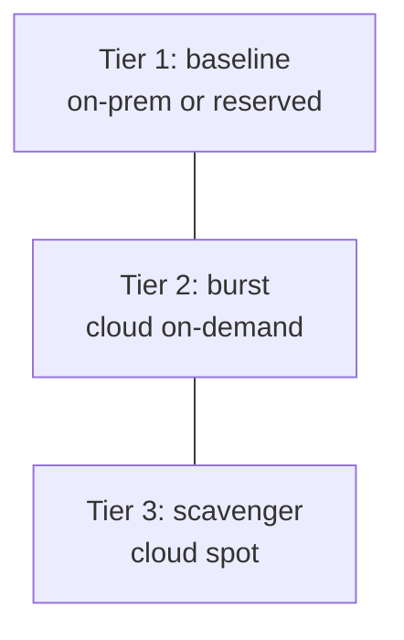

# 9.13 Sizing and capacity-planning exercises

| | |
|---|---|
| **Status** | Drafted (`capacity_planning_lab.py`: 25 checks pass; sizing and TCO exercises verified in Python) |
| **Level** | Advanced |
| **Priority tier** | 1b |
| **Lab venue** | none (design / reading) + self-checking Python model (`code/part09/capacity_planning_lab.py`) |
| **Part** | Part 9: NVIDIA systems and reference architectures |
| **Sources used** | `volume-08/01-architecture-design-masterclass.md`; `volume-08/02-capacity-tco-masterclass.md`; `nvidia-devops` V19 (Ch. 3, Ch. 6); `nvidia-devops` V21 (Ch. 11, Ch. 12, Lab 04); *AI Systems Performance Engineering* Ch. 2 |


## Why this matters for AI infrastructure

An SRE gets this question in a planning meeting: will the GPU fleet run out of power before it runs out of budget, and when? A data science lead adds a second question. Kubernetes shows 98 percent of the GPUs allocated, so can we have five million dollars for sixteen more HGX H100 servers? You cannot answer either one by guessing. You answer by measuring what the fleet really does, forecasting demand against the physical limits of the room, and only then pricing hardware.

Three facts make AI capacity planning unforgiving.

1. Lead times are long. Enterprise GPU and liquid-cooled rack orders take three to nine months to arrive. If you wait until the cluster is almost full to order, the business starves for months. If you buy the whole three-year projection on day one, millions of dollars of silicon sit idle.
2. Allocation is not utilization. Kubernetes counts how many GPUs are reserved, not how many are doing math. Clusters routinely report 98 percent allocation while the silicon sits at 12 percent busy. This is the Empty Hotel problem: every room is booked and most are empty.
3. The room has a ceiling. Extrapolating monthly growth blindly for three years asks for over eleven thousand GPUs and runs through a 150 kW power wall in the tenth month.

:::note dcgm-exporter 4.9.0 version note
dcgm-exporter 4.9.0 (2026-11-06) renamed many default metrics and changed some units. For example `DCGM_FI_DEV_GPU_UTIL` (percent) became `DCGM_FI_DEV_GPU_UTIL_RATIO` (0 to 1), and `DCGM_FI_DEV_FB_USED` (MiB) became `DCGM_FI_DEV_FB_USED_BYTES`. The metric names in this chapter are the 4.8.x names. On a 4.9.0 exporter use the [full mapping in 17.4](../part-17-operations/04-dcgm-exporter-and-interpreting-gpu-metrics.md#14-what-dcgm-exporter-490-renamed), and change thresholds together with the unit.
:::

## Prerequisites and outcomes

**Prerequisites:**
- Earlier chapters in this part cover workload VRAM sizing, Scalable Units, BasePODs, and facility power and cooling envelopes.

```text
Chapter prerequisites:
- Chapter 9.1 (Workload VRAM and compute sizing)
- Chapter 9.6 (SuperPOD Scalable Units and fabric rails)
- Chapter 9.10 (BasePOD and departmental deployments)
- Chapter 9.11 (Power delivery, thermal design, and liquid cooling)
```

**Outcomes:** After completing this chapter, you will be able to do four things.
1. Check whether a fleet is really full, using SM activity instead of Kubernetes allocation, and calculate effective capacity and cost per million tokens.
2. Forecast demand with seasonality and lead times, and find the month the forecast hits a facility power ceiling.
3. Work through multi-year refresh and TCO examples across GPU-years, cost per GPU-year, cost per PFLOP-year and generational upgrade return.
4. Design a falsifiable proof of concept that tests the riskiest claim before a purchase.

---

## 1. Is the fleet really full? Allocation versus utilization

Imagine a hotel whose reservation system says almost every room is booked, and a department asks for a new wing. Before you sign, you walk the hallway and open the doors. Nearly nine in ten booked rooms are empty, because guests dropped a suitcase and left.

### 1.1 Why 98 percent allocation can hide 12 percent utilization

Kubernetes GPU clusters do this every day.
1. Kubernetes allocation tracks `nvidia.com/gpu` requests. A pod that requests one GPU locks that GPU exclusively. If the Python process finishes after five minutes, sits idle in a notebook over a weekend, or loops in `CrashLoopBackOff`, Kubernetes still reports the GPU as allocated.
2. Physical utilization is tracked by `DCGM_FI_PROF_SM_ACTIVE`. It is the fraction of streaming multiprocessors actually executing instructions.
3. In one customer scenario, a team asked for five million dollars for sixteen HGX H100 servers because a dashboard showed 98 percent allocation. Thirty days of `DCGM_FI_PROF_SM_ACTIVE` in Prometheus showed 12 percent average utilization, because developers were locking whole GPUs for small staging and notebook tasks.

```text
Rejecting the $5M purchase and reclaiming capacity with MIG:
- Requested purchase: 16 HGX H100 servers (128 GPUs) for $5M at 98% K8s allocation (88% empty rooms)
- Actual 30-day silicon activity (DCGM_FI_PROF_SM_ACTIVE): 12% average utilization
- Root cause: Developers locking whole 80 GB GPUs for 5 GB staging / notebook tasks
- Remediation: Enable MIG 1g.10gb profiles (7 instances/GPU) + Time-Slicing for dev notebooks
- Logical GPU instances across 16 nodes: 16 nodes * 8 GPUs * 7 slices = 896 logical GPU instances
- CapEx saved over next 12 months: $5M ($0 new hardware CapEx required)
```

### 1.2 The FinOps reaper and utilization-based chargeback

Two automated controls stop GPU hoarding.
1. A reaper operator, modeled by `evaluate_finops_zombie_reaper()` in `code/part09/capacity_planning.py`, queries Prometheus for pods that hold a GPU. If `DCGM_FI_PROF_SM_ACTIVE` stays below 5 percent for 4 hours or more, it deletes the pod, returns the GPU to the scheduler, and tells the owner on Slack with a link to their checkpoint directory.
2. Utilization-weighted chargeback shows each team both allocated and utilized GPU hours. Tag `DCGM_FI_PROF_SM_ACTIVE` and `DCGM_FI_DEV_MEM_COPY_UTIL` with the Kubernetes `namespace` label in `dcgm-exporter`, and revoke quota from namespaces that stay below 20 percent SM activity.

### 1.3 Effective capacity

Nominal peak throughput is not delivered work. When you compare a cheaper on-premises cluster with cloud instances, compute effective capacity first.

```text
Effective_Capacity = Nominal_Capacity × Expected_Utilization × Availability_Factor
Cost_per_1M_Tokens = Total_Hourly_Cost / (Effective_Tokens_per_Hour / 1,000,000)

Worked example:
- Nominal_Capacity:     100,000 tokens/sec
- Expected_Utilization: 40% (0.40, limited by storage bottlenecks)
- Availability_Factor:  80% (0.80, reduced by driver/network incidents)
- Effective_Capacity:   100,000 × 0.40 × 0.80 = 32,000 tokens/sec (115.2M tokens/hour)
```

Effective capacity here is under a third of the nominal figure, so the real cost per million tokens is more than triple a naive peak estimate.

Two forecasting traps follow from the same idea.
- Sub-linear scaling: doubling inference traffic from 10 to 20 QPS rarely needs twice the GPUs. Continuous batching packs the extra requests into existing weight reads and lifts utilization from 40 to 55 percent on the same hardware.
- Super-linear scaling: user count stays flat, but product management raises the maximum PDF upload from one page to a hundred. KV-cache memory grows linearly with sequence length, so the fleet runs out of memory with zero new users.

Before you approve any GPU purchase, query `DCGM_FI_PROF_SM_ACTIVE` over thirty days and put sequence length in the forecast next to QPS.

## 2. Forecasting demand, lead times and the 36-month power wall

When traffic grows 15 percent a month and training runs 20 percent a month, a spreadsheet quickly outruns the breakers of the data hall. Orders take three to nine months, so the reorder trigger and the power ceiling have to be planned together.

### 2.1 Seasonal forecast, the 70 percent reorder trigger and the facility wall

The block below combines a seasonal demand model, a lead-time-aware ordering rule, and a facility power check. Read it as the answer to the opening question: in a 150 kW room, the fleet hits the wall at month 9 to 10.

```text
1. Seasonal Month-over-Month Forecasting :
   QPS[t] = QPS_base * (1 + growth_rate)^(t - t0) * (1 + seasonality * sin(2*pi * (t mod 12) / 12))
   GPUs_Needed[t] = QPS[t] / 7.6 QPS_per_GPU   (at ~15.2 QPS per 2-GPU Llama-70B replica)
   Starting from 286 QPS with growth_rate = 10%/mo and seasonality = 0.15:
   - Month +0:  286 QPS          -> 38 GPUs
   - Month +6:  507 QPS (+77%)   -> 67 GPUs
   - Month +11: 755 QPS (+164%)  -> 99 GPUs

2. Upfront vs Incremental vs Hybrid Procurement (400 QPS / 53 GPUs -> 1,000 QPS / 132 GPUs):
   - Option A (Upfront 132 GPUs = $3.96M): Zero stock-out risk, but 40% Year-1 initial utilization (~$2M idle)
   - Option B (Incremental +79 GPUs in 4 tranches: +20, +20, +20, +19 = $2.37M): High stock-out risk under 3-9 mo lead times
   - Recommended Hybrid Strategy: Add +40 GPUs immediately ($1.2M -> 93 GPUs = ~707 QPS capacity), and trigger
     the next purchase order whenever forecasted demand at (Today + Lead_Time) reaches 70% of installed capacity

3. The 36-Month Capacity Planning & 150 kW Facility-Wall Exercise :
   Inputs: Inference = 100 QPS (+15%/mo, 7.6 QPS/GPU); Training = 50 jobs/mo (+20%/mo, 8/30 = 0.2667 GPUs/job)
   Facility ceiling: 150 kW max power / ~1.3 kW per GPU = ~115-117 GPUs physical ceiling
   - Month 0:  13.2 (inf) + 13.3 (train) = 26.5 (~26) GPUs
   - Month 6:  30.4 (inf) + 39.8 (train) = 70.3 (~70) GPUs
   - Month 8:  40.3 (inf) + 57.3 (train) = 97.6 (~98) GPUs
   - Month 9:  46.3 (inf) + 68.8 (train) = 115.1 (~115) GPUs  [Reaches ~115-117 GPU / 150 kW facility wall]
   - Month 10: 53.2 (inf) + 82.6 (train) = 135.8 (~136) GPUs  [Exceeds 150 kW facility ceiling]
   - Month 36: Unconstrained 15%-20% compounding asks for > 11,400 GPUs (15,315 QPS + 35,440 training jobs/mo)
```

Two lessons follow. The calculation is modeled by `forecast_36month_capacity_exercise()` in `code/part09/capacity_planning.py`.
1. The facility wall arrives between month 9 and month 10, because you cannot plug a 118th GPU into a 150 kW room. Before month 9, offload interruptible training onto cloud spot instances, move to denser H200 or B200 GPUs, or book a second data hall a year ahead. A single GB200 NVL72 rack draws about 130 kW (chapter 9.5), so a 150 kW room holds one such rack and little else.
2. Replace the unconstrained exponential tail with a saturating logistic S-curve, modeled by `forecast_saturating_scurve_gpus()` in the same file. The curve is G(t) = K / (1 + ((K - G0) / G0) * exp(-r * t)), where K is the carrying capacity such as the facility limit. Choosing a logistic curve is this chapter's inference, not a vendor method. Real adoption levels off at a market or facility limit.

Order the next tranche when forecast demand at today plus supplier lead time reaches 70 percent of installed capacity, and plot the facility power ceiling as a horizontal line on every forecast chart.

## 3. Using the fleet better before buying: bin-packing, preemption and spot

Even when pods use their GPUs, poor placement and all-on-demand cloud purchasing can waste a third of the budget. Spreading small jobs across nodes leaves no free node for distributed training, and paying retail for interruptible work burns cash.

### 3.1 Bin-packing and P0, P1, P2 preemption

How the scheduler places jobs on eight-GPU nodes decides how many whole nodes stay free. The function `bin_pack_gpu_jobs()` in `code/part09/capacity_planning.py` models this.

```text
Job Bin-Packing Comparison for 5 jobs requesting [8, 4, 4, 8, 4] GPUs (28 GPUs total):
- Unpacked (spread across 5 separate 8-GPU nodes):
  Uses 5 nodes (40 GPUs total) -> 28 / 40 = 70.0% allocation, 0 full 8-GPU nodes left free
- Bin-packed (First-Fit Decreasing: Node A: 8, Node B: 4+4, Node C: 8, Node D: 4):
  Uses 4 nodes (32 GPUs total) -> 28 / 32 = 87.5% allocation, saves 1 full 8-GPU server
```

Pair packing with three priority classes.
- Tier `P0` is production inference at the highest priority and is never preempted.
- Tier `P1` is critical scheduled training and can preempt `P2` jobs.
- Tier `P2` is research and hyperparameter sweeps. It runs at a discount on idle GPUs, is preempted when `P0` or `P1` needs capacity, and resumes from its last checkpoint.

### 3.2 The three-tier purchasing model

To halve a runaway cloud GPU bill in thirty days, match each workload tier to the right contract.



| Tier | Covers | Bought as | Notes |
|---|---|---|---|
| 1. Baseline | 24/7 steady inference and core R&D | On-premises SuperPOD/BasePOD, or 1 to 3 year reserved instances | Saves 40% to 70% versus on-demand |
| 2. Burst | Peak traffic spikes and urgent deadlines | Cloud on-demand instances | Highest cost per hour; used only for elastic peaks |
| 3. Scavenger | Batch training and sweeps | Cloud spot instances (about 65% to 70% discount) | Needs 15-minute async S3 checkpoints and a 2-minute IMDS termination handler |

- Tier 1 Baseline uses On-Premises hardware or Reserved Instances to cover steady minimum inference traffic and core R&D, cutting hourly hardware cost by 40% to 70% compared to On-Demand.

```text
Spot vs On-Demand cloud GPU economics (8xH100 p5.48xlarge):
- On-Demand rate ($60/hr instance = $7.50/GPU/hr): $180/GPU/day -> $54,000/GPU/year (over 300 operating days)
- Spot rate (~65% discount, $21/hr = $2.63/GPU/hr): $63/GPU/day -> $18,936 (~$18.9K)/GPU/year
- Annual savings per GPU on Spot: ~$35.1K / GPU / year
```

How do you survive a two-minute spot eviction without losing days of progress? Poll the cloud metadata service, for example AWS IMDSv2 at `http://169.254.169.254/latest/meta-data/spot/instance-action`, every five seconds from a background thread or the AWS Node Termination Handler. Pair that with 15-minute asynchronous sharded checkpoints. When the notice arrives, set an interruption flag, flush a checkpoint at the end of the current step, and exit cleanly.

## 4. Worked cost and refresh examples

Rough sticker prices give the wrong answer to what it costs to serve a million tokens. A defensible model amortizes staggered purchases across active GPU-years and counts fixed depreciation and staffing when traffic drops below peak.

### 4.1 Example 1: cost per million tokens on a 408-GPU inference fleet

Calculate the daily cost and cost per million tokens for a 408-GPU H100 cluster serving a constant 2,000 QPS with 150-token responses.

```text
Worked example 1: 408-GPU H100 Inference Fleet (2,000 QPS, 150 tokens/response)
1. Daily token output:
   - Responses/day: 2,000 QPS * 86,400 s = 172,800,000 (172.8M) responses/day
   - Tokens/day:    172.8M * 150 tokens  = 25,920,000,000 (25.92B or 25,920M tokens/day; 300,000 tok/s)
2. Daily TCO breakdown:
   - 3-Year Hardware Amortization: (408 GPUs * $30,000) / 1,095 days = $11,178/day (~$11.2K/day)
   - Electricity (231 kW at $0.12/kWh): 231 kW * 24 h * $0.12        = $665.28/day (~$665/day)
   - Operations (15 FTEs at $150,000/yr): (15 * $150,000) / 365 days = $6,164/day (~$6.2K/day)
   - Total Daily Cost: $11,178 + $665 + $6,164 = $18,007/day (~$18.1K/day, or ~$750.50/hour)
3. Cost per Million Tokens:
   - At 100% constant 2,000 QPS load: $18,007 / 25,920M tokens = $0.695 (~$0.70) per 1M tokens
   - At 40% average diurnal load (800 QPS average): rises ~2.5x to ~$1.74 per 1M tokens
```

Cost per million tokens jumps from $0.70 to $1.74 at 40 percent load because amortization and salaries are fixed. They do not shrink when traffic dips overnight, so a 2.5 times drop in utilization raises unit cost 2.5 times.

### 4.2 Example 2: a three-year staged hardware refresh

When a fleet grows each year, count active GPU-years in service, as `calculate_multiyear_fleet_tco()` in `code/part09/capacity_planning.py` does.

```text
Worked example 2: 3-Year Staged Fleet Refresh (464 -> 524 -> 624 GPUs)
- Year 1 Fleet (464 H100 GPUs): 50 inference nodes (400 GPUs) + 8 training nodes (64 GPUs)
  464 GPUs * $30K = $13.9M CAPEX; active for 3 years = 464 * 3 = 1,392 GPU-years
- Year 2 Expansion (+60 H200 GPUs for larger models):
  60 GPUs * $40K = $2.4M CAPEX; active for 2 years (Years 2-3) = 60 * 2 = 120 GPU-years
- Year 3 Expansion (+100 H200 GPUs for new region at volume price):
  100 GPUs * $35K = $3.5M CAPEX; active for 1 year (Year 3) = 100 * 1 = 100 GPU-years
- 3-Year Totals:
  Total CAPEX:      $13.9M + $2.4M + $3.5M = $19.8M
  Total 3-Yr OPEX:  3 * $3.0M/year         = $9.0M
  Total 3-Yr TCO:   $19.8M + $9.0M         = $28.8M
  Active GPU-Years: 1,392 + 120 + 100      = 1,612 GPU-years
  Amortized Cost:   $28.8M / 1,612 GPU-yrs = $17,866 (~$17.9K) per GPU-year
```

Counting active GPU-years avoids dividing three-year cost by the final year's GPU count. It weights each tranche by how long it works in production.

### 4.3 Example 3: a 1,200-GPU factory and a generational upgrade

The same method evaluates a full 1,200-GPU factory and an H100-to-Blackwell refresh.

```text
Worked example 3A: 1,200-GPU H100 AI Factory 3-Year TCO Breakdown
1. CAPEX ($44.0M total):
   - 1,200 GPUs * $30K = $36.0M + $1.5M IB/Ethernet + $2.0M Storage
     + $1.5M Cooling/Power + $2.0M Chassis/Rails + $1.0M Labor = $44.0M
2. 3-Year OPEX ($26.15M, or ~$26.2M total):
   - Electricity (1,200 * 0.7 kW * 60% avg * 1.35 PUE = ~680 kW -> ~$0.72M/yr * 3) = $2.15M
   - Personnel (30 FTE * $150K = $4.5M/yr * 3 = $13.5M) + Maintenance ($2.0M/yr * 3 = $6.0M)
     + WAN/CDN ($1.0M/yr * 3 = $3.0M) + Software ($0.5M/yr * 3 = $1.5M) = $26.15M (~$26.2M)
3. Unit Economics ($70.2M 3-Yr TCO = $23.4M/year across 3,600 GPU-years):
   - Cost per GPU-year:       $70.2M / 3,600  = $19.5K/GPU/year ($10.0K GPU HW + $7.3K OPEX + $2.2K infra)
   - Cost per 1K QPS (~9,100 QPS at 7.6/GPU): $23.4M / 9.1    = ~$2.6M/year per 1,000 QPS
   - Cost per BF16 PFLOP-yr (1,200 * 0.989 = 1,186.8 PFLOPS): $23.4M / 1,186.8 = ~$19.7K per PFLOP-year

Worked example 3B: Generational Upgrade ROI (100 H100s -> 50 Blackwell B200s)
- Compute parity: 50 B200 GPUs (>2x throughput/GPU) replace 100 H100 GPUs for the same workload
- Power reduction: Drops from 70 kW (100 * 700W) down to 50 kW (50 * 1,000W), saving 20 kW continuously
- Infrastructure savings: Halves server chassis, CPU, RAM, and NIC port overhead (1-2 year payback)
```

## 5. Proving a risky claim before you buy: the falsifiable proof of concept

A stakeholder who asks for sixty-four GPUs on Kubernetes in three months is handing you a solution disguised as a requirement. Opening a hardware catalog first leads to shelfware or production outages. Work through six stages: discover the workload and constraints, model the data, control, trust, state, failure and observability paths, compare options, recommend with an architecture decision record, validate risky claims with a proof of concept, and adopt with a rollout plan and runbooks.

Keep five terms distinct in every review.

| Term | Definition | Concrete AI Infrastructure Example |
|---|---|---|
| Requirement | A measurable outcome the system must achieve | P99 TTFT `<= 500 ms` at `200` concurrent users |
| Assumption | An unverified belief that must be tested | Existing 100G NAS can absorb `1 TB` checkpoint bursts |
| Constraint | A hard boundary you cannot negotiate away | Data cannot leave the EU; max rack power in Room B is `150 kW` |
| Trade-off | Intentionally sacrificing one property to gain another | Accepting lower GPU utilization via physical node isolation to guarantee strict multi-tenant security |
| Failure Domain | The set of components that go offline together when one dependency fails | All 8 GPUs on an HGX baseboard share one NVSwitch domain; all nodes on PDU-A share one branch breaker |

A demo proves that software can turn on. A proof of concept, or PoC, is an experiment on one falsifiable hypothesis, built to unblock a purchase. The test: if you cannot state in advance a numeric measurement that would make the PoC fail, it is a demo.

```mermaid
flowchart LR
    H["1. Hypothesis<br/>(Trap: 'Let's try it')"] --> E["2. Test Env<br/>(Trap: Unrepresentative lab)"]
    E --> W["3. Workload Gen<br/>(Trap: Steady synthetic load)"]
    W --> M["4. Metrics & SLOs<br/>(Trap: Averages instead of P95/P99)"]
    M --> B["5. Baseline<br/>(Trap: No current comparison)"]
    B --> X["6. Experiment Matrix<br/>(Trap: 50 shallow features vs 2 deep)"]
    X --> P["7. Pass/Fail Gate<br/>(Trap: Moving goalposts after test)"]
    P --> D["8. Decision Record<br/>(Trap: Hiding residual risks)"]
```



If a customer asks for a two-week PoC of everything at once, refuse the kitchen-sink scope. Isolate the top one or two risks and write separate pass and fail gates.

```text
Example PoC pass/fail gates:
1. Hypothesis A (Operational Risk - Air-Gapped GPU Operator Upgrade):
   - Claim: NVIDIA GPU Operator upgrades drivers across a 20-node pool with zero unplanned downtime inside a 4-hour window.
   - Pass Gate: Total duration <= 4.0 hours; unplanned pod evictions = 0; rollback to prior driver <= 30 minutes (vs 14-hour manual baseline).
2. Hypothesis B (Performance Risk - LLM P95 TTFT under Burst Load):
   - Claim: Model X on Triton / TensorRT-LLM sustains 200 concurrent requests with P95 TTFT < 1.0 second.
   - Pass Gate: P95 TTFT < 1.0 s at 200 sustained concurrent users (vs 40-user / 2.3 s baseline). Never use average latency, which hides KV-cache tail spikes.
```

Test one or two risks deeply, and measure P95 and P99 under bursty load, not averages.


---

## Commands and configurations that matter

### 1. Run the 25-check sizing and Capacity-Planning verification lab

```bash
python3 -B code/part09/capacity_planning_lab.py
```

### 2. Prometheus queries for the reaper and chargeback

```promql
# 1. Identify Zombie GPU Pods: allocated in K8s but maximum SM activity < 5% (0.05) over the past 4 hours
max_over_time(DCGM_FI_PROF_SM_ACTIVE{pod!=""}[4h]) < 0.05

# 2. Compute Namespace-Level Effective SM Utilization Ratio for FinOps Chargeback
avg by (namespace) (DCGM_FI_PROF_SM_ACTIVE{pod!=""})
```

---

## How it fails

| Failure mode | Symptom | Root cause | Diagnosis & fix |
|---|---|---|---|
| **1. Approving `$5M` of new GPUs at `98%` K8s Allocation and `12%` SM Utilization** | Finance buys 16 new HGX servers because `kubectl describe nodes` shows `98%` of `nvidia.com/gpu` allocated; after installation, cluster throughput barely increases. | Confusing **Kubernetes Allocation** with **DCGM Silicon Utilization**. Developers locked whole 80 GB GPUs for idle Jupyter notebooks and 5 GB staging pods. | Query `DCGM_FI_PROF_SM_ACTIVE` over 30 days first. Partition dev/staging GPUs into **`1g.10gb` MIG slices (`7×` instances/GPU)** or Time-Slicing, and deploy the **FinOps Reaper Bot** (`SM_ACTIVE < 5%` for `≥ 4h`). |
| **2. Unfalsifiable "Kitchen-Sink" PoC declaring success before a production outage** | A 2-week PoC tests 20 features superficially, reports *"everything works, average latency is 50 ms,"* and crashes in production when P99 latency hits 5 seconds under burst load. | The PoC had **no pre-agreed numeric FAIL criterion**, used synthetic steady load instead of bursty traffic, and measured **average latency** instead of **P95/P99 tail latency**. | Scope PoCs to **1–2 high-risk hypotheses** with strict pre-stated pass/fail gates (e.g., `P95 TTFT < 1.0 s at 200 concurrent users` or `Air-gapped upgrade ≤ 4h with 0 unplanned evictions`). |
| **3. Context-window expansion (`1 page → 100 pages`) crashing a cluster at `0%` user growth** | Capacity planners forecast `0%` new user growth and buy zero GPUs; product launches 100-page PDF uploads and the inference fleet crashes with `CUDA out of memory`. | **The Fallacy of Linear Forecasting:** KV-cache VRAM scales linearly with **sequence length**, creating a massive memory diseconomy of scale even when user QPS is flat. | Model **average and P99 sequence length (`L_seq`)** as an explicit multiplier in your VRAM capacity forecast alongside QPS. |
| **4. Hitting the `150 kW` (`~117-GPU`) data center power wall at Month 9** | A startup orders GPUs for Month 10–12 demand (`136+ GPUs`), and facilities refuses to energize the racks because the room is capped at `150 kW`. | The capacity plan tracked dollar budget (`$5M–$7M/yr`) and QPS growth (`+15%/mo`), but forgot to divide the facility power ceiling (`150 kW`) by per-GPU node power (`~1.3 kW/GPU = ~115–117 GPUs max`). | Plot **facility power ceiling (`kW`)** as a hard horizontal line on every GPU forecast chart, offload training above the ceiling to **Cloud Spot instances**, and initiate facility/region expansion **12 months before** the curve crosses the line. |
| **5. Losing 3 days of training work on a Cloud Spot instance eviction** | A team moves a 70B training run to 65%-discounted Spot instances to save money, gets evicted on Day 3, and loses 72 hours of compute because no checkpoint was flushed. | Running on Spot instances without **frequent asynchronous S3 checkpoints** and an **IMDSv2 2-minute termination notice handler**. | Save sharded checkpoints every **15 minutes** and run a background thread polling `http://169.254.169.254/latest/meta-data/spot/instance-action` every 5 seconds to trigger a final graceful checkpoint before termination. |

---

## Hands-on lab

This chapter's self-checking Python model in `code/part09/capacity_planning.py` and lab script in `code/part09/capacity_planning_lab.py` implement five verification checks.
- The Effective Capacity and Cost per Million Tokens Calculator verifies the inference fleet economics at full load and diurnal average load.
- The FinOps Zombie Reaper Bot Evaluator and MIG Reclamation Check verify pod eviction thresholds and logical GPU slicing across the staging node pool.
- The First-Fit Decreasing GPU Job Bin-Packer and Spot versus On-Demand Savings Calculator verify node packing and annual cloud savings.
- The Multi-Year Fleet TCO and GPU-Year Amortizer verifies the staged refresh and the large AI factory unit economics.
- The Seasonal and Multi-Year Demand Forecaster detects the facility power wall and compares exponential growth against the saturating logistic S-curve.

Run the lab from the repository root.

```bash
python3 -B code/part09/capacity_planning_lab.py
```

Expected output verified in this repository is shown below.

```text
=== Chapter 9.13 Lab: Sizing and Capacity-Planning Exercises ===
  [PASS] V21 Ch12: 408-GPU fleet (300k tok/s) at $750.5/hr ($18.01K/day) costs $0.695 (~$0.70) per 1M tokens
  [PASS] V21 Ch12: At 40% utilization, cost per 1M tokens rises 2.5x to $1.7373
  [PASS] VL8 Ch2: Effective capacity (100k * 0.40 * 0.80) == 32,000 tok/s (115.2M tok/hr)
  [PASS] Rejects utilization > 1.0
  [PASS] V19 Ch3: Allocated GPU with SM_ACTIVE=1.2% (<5%) for 4.5h (>=4h) is evicted as zombie pod
  ...
  [PASS] V21 Ch12 Part 3: 1,200 H100s = 1,186.8 BF16 PFLOPS; at $23.4M/yr, cost per PFLOP-year == $19.7K
  [PASS] V21 Ch12 Part 3: 1,200 H100s = ~9,120 QPS; at $23.4M/yr, cost per 1K QPS capacity == $2.57M (~$2.6M)/yr
  [PASS] ASP Ch2 chunk 8 ROI case study: Replacing 100 H100s (70 kW) with 50 B200s (50 kW) saves 20 kW continuously
  [PASS] Rejects non-positive year1_gpus in TCO calculator
  [PASS] Rejects negative initial_qps in 36-month forecaster

Summary: 25 passed, 0 failed (total 25)
```

---

## Exercises

Run the exercises below using the parameters summarized in the block.

```text
Exercise parameter table:
- Ex 1: 408-GPU fleet cost per 1M tokens at 60% average load vs 40% load (falls between $0.70 and $1.74)
- Ex 2: First-fit decreasing bin-packing of [8, 8, 4, 2, 2, 4, 8, 1] GPUs onto 8-GPU nodes
- Ex 3: 30-day audit showing 90% Kubernetes allocation vs 18% SM activity (request for 8 more nodes)
- Ex 4: Falsifiable PoC for serving a 70B model at 100 concurrent users
- Ex 5: the 36-month growth rates in a room capped at 120 kW (~1.3 kW/GPU)
- Ex 6: GPU-year amortization for 200 GPUs in Year 1 ($6M), +100 in Year 2 ($3.2M), +100 in Year 3 ($3.0M), $1.4M/yr OPEX
```

- Run `python3 -B code/part09/capacity_planning_lab.py` and redo the inference fleet token cost at sixty percent average load to show how fixed costs place the result between the peak and forty-percent figures.
- Pack the eight job requests from the parameter table onto eight-GPU nodes by hand with first-fit decreasing, and state how many nodes you need and what the allocation percentage is.
- Write a one-page reply to a manager who asks for eight more nodes when allocation is high but thirty-day SM activity is low, including the two queries you ran and two changes you propose first.
- Write a falsifiable PoC for the seventy-billion-parameter serving target in the table, giving the hypothesis, the test, the numeric pass gate, and the numeric fail gate.
- Use the 36-month growth rates and the room power cap in the table to find the first month demand passes the cap, and then describe two ways to avoid the wall.
- Compute the amortized cost per GPU-year for the three-year fleet expansion schedule in the parameter table.

## Checkpoint questions (20)

<details>
<summary>**1. What is the difference between a Constraint and a Trade-off, and what is the Unfalsifiable-PoC Test?**</summary>

- A Constraint is a hard boundary you cannot change, such as a 150 kW room power limit or EU data residency law. A Trade-off is a deliberate architectural choice to sacrifice one property, such as GPU utilization, to gain another, such as strict physical tenant isolation.
- Under the Unfalsifiable-PoC Test, if you cannot specify a numeric measurement in advance that would cause the Proof of Concept to be declared a FAIL, it is a demo rather than a PoC.
</details>

<details>
<summary>**2. Why does a FinOps Reaper Bot query DCGM_FI_PROF_SM_ACTIVE instead of Kubernetes pod status or GPU allocation, and what threshold does it use?**</summary>

To Kubernetes, an idle Jupyter notebook pod that locked `nvidia.com/gpu: 1` three weeks ago is running and fully allocated. Only hardware telemetry from `dcgm-exporter` via `DCGM_FI_PROF_SM_ACTIVE` reveals whether the GPU silicon is actually executing math. If a pod holds a GPU with `DCGM_FI_PROF_SM_ACTIVE` below 5% continuously for 4 hours or more, the FinOps Reaper evicts the pod and notifies the user on Slack.
</details>

<details>
<summary>**3. Give one example of an Economy of Scale and one example of a Diseconomy of Scale in LLM inference forecasting.**</summary>

- Dynamic Batching provides an Economy of Scale. Doubling user QPS from 10 to 20 QPS rarely doubles GPU count because continuous batching groups the additional requests into existing weight reads, raising GPU utilization from 40% to 55%.
- Context Window Expansion creates a Diseconomy of Scale. Expanding input prompts from single-page PDFs to hundred-page PDFs causes KV-cache VRAM to grow linearly with sequence length, triggering OOM crashes and requiring far more GPUs even at zero user growth.
</details>

<details>
<summary>**4. How many 8-GPU nodes are required to schedule five jobs requesting [8, 4, 4, 8, 4] GPUs with bin-packing versus without bin-packing, and what is the resulting node allocation percentage?**</summary>

```text
Bin-packing result for [8, 4, 4, 8, 4] GPUs (28 GPUs total):
- Without bin-packing (1 job/node): 5 nodes (40 GPUs) -> 70.0% allocation
- With bin-packing (Node A: 8, Node B: 4+4, Node C: 8, Node D: 4): 4 nodes (32 GPUs) -> 87.5% allocation
```

Packing the two four-GPU jobs onto the same server saves one full eight-GPU node for distributed training.
</details>

<details>
<summary>**5. Calculate the total active GPU-years and amortized cost per GPU-year for a 3-year deployment that starts with 464 GPUs in Year 1, adds 60 GPUs in Year 2, and adds 100 GPUs in Year 3.**</summary>

```text
3-Year Staged Refresh Amortization:
- Total CAPEX:      $13.9M + $2.4M + $3.5M = $19.8M
- Total 3-Yr OPEX:  3 * $3.0M = $9.0M -> Total 3-Yr TCO = $28.8M
- Active GPU-Years: (464 * 3) + (60 * 2) + (100 * 1) = 1,392 + 120 + 100 = 1,612 GPU-years
- Amortized Cost:   $28.8M / 1,612 = $17,866 (~$17.9K) per GPU-year
```

Weighting each hardware tranche by its years in service gives an amortized cost of $17.9K per GPU-year.
</details>

<details>
<summary>**6. Walk through the daily cost and Cost per Million Tokens of the 408-GPU inference fleet serving 2,000 QPS, and explain what happens at 40% average load.**</summary>

```text
408-GPU Fleet Daily Cost & Token Economics:
- Daily tokens: 2,000 QPS * 86,400 s * 150 tokens = 25,920 million tokens/day
- Daily cost:   $11.2K HW + $665 power + $6.2K ops = ~$18.1K/day
- Cost at 100% load: $18.1K / 25,920M = ~$0.70 per 1M tokens
- Cost at 40% load:  Rises ~2.5x to ~$1.74 per 1M tokens
```

Because hardware amortization and FTE salaries are fixed daily costs, a drop in utilization raises the cost per million tokens proportionally.
</details>

<details>
<summary>**7. In the 36-month capacity-planning exercise, in which month does demand breach the 150 kW facility power ceiling, and how do you solve it?**</summary>

```text
Monthly GPU demand trajectory:
- Month 0: 26 GPUs | Month 6: 70 GPUs | Month 8: 98 GPUs | Month 9: 115 GPUs | Month 10: 136 GPUs
- Facility limit: 150 kW / ~1.3 kW per GPU = ~115-117 GPUs (breached between Month 9 and Month 10)
```

To solve the power wall within a single data hall, cap on-premises purchases at the room limit for latency-critical inference, offload excess batch training onto Cloud Spot instances, and replace unconstrained exponential extrapolation with a saturating S-curve.
</details>

<details>
<summary>**8. What is the Hybrid 70% Reorder Trigger Rule for managing 3-to-9-month GPU hardware procurement lead times?**</summary>

Instead of buying 100% of year-end capacity upfront or buying strictly just-in-time, deploy an initial buffer to cover near-term growth. Then place the next purchase order as soon as forecasted demand at Today plus Supplier Lead Time reaches 70% of installed capacity.
</details>

<details>
<summary>**9. What are the six stages of the architecture method and the six paths to model?**</summary>

The six stages are Discover, Model, Compare, Recommend, Validate, and Adopt. The six paths are data and request, control, trust and identity, persistent state, failure domains, and observability.
</details>

<details>
<summary>**10. What is the difference between a requirement, an assumption, a constraint, a trade-off, and a failure domain?**</summary>

A requirement is a measurable outcome. An assumption is an untested belief. A constraint is a hard limit. A trade-off gives up one property to gain another. A failure domain is the set of parts that fail together.
</details>

<details>
<summary>**11. What makes a PoC falsifiable?**</summary>

You write, before the test, a numeric result that would make the experiment a failure. Otherwise it is a demo.
</details>

<details>
<summary>**12. Why measure P95 or P99 latency in a PoC and not the average?**</summary>

Averages hide tail spikes, such as stalls from KV-cache swapping, that users directly feel. Always test with tail latency under bursty load.
</details>

<details>
<summary>**13. Why refuse a two-week PoC of everything?**</summary>

Running many shallow tests proves very little. Pick one or two top risks and give each its own pass and fail gate.
</details>

<details>
<summary>**14. What is the Empty Hotel problem?**</summary>

Kubernetes shows GPUs as allocated, like hotel rooms booked, even when the physical GPUs do little work. Always measure real SM activity before buying more hardware.
</details>

<details>
<summary>**15. What are the numbers for the FinOps reaper and the chargeback rule?**</summary>

Evict a pod whose SM activity stays under 5% for at least 4 hours. For chargeback, show allocated and utilized GPU-hours and revoke quota from namespaces below 20% SM activity.
</details>

<details>
<summary>**16. What does effective capacity mean and what is the worked example?**</summary>

Effective capacity equals nominal capacity multiplied by expected utilization multiplied by availability. At 100,000 tokens per second nominal capacity with 40% utilization and 80% availability, effective capacity is 32,000 tokens per second.
</details>

<details>
<summary>**17. What is the three-tier capacity model?**</summary>

Use baseline on-premises or reserved capacity for steady load, on-demand cloud capacity for peaks, and spot or preemptible capacity for batch work that can restart from checkpoints.
</details>

<details>
<summary>**18. What must a training job do to survive Spot eviction?**</summary>

Save sharded checkpoints about every 15 minutes, poll the metadata service for the 2-minute eviction notice, and write a final checkpoint when the notice arrives.
</details>

<details>
<summary>**19. Why can lead times make just-in-time buying dangerous?**</summary>

Enterprise GPU orders take 3 to 9 months to arrive. Order when forecast demand at today plus lead time reaches 70% of installed capacity.
</details>

<details>
<summary>**20. What is the point of the saturating S-curve in the 36-month exercise?**</summary>

Unlimited monthly compounding for 36 months asks for over 11,000 GPUs. Real growth levels off at a market or facility limit, so the forecast model needs a carrying-capacity ceiling.
</details>

---

## Sources and review notes

### Sources read in full for this chapter

| Source | Coverage used in this chapter |
|---|---|
| `volume-08/01-architecture-design-masterclass.md` (1,361 words) & `volume-08/02-capacity-tco-masterclass.md` (1,118 words) | Six-stage architecture framework (Discover, Model, Compare, Recommend, Validate, Adopt), 5 essential definitions, 6 modeled paths, Slurm vs K8s trade-off scenario, workload-to-sharing table, `Effective_Capacity = Nominal * Utilization * Availability`, and the Unfalsifiable-PoC Test (Hypothesis A 4h upgrade / 0 evictions / 30m rollback; Hypothesis B P95 TTFT `< 1.0s` at 200 concurrency) |
| `nvidia-devops` Volume 19 Chapter 3 (`chapter-03-capacity-planning-and-forecasting.md`, 1,400 words) & Chapter 6 (`chapter-06-cost-optimization-and-resource-efficiency.md`, 1,089 words) | The Empty Hotel (`98%` K8s Allocation vs `12%` `DCGM_FI_PROF_SM_ACTIVE`, rejecting `$5M` for 16 HGX nodes via `1g.10gb` MIG 7x slicing + Time-Slicing), the Automated FinOps Reaper Bot (`SM_ACTIVE < 5%` for `>= 4 hours`), Economies of Scale (Dynamic Batching) vs Diseconomies of Scale (100-page PDF context-window KV-cache OOM), the 3-tier capacity model (Reserved/On-Prem + On-Demand + Spot), utilization-based namespace chargeback, and the `$500K/mo` AWS startup cost-halving plan |
| `nvidia-devops` Volume 21 Chapter 11 (`chapter-11-capacity-planning-and-forecasting.md`, 1,204 words), Chapter 12 (`chapter-12-cost-optimization-and-resource-efficiency.md`, 1,486 words), & Lab 04 (`labs/lab-04-capacity-planning-exercise.md`, 1,782 words) | Seasonal QPS forecasting (`286 -> 507 -> 755 QPS` / `38 -> 67 -> 99 GPUs`), 3-year hardware refresh (`464 -> 524 -> 624 GPUs`, `$28.8M` TCO / `1,612 GPU-years = $17.9K/GPU-yr`), Upfront (`$3.96M`) vs Incremental (`$2.37M`) vs Hybrid (`70%` minus lead time) procurement, `[8, 4, 4, 8, 4]` bin-packing (`87.5%`), `P0/P1/P2` preemption, `408-GPU` (`2,000 QPS`) `$0.70/1M tokens` math, Spot (`$2.63/hr` vs `$7.50/hr` = `$35.1K/yr` saved) + IMDSv2 2-min termination handler, `1,200-GPU` `$70.2M` 3-year TCO (`$19.5K/GPU-yr`, `$2.6M/yr per 1K QPS`, `$19.7K/PFLOP-yr`), and the 36-month `150 kW` (`~117 GPU` at Month 9-10) Lab 04 exercise |
| Chris Fregly, *AI Systems Performance Engineering* (`ai-systems-performance-engineering`), Chapter 2 (chunk 8) | Generational upgrade ROI case study replacing 100 H100 GPUs (`70 kW`) with 50 Blackwell GPUs (`50 kW`, saving `20 kW` with 1-2 year payback) |

### Run here
- Running `python3 -B code/part09/capacity_planning_lab.py` passes all 25 checks with 0 failures.

### Choices and inferences made in this chapter
1. The logistic carrying-capacity curve in `forecast_saturating_scurve_gpus` in `code/part09/capacity_planning.py` and section 2.1 replaces the unconstrained 36-month exponential tail, as the source lab suggests. The exact formula is this chapter's inference.
2. This revision reframed the chapter as capacity planning for an SRE, opening on the power-wall question. The Solutions Architect framing, the "In one minute" boxes and the numbered Volume and Lab references were removed from the body. All figures are unchanged.
3. The remark that one GB200 NVL72 rack (about 130 kW) nearly fills a 150 kW room uses the rack power figure sourced in chapter 9.5.

### Not verified on live hardware
- Prometheus FinOps Reaper queries (`k8s_gpu_allocated=True`, `896-instance` `1g.10gb` MIG pool, `M10` Month 10 power ceiling, `$0.665`K/day power, `2.50`x cost multiplier at 40% load, `$17.4`K/day, and `25.9`B daily tokens) and AWS IMDSv2 spot-termination polling scripts were not executed against a live cluster in this authoring environment.

