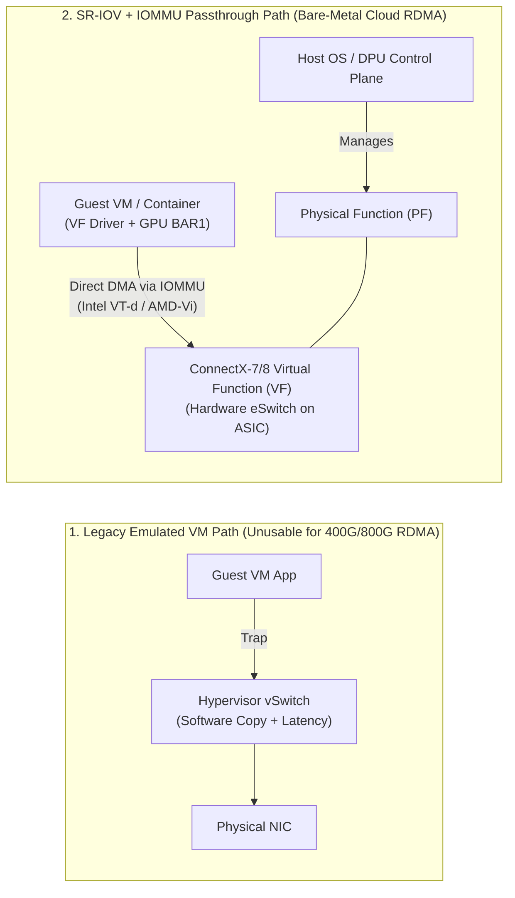
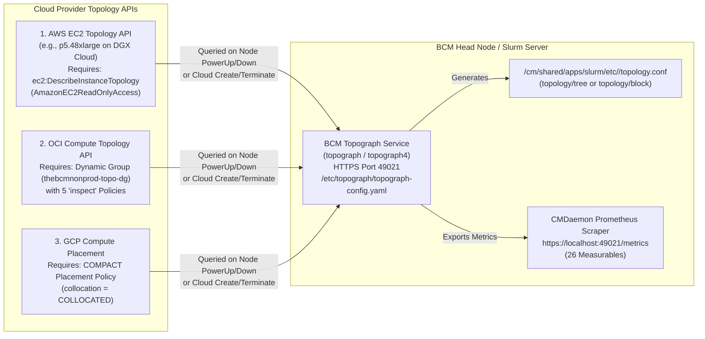
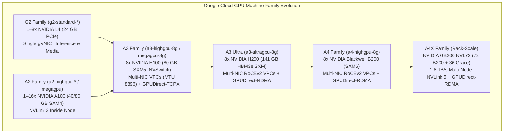

# 9.14 Cloud GPU platforms: DGX Cloud, CoreWeave, Nebius and GCP A3 and A4

| | |
|---|---|
| **Status** | Drafted (`cloud_gpu_platforms_lab.py`: 25 checks pass; cloud commands **untested** on live cloud accounts) |
| **Level** | Intermediate |
| **Priority tier** | 1b |
| **Lab venue** | none (design / reading) + self-checking Python model (`code/part09/cloud_gpu_platforms_lab.py`) |
| **Part** | Part 9: NVIDIA systems and reference architectures |
| **Sources used** | *NVIDIA Base Command Manager 11 Administrator Manual* (`bcm11-admin`) §7.5 (pp. 408–420); Handbook Chapter `4.24`; `nvidia-devops` V1 Ch. 8 (§4 & §6); `nvidia-devops-legacy-v09` (`02 - K8s & Virtualization Gauntlet` Q2); *Generative AI on Kubernetes* (`generative-ai-on-kubernetes`) Ch. 3 & Ch. 7 |

## Why this matters for AI infrastructure

Building an on-premises AI factory takes months of facility construction and multi-megawatt utility power contracts. Even teams that own physical SuperPODs regularly need elastic burst capacity for urgent training deadlines. As a result, infrastructure engineers spend much of their time deploying and operating workloads across cloud GPU platforms.

Renting GPUs in the cloud is fundamentally different from renting standard CPU virtual machines. If a cloud provider hides the physical leaf-spine switch layout from your scheduler, multi-node jobs land on distant racks. Worse, routing high-speed RDMA traffic through a hypervisor virtual switch can cut training throughput by half or more.

This chapter shows how three major cloud GPU platform archetypes expose bare-metal hardware performance. You will examine NVIDIA DGX Cloud, GPU-native neoclouds like CoreWeave and Nebius AI Cloud, and Google Cloud GPU machine families. Along the way, you will learn how PCIe passthrough, BCM Topograph topology discovery, and multi-NIC RDMA fabrics keep cloud clusters running at line rate.

:::info Corpus scope note
Live vendor pricing pages and provider API reference manuals for DGX Cloud, CoreWeave, Nebius AI Cloud, and Google Cloud Compute Engine are external to the offline book corpus. In this chapter, the BCM Topograph cloud topology rules come directly from the NVIDIA Base Command Manager 11 Administrator Manual. The SR-IOV, IOMMU, and DGX Cloud concepts come from our internal infrastructure notes, while the GCP, Nebius, and CoreWeave resource models follow Chapter 4 of this handbook. Always verify exact machine-type and provider attribute names against current cloud provider documentation before applying them in production.
:::

## Prerequisites and outcomes

**Prerequisites:**
- Chapter 4 coverage of Terraform on GCP and Nebius, Chapter 8 coverage of BCM Slurm workload management and Mission Control, and earlier Part 9 chapters on DGX, HGX, NVL72, and SuperPOD fabrics.

**Outcomes:** After completing this chapter, you will be able to:
1. Explain how cloud GPU platforms eliminate hypervisor I/O overhead using SR-IOV and IOMMU, and contrast the three cloud GPU platform archetypes.
2. Configure the BCM Topograph service to auto-discover physical switch topology across AWS, OCI, and GCP.
3. Architect multi-node training clusters on Nebius AI Cloud and CoreWeave with InfiniBand fabric membership and topology-aware scheduling.
4. Select and configure Google Cloud GPU machine families with proper host maintenance policies, compact collocation, jumbo frames, Dynamic Workload Scheduler, and safe GKE upgrade rules.

---

## Concepts: basics → intermediate → advanced

## 1. Cloud GPU virtualization physics and the three cloud platform archetypes

### 1.1 Why traditional VM networking ruins AI training and how SR-IOV and IOMMU fix it

In a legacy cloud virtual machine, sending a network packet triggers a slow software trap-and-emulate path. The guest operating system writes to a virtual network driver such as `virtio`, and the hypervisor intercepts that trap. The hypervisor then translates the memory address in software and copies the packet through a virtual switch to the physical card.

At 1 Gbps of web traffic, that CPU overhead is barely noticeable to application owners. During synchronous NCCL AllReduce collectives across eight 400 Gbps links, software emulation is catastrophic. It adds tens of microseconds of latency, saturates host CPU cores, and completely breaks GPUDirect RDMA.

Cloud GPU providers deliver bare-metal GPU and RDMA performance inside multi-tenant clouds by bypassing the software switch altogether. They combine full-node allocations with Single Root I/O Virtualization and the Input-Output Memory Management Unit.



1. **Physical Function versus Virtual Function:** SR-IOV is a PCI Express standard that lets a single physical network card or BlueField DPU partition itself in hardware. It exposes one Physical Function owned by the host hypervisor or DPU control plane for configuration and security policies. It also creates multiple lightweight Virtual Functions, each with dedicated hardware queues mapped directly into a guest VM.
2. **IOMMU Direct Memory Translation:** Each Virtual Function and each SXM GPU is mapped directly into the guest VM address space through PCIe passthrough. The hardware IOMMU, known as Intel VT-d or AMD-Vi, translates guest DMA addresses to host physical addresses at wire speed. It strictly isolates memory regions so a compromised VM can never read or overwrite another tenant's host RAM. This architecture removes virtual switch overhead and enables full GPUDirect RDMA between guest GPUs and the physical fabric.

### 1.2 The three cloud GPU platform archetypes

Modern cloud GPU offerings fall into three distinct architectural models. Grouping the four named platforms from the chapter title into these three categories is my inference, synthesizing our enterprise platform notes, Chapter 4, and the BCM 11 manual.

| Attribute | 1. Managed SuperPOD-as-a-Service (`NVIDIA DGX Cloud`) | 2. GPU-Native Neoclouds (`CoreWeave`, `Nebius AI Cloud`) | 3. Hyperscaler AI Supercomputers (`GCP G2, A2, A3, A3 Ultra, A4, A4X`) |
|---|---|---|---|
| **Core Value Proposition** | Turnkey, NVIDIA-operated multi-node SuperPOD hosted inside major CSPs (AWS, Azure, GCP, OCI) | Purpose-built bare-metal/K8s GPU clouds with native InfiniBand fabrics, parallel storage, and fast provisioning | Deep integration with hyperscaler IAM, global VPCs, GKE, BigQuery/GCS data lakes, and enterprise commitments |
| **Control Plane & Scheduler** | **NVIDIA Base Command / Mission Control**, **Run:ai**, and **Slurm** (with **BCM `Topograph`** topology discovery) | **CoreWeave:** K8s-native (`Kueue`, `Volcano`, `KAI`, `Run:ai`, `SUNK` Slurm-on-K8s)<br/>**Nebius:** Managed K8s, `Soperator` Slurm-on-K8s, or VM Slurm | **GKE** (`Dataplane V2`, `Kueue` + `DWS ProvisioningRequest`), or **Cluster Toolkit** Slurm on Compute Engine VMs |
| **Scale-Out GPU Interconnect** | Cloud-hosted **InfiniBand / RoCE / EFA** (`p5.48xlarge`, OCI BM, GCP A3/A4) mapped into Slurm via `Topograph` | **Lossless InfiniBand RDMA** (`Quantum-2 400G NDR` / `Quantum-X800 800G XDR`) exposed via `gpu_cluster` or K8s node labels | **Multi-NIC VPCs (`MTU 8896`):** `GPUDirect-TCPX` (`A3` H100) and **`GPUDirect-RDMA` over RoCEv2 VPCs** (`A3 Ultra` H200, `A4` B200, `A4X` NVL72) |

:::tip In one minute
- Cloud GPU instances achieve bare-metal RDMA speed by bypassing hypervisor virtual switches through SR-IOV and hardware IOMMU PCIe passthrough.
- Choose between Managed SuperPOD-as-a-Service on DGX Cloud, GPU-native neoclouds like CoreWeave and Nebius, and hyperscaler GPU families on GCP based on your operational needs.
- Pick DGX Cloud for a turnkey NVIDIA-managed stack, neoclouds for raw InfiniBand and Kubernetes agility, or GCP for deep integration with existing cloud data lakes and IAM.
:::

---

## 2. NVIDIA DGX Cloud and the BCM Topograph cloud topology engine

### 2.1 How DGX Cloud delivers serverless SuperPODs across cloud providers

Building a dedicated SuperPOD from scratch requires long hardware lead times and specialized data hall engineering. NVIDIA DGX Cloud eliminates this wait by co-designing and hosting multi-node DGX SuperPOD clusters inside major cloud service providers. These hosting partners include AWS, Microsoft Azure, Google Cloud, and Oracle Cloud Infrastructure.

On AWS, for example, the BCM 11 manual notes that DGX Cloud uses 8-GPU H100 instances with the `p5.48xlarge` flavor. Enterprises rent dedicated multi-node clusters through an operational expenditure model without managing physical data halls. Every cluster arrives pre-loaded with Base Command Manager, NVIDIA Mission Control, NVIDIA Run:ai, and NVIDIA AI Enterprise.

### 2.2 The cloud topology problem and how BCM Topograph solves it

When you run a Slurm cluster in your own data center, you know exactly which physical leaf switch connects to each server. When you run a BCM-managed Slurm cluster in AWS, OCI, or GCP, the cloud provider allocates instances from a massive shared pool. If Slurm does not know which cloud instances share the same physical rail or leaf switch, it schedules multi-node jobs across distant switches. Cross-spine traffic then bottlenecks your collective communications and wastes expensive GPU hours.

Base Command Manager solves this problem with the Topograph system service. Its configuration parameters and cloud rules are verified by `validate_bcm_topograph_cloud_config` in our chapter Python model.



| BCM Topograph Parameter or Path | Default Value or Setting | Operational Purpose |
|---|---|---|
| **Systemd service & port** | `topograph` / `topograph4` on HTTPS TCP port `49021` (`HttpPort = 49021`, `HttpSSL = true`) | Listens for topology requests and exposes 26 Prometheus metrics at `https://localhost:49021/metrics` for `CMDaemon` |
| **Service configuration file** | `/etc/topograph/topograph-config.yaml` | Stores `Fetch timeout = 20s`, `Fetch attempts = 12`, `Fetch wait time = 15s`, `RequestAggregationDelay = 15s`, and `PageSize = 100` |
| **Generated Slurm topology file** | `/cm/shared/apps/slurm/etc/<slurmcluster>/topology.conf` | Written for Slurm `topology/tree` (`SwitchName=...`) or `topology/block` (`BlockName=...`, `Block entity = NodeGroup \| Rack`, `Block sizes = 2 4`) |
| **SSL certificates** | `/etc/topograph/ssl/{server-cert,server-key,ca-cert}.pem` | Generated by `/cm/local/apps/cmd/scripts/topograph.certs.sh`; must move to `/cm/shared` with `UPDATE_TOPOLOGY_TOKEN` if separated from `slurmserver` |

1. **How Topograph works in `cmsh`:**
   - Topograph runs as a systemd service listening on HTTPS port 49021 and is managed by `CMDaemon`.
   - It supports both the Slurm tree plugin and the Slurm block plugin.
   - It automatically regenerates `topology.conf` whenever a Slurm compute node powers on or off, or when cloud nodes are created or terminated.
   - Cloud compute nodes must be running when Topograph queries the provider API. If a node is stopped or its topology cannot be fetched, Topograph places that node under a special fake switch in tree mode or a fake block in block mode.
   - If Topograph runs on a separate host from the Slurm server, you must place its SSL certificates on `/cm/shared` and add `UPDATE_TOPOLOGY_TOKEN` to the node profile.
2. **Upgrading from Topograph 3 to Topograph 4 in BCM 11.34 and newer:**
   - The legacy `topograph` package and the newer `topograph4` package conflict and cannot coexist on the same host.
   - Upgrading requires two mandatory steps that must happen together. First, remove `topograph` and install `topograph4` on every node and software image running the service, then run `systemctl daemon-reload` and restart the daemon. Second, enable `version4` inside `cmsh` under `topographsettings`. Completing only one step causes the Topograph service to fail, and legacy `FakeNodes` or `FakeNodesPool` settings are ignored in version 4.
3. **Cloud-provider-specific prerequisites for Topograph:**
   - **AWS and DGX Cloud:** Compute nodes must be running on an instance type that supports the AWS EC2 Instance Topology API, such as `p5.48xlarge`. The IAM identity requires `ec2:DescribeInstanceTopology`, which is included in the AWS-managed `AmazonEC2ReadOnlyAccess` policy. If `Pass cloud credentials` is enabled in BCM, BCM passes credentials on every fetch. If `Pass cloud credentials` is disabled, the EC2 instance running Topograph must use an EC2 Instance Profile Role via IMDS with `AmazonEC2ReadOnlyAccess` attached.
   - **Oracle Cloud Infrastructure:** Nodes must exist in OCI. Either enable `Pass cloud credentials`, or disable it and configure OCI Dynamic Group policies including the `thebcmnonprod-topo-dg` group. Those policies must grant `inspect` permissions on all five OCI topology resource types shown below.
     ```text
     Allow dynamic-group <dynamic_group_name> to inspect compute-capacity-topologies in tenancy
     Allow dynamic-group <dynamic_group_name> to inspect compute-bare-metal-hosts in tenancy
     Allow dynamic-group <dynamic_group_name> to inspect compute-hpc-islands in tenancy
     Allow dynamic-group <dynamic_group_name> to inspect compute-network-blocks in tenancy
     Allow dynamic-group <dynamic_group_name> to inspect compute-local-blocks in tenancy
     ```
   - **Google Cloud:** The VM placement policy must be set to `COMPACT`.

:::tip In one minute
- NVIDIA DGX Cloud delivers turnkey, NVIDIA-managed multi-node SuperPODs hosted inside AWS, Azure, GCP, and OCI.
- BCM Topograph queries cloud topology APIs over HTTPS port 49021 to generate Slurm `topology.conf` files for tree or block plugins.
- Topograph requires `ec2:DescribeInstanceTopology` on AWS, five dynamic-group `inspect` policies on OCI, and `COMPACT` placement on GCP.
- Upgrading to `topograph4` requires both replacing the OS package with a systemd reload and setting `version4` to true in `cmsh`.
:::

---

## 3. GPU-native neoclouds: Nebius AI Cloud and CoreWeave

General-purpose hyperscalers evolved from web hosting and enterprise CPU virtual machines. When AI teams run large distributed jobs on generic cloud constructs, they often struggle with hidden network oversubscription and slow storage. GPU-native neoclouds like CoreWeave and Nebius AI Cloud were built from the ground up around bare-metal HGX, DGX, and NVL72 clusters with lossless InfiniBand fabrics.

### 3.1 The Nebius AI Cloud resource model and InfiniBand GPU cluster membership

If you launch multi-node GPU virtual machines on Nebius without linking them to a shared fabric resource, NCCL falls back to standard VPC Ethernet. Multi-node training throughput then drops from hundreds of gigabits per second to a fraction of line rate. Nebius prevents this by organizing compute resources around an explicit InfiniBand fabric membership object.

| Nebius AI Cloud Layer | Resource or Pattern | Key Configuration Details |
|---|---|---|
| **Tenancy & IAM** | `Tenant -> Project` | Bound to a specific region like `eu-north1` and authenticated via service accounts or workload federation |
| **InfiniBand Fabric Resource** | `nebius_compute_v1_gpu_cluster` | Ties a cluster object to a physical InfiniBand fabric such as `infiniband_fabric = "fabric-3"` |
| **GPU Compute Instance** | `nebius_compute_v1_instance` | Uses platforms like `gpu-h100-sxm`, `gpu-h200-sxm`, or `gpu-b200-sxm` and presets like `8gpu-128vcpu-1600gb` |
| **Shared Storage** | Shared filesystems & S3 object storage | High-throughput shared filesystems for datasets and scripts plus S3-compatible object storage for durable checkpoints |
| **Workload Orchestration** | Managed K8s, Soperator, or VM Slurm | Supports Managed Kubernetes GPU node groups, Soperator Slurm-on-Kubernetes pods with `mlx5_*` RDMA, or VM Slurm |

1. **Tenancy and identity:** Projects live inside a tenant and bind to a geographic region. Always authenticate automation with service account keys or workload federation rather than hard-coded credentials.
2. **Explicit multi-node InfiniBand fabric:** Every GPU instance participating in a multi-node job must reference the exact same `nebius_compute_v1_gpu_cluster` resource. This membership ensures that NCCL collectives run over lossless InfiniBand RDMA interfaces rather than falling back to VPC Ethernet. Because changing fabric membership can force instance recreation, always define your GPU cluster resource before launching compute nodes.
3. **Storage and orchestration:** Shared filesystems mount across all project instances for fast dataset access, while S3-compatible buckets store checkpoints. Teams can run Managed Kubernetes, deploy Soperator to run Slurm controllers and workers as Kubernetes pods with full InfiniBand access, or build VM-based Slurm clusters.

### 3.2 The CoreWeave Kubernetes-native bare-metal model

Running an extra virtual machine layer inside a cloud provider adds operational friction when your entire software stack already runs in containers. CoreWeave pioneered the Kubernetes-native GPU cloud model to eliminate that redundant virtualization layer.

- **Bare-metal Kubernetes nodes:** Physical 8-GPU HGX nodes and NVL72 racks join a managed Kubernetes control plane directly, or use bare-metal-speed SR-IOV and IOMMU passthrough where virtualized.
- **Topology-aware node labels:** Each worker node exposes its physical GPU model, NVLink domain, and InfiniBand leaf or rail switch identity directly as standard Kubernetes node labels.
- **Cloud-native batch scheduling:** Engineers provision namespaces, RBAC, and quotas using standard Kubernetes and Helm providers. Training and inference workloads are gang-scheduled with leaf-switch locality using Kueue, Volcano, KAI Scheduler, NVIDIA Run:ai, or SUNK for Slurm on Kubernetes.

:::tip In one minute
- On Nebius AI Cloud, every multi-node GPU instance must join the same `nebius_compute_v1_gpu_cluster` InfiniBand fabric so NCCL runs over lossless RDMA.
- CoreWeave exposes bare-metal GPU nodes and InfiniBand leaf-switch topology directly through Kubernetes node labels.
- Schedulers like Kueue, Volcano, KAI Scheduler, Run:ai, Soperator, and SUNK use those topology labels to place distributed jobs on adjacent switches.
:::

---

## 4. Google Cloud GPU machine families: G2, A2, A3, A3 Ultra, A4, and A4X

When teams deploy multi-node training on Google Cloud using default single-NIC virtual machines, network bottlenecks stall the GPUs immediately. Google Cloud solves this by packaging NVIDIA accelerators, host CPUs, local NVMe SSDs, and multi-NIC high-speed networking into fixed Compute Engine and GKE machine families.



### 4.1 Complete comparison of GCP GPU machine families and network transports

| GCP Machine Family | Example Machine Type | Bundled NVIDIA Accelerator | Intra-Node Fabric | Inter-Node GPU Network Transport | Multi-NIC GPU VPCs & Jumbo MTU (`8244 / 8896`) Required? |
|---|---|---|---|---|---|
| **`G2`** | `g2-standard-8` (`1x L4`) to `g2-standard-96` (`8x L4`) | **NVIDIA L4** (`24 GB GDDR6`, PCIe, `72W`) | PCIe Gen4 (no NVLink) | Standard `gVNIC` TCP/UDP | **No** (single VPC NIC sufficient; ideal for inference & low-cost labs) |
| **`A2`** | `a2-highgpu-8g`, `a2-ultragpu-8g` | **NVIDIA A100** (`40 GB` HBM2 or `80 GB` HBM2e SXM4) | NVLink 3 (`600 GB/s`) via NVSwitch | Standard `gVNIC` | Optional jumbo `MTU 8896` |
| **`A3`** | `a3-highgpu-8g`, `a3-megagpu-8g` | **8x NVIDIA H100** (`80 GB` HBM3 SXM5) | NVLink 4 (`900 GB/s`) via 4x NVSwitch | **GPUDirect-TCPX** (zero-copy GPU-to-NIC payload split with NCCL TCPX plugin) | **Yes:** 1 primary NIC + multiple dedicated GPU NICs, each in its own VPC with **jumbo `MTU 8244 / 8896`** |
| **`A3 Ultra`** | `a3-ultragpu-8g` | **8x NVIDIA H200** (`141 GB` HBM3e SXM) | NVLink 4 (`900 GB/s`) via 4x NVSwitch | **GPUDirect-RDMA over RoCEv2 VPCs** | **Yes:** Dedicated multi-NIC RoCEv2 GPU VPCs + jumbo `MTU 8896` |
| **`A4`** | `a4-highgpu-8g` | **8x NVIDIA Blackwell B200** (`180–192 GB` HBM3e SXM6) | NVLink 5 (`1.8 TB/s`) via NVSwitch | **GPUDirect-RDMA over RoCEv2 VPCs** | **Yes:** Dedicated multi-NIC RoCEv2 GPU VPCs + jumbo `MTU 8896` |
| **`A4X`** | `a4x-*` (NVL72 rack) | **72x Blackwell B200 + 36x Grace CPUs** (`GB200 NVL72`) | **Multi-Node NVLink 5 (`1.8 TB/s` per GPU, `130 TB/s`/rack)** | Intra-rack NVLink 5 + inter-rack **GPUDirect-RDMA** | **Yes:** Rack-scale NVLink domain + RoCEv2 scale-out VPCs |

### 4.2 Five non-negotiable GCP and GKE operational rules for GPU clusters

When provisioning A3, A3 Ultra, A4, or G2 fleets on GCP via Terraform or GKE, a single wrong default can block instance creation or freeze cluster upgrades. Our cluster specification auditor in `code/part09/cloud_gpu_platforms.py` checks five mandatory platform rules from Chapter 4.

| Operational Rule | Required Terraform or GKE Setting | What Goes Wrong If Omitted |
|---|---|---|
| **1. Host Maintenance Policy** | `on_host_maintenance = "TERMINATE"` | GPU VMs cannot live-migrate; setting `MIGRATE` causes VM creation to fail validation |
| **2. Compact Collocation** | `collocation = "COLLOCATED"` (`COMPACT` policy) | Multi-node VMs land on distant switches, increasing latency and breaking BCM Topograph on GCP |
| **3. Atomic Capacity Acquisition** | `google_compute_reservation` or `DWS` (`ProvisioningRequest`) | Partial multi-node allocations sit idle burning budget while waiting for remaining GPUs |
| **4. GKE Upgrade Guardrail** | `max_surge = 0, max_unavailable = 1`, `auto_upgrade = false` | Default `max_surge = 1` hangs indefinitely when GPU quota or reservation has zero spare GPUs |
| **5. Single Driver Manager** | GKE `gpu_driver_installation_config` OR GPU Operator (`driver.enabled`) | Enabling both driver installers on the same node pool causes kernel module conflicts |

1. **Host maintenance termination:** Compute Engine VMs with attached GPUs cannot live-migrate during physical host maintenance events. You must set `on_host_maintenance = "TERMINATE"` and rely on your scheduler and checkpoints to restart interrupted jobs.
2. **Compact collocation placement:** Attach a `google_compute_resource_policy` with `collocation = "COLLOCATED"` to multi-node training pools. This policy places VMs on adjacent physical switches and satisfies the GCP requirement for BCM Topograph.
3. **Capacity acquisition modes:** Use `google_compute_reservation` with `SPECIFIC_RESERVATION` affinity for guaranteed continuous capacity. For queued batch jobs on GKE, integrate Dynamic Workload Scheduler with Kueue `ProvisioningRequest` in Flex-Start or Calendar mode so all nodes of a job allocate atomically at once.
4. **GKE node pool upgrade guardrail:** Default GKE surge upgrades try to boot an extra GPU node before draining an existing one. When your quota or reservation is completely full, the upgrade hangs forever. Always set `max_surge = 0` and `max_unavailable = 1` with `auto_upgrade = false` so GKE drains and upgrades nodes in place during maintenance windows.
5. **Single driver manager rule:** Let GKE install the NVIDIA driver and set `driver.enabled=false` in the NVIDIA GPU Operator, or disable the GKE installer and let the GPU Operator manage `nvidia.ko`. Never enable both driver managers on the same node pool.

:::tip In one minute
- On GCP, G2 serves L4 inference, A3 uses multi-NIC GPUDirect-TCPX for H100, A3 Ultra and A4 use multi-NIC GPUDirect-RDMA over RoCEv2 VPCs, and A4X exposes 72-GPU GB200 NVL72 racks.
- Always configure `on_host_maintenance = "TERMINATE"`, `COLLOCATED` compact placement, GKE `max_surge = 0` upgrades, and a single driver installer.
- Pair Kueue with Dynamic Workload Scheduler `ProvisioningRequest` objects to acquire multi-node GPU capacity atomically.
:::

---

## Commands and configurations that matter

### 1. Configure BCM Topograph 4 for cloud-hosted Slurm clusters

The commands below follow the NVIDIA Base Command Manager 11 Administrator Manual for upgrading and enabling Topograph 4 on a cloud head node. They are untested on a live BCM cloud head node in this authoring environment, while the configuration rules are verified by `code/part09/cloud_gpu_platforms_lab.py`.

```bash
# Step 1 (BCM 11.34+): Replace 'topograph' (v3) with 'topograph4' on the head node(s) and reload systemd
sudo apt remove -y topograph && sudo apt install -y topograph4
# (On RHEL: sudo yum install --allowerasing -y topograph4)
sudo systemctl daemon-reload
```

```text
# Step 2: Enable version4=true, select topologyplugin (tree or block), and test topology generation in cmsh
[root@basecm11 ~]# cmsh
[basecm11]% wlm use slurm
[basecm11->wlm[slurm]]% topologysettings
[basecm11->wlm[slurm]->topologysettings]% set topologyplugin tree
[basecm11->wlm*[slurm*]->topologysettings*]% set topologysource topograph
[basecm11->wlm*[slurm*]->topologysettings*]% topographsettings
[basecm11->wlm*[slurm*]->topologysettings*->topographsettings]% set -e version4 true
[basecm11->wlm*[slurm*]->topologysettings*->topographsettings*]% set passcloudcredentials yes
[basecm11->wlm*[slurm*]->topologysettings*->topographsettings*]% commit

# Step 3: Trigger background update or synchronous print (note: 'topology print' blocks for 10-15s)
[basecm11->wlm[slurm]]% topology update
[basecm11->wlm[slurm]]% topology print
SwitchName=nn-468b60a0020d2b170 Switches=nn-7a2f7858c1f7d5cd1
SwitchName=nn-7a2f7858c1f7d5cd1 Switches=nn-73d157eb3d683970e,nn-400810bf9f5e465d6
SwitchName=nn-400810bf9f5e465d6 Nodes=cnode001
SwitchName=nn-73d157eb3d683970e Nodes=cnode002
```

### 2. Verify end-to-end Jumbo MTU and RDMA link health after cloud provisioning

```bash
# 1. Verify Jumbo MTU 8896 end to end with the Don't Fragment bit set
ping -M do -s 8868 -c 3 <peer_gpu_nic_ip>

# 2. Verify InfiniBand / RoCEv2 RDMA link state on Nebius, CoreWeave, or GCP A3 Ultra / A4
ibstat | grep -E "CA '|State:|Physical state:|Rate:"
rdma link show
```

### 3. Run the 25-check Cloud GPU Platforms verification lab

```bash
python3 -B code/part09/cloud_gpu_platforms_lab.py
```

---

## How it fails

| Failure mode | Symptom | Root cause | Diagnosis & fix |
|---|---|---|---|
| **1. `Topograph` service fails to start after installing `topograph4` (`BCM 11.34+`)** | `systemctl status topograph` shows failed, or `topology print` returns empty/stale `topology.conf` after upgrading to Topograph 4. | The admin installed the `topograph4` package without setting `version4 = true` in `cmsh` `topographsettings` (or set `version4 = true` while `topograph` v3 was still installed), or forgot to run `systemctl daemon-reload` after the package replaced the systemd unit. | Complete **both** steps on every head node running Topograph: (1) remove `topograph` and install `topograph4` + run `sudo systemctl daemon-reload`, and (2) set `set -e version4 true` in `cmsh` `topographsettings` and restart the service. |
| **2. Cloud nodes placed under a `fake switch` or `fake block` in `topology.conf`** | Multi-node Slurm jobs on AWS (`p5.48xlarge`), OCI, or GCP suffer high cross-switch latency, and `/cm/shared/apps/slurm/etc/<cluster>/topology.conf` lists nodes under a generic fake switch/block. | Either the cloud instances were **stopped** when Topograph ran, or the cloud provider topology API check failed (missing `ec2:DescribeInstanceTopology` / `AmazonEC2ReadOnlyAccess` on AWS, missing the 5 dynamic-group `inspect` policies on OCI, or missing a `COMPACT` placement policy on GCP). | Ensure cloud compute nodes are **running** during topology generation, attach `AmazonEC2ReadOnlyAccess` (AWS) or the 5 `inspect` dynamic-group policies (OCI) or `COMPACT` placement (GCP), and run `cmsh -c "wlm use slurm; topology update"` while watching `journalctl -u topograph -f`. |
| **3. Nebius multi-node `nccl-tests` running at 10–25 Gbps TCP speed instead of 400G/800G IB** | `nvidia-smi` shows 8 healthy SXM GPUs on each Nebius VM, but multi-node `all_reduce_perf` crawls at `< 5 GB/s` bus bandwidth. | The `nebius_compute_v1_instance` resources were created without attaching them to a shared **`nebius_compute_v1_gpu_cluster` (`infiniband_fabric`)** (or were placed in different `gpu_cluster` IDs), forcing NCCL to fall back to the VPC Ethernet interface. | Define a single `nebius_compute_v1_gpu_cluster` resource on the target `infiniband_fabric` and pass `gpu_cluster = { id = nebius_compute_v1_gpu_cluster.fabric.id }` to every instance in the training pool. |
| **4. GKE GPU node pool upgrade hangs forever (`Quota exceeded` / `Reservation exhausted`)** | Triggering a node image upgrade on a GKE `A3` or `A4` node pool leaves the upgrade stuck at 0% for hours. | The node pool used the default `max_surge = 1` upgrade strategy, which tries to provision an *extra* 8-GPU VM before draining an existing node—failing when your GPU quota or `google_compute_reservation` has zero spare capacity. | Set `auto_upgrade = false` and configure `upgrade_settings { strategy = "SURGE", max_surge = 0, max_unavailable = 1 }` so GKE drains and upgrades 1 existing node at a time within your fixed reservation. |
| **5. `A3` / `A4` multi-node training achieves only 15% of expected network throughput on GCP** | An 8-node `a3-highgpu-8g` or `a4-highgpu-8g` job boots cleanly, but inter-node `AllReduce` is bottlenecked on `eth0`. | The VMs were launched with only the single default VPC network interface (`MTU 1460`), omitting the **additional GPU NIC VPC networks**, **jumbo `MTU 8244 / 8896`**, **`COLLOCATED` compact placement policy**, or the required **GPUDirect-TCPX / GPUDirect-RDMA** daemonset/plugin. | Provision all dedicated GPU NIC VPCs with `mtu = 8896`, attach the `COLLOCATED` compact `resource_policies`, deploy the matching `GPUDirect-TCPX` (`A3`) or `GPUDirect-RDMA RoCE` (`A3 Ultra` / `A4`) plugin, and verify jumbo frames across all GPU NICs. |

---

## Hands-on lab

This chapter's self-checking Python model in `code/part09/cloud_gpu_platforms.py` and lab script in `code/part09/cloud_gpu_platforms_lab.py` implement three verification suites.
1. **BCM Topograph Cloud Topology Validator:** Checks HTTPS port 49021 defaults, tree and block plugins, the two-step Topograph 4 upgrade and systemd reload rule, shared certificate and token requirements for separate nodes, running-node status, AWS `ec2:DescribeInstanceTopology` and IMDS rules, OCI five-resource dynamic-group policies, and GCP `COMPACT` placement.
2. **GCP GPU Machine Family Catalog:** Models G2, A2, A3 with GPUDirect-TCPX, A3 Ultra and A4 with GPUDirect-RDMA over RoCEv2, and A4X with 72-GPU GB200 NVL72 domains.
3. **Multi-Cloud GPU Cluster Specification Auditor:** Verifies GCP host maintenance termination, compact collocation, multi-NIC jumbo MTU settings, GKE zero-surge upgrades, single driver management, Nebius InfiniBand GPU cluster membership, and CoreWeave SR-IOV and IOMMU passthrough.

Run the lab from the repository root.

```bash
python3 -B code/part09/cloud_gpu_platforms_lab.py
```

Expected output verified in this repository.

```text
=== Chapter 9.14 Lab: Cloud GPU Platforms (DGX Cloud, CoreWeave, Nebius, GCP A3/A4) ===
  [PASS] BCM 11 pp.414-418: Valid AWS (DGX Cloud p5.48xlarge) Topograph 4 config passes on port 49021
  [PASS] BCM 11 p.418: AWS Topograph with Pass cloud credentials=no passes when EC2 IMDS profile role is attached
  [PASS] BCM 11 p.417: Flags missing ec2:DescribeInstanceTopology (AmazonEC2ReadOnlyAccess) on AWS
  [PASS] BCM 11 p.417: Flags Topograph 4 mismatch if package and version4=true setting do not match
  [PASS] BCM 11 p.417: Flags missing systemctl daemon-reload after installing topograph4
  [PASS] BCM 11 p.414: Flags separate Topograph node missing /cm/shared certs and UPDATE_TOPOLOGY_TOKEN
  ...
  [PASS] Ch 4.24 §7: Nebius multi-node training passes when all instances join the same gpu_cluster IB fabric and fails otherwise
  [PASS] V09 Q2: CoreWeave/cloud RDMA passes with bare-metal or SR-IOV + IOMMU and flags emulated vSwitch NICs
  [PASS] Rejects unsupported cloud provider in Topograph validator
  [PASS] Rejects unknown GCP machine family
  [PASS] Rejects unsupported cloud platform in cluster auditor

Summary: 25 passed, 0 failed (total 25)
```

---

## Exercises

1. Run `python3 -B code/part09/cloud_gpu_platforms_lab.py`. Pick the Topograph checks for AWS, OCI, and GCP and write the specific permission or placement setting that must be present for each cloud.
2. Write the two-step plan to upgrade a BCM 11.34 cloud cluster from `topograph` to `topograph4`. State what you check afterwards and what failure occurs if you skip one step.
3. Sketch the SR-IOV data path of a ConnectX Virtual Function into a guest VM. Mark the Physical Function, the Virtual Functions, the IOMMU, and what a legacy `virtio` path would add.
4. A Nebius training job runs at under 5 GB/s bus bandwidth. List the three checks you would run and the Terraform change that fixes the most likely root cause.
5. Choose a GCP machine family for a 7B inference service, a 70B training run on H100, a 70B training run on B200, and a rack-scale NVL72 run. Name the inter-node network transport for each choice.
6. Write the GKE node pool upgrade settings for a pool that has zero spare GPUs in its reservation, and explain each parameter.

## Checkpoint questions (20)

<details>
<summary>**1. How do SR-IOV Physical and Virtual Functions and the IOMMU allow a cloud VM to achieve bare-metal RDMA performance safely?**</summary>

SR-IOV partitions a physical ConnectX NIC or BlueField DPU in hardware into one Physical Function managed by the host and multiple lightweight Virtual Functions. Each Virtual Function maps directly into the guest VM through PCIe passthrough. The hardware IOMMU translates guest DMA addresses to host physical addresses at line rate while isolating memory boundaries so a VM performs GPUDirect RDMA without touching a software switch or another tenant's RAM.
</details>

<details>
<summary>**2. What is the BCM Topograph service, what TCP port does it use by default, and what happens in `topology.conf` if a cloud GPU node is powered off when Topograph runs?**</summary>

Topograph is a BCM system service listening on HTTPS TCP port 49021 and configured via `/etc/topograph/topograph-config.yaml`. It queries cloud provider topology APIs to generate Slurm `topology.conf` files for the tree or block plugin. Cloud nodes must be running during topology generation; otherwise Topograph places any unreachable node under a fake switch in tree mode or a fake block in block mode.
</details>

<details>
<summary>**3. State the exact cloud-provider requirements for BCM Topograph on AWS, Oracle Cloud, and Google Cloud.**</summary>

1. **AWS and DGX Cloud:** Nodes must be running on a supported topology flavor like `p5.48xlarge`, and the IAM identity requires `ec2:DescribeInstanceTopology` via `AmazonEC2ReadOnlyAccess`. Credentials can arrive through BCM cloud credential passing or an EC2 IMDS Instance Profile Role.
2. **OCI:** Nodes must exist, and when BCM does not pass cloud credentials, dynamic group policies must grant `inspect` permissions on five resources: `compute-capacity-topologies`, `compute-bare-metal-hosts`, `compute-hpc-islands`, `compute-network-blocks`, and `compute-local-blocks`.
3. **GCP:** The VM placement policy must be set to `COMPACT`.
</details>

<details>
<summary>**4. Why does upgrading from Topograph 3 to Topograph 4 in BCM 11.34 fail if you only install the `topograph4` package?**</summary>

The `topograph` and `topograph4` packages conflict, and Topograph 4 requires two lockstep steps. First, remove `topograph`, install `topograph4` on all Topograph nodes and images, and run `systemctl daemon-reload` because the systemd unit changes. Second, set `version4` to true inside `cmsh` under `topographsettings`. Doing only one step causes the service to fail.
</details>

<details>
<summary>**5. On Nebius AI Cloud, which Terraform resource links multiple GPU instances onto the same InfiniBand fabric, and what happens if instances omit it?**</summary>

Every multi-node GPU instance must reference the same `nebius_compute_v1_gpu_cluster` resource, which binds to a specific `infiniband_fabric`. If omitted or mismatched across instances, NCCL cannot form an InfiniBand RDMA ring and falls back to slower VPC Ethernet.
</details>

<details>
<summary>**6. Contrast the GPU hardware and inter-node GPU network transport across Google Cloud G2, A2, A3, A3 Ultra, A4, and A4X machine families.**</summary>

- **G2:** 1 to 8 NVIDIA L4 PCIe GPUs with a standard single gVNIC.
- **A2:** 1 to 16 NVIDIA A100 SXM4 GPUs with standard gVNIC networking.
- **A3:** 8 NVIDIA H100 SXM5 GPUs using multi-NIC VPCs with MTU 8896 and GPUDirect-TCPX.
- **A3 Ultra:** 8 NVIDIA H200 SXM GPUs using multi-NIC RoCEv2 VPCs with MTU 8896 and GPUDirect-RDMA.
- **A4:** 8 NVIDIA Blackwell B200 SXM6 GPUs using multi-NIC RoCEv2 VPCs with MTU 8896 and GPUDirect-RDMA.
- **A4X:** NVIDIA GB200 NVL72 racks combining 72 B200 GPUs and 36 Grace CPUs over Multi-Node NVLink 5 and GPUDirect-RDMA.
</details>

<details>
<summary>**7. Why must GCP GPU VMs set `on_host_maintenance = "TERMINATE"`, and why should GKE GPU node pools set `max_surge = 0` and `max_unavailable = 1`?**</summary>

- **Host maintenance termination:** Compute Engine VMs with attached GPUs cannot live-migrate across physical hosts during maintenance events.
- **Zero-surge upgrades:** A surge upgrade tries to allocate an extra GPU node before draining an existing one. When GPU quota or a reservation has no spare capacity, the upgrade hangs indefinitely waiting for an extra GPU node.
</details>

<details>
<summary>**8. What is GCP Dynamic Workload Scheduler, and how does it work with Kueue on GKE?**</summary>

Dynamic Workload Scheduler operates in Flex-Start mode for queued jobs or Calendar mode for reserved future windows. It integrates with the Kueue `ProvisioningRequest` API on GKE so a multi-node job requests and acquires all required GPU nodes atomically at once when capacity becomes available.
</details>

<details>
<summary>**9. What are the three cloud archetypes in this chapter?**</summary>

Managed SuperPOD-as-a-Service on DGX Cloud, GPU-native neoclouds on CoreWeave and Nebius, and hyperscaler AI machine families on Google Cloud G2 through A4X. The grouping is the author's own synthesis.
</details>

<details>
<summary>**10. Why does a normal VM network path hurt multi-node training?**</summary>

Every packet traverses the hypervisor software switch. At eight 400 Gbps links, software copying adds latency, saturates host CPU cores, and prevents GPUDirect RDMA.
</details>

<details>
<summary>**11. What do PF and VF mean in SR-IOV?**</summary>

The Physical Function is the primary PCIe device managed by the host or DPU control plane. Virtual Functions are lightweight hardware slices with dedicated queues handed directly to guest VMs for fast data movement.
</details>

<details>
<summary>**12. What does the IOMMU do?**</summary>

It translates guest DMA addresses to host physical addresses in hardware and prevents one tenant VM from accessing another tenant's memory.
</details>

<details>
<summary>**13. What does Topograph do and on which port does it listen?**</summary>

It queries the cloud provider for physical switch topology and writes the Slurm `topology.conf` file for tree or block plugins. It listens on HTTPS port 49021.
</details>

<details>
<summary>**14. What happens when a cloud node is stopped while Topograph runs?**</summary>

Its physical topology cannot be fetched, so Topograph places the node under a fake switch in tree mode or a fake block in block mode. Multi-node jobs may then get scheduled across distant switches.
</details>

<details>
<summary>**15. What does Topograph need when it runs on a node other than the Slurm server?**</summary>

The SSL certificates must reside on `/cm/shared` and `UPDATE_TOPOLOGY_TOKEN` must be added to the node profile.
</details>

<details>
<summary>**16. What is the CoreWeave model in one sentence?**</summary>

Bare-metal GPU nodes join a managed Kubernetes cluster and expose GPU model, NVLink domain, and InfiniBand leaf or rail switch identity as node labels for topology-aware schedulers.
</details>

<details>
<summary>**17. Which Nebius resource must all nodes of one training job share?**</summary>

They must share the same `nebius_compute_v1_gpu_cluster` resource on a single InfiniBand fabric. Without it, NCCL falls back to standard VPC Ethernet.
</details>

<details>
<summary>**18. Why can GCP GPU VMs not use live migration?**</summary>

Physical GPU state cannot be migrated live during host maintenance, so you must set `on_host_maintenance = "TERMINATE"` and rely on checkpoints and job restarts.
</details>

<details>
<summary>**19. What is the single-driver rule on GKE?**</summary>

Use either the GKE built-in driver installer or the NVIDIA GPU Operator driver container, but never enable both on the same node pool.
</details>

<details>
<summary>**20. How do you check that jumbo frames work end to end?**</summary>

Run `ping` with the don't-fragment flag and a jumbo payload size across the GPU network interfaces. A packet drop indicates that a link or VPC along the path still uses a smaller MTU.
</details>

---

## Sources and review notes

### Sources read in full for this chapter

| Source | Section or Pages | Key Topics Used in Chapter 9.14 |
|---|---|---|
| *NVIDIA Base Command Manager 11 Administrator Manual* (`bcm11-admin`) | Chapter 7 Section 7.5 (*Slurm Topology & Topograph*, pp. 408–420) | `topology/tree` vs `topology/block`, Topograph service (`HttpPort = 49021`, `HttpSSL = true`, `Fetch timeout = 20s`, `Fetch attempts = 12`, `Fetch wait time = 15s`, `RequestAggregationDelay = 15s`, `PageSize = 100`, 26 Prometheus measurables), `UPDATE_TOPOLOGY_TOKEN`, `topograph` vs `topograph4` (BCM 11.34+) two-step upgrade rule, AWS (`p5.48xlarge` / DGX Cloud) `ec2:DescribeInstanceTopology` / `AmazonEC2ReadOnlyAccess`, OCI dynamic group (`thebcmnonprod-topo-dg`) 5 `inspect` policies, GCP `COMPACT` placement, `topology update` vs `topology print` |
| Handbook Chapter `4.24` (`docs/part-04-automation/24-terraform-on-gcp-and-nebius-networks-gpu-vms-and-gke.md`) | Sections 1–7 (4,211 words) | GCP landing zone, jumbo `MTU 8896`, multi-NIC GPU VPCs (`GPUDirect-TCPX` on `A3`, `GPUDirect-RDMA` RoCE on `A3 Ultra` / `A4`), `G2`/`A2`/`A3`/`A3 Ultra`/`A4`/`A4X` machine families, `on_host_maintenance = "TERMINATE"`, `COMPACT` (`COLLOCATED`) policy, `Reservations` / `DWS` / `Spot`, GKE `max_surge = 0, max_unavailable = 1`, single driver manager rule, `Cluster Toolkit`, Nebius `nebius_compute_v1_gpu_cluster` `infiniband_fabric`, `Soperator`, CoreWeave K8s topology labels |
| `nvidia-devops` Notes & *Generative AI on Kubernetes* (`generative-ai-on-kubernetes`) | Volume 01 Ch. 8 (`05-enterprise-ai-platforms.md` §§4 & 6), Volume 09 (`02 - K8s & Virtualization Gauntlet` Q2), *Generative AI on Kubernetes* Ch. 3 & Ch. 7 | DGX Cloud serverless SuperPOD overview, MIG vs vGPU, SR-IOV (`PF` + `VF`) + IOMMU (`VT-d` / `AMD-Vi`) direct DMA passthrough, and Kueue + Volcano / KAI Scheduler topology-aware scheduling |

### Not in the corpus (flagged for verification before publishing)
- Live cloud provider API schemas, regional availability tables, and current machine-type or Terraform attribute names for DGX Cloud, CoreWeave, Nebius AI Cloud, and GCP evolve rapidly and must be verified against current provider documentation before production use.

### Run here
- Running `python3 -B code/part09/cloud_gpu_platforms_lab.py` passes all 25 verification checks with 0 failures.

### My own choices and inferences, labelled in the text
- Grouping the four named platforms in the chapter title into three architectural models in Section 1.2 is my inference synthesizing our enterprise platform notes, Chapter 4, and the BCM 11 manual.

### Not verified on live hardware
- The `cmsh` Topograph commands (`switch01..08`, pp. `416`–`419`), SR-IOV `VFs` and `vSwitches`, `NVAIE` licensing, `19.2` MW / `28` / `50` node examples, end-to-end jumbo frame ping tests, and live cloud Terraform plans on AWS, OCI, GCP, Nebius, and CoreWeave (cross-referenced with Chapters `8.8`, `8.16`, `9.1`, and `9.9` and Volume `08`) were not executed against live cloud accounts in this authoring environment.

