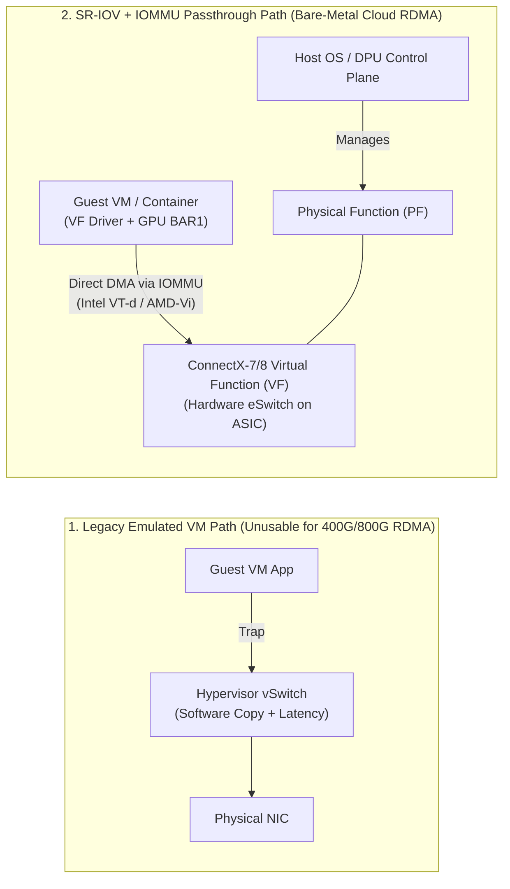
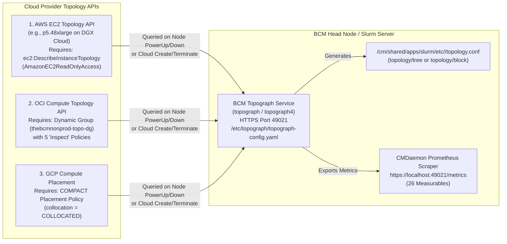

# 9.14 Cloud GPU platforms: DGX Cloud, CoreWeave, Nebius and GCP A3 and A4

| | |
|---|---|
| **Status** | Drafted (`cloud_gpu_platforms_lab.py`: 25 checks pass; cloud commands **untested** on live cloud accounts) |
| **Level** | Intermediate |
| **Priority tier** | 1b |
| **Lab venue** | none (design / reading) + self-checking Python model (`code/part09/cloud_gpu_platforms_lab.py`) |
| **Part** | Part 9: NVIDIA systems and reference architectures |
| **Sources used** | *NVIDIA Base Command Manager 11 Administrator Manual* (`bcm11-admin`) §7.5 (pp. 408–420); Handbook Chapter `4.24`; `nvidia-devops` V1 Ch. 8 (§4 & §6); `nvidia-devops-legacy-v09` (`02 - K8s & Virtualization Gauntlet` Q2); *Generative AI on Kubernetes* (`generative-ai-on-kubernetes`) Ch. 3 & Ch. 7 |

## Why this matters for AI infrastructure

A team owns a SuperPOD, and a training deadline arrives that needs twice the GPUs. Building more capacity takes months of construction and a utility power contract, so the team rents GPUs in the cloud. The first multi-node job runs far slower than it did at home. The scheduler could not see which racks the instances landed on, so the job spread across distant switches. The RDMA traffic also went through a hypervisor virtual switch.

The team did nothing obviously wrong. They rented the same kind of GPU they owned, and the job still ran slower. The cause was not the GPU but the path between the GPUs. At home, every server sits behind a known switch and the wiring is fixed. In a public cloud, the provider hands out instances from a large shared pool, so two instances that look identical can sit on very different parts of the network.

Renting GPUs differs from renting CPU virtual machines for exactly these two reasons: topology and the network path decide the training speed. This chapter looks at three kinds of cloud GPU platform: NVIDIA DGX Cloud, GPU-native neoclouds such as CoreWeave and Nebius AI Cloud, and Google Cloud GPU machine families. A neocloud is a cloud provider built only for GPU work. It also shows how they bring bare-metal speed to a cloud cluster, with PCIe passthrough, BCM Topograph topology discovery and multi-NIC RDMA networks. Provider machine types and attribute names change, so check them against the provider's current documentation before production use.

## Prerequisites and outcomes

**Prerequisites:**
- Chapter 4 coverage of Terraform on GCP and Nebius, Chapter 8 coverage of BCM Slurm workload management and Mission Control, and earlier Part 9 chapters on DGX, HGX, NVL72, and SuperPOD fabrics.

The chapter moves in four steps. It starts with why ordinary cloud networking slows training, and how SR-IOV and IOMMU fix that, and then sorts cloud GPU platforms into three groups. Next it covers DGX Cloud and the BCM Topograph service, which tells Slurm where each instance sits. After that it looks at the Nebius and CoreWeave models, and at the Google Cloud machine families. It ends with the host, placement, capacity, upgrade and driver rules that keep a GKE GPU cluster stable.

---

## 1. Why cloud networking needs SR-IOV, and three kinds of cloud GPU platform

### 1.1 Why ordinary VM networking slows training, and how SR-IOV fixes it

A guest virtual machine on a legacy cloud sends a network packet. The guest writes to a virtual driver such as `virtio`, and the hypervisor traps the write, translates the memory address in software and copies the packet through a virtual switch to the physical card. The hypervisor is the software that runs the virtual machines on a host. Each step is cheap on its own, but the path is repeated for every packet, and the software steps add up.

At 1 Gbps of web traffic nobody notices the CPU cost. Gbps means gigabits per second. A web server sending a modest stream of requests barely registers the software switch. A training step is different. During an NCCL AllReduce over eight 400 Gbps links, the same path adds latency, uses host CPU cores and breaks GPUDirect RDMA. NCCL is the NVIDIA Collective Communications Library that GPUs use to exchange gradients, and AllReduce is the step where every GPU combines its results with every other GPU. GPUDirect RDMA lets a network card read and write GPU memory directly, without copying the data through the host CPU first.

Cloud GPU providers get bare-metal speed inside multi-tenant clouds by bypassing the software switch. Bare metal means a whole physical machine with no hypervisor between your code and the hardware. Multi-tenant means many customers share the same physical facility. They give you whole nodes and combine Single Root I/O Virtualization (SR-IOV) with the Input-Output Memory Management Unit (IOMMU).



SR-IOV is a PCI Express standard that lets one physical network card or BlueField DPU split itself in hardware. A DPU is a data processing unit, a network card with its own processor. SR-IOV exposes one Physical Function, owned by the host or the DPU control plane, for configuration and security policy. It also creates many light Virtual Functions, each with its own hardware queues mapped straight into a guest VM.

Think of the card as a building with one front desk and many private doors. The front desk, the Physical Function, sets the rules. Each private door, a Virtual Function, leads straight to the hardware. A guest that uses its own door never has to walk through a shared lobby run by the hypervisor.

Each Virtual Function and each SXM GPU is mapped into the guest's address space by PCIe passthrough. PCIe passthrough hands a physical device to one guest so the guest talks to it directly. The hardware IOMMU, called Intel VT-d or AMD-Vi, translates guest DMA addresses to host physical addresses at wire speed and isolates memory regions, so a compromised VM cannot read another tenant's RAM. DMA, direct memory access, is how a device moves data into memory without the CPU copying each byte. The IOMMU acts as the gatekeeper for those transfers. This removes the virtual switch overhead and allows full GPUDirect RDMA between guest GPUs and the physical fabric.

### 1.2 The three cloud GPU platform archetypes

Cloud GPU offerings fall into three models. Sorting the platforms in the chapter title into these three groups is this handbook's own summary, not a vendor category. Each group buys speed in a different place: in a managed NVIDIA stack, in a raw InfiniBand network, or in the ecosystem of a large cloud.

The first group is managed SuperPOD-as-a-service, which is NVIDIA DGX Cloud. A SuperPOD is NVIDIA's name for a large, pre-designed multi-node DGX cluster. In this model NVIDIA operates a turnkey SuperPOD hosted inside a major cloud provider (AWS, Azure, Google Cloud or Oracle Cloud Infrastructure). The control plane is Base Command and Mission Control with Run:ai and Slurm, and BCM Topograph discovers the topology. The scale-out network is the cloud provider's InfiniBand, RoCE or EFA fabric, for example on `p5.48xlarge` instances, mapped into Slurm by Topograph. Scale-out means connecting many nodes together, as opposed to scale-up, which means adding GPUs inside one node.

The second group is GPU-native neoclouds, CoreWeave and Nebius AI Cloud. These are bare-metal or Kubernetes GPU clouds built around InfiniBand, parallel storage and fast provisioning. CoreWeave is Kubernetes-native and uses Kueue, Volcano, KAI, Run:ai and SUNK, its Slurm on Kubernetes. Kueue is a Kubernetes add-on that holds jobs in a queue and admits them when quota is free. Volcano is a batch scheduler for Kubernetes. Nebius offers managed Kubernetes, Soperator for Slurm on Kubernetes, or Slurm on virtual machines. The scale-out network is lossless InfiniBand, Quantum-2 400G NDR or Quantum-X800 800G XDR, exposed through a `gpu_cluster` object or Kubernetes node labels. A node label is a tag on a Kubernetes node that the scheduler can read when it places a pod.

The third group is hyperscaler AI machine families, Google Cloud G2, A2, A3, A3 Ultra, A4 and A4X. A hyperscaler is one of the very large public clouds. These machine families integrate with the provider's identity system, global networks, GKE and data lakes. GKE is Google Kubernetes Engine. The control plane is GKE with Dataplane V2, Kueue and the Dynamic Workload Scheduler, or Cluster Toolkit Slurm on Compute Engine. The scale-out network is a set of multi-NIC VPCs with an MTU of 8896. A NIC is a network interface card, and a VPC is a virtual private cloud, a private network inside the provider. MTU is the maximum transmission unit, the largest packet the link carries. The 8896 setting means jumbo frames. GPUDirect-TCPX runs on A3 with H100, and GPUDirect-RDMA over RoCEv2 runs on A3 Ultra, A4 and A4X.

Pick DGX Cloud for a turnkey NVIDIA-managed stack, a neocloud for raw InfiniBand and Kubernetes agility, and Google Cloud for deep integration with existing data lakes and identity. The choice comes down to which part of the stack you want to own yourself and which part you want the provider to run.

> **Update, November 2026:** The Run:ai platform named in this table is now also open source. NVIDIA released it under Apache 2.0 on 13 October 2026, and a supported commercial release still exists. See [11.31](../part-11-gpu-kubernetes/31-nvidias-open-source-ai-factory-kubernetes-stack.md).

---

## 2. NVIDIA DGX Cloud and BCM Topograph

### 2.1 How DGX Cloud delivers a SuperPOD inside a cloud provider

A dedicated SuperPOD needs long hardware lead times and data hall engineering. A data hall is the room built to hold racks, with its own power and cooling. Ordering the hardware and preparing that room can take many months before the first job runs. NVIDIA DGX Cloud skips that wait. NVIDIA designs multi-node DGX clusters and hosts them inside the major providers: AWS, Microsoft Azure, Google Cloud and Oracle Cloud Infrastructure.

On AWS, DGX Cloud uses 8-GPU H100 instances of the `p5.48xlarge` type. Enterprises rent dedicated multi-node clusters as an operating expense, without managing data halls. An operating expense is money spent over time for a service, as opposed to a one-time purchase of equipment. Each cluster arrives with Base Command Manager, NVIDIA Mission Control, NVIDIA Run:ai and NVIDIA AI Enterprise. Base Command Manager, or BCM, is the cluster management software that this part of the handbook covers in detail.

### 2.2 The cloud topology problem and how BCM Topograph solves it

Topology here means which machine sits behind which switch. In your own data center you know which leaf switch connects to each server. A leaf switch is the switch closest to the servers, and the spine switches sit above the leaves. In AWS, OCI or GCP the provider hands out instances from a large shared pool, and a BCM-managed Slurm cluster does not know where they sit. If Slurm cannot tell which instances share a leaf switch, it schedules a multi-node job across distant switches. The traffic crosses the spine, collectives slow down and GPU hours are wasted.

Base Command Manager answers with the Topograph service. Topograph asks the cloud for the placement of each instance and writes that placement in a form Slurm can read. The function `validate_bcm_topograph_cloud_config` in the chapter's Python model checks its configuration parameters and cloud rules.



The diagram shows the flow in three moves. The three cloud APIs on the left are queried by Topograph on the head node, which is the management server. Topograph writes the topology file that Slurm reads, and it also exports metrics that CMDaemon, the BCM management daemon, scrapes for monitoring. Each cloud needs its own permission or placement setting before any of this works, and the table below lists the defaults.

| BCM Topograph Parameter or Path | Default Value or Setting | Operational Purpose |
|---|---|---|
| **Systemd service & port** | `topograph` / `topograph4` on HTTPS TCP port `49021` (`HttpPort = 49021`, `HttpSSL = true`) | Listens for topology requests and exposes 26 Prometheus metrics at `https://localhost:49021/metrics` for `CMDaemon` |
| **Service configuration file** | `/etc/topograph/topograph-config.yaml` | Stores `Fetch timeout = 20s`, `Fetch attempts = 12`, `Fetch wait time = 15s`, `RequestAggregationDelay = 15s`, and `PageSize = 100` |
| **Generated Slurm topology file** | `/cm/shared/apps/slurm/etc/<slurmcluster>/topology.conf` | Written for Slurm `topology/tree` (`SwitchName=...`) or `topology/block` (`BlockName=...`, `Block entity = NodeGroup \| Rack`, `Block sizes = 2 4`) |
| **SSL certificates** | `/etc/topograph/ssl/{server-cert,server-key,ca-cert}.pem` | Generated by `/cm/local/apps/cmd/scripts/topograph.certs.sh`; must move to `/cm/shared` with `UPDATE_TOPOLOGY_TOKEN` if separated from `slurmserver` |

The table is a lookup, so read it row by row when you configure a head node. The service row tells you which port to open and where to check metrics. The configuration file row holds the timing values that control how patient Topograph is with a slow cloud API. The topology file row is the output Slurm uses, and the certificate row matters only when Topograph runs on a separate host.

Topograph works in a few ways that matter for operators. Each one is a rule you will meet during an upgrade or an incident.
1. How Topograph works in `cmsh`: Topograph runs as a systemd service listening on HTTPS port 49021 and is managed by `CMDaemon`. It supports both the Slurm tree plugin and the Slurm block plugin. It automatically regenerates `topology.conf` whenever a Slurm compute node powers on or off, or when cloud nodes are created or terminated. Cloud compute nodes must be running when Topograph queries the provider API. If a node is stopped or its topology cannot be fetched, Topograph places that node under a special fake switch in tree mode or a fake block in block mode. If Topograph runs on a separate host from the Slurm server, you must place its SSL certificates on `/cm/shared` and add `UPDATE_TOPOLOGY_TOKEN` to the node profile.
2. Upgrading from Topograph 3 to Topograph 4 in BCM 11.34 and newer: The legacy `topograph` package and the newer `topograph4` package conflict and cannot coexist on the same host. Upgrading requires two mandatory steps that must happen together. First, remove `topograph` and install `topograph4` on every node and software image running the service, then run `systemctl daemon-reload` and restart the daemon. Second, enable `version4` inside `cmsh` under `topographsettings`. Completing only one step causes the Topograph service to fail, and legacy `FakeNodes` or `FakeNodesPool` settings are ignored in version 4.
3. Cloud-provider-specific prerequisites for Topograph: Each provider asks for something different. On AWS and DGX Cloud, compute nodes must be running on an instance type that supports the AWS EC2 Instance Topology API, such as `p5.48xlarge`. The IAM identity requires `ec2:DescribeInstanceTopology`, which is included in the AWS-managed `AmazonEC2ReadOnlyAccess` policy. If `Pass cloud credentials` is enabled in BCM, BCM passes credentials on every fetch. If `Pass cloud credentials` is disabled, the EC2 instance running Topograph must use an EC2 Instance Profile Role via IMDS with `AmazonEC2ReadOnlyAccess` attached. IMDS is the instance metadata service, the address inside an instance that serves its own identity and role. On Oracle Cloud Infrastructure, nodes must exist in OCI. Either enable `Pass cloud credentials`, or disable it and configure OCI Dynamic Group policies including the `thebcmnonprod-topo-dg` group. Those policies must grant `inspect` permissions on all five OCI topology resource types shown below.
     ```text
     Allow dynamic-group <dynamic_group_name> to inspect compute-capacity-topologies in tenancy
     Allow dynamic-group <dynamic_group_name> to inspect compute-bare-metal-hosts in tenancy
     Allow dynamic-group <dynamic_group_name> to inspect compute-hpc-islands in tenancy
     Allow dynamic-group <dynamic_group_name> to inspect compute-network-blocks in tenancy
     Allow dynamic-group <dynamic_group_name> to inspect compute-local-blocks in tenancy
     ```
   On Google Cloud, the VM placement policy must be set to `COMPACT`.

The upgrade rule in item 2 is the one most often missed. Two steps have to land on the same host at the same time. The package swap changes the systemd unit, so the daemon must reload. The version flag in `cmsh` tells Topograph which generation of the service to run. Doing only one of them leaves the service in a state that fails at start.

---

## 3. GPU-native neoclouds: Nebius AI Cloud and CoreWeave

Hyperscalers grew out of web hosting and enterprise CPU virtual machines. An AI team that runs a large distributed job on those generic building blocks can hit hidden network oversubscription and slow storage. Oversubscription means the network has less total capacity than the sum of what its links could carry at once, so a busy job finds the shared links full. CoreWeave and Nebius AI Cloud were built for GPUs from the start, on bare-metal HGX, DGX and NVL72 clusters with lossless InfiniBand. Lossless means the fabric is built so packets are not dropped under load, which NCCL depends on.

### 3.1 The Nebius AI Cloud resource model and InfiniBand GPU cluster membership

A team launches multi-node GPU virtual machines on Nebius without linking them to a shared fabric resource. NCCL falls back to standard VPC Ethernet, and multi-node throughput drops from hundreds of gigabits per second to a fraction of line rate. Line rate is the full speed of the link. Nebius avoids this with an explicit InfiniBand fabric membership object.

The table below lists the Nebius layers as this chapter uses them. Read it from top to bottom, because each layer depends on the one above it. Tenancy comes first, then the fabric object, then the instances, then storage and the orchestration layer that runs the workload.

| Nebius AI Cloud Layer | Resource or Pattern | Key Configuration Details |
|---|---|---|
| **Tenancy & IAM** | `Tenant -> Project` | Bound to a specific region like `eu-north1` and authenticated via service accounts or workload federation |
| **InfiniBand Fabric Resource** | `nebius_compute_v1_gpu_cluster` | Ties a cluster object to a physical InfiniBand fabric such as `infiniband_fabric = "fabric-3"` |
| **GPU Compute Instance** | `nebius_compute_v1_instance` | Uses platforms like `gpu-h100-sxm`, `gpu-h200-sxm`, or `gpu-b200-sxm` and presets like `8gpu-128vcpu-1600gb` |
| **Shared Storage** | Shared filesystems & S3 object storage | High-throughput shared filesystems for datasets and scripts plus S3-compatible object storage for durable checkpoints |
| **Workload Orchestration** | Managed K8s, Soperator, or VM Slurm | Supports Managed Kubernetes GPU node groups, Soperator Slurm-on-Kubernetes pods with `mlx5_*` RDMA, or VM Slurm |

Projects live inside a tenant and bind to a region. A tenant is the top-level account, and a project is a container for the resources inside it, somewhat like a folder with its own permissions. Authenticate automation with service account keys or workload federation, not hard-coded credentials. A service account is an identity for a program rather than a person, and workload federation lets a running job prove who it is without a stored secret.

Every GPU instance in a multi-node job must reference the same `nebius_compute_v1_gpu_cluster` resource. That membership makes NCCL use the lossless InfiniBand interfaces instead of falling back to VPC Ethernet. A fabric is the physical InfiniBand network, and the membership object tells the cloud which instances are attached to it. Changing fabric membership can force instances to be recreated, so define the GPU cluster resource before you launch compute nodes. Recreating an instance means destroying it and building a new one, so plan the order of the Terraform changes before the first launch.

Shared filesystems mount across the project's instances for datasets, and S3-compatible buckets hold checkpoints. S3-compatible storage speaks the same API as Amazon S3, which many tools already know how to use. You can run Managed Kubernetes, deploy Soperator to run Slurm controllers and workers as Kubernetes pods with full InfiniBand access, or build Slurm on virtual machines.

### 3.2 The CoreWeave Kubernetes-native bare-metal model

A team whose whole software stack already runs in containers gains little from an extra virtual machine layer, and the layer adds operational work. CoreWeave built a Kubernetes-native GPU cloud to remove that layer.

Physical 8-GPU HGX nodes and NVL72 racks join a managed Kubernetes control plane directly, or use SR-IOV and IOMMU passthrough where they are virtualized. The control plane is the part of Kubernetes that makes decisions about the cluster. Each worker node exposes its GPU model, NVLink domain and InfiniBand leaf or rail switch as standard Kubernetes node labels. An NVLink domain is the set of GPUs that share NVLink, the fast link inside a node or rack. Engineers provision namespaces, RBAC and quotas with standard Kubernetes and Helm tooling. A namespace is a separate area of the cluster, RBAC is the role-based access control that decides who may do what, and a quota caps how many resources a namespace may use. Helm is the package manager that installs bundles of Kubernetes objects. Training and inference are gang-scheduled with leaf-switch locality by Kueue, Volcano, KAI Scheduler, NVIDIA Run:ai or SUNK, which is Slurm on Kubernetes. Gang-scheduled means all the pods of one job start together or none start, so a distributed job never sits half-running and holding GPUs.

When you pick a neocloud, ask whether the scheduler can see the leaf switch of every node. A scheduler that cannot see the leaf switch will place a job wherever a GPU is free, and that is the same failure the team in the opening section met. The question is cheap to ask on a sales call and expensive to learn after the first month of bills.

---

## 4. Google Cloud GPU machine families

A team deploys multi-node training on Google Cloud with default single-NIC virtual machines, and the network stalls the GPUs at once. A single-NIC VM has one network interface, so every byte of GPU traffic shares one link, and the GPUs wait on the network. Google Cloud offers fixed Compute Engine and GKE machine families instead. Each bundles NVIDIA accelerators, host CPUs, local NVMe SSDs and multi-NIC high-speed networking. NVMe SSDs are fast local solid-state drives attached directly to the host.


The diagram reads left to right as a timeline. Each family adds a larger GPU, a faster link, or a wider network than the one before it. G2 is the small inference option with one NIC, and the later families add more NICs and move to RDMA. The arrows show the order Google Cloud introduced them, not a rule that every job should move up.

### 4.1 Complete comparison of GCP GPU machine families and network transports

Read the table as a lookup. Each row is one family. The columns say which GPU the family bundles, how the GPUs talk inside a node, which transport carries traffic between nodes, and whether the family needs the extra GPU NICs with jumbo frames.

| GCP Machine Family | Example Machine Type | Bundled NVIDIA Accelerator | Intra-Node Fabric | Inter-Node GPU Network Transport | Multi-NIC GPU VPCs & Jumbo MTU (`8244 / 8896`) Required? |
|---|---|---|---|---|---|
| **`G2`** | `g2-standard-8` (`1x L4`) to `g2-standard-96` (`8x L4`) | **NVIDIA L4** (`24 GB GDDR6`, PCIe, `72W`) | PCIe Gen4 (no NVLink) | Standard `gVNIC` TCP/UDP | **No** (single VPC NIC sufficient; ideal for inference & low-cost labs) |
| **`A2`** | `a2-highgpu-8g`, `a2-ultragpu-8g` | **NVIDIA A100** (`40 GB` HBM2 or `80 GB` HBM2e SXM4) | NVLink 3 (`600 GB/s`) via NVSwitch | Standard `gVNIC` | Optional jumbo `MTU 8896` |
| **`A3`** | `a3-highgpu-8g`, `a3-megagpu-8g` | **8x NVIDIA H100** (`80 GB` HBM3 SXM5) | NVLink 4 (`900 GB/s`) via 4x NVSwitch | **GPUDirect-TCPX** on `a3-highgpu-8g`; `a3-megagpu-8g` uses its offload variant, TCPXO | **Yes:** 1 primary NIC + multiple dedicated GPU NICs, each in its own VPC with **jumbo `MTU 8244 / 8896`** |
| **`A3 Ultra`** | `a3-ultragpu-8g` | **8x NVIDIA H200** (`141 GB` HBM3e SXM) | NVLink 4 (`900 GB/s`) via 4x NVSwitch | **GPUDirect-RDMA over RoCEv2 VPCs** | **Yes:** Dedicated multi-NIC RoCEv2 GPU VPCs + jumbo `MTU 8896` |
| **`A4`** | `a4-highgpu-8g` | **8x NVIDIA Blackwell B200** (`180–192 GB` HBM3e) | NVLink 5 (`1.8 TB/s`) via NVSwitch | **GPUDirect-RDMA over RoCEv2 VPCs** | **Yes:** Dedicated multi-NIC RoCEv2 GPU VPCs + jumbo `MTU 8896` |
| **`A4X`** | `a4x-*` (NVL72 rack) | **72x Blackwell B200 + 36x Grace CPUs** (`GB200 NVL72`) | **Multi-Node NVLink 5 (`1.8 TB/s` per GPU, `130 TB/s`/rack)** | Intra-rack NVLink 5 + inter-rack **GPUDirect-RDMA** | **Yes:** Rack-scale NVLink domain + RoCEv2 scale-out VPCs |

Two columns carry most of the decision. The inter-node transport column says how GPUs on different machines exchange data, and the jumbo column says whether you must build the extra network. The short version is that G2 and A2 can use a standard network, while A3 and later need a dedicated GPU network with large packets. GPUDirect is the family of features that lets the network card and GPU exchange data without the CPU in the middle. TCPX and RDMA are two ways of doing that, and RDMA over RoCEv2 is the one used on the newer families.

### 4.2 Five non-negotiable GCP and GKE operational rules for GPU clusters

Imagine a Friday change window. An upgrade on a GKE GPU node pool starts, and it never finishes. The cluster sits half-upgraded over the weekend, and the on-call engineer has no clear cause. On GCP, one wrong default in Terraform or GKE can block instance creation or freeze a cluster upgrade. The auditor in `code/part09/cloud_gpu_platforms.py` checks five platform rules, taken from Chapter 4, for A3, A3 Ultra, A4 and G2 fleets. Each rule below prevents a specific failure you could otherwise discover only in production.

The first rule is host maintenance. GPU virtual machines cannot live-migrate during host maintenance. Set `on_host_maintenance = "TERMINATE"`, because `MIGRATE` fails validation, and rely on your scheduler and checkpoints to restart interrupted jobs. Live migration means moving a running VM to another physical host without stopping it. With GPUs attached this does not work, so the VM stops and must be restarted, and the job has to resume from its last checkpoint.

The second rule is compact placement. Attach a `google_compute_resource_policy` with `collocation = "COLLOCATED"` to multi-node training pools. It places the VMs on adjacent switches, and BCM Topograph on GCP requires it. Without it, multi-node VMs land on distant switches. The effect is the same one Topograph exists to prevent: the job still runs, but the traffic crosses more switches than it needs to.

The third rule is atomic capacity. Use `google_compute_reservation` with `SPECIFIC_RESERVATION` affinity for guaranteed capacity. For queued batch jobs on GKE, use the Dynamic Workload Scheduler with a Kueue `ProvisioningRequest` in Flex-Start or Calendar mode, so that all nodes of a job are allocated at once. Atomic here means all or nothing. Otherwise partial allocations sit idle and burn budget, because the first few nodes wait for the rest of the job to arrive.

The fourth rule is the upgrade guardrail. Default GKE surge upgrades boot an extra GPU node before draining an old one. Draining means moving the workloads off a node before it is replaced. When your quota or reservation is full, the upgrade hangs forever, because the extra node has nowhere to come from. Set `max_surge = 0`, `max_unavailable = 1` and `auto_upgrade = false`, so that GKE upgrades nodes in place during maintenance windows.

The fifth rule is one driver manager. Either let GKE install the NVIDIA driver and set `driver.enabled=false` in the GPU Operator, or disable the GKE installer and let the GPU Operator manage `nvidia.ko`. The driver is the kernel module that lets the operating system talk to the GPU, and `nvidia.ko` is its file name. Enabling both on one node pool causes kernel module conflicts, because two managers try to load the same module.

---

## Commands and configurations that matter

### 1. Configure BCM Topograph 4 for cloud-hosted Slurm clusters

The commands below follow the NVIDIA Base Command Manager 11 Administrator Manual for upgrading and enabling Topograph 4 on a cloud head node. The configuration rules they depend on are checked by `code/part09/cloud_gpu_platforms_lab.py`.

```bash
# Step 1 (BCM 11.34+): Replace 'topograph' (v3) with 'topograph4' on the head node(s) and reload systemd
sudo apt remove -y topograph && sudo apt install -y topograph4
# (On RHEL: sudo yum install --allowerasing -y topograph4)
sudo systemctl daemon-reload
```

Step 1 swaps the package on each head node, using the APT package manager on Debian-based systems or yum on RHEL-based ones. The reload at the end tells systemd that the unit file changed. Without that reload, systemd keeps using the old definition of the service.

```text
# Step 2: Enable version4=true, select topologyplugin (tree or block), and test topology generation in cmsh
[root@basecm11 ~]# cmsh
[basecm11]% wlm use slurm
[basecm11->wlm[slurm]]% topologysettings
[basecm11->wlm[slurm]->topologysettings]% set topologyplugin tree
[basecm11->wlm*[slurm*]->topologysettings*]% set topologysource topograph
[basecm11->wlm*[slurm*]->topologysettings*]% topographsettings
[basecm11->wlm*[slurm*]->topologysettings*->topographsettings]% set -e version4 true
[basecm11->wlm*[slurm*]->topologysettings*->topographsettings*]% set passcloudcredentials yes
[basecm11->wlm*[slurm*]->topologysettings*->topographsettings*]% commit

# Step 3: Trigger background update or synchronous print (note: 'topology print' blocks for 10-15s)
[basecm11->wlm[slurm]]% topology update
[basecm11->wlm[slurm]]% topology print
SwitchName=nn-468b60a0020d2b170 Switches=nn-7a2f7858c1f7d5cd1
SwitchName=nn-7a2f7858c1f7d5cd1 Switches=nn-73d157eb3d683970e,nn-400810bf9f5e465d6
SwitchName=nn-400810bf9f5e465d6 Nodes=cnode001
SwitchName=nn-73d157eb3d683970e Nodes=cnode002
```

The `cmsh` block is the second half of the upgrade. Step 2 sets the version flag, chooses the tree plugin, and commits the change. Step 3 asks for a fresh topology. Read the output as a tree. Each `SwitchName` line names a switch and lists the switches or nodes beneath it. Here `cnode001` and `cnode002` sit under different leaf switches, which is the placement information Slurm needs. If a node appears under a fake switch instead, return to the cloud prerequisites above.

### 2. Verify end-to-end Jumbo MTU and RDMA link health after cloud provisioning

```bash
# 1. Verify Jumbo MTU 8896 end to end with the Don't Fragment bit set
ping -M do -s 8868 -c 3 <peer_gpu_nic_ip>

# 2. Verify InfiniBand / RoCEv2 RDMA link state on Nebius, CoreWeave, or GCP A3 Ultra / A4
ibstat | grep -E "CA '|State:|Physical state:|Rate:"
rdma link show
```

The first command checks the jumbo path. The `-M do` flag sets the don't-fragment bit, so a packet too large for any hop is dropped instead of being split. The payload size of 8868 bytes plus the 8-byte ICMP header and the 20-byte IP header makes an 8896-byte packet, which matches the MTU. A dropped reply tells you that a link or VPC on the path still uses a smaller MTU. The second command reads the state of the RDMA links on the node, so you can confirm that each port reports an active state before you start a job.

### 3. Run the 25-check Cloud GPU Platforms verification lab

```bash
python3 -B code/part09/cloud_gpu_platforms_lab.py
```

The lab checks the configuration rules in this chapter. It does not contact any cloud account, so it can run on a laptop.

---

## How it fails

Each failure below starts with a symptom an operator would see first. The cause points to the decision behind it, and the fix names the check that would have caught it.

### 1. `Topograph` service fails to start after installing `topograph4` (`BCM 11.34+`)

Symptom: `systemctl status topograph` shows failed, or `topology print` returns empty/stale `topology.conf` after upgrading to Topograph 4.

Cause: The admin installed the `topograph4` package without setting `version4 = true` in `cmsh` `topographsettings` (or set `version4 = true` while `topograph` v3 was still installed), or forgot to run `systemctl daemon-reload` after the package replaced the systemd unit.

Fix: Complete both steps on every head node running Topograph: (1) remove `topograph` and install `topograph4` + run `sudo systemctl daemon-reload`, and (2) set `set -e version4 true` in `cmsh` `topographsettings` and restart the service.

### 2. Cloud nodes placed under a `fake switch` or `fake block` in `topology.conf`

Symptom: Multi-node Slurm jobs on AWS (`p5.48xlarge`), OCI, or GCP suffer high cross-switch latency, and `/cm/shared/apps/slurm/etc/<cluster>/topology.conf` lists nodes under a generic fake switch/block.

Cause: Either the cloud instances were stopped when Topograph ran, or the cloud provider topology API check failed (missing `ec2:DescribeInstanceTopology` / `AmazonEC2ReadOnlyAccess` on AWS, missing the 5 dynamic-group `inspect` policies on OCI, or missing a `COMPACT` placement policy on GCP).

Fix: Ensure cloud compute nodes are running during topology generation, attach `AmazonEC2ReadOnlyAccess` (AWS) or the 5 `inspect` dynamic-group policies (OCI) or `COMPACT` placement (GCP), and run `cmsh -c "wlm use slurm; topology update"` while watching `journalctl -u topograph -f`.

### 3. Nebius multi-node `nccl-tests` running at 10–25 Gbps TCP speed instead of 400G/800G IB

Symptom: `nvidia-smi` shows 8 healthy SXM GPUs on each Nebius VM, but multi-node `all_reduce_perf` crawls at `< 5 GB/s` bus bandwidth.

Cause: The `nebius_compute_v1_instance` resources were created without attaching them to a shared `nebius_compute_v1_gpu_cluster` (`infiniband_fabric`) (or were placed in different `gpu_cluster` IDs), forcing NCCL to fall back to the VPC Ethernet interface.

Fix: Define a single `nebius_compute_v1_gpu_cluster` resource on the target `infiniband_fabric` and pass `gpu_cluster = { id = nebius_compute_v1_gpu_cluster.fabric.id }` to every instance in the training pool.

The symptom here is easy to misread. Every GPU reports healthy, so the failure looks like a software problem. The GPUs are fine. The traffic between them is taking the slow path, and the membership object is the only thing that moves it onto the fast one.

### 4. GKE GPU node pool upgrade hangs forever (`Quota exceeded` / `Reservation exhausted`)

Symptom: Triggering a node image upgrade on a GKE `A3` or `A4` node pool leaves the upgrade stuck at 0% for hours.

Cause: The node pool used the default `max_surge = 1` upgrade strategy, which tries to provision an *extra* 8-GPU VM before draining an existing node—failing when your GPU quota or `google_compute_reservation` has zero spare capacity.

Fix: Set `auto_upgrade = false` and configure `upgrade_settings { strategy = "SURGE", max_surge = 0, max_unavailable = 1 }` so GKE drains and upgrades 1 existing node at a time within your fixed reservation.

### 5. `A3` / `A4` multi-node training achieves only 15% of expected network throughput on GCP

Symptom: An 8-node `a3-highgpu-8g` or `a4-highgpu-8g` job boots cleanly, but inter-node `AllReduce` is bottlenecked on `eth0`.

Cause: The VMs were launched with only the single default VPC network interface (`MTU 1460`), omitting the additional GPU NIC VPC networks, jumbo `MTU 8244 / 8896`, `COLLOCATED` compact placement policy, or the required GPUDirect-TCPX / GPUDirect-RDMA daemonset/plugin.

Fix: Provision all dedicated GPU NIC VPCs with `mtu = 8896`, attach the `COLLOCATED` compact `resource_policies`, deploy the matching `GPUDirect-TCPX` (`A3`) or `GPUDirect-RDMA RoCE` (`A3 Ultra` / `A4`) plugin, and verify jumbo frames across all GPU NICs.

The symptom names `eth0`, which is the default interface. The traffic is flowing through the one link the VM came with, so the extra GPU NICs are carrying nothing. A quick check of which interface carries the AllReduce traffic points straight at the missing network.

---

## Hands-on lab

This chapter's self-checking Python model in `code/part09/cloud_gpu_platforms.py` and lab script in `code/part09/cloud_gpu_platforms_lab.py` implement three verification suites.
1. **BCM Topograph Cloud Topology Validator:** Checks HTTPS port 49021 defaults, tree and block plugins, the two-step Topograph 4 upgrade and systemd reload rule, shared certificate and token requirements for separate nodes, running-node status, AWS `ec2:DescribeInstanceTopology` and IMDS rules, OCI five-resource dynamic-group policies, and GCP `COMPACT` placement.
2. **GCP GPU Machine Family Catalog:** Models G2, A2, A3 with GPUDirect-TCPX, A3 Ultra and A4 with GPUDirect-RDMA over RoCEv2, and A4X with 72-GPU GB200 NVL72 domains.
3. **Multi-Cloud GPU Cluster Specification Auditor:** Verifies GCP host maintenance termination, compact collocation, multi-NIC jumbo MTU settings, GKE zero-surge upgrades, single driver management, Nebius InfiniBand GPU cluster membership, and CoreWeave SR-IOV and IOMMU passthrough.

Each suite checks a rule from the sections above against a model of the cloud, so a failing check points you back to the matching section. The suites are a way to catch a wrong setting before you apply it.

Run the lab from the repository root.

```bash
python3 -B code/part09/cloud_gpu_platforms_lab.py
```

Expected output verified in this repository.

```text
=== Chapter 9.14 Lab: Cloud GPU Platforms (DGX Cloud, CoreWeave, Nebius, GCP A3/A4) ===
  [PASS] BCM 11 pp.414-418: Valid AWS (DGX Cloud p5.48xlarge) Topograph 4 config passes on port 49021
  [PASS] BCM 11 p.418: AWS Topograph with Pass cloud credentials=no passes when EC2 IMDS profile role is attached
  [PASS] BCM 11 p.417: Flags missing ec2:DescribeInstanceTopology (AmazonEC2ReadOnlyAccess) on AWS
  [PASS] BCM 11 p.417: Flags Topograph 4 mismatch if package and version4=true setting do not match
  [PASS] BCM 11 p.417: Flags missing systemctl daemon-reload after installing topograph4
  [PASS] BCM 11 p.414: Flags separate Topograph node missing /cm/shared certs and UPDATE_TOPOLOGY_TOKEN
  ...
  [PASS] Ch 4.24 §7: Nebius multi-node training passes when all instances join the same gpu_cluster IB fabric and fails otherwise
  [PASS] V09 Q2: CoreWeave/cloud RDMA passes with bare-metal or SR-IOV + IOMMU and flags emulated vSwitch NICs
  [PASS] Rejects unsupported cloud provider in Topograph validator
  [PASS] Rejects unknown GCP machine family
  [PASS] Rejects unsupported cloud platform in cluster auditor

Summary: 25 passed, 0 failed (total 25)
```

Each PASS line states one rule and whether the model agrees with it. The lines marked as flags show the model rejecting a bad setting, which is as important as accepting a good one. The rule behind each line is the same rule in the sections above. These steps were not run on a live cloud account, so the lab checks the configuration rules and not the real behavior of any provider.

---

## Exercises

Each exercise uses the cloud rules above, and most of them can be answered from the chapter text.

Exercise 1 asks you to run the lab script and read the Topograph checks. Run `python3 -B code/part09/cloud_gpu_platforms_lab.py`.
For each of AWS, OCI and GCP, which permission or placement setting must be present?

Exercise 2 is a two-step upgrade plan. Write the plan to upgrade a BCM 11.34 cloud cluster from `topograph` to `topograph4`.
What do you check afterwards?
What fails if you skip one step?

Exercise 3 traces a data path. Sketch the SR-IOV data path from a ConnectX Virtual Function into a guest VM.
Mark the Physical Function on your sketch.
Mark the Virtual Functions on your sketch.
Mark the IOMMU on your sketch.
Then mark what a legacy `virtio` path would add.

Exercise 4 is a Nebius slowdown. A Nebius training job runs at under 5 GB/s bus bandwidth.
Which three checks would you run?
Which Terraform change fixes the most likely cause?

Exercise 5 is a machine-family choice. Choose a GCP machine family for each of four jobs.
- A 7B inference service
- A 70B training run on H100
- A 70B training run on B200
- A rack-scale NVL72 run

For each choice, name the inter-node network transport.

Exercise 6 is a GKE upgrade. A GKE node pool has zero spare GPUs in its reservation.
Write its upgrade settings.
Explain each parameter.

## Checkpoint questions (20)

<details>
<summary>**1. How do SR-IOV Physical and Virtual Functions and the IOMMU allow a cloud VM to achieve bare-metal RDMA performance safely?**</summary>

SR-IOV partitions a physical ConnectX NIC or BlueField DPU in hardware into one Physical Function managed by the host and multiple lightweight Virtual Functions. Each Virtual Function maps directly into the guest VM through PCIe passthrough. The hardware IOMMU translates guest DMA addresses to host physical addresses at line rate while isolating memory boundaries so a VM performs GPUDirect RDMA without touching a software switch or another tenant's RAM.
</details>

<details>
<summary>**2. What is the BCM Topograph service, what TCP port does it use by default, and what happens in `topology.conf` if a cloud GPU node is powered off when Topograph runs?**</summary>

Topograph is a BCM system service listening on HTTPS TCP port 49021 and configured via `/etc/topograph/topograph-config.yaml`. It queries cloud provider topology APIs to generate Slurm `topology.conf` files for the tree or block plugin. Cloud nodes must be running during topology generation; otherwise Topograph places any unreachable node under a fake switch in tree mode or a fake block in block mode.
</details>

<details>
<summary>**3. State the exact cloud-provider requirements for BCM Topograph on AWS, Oracle Cloud, and Google Cloud.**</summary>

1. **AWS and DGX Cloud:** Nodes must be running on a supported topology flavor like `p5.48xlarge`, and the IAM identity requires `ec2:DescribeInstanceTopology` via `AmazonEC2ReadOnlyAccess`. Credentials can arrive through BCM cloud credential passing or an EC2 IMDS Instance Profile Role.
2. **OCI:** Nodes must exist, and when BCM does not pass cloud credentials, dynamic group policies must grant `inspect` permissions on five resources: `compute-capacity-topologies`, `compute-bare-metal-hosts`, `compute-hpc-islands`, `compute-network-blocks`, and `compute-local-blocks`.
3. **GCP:** The VM placement policy must be set to `COMPACT`.
</details>

<details>
<summary>**4. Why does upgrading from Topograph 3 to Topograph 4 in BCM 11.34 fail if you only install the `topograph4` package?**</summary>

The `topograph` and `topograph4` packages conflict, and Topograph 4 requires two lockstep steps. First, remove `topograph`, install `topograph4` on all Topograph nodes and images, and run `systemctl daemon-reload` because the systemd unit changes. Second, set `version4` to true inside `cmsh` under `topographsettings`. Doing only one step causes the service to fail.
</details>

<details>
<summary>**5. On Nebius AI Cloud, which Terraform resource links multiple GPU instances onto the same InfiniBand fabric, and what happens if instances omit it?**</summary>

Every multi-node GPU instance must reference the same `nebius_compute_v1_gpu_cluster` resource, which binds to a specific `infiniband_fabric`. If omitted or mismatched across instances, NCCL cannot form an InfiniBand RDMA ring and falls back to slower VPC Ethernet.
</details>

<details>
<summary>**6. Contrast the GPU hardware and inter-node GPU network transport across Google Cloud G2, A2, A3, A3 Ultra, A4, and A4X machine families.**</summary>

- **G2:** 1 to 8 NVIDIA L4 PCIe GPUs with a standard single gVNIC.
- **A2:** 1 to 16 NVIDIA A100 SXM4 GPUs with standard gVNIC networking.
- **A3:** 8 NVIDIA H100 SXM5 GPUs using multi-NIC VPCs with MTU 8896 and GPUDirect-TCPX.
- **A3 Ultra:** 8 NVIDIA H200 SXM GPUs using multi-NIC RoCEv2 VPCs with MTU 8896 and GPUDirect-RDMA.
- **A4:** 8 NVIDIA Blackwell B200 SXM GPUs using multi-NIC RoCEv2 VPCs with MTU 8896 and GPUDirect-RDMA.
- **A4X:** NVIDIA GB200 NVL72 racks combining 72 B200 GPUs and 36 Grace CPUs over Multi-Node NVLink 5 and GPUDirect-RDMA.
</details>

<details>
<summary>**7. Why must GCP GPU VMs set `on_host_maintenance = "TERMINATE"`, and why should GKE GPU node pools set `max_surge = 0` and `max_unavailable = 1`?**</summary>

- **Host maintenance termination:** Compute Engine VMs with attached GPUs cannot live-migrate across physical hosts during maintenance events.
- **Zero-surge upgrades:** A surge upgrade tries to allocate an extra GPU node before draining an existing one. When GPU quota or a reservation has no spare capacity, the upgrade hangs indefinitely waiting for an extra GPU node.
</details>

<details>
<summary>**8. What is GCP Dynamic Workload Scheduler, and how does it work with Kueue on GKE?**</summary>

Dynamic Workload Scheduler operates in Flex-Start mode for queued jobs or Calendar mode for reserved future windows. It integrates with the Kueue `ProvisioningRequest` API on GKE so a multi-node job requests and acquires all required GPU nodes atomically at once when capacity becomes available.
</details>

<details>
<summary>**9. What are the three cloud archetypes in this chapter?**</summary>

Managed SuperPOD-as-a-Service on DGX Cloud, GPU-native neoclouds on CoreWeave and Nebius, and hyperscaler AI machine families on Google Cloud G2 through A4X. The grouping is the author's own synthesis.
</details>

<details>
<summary>**10. Why does a normal VM network path hurt multi-node training?**</summary>

Every packet traverses the hypervisor software switch. At eight 400 Gbps links, software copying adds latency, saturates host CPU cores, and prevents GPUDirect RDMA.
</details>

<details>
<summary>**11. What do PF and VF mean in SR-IOV?**</summary>

The Physical Function is the primary PCIe device managed by the host or DPU control plane. Virtual Functions are lightweight hardware slices with dedicated queues handed directly to guest VMs for fast data movement.
</details>

<details>
<summary>**12. What does the IOMMU do?**</summary>

It translates guest DMA addresses to host physical addresses in hardware and prevents one tenant VM from accessing another tenant's memory.
</details>

<details>
<summary>**13. What does Topograph do and on which port does it listen?**</summary>

It queries the cloud provider for physical switch topology and writes the Slurm `topology.conf` file for tree or block plugins. It listens on HTTPS port 49021.
</details>

<details>
<summary>**14. What happens when a cloud node is stopped while Topograph runs?**</summary>

Its physical topology cannot be fetched, so Topograph places the node under a fake switch in tree mode or a fake block in block mode. Multi-node jobs may then get scheduled across distant switches.
</details>

<details>
<summary>**15. What does Topograph need when it runs on a node other than the Slurm server?**</summary>

The SSL certificates must reside on `/cm/shared` and `UPDATE_TOPOLOGY_TOKEN` must be added to the node profile.
</details>

<details>
<summary>**16. What is the CoreWeave model in one sentence?**</summary>

Bare-metal GPU nodes join a managed Kubernetes cluster and expose GPU model, NVLink domain, and InfiniBand leaf or rail switch identity as node labels for topology-aware schedulers.
</details>

<details>
<summary>**17. Which Nebius resource must all nodes of one training job share?**</summary>

They must share the same `nebius_compute_v1_gpu_cluster` resource on a single InfiniBand fabric. Without it, NCCL falls back to standard VPC Ethernet.
</details>

<details>
<summary>**18. Why can GCP GPU VMs not use live migration?**</summary>

Physical GPU state cannot be migrated live during host maintenance, so you must set `on_host_maintenance = "TERMINATE"` and rely on checkpoints and job restarts.
</details>

<details>
<summary>**19. What is the single-driver rule on GKE?**</summary>

Use either the GKE built-in driver installer or the NVIDIA GPU Operator driver container, but never enable both on the same node pool.
</details>

<details>
<summary>**20. How do you check that jumbo frames work end to end?**</summary>

Run `ping` with the don't-fragment flag and a jumbo payload size across the GPU network interfaces. A packet drop indicates that a link or VPC along the path still uses a smaller MTU.
</details>

---

## Sources and review notes

### Sources read in full for this chapter

| Source | Section or Pages | Key Topics Used in Chapter 9.14 |
|---|---|---|
| *NVIDIA Base Command Manager 11 Administrator Manual* (`bcm11-admin`) | Chapter 7 Section 7.5 (*Slurm Topology & Topograph*, pp. 408–420) | `topology/tree` vs `topology/block`, Topograph service (`HttpPort = 49021`, `HttpSSL = true`, `Fetch timeout = 20s`, `Fetch attempts = 12`, `Fetch wait time = 15s`, `RequestAggregationDelay = 15s`, `PageSize = 100`, 26 Prometheus measurables), `UPDATE_TOPOLOGY_TOKEN`, `topograph` vs `topograph4` (BCM 11.34+) two-step upgrade rule, AWS (`p5.48xlarge` / DGX Cloud) `ec2:DescribeInstanceTopology` / `AmazonEC2ReadOnlyAccess`, OCI dynamic group (`thebcmnonprod-topo-dg`) 5 `inspect` policies, GCP `COMPACT` placement, `topology update` vs `topology print` |
| Handbook Chapter `4.24` (`docs/part-04-automation/24-terraform-on-gcp-and-nebius-networks-gpu-vms-and-gke.md`) | Sections 1–7 (4,211 words) | GCP landing zone, jumbo `MTU 8896`, multi-NIC GPU VPCs (`GPUDirect-TCPX` on `A3`, `GPUDirect-RDMA` RoCE on `A3 Ultra` / `A4`), `G2`/`A2`/`A3`/`A3 Ultra`/`A4`/`A4X` machine families, `on_host_maintenance = "TERMINATE"`, `COMPACT` (`COLLOCATED`) policy, `Reservations` / `DWS` / `Spot`, GKE `max_surge = 0, max_unavailable = 1`, single driver manager rule, `Cluster Toolkit`, Nebius `nebius_compute_v1_gpu_cluster` `infiniband_fabric`, `Soperator`, CoreWeave K8s topology labels |
| `nvidia-devops` Notes & *Generative AI on Kubernetes* (`generative-ai-on-kubernetes`) | Volume 01 Ch. 8 (`05-enterprise-ai-platforms.md` §§4 & 6), Volume 09 (`02 - K8s & Virtualization Gauntlet` Q2), *Generative AI on Kubernetes* Ch. 3 & Ch. 7 | DGX Cloud serverless SuperPOD overview, MIG vs vGPU, SR-IOV (`PF` + `VF`) + IOMMU (`VT-d` / `AMD-Vi`) direct DMA passthrough, and Kueue + Volcano / KAI Scheduler topology-aware scheduling |

### Notes from the 2026-11 rework
- The "SXM6" module name was removed because the sources do not state it. The A3 row now separates `a3-highgpu-8g` (GPUDirect-TCPX) from `a3-megagpu-8g` (TCPXO) from Google's A3 documentation as I recall it; this was not re-fetched, so treat it as unresolved until checked against the current Google Cloud page. The BCM Topograph port, defaults, `topograph4` upgrade steps and the AWS and OCI prerequisites were rechecked against the BCM 11 manual and match.

### Not in the corpus (flagged for verification before publishing)
- Live cloud provider API schemas, regional availability tables, and current machine-type or Terraform attribute names for DGX Cloud, CoreWeave, Nebius AI Cloud, and GCP evolve rapidly and must be verified against current provider documentation before production use.

### Run here
- Running `python3 -B code/part09/cloud_gpu_platforms_lab.py` passes all 25 verification checks with 0 failures.

### Choices and inferences, labelled in the text
- Grouping the four named platforms in the chapter title into three architectural models in Section 1.2 is this chapter's own inference synthesizing our enterprise platform notes, Chapter 4, and the BCM 11 manual.

### Not verified on live hardware
- The `cmsh` Topograph commands (`switch01..08`, pp. `416`–`419`), SR-IOV `VFs` and `vSwitches`, `NVAIE` licensing, `19.2` MW / `28` / `50` node examples, end-to-end jumbo frame ping tests, and live cloud Terraform plans on AWS, OCI, GCP, Nebius, and CoreWeave (cross-referenced with Chapters `8.8`, `8.16`, `9.1`, and `9.9` and Volume `08`) were not executed against live cloud accounts in this authoring environment.
