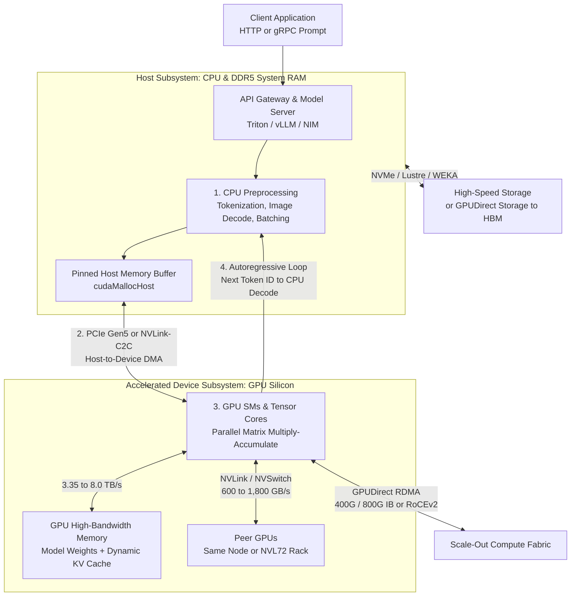
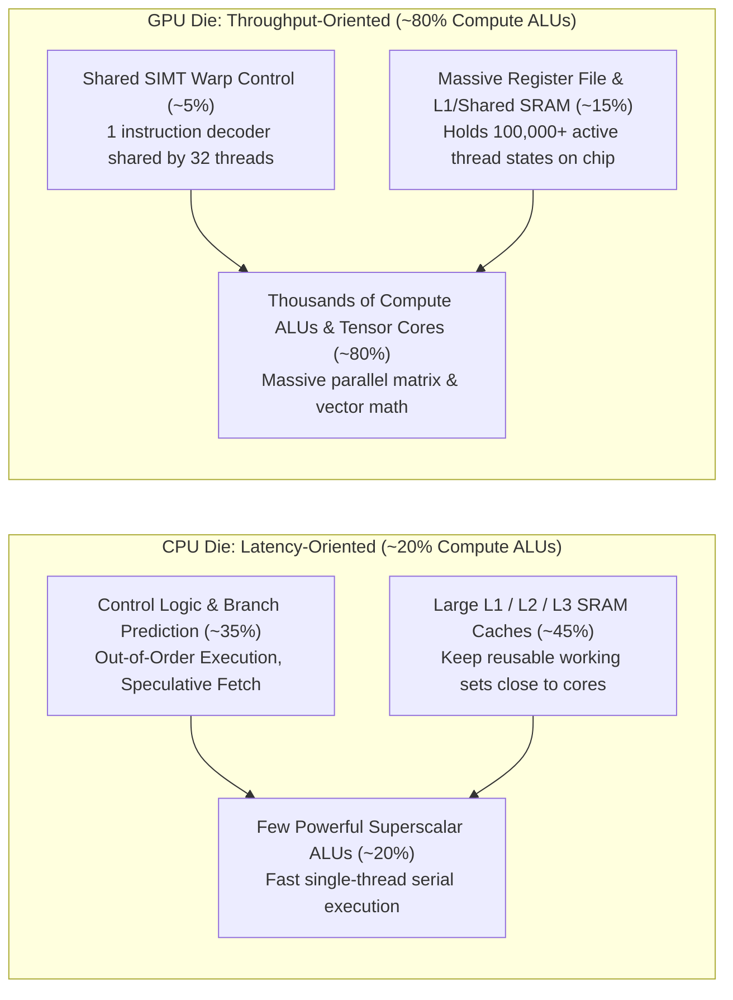
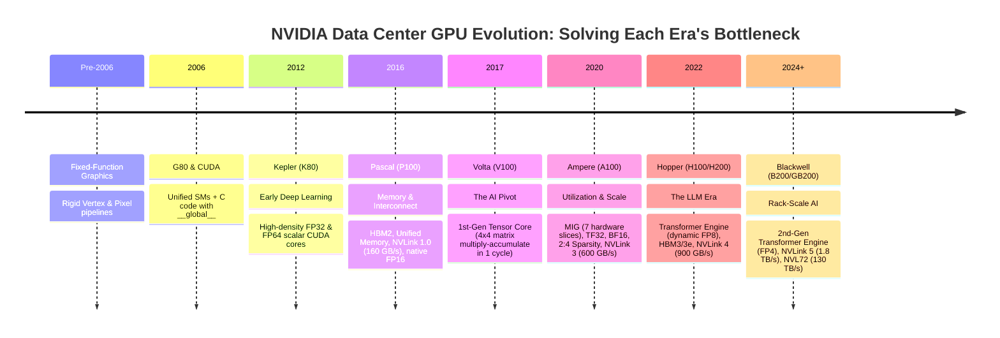
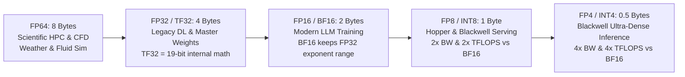
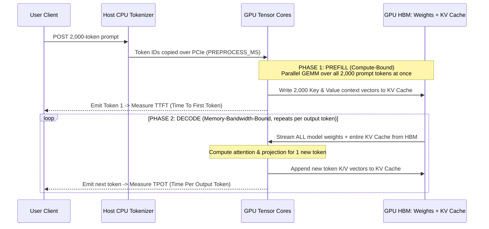
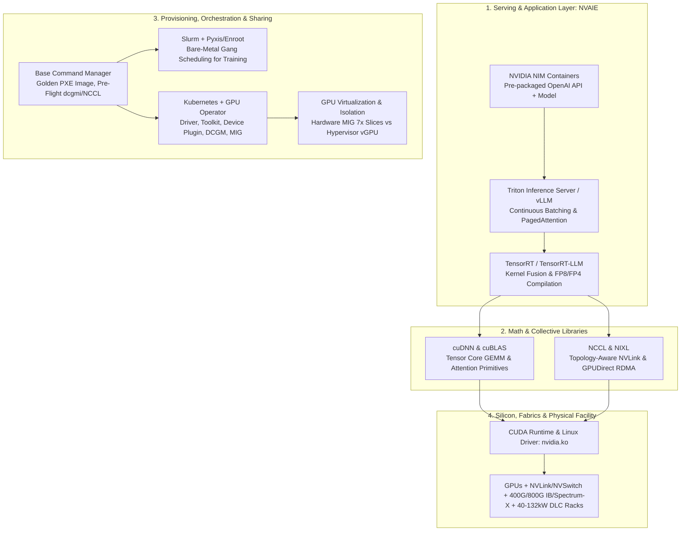
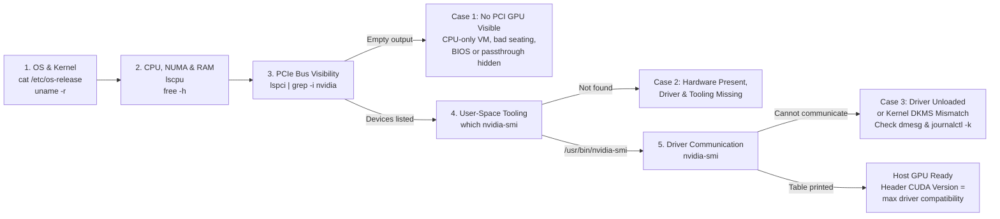

# 10.1 Why GPUs: CPU versus GPU and throughput design

| | |
|---|---|
| **Status** | Drafted (`why_gpus_lab.py`: 30 checks pass; GPU micro-benchmarks **untested** on live Nebius GPU VM) |
| **Level** | Basics |
| **Priority tier** | 2 |
| **Lab venue** | Nebius GPU + self-checking Python model (`code/part10/why_gpus_lab.py`) |
| **Part** | Part 10: The GPU and CUDA |
| **Sources used** | `nvidia-devops` V1 Ch 1–9 & Labs 1–2; `nvidia-devops` V2 Ch 1; *AI Systems Performance Engineering* Ch 1; *Parallel and High Performance Computing* Ch 9 |
| **Claim ledger** | `planning/ledgers/10-01.md` |

## Why this matters for AI infrastructure

Picture an AI inference service that looks, from the outside, exactly like the web services your team already runs. A client sends an HTTP POST request (a web request that carries its data in the body) with a JSON prompt (JavaScript Object Notation, a plain text format for structured data), and the server sends a JSON response back. The dashboards look familiar, the load balancer looks familiar, and so the platform team reaches for the same habits they use on a web tier. Those habits are exactly where the expensive mistakes start.

A traditional web application spends most of its life waiting. A thread might wait on a database query, a disk read, or a reply from another service over the network. While it waits, the operating system hands the CPU core to another request. That is why adding more stateless servers behind a load balancer (a component that spreads incoming requests across servers) scales so cleanly. An AI model is the opposite. It is busy almost all the time, doing dense matrix math (large grids of multiply and add operations) and pushing huge amounts of data through memory. One response can need trillions of multiply-accumulate operations, which are the basic multiply-then-add steps behind all that math, along with terabytes per second of memory traffic. Adding 100 standard CPU servers will not make one prompt run faster. Instead, the servers spend their time exchanging synchronization traffic over the network and waiting on the memory bus inside each motherboard.

Even after you deploy GPUs, daily production incidents need a silicon-level view of throughput to explain them. A training job can sit at 15 percent GPU utilization while every host CPU core is pegged at 100 percent. A data science team can move legacy FP32 code (32-bit floating point, the older and wider number format) from V100 GPUs to expensive H100 GPUs and see almost no speedup. A coding assistant can stream words quickly once it starts, yet freeze for 10 seconds before the first word appears. A training cluster can report 100 percent utilization in `nvidia-smi` (the NVIDIA System Management Interface command) while wasting 70 percent of its real compute capacity. Each of these symptoms has a cause on the hardware side, and the rest of this chapter builds the picture that lets you connect a symptom to its cause.

```text
Production Symptoms vs Hardware Reality (V1 Ch 1-4, ASP Ch 1):
  - 15% GPU Util + 100% CPU Util:     Host CPU starves the GPU during JPEG decoding, tokenization, or pageable memory copies
  - Zero Speedup V100 -> H100:        Legacy FP32 scalar code bypasses H100 BF16/FP8 Tensor Cores and Transformer Engine
  - 10s Blank Screen, Fast Streaming: Compute-bound Prefill (TTFT) saturates Tensor Cores while Decode (TPOT) streams from HBM
  - 100% nvidia-smi, 30% Goodput:     70% to 75% of cluster capacity is lost to AllReduce waits, data stalls, and restarts
```

The chapter starts with the basic difference between a CPU and a GPU. A CPU is built to finish one task quickly, while a GPU is built to get through a huge crowd of small tasks at the same time. From there it works through the formulas that set the exact speed ceilings for peak math, memory bandwidth, and PCIe transfers (PCI Express, the bus that links cards to the server board). It then adds the cluster-level measure called goodput, which is useful work actually finished per second rather than work the hardware could theoretically do. Last, it connects the silicon inside one GPU to the full AI factory around it.

:::tip In one minute
- Why does the web playbook fail? Web infrastructure scales horizontally around external I/O waits. AI infrastructure is governed by General Matrix Multiply compute, High-Bandwidth Memory speed, and GPU-to-GPU interconnect bandwidth.
- How do CPU and GPU chips differ? CPUs dedicate roughly 35 percent of their die to control logic, 45 percent to caches, and 20 percent to arithmetic units. GPUs dedicate roughly 80 percent of their die to compute units, 15 percent to registers and L1 memory, and 5 percent to control logic.
- What makes a GPU fast at matrix math? NVIDIA GPUs execute threads in lockstep groups of 32 called warps. They hide memory latency by switching warps in a single cycle inside the register file. Scalar CUDA cores execute one multiply-accumulate per cycle, whereas Tensor Cores execute an entire 4x4 matrix multiply-accumulate in one operation.
- Which phase of an LLM request is slow? Reading the prompt during prefill is compute-bound and determines Time To First Token. Generating tokens sequentially during decode is memory-bandwidth-bound and determines Time Per Output Token.
- Why is utilization not enough? `nvidia-smi` utilization only shows that at least one kernel is active. Goodput measures actual useful tokens or training samples completed per second divided by the theoretical speed of light ceiling.
:::

---

## Prerequisites and outcomes

**Prerequisites**: Review Linux processes, memory, NUMA topology, and PCIe fundamentals from Chapters 1.8, 1.10, and 1.17. You should also be familiar with NVIDIA server families and rack power envelopes from Chapters 9.1 through 9.5.

The chapter follows one AI request from start to finish. It begins with the contrast between stateless web scaling and a mix of CPU and GPU work, then traces the request across CPU preprocessing, the PCIe transfer, GPU High-Bandwidth Memory, and the decode loop. It explains why CPUs and GPUs were built differently in the first place, and how the precision cascade from FP64 down to FP4 trades bits for speed. It covers the arithmetic for peak FLOPs, memory bandwidth, and PCIe throughput, and it separates the compute-bound prefill phase from the memory-bound decode phase, where Continuous Batching and PagedAttention keep the key-value (KV) cache from fragmenting. The last sections cover goodput, the eight-step host check, and a staged latency lab.

---

## 1. Why AI breaks the web-scaling mindset

Imagine a platform engineer who has spent years running web services. She is asked to speed up a slow language model endpoint, so she adds CPU nodes to the cluster. The latency chart barely moves, and the network graphs climb steadily. Her instincts were built on web services, and those instincts do not explain what she is seeing. This section shows why the same scaling move that helps a web tier does little for a model.

A traditional web server is built to wait efficiently on external input and output. Think of a web tier as a busy hotel front desk, where the receptionists spend most of their time on hold, waiting for housekeeping to answer the phone. Hiring more receptionists lets the desk handle more guests at once, because each one spends most of the day waiting anyway. An AI model is more like translating an entire encyclopedia, page by page. The work is relentless arithmetic and page turning. Putting 100 clerks in separate buildings, connected by slow walkie-talkies, does not finish the book faster. It makes the job slower, because every page now needs a conversation across the gap.

### 1.1 I/O-bound web infrastructure versus compute- and memory-bound AI

Suppose a web endpoint suddenly takes much longer to answer. An experienced web engineer usually starts by checking the database, the object store, and any upstream REST calls, because slow web requests almost always wait on something outside the process. The usual repair is to add capacity or fix a slow query. While one thread waits on a network socket, the operating system scheduler gives the CPU core to another request. Horizontal scaling works because independent web requests rarely share dense mathematical state.

AI workloads reverse every one of those assumptions. First, neural networks spend most of their runtime executing General Matrix Multiply operations across billions of learned parameters. Second, each multiplication forces the processor to stream gigabytes of model weights from memory into the arithmetic units, and it does this again on every step. Third, when a model is too large for one accelerator, it is split across several GPUs. Those GPUs must exchange activations and gradients (the intermediate values and the learning signals that flow between layers) all the time over NVLink, InfiniBand, or RoCEv2 fabrics. The bottleneck is no longer waiting for an outside service. The bottleneck is the arithmetic and the movement of data inside the machine.

The arithmetic makes this concrete. Take a 70 billion parameter model stored in 16-bit formats. Each parameter takes 2 bytes, so the weights alone fill 140 GB. Reading that once from CPU memory takes hundreds of milliseconds, because a server's DDR5 memory delivers only a few hundred GB/s per socket. Reading it from GPU HBM3 or HBM3e takes tens of milliseconds per token, because the bus moves several TB/s. The same bytes, read from a different place, make a very different speed.

```text
Memory Bandwidth Wall for a 70B Parameter LLM in FP16 / BF16 (V1 Ch 1, V1 Ch 2):
  - Weight Footprint:       70 billion parameters x 2 bytes/parameter = 140 GB of model weights
  - CPU DDR5 Memory Bus:    ~300 to 400 GB/s per socket -> hundreds of milliseconds just to read weights once
  - GPU HBM3 / HBM3e Bus:   3.35 TB/s (H100) to 8.0 TB/s (B200) -> tens of milliseconds per token step
```

### 1.2 The four physical stages of an AI request on a heterogeneous node

Neither a CPU alone nor a GPU alone can serve a production AI model. Every modern AI server is a heterogeneous system, which means it mixes different kinds of processors and gives each one a specific job. The host subsystem is the CPU and its DDR5 system RAM. It runs the Linux kernel, the scheduler agents, the storage drivers, and the data preprocessing. The device subsystem is the GPU silicon and the High-Bandwidth Memory packaged next to it. It runs the massively parallel matrix math. A request moves back and forth between these two subsystems, and each crossing has its own cost.

Take a single prompt as it arrives at an inference server. The diagram below follows it from the front door, through the host, into the GPU, and out again.



When a user sends a prompt to an inference server, four physical stages run in sequence. The table gives each stage, the hardware it uses, and the place where it usually slows down. Read it as a map of where a request spends its time.

| Stage | Subsystem | Hardware and software activity | Primary bottleneck risk |
|---|---|---|---|
| **Stage 1: CPU Preprocessing** | Host CPU and System RAM | Converts raw UTF-8 strings into integer token IDs or decodes JPEGs into tensors, then groups requests into a batch. | Single-thread CPU saturation or slow disk reads starving the GPU. |
| **Stage 2: Host-to-Device Transfer** | PCIe bus or NVLink-C2C | Copies token arrays and kernel launch descriptors from host RAM across the motherboard into GPU memory via DMA. | Unpinned pageable memory copies or narrow PCIe lanes stalling transfers. |
| **Stage 3: Parallel Matrix Execution** | GPU SMs, Tensor Cores, and HBM | Streams model weights and context state from HBM into Streaming Multiprocessors and Tensor Cores for parallel multiply-accumulate math. | HBM memory bandwidth saturation or unoptimized scalar precision. |
| **Stage 4: Autoregressive Loop** | GPU and Host loop | Emits a probability distribution for the single next token, appends that token ID to the sequence, and repeats Stage 3 for every output word. | Sequential token-by-token weight streaming across the entire model. |

Stage 1 is where the CPU earns its keep. It turns text into token IDs, which are the integer codes a model reads, and it groups waiting requests into a batch. Stage 2 is the crossing. The data travels over PCIe or NVLink-C2C, and it has to land in memory the GPU can reach without help from the CPU. Stage 3 is where the GPU does its work, reading the weights from HBM and multiplying them at high speed. Stage 4 is the one that surprises people. The model produces one token, and then the whole cycle repeats for the next token. A long answer means many trips through Stage 3, so a slow loop multiplies every small delay.

### 1.3 Three classic infrastructure bottlenecks on day one

Your pager goes off in the middle of the night. The GPUs look busy on paper, but the answers come out slowly. Mapping the four stages above explains most of what you will see, because each slow answer points to one stage. Three walls account for almost every case.

The first is the Memory Wall, which sits on GPU HBM during autoregressive generation. The GPU must read all model weights from HBM for every single token it produces, so memory bandwidth sets the speed of token generation. Engineers push against this wall in two ways. They deploy higher-bandwidth HBM, such as H200 at 4.8 TB/s or B200 at 8.0 TB/s. They also quantize the weights, which means storing each number in a smaller format. Moving from 16-bit to 8-bit cuts the bytes moved per parameter in half, and moving to 4-bit cuts them to a quarter.

The second is the Interconnect Wall. It appears when a 70B or 405B model is split across multiple GPUs using Tensor Parallelism, which divides each layer's math across the GPUs. Those GPUs must combine their partial sums after every transformer layer. Over a standard PCIe Gen5 x16 bus, which moves roughly 63 to 64 GB/s in each direction, the GPUs spend most of their time waiting for the bus. High-speed NVLink at 900 GB/s on Hopper or 1,800 GB/s on Blackwell, together with 400G to 800G GPUDirect RDMA networks (direct memory transfers between GPUs and network cards), keeps the compute units fed.

The third is Host Starvation, which happens when the CPU cannot feed the accelerators fast enough. In computer vision or multimodal training, slow disk reads and CPU-bound JPEG decoding leave expensive GPUs sitting at 10 to 15 percent utilization while they wait on a cheap CPU. The fix is to get the data to the GPU faster. Platform teams use parallel NVMe storage, GPUDirect Storage to skip the CPU bounce buffers (the staging copies the CPU would otherwise make), and NVIDIA DALI to move data augmentation (random crops, flips, and similar changes to training images) onto the GPU itself.

---

### 1.4 The performance engineer's daily work

Consider a Tuesday in the life of an AI systems performance engineer. A training run is noticeably slower than it was last week. Nobody changed the model. The engineer opens a profiler, finds one kernel that now waits on memory, and traces that wait back to a change in how the data loader batches its inputs. That single chain of cause and effect is the job. The role is hard to hire for because it sits between hardware, software, and algorithms, and the work pays off directly in cost and in delivery speed.

The engineer needs low-level operating system knowledge, an understanding of memory hierarchies, networking fundamentals, and skill in languages such as Python and C++. The toolset includes frameworks such as PyTorch, OpenAI's Triton, and NVIDIA's CUDA. Each tool answers a different question, and knowing which question to ask is most of the skill.

On any given day, the engineer might examine GPU kernel efficiency, tune OS thread scheduling, analyze memory access patterns, raise network throughput, or debug distributed training. The core duties are benchmarking, profiling, debugging, optimizing, scaling, and managing resources. Hardware, software, and algorithm specialties must be designed together, because a choice in one area changes the trade-offs in the others.

Benchmarking and profiling measure latency, throughput, memory usage, and other metrics under training and inference workloads. A profiler is a tool that records where time and memory go during a run. To find bottlenecks, the engineer combines NVIDIA Nsight Systems, NVIDIA Nsight Compute, and the PyTorch profiler. Automated performance tests should also run on every change, so regressions are caught early in the development cycle rather than in production.

Debugging traces each problem to its root cause. That cause might be a suboptimal CUDA kernel (a small program that runs across many GPU threads), unnecessary communication overhead, or an imbalance in the training or inference workload. The fix might be the latest NVIDIA Transformer Engine for matrix operations on modern LLMs. It might be a higher degree of parallelism for an embarrassingly parallel inference workload, which is one where the pieces of work never need to talk to each other. It might also be better memory management in attention, which moves less data in and out of GPU RAM.

Small code changes can produce large wins. A Python preprocessing step can hold up an entire training pipeline while the GPUs sit idle. The engineer can reimplement that step in C++, or use NVIDIA cuPyNumeric, a drop-in replacement for NumPy (the common Python array library) that spreads array work across CPUs and GPUs.

Scaling from research to production is its own discipline. Moving from 8 GPUs to 80,000 GPUs should keep overhead low and efficiency high. That requires NVIDIA's Collective Communications Library (NCCL, pronounced "nickel") for all-reduce and other collective operations in training, where every GPU must share results with every other GPU. For distributed inference, the NVIDIA Inference Xfer Library (NIXL) moves data point to point across GPU memory and storage tiers. The engineer also optimizes all-to-all and all-gather, since training and inference both use them heavily.

Data placement across nodes uses data, tensor, and pipeline parallelism. Data parallelism gives each GPU a copy of the model and a slice of the data. A model too large for one GPU may need tensor or pipeline parallelism, which split the model itself across GPUs. A mixture-of-experts model can also use expert parallelism, where different GPUs hold different expert sub-networks.

Resource management is the next duty. A model uses CPU cores, GPU memory, interconnect bandwidth, and storage I/O all at once, and a bottleneck in any one of them slows the whole job. The engineer keeps GPUs fed with data at full throttle, pins threads to CPU cores, and reduces context-switch overhead. The engineer also works to avoid out-of-memory errors on GPUs. When a job does not need a full GPU, GPU virtualization such as NVIDIA's Multi-Instance GPU (MIG) partitions the device into smaller pieces, so the rest of the hardware is not left idle.

Cross-team collaboration is critical. Performance engineers work with researchers, data scientists, and application developers, and they also work with networking and storage teams. Changing model code means coordinating with researchers. Deploying a new GPU driver means working with the infrastructure team. Updating the CUDA driver or CUDA version for bug fixes and efficiency involves DevOps, infrastructure, and support teams. The performance engineer sits at the intersection and speaks the language of AI, computer science, and systems engineering.

Transparency matters too. In performance engineering, measure everything and trust data over assumptions. Publishing your work lets others learn from it, reproduce it, and build on your findings.

This broad, deep understanding is rare, and that is why AI systems performance engineers are so scarce today.

### 1.5 Core competencies and tools of the role

The first chapter of *AI Systems Performance Engineering* traces how AI workloads moved from traditional computing to today's demands. That history explains why a specialized performance discipline became necessary. The chapter then lists the core competencies. They include a deep understanding of hardware architectures, software optimization techniques, and system-level integration. Soft skills matter as well, including problem solving, communication, and collaboration.

The practical side covers how engineers analyze system bottlenecks, implement optimization strategies, and keep AI systems scalable and reliable. Real-world scenarios show the challenges and fixes found in the field. Performance testing, monitoring, and benchmarking tools round out the toolkit. Each tool shows how to assess and improve a system, and the skill is knowing which tool answers which question.

---
## 2. CPU latency design versus GPU throughput design

A colleague in a planning meeting asks a sensible question. If deep learning needs so much parallel work, why not build a server CPU with 10,000 cores and skip the GPU entirely? The short answer is heat. Processor designers hit a physical limit long before they could fit that many cores on a chip, and the way they responded split the processor world into two families. One family makes a single thread as fast as possible. The other makes thousands of simple threads add up to a lot of work. Knowing which family a chip belongs to explains most of what happens when you run a model on it.

### 2.1 The end of Dennard Scaling and the silicon budget split

Until roughly 2005, software got faster on every new chip without anyone changing a line of code. Two physical trends made that happen. Moore's Law described transistor density, the number of tiny switches that fit in a given area, roughly doubling every two years. Dennard Scaling said that as transistors shrank, the power they used per unit of area stayed about constant. Together, the two trends let CPU clock frequencies climb toward 4 to 5 GHz, so single-threaded code ran faster on each new generation with no changes at all.

That free ride ended around 4 to 5 GHz. At that point the silicon hit a thermal wall. Current leaked through the tiny transistors even when they were off, and the heat that resulted could not be carried away fast enough to allow higher clock speeds. Once the clock speed stopped climbing, the only way to get more work done was to do more things at once. Chip designers had to pick a direction, and they picked two.

Processor architects responded to that thermal wall in two opposite ways. CPUs were optimized to finish one serial thread quickly, while GPUs were optimized to keep thousands of parallel threads busy. Think of a CPU as a single master chef who handles a complicated order from start to finish, with a pantry close at hand and a fine eye for every detail. A GPU is a large kitchen crew where each cook does a simple, repeated task, and the crew as a whole produces far more meals per hour. Neither is better in general. Each one is built for a different kind of order.



The diagram shows where the silicon goes. On a CPU, most of the die is spent on control logic that guesses what comes next and on large caches that keep recent data close. Only a small share is left for the arithmetic itself. On a GPU, the picture flips. Most of the die is arithmetic units, and one control unit steers a whole group of them. The reader's job is to notice that the same chip area is spent on very different things, and that each choice follows from the goal.

| Architectural dimension | General-purpose CPU (Latency Machine) | Accelerated GPU (Throughput Machine) |
|---|---|---|
| **Primary design goal** | Finish one serial instruction stream in as few nanoseconds as possible. | Finish millions of parallel data operations per second across massive arrays. |
| **Silicon area allocation** | **~35%** Control Logic & Branch Prediction, **~45%** L1/L2/L3 Caches, **~20%** Compute ALUs. | **~80%** Compute Cores (ALUs & Tensor Cores), **~15%** Registers & L1/Shared Memory, **~5%** Control Logic. |
| **Branch handling** | Deep branch prediction and out-of-order execution guess branches ahead of time. | Minimal control logic; 32 threads in a warp execute in lockstep SIMT. Divergent branches serialize. |
| **Latency hiding mechanism** | Large L1, L2, and L3 caches avoid main memory reads when working sets repeat. | Zero-cost warp scheduling swaps register-resident warps in 1 cycle when a memory fetch stalls. |
| **Main memory interface** | Motherboard DDR4/DDR5 DIMMs (**~150–400 GB/s** per socket). | On-package GDDR6 (**300–864 GB/s**) or stacked HBM2e/HBM3/HBM3e (**2.0–8.0 TB/s**). |
| **Heavy vector math behavior** | Heavy `AVX-512` vector math draws high power, triggers thermal down-clocking, and peaks at a few TFLOPS. | Dedicated Tensor Cores sustain **1,000+ TFLOPS** of dense low-precision matrix math. |

The table is a lookup, so read one row at a time. The first row sets the goal. The silicon row explains the budget. The branch row explains why a GPU punishes code where threads want different paths. The memory row shows why the GPU's bandwidth is so much higher. The math row is the reason the GPU wins on dense matrix work.

Why does a CPU's massive L3 cache fail on deep learning workloads? An L3 cache is the largest and slowest of the on-chip caches, a shared store that holds recently used data near the cores. A database or web server repeatedly reads the same hot lookup tables and instruction paths, so a 100 MB L3 cache can achieve a high hit rate. A neural network forward pass works differently. It streams a 140 GB weight tensor through the processor once per token, touching far more data than the cache can hold. That streaming pattern flushes the cache again and again, a problem called cache thrashing. The arithmetic units end up stalled, waiting on 300 GB/s of motherboard DDR5 memory.

### 2.2 Cross-vendor hardware terminology

When you read profiling guides, academic papers, or multi-vendor specifications, you will notice that different hardware vendors use different names for the same silicon building blocks. It can feel like learning three languages for one building. Both commodity integrated GPUs (or AMD Accelerated Processing Units, which share system RAM on the CPU die) and dedicated discrete GPUs organize their parallel compute engines into a hierarchical tree. The table maps the names across vendors so you can read any document without getting lost.

| Concept / Hierarchy level | Host CPU | OpenCL standard | AMD GPU (`ROCm`) | NVIDIA GPU (`CUDA`) | Intel GPU (`Gen11` / `Xe`) |
|---|---|---|---|---|---|
| **Accelerator device** | CPU socket | Compute device | GPU | GPU | GPU |
| **Hardware replication cluster** | Core complex | — | Shader Engine (SE) | Graphics Processing Cluster (GPC) | Slice |
| **Multiprocessor block** | Physical core | Compute Unit (CU) | Compute Unit (CU) | **Streaming Multiprocessor (SM)** | Subslice |
| **Individual scalar lane** | ALU / SIMD lane | Processing Element (PE) | Processing Element (PE) | **CUDA Core** (Compute Core) | Execution Unit (EU) |
| **Smallest execution unit** | Thread | Work Item | Work Item | **Thread** | Thread |
| **Lockstep execution group** | SIMD vector | Subgroup / Vector | Wavefront / Subgroup (**64** threads) | **SIMT Warp** (**32** threads) | SIMD subgroup |

When you see "SM" in an NVIDIA document, think "Compute Unit" in OpenCL and AMD language. When you see "warp," think "wavefront" on AMD, although an AMD wavefront holds 64 threads where an NVIDIA warp holds 32. The lane that does the actual arithmetic is a "CUDA Core" on NVIDIA and a "Processing Element" on AMD and OpenCL. Keep this table open when you read a vendor paper, and the names will stop getting in the way of the ideas.

### 2.3 SIMT warps, zero-cost context switching, and batch-size alignment

Picture a Linux server with 64 CPU cores. Someone starts 100,000 operating system threads on it, and the machine grinds to a halt. The reason is the cost of switching. To move a CPU core from Thread A to Thread B, the Linux kernel must run a context switch. It pauses the core, saves the CPU registers (the small, fast slots where a thread keeps its working values) out to system RAM, loads the next thread's registers back from RAM, and flushes the pipeline state. Each of those steps costs time, and the sequence costs thousands of clock cycles. Multiply that by 100,000 threads and most of the machine spends its life switching rather than working.

An NVIDIA GPU avoids that cost with a design called Single Instruction, Multiple Threads (SIMT), together with hardware warp scheduling. Whenever work is launched on the GPU, each Streaming Multiprocessor groups its threads into fixed bundles of 32 threads called a warp. Think of a warp as a squad of soldiers who march in step. All 32 threads execute the exact same instruction on the same clock cycle, each one on its own data element. Because all 32 lanes follow one instruction pointer, they share a single instruction fetch and decode unit. That shared front end is why the GPU can give roughly 80 percent of its die to math units.

The register file is the second half of the trick. Each Streaming Multiprocessor contains a massive physical register file with 65,536 32-bit registers. Instead of copying a thread's state to RAM when it pauses, the GPU keeps tens of thousands of threads resident in registers at the same time. Up to 100,000 active threads can live on the chip at once. When Warp 0 issues a load from global memory in HBM, a fetch that takes hundreds of cycles, the scheduler does not wait and does not copy anything. On the very next clock cycle it issues an instruction from Warp 1, whose operands are already sitting in registers. The memory wait is hidden by having many warps ready to go, rather than by avoiding the wait with large caches.

```text
SIMT Warp Lane Efficiency vs Batch Size Alignment (V1 Ch 3, why_gpus.py):
  - Batch Size 32:  Allocates 1 warp  (32 lanes) -> 32 active,  0 idle -> 100.00% lane efficiency
  - Batch Size 31:  Allocates 1 warp  (32 lanes) -> 31 active,  1 idle ->  96.88% lane efficiency
  - Batch Size 33:  Allocates 2 warps (64 lanes) -> 33 active, 31 idle ->  51.56% lane efficiency
  - Operational Rule: Always pad batch sizes, hidden dimensions, and vocabularies to multiples of 8 or 32
```

The listing shows what happens at the edges. A warp always runs all 32 lanes, so a batch of 31 still occupies a full warp and wastes one lane. A batch of 33 spills into a second warp, and then 31 lanes sit idle. The practical rule follows directly: pad batch sizes, hidden dimensions, and vocabularies to a multiple of 8 or 32, so the lanes stay full. This is one of the cheapest performance fixes you will ever make, because it costs nothing except attention to shapes.

### 2.4 Calculating theoretical peak FLOPs, memory bandwidth, and PCIe overhead

Before you run a single benchmark on a new GPU server, calculate its theoretical speed-of-light ceilings from the datasheet. The number you get is the best the hardware could do on paper. A benchmark that lands far below it tells you something is wrong, and a benchmark that lands close to it tells you the software is doing its job. Three formulas cover most of what you need: peak floating-point operations per second (FLOP/s), memory bandwidth, and PCIe transfer rate. Each one is a product of a few datasheet numbers, so you can check the arithmetic by hand.

#### Formula 1: Peak theoretical scalar and vector FLOP/s
A Fused Multiply-Add (FMA) instruction computes `D = A * B + C` in a single clock cycle. It counts as two floating-point operations, one multiply and one add. Peak theoretical performance in TFLOP/s (trillions of floating-point operations per second) is therefore a direct product of three things: the clock rate, the number of multiprocessors, and the number of cores in each one.

```text
Peak Theoretical Scalar TFLOP/s (PHPC Ch 9 §9.2.4):
  Peak TFLOP/s = (Clock Rate (MHz) x Compute Units (SMs) x Cores per SM x 2 (FMA)) / 1,000,000

  - NVIDIA V100 (80 SMs, 1,530 MHz):
      FP32 (64/SM): 2 x 1530 x 80 x 64 / 10^6 = 15.6672 TFLOP/s (15.67 rounded, 15.6 truncated in book)
      FP64 (32/SM): 2 x 1530 x 80 x 32 / 10^6 =  7.8336 TFLOP/s (7.83 rounded, 7.8 truncated in book)
  - NVIDIA A100 (108 SMs, 1,410 MHz):
      FP32 (64/SM): 2 x 1410 x 108 x 64 / 10^6 = 19.4918 TFLOP/s (19.49 exact, 19.5 rounded in book)
      FP64 (32/SM): 2 x 1410 x 108 x 32 / 10^6 =  9.7459 TFLOP/s (9.75 rounded, 9.7 truncated in book)
```

Work through the V100 line by hand to see how the formula behaves. Multiply 2 by 1,530 MHz, then by 80 SMs, then by 64 FP32 cores in each SM, and divide by one million. The answer is about 15.67 TFLOP/s. Swap in 32 FP64 cores per SM and the answer halves, which is why double precision is the slow lane on this family. The same calculation on the A100, with its 108 SMs, gives the figures in the table below.

High-performance computing GPUs such as the V100, A100, MI50, and MI100 provide a 1:2 FP64-to-FP32 core ratio, whereas graphics and inference GPUs often use 1:4, 1:8, or lower double-precision ratios. That ratio is a design choice. Scientific codes that need double precision pay for it, and inference chips usually skip it because models run well in lower precision.

| Accelerator | CUs / SMs | FP32 cores/CU | FP64 cores/CU | Boost Clock (MHz) | Peak FP32 (TFLOP/s) | Peak FP64 (TFLOP/s) |
|---|---|---|---|---|---|---|
| **NVIDIA V100 (Volta)** | 80 SMs | 64 | 32 | 1,530 MHz | **15.6** (15.67) | **7.8** (7.83) |
| **NVIDIA A100 (Ampere)** | 108 SMs | 64 | 32 | 1,410 MHz | **19.5** (19.49) | **9.7** (9.75) |
| **AMD Radeon Instinct MI50 (Vega 20)** | 60 CUs | 64 | 32 | 1,746 MHz | **13.4** | **6.7** |
| **AMD Instinct MI100 (Arcturus)** | 120 CUs | 64 | 32 | 1,502 MHz | **23.1** | **11.5** |
| **Intel Ice Lake Gen11 Integrated** | 8 Subslices | 64 EUs | 16 | 1,000 MHz | **1.0** | **0.25** |

#### Formula 2: Peak theoretical GPU memory bandwidth
Memory bandwidth, the rate at which bytes move between the GPU and its memory, depends on three things: the memory clock frequency, the width of the memory bus in bits divided by 8 bits per byte, and the number of transfers per clock cycle. Double Data Rate HBM moves data twice per clock cycle, whereas GDDR5, GDDR5X, and GDDR6 move 4 to 8 transfers per cycle. The multiplier is where the memory types differ most.

```text
Theoretical Memory Bandwidth & BabelStream Verification (PHPC Ch 9 §9.3.1-9.3.2, Table 9.4):
  Theoretical Memory Bandwidth (GB/s) = Memory Clock (GHz) x (Bus Width (bits) / 8) x Transaction Multiplier

  - GDDR3  (1.000 GHz, mult 2,   256-bit bus): 1.000 x (256 / 8)  x 2 =    64 GB/s (2.0 GT/s)
  - GDDR5  (2.000 GHz, mult 4,   256-bit bus): 2.000 x (256 / 8)  x 4 =   256 GB/s (8.0 GT/s)
  - GDDR5X (1.375 GHz, mult 8,   384-bit bus): 1.375 x (384 / 8)  x 8 =   528 GB/s (11.0 GT/s)
  - GDDR6  (2.000 GHz, mult 8,   384-bit bus): 2.000 x (384 / 8)  x 8 =   768 GB/s (16.0 GT/s)
  - HBM1   (0.500 GHz, mult 2, 4,096-bit bus): 0.500 x (4096 / 8) x 2 =   512 GB/s (1.0 GT/s)
  - HBM2 V100 (0.876 GHz, mult 2, 4,096-bit):  0.876 x (4096 / 8) x 2 =   897 GB/s (1.75 GT/s)
  - HBM2 MI50 (1.000 GHz, mult 2, 4,096-bit):  1.000 x (4096 / 8) x 2 = 1,024 GB/s (2.0 GT/s)

  Empirical BabelStream (./cuda-stream) on V100 (897 GB/s theoretical peak):
    Copy:  800,995.1 MB/s (~801.0 GB/s)    Add: 838,993.1 MB/s (~839.0 GB/s)
    Triad: 840,730.8 MB/s (~840.7 GB/s)    Dot: 866,071.4 MB/s (~866.1 GB/s, ~96% of peak)
```

Notice how HBM reaches terabytes per second while keeping its power in check. GDDR6 drives a narrow 256-bit or 384-bit bus at very high clock frequencies, and every extra clock step costs power. HBM takes the other route. It stacks DRAM dies vertically on a silicon interposer (a shared base layer that links the memory to the GPU), and it reaches across an ultra-wide 4,096-bit or 5,120-bit bus at a lower clock frequency. Width does the work that speed does in GDDR. The BabelStream lines are the reality check. A V100 with a theoretical peak of 897 GB/s delivered about 866.1 GB/s on the Dot test, close to the ceiling, and a little less on the Copy and Triad tests.

#### Formula 3: Theoretical PCIe bus bandwidth and pinned host memory
When tensors move between host CPU memory and a discrete GPU over PCIe, the one-way bandwidth depends on three things: lane count, transfer rate, and line encoding overhead. Encoding is the extra bits a link sends to keep the signal reliable. PCIe Gen1 and Gen2 use `8b/10b` encoding, which sends 10 bits for every 8 data bits, an overhead of 20 percent, or an efficiency factor of 80 percent. PCIe Gen3 through Gen6 use `128b/130b` encoding, which sends 130 bits for every 128 data bits. That cuts the overhead to 1.54 percent, a 98.46 percent efficiency factor.

```text
PCIe Unidirectional Bandwidth Formula (PHPC Ch 9 §9.4.1, Table 9.5):
  PCIe Bandwidth (GB/s) = Lanes x Transfer Rate (GT/s) x Overhead Factor x (1 byte / 8 bits)
```

| PCIe Generation | Transfer Rate per Lane | Encoding Overhead | Efficiency Factor | 16-Lane (x16) Unidirectional Bandwidth |
|---|---|---|---|---|
| **PCIe Gen1** | 2.5 GT/s | 20% (`8b/10b`) | 80% | **4.0 GB/s** |
| **PCIe Gen2** | 5.0 GT/s | 20% (`8b/10b`) | 80% | **8.0 GB/s** |
| **PCIe Gen3** | 8.0 GT/s | 1.54% (`128b/130b`) | 98.46% (0.9846) | **15.75 GB/s** |
| **PCIe Gen4** | 16.0 GT/s | 1.54% (`128b/130b`) | 98.46% (0.9846) | **31.5 GB/s** (31.51 GB/s) |
| **PCIe Gen5** | 32.0 GT/s | 1.54% (`128b/130b`) | 98.46% (0.9846) | **63 GB/s** (63.01 GB/s) |
| **PCIe Gen6** | 64.0 GT/s | 1.54% (`128b/130b`) | 98.46% (0.9846) | **126 GB/s** (126.03 GB/s) |

Read the table as a sequence of doublings. Each generation roughly doubles the transfer rate per lane, so an x16 slot doubles its ceiling with each step. The jump from Gen2 to Gen3 is also an efficiency jump, because the encoding overhead falls from 20 percent to 1.54 percent. That is why the Gen3 row looks so much better than a simple doubling would suggest.

The formula gives the ceiling. Real throughput depends on the size of each transfer and on the kind of host memory involved. Transfers smaller than roughly 10 MB (`10^7` bytes) are dominated by the setup latency of each transaction, so they reach only a fraction of the link's bandwidth. Standard operating system allocations (`malloc`) are pageable, which means the Linux kernel can swap those pages out to disk at any moment. The GPU's DMA engine (direct memory access, the hardware that copies data without the CPU) needs a fixed physical address, so a pageable transfer forces the CUDA driver to copy the array into a temporary pinned staging buffer first. Allocating host buffers directly in page-locked pinned memory, using `cudaMallocHost` or setting `pin_memory=True` in a PyTorch `DataLoader`, removes that extra CPU copy. On a PCIe Gen3 x16 system, pinned memory reaches roughly 11.6 GB/s, or 72 percent of the 15.75 GB/s ceiling, with low variance from run to run.

### 2.5 Five workload patterns where GPUs struggle

GPUs are specialized throughput engines. They are not universal replacements for every CPU program, and a job that suits a CPU can run slower on a GPU than on a laptop. Five workload patterns perform poorly on GPU silicon, and each one traces back to the design choices from earlier in this section.

1. **Lack of parallelism**. This is the First Law of GPGPU. If an algorithm is inherently serial, or it spawns only a few hundred threads, it cannot fill the SMs or hide memory latency. A high-clock-speed CPU core finishes first.
2. **Irregular pointer-chasing memory access**. This is the Second Law of GPGPU. Graph traversals or sparse lookups jump randomly across memory. That stops the GPU from combining neighboring requests into wide HBM transactions, so most of the bandwidth goes unused.
3. **Severe warp branch divergence**. When threads inside the same 32-thread warp take different `if/else` paths, the SIMT hardware must run each path one after another, with the lanes that are not on that path switched off.
4. **Dynamic host-driven memory allocations**. Calling `cudaMalloc` and `cudaFree` inside a tight loop stalls the GPU on synchronous calls to the host driver, which means the GPU waits for the CPU-side driver to answer each request.
5. **Deep recursive algorithms**. GPU threads have tiny per-thread stack frames (the small blocks of memory that track each function call) compared to CPU threads. They are poorly suited to deep recursion.

---
## 3. How GPU silicon evolved from pixels to Tensor Cores and NVL72

Picture a team that buys a fleet of H100 GPUs to speed up a training job. The new hardware is far faster than the old V100 cards, yet the first run barely improves on the old one. The code was written for an older chip and never asked for the features the new one offers. To see why, you need the story of how NVIDIA's GPUs changed, because each feature exists to solve a problem that the previous generation could not solve.

Modern H100 and B200 GPUs train transformer models tens of times faster than older V100 GPUs. Yet those same accelerators show almost no speedup when they are handed unoptimized legacy FP32 code. Understanding that gap requires tracing how NVIDIA evolved GPU silicon from fixed-function graphics pipelines into rack-scale Tensor Core computers. Fixed-function means each stage of the pipeline does one hardwired job, and it cannot be reprogrammed for something else.

### 3.1 From 4K video games to GPGPU and CUDA

Start with a video game. Rendering a 4K frame (`3840 x 2160`) at 60 frames per second means working out lighting, shading, and geometry for more than 8 million independent pixels, and doing that 60 times every second. Each pixel can be worked out on its own, so a chip built to shade many pixels at once is a chip built for parallel work.

Around 2006 to 2010, physicists running `O(N^2)` molecular dynamics simulations noticed something useful. (The `O(N^2)` notation means the work grows with the square of the number of items, so each atom interacts with every other atom.) Calculating the forces between millions of atoms had the same mathematical structure as shading millions of pixels. A single workstation with four consumer Fermi GPUs could beat a multi-million-dollar CPU cluster whose Ethernet network was choked with MPI messages (the message-passing traffic that cluster nodes exchange with each other). The graphics chip had been built for games, and it turned out to be a very good scientific calculator too.

That discovery pushed NVIDIA to make the GPU programmable for general work. The result was CUDA, a programming model that lets C and C++ code run directly on GPU threads. The timeline below shows each generation and the bottleneck it was built to remove.



Read the timeline as a chain of answers. Each generation of NVIDIA data center silicon removed the specific hardware bottleneck that limited the previous era. Kepler had the cores but not the memory to feed them. Pascal brought in fast on-package memory. Volta added the first Tensor Core for matrix math, which is the piece that made deep learning practical. Ampere made one GPU shareable among several users. Hopper focused on the transformer models that power today's language systems. Blackwell is built around the rack as a single computer.

The table below lists the same story with the key capacities for each generation.

| Generation & Year | Flagship SKU | Key architectural inventions and hardware capacities |
|---|---|---|
| **Pre-2006 Fixed-Function** | Early GeForce | Separate hardwired Vertex and Pixel processors; researchers had to disguise matrix math as 2D OpenGL textures. |
| **G80 (2006–2007)** | G80 / Tesla | Replaced separate shaders with unified Streaming Multiprocessors and launched CUDA so C/C++ `__global__` functions run directly on GPU threads. |
| **Kepler (2012)** | K20 / K80 | Scaled high-density scalar FP32 and FP64 CUDA cores for early deep learning and HPC workloads. |
| **Pascal (2016)** | P100 | Introduced on-package HBM2 memory, hardware Unified Memory page faulting, native 16-bit FP16, and NVLink 1.0 at **160 GB/s**. |
| **Volta (2017)** | V100 | Introduced the first-generation **Tensor Core**, executing a full `4 x 4` FP16 matrix multiply-accumulate in 1 operation instead of **64** scalar CUDA core operations. |
| **Ampere (2020)** | A100 (40/80 GB) | Added **Multi-Instance GPU (MIG)** for up to **7** hardware-isolated slices, TF32 and BF16 Tensor Core formats, 2:4 structured sparsity, **2.0 TB/s** HBM2e, and **600 GB/s** NVLink 3. |
| **Hopper (2022–2024)** | H100 (80 GB) / H200 (141 GB) | Added the **Transformer Engine** for dynamic layer-by-layer FP8 scaling, **3.35 TB/s** HBM3 on H100, **4.8 TB/s** HBM3e on H200, and **900 GB/s** NVLink 4. |
| **Blackwell (2024+)** | B200 / B300 / GB200 NVL72 | Added 2nd-Gen Transformer Engine with microscaled **FP4**, **180–192 GB** HBM3e on B200 (**288 GB** on B300) at **8.0 TB/s**, and **1.8 TB/s** NVLink 5 (**18 x 100 GB/s** links). |

The Volta row is the one to remember. A Tensor Core does a whole `4 x 4` matrix multiply-accumulate in a single operation, which would take 64 separate steps on ordinary scalar cores. A large part of the speedup that made deep learning practical comes from that one change in how the math is packaged.

Look closely at the rack-scale leap in the **GB200 and GB300 NVL72** architecture. NVIDIA describes an NVL72 as an AI supercomputer in a rack. One cabinet links **36 Grace CPUs and 72 Blackwell GPUs** across a liquid-cooled NVSwitch copper backplane, which is the shared switching fabric that lets every GPU in the rack reach every other one.

```text
GB200 / GB300 NVL72 Rack Envelope & MLPerf v5.0 Gains (ASP Ch 1, V1 Ch 7):
  - Compute Density:        36 Grace CPUs + 72 Blackwell GPUs -> 1.44 ExaFLOPS of FP4 (720 PetaFLOPS of FP8)
  - Interconnect Bandwidth: 1.8 TB/s NVLink 5 per GPU (18 x 100 GB/s links) -> 130 TB/s aggregate rack NVLink
  - Memory Footprint:       13.5 TB of HBM3e (~30 TB total fast memory including Grace LPDDR5X)
  - Power & Cooling:        120 to 132 kW per rack with Direct Liquid Cooling (DLC)
  - MLPerf v5.0 (2025):     Up to 2.6x higher training throughput/GPU and 3.4x higher inference throughput/GPU vs Hopper
```

The rack-scale story continues past Blackwell. Vera Rubin VR200 arrives in 2026, and Feynman follows in 2028. Both extend the idea of exascale supercomputers condensed into one data center rack. NVIDIA calls these NVL rack systems, such as NVL72, NVL144, and NVL576, "AI supercomputers in a rack." The label fits.

Each NVL72 rack is a building block rather than the whole cluster. Racks can be combined into ultrascale clusters that support multi-trillion-parameter models. Cloud providers such as AWS, Google Cloud Platform (GCP), Microsoft Azure, CoreWeave, and Lambda Labs can provision racks and rack clusters within a few clicks. Expect a real bill, though, because a rack this dense costs serious money to run.

The NVLink fabric inside the rack unifies all 72 GPUs into one high-speed domain. Frameworks such as PyTorch for training and vLLM for inference can use that single domain for data, tensor, pipeline, and expert parallelism. CUDA Unified Memory can migrate pages between CPU and GPU, or access them remotely over NVLink. Remote memory has a different latency and bandwidth from local memory, so treat it as nonuniform. In other words, the same pointer can be fast or slow depending on where the data lives.

For managed allocations across Grace and Blackwell, prefer explicit prefetching. Use `cudaMemPrefetchAsync` and `cudaMemAdvise` to reduce page-fault stalls. A page fault is the stop that happens when the GPU touches memory that is not yet in its local store, and explicit prefetching moves the data before anyone waits on it.

### 3.2 The precision cascade: trading bits for memory bandwidth and FLOPs

Every step down in numerical precision cuts the bytes stored in HBM and moved across memory buses, and at the same time it raises the math throughput of the Tensor Cores. The trade is between accuracy and speed. A number stored in fewer bits takes less room and less time to move, but it carries less detail. Training and serving teams pick the lowest precision that keeps their model accurate enough.



Read the diagram from left to right. Each arrow is a choice to store numbers in fewer bytes. FP64 uses 8 bytes per number and is kept for scientific work that needs every digit. FP32 and TF32 use 4 bytes and remain the default for older deep learning code. FP16 and BF16 use 2 bytes and became the standard for modern LLM training. FP8 and INT8 use 1 byte and carry most of today's serving work. FP4 and INT4 use half a byte and push the density even further.

Two operational traps catch infrastructure teams during GPU hardware upgrades, and both come from skipping a precision setting. First, migrating a legacy FP32 training container from V100 to H100 without enabling Automatic Mixed Precision (`torch.amp` with BF16 or FP8) or TF32 forces the workload onto scalar FP32 cores. That mistake bypasses the H100 Tensor Cores and Transformer Engine completely, so you pay for the new card and use the old path.

Second, buying flagship AI GPUs like the H100 for pure 64-bit double-precision (`FP64`) fluid dynamics without profiling wastes budget on silicon the job never touches. An H100 still runs FP64 faster than a V100, because its FP64 cores, L2 cache, and 3.35 TB/s HBM3 are faster. However, the team pays a premium for AI features the code never uses. Always profile the workload first. The Empirical Roofline Toolkit and `mixbench` plot compute GFLOP/s (billions of floating-point operations per second) against memory bandwidth across arithmetic intensities. Arithmetic intensity is the number of operations done per byte loaded, and it runs from `1 FLOP/load` on typical apps up to `65 FLOPs/load` on dense GEMM. A low number means the job waits on memory, and a high number means it waits on math. That picture tells you which GPU to buy. Choose PCIe L-series GPUs such as L4 and L40S for graphics, media, and small-batch inference. Reserve SXM and NVLink H-series or B-series systems for distributed training and large-scale LLM serving.

---

## 4. Anatomy of an LLM inference request: Prefill, Decode, and the KV Cache

An internal coding assistant can pause for 10 seconds before printing the first word of an answer to a 5,000-line prompt, even though the words then stream out quickly. Later the same week, an inference server crashes with `CUDA out of memory` under concurrent traffic, even though the model weights fit easily in VRAM (the memory on the GPU card). Both failures are real, and both come from the same fact. An LLM request is not a uniform computation. It splits into two hardware phases, and it grabs more GPU memory as each user's conversation grows.

This section walks through one request in order. It starts with the prompt, which is a burst of parallel work. Then it moves to the answer, which is a long chain of small steps. Last, it looks at the KV cache, the store of past attention keys and values that lets the model avoid redoing work for each new token, and the memory that store consumes as users pile on.

### 4.1 Phase 1 (Prefill and TTFT) versus Phase 2 (Decode and TPOT)

Transformer models generate text autoregressively, which means they produce one token at a time, and each new token depends on everything before it. Serving one prompt therefore stresses two completely different parts of the GPU, one after the other. The diagram follows one long prompt from the client to the first output token and then through the loop that produces the rest of the answer.



Phase 1 is prefill. The model reads the whole prompt at once, and the GPU can process all of those tokens in parallel. That turns the work into one large matrix-matrix multiplication, which is the kind of job Tensor Cores are built for. The phase ends when the first output token appears. The delay from request arrival to that first token is called TTFT (Time To First Token).

Phase 2 is decode. The model now writes the answer one token at a time. For each new word, the GPU streams the model weights and the growing KV cache out of HBM, does a small matrix-vector multiply, and produces one token. Almost all of the time goes into moving bytes rather than doing math, so memory bandwidth sets the pace. The delay between output tokens is called TPOT (Time Per Output Token).

| Inference phase | Hardware execution pattern | Primary bottleneck | Service Level Indicator (SLI) | Symptom when degraded |
|---|---|---|---|---|
| **1. Prefill Phase** (reading the prompt) | Processes all input prompt tokens in parallel inside one massive matrix-matrix multiplication (`GEMM`) and writes the initial Key-Value cache to HBM. | **Compute-bound** on GPU Tensor Cores. | **TTFT (Time To First Token):** delay from request arrival until the first output token appears. | Users stare at a blank screen for 5 to 10 seconds on long 5,000-line code prompts, even though words stream fast afterward. |
| **2. Decode Phase** (generating the answer) | Generates one token at a time sequentially. For every word, the GPU streams all model weights plus the growing KV cache from HBM to do a small matrix-vector multiply. | **Memory-bandwidth-bound** on HBM GB/s. | **TPOT (Time Per Output Token)** or **ITL (Inter-Token Latency)**. | The first word appears in 0.2 seconds, but subsequent text streams painfully slowly at 1.5 seconds per word. |

The table makes the two symptoms easy to tell apart. A slow prefill shows up as a long wait before anything appears. A slow decode shows up as text that starts quickly and then crawls. Each symptom points at a different bottleneck, so each one needs a different fix.

When a platform team sees a 10-second TTFT on 5,000-line code prompts while TPOT stays fast, buying GPUs with higher memory bandwidth will not help. Prefill is compute-bound on Tensor Cores, so more bandwidth does not speed up the math. The team should try three targeted mitigations instead. First, enable prefix or prompt caching in vLLM, SGLang, or TensorRT-LLM, so that shared codebase headers reuse pre-computed KV cache blocks and skip the prefill math for that part. Second, enforce input context limits or chunked prefill, which splits a very long prompt into pieces so that one huge request cannot block everyone else. Third, deploy disaggregated prefill and decode serving. That pattern sends heavy prompts to compute-optimized prefill nodes, then moves the KV cache over RDMA or NVLink, using NVIDIA NIXL and NVIDIA Dynamo, to decode nodes that are tuned for memory bandwidth.

### 4.2 The KV cache memory crisis, Continuous Batching, and PagedAttention

Model weights sit still in GPU memory once they are loaded. The KV cache does not. It grows with the length of each conversation and with the number of users active at the same moment. Picture an 8-billion-parameter model in FP16 (2 bytes per parameter). It occupies 16 GB of weights on a 24 GB GPU. That leaves only 8 GB of free VRAM. Every active user request stores its attention keys and values inside that remaining 8 GB. The cache exists to avoid recomputing the previous tokens on every decode step, so it is a shortcut that costs memory.

Now let a few users upload large PDFs at once. Each conversation adds its own KV cache, and the caches share the same leftover space. When 10 users upload large PDFs simultaneously, their combined KV caches can exceed the 8 GB that remains, and the server crashes with an out-of-memory error even though the weights themselves fit. The problem is not the model size. It is how the free memory is handed out to conversations.

Modern inference engines such as vLLM, Triton Inference Server, TensorRT-LLM, SGLang, and NVIDIA NIM prevent this crash using two foundational systems techniques.

1. **Continuous Batching**. Naive static batching waits for the longest response in a batch of 500 tokens to finish before it admits new requests. That leaves GPU lanes idle for the requests that finished after 5 tokens. Continuous batching removes finished sequences and inserts newly arrived requests at the granularity of a single decode step, so the lanes stay busy.
2. **PagedAttention**. Early serving engines required each request's KV cache to sit in one contiguous slab of VRAM, pre-allocated for the maximum possible context length. That pre-allocation wasted **60% to 80%** of KV cache memory to internal and external fragmentation. Fragmentation means memory exists but is cut into pieces too small or too scattered to use. PagedAttention, introduced by the vLLM project, splits the KV cache into fixed-size, non-contiguous physical blocks, and it maps those blocks through a virtual page table, much as an operating system maps memory pages. That design removes most of the fragmentation waste and raises serving throughput by **2x to 4x** at the same latency.

---

## 5. Performance engineering at scale: Goodput, Mechanical Sympathy, and energy

Picture a finance lead who opens the cluster dashboard and sees 100 percent GPU utilization on every node. She asks a simple question. If the GPUs are full, why does the training job take so long, and why does the invoice keep growing? The answer is that the dashboard and the job are measuring different things. At cluster scale, raw `nvidia-smi` utilization and peak datasheet TFLOPS become vanity metrics. A cluster can report 100 percent GPU utilization on every dashboard while wasting three-quarters of its compute capacity. What governs training time and financial return is **Goodput**, the fraction of theoretical cluster capacity spent making useful mathematical progress.

### 5.1 Measuring Goodput versus Speed of Light

A reading of 100 percent GPU utilization in `nvidia-smi` only means that at least one CUDA kernel (a GPU program) was active on the device during the sampling window. That kernel might be using only 5 percent of the SMs, or it might be spinning on an interconnect wait. The number says almost nothing about how much useful work was finished. To measure true efficiency, performance engineers compare two rates.

The first rate is the Speed of Light. It is the theoretical maximum throughput of the hardware, in tokens or samples per second, if compute, memory, and interconnects all ran at 100 percent with no stalls. The second is Goodput, also called the effective training-time ratio. It is the actual rate of productive work finished from end to end. Goodput discounts the time lost to data stalls, `AllReduce` waits (the moments when every GPU must wait for all the others to share results), pipeline bubbles, job preemptions, and failure restarts. Dividing Goodput by the Speed of Light gives a percentage you can track over time.

```text
Goodput Efficiency Formula & Production Benchmarks (ASP Ch 1 pp. 13-15):
  Goodput Efficiency (%) = (Achieved Useful Throughput / Cluster Speed of Light Throughput) x 100%

  1. 8-GPU Node Token Goodput Example:
     - Achieved Useful Work: 100,000 tokens in 10 seconds = 10,000 tokens/s
     - Speed of Light Peak:  8 GPUs x 1,500 tokens/s/GPU  = 12,000 tokens/s
     - Goodput Efficiency:   10,000 / 12,000 = 0.8333 -> 83.3% goodput efficiency

  2. Large-Cluster Wasted Compute (Meta "Revisiting Reliability" Study):
     - Headline Utilization: 100% GPU allocation on cluster dashboards
     - Wasted Raw Compute:   70% to 75% lost to communication stalls, data pipelines, fragmentation, and restarts
     - Worked Job Example:   300 samples/s achieved / 1,000 samples/s ideal = 30.0% goodput (70.0% wasted capacity)
```

Work the first example through by hand. The node produces 100,000 tokens in 10 seconds, which is 10,000 tokens per second. The hardware ceiling is 8 GPUs at 1,500 tokens per second each, which is 12,000. Divide the useful rate by the ceiling, and you get 83.3 percent goodput. The second example shows the same arithmetic at cluster scale. A job that could run at 1,000 samples per second on ideal hardware, but that actually delivers 300, has 30 percent goodput. The other 70 percent is capacity that the dashboard counted as busy and the job never used.

Meta's AI infrastructure team described the same gap in its "Revisiting Reliability" paper. That paper introduces the effective training time ratio. It shows that preemptions, hardware faults, and network congestion reduce realized training time, even when headline utilization looks high. In that analysis, the cluster looked fully utilized, yet 70% to 75% of its compute was lost to communication delays, suboptimal parallelization, data delays, and failure recovery.

Raising cluster goodput by even 20 percentage points recovers millions of dollars in hardware and electricity without buying a single additional server. That is why goodput is the number finance and engineering leaders should share.

NVIDIA calls the theoretical hardware maximum the speed of light. You will see that phrase in NVIDIA blogs, documentation, webinars, and conference talks. In simple terms, goodput counts the useful work completed per unit of time. That work might be tokens processed or inference requests completed. Everything that does not directly contribute to training or inference is discounted. Dividing by the cluster's maximum possible throughput gives a percent efficiency value.

A simple case shows the idea. Take a training job that could process 1,000 samples per second on ideal hardware. A poor input pipeline and excessive synchronization hold it to 300 samples per second. That job runs at 30% goodput. The remaining 70% of capacity is essentially wasted.

MLPerf results need careful reading. MLPerf is a benchmark suite for AI systems. It cautions that per-GPU results are not a primary metric across platforms, so use system-level, end-to-end throughput as the correct basis for comparison. Treat per-GPU numbers as component-level indicators only.

Investments in performance engineers return well above their cost. A performance engineer who helps lift cluster efficiency by 20% can cut hardware costs by millions of dollars in a large AI environment.

Goodput beats raw FLOPS or device utilization because it measures what matters. It shows how much useful training you get per dollar of cost and per joule of power, where a joule is the basic unit of energy. It reflects how well hardware, software, and algorithms work together toward faster, cheaper model training.

Improving goodput requires understanding how these layers interact. Hardware includes CPUs, GPUs, network topologies, memory hierarchies, and storage layouts. Software includes operating system configurations, paged memory, and I/O utilization. Algorithms include transformer variants, attention alternatives, and caching and batching strategies. A gain in one layer can be lost in another, so the work is to measure the whole path.

### 5.2 Mechanical sympathy, 100-trillion-parameter math, and the DeepSeek-V3 case study

Coined by race-car driver Jackie Stewart and brought to computing by Martin Thompson, mechanical sympathy means designing software that works with the physical grain of the hardware. A driver who understands the engine drives it more gently and gets more out of it. The same idea applies to GPU code. For example, standard self-attention materializes a large `N x N` attention matrix in off-chip HBM, and every read and write of that matrix costs bandwidth. FlashAttention tiles the attention math inside fast on-chip SRAM shared memory, cutting HBM reads and writes to deliver a 2x to 4x speedup while shrinking the memory footprint. Similarly, because transformer attention relies heavily on exponentials in `softmax`, NVIDIA expanded the Special Function Units inside modern SMs to accelerate transcendental math alongside the Tensor Cores. Transcendental math is the family of functions such as exponentials and logarithms that a simple multiplier cannot compute directly.

Real-world experience shows that even minor tweaks to GPU kernels or memory access patterns can produce outsized gains. FlashAttention is a classic example. It reimplements transformer attention in a hardware-aware way. It tiles the GPU computation, which minimizes the reads and writes that go to GPU memory. That change shrinks attention, which had been a major bottleneck, to a fraction of total runtime.

Replacing default attention with FlashAttention gives a 2x to 4x speedup in training and inference for long sequences. It also reduces the overall memory footprint. FlashAttention became the default in many libraries almost overnight. Since then, many new attention algorithms have appeared, including DeepSeek's Multi-Head Latent Attention (MLA), which compresses the cache of keys and values.

NVIDIA's work on special-function throughput and fast-math pipelines follows the same codesign pattern. Those changes target attention bottlenecks directly, in close cooperation with the researchers and practitioners who run LLMs on the hardware. That is mechanical sympathy in its purest form.

Why can we not rely on brute-force dense scaling forever? Using the dense transformer training heuristic `C = 6 x N x D`, where `N` is the parameter count and `D` is the number of training tokens, consider the hardware required to train a hypothetical 100-trillion-parameter dense model on 29 trillion tokens. A dense model uses its full network for every token, so the arithmetic grows with both numbers at once.

```text
100-Trillion-Parameter Dense Model Scaling Wall (ASP Ch 1 p. 7, why_gpus.py):
  - Dense Training FLOPs:   C = 6 x 10^14 params x 2.9 x 10^13 tokens = 1.74 x 10^28 FLOPs
  - Raw FP16 Weight Memory: 10^14 params x 2 bytes/param = 200 TB (200,000 GB) of HBM just for weights
  - NVIDIA B200 Sizing:     200,000 GB / 180 GB per B200 = 1,112 B200 GPUs (~1,110 in book; ~125 to 139 8-GPU nodes)
  - NVIDIA B300 Sizing:     200,000 GB / 288 GB per B300 =   695 B300 GPUs (~86 to 87 8-GPU nodes)
  - Note: Excludes optimizer states, gradients, activations, and KV cache
```

A 100-trillion-parameter model is an aspirational milestone for AI. People often compare it with the estimated 100 trillion synaptic connections in the human neocortex, treating each connection as one parameter. That comparison is a rough picture, not a measurement. Building such a model is possible in theory. Doing it by brute force would be impractical for all but the wealthiest organizations.

One prominent idea is sparsity, especially mixture-of-experts (MoE) models. Dense models, such as the GPT-series LLMs made popular by OpenAI, use their full network for every token. A MoE model routes each input token through only a subset of its many experts, which are separate sub-networks inside the model. FLOPs per token stay roughly constant as total parameters grow. Sparse models also tend to have lower request latency at inference, because fewer parameters are active for each token.

There is public speculation that some frontier models, including OpenAI's GPT-series and o-series reasoning models, use the MoE architecture. Whatever the truth for any one model, the lesson holds. Sparse models show that multi-trillion-parameter scale does not need an equal explosion in computation. Google's Switch Transformer from 2021 is a 1.6-trillion-parameter MoE. It matched dense-model accuracy with a fraction of the computation, and it trained 7x faster than a comparable dense approach.

DeepSeek-V3 and DeepSeek-R1 are strong MoE examples. They hold about 680 billion total parameters, with about 37 billion active per input token. Each token uses 1 shared expert plus 8 selected experts. Those experts come from a pool of 256. That makes them far more resource-efficient than similarly sized dense LLMs, because most of the network sits idle for any given token.

Memory is a second major bottleneck. A 100-trillion-parameter model needs about 200 TB of GPU memory just to load FP16 weights. That is 100 trillion parameters times 2 bytes each. The figure is roughly three orders of magnitude above the roughly 180 GB of usable HBM on one NVIDIA Blackwell B200, which has 192 GB physically.

Loading only the weights takes about 1,110 B200 GPUs at 180 GB each. With 288 GB B300 GPUs, it takes about 695. Activations, optimizer states, KV cache, and serving workspace add more on top. A B200 node holds 8 GPUs, so loading the model takes about 125 GPU nodes. A cluster of B300 nodes, with 8 GPUs per node, takes about 86 nodes.

Feeding data fast enough to keep such a model busy is also hard. Communication overhead grows as the model is split across 1,000 B200 GPUs or 700 B300 GPUs. One training run can consume millions of GPU-hours and megawatt-hours of energy. That cost is why the era of 100-trillion-parameter AI forces a redesign of system design. Hardware, algorithms, and software must evolve together.

While the optimizations here also apply to smaller models, we will keep returning to the 100-trillion-parameter case. It shows that we cannot just throw hardware at the scaling problem. We need software and algorithmic innovation designed together with compute, networking, memory, and storage.

The DeepSeek-V3 and DeepSeek-R1 training run demonstrates how mechanical sympathy and hardware-software co-design overcome severe hardware limits. Restricted from buying B200 or H100 GPUs at 900 GB/s NVLink, DeepSeek trained its 680-billion-parameter model on export-compliant NVIDIA H800 GPUs throttled to 400 GB/s NVLink. Dense frontier training runs cost an estimated $100M for GPT-4 and $191M for Gemini Ultra. DeepSeek instead reported completing its run for under $6M in compute through five co-designed optimizations released during its February 2025 Open-Source Week.

| Optimization pillar | Open-source repo | How it works with H800 hardware |
|---|---|---|
| **1. Sparse Mixture-of-Experts (MoE)** | Model architecture | Out of **680B** total parameters, each token activates **1** shared expert plus **8** routed experts out of **256** (**9** active experts), using only **37B** active parameters per token (**5.44%**). |
| **2. Multi-Head Latent Attention (MLA)** | `FlashMLA` | Compresses KV cache representations into low-rank latent vectors with custom Hopper CUDA C++ decoding kernels. |
| **3. Fine-Grained FP8 Matrix Math** | `DeepGEMM` | Executes dense and MoE matrix multiplications in 8-bit **FP8** precision to halve memory movement and double Tensor Core throughput. |
| **4. Bidirectional Overlap & Expert Routing** | `DualPipe`, `DeepEP`, `EPLB` | Overlaps forward and backward computation with all-to-all RDMA and NVLink communication (`DualPipe` and `DeepEP`) plus redundant expert load balancing (`EPLB`), hiding the **400 GB/s** H800 NVLink limit. |
| **5. Parallel NVMe + RDMA Storage** | `3FS` (Fire-Flyer File System) | Saturates NVMe SSD and RDMA fabric bandwidth across storage nodes so data loading never starves the SMs. |

The table lists five pillars, and each one attacks a different limit. The MoE row cuts the work per token. The MLA row shrinks the cache. The FP8 row halves the bytes moved. The overlap row hides communication behind computation. The storage row keeps the data flowing so the SMs never wait on the disk. Together they show that a hardware limit can be worked around from several sides at once.

### 5.3 Time-to-solution, energy efficiency, and job-suite parallel efficiency

When you size a cluster or choose how many GPUs to give each job, three quantitative models from *Parallel and High Performance Computing* Chapter 9 guide the capacity planning. Each model answers a different question, and they can point in different directions, so you need all three.

The first question is how long a job takes. GPUs compress time-to-solution dramatically on data-parallel workloads, where the same operation runs over large amounts of data. On the `CloverLeaf` hydrodynamics benchmark over **500,000** cycles, a single V100 GPU finishes **4.6x** faster than a 36-core Skylake CPU and **10.4x** faster than a 16-core Ivy Bridge CPU.

```text
CloverLeaf Hydrodynamics Benchmark Time-to-Solution (PHPC Ch 9 §9.6.1):
  - 16-core Intel Ivy Bridge (E5-2650 v2 @ 2.60 GHz): 615.1 s / 500 cycles (1.23 s/cycle) -> 171.0 hours (7d 3h) for 500,000 cycles
  - 36-core Intel Skylake (Xeon Gold 6152 @ 2.10 GHz): 273.3 s / 500 cycles (0.55 s/cycle) ->  76.4 hours (3d 4h) for 500,000 cycles
  - 1x NVIDIA V100 GPU (CUDA -arch=sm_70):              59.3 s / 500 cycles (0.12 s/cycle) ->  16.5 hours (4.6x vs Skylake, 10.4x vs Ivy Bridge)
```

The second question is how much energy the cluster burns. A single GPU has a higher nameplate Thermal Design Power (TDP, the maximum heat a part is designed to shed) than a single CPU. Even so, a GPU cluster consumes far less total electrical energy to deliver the same aggregate memory bandwidth, because it needs far fewer processors to reach that bandwidth. The formula below turns power into energy.

```text
Energy Consumption Formula & Real-World Power Draw (PHPC Ch 9 §9.6.2):
  Energy (kWh) = (N_processors x TDP (Watts) x Runtime (hours)) / 1,000
  Empirical V100 Power (nvidia-smi dmon on CloverLeaf 60s run): 10.4 kJ (~61% of 300 W TDP active, ~20% of TDP idle)
```

The comparison table below applies that formula to a design target of 10 TB/s. Each row is a single fact about the two clusters, so read down a column to see one design and across a row to compare the two.

| Design target: ~10 TB/s aggregate memory bandwidth (24-hour run) | CPU Cluster: **45x Intel Xeon Gold 6152** | GPU Cluster: **12x NVIDIA V100 GPUs** |
|---|---|---|
| **Sustained memory bandwidth** | 45 x 224 GB/s = **10.1 TB/s** | 12 x 850 GB/s = **10.2 TB/s** |
| **Processor hardware cost** | 45 x $3,800 = **$171,000** | 12 x $11,000 = **$132,000** (~23% lower) |
| **Nameplate TDP per processor** | **140 W** per CPU | **300 W** per GPU |
| **24-hour energy consumption** | 45 x 140 W x 24 h = **151.2 kWh** | 12 x 300 W x 24 h = **86.4 kWh** (~42.9% less energy) |

The fewer-but-hotter design wins on energy. The GPU cluster draws more power per part, but it needs only 12 parts to reach the bandwidth that takes 45 CPUs. Multiply the power by the hours, and the GPU cluster uses less energy over the day. The same table also shows the hardware price gap, which favors the GPUs as well.

The third question is how to share a fixed pool of processors. Engineers must balance the turnaround time of a single job against the throughput of a whole queue of jobs. When you double the processors assigned to a job (`P_mult = 2`), inter-processor communication overhead reduces parallel efficiency (`P_efficiency = 80%`). That trade-off makes a single urgent job finish faster, but it makes a full queue of 100 jobs finish **25 hours slower**.

```text
Single-Job Turnaround vs 100-Job Suite Throughput on 200 Processors (PHPC Ch 9 §9.6.2):
  Baseline: 100 jobs, 200 total processors; 1 job on 20 processors takes 10.0 hours
  Scaled:   Doubling to 40 processors/job (P_mult = 2) at P_efficiency = 80% gives Speedup S = 0.80 x 2 = 1.6x
            Single 40-processor job runtime T_new = 10.0 hours / 1.6 = 6.25 hours

  - Case 1 (10 concurrent jobs x 20 processors): 10 batches x 10.00 hours = 100.0 hours total for 100 jobs
  - Case 2 ( 5 concurrent jobs x 40 processors): 20 batches x  6.25 hours = 125.0 hours total (25 hours / 25% slower)
```

Scale up processors per job when minimizing latency for one critical run. Scale down processors per job, within memory limits, when maximizing total throughput across a busy multi-job queue. The listing shows the trade in numbers: the single job gets faster, but the whole queue takes longer to clear.

---

### 5.4 Why DeepSeek's export limits shaped its design

In late 2024, DeepSeek.AI, a small startup in China, stunned the AI community. It trained a frontier large language model without access to the latest NVIDIA GPUs. Export restrictions blocked the top-tier Blackwell and Hopper parts. Its engineers used export-compliant alternatives, including the NVIDIA H800. They also wrote custom kernels and used techniques such as model distillation, which trains a smaller model to copy a larger one, to squeeze out performance.

Despite those limits, DeepSeek trained DeepSeek-R1 to reasoning performance near leading frontier models. Those models were trained on the most capable chips of the time. The case shows that performance engineers can get the most from their hardware, whatever the constraints. DeepSeek treated communication bandwidth as a scarce resource. It optimized every byte on the wire and scaled out to thousands of constrained GPUs.

Contrast that with the brute-force path of the largest frontier labs in the United States and Europe. Those labs keep building larger clusters for larger models. Model sizes grew from millions to billions, and now to trillions of parameters. Each 10x jump in scale unlocked new capabilities. It also brought enormous cost. Training GPT-4 in 2023 reportedly cost an estimated ~$100 million. Google's Gemini Ultra, in late 2023, is estimated at ~$191 million.

DeepSeek claims its model was trained for less than $6 million in compute. That figure is an order of magnitude below GPT-4 and Gemini Ultra. Its performance on the benchmarks it reports is comparable to far more expensive closed-model systems. Doubt remains about the $6 million number. It may cover only a single training run, and it may exclude experimentation and the model-development pipeline. Treat the claim as a reported figure to check, not as settled fact.

The announcement briefly shocked US financial markets. NVIDIA's stock dropped ~17% in a single day, on fears that efficiency gains would need less NVIDIA hardware. That reaction was somewhat overblown, and the stock recovered in later sessions. It still shows how an efficiency breakthrough can move global markets.

DeepSeek also reports large inference efficiency gains. They come from hardware-aware changes to the transformer architecture behind most frontier LLMs. The rest of this handbook covers these optimizations.

At these scales, every bit of squeezed performance can mean millions or billions of dollars saved. Each removed bottleneck has an outsized effect on training throughput and inference latency. That lowers cost and makes end users happier. AI systems performance engineering is not only about speed. It makes the previously impossible both possible and affordable.

DeepSeek delivered GPT-4-level model performance for millions of dollars less. It did this by extracting every ounce of performance from the H800, even with reduced communication bandwidth. It also saved money by needing less human-labeled data for R1's reasoning fine-tuning.

DeepSeek built DeepSeek-R1 on top of the V3 base. R1 is a reasoning model, designed much like OpenAI's o1 and o3 series. Its staged pipeline uses cold-start data, supervised fine-tuning (SFT), rejection sampling, and reinforcement learning (RL). Cold-start data is a small, clean set of examples that gives the model a stable start. DeepSeek-R1-Zero took a different path. It emphasized RL over SFT, used minimal supervised data, and trained with RL on chain-of-thought reasoning data, where the model writes out its steps before the answer. That approach cut training cost and time.

The lessons are clear. Large, sparsely activated MoE models can scale even on limited memory and compute budgets. Novel training schedules, and low-level overlap of communication with computation, can push past hardware limits. The return on investment was large. Smart software and algorithm design overcame brute-force hardware limits, which let DeepSeek build large-scale models on a tight budget.

---

## 6. From one GPU to the full-stack AI factory

Picture a new GPU rack that passes its own burn-in test on the first day. On the second day, a distributed job starts and the GPUs sit idle, with no error message on any single card. The GPU is fine. The problem is somewhere in the layers around it, such as a network that drops packets, a container that cannot see the device files, or a rack that trips its breaker under load. A fast GPU cannot deliver high goodput in isolation. Network packet drops, partial rank launches, missing `/dev/nvidia*` container access, or tripped rack circuit breakers will leave the SMs idle, and none of those problems shows up inside the chip.

The diagram below shows the full stack that sits around one GPU. Read it from the top down. The serving software at the top sends work to the math libraries, which send it to the drivers, which finally reach the hardware. The orchestration layer on the side decides where each job runs.



Read the diagram as four layers. The top layer is the serving software that answers requests. The second layer is the math and communication libraries that turn those requests into GPU work. The third layer provisions machines and decides who gets which GPU. The bottom layer is the silicon, the network fabric, and the physical facility that powers and cools it all. A failure can start in any layer and look like a slow GPU from the outside, which is why the layers need to be checked in order.

To orient you for the rest of Part 10 and Parts 11 through 17, four infrastructure layers surround the GPU silicon. The table gives the main components in each layer and the role each one plays in preventing failures.

| Infrastructure layer | Core components | Production role and failure prevention |
|---|---|---|
| **1. Runtime & Collective Libraries** | `CUDA`, `cuDNN`, `NCCL`, `NIXL` | `CUDA` and `cuDNN` program SMs and Tensor Cores (Chapters 10.9, 10.11). `NCCL` detects NVLink, PCIe, InfiniBand, and Spectrum-X RoCEv2 topology to run `AllReduce` over GPUDirect RDMA without CPU staging (Chapters 12.15–12.19). `NIXL` moves KV cache blocks across memory and storage tiers. |
| **2. Compilation & Serving Stack** | `TensorRT-LLM`, `Triton`, `NIM`, `NVAIE` | `TensorRT-LLM` fuses layers into FP8 and FP4 engines; `Triton` provides HTTP/gRPC endpoints and continuous batching; `NIM` packages everything under `NVAIE` enterprise SLAs and CVE patching (Chapters 15.5–15.7, 16.12). |
| **3. Provisioning & Orchestration** | `BCM`, `Kubernetes + GPU Operator`, `Slurm` | `BCM` boots golden PXE images and runs `dcgmi diag` and `nccl-tests` pre-flight gates (Part 8). `GPU Operator` manages K8s driver/device/DCGM/MIG DaemonSets for inference (Chapters 11.1–11.5). `Slurm` (`slurmctld`/`slurmd` with Enroot/Pyxis) or K8s `KAI Scheduler`, `Kueue`, and `Volcano` provide **gang scheduling** so multi-node jobs never deadlock waiting on partial pods (Chapters 11.7–11.20). |
| **4. Sharing & Facility Envelopes** | `MIG`, `vGPU`, `RDHx`, `DLC` | `MIG` partitions one GPU in hardware into up to **7** isolated instances for K8s pods, while `vGPU` shares GPUs across VMware or KVM hypervisors (Chapters 11.23–11.26). Legacy racks supply **5–15 kW** air cooling, whereas 4x DGX H100s (**>40 kW**), 8x DGX H100s (**~85 kW**, **>1,000 lbs**), and NVL72 racks (**120–132 kW**) require Rear Door Heat Exchangers or Direct Liquid Cooling (Chapters 6.30, 9.11). |

The table is a map of who is responsible for what. The runtime libraries make the GPU do math quickly and talk to its neighbors. The serving stack compiles and packages the model. The orchestration layer keeps jobs from waiting forever on each other. The sharing and facility layer decides how one card is split between users and whether the room can power and cool the rack at all.

### 6.1 Where the rest of the book goes

The source book, *AI Systems Performance Engineering*, follows one path. It starts with hardware fundamentals, moves up through the software stack, and ends with algorithmic techniques. Each stage includes hands-on analysis. The goal is to optimize 100-trillion-parameter AI systems, so every layer gets examined in turn.

Chapter 2 covers NVIDIA AI system hardware in depth. That includes the GB200 and GB300 NVL72 rack, which combines Grace Blackwell Superchip design with the NVLink network. Chapters 3 through 5 cover OS, networking, and storage optimizations for GPU systems. They explain CPU and memory pinning, Docker and Kubernetes, and network and storage setup for GPU environments.

Chapters 6 through 12 teach CUDA programming and kernel optimization. These skills are needed to build hardware-aware algorithms such as FlashAttention and DeepSeek's MLA. Those algorithms target attention, the resource-heavy part of the transformer that dominates generative AI. The source then moves to distributed communication. It shows how to minimize communication and overlap computation with it, a pattern that applies across the whole stack.

Chapters 13 and 14 cover PyTorch-specific optimization. They explain the PyTorch compiler stack and OpenAI's Python-based Triton language for custom GPU kernels. Triton lowers the barrier, because it does not require deep C++ knowledge. These chapters also cover parallelism: data (DP), fully sharded data (FSDP), tensor (TP), pipeline (PP), context (CP), and mixture-of-experts (MoE). They close with memory techniques such as activation checkpointing, sharding optimizer states, and offloading to CPU memory.

Chapters 15 through 19 focus on inference and agentic AI. The central pattern is disaggregated prefill and decode. NVIDIA Dynamo supports it, with KV cache movement over UCX with GPUDirect RDMA, NCCL point-to-point, or framework transports. The source also covers the serving engines vLLM, SGLang, and NVIDIA TensorRT LLM. The Dynamo framework integrates with those engines and uses NIXL for low-latency KV cache transfer. Other topics include the Grace CPU for preprocessing, draft models for speculative decoding, and request routing and batching. Compression methods include 4-bit quantization, knowledge distillation, sparsity and pruning, and specialized TensorRT kernels. Adaptive runtime tuning appears throughout.

Chapter 20 covers AI-assisted tools for kernel and system optimization. It includes case studies on training and serving multi-billion- and multi-trillion-parameter models. It also covers self-improving optimization and agents. The appendix gives a checklist of common performance and cost-saving tips.

Throughout the source, each generation's gains in compute, memory, networking, and storage add to AI scaling. Those gains show up as ultrascale clusters, multi-trillion-parameter models, high-throughput training, and extreme-low-latency inference servers.

### 6.2 Key takeaways and the closing argument

These qualities define the performance engineer's role. The role merges deep technical knowledge with strategic, profile-driven optimization. It turns raw hardware into cost-effective, high-performance AI. The takeaways below are the habits that follow from everything earlier in this chapter.

Measure goodput first. Look beyond raw FLOPS or utilization. Measure how much of the GPU's time goes to useful work, such as forward and backward computation, versus waiting on data or other overhead. Use Nsight Systems, Nsight Compute, or the PyTorch profiler to measure that ratio, and push it up.

Prefer skillful engineering over brute-force spending. More hardware is not a silver bullet. Clever software and system work can close gaps when hardware is limited. DeepSeek trained a model that matched far more powerful hardware by optimizing communication and hardware use. It did so on H800 GPUs with limited interconnect bandwidth, at a fraction of the cost. Skillful engineering beat brute-force spending.

Look for order-of-magnitude impact with incremental optimizations. At scale, a small percentage gain can save millions of dollars. Small inefficiencies, such as redundant computation and slow data pipelines, quietly raise cost as a system grows.

Approach tuning with a profile-driven mindset. Let data and profilers find the true bottleneck. It may be compute utilization, memory bandwidth, memory latency, cache misses, or communication delays. Then apply targeted optimization to that bottleneck, and leave the rest alone until the profile says otherwise.

Maintain a holistic view. Performance spans the GPU, CPU, memory, network, algorithms, and libraries. A weak link in any layer can bottleneck the whole system. Sometimes an algorithm change relieves a hardware limit. Sometimes a new hardware feature enables a new algorithm.

Stay informed on the latest hardware, software, and algorithms. Unified CPU-GPU memory, faster interconnects, and new numerical precision formats can change the best strategy. Keep your mental models current so you can remove bottlenecks quickly. The MLPerf benchmark suites are a good resource for hardware performance across models.

The conclusion is simple. At large scale, optimization is not optional. It separates a system that works from one that is impractical. Traditional approaches in hardware or algorithms break down at this scale, so the field needs advanced hardware and smart software together. AI models push physical resource limits, and hardware races to keep up. Performance engineers make sure that expensive machinery delivers results.

Throwing money and hardware at the problem is not enough. Model architectures, algorithms, hardware, and system design have to be co-optimized together. The performance engineer's job spans many disciplines. You may profile a GPU one day, study network topology the next, and analyze algorithmic complexity after that. The role suits a full-stack performance enthusiast who wants every bit of performance from hardware and software.

The mantra for this role is mechanical sympathy. Understand the machinery, both hardware and software, so you can tailor solutions that use the whole stack. *AI Systems Performance Engineering* is a study in that idea. New hardware features and constraints inspire new software. New algorithms encourage new hardware.

A 100-trillion-parameter model stays beyond today's hardware. Even an exascale system would need several millennia of GPU time for one training run. That is impractical. It is why advanced hardware and clever software optimizations are both needed. The following chapters break an AI system into processors, memory, interconnects, and frameworks, and show how to optimize each part on principle.

---

## 7. Inspecting a GPU host and tracing a staged request path

When you log into an unfamiliar GPU server, or when you investigate a latency spike, never guess and never reinstall drivers blindly. Blind reinstalls can hide the real cause and make the next incident harder to read. Follow two operational habits instead. Verify the hardware and driver stack from bottom to top, and measure request latency stage by stage.

### 7.1 The 8-step host inspection sequence and 3-layer failure triage

Picture the first ten minutes on an unfamiliar box. Someone says the GPUs are gone after a reboot. Before you touch anything, you need to know which layer broke. When `nvidia-smi` fails on a Linux host, the root cause sits at one of three distinct physical or software layers. The flowchart walks through the checks in order, and each branch tells you which layer to look at next.



The first check is the physical bus. Run `lspci | grep -i nvidia`. Empty output proves the Linux kernel sees no NVIDIA PCIe device at all. That points to a CPU-only instance, unseated hardware, or missing hypervisor PCIe passthrough, which is the step that hands a physical device through to a virtual machine. Second, if `lspci` lists the GPUs, check `which nvidia-smi`. A missing binary means the hardware is physically present on the motherboard, but the NVIDIA user-space driver packages are not installed. Third, if `/usr/bin/nvidia-smi` exists but prints `NVIDIA-SMI has failed because it couldn't communicate with the NVIDIA driver`, the `nvidia.ko` kernel module is unloaded or mismatched against the running `uname -r` kernel after an OS upgrade. Note that `CUDA Version` in the `nvidia-smi` header shows the maximum runtime version supported by the driver, not the installed `nvcc` toolkit. That detail trips up many people, so check the toolkit separately when you need it.

This chapter suggests combining the three-layer host inspection with the staged latency analyzer into one function, `diagnose_host_and_request_stage` in `code/part10/why_gpus.py`. That combination is an idea of this chapter, not a recipe a source spelled out.

---

## Commands and configurations that matter

### 1. The 8-step Linux and GPU host qualification sequence (untested on live Nebius GPU VM)

The block below runs the host checks in the same order as the flowchart. Run it on a fresh host before you put the box into service. Each comment names the steps it covers.

```bash
# Steps 1 & 2: Identify OS distribution and running kernel (nvidia.ko must match uname -r)
cat /etc/os-release
uname -r

# Steps 3 & 4: Inspect CPU sockets, cores, NUMA nodes, and available RAM / swap usage
lscpu | grep -E "Architecture:|CPU\(s\):|Thread\(s\) per core:|Core\(s\) per socket:|Socket\(s\):|NUMA"
free -h

# Steps 5 & 6: Inspect PCIe bus and verify NVIDIA GPU / NVSwitch / ConnectX visibility
lspci | grep -i nvidia
sudo lspci -vvv | grep -E "PCI bridge|NVIDIA|LnkCap|LnkSta"

# Steps 7 & 8: Verify nvidia-smi binary and kernel driver communication
which nvidia-smi || echo "nvidia-smi not found"
nvidia-smi

# Optional: If nvidia-smi fails to communicate with the driver, inspect kernel logs
sudo dmesg -T | grep -iE "nvidia|nvrm|xid"
sudo journalctl -k | grep -i nvidia
```

### 2. Monitoring GPU power and utilization over time (`nvidia-smi dmon`)

A single `nvidia-smi` snapshot can miss a spike. The `dmon` mode samples the same counters on a schedule, so you can see the shape of a run. The command below records one sample per second for 65 samples.

```bash
# Log power (W), GPU/memory temp (C), SM/mem utilization (%), and clocks every 1s for 65 samples
nvidia-smi dmon -i 0 --select pumct -c 65 --options DT --filename gpu_monitoring.log &
```

### 3. Empirical memory bandwidth (`BabelStream`) and Roofline (`mixbench`) micro-benchmarks

These two micro-benchmarks give you the measured numbers to compare against the paper ceilings from section 2. BabelStream measures memory bandwidth, and mixbench measures how compute throughput changes with arithmetic intensity. Run both on the same GPU, so the results line up.

```bash
# 1. Measure achieved HBM Copy / Mul / Add / Triad / Dot bandwidth with BabelStream
git clone https://github.com/UoB-HPC/BabelStream.git
cd BabelStream && make -f CUDA.make && ./cuda-stream

# 2. Measure compute GFLOP/s vs memory bandwidth GB/s across arithmetic intensities with mixbench
git clone https://github.com/ekondis/mixbench.git
cd mixbench && make && ./mixbench-cuda-ro
```

---

## How it fails

The table lists six failure modes that you will meet on real clusters. Each row has a symptom you can see, the root cause behind it, and the first fix to try. Match the symptom first, and only then reason about the cause.

| Failure mode | Symptom | Root cause | Diagnosis & fix |
|---|---|---|---|
| **1. Host Starvation (CPU preprocessing bottleneck)** | Training or inference runs slowly; `nvidia-smi` shows **10–15%** GPU utilization while `htop` shows **100%** CPU utilization, or staged logs show `preprocessing_ms = 500 ms` vs `execution_ms = 80 ms`. | The host CPU cannot tokenize text, decode JPEGs, or copy pageable memory buffers fast enough to keep the GPUs fed. | Profile stage timings, enable pinned host memory (`pin_memory=True` or `cudaMallocHost`), increase `DataLoader` workers, use NVMe with **GPUDirect Storage**, or offload image decoding to GPU **NVDEC** via **NVIDIA DALI**. |
| **2. Legacy FP32 fallback on Tensor Core GPUs** | A workload migrated from V100 to H100 runs barely faster despite the **$30,000** GPU price; profiling shows high scalar CUDA core activity and near-zero Tensor Core utilization. | The code enforces strict 32-bit float (`FP32`, `allow_tf32=False`) math, bypassing Hopper BF16 and FP8 Tensor Cores and the Transformer Engine. | Enable Automatic Mixed Precision (`torch.amp` with BF16 or FP8), enable TF32 (`torch.backends.cuda.matmul.allow_tf32 = True`), or compile models with **TensorRT-LLM**. |
| **3. Multi-node training stalls at 20% GPU utilization over 10 GbE** | An 8-node (**64-GPU**) 70B training job takes weeks; GPUs compute for milliseconds and then sit at **20%** utilization waiting on `AllReduce`. | Nodes were plugged into a standard **10 Gbps** Ethernet switch instead of a lossless RDMA fabric, bottlenecking gradient sync on TCP/IP and host CPUs. | Pair GPUs with ConnectX NICs over a **400G/800G** NDR InfiniBand or Spectrum-X RoCEv2 fabric with **GPUDirect RDMA** so `NCCL` bypasses the host CPU. |
| **4. KV Cache OOM crash under concurrent LLM requests** | An 8B FP16 model (**16 GB** weights) starts cleanly on a **24 GB** GPU, but crashes with `CUDA out of memory` as soon as 10 concurrent users submit long PDF prompts. | Active requests allocate dynamic **KV Cache** tensors in the remaining **8 GB** of VRAM; contiguous pre-allocation wastes **60–80%** of KV cache memory to fragmentation. | Serve the model with **vLLM**, **Triton**, **TensorRT-LLM**, or **NVIDIA NIM** using **PagedAttention** and **Continuous Batching**, or quantize weights and KV cache to FP8. |
| **5. `nvidia-smi` fails after Linux kernel upgrade** | `lspci \| grep -i nvidia` lists all GPUs and `/usr/bin/nvidia-smi` exists, but running `nvidia-smi` prints `couldn't communicate with the NVIDIA driver`. | The host rebooted into a newly upgraded Linux kernel (`uname -r`) for which `nvidia.ko` was not rebuilt via DKMS, or Secure Boot blocked module loading. | Check `dmesg \| grep -i nvidia` and `dkms status`; rebuild the driver module for `$(uname -r)` via `sudo dkms autoinstall` or the GPU Operator Driver Container, and pin kernel packages. |
| **6. Partial-job deadlock (`NCCL Timeout`) on vanilla Kubernetes** | A distributed job requests 64 GPUs on Kubernetes; 30 pods enter `Running` while 34 stay `Pending`, and the running pods crash with `NCCL Timeout`. | Default `kube-scheduler` schedules pods individually and lacks **gang scheduling** (all-or-nothing placement). | Use **Slurm** for bare-metal gang scheduling, or install **KAI Scheduler / Run:ai**, **Kueue**, or **Volcano** on Kubernetes so pods launch only when all 64 GPUs are available. |

---

## Hands-on lab

Before you run anything, know what this lab can and cannot show. The first part is a plain Python model of the formulas in this chapter. It runs on any laptop and needs no GPU. The second part is a small local HTTP service that simulates a slow preprocessing stage. Neither part touches real GPU hardware, and the micro-benchmarks in the host section were not run on a live cluster.

### Part A: Self-checking Python model (`code/part10/why_gpus_lab.py` — verified here)

The module `code/part10/why_gpus.py` implements every formula and diagnostic classifier from this chapter. Its test runner, `code/part10/why_gpus_lab.py`, runs 30 automated checks. The checks cover the worked examples from the cited sources, so a failing check tells you which number moved. The list below shows what each group of checks covers.

```text
What code/part10/why_gpus_lab.py Verifies (30 Automated Checks):
  1. Silicon & Terminology:  CPU (35%/45%/20%) vs GPU (80%/15%/5%) area splits; OpenCL/AMD/NVIDIA/Intel hierarchy map
  2. Peak Scalar TFLOPS:     V100 (15.67/7.83), A100 (19.49/9.75), MI50 (13.4/6.7), MI100 (23.1/11.5), Intel Gen11 (1.0/0.25)
  3. Memory & PCIe BW:       V100 HBM2 (897.0 GB/s), MI50 HBM2 (1024.0 GB/s), GDDR6 (768.0 GB/s); PCIe Gen1-Gen6 x16 (4.0 to 126.03 GB/s)
  4. SIMT & Precision Math:  Warp lane efficiency (batch 31 = 96.88%, batch 33 = 51.56%); 4x4 Tensor Core vs scalar ratio (64:1); FP64-to-FP4 bytes
  5. Goodput & 100T Scale:   Goodput (10,000 / 12,000 = 83.3%; 300 / 1,000 = 30.0%); 100T dense FLOPs (1.74e28) & B200/B300 sizing; DeepSeek-V3 MoE (9/256 = 5.44%)
  6. Energy & Job Suites:    10 TB/s 24h energy (151.2 kWh on 45 CPUs vs 86.4 kWh on 12 V100s); 100-job suite turnaround (100h vs 125h at 80% efficiency)
  7. Triage Classifiers:     3-layer host inspection (lspci -> which nvidia-smi -> nvidia-smi) & staged latency detector (20ms vs 500ms prep)
```

Run the lab from the repository root. The command uses `-B`, which stops Python from writing bytecode files into the repository.

```bash
python3 -B code/part10/why_gpus_lab.py
```

The expected output below came from a run in this repository. Each `PASS` line names the source table or section that the check follows, so you can trace it back to the text above.

```text
=== Chapter 10.1 Lab: Why GPUs — CPU vs GPU & Throughput Design ===
  [PASS] V1 Ch2: CPU silicon budget sums to 100% (35% control, 45% cache, 20% ALUs)
  [PASS] V1 Ch2: GPU silicon budget sums to 100% (80% ALUs, 15% registers/L1, 5% control)
  [PASS] PHPC Ch9 Table 9.1: OpenCL Compute unit (CU) maps to NVIDIA Streaming multiprocessor (SM)
  [PASS] PHPC Ch9 Table 9.1: OpenCL Processing element (PE) maps to NVIDIA CUDA core and SIMT Warp (32)
  [PASS] PHPC Ch9 §9.2.4: V100 peak FP32 (80 SMs, 64 cores/SM, 1530 MHz, FMA=2) == 15.67 TFLOPS (15.6 truncated in book)
  ...
  [PASS] V1 Lab 01: Distinguishes missing PCIe GPU, missing nvidia-smi binary, and broken driver communication
  [PASS] V1 Lab 02: Healthy request (20ms prep, 80ms exec) is execution-dominated (~101ms); injected 500ms prep delay is CPU-bottlenecked (~581ms)
  [PASS] Rejects unsupported PCIe generation

Summary: 30 passed, 0 failed (total 30)
```

### Part B: Staged request-path latency and preprocessing fault-injection lab

This lab starts a small local HTTP server with Python's standard library. The server sleeps for a preprocessing time and then for an execution time, and it reports both. You can then raise the preprocessing time and watch the total latency grow while the execution time stays put. That is the same pattern as a CPU that cannot feed the GPU fast enough.

```bash
# 1. Start the staged service in healthy mode (PREPROCESS_MS=20, EXECUTION_MS=80)
PREPROCESS_MS=20 EXECUTION_MS=80 python3 -c '
import json, os, time, uuid
from http.server import BaseHTTPRequestHandler, ThreadingHTTPServer
PREP = int(os.getenv("PREPROCESS_MS", "20"))
EXEC = int(os.getenv("EXECUTION_MS", "80"))
class H(BaseHTTPRequestHandler):
    def do_POST(self):
        rid, t0 = str(uuid.uuid4()), time.perf_counter()*1000
        raw = self.rfile.read(int(self.headers.get("Content-Length", "0")))
        tp0 = time.perf_counter()*1000; time.sleep(PREP/1000); tp = time.perf_counter()*1000 - tp0
        te0 = time.perf_counter()*1000; time.sleep(EXEC/1000); te = time.perf_counter()*1000 - te0
        body = json.dumps({"request_id": rid, "preprocess_ms": round(tp,1), "execution_ms": round(te,1), "total_ms": round(time.perf_counter()*1000 - t0,1)}).encode()
        self.send_response(200); self.send_header("Content-Length", str(len(body))); self.end_headers(); self.wfile.write(body)
    def log_message(self, *a): pass
ThreadingHTTPServer(("127.0.0.1", 8080), H).serve_forever()
' &
SERVER_PID=$!

# 2. Send a test prompt and inspect stage contributions (~20ms prep, ~80ms exec, ~100ms total)
curl -sS -X POST -d '{"prompt":"measure the request path"}' http://127.0.0.1:8080 ; echo ""

# 3. Stop the server, inject PREPROCESS_MS=500 (simulating CPU tokenization starvation), and compare
kill $SERVER_PID
```

Read the response from step 2 first. The `preprocess_ms` field should sit near 20, and the `execution_ms` field near 80. Then restart the server with the slow preprocessing setting from step 3 and send the same request again. The total grows, and the extra time sits in the preprocessing stage, not on the GPU side.

---

## Common first mistakes

These eight mistakes show up again and again in first-month GPU work. Each one has a short fix, and most of the fixes cost nothing but a check.

Treating 100% `nvidia-smi` utilization as proof of hardware efficiency is the first. That metric only reports that at least one kernel was active, even if only one SM was busy or stalled. Measure goodput against the hardware speed of light before you call a cluster healthy.

Reading the `CUDA Version` in the `nvidia-smi` header as the installed CUDA Toolkit is the second. That header field reports the maximum CUDA runtime version supported by the kernel driver, not the `nvcc` compiler installed in `/usr/local/cuda`. The two numbers can differ on the same box.

Assuming `nvidia-smi: command not found` means no GPU is installed is the third. Run `lspci | grep -i nvidia` first, so you can separate missing PCIe hardware from missing user-space driver packages. The two problems need different fixes.

Choosing odd or unaligned batch sizes such as 31 or 33 is the fourth. NVIDIA GPUs execute threads in 32-thread SIMT warps, and they tile Tensor Core matrices in multiples of 8, 16, or 32. Unaligned sizes leave warp lanes masked off, so the hardware runs but does less work per cycle.

Copying large host arrays from pageable `malloc` memory instead of pinned memory is the fifth. Pageable transfers force an extra CPU staging copy, and they reduce the achieved PCIe bandwidth noticeably.

Buying higher-bandwidth GPUs to fix a slow Time To First Token on long prompts is the sixth. Long-prompt prefill is compute-bound on Tensor Cores, while token-by-token decode is memory-bandwidth-bound on HBM. Faster memory helps the second phase, not the first.

Migrating legacy FP32 scripts to H100 or B200 GPUs without enabling BF16, FP8, or TF32 is the seventh. Without mixed or reduced precision, the workload bypasses the Tensor Cores and Transformer Engine completely.

Over-scaling GPUs per job across a multi-job queue is the eighth. When doubling GPUs per job drops parallel efficiency to 80 percent, a 100-job queue finishes 25 percent slower than running twice as many narrower jobs at the same time.

---

## Exercises

Each exercise gives one situation and then one task. Work through them in order, because later ones reuse the functions from the lab.

1. A colleague quotes peak numbers for three GPUs in a design review. Run `python3 -B code/part10/why_gpus_lab.py` first. Then open `code/part10/why_gpus.py`. Use `calc_peak_tflops` and `calc_peak_memory_bandwidth_gbps` to check the FP32, FP64, and HBM2 ceilings for V100, A100, and AMD MI100.
2. Your network team is choosing a PCIe generation for a new host. Using `calc_pcie_bandwidth_gbps`, compare unidirectional and bidirectional bandwidth for each x16 generation, from Gen3 to Gen6. Why did the encoding overhead fall from 20 percent in Gen2 to 1.54 percent in Gen3?
3. A batch of 31 requests arrives at an inference server. Call `calc_warp_lane_efficiency` for the batch sizes 31 and 32. Then call it for 33 and 64. How many hardware lanes does each case allocate? How many lanes does each case waste?
4. A dashboard shows an 8-GPU node that finished 100,000 tokens in 10 seconds. Using `calc_goodput_efficiency`, work out its goodput against a ceiling of 1,500 tokens per second for each GPU. Next, compare it with a cluster that delivers 300 samples per second out of an ideal 1,000. Which one is using its hardware better?
5. Your team is asked how many nodes it takes to hold the raw weights of a 100-trillion-parameter model. Using `size_100t_weight_cluster`, count the 8-GPU nodes needed for FP16. Do the same for FP8 and FP4. Then compare B200 GPUs at 180 GB HBM3e with B300 GPUs at 288 GB HBM3e.
6. A planning team has 200 processors and 100 jobs to run. Using `calc_job_suite_turnaround`, reproduce the trade-off between 20 processors per job and 40 processors per job. Use 10 hours per job for the 20-processor case. Use 80 percent parallel efficiency for the 40-processor case.

---

## Interview angles

1. Why did CPU-centric horizontal scaling stop working for deep learning, and why do we not just build CPUs with 10,000 cores?
   CPUs dedicate roughly 80 percent of their silicon to branch prediction, out-of-order control logic, and large caches to minimize single-thread latency. They also read from 300 to 400 GB/s motherboard DDR5 RAM. Deep learning matrix math has predictable control flow that flushes L3 caches and requires terabytes per second of memory bandwidth. GPUs strip control logic down to 5 percent by sharing one decoder across a 32-thread SIMT warp, dedicate 80 percent of the die to compute units, and pair the die with 3.35 to 8.0 TB/s HBM.
2. A customer ran their V100 PyTorch training container on new H100 GPUs and says the H100 is barely faster. What happened?
   Their legacy script enforces strict 32-bit float scalar math (`allow_tf32=False`), bypassing the H100 Tensor Cores and Transformer Engine. Enabling Automatic Mixed Precision with BF16 or FP8 or compiling with TensorRT engages the Tensor Cores, which execute full 4x4 matrix multiply-accumulates per operation instead of scalar operations.
3. Users of an internal coding assistant complain of a 10-second delay before the first word appears, after which tokens stream quickly. Should we buy GPUs with faster memory bandwidth?
   No. Fast streaming proves that HBM bandwidth during the decode phase is healthy. The 10-second delay occurs during the compute-bound prefill phase on 5,000-line code prompts. Fix it with prefix caching, chunked prefill, or disaggregated prefill and decode serving pools.
4. What is Goodput, and why can a cluster with 100% `nvidia-smi` utilization still have 30% Goodput?
   `nvidia-smi` utilization only indicates that at least one kernel is running on the GPU. Goodput measures useful tokens or training samples completed per second divided by the theoretical speed of light ceiling. It exposes the 70 to 75 percent of capacity often lost to data-loading stalls, `AllReduce` communication waits, pipeline bubbles, and job restarts.
5. How did DeepSeek train the 680B DeepSeek-V3 model on export-restricted H800 GPUs?
   The H800 throttles NVLink bandwidth from 900 GB/s down to 400 GB/s. DeepSeek co-designed a sparse Mixture-of-Experts architecture activating only 9 of 256 experts, or 37B active parameters per token. They combined that sparsity with Multi-Head Latent Attention (`FlashMLA`), FP8 matrix kernels (`DeepGEMM`), bidirectional pipeline and expert-parallel overlap (`DualPipe` and `DeepEP`), and the `3FS` parallel filesystem.

---

## Checkpoint questions (20)

<details>
<summary>**1. Why does horizontal CPU scaling work for I/O-bound web applications but fail for LLM inference and training?**</summary>

Web requests spend most of their time waiting on external input and output, so adding CPU servers scales concurrency cleanly. An LLM must stream all of its weights from memory for every generated token, requiring 140 GB per token for a 70B FP16 model. That workload hits the memory bandwidth wall on a single node and the interconnect wall across nodes. Adding standard CPU servers removes neither wall.

</details>

<details>
<summary>**2. What are the four physical stages a prompt traverses on a heterogeneous CPU and GPU node?**</summary>

Stage 1 is CPU preprocessing, where the host tokenizes text and batches requests in system RAM. Stage 2 transfers token IDs and launch descriptors across PCIe or NVLink-C2C into GPU memory. Stage 3 executes parallel matrix math on GPU SMs and Tensor Cores while streaming weights from HBM. Stage 4 runs the autoregressive loop, repeating execution once per generated output token.

</details>

<details>
<summary>**3. What approximate percentages of silicon area do a CPU and a GPU allocate to control logic, caches or registers, and compute ALUs?**</summary>

A latency-oriented CPU allocates roughly 35 percent of its die to control logic and branch prediction, 45 percent to caches, and 20 percent to compute ALUs. A throughput-oriented GPU allocates roughly 80 percent of its die to compute cores, 15 percent to registers and L1 shared memory, and 5 percent to control logic.

</details>

<details>
<summary>**4. Why is a 100 MB CPU L3 cache helpful for a database server but ineffective when streaming a 140 GB LLM weight matrix?**</summary>

A database server repeatedly reads the same hot lookup tables and code paths, so a 100 MB L3 cache achieves a high hit rate. An LLM forward pass streams the entire 140 GB weight tensor through the processor once per generated token. That streaming pattern overwrites the 100 MB cache immediately and forces almost every read to wait on main memory.

</details>

<details>
<summary>**5. How does a GPU's zero-cost warp scheduling differ from a Linux CPU context switch?**</summary>

A Linux CPU context switch pauses the core, saves registers to system RAM, reloads the next thread's registers, and flushes pipeline state across thousands of clock cycles. A GPU keeps tens of thousands of threads resident in its on-chip register file simultaneously. When one warp stalls on an HBM read, the SM scheduler issues an instruction from another ready warp on the very next clock cycle.

</details>

<details>
<summary>**6. What is a SIMT warp on an NVIDIA GPU, how many threads does it contain, and why does a batch size of 31 or 33 waste hardware lanes?**</summary>

A warp is a fixed group of 32 threads that execute the exact same instruction on the same clock cycle across 32 data elements. A batch size of 31 allocates one 32-lane warp and masks off 1 lane. A batch size of 33 allocates two warps totaling 64 lanes and leaves 31 lanes idle.

</details>

<details>
<summary>**7. In OpenCL, AMD, and Intel terminology, what are the equivalents of an NVIDIA Streaming Multiprocessor, a CUDA Core, and a 32-thread Warp?**</summary>

An NVIDIA Streaming Multiprocessor corresponds to a Compute Unit in OpenCL and AMD and a Subslice on Intel. A CUDA Core corresponds to a Processing Element in OpenCL and AMD and an Execution Unit on Intel. A 32-thread warp corresponds to a Subgroup in OpenCL, a 64-thread Wavefront on AMD, and a SIMD subgroup on Intel.

</details>

<details>
<summary>**8. Write the formula for theoretical peak scalar FLOP/s and state the FP32 and FP64 TFLOP/s of an NVIDIA V100 and an NVIDIA A100.**</summary>

Peak TFLOP/s equals 2 for Fused Multiply-Add multiplied by clock rate in MHz, compute units, and cores per unit, divided by one million. A V100 with 80 SMs at 1,530 MHz delivers 15.67 TFLOP/s in FP32 and 7.83 TFLOP/s in FP64. An A100 with 108 SMs at 1,410 MHz delivers 19.49 TFLOP/s in FP32 and 9.75 TFLOP/s in FP64.

</details>

<details>
<summary>**9. Write the formula for theoretical peak GPU memory bandwidth and state the bandwidth of V100 HBM2. How does HBM achieve higher bandwidth than GDDR6 at lower clock rates?**</summary>

Memory bandwidth in GB/s equals memory clock in GHz multiplied by bus width in bytes and the transaction multiplier. On a V100 with a 0.876 GHz clock, a 4,096-bit bus, and a multiplier of 2, bandwidth equals 897 GB/s. HBM stacks DRAM dies vertically on a silicon interposer with a 4,096-bit or 5,120-bit bus at modest clocks, whereas GDDR6 uses a narrower 256-bit or 384-bit bus at high clocks.

</details>

<details>
<summary>**10. Write the formula for theoretical PCIe bandwidth, explain the encoding overhead difference, and state the x16 per-direction bandwidth for Gen3 to Gen6.**</summary>

Unidirectional bandwidth in GB/s equals lane count multiplied by transfer rate in GT/s and the encoding efficiency factor, divided by 8 bits per byte. PCIe Gen1 and Gen2 use `8b/10b` encoding with 20 percent overhead, whereas Gen3 through Gen6 use `128b/130b` encoding with 1.54 percent overhead. Across 16 lanes per direction, Gen3 delivers 15.75 GB/s and Gen4 delivers 31.51 GB/s, while Gen5 and Gen6 deliver 63.01 GB/s and 126.03 GB/s.

</details>

<details>
<summary>**11. Why does pinned host memory achieve much higher and more consistent PCIe transfer bandwidth than pageable malloc memory?**</summary>

The GPU DMA engine requires fixed physical memory addresses that cannot be swapped out mid-transfer. When copying from pageable memory, the CUDA driver must first copy the array on the CPU into a temporary pinned staging buffer before starting DMA. Allocating pinned host memory via `cudaMallocHost` or `pin_memory=True` eliminates that extra CPU copy and reaches roughly 11.6 GB/s on PCIe Gen3 x16.

</details>

<details>
<summary>**12. How many scalar CUDA core operations are required to multiply two 4x4 matrices and add a third, versus how many Tensor Core operations?**</summary>

A scalar CUDA core executes one multiply-accumulate per cycle, so multiplying two 4x4 matrices requires 64 separate scalar operations. A Volta or later Tensor Core executes the entire 4x4 matrix multiply-accumulate in 1 operation.

</details>

<details>
<summary>**13. Name the key AI hardware innovation introduced by each NVIDIA generation: G80, Pascal, Volta, Ampere, Hopper, and Blackwell.**</summary>

G80 introduced unified Streaming Multiprocessors and CUDA in 2006. Pascal added HBM2, Unified Memory, native FP16, and NVLink 1.0 in 2016, while Volta added first-generation Tensor Cores in 2017. Ampere introduced MIG hardware partitioning, TF32, and BF16 in 2020. Hopper added the FP8 Transformer Engine in 2022, and Blackwell introduced microscaled FP4, NVLink 5, and NVL72 racks in 2024.

</details>

<details>
<summary>**14. State the byte size per parameter for FP64, FP32, FP16/BF16, FP8/INT8, and FP4/INT4. Why is BF16 preferred over FP16 during training?**</summary>

FP64 uses 8 bytes and FP32 uses 4 bytes. FP16 and BF16 use 2 bytes, FP8 and INT8 use 1 byte, and FP4 and INT4 use 0.5 bytes. BF16 is preferred over FP16 during training because BF16 preserves the 8-bit exponent dynamic range of FP32, preventing gradient underflow and overflow.

</details>

<details>
<summary>**15. Contrast the Prefill and Decode phases of LLM inference across computation pattern, hardware bottleneck, and SLI metric.**</summary>

Prefill processes all input prompt tokens in parallel inside one large matrix-matrix multiplication, is compute-bound on Tensor Cores, and is measured by Time To First Token. Decode generates one token at a time sequentially by streaming all weights and the KV cache from HBM, is memory-bandwidth-bound, and is measured by Time Per Output Token.

</details>

<details>
<summary>**16. What is the KV Cache, how much KV cache memory was wasted before PagedAttention, and what do Continuous Batching and PagedAttention do?**</summary>

The KV cache stores each active request's intermediate Key and Value vectors in HBM and grows with sequence length and concurrency. Contiguous pre-allocation wasted 60 to 80 percent of KV cache memory to fragmentation. Continuous Batching evicts finished sequences and inserts new requests on every decode step. PagedAttention splits the KV cache into fixed-size non-contiguous blocks mapped via a page table, raising throughput by 2x to 4x.

</details>

<details>
<summary>**17. Define Goodput and state the Goodput efficiency of an 8-GPU node that processes 100,000 tokens in 10 seconds when each GPU has a theoretical peak of 1,500 tokens/s.**</summary>

Goodput is the rate of useful work completed end to end divided by the theoretical Speed of Light ceiling. Processing 100,000 tokens in 10 seconds achieves 10,000 tokens/s. Eight GPUs at 1,500 tokens/s each have a theoretical peak of 12,000 tokens/s, yielding a Goodput efficiency of 83.3 percent.

</details>

<details>
<summary>**18. Using C = 6 x N x D, how many FLOPs are required to train a dense 100-trillion-parameter model on 29 trillion tokens, and how many B200 or B300 GPUs are needed just to hold its FP16 weights?**</summary>

Multiplying 6 by 100 trillion parameters and 29 trillion tokens requires `1.74 x 10^28` FLOPs. Storing the raw FP16 weights requires 200 TB of HBM. That weight footprint alone requires roughly 1,110 to 1,112 B200 GPUs at 180 GB each, or 695 B300 GPUs at 288 GB each, before counting gradients, optimizer states, or activations.

</details>

<details>
<summary>**19. How did DeepSeek-V3 reduce active parameters per token and overcome the H800's 400 GB/s NVLink limit, and what are the six open-source repositories released in February 2025?**</summary>

DeepSeek-V3 uses sparse Mixture-of-Experts routing where each token activates 1 shared expert and 8 routed experts out of 256, or 37B active parameters out of 680B total. Multi-Head Latent Attention, FP8 matrix math, and bidirectional pipeline overlap hide the 400 GB/s NVLink constraint. The six open-source repositories are `FlashMLA`, `DeepGEMM`, `DeepEP`, `EPLB`, `DualPipe`, and `3FS`.

</details>

<details>
<summary>**20. In the 8-step host inspection sequence, how do you distinguish missing GPU hardware, missing nvidia-smi tooling, and an unloaded or mismatched nvidia.ko driver?**</summary>

Run `lspci | grep -i nvidia` first. Empty output means no GPU is visible on the PCIe bus due to a CPU-only instance, bad seating, or missing passthrough. If devices appear on PCIe, run `which nvidia-smi` to check whether user-space driver packages are missing. If `nvidia-smi` exists but cannot communicate with the driver, `nvidia.ko` is unloaded or mismatched against `uname -r`, which you confirm via `dmesg`.

</details>

---

## Sources and review notes

```text
Primary Sources Read in Full for Chapter 10.1:
  1. Chris Fregly, AI Systems Performance Engineering (ai-systems-performance-engineering):
     - Chapter 1 (Introduction and AI System Overview, pp. 1-19):
       DeepSeek-V3 / DeepSeek-R1 / DeepSeek-R1-Zero on export-restricted H800 GPUs (400 GB/s NVLink vs 900 GB/s H100,
       ~680B total / ~37B active MoE with 1 shared + 8 routed of 256 experts = 9 active experts/token, <$6M compute claim
       vs ~$100M GPT-4 & ~$191M Gemini Ultra, February 2025 Open-Source Week: FlashMLA, DeepGEMM, DeepEP, EPLB, DualPipe, 3FS);
       MLPerf v5.0 (2025) GB200 NVL72 vs Hopper (2.6x training and 3.4x inference per GPU); 100-trillion-parameter dense
       training heuristic (C = 6 x N x D = 1.74 x 10^28 FLOPs) and 200 TB FP16 weight sizing (~1,110 B200 GPUs @ 180 GB /
       ~125 8-GPU nodes vs ~695 B300 GPUs @ 288 GB / ~86 8-GPU nodes); GB200/GB300 NVL72 (36 Grace + 72 Blackwell,
       1.8 TB/s NVLink 5 per GPU, 130 TB/s rack, 1.44 EFLOPS FP4 / 720 PFLOPS FP8, 13.5-30 TB memory, 120-132 kW);
       Mechanical Sympathy (FlashAttention 2-4x speedup, MLA, SFUs for softmax exponentials); Goodput (effective training-time
       ratio vs speed of light, 100,000 tokens / 10s = 10,000 tok/s on 8 GPUs vs 12,000 tok/s peak = 83.3%, and Meta
       Revisiting Reliability 300 / 1,000 samples/s = 30% goodput analysis).

  2. Robert Robey & Yuliana Zamora, Parallel and High Performance Computing (parallel-and-high-performance-computing):
     - Chapter 9 (GPU architectures and concepts, Sections 9.1-9.8):
       Integrated APUs vs dedicated discrete GPUs (§9.1); OpenCL/AMD/NVIDIA/Intel hardware terminology and replication blocks
       (§9.2, Tables 9.1 & 9.2); theoretical peak FLOPs formula and worked examples for V100, A100, AMD MI50, AMD MI100, and
       Intel Gen11 (§9.2.4, Table 9.3); GPU memory spaces, theoretical memory bandwidth formula (GDDR3-GDDR6, HBM1, HBM2),
       BabelStream (./cuda-stream), Empirical Roofline Toolkit (ERT), and mixbench (§9.3.1-9.3.4, Table 9.4); PCIe Gen1-Gen6
       theoretical bandwidth formula with 8b/10b (20% overhead) vs 128b/130b (1.54% overhead) and pinned (cudaMallocHost) vs
       pageable (malloc) micro-benchmark (§9.4.1-9.4.2, Table 9.5); 10-step CPU-staged multi-GPU MPI data transfer vs GPUDirect
       and NVLink (§9.5); CloverLeaf time-to-solution comparison (Ivy Bridge 171h vs Skylake 76.4h vs V100 16.5h = 4.6x over
       Skylake, 10.4x over Ivy Bridge, §9.6.1); 10 TB/s memory-bandwidth system design and 24-hour energy comparison
       (12 V100s = 86.4 kWh, $132k vs 45 Xeon Gold 6152s = 151.2 kWh, $171k), nvidia-smi dmon power curve integration
       (10.4 kJ = ~61% of TDP active, ~20% idle), and the 100-job suite parallel-efficiency trade-off (100h at 20 procs/job vs
       125h at 40 procs/job at 80% efficiency, §9.6.2); and the 5 workload anti-patterns where GPUs struggle (§9.7).

  3. Migrated from nvidia-devops:
     - nvidia-zero-to-hero/volume-01/chapter-01-what-is-ai-infrastructure.md
     - nvidia-zero-to-hero/volume-01/chapter-02-why-cpus-became-insufficient.md
     - nvidia-zero-to-hero/volume-01/chapter-03-cpu-vs-gpu.md
     - nvidia-zero-to-hero/volume-01/chapter-04-what-happens-when-chatgpt-answers.md
     - nvidia-zero-to-hero/volume-01/chapter-05-ai-infrastructure-landscape.md
     - nvidia-zero-to-hero/volume-01/chapter-06-modern-ai-factory.md
     - nvidia-zero-to-hero/volume-01/04-nvidia-ecosystem-overview.md
     - nvidia-zero-to-hero/volume-01/05-enterprise-ai-platforms.md
     - nvidia-zero-to-hero/volume-01/06-volume-01-summary.md
     - nvidia-zero-to-hero/volume-01/labs/lab-01-inspect-an-ai-infrastructure-host.md
     - nvidia-zero-to-hero/volume-01/labs/lab-02-trace-an-ai-request-path.md
     - nvidia-zero-to-hero/volume-02/chapter-01-why-gpu-architecture-evolved.md
```

### Reconciliations and verification notes

- **Truncation versus rounding in cited books**. *Parallel and High Performance Computing* Section 9.2.4 truncates V100 FP32 `15.6672` to `15.6` and A100 FP64 `9.7459` to `9.7`, while rounding A100 FP32 `19.4918` to `19.5`. Similarly, *AI Systems Performance Engineering* Chapter 1 rounds 1,112 B200 GPUs and 139 nodes to `~1,110 B200 GPUs` and `~125 GPU nodes`. Both exact and rounded values are preserved in Section 2.4, Section 5.2, and `why_gpus_lab.py`.
- **Verified in this repository**. Running `python3 -B code/part10/why_gpus_lab.py` passes all 30 automated checks.
- **Labelled inferences**. Combining the Volume 01 Lab 01 host inspection state machine with the Lab 02 staged latency analyzer into `diagnose_host_and_request_stage` in `code/part10/why_gpus.py` is **my inference**.
- **Not verified on live hardware**. Live execution of `nvidia-smi` (`GPU-Util`, `FP64:FP32` ratios `1.752` TFLOPS, `DRIVER_COMMUNICATION_FAILED`, `num_workers`, `GDS`, `CDUs`, `nvidia.com/gpu`, `AllGather` / `ReduceScatter`, `93` / `138.9` / `291` / `1111.11` / `384000` sizing examples), `BabelStream`, `mixbench`, the Empirical Roofline Toolkit, and `CloverLeaf_CUDA` was not run on a live GPU VM in this authoring environment.

