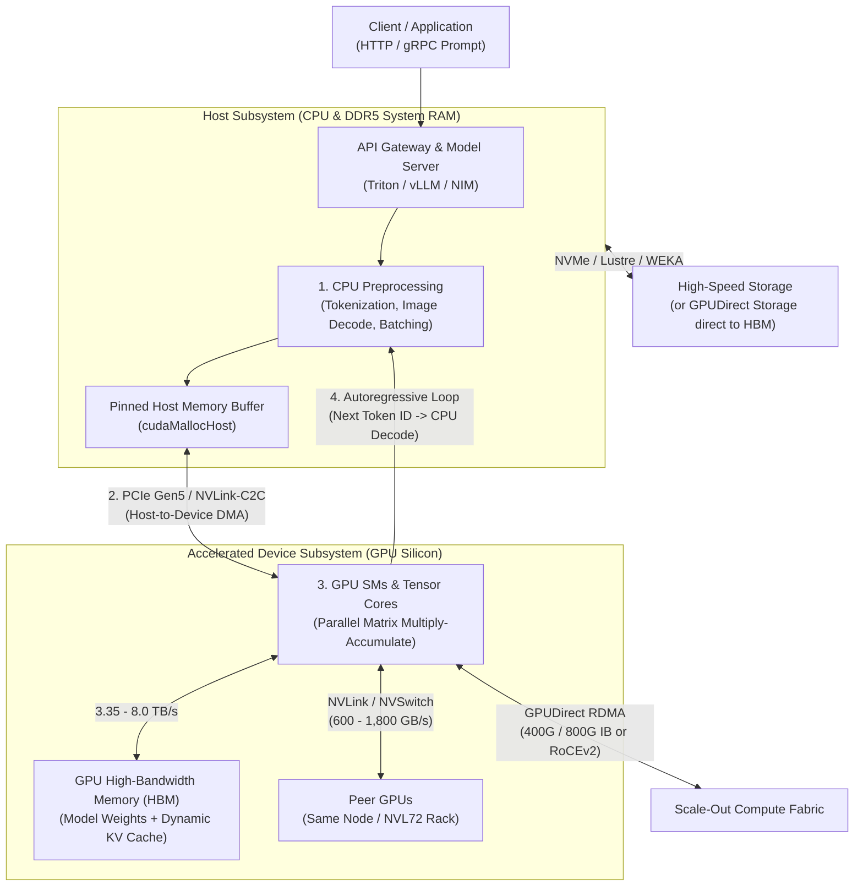
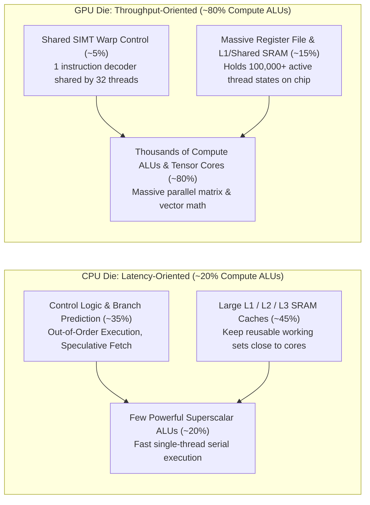
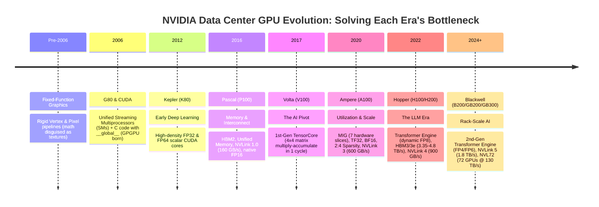
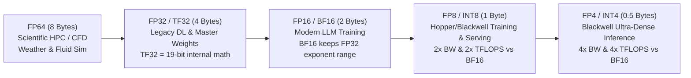
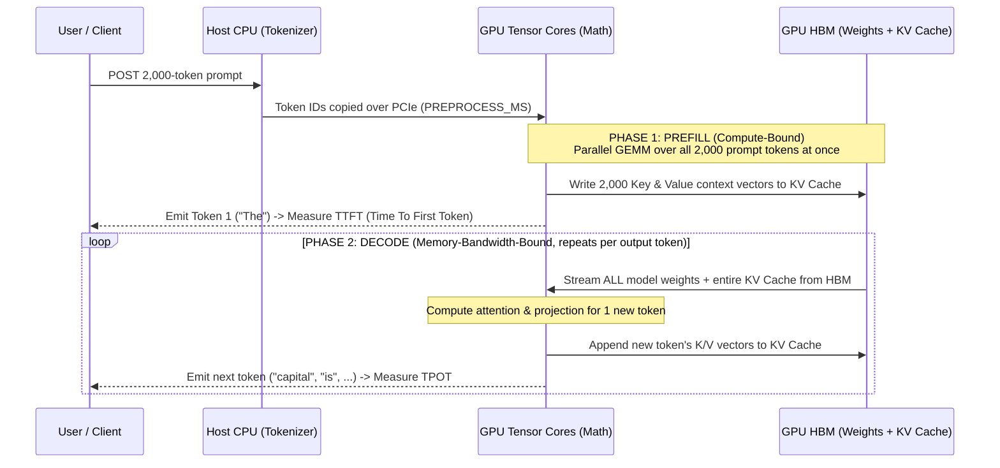
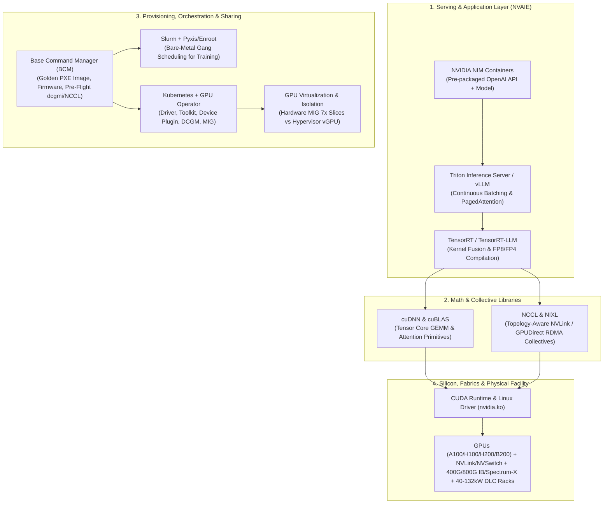
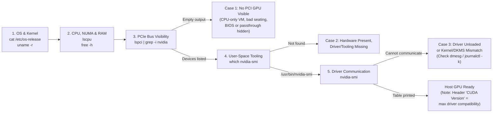

# 10.1 Why GPUs: CPU versus GPU and throughput design

| | |
|---|---|
| **Status** | Drafted (`why_gpus_lab.py`: 30 checks pass; GPU micro-benchmarks **untested** on live Nebius GPU VM) |
| **Level** | Basics |
| **Priority tier** | 2 |
| **Lab venue** | Nebius GPU + self-checking Python model (`code/part10/why_gpus_lab.py`) |
| **Part** | Part 10: The GPU and CUDA |
| **Sources used** | `nvidia-devops` V1 (Ch. 1–9, Labs 1–2); `nvidia-devops` V2 (Ch. 1); *AI Systems Performance Engineering* Ch. 1; *Parallel and High Performance Computing* Ch. 9 |

## Why this matters for AI infrastructure

When an AI service looks just like a web microservice from the outside—an HTTP `POST` carrying a JSON prompt in, a JSON answer out—it is tempting to operate and scale it like a web application. That instinct causes the most expensive mistakes in AI infrastructure. A web application is almost always **I/O-bound**: CPU threads spend most of their lives waiting on database queries, disk reads, or upstream REST calls, so adding more CPU servers behind a load balancer increases concurrency cleanly. An AI model is **compute-bound and memory-bandwidth-bound**: generating a single response requires billions or trillions of multiply-accumulate math operations and terabytes per second of memory movement. Adding 100 standard CPU servers will not make a single prompt faster; it will either saturate your network with synchronization traffic or stall on motherboard DDR memory buses.

Even when you deploy GPUs, you will face daily production questions that only a silicon-level mental model of throughput design can answer:
- Why is a training job running at 15% GPU utilization while all host CPU cores are pegged at 100%?
- Why did a data science team migrate legacy FP32 code from V100s to $30,000 H100s and see almost zero speedup?
- Why does a coding assistant generate words rapidly once it starts, yet stall for 10 seconds before the first word appears?
- Why can a cluster report 100% GPU utilization in `nvidia-smi` while wasting 70% of its actual compute capacity?

This chapter builds the foundational model of **latency-oriented CPU design versus throughput-oriented GPU design**, derives the exact formulas for peak FLOPs, memory bandwidth, PCIe transfer overhead, and **Goodput**, and connects the silicon inside a single GPU to the full-stack AI factory around it.

## Prerequisites and outcomes

**Prerequisites:**
- Linux process, memory, NUMA, and PCIe fundamentals from Part 1 (`1.8`, `1.10`, `1.17`).
- Familiarity with NVIDIA system families and rack envelopes from Part 9 (`9.1`–`9.5`).

**Outcomes:** After completing this chapter, you will be able to:
1. Contrast I/O-bound stateless web scaling with heterogeneous CPU+GPU AI execution, and trace a prompt through CPU preprocessing, PCIe transfer, GPU High-Bandwidth Memory (HBM), and the autoregressive decode loop.
2. Explain why Moore's Law and Dennard Scaling pushed CPUs toward multi-core latency design (~35% control/branch prediction, ~45% cache, ~20% ALUs) while GPUs evolved toward **Single Instruction, Multiple Threads (SIMT)** throughput design (~80% compute ALUs, ~15% registers/L1, ~5% control logic) with zero-cost **Warp Scheduling**.
3. Translate hardware terminology across OpenCL, AMD, NVIDIA/CUDA, and Intel, and calculate theoretical peak scalar/vector FLOPs, memory bandwidth (GDDR vs HBM), and PCIe Gen1–Gen6 transfer bandwidth (including `8b/10b` and `128b/130b` encoding overhead and pinned versus pageable host memory).
4. Explain the architectural evolution from fixed-function graphics pipelines to unified shaders (`G80`), scalar CUDA cores, **Tensor Cores** (`Volta`), **Multi-Instance GPU (MIG)** (`Ampere`), the **Transformer Engine** (`Hopper`), and rack-scale **NVL72** (`Blackwell`), along with the precision cascade from `FP64` (8 bytes) down to `FP4` (0.5 bytes).
5. Distinguish the compute-bound **Prefill** phase (**Time To First Token, TTFT**) from the memory-bandwidth-bound **Decode** phase (**Time Per Output Token, TPOT**), and explain how **Continuous Batching** and **PagedAttention** prevent **Key-Value (KV) cache** fragmentation and Out-Of-Memory (`OOM`) crashes.
6. Calculate **Goodput** ("effective training-time ratio" versus theoretical "speed of light"), apply the dense transformer training heuristic (`C ≈ 6 × N × D`), evaluate sparse **Mixture-of-Experts (MoE)** hardware-software codesign (`DeepSeek-V3`/`R1` on export-restricted `H800` GPUs), and model energy and job-suite parallel efficiency trade-offs.
7. Run the 8-step Linux host inspection sequence (`lspci`, `which nvidia-smi`, `nvidia-smi`) and trace a staged request pipeline to isolate CPU preprocessing bottlenecks from GPU execution bottlenecks.

---

## 1. Why AI breaks the web-scaling mindset

A traditional web server is built to wait efficiently; an AI server is built to move and multiply massive arrays of numbers without stalling.

Think of a web platform like a busy hotel front desk where receptionists spend most of their time waiting on phone calls to housekeeping or accounting. Hiring more receptionists lets you handle more guests waiting in parallel. An AI model, by contrast, is like translating an entire encyclopedia page by page: the work is relentless mental arithmetic and page-turning, and putting 100 clerks in separate buildings connected by slow walkie-talkies makes the translation slower, not faster.

### 1.1 I/O-bound web infrastructure versus compute- and memory-bound AI

In cloud-native web engineering, when an endpoint slows down, the bottleneck is almost always external I/O: a database query lock, an object-storage read, or a third-party REST call. While the thread waits on a socket, the CPU core yields to another request. Horizontal scaling—adding more stateless CPU pods behind a load balancer—solves concurrency because requests rarely share dense mathematical state.

AI workloads invert every one of those assumptions:
1. **Sustained matrix execution (`GEMM`):** Neural networks spend the vast majority of their runtime executing **General Matrix Multiply (`GEMM`)** operations across millions or billions of learned parameters.
2. **The Memory Bandwidth Wall:** To multiply those matrices, the processor must stream gigabytes of model weights from memory into the arithmetic units on every step. For a 70-billion-parameter model stored in 16-bit precision (`FP16` or `BF16`, 2 bytes per parameter), the weights alone occupy **140 GB**. Reading 140 GB across a standard CPU motherboard DDR5 memory bus (**~300–400 GB/s**) takes hundreds of milliseconds per token; reading it from GPU **High-Bandwidth Memory (`HBM3` / `HBM3e`)** at **3.35 TB/s to 8.0 TB/s** takes tens of milliseconds.
3. **Synchronous multi-device communication:** When a model does not fit on one accelerator, it is split across 8, 64, or 10,000 GPUs. Unlike independent web pods, those GPUs must synchronize intermediate activations and gradients continuously over low-latency interconnects (**NVLink** inside a node or rack, and **InfiniBand** or **RoCEv2** across nodes).

### 1.2 The four physical stages of an AI request on a heterogeneous node

Because neither a CPU alone nor a GPU alone can run an AI service, every modern AI node is a **heterogeneous computer** with a strict division of labor between the **Host (CPU + System RAM)** and the **Device (GPU + HBM)**:



When a user submits a prompt to an LLM service, four physical stages occur in sequence:
1. **Stage 1 — CPU Preprocessing (Host):** Neural networks cannot read raw UTF-8 strings or JPEG files. A tokenizer running on the host CPU converts text into an array of integer token IDs, and the serving engine (such as NVIDIA Triton or vLLM) groups incoming requests into a batch.
2. **Stage 2 — Host-to-Device Data Transfer (`PCIe` or `NVLink-C2C`):** Because a discrete GPU has its own separate physical memory space, the token array and launch instructions must cross the motherboard over the **Peripheral Component Interconnect Express (`PCIe`)** bus (or **NVLink-C2C** on Grace Superchips) into GPU memory.
3. **Stage 3 — Parallel Matrix Execution (GPU SMs + HBM):** The GPU's **Streaming Multiprocessors (`SMs`)** and **Tensor Cores** execute parallel Multiply-Accumulate (`MAC`) operations while streaming the model's weight matrices and context state from **High-Bandwidth Memory (`HBM`)**.
4. **Stage 4 — The Autoregressive Loop:** The GPU outputs a probability distribution for the *single next token*. That token ID is appended to the sequence, and the entire execution loop repeats once for every word in the response.

### 1.3 Three classic infrastructure bottlenecks on day one

Understanding those four stages immediately explains the three bottlenecks you will hunt as an AI infrastructure engineer:
- **Bottleneck 1 — The Memory Wall (GPU HBM bandwidth):** During token generation, the GPU must read all model weights from HBM for every single token produced. We mitigate this either by buying higher-bandwidth HBM (`H200` at 4.8 TB/s, `B200` at 8.0 TB/s) or by **quantizing** weights from 16-bit (`FP16`/`BF16`) to 8-bit (`FP8`/`INT8`) or 4-bit (`FP4`/`INT4`), halving the bytes moved per parameter at the cost of a small, carefully validated accuracy trade-off.
- **Bottleneck 2 — The Interconnect Wall (`PCIe` vs `NVLink` vs `RDMA`):** If a 70B or 405B model is split across multiple GPUs using Tensor Parallelism, those GPUs must synchronize after every transformer layer. Over PCIe Gen5 x16 (**~63–64 GB/s** per direction), GPUs spend much of their time waiting on the bus; over **NVLink** (**900 GB/s** on Hopper, **1,800 GB/s** on Blackwell) and **400G/800G GPUDirect RDMA** across nodes, the compute units stay fed.
- **Bottleneck 3 — Host Starvation (CPU preprocessing and storage I/O):** In vision or multimodal training, if the host CPU cannot read images from disk, decode JPEGs, and push batches across PCIe fast enough, $30,000 GPUs sit at 10–15% utilization waiting on a $1,000 CPU. The fix is fast NVMe/parallel storage, **GPUDirect Storage (`GDS`)** to bypass the CPU bounce buffer, or offloading data augmentation onto the GPU with **NVIDIA DALI**.

:::info In one minute: Section 1 takeaways
- **Web infrastructure** scales horizontally around **I/O waits**; **AI infrastructure** is governed by **matrix compute (`GEMM`)**, **HBM memory bandwidth**, and **GPU-to-GPU interconnect speed**.
- Every AI node is **heterogeneous**: the **CPU** runs the OS, `kubelet`/`slurmd`, tokenization, and kernel launches; the **GPU** runs parallel tensor math against its own dedicated **HBM**.
- Always check whether a slow workload is bottlenecked on **CPU preprocessing (Host Starvation)**, **PCIe/network transfers (Interconnect Wall)**, or **HBM weight streaming (Memory Wall)** before buying faster GPUs.
:::

---

## 2. CPU latency design versus GPU throughput design

A CPU is designed to minimize the latency of a single complex, unpredictable thread; a GPU is designed to maximize the combined throughput of tens of thousands of simple, predictable threads running in parallel.

### 2.1 The end of Dennard Scaling and the silicon budget split

Until roughly 2005, **Moore's Law** (transistor density doubling roughly every two years) and **Dennard Scaling** (power density staying constant as transistors shrank) gave software engineers a "free lunch": clock speeds climbed toward 4–5 GHz and single-threaded code automatically ran faster on every new CPU generation. Around 4–5 GHz, processors hit a **thermal wall** where leakage current and heat dissipation made higher clock frequencies impractical.

Processor architects responded in two radically different ways depending on the workload:



| Architectural dimension | General-purpose CPU (Latency Machine) | Accelerated GPU (Throughput Machine) |
|---|---|---|
| **Primary design goal** | Finish **one serial instruction stream** in as few nanoseconds as possible. | Finish **millions of parallel data operations** per second, even if each individual thread takes longer. |
| **Approximate silicon area split** | **~35%** Control Logic & Branch Prediction, **~45%** L1/L2/L3 Caches, **~20%** Compute ALUs. | **~80%** Compute Cores (ALUs & Tensor Cores), **~15%** Registers & L1/Shared Memory, **~5%** Control Logic. |
| **How it handles branching (`if/else`)** | Deep **Branch Prediction** and **Out-of-Order Execution** hardware guesses branches ahead of time. | Minimal control hardware; threads in a 32-thread **Warp** execute in lockstep (**SIMT**). Divergent branches serialize. |
| **How it hides memory latency** | Huge **L1/L2/L3 caches** (tens to hundreds of MB) avoid going to DDR RAM when working sets repeat. | **Zero-cost Warp Scheduling**: keeps tens of thousands of threads in physical registers and switches warps in 1 cycle when a memory fetch stalls. |
| **Main memory interface** | Motherboard DDR4/DDR5 DIMMs (**~150–400 GB/s** per socket). | On-package **GDDR6** (**300–864 GB/s**) or stacked **HBM2e/HBM3/HBM3e** (**2.0–8.0 TB/s**). |
| **Vector extensions trap** | Heavy `AVX-512` vector math draws high power, causing thermal down-clocking, and peaks at a few TFLOPS. | Purpose-built **Tensor Cores** sustain **1,000+ TFLOPS (1+ PFLOPS)** of dense low-precision matrix math. |

Why does a CPU's massive **L3 cache** fail on deep learning? A web server or database repeatedly reads the same hot lookup tables and code paths, so a 100 MB L3 cache achieves a high hit rate. A neural network forward pass streams a 140 GB weight tensor through the processor once per token: the 100 MB L3 cache is immediately blown out (cache thrashing), leaving the CPU's ALUs stalled waiting on 300 GB/s motherboard DDR5 RAM.

### 2.2 Cross-vendor hardware terminology (`OpenCL`, `AMD`, `NVIDIA`, `Intel`)

When you read research papers, profiler guides, or multi-vendor HPC documentation, different vendors use different names for the exact same hardware building blocks. Using the standard translation table from *Parallel and High Performance Computing* Chapter 9:

| Concept / Hierarchy level | Host CPU | OpenCL standard | AMD GPU (`ROCm`) | NVIDIA GPU (`CUDA`) | Intel GPU (`Gen11` / `Xe`) |
|---|---|---|---|---|---|
| **Accelerator device** | CPU socket | Compute device | GPU | GPU | GPU |
| **Hardware replication cluster** | Core complex | — | Shader Engine (`SE`) | Graphics Processing Cluster (`GPC`) | Slice |
| **Multiprocessor block** | Physical core | Compute Unit (`CU`) | Compute Unit (`CU`) | **Streaming Multiprocessor (`SM`)** | Subslice |
| **Individual scalar lane** | ALU / SIMD lane | Processing Element (`PE`) | Processing Element (`PE`) | **CUDA Core** (Compute Core) | Execution Unit (`EU`) |
| **Smallest execution unit** | Thread | Work Item | Work Item | **Thread** | Thread |
| **Lockstep execution group** | SIMD vector | Subgroup / Vector | Wavefront / Subgroup (**64** threads) | **SIMT Warp** (**32** threads) | SIMD subgroup |

In addition to dedicated discrete GPUs on PCIe cards or SXM baseboards, commodity laptops and desktops often contain **integrated GPUs** (or AMD **Accelerated Processing Units, APUs**) on the same die as the CPU, sharing CPU RAM to eliminate PCIe copy overhead for light workloads. For large-scale training and inference, however, **dedicated (discrete) GPUs** with dedicated HBM and high-speed interconnects are mandatory.

### 2.3 SIMT Warps, zero-cost context switching, and batch-size alignment

If you spawn 100,000 OS threads on a 64-core Linux CPU, the machine grinds to a halt. To switch from Thread A to Thread B, the Linux kernel must perform a **context switch**: pause the core, save all CPU registers out to system RAM, reload the next thread's registers from RAM, and flush pipeline state—costing thousands of clock cycles.

An NVIDIA GPU solves this with **Single Instruction, Multiple Threads (`SIMT`)** and **Warp Scheduling**:
1. **The 32-thread Warp:** Whenever work is launched on an NVIDIA GPU, the hardware groups threads into fixed bundles of **32 threads** called a **Warp**. All 32 threads in a warp execute the **exact same instruction at the exact same clock cycle** across 32 different data elements. Because all 32 lanes follow one instruction pointer, they share a single instruction fetch/decode unit—freeing up ~80% of the die for math units.
2. **Zero-cost register-resident warp switching:** Each Streaming Multiprocessor (`SM`) has a huge physical register file (65,536 32-bit registers per SM on modern architectures). Instead of keeping one thread's state on chip and swapping to RAM, the GPU keeps **tens of thousands of threads resident in hardware registers simultaneously**. When Warp 0 issues a global memory load to HBM (which takes hundreds of cycles), the SM warp scheduler does not wait and does not copy registers to RAM: on the very next clock cycle, it issues an instruction from Warp 1 whose operands are already in registers. Memory latency is **hidden by massive concurrency** rather than avoided by caches.
3. **Operational consequence — align dimensions to multiples of 8 or 32:** Because the hardware schedules whole warps of 32 threads (and Tensor Cores tile matrices in multiples of 8, 16, or 32), choosing a batch size or hidden dimension of **31** still forces the SM to allocate a full **32-thread warp**:
   - At batch size `31`: `1 warp = 32 lanes` is allocated, `1 lane` is masked off (`96.88%` lane efficiency).
   - At batch size `33`: `2 warps = 64 lanes` are allocated, leaving `31 lanes` idle (`51.56%` lane efficiency).
   Always pad batch sizes, vocabulary sizes, and matrix dimensions to multiples of **8 or 32** (and larger powers of two on FP8/FP4 Tensor Cores).

### 2.4 Calculating theoretical peak FLOPs, memory bandwidth, and PCIe overhead

Before running a single benchmark on a new GPU node, you should be able to compute its theoretical hardware ceilings ("speed of light") on the back of an envelope.

#### Formula 1: Peak theoretical scalar/vector FLOP/s
A Fused Multiply-Add (`FMA`) instruction computes `D = (A * B) + C` (two floating-point operations: one multiply and one add) in a single clock cycle. Therefore, peak theoretical floating-point performance in TFLOP/s is:

```text
Peak TFLOP/s = (Clock Rate (MHz) × Compute Units (SMs) × Cores per SM × 2 (FMA)) / 1,000,000
```

Reproducing the worked examples from *Parallel and High Performance Computing* Chapter 9 (Table 9.3, where HPC GPUs provide a **1:2 `FP64:FP32` ratio**—32 FP64 cores and 64 FP32 cores per SM—while graphics/ML GPUs often use 1:4, 1:8, or lower FP64 ratios):

| Accelerator | CUs / SMs | FP32 cores/CU | FP64 cores/CU | Boost Clock (MHz) | Peak FP32 (TFLOP/s) | Peak FP64 (TFLOP/s) |
|---|---|---|---|---|---|---|
| **NVIDIA V100 (Volta)** | 80 SMs | 64 | 32 | 1,530 MHz | `2 × 1530 × 80 × 64 / 10^6 =` **15.67** (`15.6` truncated) | `2 × 1530 × 80 × 32 / 10^6 =` **7.83** (`7.8`) |
| **NVIDIA A100 (Ampere)** | 108 SMs | 64 | 32 | 1,410 MHz | `2 × 1410 × 108 × 64 / 10^6 =` **19.49** (`19.5` rounded) | `2 × 1410 × 108 × 32 / 10^6 =` **9.75** (`9.7` truncated) |
| **AMD Radeon Instinct MI50 (Vega 20)** | 60 CUs | 64 | 32 | 1,746 MHz | `2 × 1746 × 60 × 64 / 10^6 =` **13.4** | `2 × 1746 × 60 × 32 / 10^6 =` **6.7** |
| **AMD Instinct MI100 (Arcturus)** | 120 CUs | 64 | 32 | 1,502 MHz | `2 × 1502 × 120 × 64 / 10^6 =` **23.1** | `2 × 1502 × 120 × 32 / 10^6 =` **11.5** |
| **Intel Ice Lake Gen11 Integrated** | 8 Subslices | 64 EUs | 16 (1:4 ratio) | 1,000 MHz | `2 × 1000 × 8 × 64 / 10^6 =` **1.0** | **0.25** |

*(Note: Those numbers measure standard scalar `FP32`/`FP64` CUDA cores; as we will see in Section 3, dedicated **Tensor Cores** multiply matrix throughput by another 10×–50× on `TF32`, `BF16`, `FP8`, and `FP4`.)*

#### Formula 2: Peak theoretical GPU memory bandwidth (`GDDR` vs `HBM`)
GPU global memory bandwidth depends on the memory clock frequency, the width of the memory bus in bits (divided by 8 bits per byte), and the data-rate transaction multiplier (2 for Double Data Rate `HBM`, or 4 to 8 for `GDDR5`/`GDDR5X`/`GDDR6`):

```text
Theoretical Memory Bandwidth (GB/s) = Memory Clock (GHz) × (Bus Width (bits) / 8) × Transaction Multiplier
```

| Memory technology | Memory Clock | Transaction Multiplier | Transfer Rate (GT/s) | Bus Width (bits) | Theoretical Bandwidth (GB/s) |
|---|---|---|---|---|---|
| **GDDR3** | 1.000 GHz | 2 | 2.0 GT/s | 256 bits | `1.0 × (256 / 8) × 2 =` **64 GB/s** |
| **GDDR5** | 2.000 GHz | 4 | 8.0 GT/s | 256 bits | `2.0 × (256 / 8) × 4 =` **256 GB/s** |
| **GDDR5X** | 1.375 GHz | 8 | 11.0 GT/s | 384 bits | `1.375 × (384 / 8) × 8 =` **528 GB/s** |
| **GDDR6** | 2.000 GHz | 8 | 16.0 GT/s | 384 bits | `2.0 × (384 / 8) × 8 =` **768 GB/s** |
| **HBM1** | 0.500 GHz | 2 | 1.0 GT/s | 4,096 bits | `0.5 × (4096 / 8) × 2 =` **512 GB/s** |
| **HBM2 (V100 example)** | 0.876 GHz | 2 | 1.752 GT/s | 4,096 bits | `0.876 × (4096 / 8) × 2 =` **897 GB/s** |
| **HBM2 (AMD MI50 example)** | 1.000 GHz | 2 | 2.0 GT/s | 4,096 bits | `1.000 × (4096 / 8) × 2 =` **1,024 GB/s** |

Notice *how* HBM achieves terabytes per second while saving power: instead of running a narrow 256-bit or 384-bit bus at very high clock frequencies like `GDDR6`, **HBM stacks DRAM dies vertically on the silicon interposer with an ultra-wide 4,096-bit or 5,120-bit bus** at a lower clock rate. When benchmarked empirically with **BabelStream** (`./cuda-stream`), a V100 with an `897 GB/s` theoretical ceiling achieves **`801.0 GB/s`** on `Copy`, **`839.0 GB/s`** on `Add`, **`840.7 GB/s`** on `Triad`, and **`866.1 GB/s`** on `Dot` (~93–96% of theoretical peak).

#### Formula 3: Theoretical PCIe bus bandwidth and pinned memory
When data moves between host CPU RAM and a discrete GPU over `PCIe`, the theoretical per-direction bandwidth across `L` lanes is:

```text
PCIe Bandwidth (GB/s) = Lanes × Transfer Rate (GT/s) × Overhead Factor × (1 byte / 8 bits)
```

where **PCIe Gen1 and Gen2** use `8b/10b` encoding (10 bits sent for every 8 bits of data = **20% overhead**, or an **80% (`0.80`) overhead factor**), while **PCIe Gen3, Gen4, Gen5, and Gen6** use `128b/130b` encoding (130 bits sent for every 128 bits of data = **1.54% overhead**, or a **98.46% (`0.9846`) overhead factor**):

| PCIe Generation | Transfer Rate per Lane | Encoding Overhead | Overhead Factor | 16-Lane (`x16`) Bandwidth (per direction) |
|---|---|---|---|---|
| **PCIe Gen1** | 2.5 GT/s | 20% (`8b/10b`) | 80% (`0.80`) | `16 × 2.5 × 0.80 / 8 =` **4.0 GB/s** |
| **PCIe Gen2** | 5.0 GT/s | 20% (`8b/10b`) | 80% (`0.80`) | `16 × 5.0 × 0.80 / 8 =` **8.0 GB/s** |
| **PCIe Gen3** | 8.0 GT/s | 1.54% (`128b/130b`) | 98.46% (`0.9846`) | `16 × 8.0 × 0.9846 / 8 =` **15.75 GB/s** |
| **PCIe Gen4** | 16.0 GT/s | 1.54% (`128b/130b`) | 98.46% (`0.9846`) | `16 × 16.0 × 0.9846 / 8 =` **31.51 GB/s** |
| **PCIe Gen5** | 32.0 GT/s | 1.54% (`128b/130b`) | 98.46% (`0.9846`) | `16 × 32.0 × 0.9846 / 8 =` **63.01 GB/s** |
| **PCIe Gen6** | 64.0 GT/s | 1.54% (`128b/130b`) | 98.46% (`0.9846`) | `16 × 64.0 × 0.9846 / 8 =` **126.03 GB/s** |

In practice, achieved PCIe throughput depends heavily on **transfer size** and **pinned versus pageable host memory**:
- **Small transfer penalty:** Transfers smaller than ~`10^7` bytes (10 MB) are dominated by per-transfer setup latency and achieve a small fraction of peak bandwidth.
- **Pageable (`malloc`) versus Pinned (`cudaMallocHost`) memory:** Standard OS allocations are *pageable* (the kernel can swap them to disk). Because the GPU's Direct Memory Access (`DMA`) engine requires physical addresses that will not move mid-transfer, copying from pageable memory forces the CUDA driver to first copy the array on the CPU into a temporary internal **pinned (page-locked)** staging buffer, and only then DMA across PCIe. Allocating host buffers directly in pinned memory (`cudaMallocHost` in C, or `pin_memory=True` in a PyTorch `DataLoader`) eliminates that extra CPU copy—reaching **~11.6 GB/s (~72% of the 15.75 GB/s peak)** with low variance on a PCIe Gen3 x16 system.

### 2.5 Five workload patterns where GPUs struggle

GPUs are specialized throughput engines, not drop-in replacements for every CPU program. Five workload characteristics perform poorly on GPUs:
1. **Lack of parallelism ("First Law of GPGPU"):** If an algorithm is inherently serial or launches only a few hundred threads, it cannot fill the SMs or hide memory latency; a high-clock-speed CPU core will beat the GPU.
2. **Irregular, pointer-chasing memory access ("Second Law of GPGPU"):** Graph traversals or sparse lookups that jump randomly across memory prevent the GPU from coalescing memory requests into wide HBM transactions.
3. **Severe thread/warp divergence:** If threads within the same 32-thread warp take wildly different `if/else` branch paths, the SIMT hardware must execute every branch path serially with inactive lanes masked off.
4. **Dynamic host-driven memory allocations:** Allocating and freeing GPU device memory (`cudaMalloc`) inside a tight loop stalls execution on the host CPU.
5. **Deep recursive algorithms:** GPU threads have very small per-thread stack frames compared to CPU threads and are poorly suited to deep call-stack recursion.

:::info In one minute: Section 2 takeaways
- **CPUs (~20% ALUs, ~45% caches, ~35% control)** minimize single-thread latency; **GPUs (~80% ALUs, ~15% registers/L1, ~5% control)** maximize parallel throughput via **32-thread SIMT Warps** and **zero-cost register-resident warp switching**.
- **Peak scalar TFLOP/s** `= Clock (MHz) × SMs × Cores/SM × 2 / 10^6`; **Peak Memory BW (GB/s)** `= Clock (GHz) × (Bus bits / 8) × Multiplier`; **PCIe x16 BW** `= 16 × GT/s × 0.9846 / 8` (`15.75 GB/s` Gen3, `31.5 GB/s` Gen4, `63 GB/s` Gen5, `126 GB/s` Gen6).
- Always batch transfers above **10 MB**, use **pinned host memory (`pin_memory=True`)**, and pad tensor/batch dimensions to multiples of **8 or 32**.
:::

---

## 3. How GPU silicon evolved from pixels to Tensor Cores and NVL72

The history of NVIDIA data center GPUs is a sequence of targeted silicon inventions—each removing the specific bottleneck that limited the previous generation.

### 3.1 From 4K video games to GPGPU and CUDA

Rendering a 4K frame (`3840 × 2160`) at 60 frames per second requires computing lighting, shading, and geometry for **more than 8 million independent pixels, 60 times every second**. Around 2006–2010, scientific computing teams running `O(N^2)` molecular dynamics simulations noticed that calculating forces between millions of atoms had the exact same mathematical shape as shading millions of pixels. A single workstation with four consumer "Fermi" GPUs could outperform a multi-million-dollar CPU cluster whose Ethernet/MPI network was saturated with inter-node messages.



1. **Fixed-Function Era (Pre-2006):** Early GPUs had separate, hardwired Vertex Processors and Pixel Processors. Researchers had to disguise matrix equations as 2D graphics textures (`OpenGL` shaders) to trick the hardware into doing scientific math.
2. **Unified Programmable Shaders and CUDA (`G80`, 2006–2007):** NVIDIA replaced separate vertex/pixel engines with unified **Streaming Multiprocessors (`SMs`)** and released **CUDA (Compute Unified Device Architecture)**, allowing engineers to write standard C/C++ functions marked `__global__` and launch them directly across thousands of GPU threads (**General-Purpose GPU computing, `GPGPU`**).
3. **Pascal (`P100`, 2016):** Introduced on-package **HBM2**, hardware **Unified Memory** page faulting, native 16-bit floating-point (`FP16`), and 1st-generation **NVLink (`160 GB/s`)** to break the PCIe bottleneck.
4. **Volta (`V100`, 2017) — The Tensor Core Revolution:** Traditional **CUDA Cores** are scalar processors: each core computes one scalar Multiply-Accumulate (`D = A × B + C`) per cycle, so multiplying two `4 × 4` matrices requires **`4 × 4 × 4 = 64` separate scalar operations**. Volta introduced the **Tensor Core**, a dedicated matrix engine that multiplies an entire `4 × 4` FP16 matrix by another `4 × 4` FP16 matrix and accumulates a `4 × 4` FP32 matrix in a **single clock cycle** (a 64-to-1 operation reduction).
5. **Ampere (`A100`, 2020) — Hardware Isolation (`MIG`) and `TF32`/`BF16`:** Solved two production problems: (a) **Multi-Instance GPU (`MIG`)** physically partitions a single A100 (40/80 GB HBM2e, `2.0 TB/s`, `600 GB/s` NVLink 3) into up to **7 hardware-isolated GPU instances**, each with dedicated SMs, L2 cache banks, and memory controllers so small Kubernetes pods do not waste an entire GPU or suffer noisy-neighbor interference; and (b) introduced **`TF32`** and **`BF16`** Tensor Core formats plus 2:4 structured sparsity.
6. **Hopper (`H100` / `H200`, 2022–2024) — The Transformer Engine:** Built for massive LLMs (`H100`: 80 GB HBM3 at `3.35 TB/s`; `H200`: 141 GB HBM3e at `4.8 TB/s`; `900 GB/s` NVLink 4). Hopper's **Transformer Engine** dynamically inspects tensor ranges per layer and switches between 16-bit (`FP16`/`BF16`) and 8-bit (**`FP8`**) precision on the fly—halving weight memory traffic and doubling Tensor Core throughput without manual quantization tuning.
7. **Blackwell (`B200` / `GB200` / `GB300`, 2024+) — Rack-Scale `NVL72` and `FP4`:** Each B200 GPU provides **180–192 GB HBM3e** (`288 GB` on `B300` Ultra) at **`8.0 TB/s`** memory bandwidth, **2nd-generation Transformer Engine** support for **4-bit (`FP4`)** microscaled precision, and **`1.8 TB/s`** bidirectional **NVLink 5** per GPU (`18 × 100 GB/s` links). In a **GB200/GB300 NVL72** rack ("an AI supercomputer in a rack"), **36 Grace CPUs and 72 Blackwell GPUs** connect across an NVSwitch copper backplane at **`130 TB/s`** aggregate NVLink bandwidth, delivering **`1.44 ExaFLOPS` of `FP4`** (`720 PetaFLOPS` of `FP8`), **13.5 TB of HBM3e** (~**30 TB** total fast memory counting Grace LPDDR5X) inside a **120–132 kW** liquid-cooled rack. In published **MLPerf v5.0 (2025)** submissions, a GB200 NVL72 achieved up to **2.6× higher training throughput per GPU** and **3.4× higher inference throughput per GPU** than an equivalent Hopper system.

### 3.2 The precision cascade: trading bits for memory bandwidth and FLOPs

Every step down in numerical precision cuts the bytes stored in HBM and transferred over memory buses while multiplying Tensor Core throughput:



Two operational traps catch infrastructure teams during hardware upgrades:
1. **Trap 1 — Running unoptimized `FP32` code on Hopper/Blackwell:** When a data science team migrates a legacy `FP32` training container from V100 to H100 without enabling **Automatic Mixed Precision (`torch.amp` / `BF16` / `FP8`)** or `TF32`, the workload bypasses the low-precision Tensor Core pipelines and runs on scalar FP32 cores—wasting the primary acceleration silicon of the H100.
2. **Trap 2 — Buying AI GPUs (`H100`) for pure `FP64` scientific simulations without profiling:** If an HPC team runs legacy raw-CUDA fluid dynamics strictly requiring 64-bit double precision (`FP64`), an H100 is still faster than a V100 because its FP64 cores, L2 cache, and 3.35 TB/s HBM3 are all faster, but the team pays a heavy price premium for Hopper's Transformer Engine and FP8 Tensor Cores that their `FP64` code never touches. Always benchmark with **Empirical Roofline Toolkit (`ERT`)** or **`mixbench`** (which plots compute GFLOP/s against memory bandwidth GB/s across arithmetic intensities from `1 FLOP/load` typical apps up to `65 FLOPs/load` dense GEMM) to match the SKU to the workload's arithmetic intensity.

:::info In one minute: Section 3 takeaways
- A scalar **CUDA Core** computes 1 multiply-accumulate per cycle (**64 ops** for a `4 × 4` matrix multiply); a **Tensor Core** (Volta+) computes an entire `4 × 4` matrix multiply-accumulate in **1 operation**.
- Stepping precision down from **`FP32` (4B) → `BF16` (2B) → `FP8` (1B) → `FP4` (0.5B)** shrinks model weight memory and multiplies effective memory bandwidth and Tensor Core TFLOPS.
- **L-series (`L4`, `L40S`)** PCIe GPUs target graphics, media, and small-batch inference; **H/B-series (`H100`, `H200`, `B200`, `GB200 NVL72`)** SXM/rack systems provide the HBM3/3e bandwidth and NVLink/NVSwitch fabrics required for distributed training and frontier LLM serving.
:::

---

## 4. Anatomy of an LLM inference request: Prefill, Decode, and the KV Cache

An LLM inference request is not a uniform computation; it splits into a **compute-bound Prefill phase** followed by a **memory-bandwidth-bound Decode phase** that dynamically consumes GPU memory via the **KV Cache**.

### 4.1 Phase 1 (Prefill / TTFT) versus Phase 2 (Decode / TPOT)

Because Transformer LLMs are autoregressive, serving a single prompt stresses two completely different parts of the GPU in sequence:



| Inference phase | What the hardware does | Primary hardware bottleneck | Primary SLI metric | Typical symptom when degraded |
|---|---|---|---|---|
| **1. Prefill Phase** (reading the prompt) | Processes all input prompt tokens (e.g., 2,000–5,000 tokens) **in parallel** in one massive matrix-matrix multiplication (`GEMM`) and populates the initial **KV Cache** in HBM. | **Compute-bound** (saturates GPU Tensor Cores). | **TTFT (Time To First Token):** delay from request arrival until the first output token appears. | Users stare at a blank screen for 5–10 seconds on long prompts (such as 5,000-line codebases), even though subsequent words stream fast. |
| **2. Decode Phase** (generating the answer) | Generates **one token at a time sequentially**. For *every single word*, the GPU must read all model weights plus the growing **KV Cache** from HBM into the SMs to do a tiny matrix-vector multiply. | **Memory-bandwidth-bound** (saturates HBM GB/s). | **TPOT (Time Per Output Token)** / **ITL (Inter-Token Latency)**. | First word appears quickly (`TTFT = 0.2s`), but text streams painfully slowly (`TPOT = 1.5s/word`). |

When a platform team complains that an internal coding assistant has a 10-second `TTFT` on 5,000-line code prompts while `TPOT` is fast, buying GPUs with higher memory bandwidth will not fix the problem—because Prefill is **compute-bound**. The right architectural fixes for high `TTFT` are:
1. **Prefix / Prompt Caching** (in vLLM, SGLang, or TensorRT-LLM) so shared codebase prefixes reuse pre-computed KV cache blocks without re-running prefill math.
2. **Input context rate-limiting** or chunked prefill.
3. **Disaggregated Prefill and Decode serving**: routing heavy prompt prefill onto compute-optimized prefill nodes and transferring the resulting KV cache over RDMA/NVLink (via libraries such as NVIDIA **NIXL** and **NVIDIA Dynamo**) to bandwidth-optimized decode nodes.

### 4.2 The KV Cache memory crisis, Continuous Batching, and PagedAttention

Why does an inference server crash with `CUDA out of memory (OOM)` under concurrent user load even when the model weights fit comfortably in VRAM?
- Suppose an 8-billion-parameter model in `FP16` (2 bytes/param) occupies **16 GB** of weights on a **24 GB** GPU, leaving **8 GB** of free VRAM.
- Every active user request stores its **Key-Value (`KV`) Cache** in that remaining 8 GB, and the KV cache grows linearly with sequence length and concurrency. If 10 users upload large PDFs simultaneously, their KV caches rapidly exceed 8 GB and crash the server with an `OOM` error.

Modern inference engines (**vLLM**, **Triton Inference Server**, **TensorRT-LLM**, **SGLang**, and **NVIDIA NIM**) solve concurrency and utilization with two foundational systems techniques:
1. **Continuous (In-Flight) Batching:** Static batching waits for the longest response in a batch (e.g., 500 tokens) to finish before starting new requests, leaving GPU slots idle for users whose answers finished in 5 tokens. **Continuous Batching** evicts completed sequences and inserts newly arrived requests at the granularity of a single decode step, keeping GPU utilization high.
2. **PagedAttention (virtual memory paging for the KV Cache):** Early serving systems required each request's KV cache to reside in a single contiguous slab of VRAM pre-allocated for the maximum possible context length, wasting **60% to 80% of KV cache memory** to internal and external fragmentation. **PagedAttention** (introduced by the vLLM project) partitions the KV cache into fixed-size, non-contiguous physical blocks mapped via a page table—just like Linux virtual memory pages—eliminating fragmentation waste and increasing serving throughput by **2× to 4×** at the same latency.

:::info In one minute: Section 4 takeaways
- Never monitor LLM serving with a single HTTP latency metric: always separate **TTFT** (compute-bound **Prefill**) from **TPOT** (memory-bandwidth-bound **Decode**).
- Model weights are static in VRAM, but the **KV Cache** grows dynamically with prompt length and active user concurrency.
- Use **Continuous Batching** and **PagedAttention** (via Triton, vLLM, TensorRT-LLM, or NIM) instead of raw PyTorch loops to eliminate the **60–80% KV cache fragmentation waste** and triple concurrent throughput.
:::

---

## 5. Performance engineering at scale: Goodput, Mechanical Sympathy, and energy

At cluster scale, raw `nvidia-smi` utilization and peak datasheet TFLOPS are vanity metrics; what determines training time and cost is **Goodput**—the fraction of theoretical cluster capacity spent doing useful mathematical progress.

### 5.1 Measuring Goodput ("Effective Training-Time Ratio") versus Speed of Light

In `nvidia-smi`, **`GPU-Util: 100%`** only means that *at least one CUDA kernel was active on the GPU during the sampling window*—even if that kernel was using 5% of the SMs or spinning on a communication wait. To measure real efficiency, *AI Systems Performance Engineering* Chapter 1 defines two concepts:
- **Speed of Light (`SoL`):** The theoretical maximum throughput of the hardware (tokens/sec or samples/sec) if compute, memory, and interconnects operated at 100% peak without stalls.
- **Goodput (Useful Throughput):** The actual rate of productive work completed end-to-end (tokens processed or valid training steps committed per second), discounting time lost to data-loading stalls, `AllReduce` communication waits, pipeline bubbles, job preemptions, and failure restarts/rollbacks:

```text
Goodput Efficiency (%) = (Achieved Useful Throughput (tokens/s or samples/s) / Cluster Speed of Light Throughput) × 100%
```

Two concrete examples from *AI Systems Performance Engineering* Chapter 1 illustrate why Goodput is the north-star metric:
1. **8-GPU node token goodput worked example:** Suppose an 8-GPU node processes **100,000 tokens in 10 seconds**, giving an achieved goodput of **10,000 tokens/s**. If each GPU has a theoretical peak ("speed of light") of **1,500 tokens/s** (**12,000 tokens/s** across all 8 GPUs), the node's Goodput efficiency is:
   ```text
   10,000 tokens/s / 12,000 tokens/s = 0.8333 ≈ 83.3%
   ```
2. **Cluster-scale wasted compute (Meta's *Revisiting Reliability* study):** In large-scale production clusters that appear 100% utilized on dashboards, **70% to 75% of raw compute** can be lost to communication stalls, slow data pipelines, resource fragmentation, preemptions, and hardware fault restarts. A job capable of **1,000 samples/s** on ideal hardware that achieves only **300 samples/s** is running at **30% goodput** (**70% wasted capacity**). Raising goodput by even 20% on a large cluster saves millions of dollars in hardware and power.

### 5.2 Mechanical sympathy, 100-trillion-parameter math, and the DeepSeek-V3/R1 case study

Coined by race-car champion Jackie Stewart and applied to computing by Martin Thompson, **mechanical sympathy** means designing software and algorithms that work *with* the physical grain of the hardware rather than against it:
- **Hardware-aware algorithms (`FlashAttention` and `SFUs`):** Standard attention materializes a huge `N × N` matrix in slow HBM. **FlashAttention** tiles the attention math inside fast on-chip **SRAM (Shared Memory)**, cutting HBM reads/writes and delivering a **2× to 4× speedup** while shrinking memory footprint. Conversely, because transformer attention relies heavily on exponentials (`e^x`) in `softmax`, NVIDIA expanded the **Special Function Units (`SFUs`)** in modern SMs to accelerate transcendental math alongside Tensor Cores.
- **Why brute-force scaling hits a wall at 100 trillion parameters:** Using the dense transformer training heuristic `C ≈ 6 × N × D` (where `N` is parameters and `D` is training tokens), training a dense **100-trillion-parameter (`10^14`)** model on **29 trillion (`2.9 × 10^13`) tokens** requires:
  ```text
  C ≈ 6 × 10^14 × 2.9 × 10^13 = 1.74 × 10^28 FLOPs
  ```
  Just loading the raw `FP16` weights (`10^14 × 2 bytes`) requires **200 TB (`200,000 GB`) of HBM**—roughly **1,110–1,112 NVIDIA B200 GPUs** (`180 GB` each, or ~125–139 8-GPU nodes) or **695 NVIDIA B300 GPUs** (`288 GB` each, or ~86–87 8-GPU nodes) *before* counting optimizer states, gradients, activations, or KV cache.
- **Case study — How `DeepSeek-V3` and `DeepSeek-R1` beat hardware export limits:** Restricted from buying top-tier `B200` or `H100` (`900 GB/s` NVLink) GPUs, DeepSeek trained its ~680-billion-parameter `DeepSeek-V3` and reasoning `DeepSeek-R1` models on export-compliant **NVIDIA `H800` GPUs**, whose NVLink bandwidth is throttled to **`400 GB/s`** (less than half of `H100`). Rather than brute-forcing dense compute (which cost an estimated **~$100M** for GPT-4 and **~$191M** for Gemini Ultra), DeepSeek reported training for **under `$6M` in compute** through five co-designed optimizations (open-sourced during their February 2025 Open-Source Week):
  1. **Sparse Mixture-of-Experts (`MoE`) routing:** Out of **~680B total parameters**, each token activates only **1 shared expert + 8 routed experts (out of 256) = 9 active experts**, or **~37B active parameters per token (5.44%)**, keeping per-token FLOPs low.
  2. **`Multi-Head Latent Attention (MLA)` and `FlashMLA`:** Compressed KV cache representations and custom CUDA C++ attention kernels tuned for H800 memory hierarchies.
  3. **`DeepGEMM`:** Fine-grained **`FP8`** matrix multiplication kernels for dense and MoE layers.
  4. **`DualPipe` and `DeepEP`:** Bidirectional pipeline parallelism (`DualPipe`) and custom expert-parallel RDMA/NVLink kernels (`DeepEP`) + redundant expert load balancing (`EPLB`) that completely overlap computation with communication, hiding the H800's 400 GB/s NVLink constraint.
  5. **`Fire-Flyer File System (3FS)`:** A distributed parallel filesystem that saturates NVMe SSD and RDMA bandwidth so storage never starves the GPUs.

### 5.3 Time-to-solution, energy efficiency, and job-suite parallel efficiency

When making a business case for GPUs (or deciding how many GPUs to allocate per job), three quantitative models from *Parallel and High Performance Computing* Chapter 9 provide concrete proof:

1. **Time-to-solution (`CloverLeaf` hydrodynamics benchmark, 500,000 cycles):**
   - **16-core Intel Ivy Bridge CPU (`E5-2650 v2 @ 2.60 GHz`):** `615.1 s` for 500 cycles (`1.23 s/cycle`) → **171 hours (7 days, 3 hours)** for the full run.
   - **36-core Intel Skylake CPU (`Xeon Gold 6152 @ 2.10 GHz`):** `273.3 s` for 500 cycles (`0.55 s/cycle`) → **76.4 hours (3 days, 4 hours)**.
   - **1x NVIDIA V100 GPU (`CUDA -arch=sm_70`):** `59.3 s` for 500 cycles (`0.12 s/cycle`) → **16.5 hours** (**4.6× faster** than the 36-core Skylake CPU and **10.4× faster** than the 16-core Ivy Bridge CPU).
2. **Energy and hardware cost to deliver `10 TB/s` of aggregate memory bandwidth:**
   ```text
   Energy (kWh) = (N_processors × TDP (Watts) × T_hours) / 1,000
   ```

   | Design target: `~10 TB/s` aggregate memory bandwidth (24-hour run) | CPU Cluster: **45× Intel Xeon Gold 6152** | GPU Cluster: **12× NVIDIA V100 GPUs** |
   |---|---|---|
   | **Sustained memory bandwidth** | `45 × 224 GB/s =` **10.1 TB/s** | `12 × 850 GB/s =` **10.2 TB/s** |
   | **Processor hardware cost** | `45 × $3,800 =` **$171,000** | `12 × $11,000 =` **$132,000** (~23% lower) |
   | **Nameplate TDP per processor** | `140 W` per CPU | `300 W` per GPU |
   | **24-hour energy consumption** | `45 × 140 W × 24 h =` **151.2 kWh** | `12 × 300 W × 24 h =` **86.4 kWh** (**~42.9% less energy**) |

   Even though each GPU has a higher wattage (`300 W` vs `140 W`), the GPU cluster requires far fewer chips to hit `10 TB/s` (and finishes jobs faster), cutting total energy in kWh by more than 40%. Furthermore, empirical `nvidia-smi dmon` power integration during the 60-second `CloverLeaf` V100 run measured **10.4 kJ**, or **~61% of nameplate 300 W TDP** at 100% utilization (and **~20% of TDP** at idle).
3. **Single-job turnaround versus multi-job suite throughput (the parallel-efficiency trap):**
   Suppose you have **100 jobs** to run on a **200-processor cluster**. On **20 processors**, each job takes **10 hours**. If you double a job's allocation to **40 processors** (`P_mult = 2`), communication overhead reduces parallel efficiency to **`P_efficiency = 80%`**:
   - **Single-job speedup (`S`):** `S = P_efficiency × P_mult = 0.80 × 2 =` **1.6×**, so one 40-processor job finishes in `T_new = 10 h / 1.6 =` **6.25 hours** (faster turnaround for a single urgent job).
   - **Total 100-job suite completion time:**
     - **Case 1 (10 concurrent jobs × 20 processors):** `10 batches × 10 h =` **100 hours total**.
     - **Case 2 (5 concurrent jobs × 40 processors):** `20 batches × 6.25 h =` **125 hours total** (**25 hours slower** across the suite).
   **Operational rule:** Scale *up* processors per job when minimizing latency for a single critical run; scale *down* processors per job (within memory limits) when maximizing total cluster throughput across a large queue of jobs.

:::info In one minute: Section 5 takeaways
- **Goodput** `= Useful Throughput / Speed of Light`; `100% GPU-Util` in `nvidia-smi` can still mask 70% wasted compute from data stalls, communication waits, or restarts.
- **Mechanical sympathy** co-designs algorithms with hardware: `FlashAttention` tiles attention in SRAM (2–4× faster), while `DeepSeek-V3` combined 9-of-256 MoE sparsity (~37B active of 680B params), `MLA`, `FP8 DeepGEMM`, `DualPipe`, and `3FS` to train on 400 GB/s `H800` GPUs.
- GPUs cut **total energy (kWh)** when they replace many lower-bandwidth CPUs or shorten runtime, and running narrower jobs with higher parallel efficiency completes a **multi-job queue** faster than over-scaling each individual job.
:::

---

## 6. From one GPU to the full-stack AI factory

A fast GPU is useless if the network drops packets, the scheduler launches only 63 of 64 ranks, the container lacks device access, or the data center rack trips its circuit breaker.



To orient you for the rest of Part 10 and Parts 11–17, here is how the full NVIDIA infrastructure stack fits around the GPU:
1. **Low-level runtime and math libraries (`CUDA`, `cuDNN`, `NCCL`, `NIXL`):**
   - **CUDA & `cuDNN`:** Expose the SMs and Tensor Cores to C++ and Python frameworks (`10.9`, `10.11`).
   - **`NCCL` (NVIDIA Collective Communications Library):** Automatically inspects node and fabric topology (`NVLink` vs `PCIe` vs `InfiniBand` / `Spectrum-X RoCEv2`) to route multi-GPU collectives (`AllReduce`, `AllGather`, `ReduceScatter`) using **GPUDirect RDMA** without touching the host CPU (`12.15`–`12.19`). **NIXL** provides low-latency point-to-point KV cache transfers across GPU memory and storage tiers for disaggregated inference.
2. **Model compilation and serving (`TensorRT-LLM`, `Triton`, `NIM`):**
   - **TensorRT / TensorRT-LLM** compiles PyTorch models by fusing layers and targeting `FP8`/`FP4` Tensor Cores; **Triton Inference Server** wraps the compiled engine with HTTP/gRPC endpoints and continuous in-flight batching; **NVIDIA Inference Microservices (`NIM`)** package the model, TensorRT-LLM engine, Triton server, and CUDA dependencies into a single hardened container under **NVIDIA AI Enterprise (`NVAIE`)** commercial SLAs and CVE patching (`15.5`–`15.7`, `16.12`).
3. **Orchestration (`Kubernetes` vs `Slurm`) and bare-metal provisioning (`BCM`):**
   - **Base Command Manager (`BCM`):** Provisions immutable golden OS images, lockstep Mellanox/NVIDIA drivers and firmware over PXE, and gates nodes with automated `dcgmi diag` and `nccl-tests` before users touch them (Part 8).
   - **Kubernetes + NVIDIA GPU Operator:** Ideal for always-on **inference services** and MLOps pipelines. Because vanilla Kubernetes only understands CPU and RAM, the **GPU Operator** deploys DaemonSets for the NVIDIA Driver Container, Container Toolkit, Kubernetes Device Plugin (`nvidia.com/gpu`), `DCGM Exporter` (Prometheus hardware metrics), and `MIG Manager` (`11.1`–`11.5`).
   - **Slurm (`slurmctld` / `slurmd`):** Ideal for large-scale **synchronous multi-node training**. Vanilla Kubernetes lacks native **Gang Scheduling**: if a job requests 64 GPUs and only 30 are free, default Kubernetes schedules 30 pods that sit idle (or crash with `NCCL Timeout` waiting for the other 34 peers). Slurm natively queues the job until all 64 GPUs on the required InfiniBand leaf switches are free, then launches them together on bare metal (or via rootless `Enroot`/`Pyxis` containers). To run large training jobs on Kubernetes, you must add a batch/gang scheduler such as **KAI Scheduler / Run:ai**, **Kueue**, or **Volcano** plus **Multus / Network Operator** for RDMA (`11.7`–`11.20`).
4. **GPU sharing (`MIG` vs `vGPU`) and physical facility limits (`DLC`):**
   - **Multi-Instance GPU (`MIG`)** slices an A100/H100/H200/B200 in **hardware** into up to 7 isolated instances with dedicated SMs, L2 cache, and memory bandwidth (ideal for Kubernetes pods), whereas **NVIDIA `vGPU`** shares a GPU across **hypervisor virtual machines** (`VMware vSphere` / `KVM`) (`11.23`–`11.26`).
   - **Facility thermodynamics:** A legacy enterprise rack supplies **5–15 kW** of air cooling; stacking four 10.2 kW DGX H100s (**>40 kW**) or eight in one rack (**~85 kW**, **>1,000 lbs**) will trip PDUs, exceed raised-floor weight ratings, and thermally throttle the GPUs. High-density racks require **Rear Door Heat Exchangers (`RDHx`)** or **Direct Liquid Cooling (`DLC`)** cold plates with Coolant Distribution Units (`CDUs`), mandatory on **120–132 kW `GB200/GB300 NVL72`** racks (`6.30`, `9.11`).

---

## 7. Inspecting a GPU host and tracing a staged request path

Before installing drivers, deploying operators, or blaming the GPU for high latency, follow two disciplined operational habits: **verify the host hardware/driver layers from bottom to top**, and **measure request latency stage by stage**.

### 7.1 The 8-step host inspection sequence and 3-layer failure triage

Never assume `nvidia-smi: command not found` means a server has no GPU, and never install drivers before checking the PCIe bus:



*(Note: Combining the 3-layer host inspection state machine from Volume 01 Lab 01 with the staged request latency analyzer from Volume 01 Lab 02 into the unified `diagnose_host_and_request_stage` classifier in `code/part10/why_gpus.py` is **my inference**.)*

---

## Commands and configurations that matter

### 1. The 8-step Linux & GPU host qualification sequence (untested on live Nebius GPU VM)

```bash
# Step 1 & 2: Identify OS distribution and running kernel (driver module must match uname -r)
cat /etc/os-release
uname -r

# Step 3 & 4: Inspect CPU sockets, cores, NUMA nodes, and available RAM / swap usage
lscpu | grep -E "Architecture:|CPU\(s\):|Thread\(s\) per core:|Core\(s\) per socket:|Socket\(s\):|NUMA"
free -h

# Step 5 & 6: Inspect PCIe bus and verify NVIDIA GPU / NVSwitch / ConnectX visibility
lspci | grep -i nvidia
sudo lspci -vvv | grep -E "PCI bridge|NVIDIA|LnkCap|LnkSta"

# Step 7 & 8: Verify nvidia-smi binary and kernel driver communication
which nvidia-smi || echo "nvidia-smi not found"
nvidia-smi

# Optional: If nvidia-smi fails to communicate with the driver, inspect kernel logs
sudo dmesg -T | grep -iE "nvidia|nvrm|xid"
sudo journalctl -k | grep -i nvidia
```

### 2. Monitoring GPU power and utilization over time (`nvidia-smi dmon`)

```bash
# Log power (W), GPU/memory temp (C), SM/mem utilization (%), and clocks every 1s for 65 samples
nvidia-smi dmon -i 0 --select pumct -c 65 --options DT --filename gpu_monitoring.log &
```

### 3. Empirical memory bandwidth (`BabelStream`) and Roofline (`mixbench`) micro-benchmarks

```bash
# 1. Measure achieved HBM Copy / Mul / Add / Triad / Dot bandwidth with BabelStream
git clone https://github.com/UoB-HPC/BabelStream.git
cd BabelStream && make -f CUDA.make && ./cuda-stream

# 2. Measure compute GFLOP/s vs memory bandwidth GB/s across arithmetic intensities with mixbench
git clone https://github.com/ekondis/mixbench.git
cd mixbench && make && ./mixbench-cuda-ro
```

---

## How it fails

| Failure mode | Symptom | Root cause | Diagnosis & fix |
|---|---|---|---|
| **1. Host Starvation (CPU preprocessing bottleneck)** | Training or inference runs slowly; `nvidia-smi` shows **10–15% GPU utilization** while `htop` / `lscpu` shows **100% CPU utilization** across host cores (or staged logs show `preprocessing_ms = 500 ms` vs `execution_ms = 80 ms`). | The host CPU cannot tokenize text, decode JPEGs, or copy pageable memory buffers fast enough to keep the GPUs fed. | Profile stage timings (`preprocessing_ms` vs `execution_ms`), enable pinned host memory (`pin_memory=True` / `cudaMallocHost`), increase `DataLoader` `num_workers`, use NVMe + **GPUDirect Storage (`GDS`)**, or offload image decoding to the GPU with **NVIDIA DALI**. |
| **2. Legacy `FP32` fallback on modern Tensor Core GPUs** | A workload migrated from `V100` to `H100` runs barely faster despite the H100's $30,000 price tag; profiling shows high scalar CUDA core activity and near-zero **Tensor Core** utilization. | The code enforces strict 32-bit float (`FP32`, `allow_tf32=False`) math, bypassing Hopper's `BF16` / `FP8` Tensor Cores and Transformer Engine. | Enable **Automatic Mixed Precision (`torch.amp` with `BF16` or `FP8`)**, enable `TF32` for FP32 matmuls (`torch.backends.cuda.matmul.allow_tf32 = True`), or compile inference models with **TensorRT / TensorRT-LLM**. |
| **3. Multi-node training stalls at 20% GPU utilization over 10 GbE** | An 8-node (64-GPU) 70B training job takes weeks; GPUs compute for milliseconds and then sit at ~20% utilization waiting on `AllReduce`. | The nodes were plugged into a standard 10 Gbps enterprise Ethernet switch instead of a lossless RDMA compute fabric, bottlenecking gradient synchronization on TCP/IP and host CPUs. | Install ConnectX NICs paired with GPUs and connect them over a dedicated **400G/800G NDR InfiniBand or RoCEv2 (Spectrum-X)** fabric with **GPUDirect RDMA** so `NCCL` bypasses the host CPU. |
| **4. KV Cache `OOM` crash under concurrent LLM requests** | An 8B FP16 model (16 GB weights) starts cleanly on a 24 GB GPU, but crashes with `CUDA out of memory` as soon as 10 concurrent users submit long PDF prompts. | Each active user request allocates **KV Cache** tensors in the remaining 8 GB of VRAM; contiguous pre-allocation wastes **60–80%** of KV cache memory to fragmentation. | Serve the model with **vLLM**, **Triton**, **TensorRT-LLM**, or **NVIDIA NIM** using **PagedAttention** and **Continuous Batching**, or quantize weights and KV cache to `FP8`. |
| **5. `nvidia-smi` fails after a Linux kernel upgrade (`DRIVER_COMMUNICATION_FAILED`)** | `lspci \| grep -i nvidia` lists all GPUs on the PCIe bus and `/usr/bin/nvidia-smi` exists, but running `nvidia-smi` prints `NVIDIA-SMI has failed because it couldn't communicate with the NVIDIA driver`. | The host rebooted into a newly upgraded Linux kernel (`uname -r`) for which the `nvidia.ko` kernel module was not rebuilt via DKMS (or Secure Boot blocked module loading). | Run `dmesg \| grep -i nvidia` and `dkms status`; rebuild the driver module for `$(uname -r)` (`sudo dkms autoinstall` or redeploy the GPU Operator Driver Container) and lock kernel package upgrades in production. |
| **6. Partial-job deadlock (`NCCL Timeout`) on vanilla Kubernetes** | A distributed job requests 16 or 64 GPUs on Kubernetes; 8 pods enter `Running` while 8 stay `Pending`, and the running pods crash with `NCCL Timeout` while burning GPU hours. | Default `kube-scheduler` schedules pods individually and lacks **Gang Scheduling** (all-or-nothing placement). | Use **Slurm** for bare-metal gang scheduling, or install **KAI Scheduler / Run:ai**, **Kueue**, or **Volcano** on Kubernetes so pods only launch when all `N` GPUs are simultaneously available. |

---

## Hands-on lab

### Part A: Self-checking Python model (`code/part10/why_gpus_lab.py` — verified here)

`code/part10/why_gpus.py` implements all formulas and diagnostic rules from this chapter, and `code/part10/why_gpus_lab.py` runs **30 self-checks** reproducing every worked example from *AI Systems Performance Engineering* Chapter 1, *Parallel and High Performance Computing* Chapter 9, and `nvidia-devops` Volumes 01 and 02:
1. **CPU vs GPU silicon area allocation** (35%/45%/20% vs 80%/15%/5%) and **OpenCL/AMD/NVIDIA/Intel terminology map**.
2. **Theoretical peak scalar/vector FLOPs** (`V100` 15.67/7.83 TFLOPS, `A100` 19.49/9.75 TFLOPS, `MI50` 13.4/6.7 TFLOPS, `MI100` 23.1/11.5 TFLOPS, `Intel Gen11` 1.0 TFLOPS).
3. **Theoretical peak memory bandwidth** (`V100` HBM2 897.0 GB/s, `MI50` HBM2 1024.0 GB/s, `GDDR6` 768.0 GB/s) and **PCIe Gen1–Gen6 x16 bandwidth** (`4.0`, `8.0`, `15.75`, `31.51`, `63.01`, `126.03 GB/s`).
4. **SIMT warp lane efficiency** (batch size `31` vs `32`), **4×4 Tensor Core vs scalar CUDA core** operation ratio (`64:1`), and **precision weight footprints** (`FP64` to `FP4`).
5. **Goodput efficiency** (`10,000 / 12,000 = 83.3%` and `300 / 1,000 = 30.0%`), **100T-parameter dense FLOPs (`1.74e28`) and B200/B300 node sizing**, and **`DeepSeek-V3` MoE** expert routing (`9 of 256` active experts = `5.44%` on `400 GB/s` H800).
6. **10 TB/s system 24-hour energy comparison** (`151.2 kWh` on 45 CPUs vs `86.4 kWh` on 12 V100 GPUs) and **100-job suite turnaround** (`100h` at 20 procs/job vs `125h` at 40 procs/job at 80% efficiency).
7. **3-layer host inspection state machine** (`lspci` → `which nvidia-smi` → `nvidia-smi`) and **staged request-path bottleneck detector** (`PREPROCESS_MS=20` vs `PREPROCESS_MS=500`).

Run the lab from the repository root:

```bash
python3 -B code/part10/why_gpus_lab.py
```

Expected output (verified in this repository):

```text
=== Chapter 10.1 Lab: Why GPUs — CPU vs GPU & Throughput Design ===
  [PASS] V1 Ch2: CPU silicon budget sums to 100% (35% control, 45% cache, 20% ALUs)
  [PASS] V1 Ch2: GPU silicon budget sums to 100% (80% ALUs, 15% registers/L1, 5% control)
  [PASS] PHPC Ch9 Table 9.1: OpenCL Compute unit (CU) maps to NVIDIA Streaming multiprocessor (SM)
  [PASS] PHPC Ch9 Table 9.1: OpenCL Processing element (PE) maps to NVIDIA CUDA core and SIMT Warp (32)
  [PASS] PHPC Ch9 §9.2.4: V100 peak FP32 (80 SMs, 64 cores/SM, 1530 MHz, FMA=2) == 15.67 TFLOPS (15.6 truncated in book)
  ...
  [PASS] V1 Lab 01: Distinguishes missing PCIe GPU, missing nvidia-smi binary, and broken driver communication
  [PASS] V1 Lab 02: Healthy request (20ms prep, 80ms exec) is execution-dominated (~101ms); injected 500ms prep delay is CPU-bottlenecked (~581ms)
  [PASS] Rejects unsupported PCIe generation

Summary: 30 passed, 0 failed (total 30)
```

### Part B: Staged request-path latency & preprocessing fault-injection lab (runnable on any Linux/Mac host)

To experience directly how a CPU preprocessing bottleneck degrades end-to-end latency while model execution stays healthy (from `nvidia-devops` Volume 01 Lab 02), run a local staged HTTP server using Python's standard library:

```bash
# 1. Start the staged service in healthy mode (PREPROCESS_MS=20, EXECUTION_MS=80)
PREPROCESS_MS=20 EXECUTION_MS=80 python3 -c '
import json, os, time, uuid
from http.server import BaseHTTPRequestHandler, ThreadingHTTPServer
PREP = int(os.getenv("PREPROCESS_MS", "20"))
EXEC = int(os.getenv("EXECUTION_MS", "80"))
class H(BaseHTTPRequestHandler):
    def do_POST(self):
        rid, t0 = str(uuid.uuid4()), time.perf_counter()*1000
        raw = self.rfile.read(int(self.headers.get("Content-Length", "0")))
        tp0 = time.perf_counter()*1000; time.sleep(PREP/1000); tp = time.perf_counter()*1000 - tp0
        te0 = time.perf_counter()*1000; time.sleep(EXEC/1000); te = time.perf_counter()*1000 - te0
        body = json.dumps({"request_id": rid, "preprocess_ms": round(tp,1), "execution_ms": round(te,1), "total_ms": round(time.perf_counter()*1000 - t0,1)}).encode()
        self.send_response(200); self.send_header("Content-Length", str(len(body))); self.end_headers(); self.wfile.write(body)
    def log_message(self, *a): pass
ThreadingHTTPServer(("127.0.0.1", 8080), H).serve_forever()
' &
SERVER_PID=$!

# 2. Send a test prompt and inspect stage contributions (~20ms prep, ~80ms exec, ~100ms total)
curl -sS -X POST -d '{"prompt":"measure the request path"}' http://127.0.0.1:8080 ; echo ""

# 3. Stop the server, inject PREPROCESS_MS=500 (simulating CPU tokenization/image starvation), and compare.
kill $SERVER_PID
```

---

## Common first mistakes

1. **Treating `nvidia-smi` `GPU-Util: 100%` as proof of hardware efficiency:** `GPU-Util` only reports the fraction of time at least one kernel was active on the device—even if only 1 SM was busy or the kernel was stalled on memory/communication. Always measure **Goodput** (tokens/s or samples/s vs Speed of Light) and inspect SM/Tensor/DRAM activity counters.
2. **Reading `CUDA Version` in the `nvidia-smi` header as the installed CUDA Toolkit version:** That header field reports the **maximum CUDA runtime version supported by the loaded kernel driver**, not the `nvcc` toolkit installed in `/usr/local/cuda`.
3. **Assuming `nvidia-smi: command not found` means no GPU is installed:** Always check `lspci | grep -i nvidia` first to separate missing PCIe hardware from missing user-space driver packages.
4. **Using odd or unaligned batch sizes (such as `31` or `33`):** Because NVIDIA GPUs execute threads in **32-thread SIMT warps** and tile Tensor Core matrices in multiples of 8/16/32, unaligned batch sizes leave warp lanes masked off and prevent optimal Tensor Core kernel selection.
5. **Copying large host arrays from pageable (`malloc`) memory instead of pinned (`cudaMallocHost` / `pin_memory=True`) memory:** Pageable transfers force an extra CPU staging copy and cut achieved PCIe bandwidth significantly.
6. **Buying higher-bandwidth GPUs to fix slow `TTFT` on long prompts:** Long-prompt prefill (`TTFT`) is **compute-bound**, whereas token-by-token decode (`TPOT`) is **memory-bandwidth-bound**.
7. **Migrating legacy `FP32` scripts to `H100`/`B200` without enabling `BF16` / `FP8` / `TF32`:** Without mixed or reduced precision, workloads bypass the Tensor Cores and Transformer Engine that deliver the generational speedup.
8. **Over-scaling GPUs per job across a multi-job queue:** When doubling GPUs per job drops parallel efficiency to 80% (`1.6×` speedup instead of `2.0×`), a 100-job queue finishes **25% slower** than running twice as many narrower jobs concurrently.

---

## Exercises

1. Run `python3 -B code/part10/why_gpus_lab.py` and inspect `code/part10/why_gpus.py`. Use `calc_peak_tflops` and `calc_peak_memory_bandwidth_gbps` to verify the exact `FP32`, `FP64`, and `HBM2` ceilings for `V100`, `A100`, and `AMD MI100`.
2. Using `calc_pcie_bandwidth_gbps`, compare unidirectional and bidirectional bandwidth across **PCIe Gen3 x16**, **PCIe Gen4 x16**, **PCIe Gen5 x16**, and **PCIe Gen6 x16**. Why did the encoding overhead drop from `20%` in Gen2 to `1.54%` in Gen3+?
3. Call `calc_warp_lane_efficiency(active_items, 32)` for batch sizes `31`, `32`, `33`, and `64`. How many hardware lanes are allocated and wasted in each case?
4. Using `calc_goodput_efficiency`, evaluate a 64-GPU training cluster that processes `384,000 tokens` every `8 seconds` when each GPU has a theoretical peak of `1,000 tokens/s`. What is the cluster's Goodput efficiency and wasted capacity percentage?
5. Using `size_100t_weight_cluster`, compare how many 8-GPU nodes are needed just to hold the raw weights of a **100-trillion-parameter** model in **`FP16` (2 bytes/param)** versus **`FP8` (1 byte/param)** and **`FP4` (0.5 bytes/param)** on `B200` (`180 GB` HBM3e) and `B300` (`288 GB` HBM3e) GPUs.
6. Using `calc_job_suite_turnaround`, model a 256-GPU cluster with a queue of `64 training jobs`. Each job takes `16 hours` on `16 GPUs`. If scaling each job to `32 GPUs` achieves `75%` parallel efficiency, compare the single-job turnaround time and the total 64-job suite completion time.

---

## Interview angles

1. **"Why did CPU-centric horizontal scaling stop working for deep learning, and why don't we just build CPUs with 10,000 cores?"**
   *Answer:* CPUs dedicate ~80% of their die to branch prediction, out-of-order control logic (~35%), and large L1/L2/L3 caches (~45%) to minimize single-thread latency, and are fed by ~300–400 GB/s motherboard DDR5 RAM. Deep learning `GEMM` has predictable control flow that blows out L3 caches and requires terabytes per second of memory bandwidth; GPUs strip control logic down to ~5% by sharing one decoder across a **32-thread SIMT Warp**, pack ~80% of the die with ALUs/Tensor Cores, hide memory latency via **zero-cost register-resident warp switching**, and pair the die with **3.35–8.0 TB/s HBM**.
2. **"A customer ran their V100 PyTorch training container on new H100 GPUs and says the H100 is barely faster. What happened?"**
   *Answer:* Their legacy code is enforcing `FP32` scalar math (`allow_tf32=False`), bypassing Hopper's `TF32`/`BF16`/`FP8` Tensor Cores and Transformer Engine; enabling Automatic Mixed Precision (`BF16`/`FP8`) or TensorRT engages the Tensor Cores (which execute `4 × 4` matrix multiply-accumulates per cycle instead of scalar MACs).
3. **"Users of an internal LLM coding assistant complain of a 10-second delay before the first word appears (`TTFT`), after which tokens stream quickly (`TPOT`). Should we buy GPUs with faster memory bandwidth?"**
   *Answer:* No: fast `TPOT` proves memory bandwidth for the **Decode** phase is healthy, whereas the 10-second `TTFT` occurs during the **Prefill** phase on 5,000-line prompts, which is **compute-bound** on Tensor Cores; fix it with **Prefix/Prompt Caching**, chunked prefill, or **Disaggregated Prefill/Decode** pools.
4. **"What is Goodput, and why can a cluster with 100% `nvidia-smi` utilization still have 30% Goodput?"**
   *Answer:* `nvidia-smi` utilization only means at least one kernel is on the device; **Goodput** ("effective training-time ratio") measures useful tokens or training samples completed per second divided by the cluster's theoretical "speed of light," capturing the 70–75% of capacity often lost to data-loading stalls, `AllReduce` waits, pipeline bubbles, and fault restarts.
5. **"How did DeepSeek train the 680B `DeepSeek-V3` model on export-restricted `H800` GPUs?"**
   *Answer:* Although the `H800` throttles NVLink bandwidth from `900 GB/s` (`H100`) down to `400 GB/s`, DeepSeek co-designed a sparse **MoE** architecture (**1 shared + 8 routed of 256 experts = ~37B active parameters per token**), **`Multi-Head Latent Attention (FlashMLA)`**, **`FP8 DeepGEMM`**, **`DualPipe` + `DeepEP`** communication/computation overlap, and the **`3FS`** parallel filesystem to keep the GPUs fed despite reduced interconnect bandwidth.

---

## Checkpoint questions (20)

<details>
<summary><strong>1. Why does horizontal CPU scaling work for I/O-bound web applications but fail for LLM inference and training?</strong></summary>

Web requests are mostly waiting on I/O, so adding more CPU servers adds capacity almost linearly. An LLM must stream all of its weights from memory for every generated token (140 GB for a 70B model in FP16), so it hits the memory bandwidth wall, and multi-GPU splits hit the interconnect wall. More CPUs do not remove either wall (sections 1 and 2).

</details>

<details>
<summary><strong>2. What are the four physical stages a prompt traverses on a heterogeneous CPU+GPU node?</strong></summary>

Stage 1: CPU preprocessing (tokenizer and batching on the host). Stage 2: host-to-device transfer over PCIe or NVLink-C2C. Stage 3: parallel matrix execution on the GPU SMs and Tensor Cores, streaming weights from HBM. Stage 4: the autoregressive loop, which repeats the execution once per output token.

</details>

<details>
<summary><strong>3. What approximate percentages of silicon area do a CPU and a GPU allocate to control logic, caches/registers, and compute ALUs?</strong></summary>

CPU: about 35% control logic and branch prediction, about 45% L1/L2/L3 caches, about 20% compute ALUs. GPU: about 80% compute cores (ALUs and Tensor Cores), about 15% registers and L1/shared memory, about 5% control logic.

</details>

<details>
<summary><strong>4. Why is a 100 MB CPU L3 cache helpful for a database server but ineffective when streaming a 140 GB LLM weight matrix?</strong></summary>

A database re-reads the same hot tables and code paths, so a 100 MB cache gets a high hit rate. A forward pass streams the 140 GB weight tensor through the processor once per token, so the cache is overwritten immediately and almost every read goes to main memory.

</details>

<details>
<summary><strong>5. How does a GPU's zero-cost warp scheduling differ from a Linux CPU context switch?</strong></summary>

A CPU context switch pauses the core, saves registers to RAM, reloads the next thread's registers and flushes pipeline state, which costs thousands of clock cycles. A GPU keeps tens of thousands of threads resident in its register file, so when one warp stalls on a memory load the SM issues an instruction from another warp on the next clock cycle with nothing saved or restored.

</details>

<details>
<summary><strong>6. What is a SIMT Warp on an NVIDIA GPU, how many threads does it contain, and why does a batch size of 31 or 33 waste hardware lanes?</strong></summary>

A warp is a fixed bundle of 32 threads that execute the same instruction on the same clock cycle across 32 data elements. Batch 31 uses 31 of 32 lanes. Batch 33 needs 2 warps (64 lanes) and leaves 31 lanes idle, a lane efficiency of 51.56% (section 2.3).

</details>

<details>
<summary><strong>7. In OpenCL, AMD, and Intel terminology, what are the equivalents of an NVIDIA Streaming Multiprocessor (SM), a CUDA Core, and a 32-thread Warp?</strong></summary>

SM: Compute Unit (CU) in OpenCL and AMD, Subslice on Intel. CUDA Core: Processing Element (PE) in OpenCL and AMD, Execution Unit (EU) on Intel. Warp of 32 threads: Subgroup in OpenCL, Wavefront of 64 threads on AMD, SIMD subgroup on Intel (table in section 2.2).

</details>

<details>
<summary><strong>8. Write the formula for theoretical peak scalar FLOP/s and calculate the FP32 and FP64 TFLOP/s of an NVIDIA V100 and an NVIDIA A100.</strong></summary>

Peak FLOP/s = 2 (fused multiply-add) x clock (MHz) x compute units x cores per unit, divided by 10^6 for TFLOP/s. V100: 2 x 1530 x 80 x 64 / 10^6 = 15.67 TFLOP/s FP32 and 2 x 1530 x 80 x 32 / 10^6 = 7.83 FP64. A100: 2 x 1410 x 108 x 64 / 10^6 = 19.49 FP32 and 9.75 FP64.

</details>

<details>
<summary><strong>9. Write the formula for theoretical peak GPU memory bandwidth and calculate the bandwidth of V100 HBM2. How does HBM achieve higher bandwidth than GDDR6 at lower clock rates?</strong></summary>

Bandwidth (GB/s) = memory clock (GHz) x (bus width in bits / 8) x transaction multiplier. V100 HBM2: 0.876 x (4096 / 8) x 2 = 897 GB/s. HBM stacks DRAM dies on the silicon interposer with a 4,096-bit or 5,120-bit bus at a lower clock, while GDDR6 uses a narrow 256-bit or 384-bit bus at a very high clock.

</details>

<details>
<summary><strong>10. Write the formula for theoretical PCIe bandwidth, explain the encoding overhead difference, and state the x16 per-direction bandwidth for Gen3 to Gen6.</strong></summary>

Bandwidth (GB/s) = lanes x transfer rate (GT/s) x encoding factor / 8, for example 16 x 2.5 x 0.80 / 8 = 4.0 GB/s for Gen1. Gen1 and Gen2 use 8b/10b encoding (10 bits sent per 8 of data, 20% overhead). Gen3 to Gen6 use 128b/130b (1.54% overhead). x16 per direction: Gen3 15.75, Gen4 31.51, Gen5 63.01, Gen6 126.03 GB/s.

</details>

<details>
<summary><strong>11. Why does pinned host memory achieve much higher and more consistent PCIe transfer bandwidth than pageable malloc memory?</strong></summary>

The GPU DMA engine needs physical addresses that cannot move mid-transfer. From pageable memory the driver first copies the array into a temporary pinned staging buffer, then DMAs it. Pinned memory (cudaMallocHost or pin_memory=True) skips that CPU copy. The chapter's example reaches about 11.6 GB/s, about 72% of the 15.75 GB/s Gen3 x16 peak, with low variance.

</details>

<details>
<summary><strong>12. How many scalar CUDA core operations are required to multiply two 4 x 4 matrices and add a third, versus how many Tensor Core operations?</strong></summary>

A scalar CUDA core does one multiply-accumulate per cycle, so the 4 x 4 matrix multiply takes 4 x 4 x 4 = 64 scalar operations. A Volta-and-later Tensor Core does the whole 4 x 4 multiply-accumulate in 1 operation.

</details>

<details>
<summary><strong>13. Name the key AI hardware innovation introduced by each NVIDIA generation: G80, Pascal, Volta, Ampere, Hopper, and Blackwell.</strong></summary>

G80 (2006): unified Streaming Multiprocessors and CUDA. Pascal (2016): HBM2, Unified Memory, NVLink 1.0 at 160 GB/s, native FP16. Volta (2017): first-generation Tensor Cores. Ampere (2020): MIG with up to 7 slices, TF32, BF16. Hopper (2022): Transformer Engine with dynamic FP8 and HBM3/HBM3e. Blackwell (2024): second-generation Transformer Engine with FP4, NVLink 5, and NVL72 racks.

</details>

<details>
<summary><strong>14. State the byte size per parameter for FP64, FP32, FP16/BF16, FP8/INT8, and FP4/INT4. Why is BF16 preferred over FP16 during training?</strong></summary>

FP64 8 bytes, FP32 4, FP16 and BF16 2, FP8 and INT8 1, FP4 and INT4 0.5. The chapter's precision diagram notes that BF16 keeps the FP32 exponent range, which is why it is used for modern LLM training.

</details>

<details>
<summary><strong>15. Contrast the Prefill and Decode phases of LLM inference across computation pattern, hardware bottleneck, and SLI metric.</strong></summary>

Prefill processes all prompt tokens in parallel as one large matrix-matrix multiply, is compute-bound, and is measured by TTFT. Decode generates one token at a time, reading all weights plus the growing KV cache from HBM for each token, is memory-bandwidth-bound, and is measured by TPOT (also called ITL).

</details>

<details>
<summary><strong>16. What is the KV Cache, how much KV cache memory was wasted before PagedAttention, and what do Continuous Batching and PagedAttention do?</strong></summary>

The KV cache holds each active request's Key and Value vectors in HBM, and grows with sequence length and concurrency. Contiguous pre-allocation wasted 60% to 80% of it to fragmentation. Continuous Batching removes finished sequences and inserts new requests at every decode step. PagedAttention splits the cache into fixed-size non-contiguous blocks mapped by a page table, raising throughput 2x to 4x at the same latency.

</details>

<details>
<summary><strong>17. Define Goodput and calculate the Goodput efficiency of an 8-GPU node that processes 100,000 tokens in 10 seconds when each GPU has a theoretical peak of 1,500 tokens/s.</strong></summary>

Goodput is the rate of useful work actually completed, compared with the Speed of Light (the theoretical peak). Achieved: 100,000 / 10 = 10,000 tokens/s. Peak: 8 x 1,500 = 12,000 tokens/s. Efficiency: 10,000 / 12,000 = 83.3%.

</details>

<details>
<summary><strong>18. Using C = 6 x N x D, how many FLOPs are required to train a dense 100-trillion-parameter model on 29 trillion tokens, and how many B200 or B300 GPUs are needed just to hold its FP16 weights?</strong></summary>

C = 6 x 10^14 x 2.9 x 10^13 = 1.74 x 10^28 FLOPs. FP16 weights are 10^14 x 2 bytes = 200 TB. That is about 1,110 to 1,112 B200 GPUs at 180 GB each, or about 695 B300 GPUs at 288 GB each, before optimizer states, gradients, activations, or KV cache.

</details>

<details>
<summary><strong>19. How did DeepSeek-V3 reduce active parameters per token and overcome the H800's 400 GB/s NVLink limit, and what are the six open-source repositories released in February 2025?</strong></summary>

It uses sparse MoE routing: 1 shared plus 8 routed experts out of 256 (9 active), about 37B active of about 680B parameters (5.44%). Multi-Head Latent Attention, FP8 kernels, and DualPipe with DeepEP overlap computation with communication to hide the 400 GB/s NVLink. The six repositories are FlashMLA, DeepGEMM, DeepEP, EPLB, DualPipe, and 3FS.

</details>

<details>
<summary><strong>20. In the 8-step host inspection sequence, how do you distinguish missing GPU hardware, missing nvidia-smi tooling, and an unloaded or mismatched nvidia.ko driver?</strong></summary>

Run lspci | grep -i nvidia: empty output means no GPU is visible on the PCIe bus (CPU-only VM, bad seating, BIOS or passthrough). If devices are listed, run which nvidia-smi: not found means hardware is present but driver tooling is missing. If the binary exists but nvidia-smi cannot communicate, the driver is unloaded or the kernel and DKMS module do not match; check dmesg and journalctl -k.

</details>

---

## Sources and review notes

### Sources read in full for this chapter
1. **Chris Fregly, *AI Systems Performance Engineering* (`ai-systems-performance-engineering`):**
   - Chapter 1 (*Introduction and AI System Overview*, pp. 1–19): role of the AI systems performance engineer, hardware-software-algorithm co-design, `DeepSeek-V3` / `DeepSeek-R1` / `DeepSeek-R1-Zero` on export-restricted `H800` GPUs (`400 GB/s` NVLink vs `900 GB/s` `H100`, ~680B total / ~37B active MoE with 1 shared + 8 routed of 256 experts = 9 active experts/token, `<$6M` compute claim vs ~$100M GPT-4 & ~$191M Gemini Ultra, February 2025 Open-Source Week: `FlashMLA`, `DeepGEMM`, `DeepEP`, `EPLB`, `DualPipe`, `3FS`), `MLPerf v5.0` (2025) `GB200 NVL72` vs Hopper (`2.6×` training and `3.4×` inference per GPU), 100-trillion-parameter dense training heuristic (`C ≈ 6 × N × D = 1.74 × 10^28` FLOPs) and `200 TB` FP16 weight sizing (`~1,110 B200` GPUs @ `180 GB` / `~125` 8-GPU nodes vs `~695 B300` GPUs @ `288 GB` / `~86` 8-GPU nodes), `GB200/GB300 NVL72` ("AI supercomputer in a rack", `36 Grace + 72 Blackwell`, `1.8 TB/s` NVLink 5 per GPU, `130 TB/s` rack, `1.44 EFLOPS FP4` / `720 PFLOPS FP8`, `13.5–30 TB` memory, `120–132 kW`), Mechanical Sympathy (`FlashAttention` 2–4× speedup, `MLA`, `SFUs` for softmax exponentials), and **Goodput** ("effective training-time ratio" vs "speed of light", `100,000 tokens / 10s = 10,000 tok/s` on 8 GPUs vs `12,000 tok/s` peak = `83.3%`, and Meta's *Revisiting Reliability* `300 / 1,000 samples/s = 30%` goodput analysis).
2. **Robert Robey & Yuliana Zamora, *Parallel and High Performance Computing* (`parallel-and-high-performance-computing`):**
   - Chapter 9 (*GPU architectures and concepts*, Sections 9.1–9.8): integrated APUs vs dedicated discrete GPUs (§9.1), OpenCL/AMD/NVIDIA/Intel hardware terminology and replication blocks (§9.2, Tables 9.1 & 9.2), theoretical peak FLOPs formula and worked examples for `V100`, `A100`, `AMD MI50`, `AMD MI100`, and `Intel Gen11` (§9.2.4, Table 9.3), GPU memory spaces, theoretical memory bandwidth formula (`GDDR3`–`GDDR6`, `HBM1`, `HBM2`), `BabelStream` (`./cuda-stream`), `Empirical Roofline Toolkit (ERT)`, and `mixbench` (§9.3.1–9.3.4, Table 9.4), `PCIe` Gen1–Gen6 theoretical bandwidth formula with `8b/10b` (20% overhead) vs `128b/130b` (1.54% overhead) and pinned (`cudaMallocHost`) vs pageable (`malloc`) micro-benchmark (§9.4.1–9.4.2, Table 9.5), 10-step CPU-staged multi-GPU MPI data transfer vs `GPUDirect` and `NVLink` (§9.5), `CloverLeaf` time-to-solution comparison (`Ivy Bridge` 171h vs `Skylake` 76.4h vs `V100` 16.5h = 4.6× over Skylake, 10.4× over Ivy Bridge, §9.6.1), `10 TB/s` memory-bandwidth system design and 24-hour energy comparison (`12 V100s = 86.4 kWh, $132k` vs `45 Xeon Gold 6152s = 151.2 kWh, $171k`), `nvidia-smi dmon` power curve integration (`10.4 kJ` = ~61% of TDP active, ~20% idle), and the 100-job suite parallel-efficiency trade-off (`100h` at 20 procs/job vs `125h` at 40 procs/job at 80% efficiency, §9.6.2), and the 5 workload anti-patterns where GPUs struggle (§9.7).
3. **Migrated from `nvidia-devops`:**
   - `nvidia-zero-to-hero/volume-01/chapter-01-what-is-ai-infrastructure.md`
   - `nvidia-zero-to-hero/volume-01/chapter-02-why-cpus-became-insufficient.md`
   - `nvidia-zero-to-hero/volume-01/chapter-03-cpu-vs-gpu.md`
   - `nvidia-zero-to-hero/volume-01/chapter-04-what-happens-when-chatgpt-answers.md`
   - `nvidia-zero-to-hero/volume-01/chapter-05-ai-infrastructure-landscape.md`
   - `nvidia-zero-to-hero/volume-01/chapter-06-modern-ai-factory.md`
   - `nvidia-zero-to-hero/volume-01/04-nvidia-ecosystem-overview.md`
   - `nvidia-zero-to-hero/volume-01/05-enterprise-ai-platforms.md`
   - `nvidia-zero-to-hero/volume-01/06-volume-01-summary.md`
   - `nvidia-zero-to-hero/volume-01/labs/lab-01-inspect-an-ai-infrastructure-host.md`
   - `nvidia-zero-to-hero/volume-01/labs/lab-02-trace-an-ai-request-path.md`
   - `nvidia-zero-to-hero/volume-02/chapter-01-why-gpu-architecture-evolved.md`

### Reconciliations and notes on the sources
- **Truncation vs rounding in *Parallel and High Performance Computing* §9.2.4 (p. 291) and *AI Systems Performance Engineering* Ch. 1 (p. 7):** In *Parallel and High Performance Computing* §9.2.4, `2 × 1530 × 80 × 64 / 10^6 = 15.6672 TFLOPS` is printed as `15.6 TFLOPS` (truncated to 1 decimal place) and `2 × 1410 × 108 × 32 / 10^6 = 9.7459 TFLOPS` is printed as `9.7 TFLOPS`, whereas `19.4918 TFLOPS` is rounded to `19.5 TFLOPS`. Similarly, in *AI Systems Performance Engineering* Ch. 1 (p. 7), dividing `200,000 GB` of FP16 weights by `180 GB` per B200 GPU (`1,111.11` GPUs, or `138.9` 8-GPU nodes) is stated as the round approximations `~1,110 B200 GPUs` and `~125 GPU nodes`. Both the exact values and the books' rounded/truncated numbers are shown in the text and verified in `why_gpus_lab.py`.

### Run here
- `python3 -B code/part10/why_gpus_lab.py` — **30 passed, 0 failed**.

### My own choices and inferences, labelled in the text
1. **Unified host-readiness and request-stage diagnostic classifier (`diagnose_host_and_request_stage` in `code/part10/why_gpus.py` and Section 7.1):** Combining the 3-layer host inspection state machine from `nvidia-devops` Volume 01 Lab 01 (`lspci` → `which nvidia-smi` → `nvidia-smi`) with the staged request-path latency breakdown from Volume 01 Lab 02 (`PREPROCESS_MS` vs `EXECUTION_MS`) into a single deterministic Python classifier is **my inference**.

### Not verified on live hardware
- `nvidia-smi`, `nvidia-smi dmon`, `BabelStream` (`./cuda-stream`), `mixbench`, `Empirical Roofline Toolkit (ERT)`, and `CloverLeaf_CUDA` were not executed on a live GPU VM in this authoring environment.
