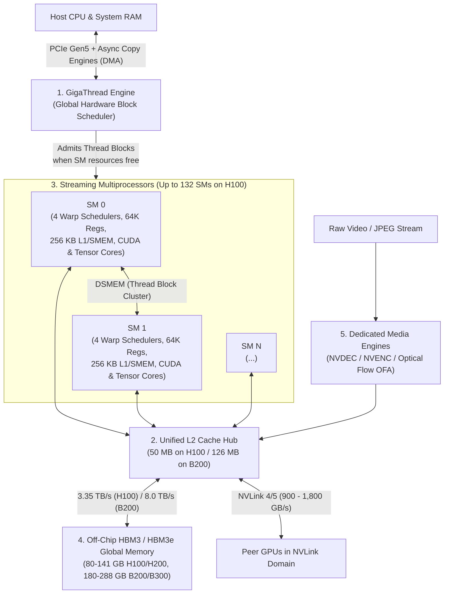
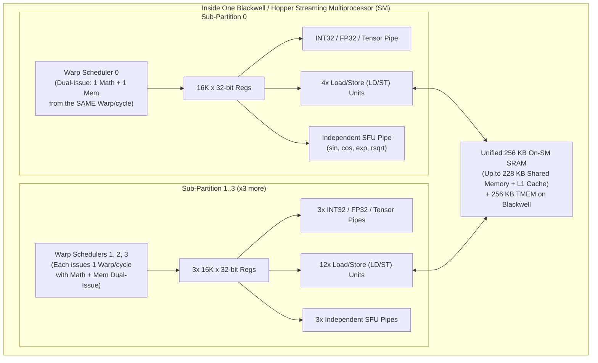
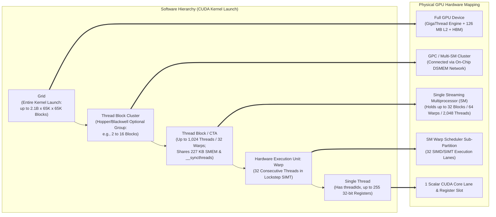
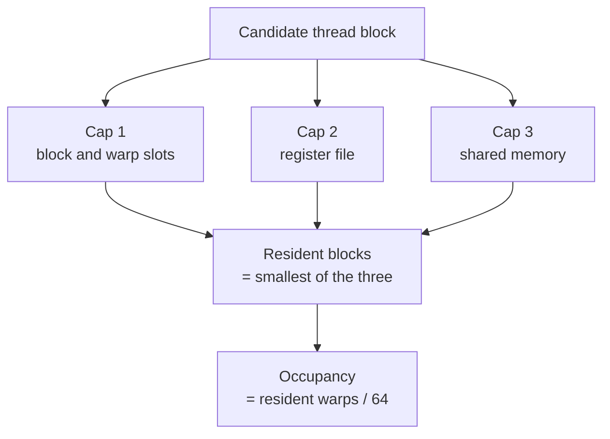
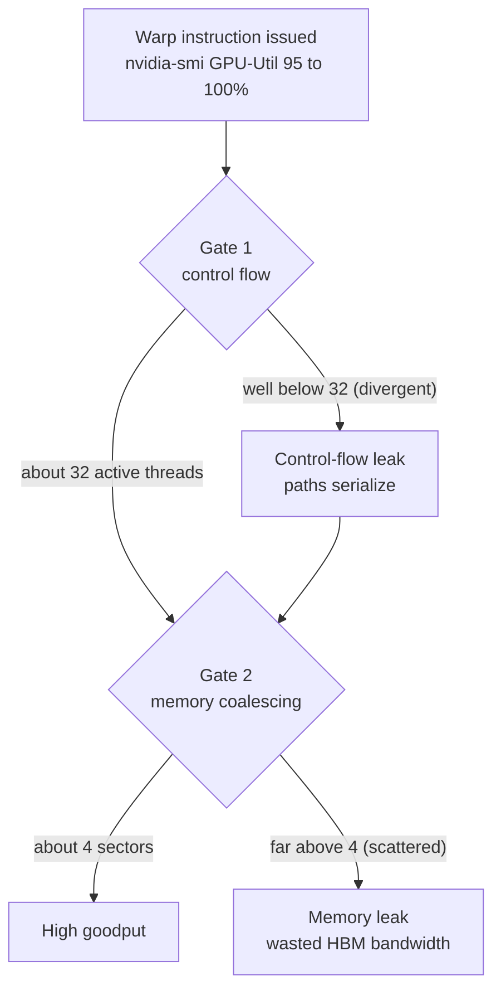

# 10.2 The execution model: threads, warps, blocks and SMs

| | |
|---|---|
| **Status** | Drafted (`execution_model_lab.py`: 25 checks pass; `nvcc`/`ncu` commands **untested** on live Nebius GPU VM) |
| **Level** | Intermediate |
| **Priority tier** | 2 |
| **Lab venue** | Nebius GPU + self-checking Python model (`code/part10/execution_model_lab.py`) |
| **Part** | Part 10: The GPU and CUDA |
| **Sources used** | *AI Systems Performance Engineering* Ch. 6; *Parallel and High Performance Computing* Ch. 10; `nvidia-devops` V2 (Ch. 2, 3, 6, 9; Labs 2, 3); `nvidia-devops` VL4 (Ch. 1) |

## Why this matters for AI infrastructure

A modern NVIDIA GPU is not a flat bag of 14,000 cores that automatically shares whatever code you throw at it. It is a hierarchical factory governed by strict hardware admission gates and a lockstep 32-thread execution engine.

Even if you never write a raw CUDA C++ kernel yourself, every production symptom you debug on an AI cluster is shaped by this execution model:
- Why did a machine learning engineer launch a custom PyTorch kernel with the maximum 1,024 threads per block "for maximum parallelism," only to watch **Occupancy** drop to 15% and the GPU stall on memory?
- Why did a minor compiler update bump a kernel from 40 registers per thread to 56 registers per thread and suddenly cut resident warps by a third?
- Why does a kernel with 91% achieved occupancy and 95% `nvidia-smi` `GPU-Util` still deliver terrible token throughput—or conversely, why does a shared-memory tiled kernel at 45% occupancy run *faster* than a naive kernel at 90% occupancy?
- Why do two independent Python processes sharing a GPU without **Multi-Instance GPU (`MIG`)** or **Multi-Process Service (`MPS`)** suffer tens of microseconds of GPU context-switching penalty?

This chapter opens the silicon of an NVIDIA GPU (Hopper `H100` and Blackwell `B200`), traces work from the **GigaThread Engine** down to the four dual-issue **Warp Schedulers** inside each **Streaming Multiprocessor (`SM`)**, derives exact formulas for launch geometry and **Occupancy**, and shows how to diagnose warp divergence, uncoalesced memory sectors, and functional memory bugs using `nvcc -Xptxas=-v`, **Nsight Compute (`ncu`)**, **Nsight Systems (`nsys`)**, and **NVIDIA Compute Sanitizer**.

## Prerequisites and outcomes

**Prerequisites:**
- CPU versus GPU throughput design, SIMT concepts, and theoretical peak FLOPs/bandwidth formulas from Chapter `10.1`.

**Outcomes:** After completing this chapter, you will be able to:
1. Map the internal geography of a modern NVIDIA GPU: the **GigaThread Engine**, the unified **L2 Cache** (`50 MB` on H100, `126 MB` on B200), the **Streaming Multiprocessors (`SMs`)**, **Copy Engines (`DMA`)**, and media accelerators (`NVDEC`/`NVENC`, `OFA`).
2. Explain the four-partition ("4 mini-SM") architecture of a Blackwell/Hopper SM, including **dual-issue** warp scheduling (1 math + 1 memory instruction per cycle from the same warp across 16 `LD/ST` units) and the independent **Special Function Unit (`SFU`)** pipeline.
3. Map the software execution hierarchy—**Thread**, **Warp (`32` threads)**, **Thread Block / Cooperative Thread Array (`CTA`, up to `1,024` threads)**, **Thread Block Cluster** (with **Distributed Shared Memory, `DSMEM`**), and **Grid**—to physical hardware, and translate terms across OpenCL, CUDA, HIP, AMD, and CPU loops.
4. Calculate 1D/2D/3D kernel launch parameters (`blocksPerGrid` and `threadsPerBlock`), explain why the `if (idx < N)` bounds check prevents lazy `cudaErrorIllegalAddress` faults, and preserve forward compatibility across GPU generations with **PTX** and `CUDA_FORCE_PTX_JIT=1`.
5. Compute exact **SM Occupancy** from thread, warp, block-slot, register (`65,536` per SM, max `255` per thread), and shared-memory (`228 KB` per SM, max `227 KB` dynamic per block + `1 KB` reserved) limits, and tune residency with `__launch_bounds__` and `cudaOccupancyMaxPotentialBlockSize`.
6. Diagnose the five **Warp States** (`Active`, `Eligible`, `Selected`, `Stalled`, `Completed`), **Warp Divergence**, **Predication**, and the two Nsight Compute efficiency gates (`smsp__thread_inst_executed_per_inst_executed.ratio` and `l1tex__average_t_sectors_per_request_pipe_lsu_mem_global_op_ld.ratio`).
7. Distinguish the four production scheduling layers (**Cluster**, **Runtime**, **Kernel**, **SM**), explain GPU **Context Switching** versus `MIG` and `MPS`, and catch memory/race/barrier bugs in CI with `compute-sanitizer`.

---

## 1. Inside a modern NVIDIA GPU and the Streaming Multiprocessor (SM)

A GPU is a hierarchical silicon factory: data enters through the **PCIe / NVLink** loading dock, rests in the off-chip **HBM** warehouse, flows through the central **L2 Cache** distribution hub, and is processed on dozens of independent **Streaming Multiprocessor (`SM`)** assembly lines.

### 1.1 Silicon geography: GigaThread Engine, L2 Cache, SMs, Copy Engines, and NVDEC

If you remove the heatsink from an NVIDIA Hopper `H100` SXM5 or Blackwell `B200` package, you see the central processor die (or dual reticle-limited dies linked at `10 TB/s` on `B200`) flanked by stacks of **High-Bandwidth Memory (`HBM3` / `HBM3e`)** on a silicon interposer. Inside the GPU die, five hardware subsystems work together:



1. **The GigaThread Engine (Global Work Distributor):** When the host CPU launches a CUDA kernel, the **GigaThread Engine** receives the grid of thread blocks and assigns each block to an SM that has enough free registers, shared memory, and warp slots. **Crucial rule:** Once a thread block is assigned to an SM, it stays on that exact SM until every thread in the block finishes; it can never migrate to another SM.
2. **The Unified L2 Cache (Central Hub):** At the center of the die sits a GPU-wide **L2 Cache** (**50 MB** on `H100`, **126 MB** on `Blackwell B200`, ~200-cycle latency). Every SM, every HBM memory controller, and every PCIe and NVLink interface connects through L2. When a peer GPU writes data over NVLink or when multiple thread blocks reuse a weight tile, hitting the L2 cache avoids costly 300-to-1,000-cycle trips to off-chip HBM.
3. **Streaming Multiprocessors (`SMs`):** The SM is the fundamental compute unit of an NVIDIA GPU (an `A100` has **108 SMs**; an `H100 SXM5` has up to **132 SMs**). Each Hopper SM contains **128 FP32 CUDA Cores**, **4 fourth-generation Tensor Cores**, **65,536 (`64K`) 32-bit registers (`256 KB`)**, and **256 KB of unified L1 Data Cache / Shared Memory** (plus a dedicated **256 KB Tensor Memory `TMEM`** per SM on Blackwell `B200` for 5th-generation `tcgen05` Tensor Core instructions, covered in detail in Chapter `10.3`).
4. **Copy Engines (`DMA` Controllers):** Dedicated Direct Memory Access engines move bytes asynchronously between host pinned RAM and GPU HBM over PCIe (or between peer GPUs over NVLink) *without* interrupting the SMs. High-performance pipelines overlap computation and transfers: while the SMs compute Batch `k`, the Copy Engines pull Batch `k + 1` into HBM.
5. **Hardware Media Engines (`NVDEC`, `NVENC`, and `Optical Flow Accelerator`):** Outside the SMs sit fixed-function hardware video/image decoders (`NVDEC`), encoders (`NVENC`), and optical flow engines (`OFA`). If a computer-vision training pipeline decodes JPEGs or MP4 streams on the host CPU, `nvidia-smi` will oscillate wildly (`0% → 100% → 0%` every few seconds) because the SMs finish the math in milliseconds and starve waiting on the CPU. Using **NVIDIA DALI** shifts decoding onto the GPU's `NVDEC` hardware so raw compressed bytes cross PCIe and decompress directly into HBM.

### 1.2 Inside one SM: four warp schedulers ("4 mini-SMs"), dual-issue, and SFUs

If you zoom inside a single SM on a modern GPU (such as Hopper or Blackwell), the SM is not one monolithic scheduler. Instead, it is partitioned into **four independent scheduling quadrants**—you can think of one SM as **four "mini-SMs"** sharing the on-chip L1/Shared Memory SRAM:



Using the per-cycle SM issue table from *AI Systems Performance Engineering* Chapter 6 (Table 6-1):

| SM scheduling resource (per clock cycle) | Hardware value | Architectural rule & operational meaning |
|---|---|---|
| **Number of independent warp schedulers per SM** | **4** | Each SM is divided into 4 sub-partitions ("mini-SMs"), each tracking its own pool of resident warps (up to `64 / 4 = 16` warps per scheduler). |
| **Maximum warps issued per cycle per SM** | **4** (`1` per scheduler) | Up to 4 different warps (one in each sub-partition) can advance on the same clock cycle. |
| **Dual-issue capability per scheduler** | **1 Math + 1 Memory** instruction | Each scheduler can issue **two independent instructions per cycle** (`1` arithmetic op on `INT32`/`FP32`/`Tensor Core` + `1` memory `LD/ST` op), **provided both instructions come from the same warp** (never across two different warps in the same partition). |
| **Maximum math + memory ops issued per cycle** | **4 Math + 4 Memory** (`8` total) | Across all 4 schedulers, an SM with well-mixed instructions can issue 4 math ops and 4 memory ops in a single clock cycle. |
| **Load/Store (`LD/ST`) pipelines per SM** | **16** (`4` per scheduler) | Memory operations flow through 16 combined `LD/ST` units to L1/Shared memory, L2 cache, or HBM. |
| **Special Function Unit (`SFU`) pipeline** | Separate decoupled pipeline | Transcendental operations (`sin`, `cos`, `exp`, `rcp`, `sqrt`) execute on a dedicated **SFU** pipeline outside the main math+memory dual-issue pair, so attention `softmax` exponentials do not stall core `FP32`/`INT32` or `LD/ST` issue. |

:::info In one minute: Section 1 takeaways
- The **GigaThread Engine** assigns Thread Blocks to **SMs**, where they remain until completion; the GPU-wide **L2 Cache** (`50 MB` on H100, `126 MB` on B200) sits between all SMs, HBM, and NVLink/PCIe.
- Each SM is split into **4 warp-scheduler sub-partitions ("4 mini-SMs")**. Each scheduler issues **1 warp per cycle** and supports **dual-issue** of **1 math instruction + 1 memory (`LD/ST`) instruction from the same warp**, while **SFUs** run transcendentals (`exp`, `sin`, `cos`) on a separate pipeline.
- **Copy Engines (`DMA`)** and **NVDEC** operate independently of the SMs; use **NVIDIA DALI** so `NVDEC` decodes images/video on the GPU instead of starving SMs on CPU JPEG decoding.
:::

---

## 2. The thread hierarchy: Threads, Warps, Thread Blocks (CTAs), Clusters, and Grids

CUDA organizes parallel software into a nested hierarchy (**Thread → Thread Block → Thread Block Cluster → Grid**) that maps cleanly onto the physical hardware (**CUDA Core/Lane → 32-Thread Warp → SM → Multi-SM GPC → Full GPU**).

### 2.1 Software-to-hardware mapping and cross-vendor terminology



1. **Thread (`Work Item` in OpenCL):** The smallest software worker. Each thread runs the kernel code on its own data element using its own private registers (up to **255 32-bit registers per thread**).
2. **Warp (`Subgroup` in OpenCL, `Wavefront` on AMD):** When an SM admits a Thread Block, the hardware slices its threads into groups of **32 consecutive threads** (`threadIdx.x` `0..31` in Warp 0, `32..63` in Warp 1, and so on; multidimensional blocks are linearized in row-major `x → y → z` order first). The **Warp** is the true hardware unit of scheduling and SIMT execution.
3. **Thread Block / Cooperative Thread Array (`CTA`, `Work Group` in OpenCL):** A 1D, 2D, or 3D group of up to **1,024 threads** (**32 warps** max). Every thread in a block is guaranteed to execute on the **same physical SM**, so threads in a block can share fast on-SM **Shared Memory (`__shared__`)** and synchronize at hardware barriers using `__syncthreads()`. Because each barrier forces fast warps in the block to wait for the slowest warp, kernels should minimize `__syncthreads()` points.
4. **Thread Block Cluster and Distributed Shared Memory (`DSMEM`, Hopper & Blackwell):** Historically, threads in different Thread Blocks could only exchange data through slower GPU-wide L2/HBM. Modern GPUs introduce **Thread Block Clusters**: a group of thread blocks scheduled concurrently across neighboring SMs within a Graphics Processing Cluster (`GPC`). Using hardware **Distributed Shared Memory (`DSMEM`)**, SMs in the same cluster link their on-chip shared-memory banks over an SM-to-SM network so threads in Block A can read, write, and atomically update Block B's shared memory at on-chip speeds and synchronize via cluster-scoped barriers without touching HBM (`10.16`).
5. **Grid (`NDRange` in OpenCL):** The complete set of Thread Blocks launched by a single kernel call. Because separate Thread Blocks (or clusters) are independent and can execute in any order—concurrently or sequentially—the **exact same binary** scales automatically from a small 2-SM test GPU (which runs 2 blocks at a time in a queue) to a 132-SM `H100` or `B200` (which dispatches over a hundred blocks simultaneously).

For engineers working across `CUDA`, `OpenCL`, AMD `ROCm`/`HIP`, and CPU vectorization, here is the complete programming abstraction and hardware scheduler comparison from *Parallel and High Performance Computing* Chapter 10 (Tables 10.1 and 10.2) and *AI Systems Performance Engineering* Chapter 6 (Tables 6-2, 6-3, 6-4, and 6-5):

| Abstraction / Hardware limit | OpenCL | AMD GPU (`HIP` / `MI50`) | NVIDIA CUDA (`H100` / `B200`) | CPU equivalent |
|---|---|---|---|---|
| **Full execution domain** | `NDRange` | `grid` / `extent` | **Grid** (`max X: 2,147,483,647; Y/Z: 65,535`) | Loop bounds / index set |
| **Max concurrent grids per device** | Device-dependent | Device-dependent | **128 concurrent grids (kernels)** | Concurrent thread pools |
| **Shared-memory team** | `Work Group` | `block` / `tile` | **Thread Block (`CTA`)** (`max 1,024 threads / 32 warps`) | Cache-blocked loop tile |
| **Lockstep execution group** | `Subgroup` | `Wavefront` (**64** work items) | **Warp** (**32** threads) | SIMD vector register width |
| **Individual lane** | `Work Item` | `thread` | **Thread** (`max 255 registers/thread`) | Single loop iteration / lane |
| **Max active warps (subgroups) per SM/CU** | Device query | **40 wavefronts** (`2,560` items on MI50) | **64 warps** (**2,048 resident threads** per SM) | SMT hardware threads |
| **Max active blocks (work groups) per SM/CU** | Device query | **40 work groups** per CU (MI50) | **32 active thread blocks** per SM | — |
| **Selected warps issued per cycle per SM/CU** | — | **4** per CU | **4** (`1` per warp scheduler) | Superscalar issue width |
| **Register file per SM** | — | Arch-dependent | **65,536 (`64K`) 32-bit registers (`256 KB`)** | Physical vector register file |
| **L1 + Shared Memory SRAM per SM** | `Local memory` | `LDS` (`64 KB`) | **256 KB total** (`up to 228 KB shared/SM; 227 KB dynamic/block + 1 KB CUDA reserved`) | L1 data cache |

:::info In one minute: Section 2 takeaways
- **Thread → Warp (`32` threads) → Thread Block / CTA (`≤ 1,024` threads, `≤ 32` warps) → Thread Block Cluster (`DSMEM`) → Grid (`≤ 128` concurrent grids)**.
- Every modern NVIDIA SM holds at most **64 resident warps (`2,048` threads)**, **32 active blocks**, **65,536 32-bit registers** (max **255 registers/thread**), and **256 KB of L1/Shared SRAM** (up to **228 KB** shared per SM, **227 KB** dynamic shared per block with **1 KB** reserved by CUDA).
- Independence between Thread Blocks is what gives CUDA hardware **generational scalability**: a kernel written for a small GPU automatically fills more SMs on a larger GPU without code changes.
:::

---

## 3. Kernel launch geometry, bounds checks, tile decomposition, and PTX compatibility

In GPU programming—often called **"Me" programming**—you replace the outer `for` loop on the CPU with a grid of threads on the GPU, where each thread computes its own global coordinate `(x, y, z)` and updates only its own element.

### 3.1 1D, 2D, and 3D indexing and the `if (idx < N)` bounds check

When the host launches `myKernel<<<blocksPerGrid, threadsPerBlock>>>(d_input, N)`, each thread computes its unique 1D global index using three built-in variables (`blockIdx.x`, `blockDim.x`, and `threadIdx.x`):

```cpp
__global__ void myKernel(float* input, int N) {
    int idx = blockIdx.x * blockDim.x + threadIdx.x;
    if (idx < N) {          // Mandatory bounds check
        input[idx] *= 2.0f;
    }
}
```

How do you choose `threadsPerBlock` and `blocksPerGrid` for an array of `N = 1,000,000` floats?
1. **Pick `threadsPerBlock` as a multiple of 32 (typically `256` = 8 warps, or `128`–`512`):** A 33-thread block allocates **2 warps (`64` lanes)** and leaves 31 lanes of the second warp idle while still consuming two warp scheduler slots. Starting at **`threadsPerBlock = 256` (`8 warps`)** fills every warp 100%, allows up to `2,048 / 256 = 8 blocks` to reside per SM, and leaves generous headroom under the 1,024-thread and register limits.
2. **Use ceiling division for `blocksPerGrid`:**
   ```text
   blocksPerGrid = (N + threadsPerBlock - 1) / threadsPerBlock
   ```
   For `N = 1,000,000` and `threadsPerBlock = 256`:
   ```text
   blocksPerGrid = (1,000,000 + 255) // 256 = 3,907 blocks (launching 3,907 × 256 = 1,000,192 threads)
   ```
3. **Why the `if (idx < N)` bounds check is non-negotiable:**
   - In our `N = 1,000,000` launch, the final block (`blockIdx.x = 3906`) spawns 256 threads whose `idx` values run from `999,936` to `1,000,191`. The last **192 threads** fall past the end of the array.
   - Or consider the worked example from *AI Systems Performance Engineering* Chapter 6: an array of size **`N = 63`** requires **2 warps (`64` threads)**. Warp 0 processes indices `0..31`; Warp 1 processes `32..62`, and its 32nd lane has `idx = 63` (the 64th element, out of bounds).
   - Without `if (idx < N)`, that trailing thread writes out of bounds. Because CUDA kernels execute **asynchronously** without per-thread exceptions, an out-of-bounds access sets a **global hardware fault flag** for the entire launch. The host CPU only discovers the crash lazily on the next synchronous API call (`cudaDeviceSynchronize()` or `cudaMemcpy()`), surfacing as **`cudaErrorIllegalAddress`**. Always pair kernel launches during debugging with `cudaGetLastError()` and `cudaDeviceSynchronize()`.

### 3.2 2D and 3D domain tile decomposition and halo trade-offs

When processing 2D images or 3D scientific/medical volumes, you use `dim3(Tx, Ty, Tz)` for `threadsPerBlock` and `blocksPerGrid`. Reproducing the four canonical domain decompositions from *Parallel and High Performance Computing* Chapter 10 (Table 10.3):

| Domain type | Global domain size (`Gz × Gy × Gx`) | Block / Tile shape (`Tz × Ty × Tx`) | Threads per block (Tile size) | Grid dimensions (`NTz × NTy × NTx`) | Total work groups (Thread Blocks `NT`) |
|---|---|---|---|---|---|
| **1D vector** | `1,048,576` | `128` | `128` (`4` warps) | `8,192` | **8,192** |
| **Small 2D tile** | `1024 × 1024` | `8 × 8` | `64` (`2` warps) | `128 × 128` | **16,384** |
| **Large 2D tile** | `1024 × 1024` | `8 × 16` | `128` (`4` warps) | `128 × 64` | **8,192** |
| **3D volume** | `128 × 128 × 128` | `4 × 4 × 8` | `128` (`4` warps) | `32 × 32 × 16` | **16,384** |

Two rules govern multidimensional tile shapes:
1. **Align the fastest-changing dimension (`Tx`) to warps and cache lines:** Make `blockDim.x` (`Tx`) a multiple of 32 (or at least 16/32 floats = 64/128 bytes) so adjacent threads in a warp access contiguous memory addresses (**coalesced global loads**).
2. **Balance contiguous `Tx` width against perimeter halo reloads:** In stencil or convolution kernels where each tile must load a 1-pixel border ("halo") of neighbor values from adjacent tiles, a very wide, flat tile (such as `64 × 2`) has a large perimeter and duplicates many halo loads from HBM, whereas a square or near-square tile (such as `16 × 16 = 256` threads or `16 × 8 = 128` threads) minimizes the surface-area-to-volume ratio while preserving coalesced row loads.

### 3.3 Forward and backward binary compatibility (`SASS`, `PTX`, and `CUDA_FORCE_PTX_JIT=1`)

How can a PyTorch wheel or CUDA binary compiled years ago still run on a brand-new Blackwell GPU?
- **`SASS` (Streaming ASSembler):** Architecture-specific machine code (such as `sm_80` for Ampere A100, `sm_90` for Hopper H100, or `sm_100` for Blackwell B200). `SASS` runs only on the architecture it was compiled for (and family-specific targets like `sm_100f` / `compute_100f` restrict portability to devices within that exact feature family).
- **`PTX` (Parallel Thread Execution):** NVIDIA's virtual instruction-set intermediate representation. When you ship a **fatbinary (`fatbin`)** containing architecture-specific `SASS` cubins *plus* generic `PTX`, any future GPU driver can **Just-In-Time (`JIT`) compile** the embedded `PTX` into native machine code at application load time and cache the compiled result.
- **Pre-flight verification (`CUDA_FORCE_PTX_JIT=1`):** In CI or node qualification, run your binary with the environment variable `CUDA_FORCE_PTX_JIT=1`. That flag forces the driver to ignore embedded `SASS` and JIT-compile the `PTX`—if the developer forgot to embed `PTX` in the binary, the kernel launch fails immediately in test rather than breaking on your next-generation GPU fleet.

:::info In one minute: Section 3 takeaways
- Global thread index in 1D is `idx = blockIdx.x * blockDim.x + threadIdx.x` with `blocksPerGrid = (N + threadsPerBlock - 1) / threadsPerBlock` (`3,907` blocks of `256` for `N = 1,000,000`).
- Always guard kernel memory accesses with `if (idx < N)`: without it, trailing warp lanes trigger asynchronous out-of-bounds faults that surface lazily as `cudaErrorIllegalAddress`.
- Ship fatbinaries with both native `SASS` and virtual **`PTX`**, and test forward compatibility in CI using **`CUDA_FORCE_PTX_JIT=1`**.
:::

---

## 4. Residency, Occupancy, and how to calculate and tune them

**Occupancy** is the ratio of active warps resident on an SM to the maximum warps the SM can physically hold (`64` warps = `2,048` threads):

```text
Occupancy (%) = (Active Resident Warps per SM / Maximum Supported Warps per SM (64)) × 100%
```

### 4.1 The block admission gate and worked register/shared-memory occupancy math

When the GigaThread Engine tries to place a candidate Thread Block onto an SM, the SM checks **three finite resource caps simultaneously** (whichever cap is tightest determines how many whole blocks can reside on the SM at once):



The candidate block is described by `threadsPerBlock`, `warpsPerBlock`, `regsPerThread` and `sharedMemPerBlock`.

| Cap | Limit per SM | How it limits resident blocks |
|---|---|---|
| 1. Thread, warp and block slots | Max 32 blocks; max 64 warps (2,048 threads) | Slot count caps blocks directly |
| 2. Register file | 65,536 registers | Max threads = floor(65,536 / `regsPerThread`); max blocks = floor(max threads / `threadsPerBlock`) |
| 3. Shared memory | 228 KB | Effective shared memory = dynamic shared memory + 1 KB reserved by CUDA; max blocks = floor(228 KB / effective shared memory) |

Resident blocks = min(Cap 1, Cap 2, Cap 3). Partial blocks cannot reside. Achieved theoretical occupancy = (resident blocks x `warpsPerBlock`) / 64.

*(Note: Unifying the thread/warp/block slot limits from ASP Chapter 6 Tables 6-2 and 6-3 with the register and shared-memory residency method from `nvidia-devops` Volume 02 Chapter 6 into `calc_sm_occupancy` in `code/part10/execution_model.py` is **my inference**.)*

You can inspect a kernel's exact compile-time register and spill footprint before ever running a profiler by passing **`-Xptxas=-v`** to `nvcc`:

```text
$ nvcc -O3 -Xptxas=-v kernel.cu -o kernel
ptxas info    : Compiling entry function '_Z6kernelPfS_m' for 'sm_90'
ptxas info    : Function properties for _Z6kernelPfS_m
    0 bytes stack frame, 0 bytes spill stores, 0 bytes spill loads
ptxas info    : Used 48 registers, 384 bytes cmem[0]
```

Look closely at the **register cliff effect** using the worked example from `nvidia-devops` Volume 02 Chapter 6 (on an SM with `65,536` registers, `64` max warps = `2,048` threads, and `256` threads/block = `8` warps/block):

| Scenario | Threads / block (`warps/block`) | Registers / thread (`-Xptxas=-v`) | Dynamic Shared Memory / block | Max threads by registers (`65536 // regs`) | Resident blocks (`threads // block_size`) | Resident warps (`blocks × warps`) | SM Occupancy (`warps / 64`) | Limiting resource |
|---|---|---|---|---|---|---|---|---|
| **1. Balanced kernel** | `256` (`8` warps) | `32` regs | `0 KB` | `2,048` | `8` blocks | **64 warps** | **100.0%** | Slot/Warp ceiling |
| **2. Moderate registers (V2 Ch 6 Ex. 1)** | `256` (`8` warps) | **`40` regs** | `0 KB` | `1,638` | **`6` blocks** (`1,536` threads) | **48 warps** | **75.0%** | **Registers** |
| **3. +16 regs after code change (V2 Ch 6 Ex. 2)** | `256` (`8` warps) | **`56` regs** | `0 KB` | `1,170` | **`4` blocks** (`1,024` threads; `0.57` block dropped | **32 warps** | **50.0%** | **Registers** |
| **4. Oversized 1,024-thread block (V2 Ch 3)** | `1,024` (`32` warps) | `48` regs | `0 KB` | `1,365` | **`1` block** (`1,024` threads; 2nd block needs `96K` regs | **32 warps** | **50.0%** | **Registers + Block size** |
| **5. Large shared-memory tile** | `256` (`8` warps) | `24` regs | **`64 KB`** (`+1 KB` reserved = `65 KB`) | `2,730` | **`3` blocks** (`228 KB // 65 KB = 3`) | **24 warps** | **37.5%** | **Shared Memory** |

Notice three crucial lessons in that table:
1. **Partial blocks cannot reside on an SM:** In Row 3, bumping register use from `40` to `56` registers/thread lowered the thread ceiling to `1,170` threads (`4.57` blocks of 256). Because the hardware only admits whole blocks, residency dropped from `6` blocks (`48` warps = **75%**) to `4` blocks (`32` warps = **50%**) in a single step.
2. **Why `1,024` threads/block often backfires (Row 4):** When an engineer sets `threadsPerBlock = 1024` at `48` registers/thread, one block consumes `49,152` registers—leaving only `16,384` free registers on the SM. A second 1,024-thread block cannot fit, so the SM runs only **1 block**. If that block hits a `__syncthreads()` barrier or memory stall, the SM has zero other blocks to switch to. Reducing `threadsPerBlock` to `256` lets the SM pack **5 blocks (`40` warps = 62.5% occupancy)**.
3. **Register spilling (`> 255` regs/thread or non-zero `spill stores/loads`):** If a thread needs more than `255` registers (or exceeds the register budget forced by `__launch_bounds__`), `nvcc` spills the excess variables into **Local Memory**, which physically lives in slow off-chip **HBM DRAM** (100s to 1,000+ cycles of latency)—a far worse performance penalty than slightly lower occupancy.

### 4.2 Why sufficient parallelism matters—and why 100% occupancy is not the goal

To see what happens when a program starves the GPU of parallel warps, compare the two vector-add implementations (`N = 1,000,000` floats) profiled with `nsys` and `ncu` in *AI Systems Performance Engineering* Chapter 6 (Table 6-6):
- **`addSequential<<<1, 1>>>` (or a naive Python `for i in range(N): C[i] = A[i] + B[i]` loop):** Uses a single GPU thread (or launches `N` tiny serial operations from Python). Only 1 lane of 1 warp on 1 SM is active.
- **`addParallel<<<3907, 256>>>` (or vectorized PyTorch `C = A + B`):** Launches `3,907` blocks of `256` threads (`8` warps/block) across all SMs simultaneously.

| Benchmark metric (`N = 1,000,000` floats, ASP Ch. 6 Table 6-6) | `add_sequential` (`<<<1, 1>>>`) | `add_parallel` (`<<<3907, 256>>>`) | Improvement |
|---|---|---|---|
| **Kernel execution time (ms)** | `48.21 ms` | **`2.17 ms`** | **22.2× faster** |
| **Overall GPU utilization (`nsys`)** | `1.5%` | **`95.0%`** | +93.5 percentage points |
| **Achieved SM occupancy (`ncu` `sm__warps_active`)** | `1.3%` | **`38.7%`** | Interleaves warps to hide HBM latency |
| **Warp execution efficiency** | `3.1%` (`1 / 32` lanes active) | **`100.0%`** (`32 / 32` lanes active) | Full 32-lane SIMT utilization |

Look closely at the third row: `add_parallel` achieved a **22.2× speedup** and **95% GPU utilization** at **38.7% achieved occupancy**—nowhere near 100%. Why? Because **occupancy is a means to hide latency, not an end-to-end performance goal**:
- Once an SM has *enough* independent warps to keep its pipelines busy during HBM loads, adding more resident warps does not make a memory-bound kernel faster—it just puts more warps in line waiting for the same saturated HBM bus.
- Even better, a kernel that uses larger **Shared Memory tiles** or more **registers per thread** to cache values on chip may drop from `90%` occupancy down to `45%` or `50%` occupancy while running **significantly faster** because it cuts off-chip HBM traffic in half.
- You can prove whether a high-occupancy kernel is already hitting the memory wall in one **Nsight Compute (`ncu`)** pass:
  ```text
  $ ncu --metrics sm__warps_active.avg.pct_of_peak_sustained_active,dram__throughput.avg.pct_of_peak_sustained_elapsed ./kernel
    sm__warps_active.avg.pct_of_peak_sustained_active     %    91.2
    dram__throughput.avg.pct_of_peak_sustained_elapsed    %    97.8
  ```
  When `sm__warps_active` is `91.2%` and `dram__throughput` is `97.8%`, HBM bandwidth is completely saturated; increasing occupancy further will accomplish nothing.

### 4.3 Tuning occupancy with `__launch_bounds__` and the CUDA Occupancy API

When a kernel uses too many registers per thread (`72` regs/thread) and starves the SM of resident warps, you have two tools:
1. **Compile-time `__launch_bounds__(maxThreadsPerBlock, minBlocksPerMultiprocessor)`:**
   Instructs `nvcc` to cap register allocation per thread so that at least `minBlocksPerMultiprocessor` blocks of size `maxThreadsPerBlock` fit on each SM.
   - **Watch out for the hardware ceiling trap (ASP Ch. 6 p. 206):** If a developer writes `__launch_bounds__(256, 16)`, they are asking for `256 × 16 =` **4,096** resident threads per SM—which exceeds the **2,048-thread hardware limit** on Blackwell/Hopper. The `ptxas` assembler emits:
     ```text
     ptxas warning : Value of threads per SM...is out of range. .minnctapersm will be ignored
     ```
     and clamps the target to the hardware maximum of **`8` blocks (`2,048` threads, or `<= 32` registers/thread)**. Always ensure `maxThreadsPerBlock * minBlocksPerMultiprocessor <= 2048`.
2. **Runtime `cudaOccupancyMaxPotentialBlockSize(&minGridSize, &bestBlockSize, myKernel, dynSmemBytes, 0)`:**
   Queries the driver at runtime for the block size (`bestBlockSize`) that maximizes occupancy given the kernel's compiled register count and `dynSmemBytes`. Remember that `minGridSize` is only the minimum number of blocks needed to fill one wave across the GPU's SMs—to cover all `N` input elements, always launch:
   ```cpp
   int gridSize = std::max(minGridSize, (N + bestBlockSize - 1) / bestBlockSize);
   ```

:::info In one minute: Section 4 takeaways
- Check compile-time register and spill counts with **`nvcc -O3 -Xptxas=-v`** (`0 bytes spill stores/loads` is mandatory; `> 0` means registers are spilling to slow HBM local memory).
- **Occupancy** `= Resident Warps / 64`, capped by `min(Slot Limit, Register Limit, Shared-Memory Limit)` rounded down to **whole blocks**.
- Never chase 100% occupancy blindly: pair `sm__warps_active` with `dram__throughput` in `ncu`, and remember that `__launch_bounds__(maxThreads, minBlocks)` must satisfy `maxThreads * minBlocks <= 2,048`.
:::

---

## 5. Warp states, instruction dispatch, divergence, and the two efficiency gates

Having 48 or 64 warps resident on an SM (`Active`) does not guarantee that the SM can issue an instruction on the next clock cycle; the warp scheduler can only issue from warps that are **Eligible**.

### 5.1 The five warp states and scoreboard dependencies

At any clock cycle, every warp on an SM is in one of five hardware states:

| Warp state | Meaning | What determines transition |
|---|---|---|
| **1. Active** | Resident on the SM (allocated registers and warp slot) and not yet finished. | Admitted by the GigaThread Engine when block resources are free. |
| **2. Stalled** | Active, but **cannot issue** its next instruction on this cycle. | Waiting on an HBM/L2 memory load (`long_scoreboard`), an arithmetic/shared-memory dependency (`short_scoreboard`), a `__syncthreads()` barrier, or a busy execution pipe. |
| **3. Eligible** | Active, all input operands are ready in registers (cleared by the hardware **Scoreboard**), and the target execution pipeline is free. | Ready to be picked by the sub-partition's warp scheduler. |
| **4. Selected** | The **1 Eligible warp** chosen by its sub-partition's warp scheduler to issue 1 (or 2 dual-issued) instruction(s) on this clock cycle. | Scheduler priority policy. |
| **5. Completed** | All 32 threads in the warp have exited the kernel. | Releases warp slot; when all warps in a block complete, the block's registers and shared memory are freed. |

Why does the distinction between **Active** and **Eligible** matter? If an SM has 64 Active warps, but all 64 warps issue a global memory load at the exact same moment (or wait at the same `__syncthreads()` barrier), **Eligible warps drop to 0** and the SM stalls despite 100% occupancy.

### 5.2 Warp divergence, predication, and the two Nsight Compute efficiency gates

Even when warps are Eligible and Selected every cycle, a kernel can waste most of the GPU's throughput if it leaks through either of the **two hardware efficiency gates**:



| Gate | Nsight Compute metric | Ideal | Bad example |
|---|---|---|---|
| 1. Control-flow efficiency | `smsp__thread_inst_executed_per_inst_executed.ratio` | 32.0 active threads per instruction (100%) | 19.4, which is 60.6% (divergent if/else inside a warp) |
| 2. Memory coalescing | `l1tex__average_t_sectors_per_request_pipe_lsu_mem_global_op_ld.ratio` | 4.0 sectors of 32 B for a 128 B float load (128 B moved for 128 B used) | 11.6 to 32 sectors, which is 371 B to 1,024 B moved: up to 8x wasted HBM bandwidth |

1. **Gate 1 — Control-Flow Efficiency (Warp Divergence and Predication):**
   - Because all 32 threads in a warp share one instruction pointer, if a conditional `if/else` statement evaluates to `True` for 16 threads and `False` for the other 16 threads *within the same warp*, the warp suffers **Warp Divergence**: first the SM executes Path A with the 16 `False` lanes masked off, and then executes Path B with the 16 `True` lanes masked off, before reconverging. Execution time doubles and effective lane throughput drops by 50%.
   - **Important nuance:** Divergence only happens *within a single 32-thread warp*. If Warp 0 (threads `0..31`) all take Path A and Warp 1 (threads `32..63`) all take Path B, there is **zero warp divergence** because each warp has uniform control flow. For very short `if/else` bodies, the compiler uses **predication** (issuing the instructions unconditionally while a per-lane predicate bit controls whether the result is written), which avoids a branch stall but still consumes instruction cycles for masked lanes.
   - **Profiler metric:** In `ncu`, inspect `smsp__thread_inst_executed_per_inst_executed.ratio` (active threads executed per instruction out of `32`). In the fraud-analysis example from `nvidia-devops` Volume 02 Chapter 9, a ratio of **`19.4`** reveals that only `19.4 / 32 =` **60.62%** of warp lanes are doing useful work (`39.4%` wasted to divergence).
2. **Gate 2 — Memory Transaction Efficiency (Coalesced vs Strided/Scattered Loads):**
   - When the 32 threads in a warp read one 4-byte `float` each (`32 × 4 bytes = 128 useful bytes`), the GPU memory system services requests in **32-byte sectors** (`128-byte` cache lines = `4 sectors`).
   - **Coalesced access (`contiguous_copy`):** Thread `t` reads `input[idx + t]`. All 128 bytes sit contiguously in a single aligned 128-byte cache line, requiring **4 sectors (`4 × 32 B = 128 bytes` transferred, `1.0×` byte amplification)**.
   - **Strided or scattered access (`strided_copy`):** Thread `t` reads `(logical * stride) % count` across 32 separate cache lines. In the worst case, the hardware must fetch **32 separate 32-byte sectors (`32 × 32 B = 1,024 bytes` transferred from HBM)** just to deliver `128` useful bytes—an **8.0× bandwidth amplification**.
   - **Profiler metric:** In `ncu`, inspect `l1tex__average_t_sectors_per_request_pipe_lsu_mem_global_op_ld.ratio`. In the Chapter 9 example, a value of **`11.6` sectors/request** (`11.6 × 32 B = 371.2 bytes` moved per `128` useful bytes = **2.9× byte amplification**) proves that uncoalesced accesses are wasting nearly two-thirds of the HBM bandwidth.

:::info In one minute: Section 5 takeaways
- A warp scheduler can only issue from **Eligible** warps (operands ready in registers, pipeline free), not merely **Active** warps.
- **Warp Divergence** occurs only when threads *inside the same 32-thread warp* take different branches; if whole warps branch uniformly (`threadIdx.x / 32`), there is no divergence penalty.
- When `nvidia-smi` shows 95% utilization but throughput is poor, check both Nsight Compute gates: **`smsp__thread_inst_executed_per_inst_executed.ratio`** (ideal `32.0` lanes) and **`l1tex__average_t_sectors_per_request_pipe_lsu_mem_global_op_ld.ratio`** (ideal `4.0` sectors for 4-byte floats; `32.0` worst-case = **8× wasted HBM traffic**).
:::

---

## 6. Production operations: the four scheduling layers, GPU Contexts, and Compute Sanitizer

### 6.1 The four scheduling layers and GPU Context Switching (`Time-Slicing` vs `MIG` vs `MPS`)

In production AI clusters, warp scheduling inside the SM is only the bottom layer of a four-layer scheduling stack:

| Layer | Scheduler component | Scheduling unit | Classic failure mode & symptom |
|---|---|---|---|
| **1. Cluster layer** | Kubernetes (`kube-scheduler` / `KAI` / `Kueue`) or Slurm (`slurmctld`) | Pod, Job, or Node | **Cross-NUMA / cross-switch placement** or **missing container GPU passthrough** (`nvidia-smi` works on host, `docker run --gpus all` fails at the Container Toolkit / CDI boundary). |
| **2. Runtime layer** | Triton, vLLM, PyTorch process, or CUDA Driver | **GPU Context**, Request Batch, CUDA Stream | **GPU Context Switching overhead** (two OS processes time-slicing one GPU without `MIG` or `MPS`) or tiny request batches underfilling the GPU. |
| **3. Kernel layer** | **GigaThread Engine** | Grid and Thread Blocks (`CTAs`) | **Small grid ("tail effect")** or **oversized 1,024-thread blocks** leaving SMs idle or capped at 1 block/SM. |
| **4. SM layer** | **4 Warp Schedulers per SM** | 32-thread Warps & Dual-Issued Instructions | **Warp divergence**, **uncoalesced HBM sector amplification**, or **register spilling** to local memory. |

Understanding **GPU Contexts** at Layer 2 is critical for multi-tenant platform design:
- Just like a Linux process has a virtual address space and CPU register state, a CUDA application creates a **GPU Context** holding its device page tables, memory allocations, and hardware state.
- By default, an NVIDIA GPU (or a single MIG slice) executes **one hardware context at a time**. If two separate Python processes (for example, two time-sliced Kubernetes pods) run on the same physical GPU concurrently, the NVIDIA driver must perform **GPU Context Switching**—saving and restoring tens of megabytes of SM and page-table state across tens of microseconds or more, while both processes also evict each other's data from the shared L2 cache.
- **Production rule:** Never share a production GPU across heavy workloads using raw OS time-slicing alone. Either:
  1. Dedicate a whole GPU per process/pod,
  2. Partition the GPU in hardware with **Multi-Instance GPU (`MIG`)** so each tenant gets physically isolated SMs, L2 cache banks, HBM controllers, and its own independent hardware context, or
  3. Use **NVIDIA Multi-Process Service (`MPS`)** when trusted cooperative processes from the same tenant need to share a single combined GPU context without context-switch stalls (`11.24`–`11.26`).

### 6.2 Catching memory, race, and barrier bugs with NVIDIA Compute Sanitizer

Because a single kernel launch spawns millions of threads without per-thread OS memory protection, subtle off-by-one indexing bugs or shared-memory race conditions can silently corrupt model weights or trigger intermittent `cudaErrorIllegalAddress` crashes hours into a training run. Integrate **NVIDIA Compute Sanitizer (`compute-sanitizer`)** into your CI pipeline with `--error-exitcode` and `--nvtx yes`:

| Compute Sanitizer tool | Command flag | What bugs it catches at runtime |
|---|---|---|
| **1. `memcheck`** (default) | `compute-sanitizer --tool memcheck --check-device-heap yes` | Out-of-bounds or misaligned accesses in global, local, and shared memory (such as a missing `if (idx < N)` check), hardware exceptions, and device heap memory leaks. |
| **2. `racecheck`** | `compute-sanitizer --tool racecheck` | Shared-memory (`__shared__`) data hazards—**Read-After-Write (`RAW`)**, **Write-After-Read (`WAR`)**, and **Write-After-Write (`WAW`)**—between threads in a block. |
| **3. `initcheck`** | `compute-sanitizer --tool initcheck` | Any kernel thread reading from **uninitialized device global memory** (for example, a forgotten `cudaMemcpy` or zero-initialization step). |
| **4. `synccheck`** | `compute-sanitizer --tool synccheck` | Invalid synchronization primitives, such as placing `__syncthreads()` inside a divergent `if/else` branch where only some threads in a block reach the barrier (causing a hardware deadlock). |

---

## Commands and configurations that matter

### 1. Inspecting compile-time register usage and local-memory spills (`nvcc -Xptxas=-v`, untested on live Nebius GPU VM)

```bash
# Compile a CUDA file for Hopper (sm_90) + embedded PTX (compute_90) and print register/spill counts
nvcc -O3 -arch=compute_90 -code=sm_90,compute_90 -Xptxas=-v memory_patterns.cu -o memory_patterns

# Verify PTX forward compatibility by forcing runtime PTX JIT compilation
CUDA_FORCE_PTX_JIT=1 ./memory_patterns
```

### 2. Profiling timeline gaps (`nsys`) and SM occupancy / efficiency gates (`ncu`)

```bash
# 1. Nsight Systems (nsys): capture end-to-end host-to-device copies, kernel gaps, and NVTX ranges
nsys profile --stats=true -t cuda,nvtx -o parallel_nsys_report ./memory_patterns

# 2. Nsight Compute (ncu): inspect Occupancy, HBM throughput, Active-Lane efficiency, and Sectors/request
ncu --section SpeedOfLight \
  --metrics sm__warps_active.avg.pct_of_peak_sustained_active,dram__throughput.avg.pct_of_peak_sustained_elapsed,smsp__thread_inst_executed_per_inst_executed.ratio,l1tex__average_t_sectors_per_request_pipe_lsu_mem_global_op_ld.ratio \
  --target-processes all --print-summary per-gpu ./memory_patterns
```

### 3. Live DCGM and `nvidia-smi` engine vs container boundary verification

```bash
# 1. Host baseline and streaming SM / memory / PCIe monitoring
nvidia-smi --query-gpu=index,name,driver_version,pstate,memory.used,utilization.gpu,utilization.memory,power.draw --format=csv
nvidia-smi dmon -s pucvmet -d 1

# 2. Verify container GPU passthrough (if host nvidia-smi works but this fails, fix Container Toolkit / CDI)
docker run --rm --gpus all nvidia/cuda:12.4.1-base-ubuntu22.04 nvidia-smi
```

### 4. CI functional verification with `compute-sanitizer`

```bash
# Fail CI with non-zero exit code if any out-of-bounds access, shared-memory race, or barrier bug occurs
compute-sanitizer --tool memcheck --error-exitcode 1 --nvtx yes ./memory_patterns
compute-sanitizer --tool racecheck --error-exitcode 1 ./memory_patterns
compute-sanitizer --tool initcheck --error-exitcode 1 ./memory_patterns
compute-sanitizer --tool synccheck --error-exitcode 1 ./memory_patterns
```

---

## How it fails

| Failure mode | Symptom | Root cause | Diagnosis & fix |
|---|---|---|---|
| **1. Register / block-size starvation on 1,024-thread blocks** | A custom CUDA/Triton kernel launched with `threadsPerBlock = 1024` runs slowly; `ncu` reports **15–50% achieved occupancy** and high `long_scoreboard` memory stalls. | At `48+` registers/thread, a single 1,024-thread block consumes `49,152+` of the SM's `65,536` registers, preventing a second block from fitting on the SM. | Check `nvcc -Xptxas=-v`; reduce `threadsPerBlock` to **`128` or `256`** (or apply `__launch_bounds__(256, 4)`) so the SM can pack 4–8 blocks and hide HBM latency across warps. |
| **2. Register spilling into off-chip HBM Local Memory** | After fusing kernels or unrolling loops, kernel latency spikes by 3×–5× and HBM traffic jumps even though the input tensors did not grow. | Per-thread register demand exceeded `255` (or exceeded a tight `__launch_bounds__` cap), forcing `ptxas` to spill temporary variables to **Local Memory** (backed by slow HBM DRAM). | Inspect `nvcc -Xptxas=-v` for non-zero **`bytes spill stores, bytes spill loads`**; relax `__launch_bounds__`, reduce unrolling, or split the overly large fused kernel. |
| **3. High `GPU-Util` (`95%`) with poor throughput from Divergence + Uncoalesced loads** | `nvidia-smi` reports 95% GPU utilization and high power draw, yet token or record throughput is a fraction of hardware peak. | Threads within warps diverge across `if/else` paths (`smsp__thread_inst_executed_per_inst_executed.ratio = 19.4 / 32`) *and/or* read strided memory (`11.6`–`32` sectors/request = **2.9×–8.0× HBM byte amplification**). | Run `ncu` on both efficiency-gate metrics; sort/group inputs by branch outcome so whole 32-thread warps take uniform paths, and convert Array-of-Structures (`AoS`) layouts to Structure-of-Arrays (`SoA`) for coalesced 128-byte loads. |
| **4. Lazy `cudaErrorIllegalAddress` crash on non-multiple input sizes** | A kernel works on power-of-two batch sizes (`256`, `1024`), but crashes with `CUDA error: an illegal memory access was encountered` at `cudaDeviceSynchronize()` when given `N = 63` or `N = 1,000,000`. | The kernel omitted `if (idx < N)`, allowing trailing threads in the final warp/block (`idx >= N`) to read or write past the allocated buffer. | Run `compute-sanitizer --tool memcheck ./app` to pinpoint the exact offending line and add `if (idx < N)` (or 2D `if (x < width && y < height)`) guards. |
| **5. `0% → 100% → 0%` GPU utilization sawtooth (Host / Python loop starvation)** | `nvidia-smi dmon` shows GPU utilization oscillating between 0% and 100% every few seconds (or staying at 1.5% during a Python loop). | Either the host CPU is bottlenecked decoding JPEGs in `DataLoader`, a debug `.cpu().numpy()` call is pulling a 10 GB tensor across the 63 GB/s PCIe bus inside the training loop, or Python is launching `N` tiny scalar kernels serially. | Remove `.cpu()` calls from inner loops, replace Python elementwise loops with vectorized PyTorch ops (`C = A + B` or `torch.compile`), and offload JPEG/video decoding to GPU `NVDEC` via **NVIDIA DALI**. |
| **6. Multi-process GPU context-switching thrash on shared nodes** | Two workloads placed on the same GPU via Kubernetes time-slicing run more than 2× slower than when run separately, with high driver overhead in `nsys`. | Each OS process owns a separate **GPU Context**; without `MIG` or `MPS`, the driver spends tens of microseconds context-switching SM/page-table state and thrashing the shared L2 cache. | Partition the GPU into hardware-isolated **MIG** instances for multi-tenant Kubernetes pods, or enable **NVIDIA MPS** when cooperative processes from one job must share a GPU. |

---

## Hands-on lab

### Part A: Self-checking Python model (`code/part10/execution_model_lab.py` — verified here)

`code/part10/execution_model.py` implements the hardware tables, launch calculators, SM occupancy solver, `__launch_bounds__` validator, and Nsight Compute efficiency-gate analyzer from this chapter, and `code/part10/execution_model_lab.py` runs **25 self-checks**:
1. **Blackwell SM 4-scheduler dual-issue limits** (`4` schedulers, `4` warps/cycle, `4` math + `4` memory ops/cycle, `16` LD/ST units) and **H100 / B200 hardware limits** (`32` warp size, `1,024` max threads/block, `64` warps / `2,048` threads / `32` blocks per SM, `65,536` regs/SM, `255` max regs/thread, `256 KB` L1/SMEM with `228 KB` shared and `227 KB` dynamic/block + `1 KB` reserved, `50 MB` vs `126 MB` L2 cache, and `128` concurrent grids).
2. **OpenCL/CUDA/HIP/AMD/CPU abstraction map** and **NVIDIA SM vs AMD MI50 CU scheduler limits** (`64` warps of `32` vs `40` wavefronts of `64`).
3. **1D kernel launch geometry & bounds check** (`N = 1,000,000` with `256` threads/block → `3,907` blocks and `192` guarded tail threads; `N = 63` on `64` threads → `1` out-of-bounds thread; `cudaOccupancyMaxPotentialBlockSize` `minGridSize` handling).
4. **1D, 2D, and 3D domain tile decompositions** (`8,192` and `16,384` work groups matching Table 10.3 of *Parallel and High Performance Computing*).
5. **Worked SM Occupancy calculations** (`256` threads/block at `40` regs → `6` blocks = `48` warps = `75.0%`; at `56` regs → `4` blocks = `32` warps = `50.0%`; at `32` regs → `8` blocks = `100.0%`; `1,024` threads/block at `48` regs → `1` block = `50.0%`; `64 KB` dynamic shared memory + `1 KB` reserved → `3` blocks = `37.5%`; and `>255` regs / `>227 KB` SMEM spill flags).
6. **`__launch_bounds__(256, 16)` validation** (detecting the `4,096 > 2,048` thread overflow, `ptxas` warning, and clamping to `8` blocks) and **`add_sequential` vs `add_parallel` 22.2× speedup verification**.
7. **Nsight Compute efficiency gates** (`19.4 / 32 = 60.62%` active-lane efficiency and `11.6` vs `32.0` vs `4.0` sectors/request = `2.9×` and `8.0×` HBM byte amplification).

Run the lab from the repository root:

```bash
python3 -B code/part10/execution_model_lab.py
```

Expected output (verified in this repository):

```text
=== Chapter 10.2 Lab: The Execution Model — Threads, Warps, Blocks & SMs ===
  [PASS] ASP Ch6 Table 6-1: Blackwell SM has 4 warp schedulers, dual-issuing up to 4 math + 4 mem ops/cycle across 16 LD/ST units
  [PASS] ASP Ch6 Table 6-2: Warp size == 32, max threads/block == 1,024, max warps/block == 32
  [PASS] ASP Ch6 Table 6-3: Max resident warps/SM == 64, max resident threads/SM == 2,048, max active blocks/SM == 32
  [PASS] ASP Ch6 Table 6-5: 65,536 registers/SM (max 255/thread), 256 KB L1/SMEM (228 KB shared, 227 KB dynamic/block + 1 KB reserved)
  ...
  [PASS] V2 Ch9 worked example: 19.4 active threads/inst == 60.62% lane efficiency & 11.6 sectors/req == 371.2 B (2.9x amplification; both gates leaking)
  [PASS] V2 Ch9 worked example: 32 scattered sectors x 32 B transfers 1,024 B for 128 useful B (8.0x amplification) vs 4 coalesced sectors (1.0x)
  [PASS] Rejects threads_per_block > 1,024 hardware limit

Summary: 25 passed, 0 failed (total 25)
```

---

## Common first mistakes

1. **Setting `threadsPerBlock = 1024` assuming bigger blocks always mean higher parallelism:** At `>32` registers/thread, a 1,024-thread block prevents a second block from fitting in the SM's `65,536`-register file, cutting occupancy to 50% (1 block) and leaving the SM with no backup blocks during `__syncthreads()` barriers. Start at **`256` threads/block (`8` warps)**.
2. **Choosing block sizes that are not multiples of 32 (such as `33` or `100`):** Every partially filled warp still consumes one of the SM's 64 warp slots while masking off inactive lanes on every instruction.
3. **Chasing 100% occupancy when `dram__throughput` is already 95%+:** Once HBM bandwidth is saturated, adding more resident warps just increases memory queuing; a lower-occupancy kernel (`40–50%`) that reuses data in Shared Memory or registers is often much faster.
4. **Writing `__launch_bounds__(256, 16)` without checking the 2,048-thread SM limit:** Requesting `256 × 16 = 4,096` threads/SM triggers a `ptxas` warning and is ignored by the assembler.
5. **Omitting `if (idx < N)` in kernels because test inputs were powers of two:** The first production request with a prime or odd token count will write past the buffer and crash asynchronously with `cudaErrorIllegalAddress`.
6. **Putting `.cpu()`, `.item()`, or `print(tensor)` inside a training or inference loop:** Copying a device tensor to host CPU RAM inside a loop forces a synchronous `cudaStreamSynchronize()` and drags execution down to PCIe speeds.
7. **Sharing a GPU across multiple heavy processes without `MIG` or `MPS`:** Default OS time-slicing swaps entire GPU hardware contexts and thrashes L2 cache.
8. **Shipping CUDA binaries with only architecture-specific `SASS` and no `PTX`:** Without embedded `PTX`, the binary will fail to load on newer GPU generations (`CUDA_FORCE_PTX_JIT=1` catches this immediately).

---

## Exercises

1. Run `python3 -B code/part10/execution_model_lab.py` and inspect `code/part10/execution_model.py`. Use `calc_sm_occupancy(256, regs, 0)` to sweep `regs` from `24` to `80` in steps of `8` and plot the staircase of resident blocks and occupancy percentages.
2. Using `calc_sm_occupancy`, compare a kernel with `48` registers/thread and `0` shared memory across `threads_per_block` values of `64`, `128`, `256`, `512`, and `1024`. Which block sizes maximize occupancy, and why does `1024` drop to 1 block (`50%`)?
3. Call `calc_sm_occupancy(256, 32, smem_kb * 1024)` for `smem_kb` values of `32`, `48`, `64`, `96`, and `113`. Remembering that CUDA reserves `1 KB` of shared memory per active block, explain why `113 KB` fits `2` blocks (`114 KB × 2 = 228 KB`) while `114 KB` drops to `1` block.
4. Using `validate_launch_bounds`, test `(256, 8)`, `(256, 16)`, `(512, 4)`, and `(512, 8)`. Which pairs exceed the 2,048-thread SM ceiling, and what register cap per thread does each valid pair imply?
5. Using `diagnose_kernel_efficiency_gates`, compute the active-lane efficiency and HBM byte amplification for a kernel where `ncu` reports `smsp__thread_inst_executed_per_inst_executed.ratio = 24.0` and `l1tex__average_t_sectors_per_request_pipe_lsu_mem_global_op_ld.ratio = 16.0`.
6. On a Nebius GPU VM (untested here), compile `memory_patterns.cu` from Volume 02 Lab 03 (`contiguous_copy` vs `strided_copy`) with `nvcc -O3 -Xptxas=-v`, run `ncu` to compare `l1tex__average_t_sectors_per_request_pipe_lsu_mem_global_op_ld.ratio`, and verify functional correctness with `compute-sanitizer --tool memcheck`.

---

## Interview angles

1. **"Walk me through what happens in hardware from the moment PyTorch launches a CUDA kernel until instructions execute on an SM."**
   *Answer:* The host driver pushes the kernel launch command across PCIe to the GPU's **GigaThread Engine**, which admits Thread Blocks (`CTAs`) onto **Streaming Multiprocessors (`SMs`)** as soon as an SM has enough free thread/warp slots (`≤ 64` warps / `2,048` threads, `≤ 32` blocks), registers (`65,536` per SM), and shared memory (`≤ 228 KB` per SM). Once admitted, the SM splits the block into **32-thread SIMT Warps** across its **4 warp-scheduler sub-partitions**; on every cycle, each scheduler picks an **Eligible** warp (operands ready in registers, pipeline free) and issues up to **1 math + 1 memory (`LD/ST`) instruction (dual-issue)** to the execution units.
2. **"An engineer increased register usage from 40 to 56 registers per thread on a 256-thread block and occupancy dropped from 75% to 50%, yet the kernel ran 15% faster. How is that possible?"**
   *Answer:* At `40` regs/thread, `floor(65,536 / 40) = 1,638` threads fits `6` whole 256-thread blocks (`48 / 64 = 75%` occupancy); at `56` regs/thread, `floor(65,536 / 56) = 1,170` threads fits `4` whole blocks (`32 / 64 = 50%` occupancy). However, occupancy only measures resident warp capacity—if those extra 16 registers cached hot intermediate values on chip and eliminated slow HBM memory traffic while 32 warps were still enough to hide latency, total runtime improves.
3. **"Why can `nvidia-smi` show `GPU-Util: 95%` and `ncu` show `91%` achieved occupancy while a kernel delivers only 20% of expected throughput?"**
   *Answer:* Check the two efficiency gates in Nsight Compute: (1) **Warp Divergence** (`smsp__thread_inst_executed_per_inst_executed.ratio` well below `32.0`, meaning warps are active but executing with many lanes masked off), and (2) **Uncoalesced Memory Access** (`l1tex__average_t_sectors_per_request_pipe_lsu_mem_global_op_ld.ratio` near `11`–`32` instead of `4` for 4-byte floats, causing up to an **8× HBM bandwidth amplification**).
4. **"What is the difference between Thread Block Shared Memory and Hopper/Blackwell Distributed Shared Memory (`DSMEM`)?"**
   *Answer:* Standard Shared Memory (`__shared__`, up to `227 KB` dynamic per block) is scoped strictly to a single Thread Block on a single SM; **Thread Block Clusters** on Hopper and Blackwell group multiple blocks across neighboring SMs in a GPC and link their shared-memory SRAM over an on-chip interconnect (**`DSMEM`**) so threads across blocks in the cluster can read, write, and barrier-synchronize without going to L2 or HBM.
5. **"Why does running two separate training processes on the same GPU without MIG or MPS hurt performance even if their combined memory fits in HBM?"**
   *Answer:* Each OS process creates its own **GPU Context** (page tables, register state, allocations); without **MIG** (which physically partitions SMs, L2 banks, and memory controllers into independent hardware contexts) or **MPS** (which funnels cooperative processes into one shared context), the GPU driver must time-slice and context-switch across tens of microseconds while both processes evict each other's L2 cache lines.

---

## Checkpoint questions (20)

<details>
<summary><strong>1. What is the role of the **GigaThread Engine**, and can a Thread Block migrate to a different SM after it has been admitted?</strong></summary>

The GigaThread Engine receives the grid of thread blocks from the host launch and assigns each block to an SM that has enough free registers, shared memory, and warp slots. No. Once admitted, a block stays on that exact SM until every thread in it finishes.

</details>

<details>
<summary><strong>2. How large is the unified **L2 Cache** on an NVIDIA Hopper `H100` versus a Blackwell `B200`, and which hardware units connect through it?</strong></summary>

H100: 50 MB. B200: 126 MB (about 200-cycle latency). Every SM, every HBM memory controller, and every PCIe and NVLink interface connects through L2.

</details>

<details>
<summary><strong>3. How many independent **warp schedulers** reside inside a single Blackwell SM, and what are the rules for **dual-issue** per clock cycle?</strong></summary>

Four warp schedulers (four sub-partitions, or "mini-SMs"). Each issues 1 warp per cycle and can dual-issue 1 math instruction plus 1 memory (LD/ST) instruction, but both must come from the same warp, never from two different warps in the same partition.

</details>

<details>
<summary><strong>4. Why does the **Special Function Unit (`SFU`)** use a separate pipeline outside the main `INT32`/`FP32` and `LD/ST` dual-issue pair, and which transformer operation benefits heavily from it?</strong></summary>

Transcendental operations (sin, cos, exp, rcp, sqrt) run on a dedicated SFU pipeline outside the math plus memory dual-issue pair, so they do not stall core FP32/INT32 or LD/ST issue. Softmax exponentials in transformer attention benefit most.

</details>

<details>
<summary><strong>5. State the exact Blackwell `B200` hardware limits for: (a) threads per warp, (b) max threads and warps per Thread Block, (c) max resident warps, resident threads, and active blocks per SM, and (d) max 32-bit registers per SM and per thread.</strong></summary>

(a) 32 threads per warp. (b) 1,024 threads and 32 warps per block. (c) 64 resident warps, 2,048 resident threads, and 32 active blocks per SM. (d) 65,536 32-bit registers per SM (256 KB) and at most 255 registers per thread.

</details>

<details>
<summary><strong>6. How much total L1/Shared Memory SRAM exists per SM on Blackwell/Hopper, how much can be configured as Shared Memory per SM (`228 KB`), and why can a single Thread Block request at most **`227 KB`** of dynamic shared memory?</strong></summary>

256 KB of unified L1/shared SRAM per SM. Up to 228 KB can be configured as shared memory. A single block can request at most 227 KB of dynamic shared memory because 1 KB per block is reserved by CUDA (227 + 1 = 228 KB).

</details>

<details>
<summary><strong>7. What are the OpenCL and AMD (`ROCm`/`MI50`) equivalents of a CUDA **Grid**, **Thread Block (`CTA`)**, **Warp (`32`)**, and **Thread**, and how does AMD's wavefront size on `MI50` differ from NVIDIA's warp size?</strong></summary>

OpenCL: Grid is NDRange, Thread Block is Work Group, Warp is Subgroup, Thread is Work Item. AMD: grid, block, Wavefront, thread. The AMD MI50 wavefront is 64 work items versus NVIDIA's 32-thread warp, and the MI50 holds up to 40 wavefronts per CU.

</details>

<details>
<summary><strong>8. What is a **Thread Block Cluster**, and how does **Distributed Shared Memory (`DSMEM`)** change inter-block communication across SMs?</strong></summary>

A Thread Block Cluster is a group of blocks scheduled together on neighbouring SMs inside one GPC (Hopper and Blackwell). Distributed Shared Memory links the SMs' shared-memory banks, so threads in one block can read, write, and atomically update another block's shared memory at on-chip speed and sync with cluster barriers, without going through L2 or HBM.

</details>

<details>
<summary><strong>9. For an input array of `N = 1,000,000` elements and `threadsPerBlock = 256`, how many blocks (`blocksPerGrid`) and total threads are launched, and how many trailing threads must be guarded by `if (idx < N)`?</strong></summary>

blocksPerGrid = (1,000,000 + 255) / 256 = 3,907 blocks, launching 3,907 x 256 = 1,000,192 threads. The last block (blockIdx.x = 3906) covers idx 999,936 to 1,000,191, so the last 192 threads must be guarded by if (idx < N).

</details>

<details>
<summary><strong>10. Why does omitting `if (idx < N)` on an array of size `N = 63` cause an error that only surfaces later at `cudaDeviceSynchronize()`, and what error code is returned?</strong></summary>

N = 63 needs 2 warps (64 threads), so the 64th thread gets idx = 63, one past the end. Kernels run asynchronously with no per-thread exceptions, so the out-of-bounds access sets a fault for the whole launch. The host only finds out at the next synchronizing call such as cudaDeviceSynchronize() or cudaMemcpy(), as cudaErrorIllegalAddress.

</details>

<details>
<summary><strong>11. How do **`SASS`** and **`PTX`** differ, and how do you use `CUDA_FORCE_PTX_JIT=1` to verify forward compatibility?</strong></summary>

SASS is architecture-specific machine code (sm_80, sm_90, sm_100) that runs only on the architecture it was built for. PTX is NVIDIA's virtual instruction set that the driver can JIT-compile for a future GPU. Running with CUDA_FORCE_PTX_JIT=1 makes the driver ignore embedded SASS and JIT the PTX, so a binary that shipped without PTX fails in CI instead of on the next GPU generation.

</details>

<details>
<summary><strong>12. Which `nvcc` compiler flag prints the exact per-thread register count and local-memory spill byte counts at compile time?</strong></summary>

nvcc -O3 -Xptxas=-v prints, per kernel, the registers used and the spill stores and loads (the chapter's example shows 48 registers and 0 bytes spill).

</details>

<details>
<summary><strong>13. Calculate the achieved theoretical SM occupancy (resident blocks, resident warps, and percentage of `64` max warps) for a `256`-thread block (`8` warps) using **`40` registers/thread** versus **`56` registers/thread** on an SM with `65,536` registers.</strong></summary>

40 registers: 65,536 / 40 = 1,638 threads, so 6 blocks (1,536 threads) = 48 warps = 75%. 56 registers: 65,536 / 56 = 1,170 threads, so 4 blocks (1,024 threads) = 32 warps = 50%. Only whole blocks can reside, so a 16-register increase cost 25 points of occupancy.

</details>

<details>
<summary><strong>14. Why does launching a kernel with `1,024` threads per block at `48` registers/thread limit an SM to only `1` active block (`50%` occupancy)?</strong></summary>

One 1,024-thread block at 48 registers per thread uses 49,152 registers and leaves 16,384 free, so a second block cannot fit. One block of 32 warps is 32 / 64 = 50% occupancy, and if it hits a barrier or stall the SM has no other block to run. At 256 threads per block the SM fits 5 blocks (40 warps, 62.5%).

</details>

<details>
<summary><strong>15. In Table 6-6 of *AI Systems Performance Engineering*, how much faster was `add_parallel` (`<<<3907, 256>>>`) than `add_sequential` (`<<<1, 1>>>`) on `N = 1,000,000` floats, and what was `add_parallel`'s achieved occupancy (`38.7%`) and warp execution efficiency (`100%`)?</strong></summary>

add_parallel took 2.17 ms versus 48.21 ms for add_sequential, 22.2x faster. Its achieved occupancy was 38.7% and its warp execution efficiency 100%, compared with 1.3% and 3.1% for the sequential kernel. Occupancy is a means to hide latency, not a goal in itself.

</details>

<details>
<summary><strong>16. What happens at compile time if you annotate a kernel with `__launch_bounds__(256, 16)` on a Blackwell or Hopper GPU, and why?</strong></summary>

256 x 16 asks for 4,096 resident threads per SM, above the 2,048-thread hardware limit. ptxas warns that the value is out of range and that .minnctapersm will be ignored, and it clamps to the hardware maximum of 8 blocks (2,048 threads). Keep maxThreadsPerBlock x minBlocksPerMultiprocessor at or below 2,048.

</details>

<details>
<summary><strong>17. List and define the **five practical warp states** (`Active`, `Eligible`, `Selected`, `Stalled`, `Completed`).</strong></summary>

Active: resident on the SM and not finished. Stalled: active but cannot issue this cycle (waiting on a memory load, a dependency, a __syncthreads() barrier, or a busy pipe). Eligible: active with operands ready and the pipeline free. Selected: the one eligible warp the scheduler picks this cycle. Completed: all 32 threads have exited, which frees the warp slot.

</details>

<details>
<summary><strong>18. Why does `if (threadIdx.x < 16)` cause **Warp Divergence** while `if ((threadIdx.x / 32) == 0)` does **not**?</strong></summary>

Divergence happens only inside one 32-thread warp. threadIdx.x < 16 splits warp 0 into two groups of 16 lanes, so the paths run one after the other with lanes masked off. (threadIdx.x / 32) == 0 sends all of warp 0 one way and every other warp the other way, so each warp has uniform control flow.

</details>

<details>
<summary><strong>19. In **Nsight Compute (`ncu`)**, what do `smsp__thread_inst_executed_per_inst_executed.ratio = 19.4` and `l1tex__average_t_sectors_per_request_pipe_lsu_mem_global_op_ld.ratio = 32.0` (on 4-byte float loads) tell you about the kernel's efficiency?</strong></summary>

smsp__thread_inst_executed_per_inst_executed.ratio = 19.4 means an average of 19.4 of 32 lanes are active per instruction, 60.62% efficiency, with 39.4% wasted on divergence. A sectors-per-request ratio of 32.0 on 4-byte loads means each warp load fetches 32 sectors (1,024 bytes) for 128 useful bytes, an 8x bandwidth amplification. Ideal is 4.0.

</details>

<details>
<summary><strong>20. Name the four tools inside **NVIDIA Compute Sanitizer (`compute-sanitizer`)** and state the specific class of CUDA bug each tool detects.</strong></summary>

memcheck: out-of-bounds or misaligned accesses and device heap leaks. racecheck: shared-memory RAW, WAR, and WAW hazards between threads in a block. initcheck: reads of uninitialized device global memory. synccheck: invalid synchronization such as __syncthreads() inside a divergent branch, which can deadlock.

</details>

---

## Sources and review notes

### Sources read in full for this chapter
1. **Chris Fregly, *AI Systems Performance Engineering* (`ai-systems-performance-engineering`):**
   - Chapter 6 (*GPU Architecture, CUDA Programming, and Maximizing Occupancy*, pp. 179–215): SIMT execution model, 4 warp schedulers ("4 mini-SMs") per SM with dual-issue of 1 math + 1 memory op per cycle from the same warp across 16 LD/ST units and independent SFU pipeline (pp. 180–182, Table 6-1), Threads, Warps, Thread Blocks (CTAs), Grids, Thread Block Clusters, and Distributed Shared Memory (`DSMEM`, pp. 182–185), Blackwell `B200` thread/block/SM/grid/memory limits (Tables 6-2, 6-3, 6-4, 6-5, pp. 186–195), PTX/SASS forward & backward compatibility and `CUDA_FORCE_PTX_JIT=1` (p. 187), 1D/2D/3D kernel launch configuration, `(N + threadsPerBlock - 1) / threadsPerBlock` (`3,907` blocks for `N = 1,000,000`), `N = 63` bounds check and lazy `cudaErrorIllegalAddress` reporting (pp. 188–193), `addSequential` / Python loop vs `addParallel` / vectorized PyTorch `nsys` & `ncu` benchmark (`48.21 ms` vs `2.17 ms` = `22.2×` speedup, `1.3%` vs `38.7%` occupancy, `3.1%` vs `100%` warp execution efficiency, pp. 201–205, Table 6-6), `__launch_bounds__(256, 16)` `4,096 > 2,048` `ptxas` warning and `cudaOccupancyMaxPotentialBlockSize` (pp. 206–207), and **NVIDIA Compute Sanitizer** (`memcheck`, `racecheck`, `initcheck`, `synccheck`, pp. 207–208). *(Subsections on `cudaMallocAsync`, `TMEM`/`TMA`, Unified Memory, and the Roofline Model are covered in full in Chapters `10.3`, `10.5`, `10.11`, and `10.12`.)*
2. **Robert Robey & Yuliana Zamora, *Parallel and High Performance Computing* (`parallel-and-high-performance-computing`):**
   - Chapter 10 (*GPU programming model*, Sections 10.1–10.2): OpenCL/CUDA/HIP/AMD/CPU programming abstraction terminology (Table 10.1), NVIDIA Volta/Ampere vs AMD MI50 subgroup/work-group scheduler limits (Table 10.2), 1D/2D/3D domain tile decompositions (`8,192` and `16,384` work groups, Table 10.3) and halo surface-area trade-offs, and the "Me" kernel programming model with C++ lambdas (`SYCL`, `Kokkos`, `Raja`).
3. **Migrated from `nvidia-devops`:**
   - `nvidia-zero-to-hero/volume-02/chapter-02-inside-a-modern-nvidia-gpu.md`
   - `nvidia-zero-to-hero/volume-02/chapter-03-threads-warps-blocks-and-sms.md`
   - `nvidia-zero-to-hero/volume-02/chapter-06-scheduling-occupancy-and-instruction-dispatch.md`
   - `nvidia-zero-to-hero/volume-02/chapter-09-divergence-coalescing-and-bottleneck-reasoning.md` (partial: warp divergence, predication, and Nsight Compute efficiency gates; memory coalescing details also in `10.3` and `10.13`)
   - `nvidia-zero-to-hero/volume-02/labs/lab-02-inspect-gpu-engine-and-memory-behavior.md` (partial: host vs container runtime boundary; full `nvidia-smi`/`dcgmi` workflow in `10.8`)
   - `nvidia-zero-to-hero/volume-02/labs/lab-03-profile-memory-and-warp-efficiency.md` (partial: `nvcc -Xptxas=-v` and `ncu` workflow; strided memory benchmark also in `10.13`)
   - `volume-04/01-gpu-architecture-topology-masterclass.md` (partial: Section 2 GPU execution mental model and GPU Contexts)

### Mapped notes checked in the 2026-10-25 deep-read pass

These files are assigned to this chapter in `planning/MIGRATION_MAP.md`. Status of each after the deep-read pass is listed below.

- `nvidia-zero-to-hero/volume-02/chapter-01-why-gpu-architecture-evolved.md`: checked for numbers only; background already in 10.1 section 3
- `nvidia-zero-to-hero/volume-02/chapter-05-gpu-memory-hierarchy.md`: read in full; new material added to 10.3 section 5
- `nvidia-zero-to-hero/volume-02/chapter-07-registers-shared-memory-and-local-memory.md`: read in full; new material added to 10.3 section 5
- `nvidia-zero-to-hero/volume-02/chapter-08-global-memory-l1-l2-and-hbm.md`: read in full; new material added to 10.3 section 5
- `nvidia-zero-to-hero/volume-02/chapter-10-gpu-topology-peer-access-and-data-paths.md`: read in full; nothing new for this chapter, its NVLink-versus-SYS arithmetic and degraded-link example are already in 10.6
- `nvidia-zero-to-hero/volume-02/chapter-11-building-a-gpu-performance-model.md`: read in full; nothing new for this chapter, roofline and bottleneck content is already in 10.5
- `nvidia-zero-to-hero/volume-02/chapter-12-volume-02-architecture-summary.md`: read in full; nothing new for this chapter, symptom map and anti-patterns are already in 10.5
- `nvidia-zero-to-hero/volume-02/labs/lab-01-inspect-gpu-architecture-and-topology.md`: read in part (the lspci versus nvidia-smi driver-init example only); not added, candidate for 10.8

### Run here
- `python3 -B code/part10/execution_model_lab.py` — **25 passed, 0 failed**.

### My own choices and inferences, labelled in the text
1. **Unified SM occupancy and efficiency-gate calculator (`calc_sm_occupancy` and `diagnose_kernel_efficiency_gates` in `code/part10/execution_model.py` and Sections 4.1 & 5.2):** Combining the hardware slot/register/shared-memory limits from *AI Systems Performance Engineering* Chapter 6 (Tables 6-2, 6-3, 6-5) with the worked register residency method from `nvidia-devops` Volume 02 Chapter 6 and the two Nsight Compute efficiency gates from Volume 02 Chapter 9 into a single deterministic Python solver is **my inference**.

### Not verified on live hardware
- `nvcc -O3 -Xptxas=-v`, `CUDA_FORCE_PTX_JIT=1`, `nsys profile`, `ncu`, `compute-sanitizer`, and `docker run --gpus all` were not executed on a live GPU VM in this authoring environment.
