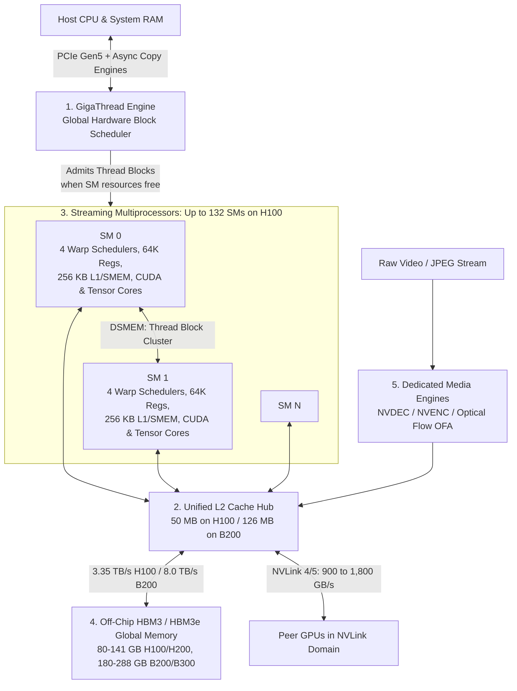
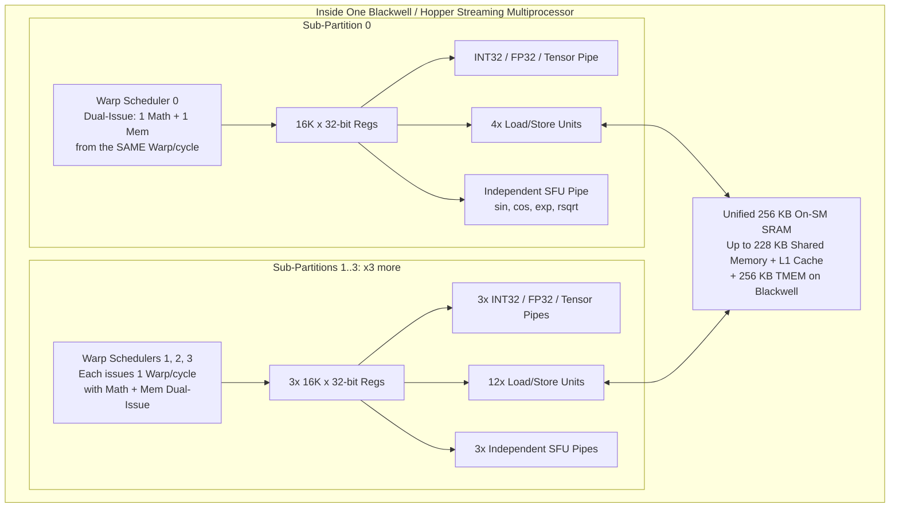
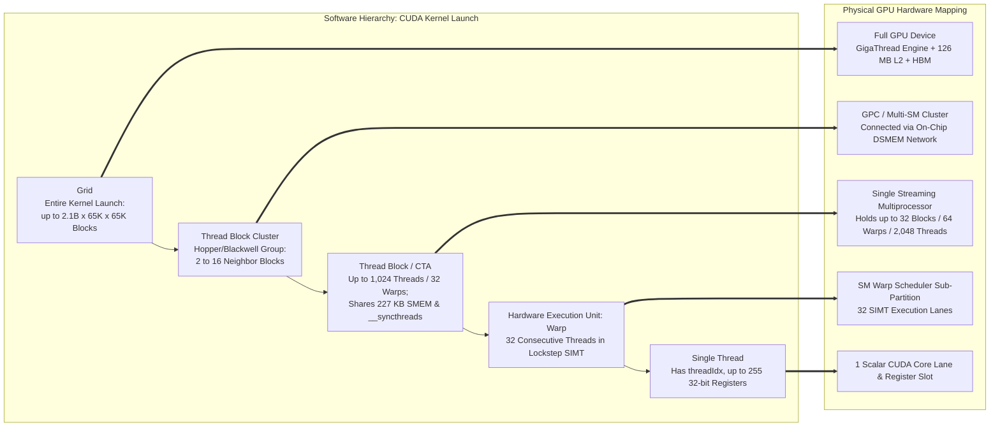
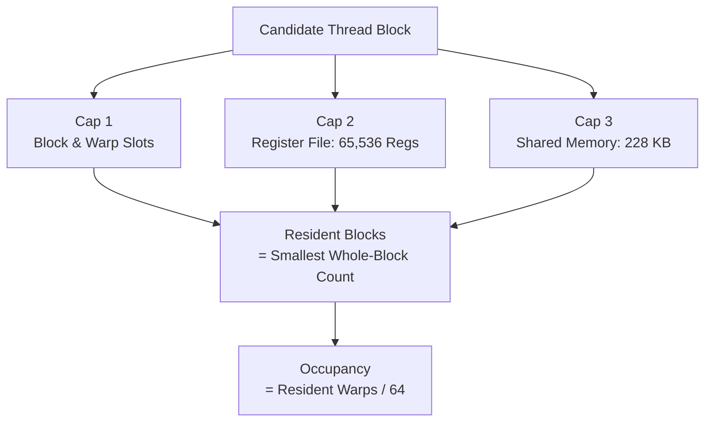
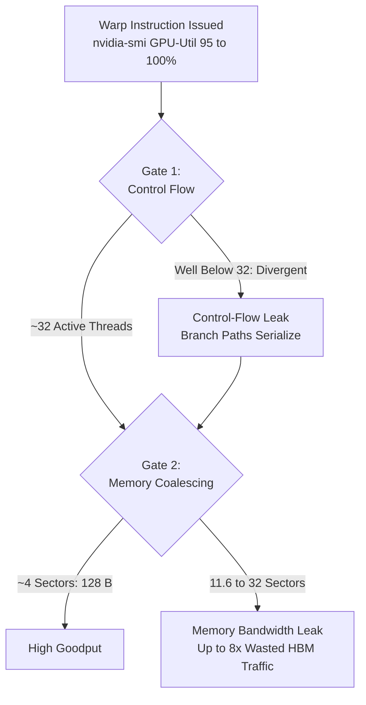

# 10.2 The execution model: threads, warps, blocks and SMs

| | |
|---|---|
| **Status** | Drafted (`execution_model_lab.py`: 25 checks pass; `nvcc` and `ncu` commands not yet run on a live Nebius GPU VM) |
| **Level** | Intermediate |
| **Priority tier** | 2 |
| **Lab venue** | Nebius GPU + self-checking Python model (`code/part10/execution_model_lab.py`) |
| **Part** | Part 10: The GPU and CUDA |
| **Sources used** | *AI Systems Performance Engineering* Ch 6; *Parallel and High Performance Computing* Ch 10; `nvidia-devops` V2 Ch 1–12 & Labs 1–3; `nvidia-devops` VL4 Ch 1 |
| **Claim ledger** | `planning/ledgers/10-02.md` |

## Why this matters for AI infrastructure

Picture an engineer who launches a custom kernel (a small program that runs across many GPU threads) with 1,024 threads per block, expecting the most parallelism the hardware allows. The occupancy number comes back at 15 percent, and the GPU stalls on memory. A week later a compiler update raises the kernel from 40 registers per thread to 56, and the number of warps resident on each SM drops by a third. Neither problem shows up as an error message. Both come from the way a GPU admits and runs work, and that is the subject of this chapter.

A modern NVIDIA GPU is not a flat pool of 14,000 cores that shares out whatever code you give it. Work passes through hardware admission gates, and the threads that run it move in lockstep groups of 32. You can run a production AI cluster for a long time without ever writing a CUDA kernel. You cannot read its profiler output, though, without knowing this model.

The model also explains results that look contradictory. A kernel can report 91 percent achieved occupancy in Nsight Compute and 95 percent utilization in `nvidia-smi` while delivering poor token throughput. A shared-memory tiled kernel at 45 percent occupancy can finish twice as fast as a naive kernel at 90 percent. Two Python processes that share a GPU without Multi-Instance GPU or Multi-Process Service lose tens of microseconds to context switching on every time slice. Once you know the execution model, these results stop looking like a contradiction and start looking like a predictable consequence of the hardware rules.

```text
Production Execution Model Anomalies vs Silicon Reality (ASP Ch 6, V2 Ch 2-9):
  - 1,024-Thread Block Trap:      48 regs/thread x 1,024 threads = 49,152 regs -> fits only 1 block/SM (32 warps = 50% cap)
  - +16 Register Cliff (40->56):  256-thread blocks drop from 6 blocks (48 warps = 75%) to 4 blocks (32 warps = 50%)
  - 95% GPU-Util, Low Goodput:    Divergent warps (19.4 / 32 active lanes) and uncoalesced loads (11.6 to 32 sectors/request)
  - Shared-GPU Time-Slice Thrash: Separate OS processes swap full GPU contexts across tens of microseconds and evict L2 cache
```

The chapter follows work through a Hopper H100 or Blackwell B200 GPU. It starts at the GigaThread Engine, which hands thread blocks to the chip, and ends at the four dual-issue warp schedulers inside each Streaming Multiprocessor. Along the way it gives the formulas for launch geometry and SM occupancy, then the five warp states and the two Nsight Compute efficiency gates. It closes with NVIDIA Compute Sanitizer, which catches memory bugs at run time.

:::tip In one minute
- Where do thread blocks go? The GigaThread Engine assigns thread blocks to Streaming Multiprocessors, where they stay until they finish. The unified L2 cache sits between all SMs, the HBM controllers, and the PCIe and NVLink interfaces.
- How is an SM built? Each Blackwell or Hopper SM has 4 independent warp schedulers. Each issues one warp per cycle, and may pair one math instruction with one memory instruction from that same warp. Special Function Units run transcendentals on a separate pipeline.
- How do threads group? Threads group into 32-thread warps, and warps form thread blocks of up to 1,024 threads on one SM. Neighboring blocks form thread block clusters that share Distributed Shared Memory, and all blocks together form the grid.
- What limits residency? Resident blocks per SM are capped by the tightest of three limits, rounded down to whole blocks: the slot ceilings, the 65,536-register file, and the 228 KB shared-memory pool.
- Is high occupancy enough? High occupancy does not guarantee high throughput. Check two ratios in Nsight Compute: `smsp__thread_inst_executed_per_inst_executed.ratio` should be near 32, and `l1tex__average_t_sectors_per_request_pipe_lsu_mem_global_op_ld.ratio` should be near 4 for 4-byte floats.
:::

---

## Prerequisites and outcomes

**Prerequisites**: Review CPU versus GPU throughput design, SIMT concepts, and theoretical FLOPs and bandwidth formulas from Chapter 10.1.

The chapter maps the internal geography of a modern NVIDIA GPU, from the GigaThread Engine and the unified L2 cache to the Streaming Multiprocessors, the copy engines, and the media decoders. It explains the four-partition layout of a Blackwell or Hopper SM, including dual-issue scheduling across 16 Load/Store units and the separate Special Function Unit pipeline. It then walks the software hierarchy of Thread, Warp, Thread Block, Thread Block Cluster, and Grid, and shows how those names line up with OpenCL, HIP, and CPU loops. Launch geometry comes next. It covers the `if (idx < N)` bounds check, which stops threads past the end of an array from faulting later with `cudaErrorIllegalAddress`, and the forward-compatibility test with `CUDA_FORCE_PTX_JIT=1`. The later sections cover occupancy and tuning with `nvcc -Xptxas=-v`, `__launch_bounds__`, and the CUDA Occupancy API, then warp states, the four scheduling layers in production, and `compute-sanitizer` for catching memory and race bugs in CI.

---

## 1. Inside a modern NVIDIA GPU and the Streaming Multiprocessor

Picture a computer-vision training pipeline. The data loader decodes JPEG images on the host CPU, and somewhere in the training loop someone calls `.cpu().numpy()`, which copies a tensor back to the host for a quick check. The `nvidia-smi` utilization graph now oscillates between 0 percent and 100 percent every few seconds. The GPU finishes its matrix math in milliseconds and then sits idle, waiting for data to cross the PCIe bus. The graph looks like a problem with the GPU, but the GPU is only waiting. Understanding why that happens requires looking inside the GPU die to see how compute engines, caches, copy engines, and media decoders interact.

### 1.1 Silicon geography: GigaThread Engine, L2 Cache, SMs, Copy Engines, and NVDEC

Think of a modern GPU as a hierarchical silicon factory. Data enters through the PCIe or NVLink loading dock and rests in the off-chip HBM warehouse. It then flows through the central L2 cache hub and gets processed on dozens of Streaming Multiprocessor assembly lines. Each part of the factory has a clear job, and a delay at any one of them shows up as idle time on the lines. If you removed the heatsink from an NVIDIA Hopper H100 SXM5 or Blackwell B200 package, you would find five hardware subsystems working together inside the processor die.

The diagram traces those five subsystems and the links between them. Follow a block of work from the host, through the scheduler, into an SM, and out to memory. The media engines sit beside the flow, handling video and images on their own.



The table below gives each subsystem's hardware capacity on H100 and B200, and the rule that governs how it behaves. Read the middle column as the size of the part and the last column as how it behaves in practice.

| Silicon subsystem | Hardware capacity (H100 / B200) | Architectural role and operational rule |
|---|---|---|
| **1. GigaThread Engine** | Global work distributor | Receives the launched grid of thread blocks and assigns each block to an SM with free registers, shared memory, and warp slots. Once admitted to an SM, a block never migrates to another SM. |
| **2. Unified L2 Cache** | **50 MB** (H100) / **126 MB** (B200) | Central coherent SRAM hub (~200-cycle latency) connecting all SMs, HBM controllers, PCIe, and NVLink interfaces. Reusing weight tiles in L2 avoids 300-to-1,000-cycle off-chip HBM trips. |
| **3. Streaming Multiprocessors (SMs)** | **108** (A100) / up to **132** (H100 SXM5) | Each Hopper SM holds **128** FP32 CUDA Cores, **4** Tensor Cores, **4** Texture Units, **65,536** 32-bit registers (**256 KB**), and **256 KB** unified L1/Shared memory (plus **256 KB** Tensor Memory on B200). |
| **4. Copy Engines (DMA)** | Asynchronous DMA controllers | Move bytes between pinned host RAM and GPU HBM over PCIe or NVLink without using SMs, allowing Batch `k + 1` transfers to overlap Batch `k` compute. |
| **5. Media Engines (`NVDEC`, `NVENC`, `OFA`)** | Dedicated fixed-function silicon | Decode and encode video and JPEGs plus optical flow outside the SMs. Offloading image decode via **NVIDIA DALI** eliminates the 0%-to-100% CPU starvation sawtooth. |

Two rows matter most for the opening story.

The L2 cache deserves a note of its own. Its 50 MB on H100 or 126 MB on B200 sits between every SM and the HBM warehouse. When a weight tile is already waiting in L2, the SM skips the long trip off-chip entirely. That is why a kernel that reuses one tile across many blocks can run much faster than the raw HBM bandwidth alone would predict. The cache is a shared hub, so the reuse has to be planned in the kernel, not left to chance. The GigaThread Engine's rule, that a block stays on the SM it was admitted to, explains why the scheduler must find room before it starts a block. The Copy Engines row explains the fix for the sawtooth. When the copy engines move Batch `k + 1` while the SMs compute Batch `k`, the GPU keeps its own pipeline full and stops waiting on the host. Offloading the JPEG decode to the media engines removes the CPU step that was feeding that sawtooth in the first place.

### 1.2 Inside one SM: four warp schedulers, dual-issue, and SFUs

Zoom inside a single Streaming Multiprocessor on a Hopper or Blackwell GPU, and the SM is not one big scheduler. It is divided into **four independent scheduling sub-partitions**. Each sub-partition works like a mini-SM with its own scheduler, its own registers, and its own math units. All four share the on-chip 256 KB of L1 data cache and shared memory SRAM. Think of an office floor with four teams. Each team has its own manager and desks, and they all draw from the same supply room.



The diagram shows each sub-partition as a column. The scheduler at the top picks a warp, the register file feeds the math pipes, the load and store units reach the shared SRAM, and the SFU pipe runs the special functions on its own path. Because the four columns run side by side, the SM can advance several warps in the same clock cycle.

Using the per-cycle SM scheduling rules from *AI Systems Performance Engineering*, Chapter 6, every clock cycle inside an SM follows strict issue constraints. The table lists each constraint with its value and what it means in practice.

| SM scheduling resource (per clock cycle) | Hardware value | Architectural rule and operational meaning |
|---|---|---|
| **Independent warp schedulers per SM** | **4** | Each SM is split into 4 sub-partitions ("mini-SMs"), each managing its own pool of up to `64 / 4 = 16` resident warps. |
| **Maximum warps issued per cycle per SM** | **4** (**1** per scheduler) | Up to 4 different warps (one in each sub-partition) can advance on the same clock cycle. |
| **Dual-issue capability per scheduler** | **1 Math + 1 Memory** op | Each scheduler can issue two independent instructions per cycle (1 arithmetic op on INT32/FP32/Tensor Core + 1 memory `LD/ST` op), provided both instructions come from the **same warp**. |
| **Maximum math + memory ops issued per cycle** | **4 Math + 4 Memory** (**8** total) | Across all 4 schedulers, an SM with well-mixed code can issue 4 math ops and 4 memory ops in a single clock cycle. |
| **Load/Store (`LD/ST`) pipelines per SM** | **16** (**4** per scheduler) | Memory requests flow through 16 combined `LD/ST` units to L1/Shared memory, L2 cache, or off-chip HBM. |
| **Special Function Unit (SFU) pipeline** | Separate decoupled pipeline | Transcendental operations (`sin`, `cos`, `exp`, `rcp`, `sqrt`) execute on a dedicated SFU pipeline outside the math+memory dual-issue pair, so attention `softmax` exponentials do not stall core issue. |

The dual-issue row is the one to remember. A scheduler can send one math instruction and one memory instruction together, but only when both come from the same warp. That rule is why a warp with a healthy mix of arithmetic and loads keeps the SM busier than a warp that only does one kind of work. The SFU row explains why attention, which uses many exponentials, does not force the core pipes to wait for them.

Here is a way to picture dual issue. Each scheduler is a dispatcher with two hands. One hand can send a math instruction to the arithmetic pipes, and the other can send a load or store to the memory units. Both hands work in the same cycle, but only on instructions from the same warp. If the warp offers only math, the second hand sits idle, and the SM loses the chance to overlap memory with arithmetic.

---
## 2. The thread hierarchy: Threads, Warps, Thread Blocks, Clusters, and Grids

Picture a team that tests a CUDA kernel on a small development GPU with 2 streaming multiprocessors (SMs), then runs the same binary on a data center GPU with 132 SMs. The code does not change, and it works on both. That is not an accident. CUDA achieves that generational scalability by organizing parallel software into a nested hierarchy that maps onto the physical hardware tree. The software names describe the work, and the hardware decides how much of it runs at once.

### 2.1 Software-to-hardware mapping and cross-vendor terminology

When a host program launches a kernel, CUDA decomposes the work across five software levels. Those levels are Thread, Warp, Thread Block or Cooperative Thread Array (CTA, a team of threads that cooperate on one tile of work), Thread Block Cluster, and Grid. Each level has a matching piece of hardware, and the diagram shows the pairing. Read it from the top down on the left, then follow the thick arrows to the hardware on the right.



The five levels, from the smallest to the largest, work like this.

The thread is the smallest software worker. Each thread executes the kernel function on its own data element, using its own private registers. The hardware maximum is **255** 32-bit registers per thread, so a thread can hold a fair amount of state without touching memory.

The warp is the level the hardware actually schedules. When an SM admits a thread block, the hardware slices its threads into fixed bundles of 32 consecutive threads. Multidimensional blocks are first flattened in row-major order, which means the last index changes fastest. That puts threads 0 through 31 in Warp 0 and threads 32 through 63 in Warp 1. A warp is the unit that marches in step, so its 32 threads always share one instruction pointer.

The thread block is a 1D, 2D, or 3D team of up to 1,024 threads, or 32 warps. Every thread in a block runs on the same physical SM, which lets them share fast on-SM `__shared__` memory and wait for each other at barriers with `__syncthreads()`. A barrier is a checkpoint where every thread must arrive before any can continue. Because each barrier makes the fast warps wait for the slowest warp in the block, kernels should use as few barrier points as they can.

The thread block cluster and distributed shared memory are newer. Before Hopper, threads in different blocks could share data only through the slower L2 cache or HBM. Hopper and Blackwell introduce Thread Block Clusters, which schedule neighboring blocks onto SMs inside one Graphics Processing Cluster (GPC, a group of SMs that sit close together on the die). Through the hardware Distributed Shared Memory (DSMEM), threads in Block A can read, write, and atomically update Block B's shared memory over an on-chip SM-to-SM network. Cluster barriers synchronize those blocks without touching HBM, as expanded in Chapter 10.16.

The grid is the complete set of thread blocks launched by one kernel call. Separate blocks execute independently, in any order. A small GPU runs a few blocks at a time from a queue, while a large GPU dispatches over a hundred blocks at once. Because the blocks do not depend on each other's order, the same grid runs correctly on both.

The table below combines the cross-vendor abstractions from *Parallel and High Performance Computing* Chapter 10 with the Blackwell B200 limits from *AI Systems Performance Engineering* Chapter 6. Each row is one role, and each column is the name that role carries on a different platform.

| Abstraction / Hardware limit | OpenCL | AMD GPU (`HIP` / `MI50`) | NVIDIA CUDA (`H100` / `B200`) | CPU equivalent |
|---|---|---|---|---|
| **Full execution domain** | `NDRange` | `grid` / `extent` | **Grid** (`max X: 2,147,483,647; Y/Z: 65,535`) | Loop bounds / index set |
| **Max concurrent grids per device** | Device-dependent | Device-dependent | **128** concurrent grids (kernels) | Concurrent thread pools |
| **Shared-memory team** | `Work Group` | `block` / `tile` | **Thread Block (CTA)** (`max 1,024 threads / 32 warps`) | Cache-blocked loop tile |
| **Lockstep execution group** | `Subgroup` | `Wavefront` (**64** work items) | **Warp** (**32** threads) | SIMD vector register width |
| **Individual lane** | `Work Item` | `thread` | **Thread** (`max 255 registers/thread`) | Single loop iteration / lane |
| **Max active warps (subgroups) per SM/CU** | Device query | **40** wavefronts per CU (MI50) | **64** warps (**2,048** resident threads per SM) | SMT hardware threads |
| **Max active blocks (work groups) per SM/CU** | Device query | **40** work groups per CU (MI50) | **32** active thread blocks per SM | — |
| **Selected warps issued per cycle per SM/CU** | — | **4** per CU | **4** (**1** per warp scheduler) | Superscalar issue width |
| **Register file per SM** | — | Arch-dependent | **65,536** (`64K`) 32-bit registers (**256 KB**) | Physical vector register file |
| **L1 + Shared Memory SRAM per SM** | `Local memory` | `LDS` (**64 KB**) | **256 KB** total (`up to 228 KB shared/SM; 227 KB dynamic/block + 1 KB CUDA reserved`) | L1 data cache |

Read the table row by row, and the names stop feeling foreign. The Work Group in OpenCL is the same thing as the Thread Block in CUDA. The Subgroup is the same thing as the Warp, though AMD's version holds 64 items. When a vendor document talks about a block, a tile, or a work group, you can ask which row it belongs to and get the same answer.

---

## 3. Kernel launch geometry, bounds checks, tile decomposition, and PTX compatibility

A kernel can pass unit tests on power-of-two batch sizes like 256 or 1,024, then crash in production with `cudaErrorIllegalAddress` on a 63-token prompt. The unit tests were fine because their sizes divided evenly. The production input did not. A compiled CUDA binary can also fail to load when it is deployed onto a newer GPU generation. Both bugs come from how the launch geometry and the binary compilation interact with the GPU runtime, and this section walks through both.

### 3.1 1D, 2D, and 3D indexing and the `if (idx < N)` bounds check

GPU programming is often called "Me" programming. You replace the outer CPU `for` loop with a grid of threads, and each thread computes its own global index. Think of it as handing every worker a numbered seat in a stadium. When the host launches `myKernel<<<blocksPerGrid, threadsPerBlock>>>(d_input, N)`, each thread calculates its unique 1D coordinate using three built-in variables: `blockIdx.x`, `blockDim.x`, and `threadIdx.x`. The first gives the block's position in the grid, the second gives the size of a block, and the third gives the thread's position inside its block.

```cpp
__global__ void myKernel(float* input, int N) {
    int idx = blockIdx.x * blockDim.x + threadIdx.x;
    if (idx < N) {          // Mandatory bounds check
        input[idx] *= 2.0f;
    }
}
```

The arithmetic in the first line is the whole idea. Multiply the block number by the block size, then add the position inside the block. That gives each thread a unique number from zero up to the total thread count. The `if` line then decides which of those numbers are real elements of the array.

Choosing `threadsPerBlock` and `blocksPerGrid` for a one-million-element array takes three rules. First, always pick `threadsPerBlock` as a multiple of 32, typically **256** (8 warps) or a value between 128 and 512. A 33-thread block allocates 2 warps (64 lanes) and leaves 31 lanes idle while it consumes two warp slots. Starting at 256 threads per block fills every warp and allows up to 8 blocks to reside per SM.

Second, use integer ceiling division to calculate `blocksPerGrid`, so the grid launches enough blocks to cover every element. Ordinary division rounds down and would leave the last few elements unprocessed. Ceiling division rounds up, so the last partial block still gets launched.

Third, always guard memory accesses with `if (idx < N)`, so the trailing threads in the final block or warp never read or write past the end of the array. Those trailing threads exist because the grid is rounded up to whole blocks, and the guard is what keeps them harmless.

```text
Ceiling Grid Math & Out-of-Bounds Fault Mechanics (ASP Ch 6 pp. 188-193, execution_model.py):
  Formula: blocksPerGrid = (N + threadsPerBlock - 1) / threadsPerBlock

  1. Large Vector Example (N = 1,000,000, threadsPerBlock = 256):
     - blocksPerGrid = (1,000,000 + 255) // 256 = 3,907 blocks
     - Total Threads = 3,907 x 256 = 1,000,192 threads launched
     - Final Block (blockIdx.x = 3906): idx spans 999,936..1,000,191 -> last 192 threads have idx >= N

  2. Two-Warp Tail Example (N = 63, warpSize = 32):
     - Hardware allocates 2 warps = 64 threads (indices 0..31 in Warp 0, 32..63 in Warp 1)
     - Thread 64 has idx = 63 (the 64th element, 1 past the end of the 63-element array)
     - Without if (idx < N): Thread 64 writes out of bounds, setting a global hardware fault flag
     - Asynchronous Reporting: Host discovers cudaErrorIllegalAddress lazily at the next cudaDeviceSynchronize() or cudaMemcpy()
```

The worked numbers show both sides of the rule. A million-element array needs 3,907 blocks, which launches 192 more threads than there are elements. Those extra threads are harmless only because the guard stops them. The 63-element case is smaller and easier to picture. Two warps launch 64 threads, and the last one has no element to work on. Without the guard, it writes past the end of the array.

Because CUDA kernels execute asynchronously, an out-of-bounds write does not raise an exception in the thread that caused it. The access sets a global hardware fault flag for the entire launch. The host CPU discovers that fault late, on the next synchronous API call such as `cudaDeviceSynchronize()` or `cudaMemcpy()`, where it surfaces as `cudaErrorIllegalAddress`. The error often points at a line that is innocent, which is why debugging takes longer than it should. During debugging, always pair kernel launches with `cudaGetLastError()` and `cudaDeviceSynchronize()`, so the error appears next to the launch that caused it.

### 3.2 2D and 3D domain tile decomposition and halo trade-offs

When you process 2D images or 3D scientific volumes, you pass `dim3(Tx, Ty, Tz)` structures for `threadsPerBlock` and `blocksPerGrid`. The shape you choose sets how many blocks the grid needs. Reproducing the four canonical domain decompositions from *Parallel and High Performance Computing* Chapter 10, Table 10.3, shows how tile shape controls the block counts.

| Domain type | Global domain size (`Gz x Gy x Gx`) | Block / Tile shape (`Tz x Ty x Tx`) | Threads per block (Tile size) | Grid dimensions (`NTz x NTy x NTx`) | Total work groups (Thread Blocks `NT`) |
|---|---|---|---|---|---|
| **1D vector** | `1,048,576` | `128` | `128` (4 warps) | `8,192` | **8,192** |
| **Small 2D tile** | `1024 x 1024` | `8 x 8` | `64` (2 warps) | `128 x 128` | **16,384** |
| **Large 2D tile** | `1024 x 1024` | `8 x 16` | `128` (4 warps) | `128 x 64` | **8,192** |
| **3D volume** | `128 x 128 x 128` | `4 x 4 x 8` | `128` (4 warps) | `32 x 32 x 16` | **16,384** |

The table shows that a smaller tile does not mean fewer blocks. The small 2D tile produces twice as many blocks as the large one, because each block covers less ground. Read the last column as the amount of scheduling work the GPU must do.

Two physical trade-offs govern how you pick a multidimensional tile.

You can check the trade-off on paper before writing a line of kernel code. Count the threads in a candidate tile, then count the halo cells that the tile must read from its neighbors. A tile whose halo is large compared with its interior spends its time on border reads, and that time does not produce output. Choose the tile shape that keeps the halo small compared with the work inside it. First, align the fastest-changing dimension, `blockDim.x`, to warps and cache lines, so that adjacent threads in a warp read contiguous memory addresses. Second, balance the width of the tile against the halo reloads along its edges. In stencil or convolution kernels, each tile must also load a border of neighbor pixels from the adjacent tiles, and that border is the halo. A flat 64 by 2 tile has a long perimeter, which duplicates many HBM halo loads. A square or near-square tile, such as 16 by 16 (256 threads) or 16 by 8 (128 threads), keeps the perimeter small compared with the area, while still reading rows in a coalesced way. Using C++ lambda wrappers in portability frameworks such as SYCL, Kokkos, and Raja lets teams write these tiled loop bodies once and run them on CPU and GPU backends.

### 3.3 Forward and backward binary compatibility (SASS, PTX, and `CUDA_FORCE_PTX_JIT=1`)

How can a PyTorch wheel or a CUDA binary compiled years ago still run on a brand-new Blackwell GPU? The answer lies in how the NVIDIA compiler (`nvcc`) packages the code. It uses a two-stage compilation model, which stores architecture-specific machine code alongside a virtual intermediate form. The next GPU generation can then finish the job at startup.

1. SASS (Streaming ASSembler) is the native machine code compiled for one specific GPU architecture, such as `sm_80` for Ampere, `sm_90` for Hopper, or `sm_100` for Blackwell. Family-specific targets like `sm_100f` and `compute_100f` restrict portability to devices within that exact feature family. Native SASS runs only on the architecture family it was built for.
2. PTX (Parallel Thread Execution) is NVIDIA's virtual instruction-set intermediate representation, a form of the program that no chip runs directly. When you ship a fatbinary, which is a single file holding several builds, it contains architecture-specific SASS cubins plus virtual PTX. A future GPU driver can then Just-In-Time (JIT) compile the embedded PTX into native machine code at startup.
3. Pre-flight verification with `CUDA_FORCE_PTX_JIT=1` is the last step, and it sets the environment variable `CUDA_FORCE_PTX_JIT=1`. In continuous integration or node qualification tests, run your binary with that variable set. It forces the CUDA driver to ignore the embedded SASS and JIT-compile the embedded PTX instead. If a build script left PTX out of the fatbinary, the test fails right away in CI, rather than crashing later on next-generation GPU nodes in production.

The three steps form a safety net. SASS gives speed on the GPU you have today. PTX gives a path to the GPU you will buy next year. The forced JIT test proves that the path still exists before the day you need it.

---

## 4. Residency, Occupancy, and how to calculate and tune them

A minor compiler change that adds 16 registers per thread can suddenly cut resident warps from 48 to 32. Launching 1,024 threads per block can also leave half the SM empty. Both behaviors come from how the SM admission gate calculates **Occupancy**, the ratio of active resident warps on an SM to the hardware maximum of 64 warps. Occupancy is a measure of how much of the SM's capacity is loaded with work at any moment. It is not a measure of how fast the work runs.

```text
SM Occupancy Definition (ASP Ch 6, V2 Ch 6):
  Occupancy (%) = (Active Resident Warps per SM / Maximum Supported Warps per SM (64)) x 100%
```

### 4.1 The block admission gate and worked register and shared-memory occupancy math

When the GigaThread Engine tries to place a candidate thread block onto an SM, the hardware checks three finite resource caps at the same time. Think of it as three gates at a ferry terminal. A ferry can only take on as many cars as the narrowest gate allows, whether the limit is the number of vehicles, the weight, or the space on deck. Whichever cap is tightest sets how many whole blocks can reside on the SM at once.



A candidate block is defined by four numbers: `threadsPerBlock`, `warpsPerBlock`, `regsPerThread`, and `sharedMemPerBlock`. Those four values come from the kernel's launch settings and from what the compiler reports. Once you know them, the three caps are simple arithmetic.

| Admission cap | Hardware limit per SM | How it restricts resident blocks |
|---|---|---|
| **1. Slot ceilings** | Max **32** blocks; max **64** warps (**2,048** threads) | Caps resident blocks directly by `min(32, floor(64 / warpsPerBlock))`. |
| **2. Register file** | **65,536** 32-bit registers (max **255** per thread) | Max threads = `floor(65536 / regsPerThread)`; max blocks = `floor(max_threads / threadsPerBlock)`. |
| **3. Shared memory** | **228 KB** shared per SM (max **227 KB** dynamic/block) | Effective block SMEM = dynamic SMEM + **1 KB** reserved by CUDA; max blocks = `floor(228 KB / effective_smem)`. |

Each row is a separate gate. The slot ceiling counts blocks and warps, the register cap counts how many registers the kernel's threads need, and the shared memory cap counts the bytes each block reserves. The lowest of the three numbers wins. That is why a kernel that looks light on one resource can still be limited by another.

The function `calc_sm_occupancy` in `code/part10/execution_model.py` applies these three limits together. The slot limits come from *AI Systems Performance Engineering*. The register and shared-memory method comes from the NVIDIA notes cited in the Sources section. Combining the three gates into one function is a design choice made for this chapter, so check its output against the arithmetic above.

---
You can inspect a kernel's exact compile-time register count, and its local-memory spill footprint, before you run any profiler. Pass `-Xptxas=-v` to `nvcc`, and the compiler prints the numbers as it builds. Spills matter because they mean the compiler ran out of registers and had to park values in slower memory.

```text
$ nvcc -O3 -Xptxas=-v kernel.cu -o kernel
ptxas info    : Compiling entry function '_Z6kernelPfS_m' for 'sm_90'
ptxas info    : Function properties for _Z6kernelPfS_m
    0 bytes stack frame, 0 bytes spill stores, 0 bytes spill loads
ptxas info    : Used 48 registers, 384 bytes cmem[0]
```

Read the last two lines first. The `Used 48 registers` line tells you how many registers each thread asks for, and the spill line tells you whether the compiler had to push any values out of registers. Zero bytes of spills is the healthy case.

Now examine the **register cliff effect**. The derivations below use the same SM from the earlier sections, with 65,536 registers and a maximum of 64 warps, which is 2,048 threads per SM. Each case changes one thing, so you can see the effect of that one change on resident warps.

```text
Worked SM Occupancy Derivations (65,536 Regs/SM, 64 Max Warps = 2,048 Threads/SM, 228 KB SMEM/SM):
  1. Balanced Kernel (256 threads/block = 8 warps, 32 regs/thread, 0 KB SMEM):
     - Reg limit: floor(65536 / 32) = 2,048 threads -> floor(2048 / 256) = 8 blocks -> 64 warps = 100.0% occupancy
  2. Moderate Registers (V2 Ch 6 Ex. 1: 256 threads/block = 8 warps, 40 regs/thread, 0 KB SMEM):
     - Reg limit: floor(65536 / 40) = 1,638 threads -> floor(1638 / 256) = 6 blocks (1,536 threads) -> 48 warps = 75.0%
  3. +16 Regs After Code Change (V2 Ch 6 Ex. 2: 256 threads/block = 8 warps, 56 regs/thread, 0 KB SMEM):
     - Reg limit: floor(65536 / 56) = 1,170 threads -> floor(1170 / 256) = 4 blocks (1,024 threads; 0.57 block dropped) -> 32 warps = 50.0%
  4. Oversized 1,024-Thread Block (V2 Ch 3: 1,024 threads/block = 32 warps, 48 regs/thread, 0 KB SMEM):
     - Reg limit: 1 block uses 1,024 x 48 = 49,152 regs (leaves 16,384 free; 2nd block needs 98,304) -> 1 block = 32 warps = 50.0%
     - Fix: Reducing block size to 256 threads at 48 regs fits floor(1365 / 256) = 5 blocks -> 40 warps = 62.5% occupancy
  5. Large Shared-Memory Tile (256 threads/block = 8 warps, 24 regs/thread, 64 KB dynamic SMEM):
     - SMEM limit: 64 KB dynamic + 1 KB CUDA reserved = 65 KB/block -> floor(228 KB / 65 KB) = 3 blocks -> 24 warps = 37.5%
```

The summary table puts the same five cases side by side. Each row names the resource that limited it, which is the column to read first.

| Scenario | Threads / block (warps) | Registers / thread | Dynamic SMEM / block | Max threads by regs | Resident blocks | Resident warps | SM Occupancy | Limiting resource |
|---|---|---|---|---|---|---|---|---|
| **1. Balanced kernel** | **256** (8 warps) | **32** regs | **0 KB** | **2,048** | **8** blocks | **64** warps | **100.0%** | Slot/Warp ceiling |
| **2. Moderate registers (V2 Ch 6 Ex. 1)** | **256** (8 warps) | **40** regs | **0 KB** | **1,638** | **6** blocks | **48** warps | **75.0%** | **Registers** |
| **3. +16 regs after edit (V2 Ch 6 Ex. 2)** | **256** (8 warps) | **56** regs | **0 KB** | **1,170** | **4** blocks | **32** warps | **50.0%** | **Registers** |
| **4. Oversized 1,024-thread block** | **1,024** (32 warps) | **48** regs | **0 KB** | **1,365** | **1** block | **32** warps | **50.0%** | **Registers + Block size** |
| **5. Large shared-memory tile** | **256** (8 warps) | **24** regs | **64 KB** (+1 KB) | **2,048** | **3** blocks | **24** warps | **37.5%** | **Shared Memory** |

Three engineering rules come out of those numbers. The first rule is that a partial block can never reside on an SM. In row 3, raising the register use from 40 to 56 per thread cut the thread ceiling to 1,170 threads. That is 4.57 blocks of 256 threads, and the SM only admits whole blocks. So residency fell from 6 blocks at 75 percent to 4 blocks at 50 percent in one step. A small change in one register count can cost a large share of occupancy.

The second rule is that a 1,024-thread block often backfires. At 48 registers per thread, one 1,024-thread block consumes 49,152 registers, leaving only 16,384 free. A second block cannot fit, so the SM runs only one block. If that single block reaches a `__syncthreads()` barrier and waits, the SM has no other block to switch to. Reducing `threadsPerBlock` to 256 lets the SM pack 5 independent blocks, which gives the scheduler something to do while one block waits.

The third rule is to watch for register spilling. Spilling happens above 255 registers per thread, or whenever the compiler reports non-zero spill stores and loads. When a thread exceeds its register budget, `nvcc` spills the excess variables into Local Memory. Despite its name, Local Memory is private to each thread but physically sits in off-chip HBM DRAM, with hundreds of cycles of latency. Spilling to HBM hurts performance far more than running at slightly lower occupancy does, so a kernel with a few spills and high occupancy is often the wrong thing to chase.

Put the three rules together and you get a practical habit. Before you touch the launch configuration, compile with `-Xptxas=-v` and read the register count and the spill bytes. Then do the arithmetic for the block size you plan to use. If the arithmetic says a block limit is hit, change the block size or the register budget first, and only then profile to confirm the change helped.

### 4.2 Why sufficient parallelism matters and why 100% occupancy is not the goal

A common goal in tuning is to push occupancy as high as possible. This subsection shows why that goal can mislead you. Compare two vector addition implementations on one million floats. The source profiles both with `nsys` and `ncu` in *AI Systems Performance Engineering* Chapter 6. The first kernel, `addSequential<<<1, 1>>>` or a naive Python loop, uses a single thread on one SM. The second kernel, `addParallel<<<3907, 256>>>` or vectorized PyTorch `C = A + B`, launches 3,907 blocks of 256 threads, which spread across all SMs at once.

| Benchmark metric (`N = 1,000,000` floats, *AI Systems Performance Engineering* Ch 6 Table 6-6) | `add_sequential` (`<<<1, 1>>>`) | `add_parallel` (`<<<3907, 256>>>`) | Speedup / Change |
|---|---|---|---|
| **Kernel execution time (ms)** | **48.21 ms** | **2.17 ms** | **22.2x faster** |
| **Overall GPU utilization (`nsys`)** | **1.5%** | **95.0%** | **1.5% to 95.0%** |
| **Achieved SM occupancy (`ncu` `sm__warps_active`)** | **1.3%** | **38.7%** | Hides HBM load latency |
| **Warp execution efficiency** | **3.1%** (1 / 32 lanes) | **100.0%** (32 / 32 lanes) | Full 32-lane SIMT utilization |

The first row shows the scale of the gain. The sequential version takes 48.21 milliseconds, and the parallel one finishes in 2.17 milliseconds. The third row is the surprising one. The parallel kernel achieved a **22.2x** speedup and **95.0%** GPU utilization at only **38.7%** achieved occupancy. Why did it not need 100 percent occupancy? Occupancy is a means to hide latency, not an end-to-end performance goal. Once an SM has enough independent warps to keep its pipelines busy during HBM loads, adding more resident warps does not make a memory-bound kernel faster. It only places more warps in line waiting for the same saturated HBM bus. A tiled kernel that caches data in registers or shared memory often drops to 45 or 50 percent occupancy, yet it can run twice as fast because it cuts off-chip HBM traffic roughly in half.

You can prove whether a high-occupancy kernel has already hit the HBM bandwidth ceiling in a single Nsight Compute (`ncu`) pass. The command below asks for two metrics, warp activity and DRAM throughput, and reports both as a percentage of their peak.

```text
$ ncu --metrics sm__warps_active.avg.pct_of_peak_sustained_active,dram__throughput.avg.pct_of_peak_sustained_elapsed ./kernel
  sm__warps_active.avg.pct_of_peak_sustained_active     %    91.2
  dram__throughput.avg.pct_of_peak_sustained_elapsed    %    97.8
```

When `sm__warps_active` is **91.2%** and `dram__throughput` is **97.8%**, HBM memory bandwidth is completely saturated. Raising occupancy further will yield zero speedup. The two numbers tell the story in one line. The SMs are full, and the memory bus is also full. More warps would only queue behind the bus.

### 4.3 Tuning occupancy with `__launch_bounds__` and the CUDA Occupancy API

When a kernel uses too many registers per thread and starves the SM of resident warps, engineers have two mechanisms for tuning residency. The first is a compile-time hint. The second is a runtime query.

The first mechanism is `__launch_bounds__(maxThreadsPerBlock, minBlocksPerMultiprocessor)`, a compile-time annotation. It tells `nvcc` to cap the per-thread register allocation, so that at least `minBlocksPerMultiprocessor` blocks of size `maxThreadsPerBlock` fit on each SM. It is easy to ask for more than the hardware can give. *AI Systems Performance Engineering* Chapter 6, on page 206, documents this hardware ceiling trap. Writing `__launch_bounds__(256, 16)` requests 4,096 resident threads per SM, which exceeds the **2,048-thread** hardware limit on Blackwell and Hopper. The `ptxas` assembler ignores `.minnctapersm` and clamps residency to **8** blocks, or at most 32 registers per thread. The safe rule is to keep `maxThreadsPerBlock * minBlocksPerMultiprocessor <= 2048`, so the product never passes the hardware limit.

```text
ptxas warning : Value of threads per SM...is out of range. .minnctapersm will be ignored
```

The warning above is the sign that the request was out of range. When you see it during a build, go back and check the arithmetic in the rule before you trust the kernel's residency.

The second mechanism is runtime. `cudaOccupancyMaxPotentialBlockSize(&minGridSize, &bestBlockSize, myKernel, dynSmemBytes, 0)` asks the CUDA driver which block size maximizes SM occupancy for the kernel's compiled register count and dynamic shared memory. The API returns a block size, which you can use at launch time. It also returns `minGridSize`, but that value only reports the minimum number of blocks needed to fill one wave across the GPU. It is not the size of your actual launch. Compute the real grid yourself with `(N + bestBlockSize - 1) / bestBlockSize`, so every element is covered.

---

## 5. Warp states, instruction dispatch, divergence, and the two efficiency gates

Having 48 or 64 warps resident on an SM does not guarantee that the SM can issue an instruction on the next clock cycle. Picture a busy kitchen with plenty of cooks at their stations, where most of them are waiting on the oven. The stations are full, but very little food leaves the kitchen. Even when an SM issues instructions every cycle at 95 percent utilization, a kernel can lose most of its throughput through the two Nsight Compute efficiency gates.

### 5.1 The five warp states and scoreboard dependencies

At every clock cycle, each warp on an SM sits in one of five hardware states. The table defines each state and what moves a warp from one state to the next.

| Warp state | Hardware definition | What governs state transitions |
|---|---|---|
| **1. Active** | Resident on the SM with allocated registers and a warp slot, and not yet exited. | Admitted by the GigaThread Engine when block resources are free. |
| **2. Stalled** | Active, but **cannot issue** its next instruction on this clock cycle. | Waiting on an HBM/L2 memory load (`long_scoreboard`), an arithmetic or SMEM dependency (`short_scoreboard`), a `__syncthreads()` barrier, or a busy execution pipe. |
| **3. Eligible** | Active, all input operands are ready in registers (cleared by the hardware **Scoreboard**), and the target execution pipeline is free. | Ready to be picked by the sub-partition's warp scheduler. |
| **4. Selected** | The **1 Eligible warp** chosen by its sub-partition's warp scheduler to issue 1 (or 2 dual-issued) instruction(s) on this clock cycle. | Hardware warp scheduler priority policy. |
| **5. Completed** | All 32 threads in the warp have finished executing the kernel. | Releases the warp slot; when all warps in a block complete, the block's registers and shared memory are freed. |

Think of the five states as a line at a checkout. Active means the shopper is in the store, Stalled means the shopper is waiting on a price check, Eligible means the shopper is ready to pay, Selected means the cashier is taking the payment, and Completed means the shopper has left.

The gap between Active and Eligible matters most. In a dependent pair of instructions such as `A = B + C; D = A * E;`, the second line cannot run until `A` is written. The hardware Scoreboard tracks that dependency and marks the warp Stalled until the value arrives. If all 64 Active warps wait on an HBM load or a barrier at the same moment, the number of Eligible warps drops to zero, and the SM stalls even though its occupancy reads 100 percent.

### 5.2 Warp divergence, predication, and the two Nsight Compute efficiency gates

When warps are Eligible and Selected on every cycle, how can a kernel still deliver poor token or record throughput? The answer lies in the **two hardware efficiency gates**: Control-Flow Efficiency and Memory Coalescing Efficiency. A kernel can look busy at every level and still fail one of these gates, so the gates are the right place to look next.



The diagram sends every issued warp instruction through two checks in order. The first asks how many lanes were active. The second asks how many memory sectors each load touched. A warp can pass the first gate and fail the second, or fail both.

| Efficiency gate | Nsight Compute (`ncu`) metric | Ideal value | Degraded example (V2 Ch 9) |
|---|---|---|---|
| **1. Control-Flow Efficiency** | `smsp__thread_inst_executed_per_inst_executed.ratio` | **32.0** active threads per instruction (**100%**) | **19.4** active threads (**60.62%** lane efficiency; divergent `if/else` inside a warp) |
| **2. Memory Coalescing** | `l1tex__average_t_sectors_per_request_pipe_lsu_mem_global_op_ld.ratio` | **4.0** sectors of **32 B** for a **128 B** float load (**1.0x**) | **11.6** sectors (**371.2 B**, **2.9x**) up to **32.0** sectors (**1,024 B**, **8.0x** wasted HBM traffic) |

```text
Two Efficiency Gates Math (V2 Ch 9, V2 Lab 03, execution_model.py):
  Gate 1 — Control-Flow Efficiency (32 lanes per warp):
    - Ideal Uniform Warp:     32.0 / 32 = 100.00% active-lane efficiency
    - V2 Ch 9 Fraud Kernel:   19.4 / 32 =  60.62% active-lane efficiency (39.38% wasted to branch divergence)
    - 50/50 Split (16 vs 16): 16.0 / 32 =  50.00% active-lane efficiency (2x serialized instruction passes)

  Gate 2 — Memory Coalescing Efficiency (32 threads x 4-byte float = 128 useful bytes; 1 sector = 32 bytes):
    - Coalesced (contiguous_copy): 4.0 sectors x 32 B =   128.0 B moved for 128 B useful -> 1.0x byte amplification
    - V2 Ch 9 Strided Example:    11.6 sectors x 32 B =   371.2 B moved for 128 B useful -> 2.9x byte amplification
    - Worst-Case Scattered Load:  32.0 sectors x 32 B = 1,024.0 B moved for 128 B useful -> 8.0x byte amplification
```

Take Gate 1 first. All 32 threads in a warp share one instruction pointer. When an `if/else` condition is true for 16 threads and false for the other 16 *within the same warp*, the warp suffers **Warp Divergence**. The SM first runs Path A with the 16 false lanes masked off. Then it runs Path B with the 16 true lanes masked off, and the warp reconverges. Execution time doubles, and lane efficiency falls to 50 percent. Divergence happens only inside a single 32-thread warp. If Warp 0 takes Path A and Warp 1 takes Path B, there is no warp divergence, because each warp branches uniformly. For very short branch bodies, `nvcc` uses **predication** instead. It issues the instructions unconditionally, and a per-lane predicate bit decides which lanes write their results. Predication avoids the two-pass cost for short bodies.

Now take Gate 2. When 32 threads in a warp each read a 4-byte float, the memory subsystem serves the 128-byte load in 32-byte sectors. Four sectors make up one 128-byte cache line. In a coalesced `contiguous_copy` kernel, adjacent threads read adjacent addresses, so all 128 bytes sit in one aligned cache line and the load transfers 4 sectors. In a `strided_copy` or scattered pointer-chasing kernel, each thread lands in a different cache line. The hardware then fetches up to 32 separate 32-byte sectors. That moves 1,024 bytes to deliver 128 useful bytes, which wastes 8.0x of HBM bandwidth.

The function `diagnose_kernel_efficiency_gates` in `code/part10/execution_model.py` joins the three occupancy limits to these two gates. Joining them into one diagnosis is a choice made for this chapter, and it is not a table from the source material.

---
## 6. Production operations: the four scheduling layers, GPU Contexts, and Compute Sanitizer

Picture two Kubernetes pods that share one GPU through operating system time-slicing. Each pod works fine on its own, but together they run more than twice as slowly as expected, and Nsight Systems shows high driver overhead. In the same week, a second team reports that `nvidia-smi` succeeds on the bare-metal host while `docker run --gpus all` fails inside a container. Both reports look like GPU problems, but neither is really about the SM. Answering them requires separating the four scheduling layers of an AI cluster, because each layer has its own scheduler and its own failure modes.

### 6.1 The four scheduling layers and GPU Context Switching (Time-Slicing vs MIG vs MPS)

In production, SM warp scheduling sits at the bottom of a four-layer scheduling stack. Work comes down from the top layer, and each layer decides something that the layer below must live with. The table lists each layer, its scheduler, the unit it schedules, and the failure you usually see there.

| Layer | Scheduler component | Scheduling unit | Typical failure and symptom |
|---|---|---|---|
| **1. Cluster layer** | Kubernetes (`kube-scheduler` / `KAI` / `Kueue`) or Slurm (`slurmctld`) | Pod, Job, or Node | Cross-NUMA placement or broken container GPU passthrough (`nvidia-smi` works on host, `docker run --gpus all` fails at the Container Toolkit / CDI boundary). |
| **2. Runtime layer** | Triton, vLLM, PyTorch process, or CUDA Driver | **GPU Context**, Request Batch, CUDA Stream | **GPU Context Switching thrash** (two OS processes time-slicing one GPU without MIG or MPS) or tiny batches underfilling the GPU. |
| **3. Kernel layer** | **GigaThread Engine** | Grid and Thread Blocks (CTAs) | Small grid tail effect or oversized **1,024-thread** blocks capping each SM at 1 active block. |
| **4. SM layer** | **4 Warp Schedulers per SM** | 32-thread Warps & Dual-Issued Instructions | Warp divergence (`19.4 / 32` lanes), uncoalesced sector amplification (`11.6` to `32` sectors), or register spilling to HBM local memory. |

The first layer explains the container report. The cluster layer places pods and passes the GPU into the container, so a failure at the Container Toolkit boundary looks like a GPU that vanished. The fourth layer explains the nodes that look busy but run slowly. Each of the middle layers is where the time-slicing and batching problems live.

A platform team that shares GPUs between tenants needs to understand **GPU Contexts**, which belong to layer 2. A GPU Context is to a CUDA process what a virtual address space is to a Linux process. It is the set of device page tables, allocations, and hardware state that belongs to one process. By default, an NVIDIA GPU runs **one hardware context at a time**. When two independent OS processes share one GPU without isolation, the driver must perform **GPU Context Switching**. Saving and restoring SM and page-table state takes tens of microseconds, and both processes evict each other's L2 cache lines while they wait their turn. That is the thrash behind the opening story.

Never share a production GPU across heavy workloads using raw OS time-slicing alone. Instead, choose one of three supported architectures. The first is to dedicate a whole GPU to each process. The second is to partition the GPU in hardware with **Multi-Instance GPU (MIG)**, so each tenant receives physically isolated SMs, L2 cache banks, memory controllers, and an independent hardware context. The third is to enable **NVIDIA Multi-Process Service (MPS)** when cooperating processes from the same tenant need to share one combined GPU context without context-switch stalls, as covered in Chapters 11.24 through 11.26. Pick the one that matches who owns the processes. Isolation between tenants calls for MIG, while teamwork inside one tenant calls for MPS.

### 6.2 Catching memory, race, and barrier bugs with NVIDIA Compute Sanitizer

A single kernel launch can spawn millions of threads, and none of them gets its own operating system page protection. An off-by-one indexing bug or a shared-memory race condition can therefore corrupt weights silently, or trigger a `cudaErrorIllegalAddress` crash hours into a run. NVIDIA Compute Sanitizer (`compute-sanitizer`) is the tool that catches these bugs while the program runs. Integrate it into continuous integration pipelines using `--error-exitcode 1` and `--nvtx yes`, so a bug fails the build instead of reaching production.

The sanitizer ships as four separate tools. Each one checks for a different class of bug, so a clean run from one tool does not clear the others. The table lists the four tools and the command for each.

| Compute Sanitizer tool | Command invocation | Functional bug class detected at runtime |
|---|---|---|
| **1. `memcheck`** (default) | `compute-sanitizer --tool memcheck --check-device-heap yes` | Out-of-bounds or misaligned accesses in global, local, and shared memory (such as a missing `if (idx < N)` check), hardware exceptions, and device heap leaks. |
| **2. `racecheck`** | `compute-sanitizer --tool racecheck` | Shared-memory (`__shared__`) data hazards: **Read-After-Write (RAW)**, **Write-After-Read (WAR)**, and **Write-After-Write (WAW)** races between threads in a block. |
| **3. `initcheck`** | `compute-sanitizer --tool initcheck` | Kernel threads reading from **uninitialized device global memory** (such as a forgotten `cudaMemcpy` or `cudaMemset`). |
| **4. `synccheck`** | `compute-sanitizer --tool synccheck` | Invalid barrier synchronization, such as placing `__syncthreads()` inside a divergent `if/else` branch where only some threads in the block reach the barrier, causing a hardware deadlock. |

Memcheck is the one you will reach for first, because out-of-bounds access is the most common kernel bug. Racecheck is the next most useful, since shared-memory races are hard to see by reading the code. Initcheck and synccheck catch the quieter mistakes that come from missing setup and from barriers placed in the wrong branch.

---

## Commands and configurations that matter

### 1. Inspecting compile-time register usage and local-memory spills (`nvcc -Xptxas=-v`, untested on live Nebius GPU VM)

The first command builds the kernel for Hopper and embeds PTX as well, then prints the register and spill counts. The second runs the binary with the forced PTX JIT, which proves the embedded PTX can be compiled at runtime.

```bash
# Compile a CUDA file for Hopper (sm_90) + embedded PTX (compute_90) and print register/spill counts
nvcc -O3 -arch=compute_90 -code=sm_90,compute_90 -Xptxas=-v memory_patterns.cu -o memory_patterns

# Verify PTX forward compatibility by forcing runtime PTX JIT compilation
CUDA_FORCE_PTX_JIT=1 ./memory_patterns
```

### 2. Profiling timeline gaps (`nsys`) and SM occupancy and efficiency gates (`ncu`)

Use two profilers for two different questions. Nsight Systems shows the timeline, including the gaps between kernels. Nsight Compute zooms into one kernel and reports its efficiency gates. The first command below records the timeline, and the second collects the occupancy and gate metrics for the kernel.

```bash
# 1. Nsight Systems (nsys): capture end-to-end host-to-device copies, kernel gaps, and NVTX ranges
nsys profile --stats=true -t cuda,nvtx -o parallel_nsys_report ./memory_patterns

# 2. Nsight Compute (ncu): inspect Occupancy, HBM throughput, Active-Lane efficiency, and Sectors/request
ncu --section SpeedOfLight \
  --metrics sm__warps_active.avg.pct_of_peak_sustained_active,dram__throughput.avg.pct_of_peak_sustained_elapsed,smsp__thread_inst_executed_per_inst_executed.ratio,l1tex__average_t_sectors_per_request_pipe_lsu_mem_global_op_ld.ratio \
  --target-processes all --print-summary per-gpu ./memory_patterns
```

### 3. Live DCGM and `nvidia-smi` host versus container boundary verification

This check separates a host problem from a container problem. Run the host commands first. If they pass, and the container command still fails, the problem sits at the Container Toolkit boundary, not in the driver.

```bash
# 1. Host baseline and streaming SM / memory / PCIe monitoring
nvidia-smi --query-gpu=index,name,driver_version,pstate,memory.used,utilization.gpu,utilization.memory,power.draw --format=csv
nvidia-smi dmon -s pucvmet -d 1

# 2. Verify container GPU passthrough (if host nvidia-smi works but this fails, fix Container Toolkit / CDI)
docker run --rm --gpus all nvidia/cuda:12.4.1-base-ubuntu22.04 nvidia-smi
```

### 4. CI functional verification with `compute-sanitizer`

The four sanitizer runs below are the CI gate. Each one returns a non-zero exit code when its bug class appears, which fails the pipeline. Run all four, because each tool covers a different class of bug.

```bash
# Fail CI with non-zero exit code if any out-of-bounds access, shared-memory race, or barrier bug occurs
compute-sanitizer --tool memcheck --error-exitcode 1 --nvtx yes ./memory_patterns
compute-sanitizer --tool racecheck --error-exitcode 1 ./memory_patterns
compute-sanitizer --tool initcheck --error-exitcode 1 ./memory_patterns
compute-sanitizer --tool synccheck --error-exitcode 1 ./memory_patterns
```

---

## How it fails

The table lists six failure modes that you will meet on real systems. Each row gives the symptom you see first, the root cause behind it, and the first fix to try. Start from the symptom, and only then reason about the cause.

| Failure mode | Symptom | Root cause | Diagnosis & fix |
|---|---|---|---|
| **1. Register / block-size starvation on 1,024-thread blocks** | A custom CUDA or Triton kernel launched with `threadsPerBlock = 1024` runs slowly; `ncu` reports **15–50%** achieved occupancy and high `long_scoreboard` memory stalls. | At **48+** registers/thread, one 1,024-thread block consumes **49,152+** of the SM's **65,536** registers, preventing a second block from fitting on the SM. | Check `nvcc -Xptxas=-v`; reduce `threadsPerBlock` to **128** or **256** (or apply `__launch_bounds__(256, 4)`) so the SM packs 4 to 8 blocks and hides HBM latency across warps. |
| **2. Register spilling into off-chip HBM Local Memory** | After fusing kernels or unrolling loops, kernel latency spikes by **3x–5x** and HBM traffic jumps even though input tensor sizes did not grow. | Per-thread register demand exceeded **255** (or exceeded a tight `__launch_bounds__` cap), forcing `ptxas` to spill variables to **Local Memory** in slow HBM DRAM. | Inspect `nvcc -Xptxas=-v` for non-zero `bytes spill stores, bytes spill loads`; relax `__launch_bounds__`, reduce loop unrolling, or split the overly large fused kernel. |
| **3. High `GPU-Util` (95%) with poor throughput from Divergence + Uncoalesced loads** | `nvidia-smi` reports **95%** GPU utilization and high power draw, yet token or record throughput is a fraction of hardware peak. | Threads within warps diverge across `if/else` paths (`19.4 / 32` active lanes) or read strided memory (`11.6` to `32` sectors/request = **2.9x–8.0x** HBM byte amplification). | Run `ncu` on both efficiency-gate metrics; group inputs by branch outcome so whole 32-thread warps take uniform paths, and convert Array-of-Structures layouts to Structure-of-Arrays for coalesced 128-byte loads. |
| **4. Lazy `cudaErrorIllegalAddress` crash on non-multiple input sizes** | A kernel works on power-of-two batch sizes (`256`, `1024`), but crashes with `an illegal memory access was encountered` at `cudaDeviceSynchronize()` when given `N = 63` or `N = 1,000,000`. | The kernel omitted `if (idx < N)`, allowing trailing threads in the final warp or block (`idx >= N`) to read or write past the allocated buffer. | Run `compute-sanitizer --tool memcheck ./app` to pinpoint the exact offending line and add `if (idx < N)` (or 2D `if (x < width && y < height)`) guards. |
| **5. `0% -> 100% -> 0%` GPU utilization sawtooth (Host / Python loop starvation)** | `nvidia-smi dmon` shows GPU utilization oscillating between 0% and 100% every few seconds, or staying at **1.5%** during a Python loop. | Either the host CPU is bottlenecked decoding JPEGs in `DataLoader`, a debug `.cpu().numpy()` call is pulling a 10 GB tensor across the **63 GB/s** PCIe bus inside the loop, or Python is launching `N` tiny scalar kernels serially. | Remove `.cpu()` calls from inner loops, replace Python elementwise loops with vectorized PyTorch ops (`C = A + B` or `torch.compile`), and offload JPEG/video decoding to GPU `NVDEC` via **NVIDIA DALI**. |
| **6. Multi-process GPU context-switching thrash on shared nodes** | Two workloads placed on the same GPU via Kubernetes time-slicing run more than **2x** slower than when run separately, with high driver overhead in `nsys`. | Each OS process owns a separate **GPU Context**; without MIG or MPS, the driver spends tens of microseconds context-switching SM and page-table state while thrashing the shared L2 cache. | Partition the GPU into hardware-isolated **MIG** instances for multi-tenant Kubernetes pods, or enable **NVIDIA MPS** when cooperative processes from one job must share a GPU. |

---

## Hands-on lab

The lab in this section is a plain Python model. It checks the arithmetic in this chapter without needing a GPU, and it turns each hand calculation into a number that either passes or fails. The commands in the earlier sections, such as the `nvcc`, `ncu`, and `compute-sanitizer` runs, were not run on a live cluster, so treat them as steps to follow on real hardware.

### Self-checking Python model (`code/part10/execution_model_lab.py` — verified here)

The module `code/part10/execution_model.py` implements the hardware tables, the launch calculators, the SM occupancy solver, the `__launch_bounds__` validator, and the Nsight Compute efficiency-gate analyzer from this chapter. Its test runner, `code/part10/execution_model_lab.py`, runs alongside `code/part10/kernel_efficiency_lab.py` and executes 25 automated checks. The checks cover each worked example from the cited sources, so a failing check points you to the example that moved.

```text
What code/part10/execution_model_lab.py Verifies (25 Automated Checks):
  1. SM & Device Limits:     4 warp schedulers, dual-issue (4 math + 4 mem ops/cycle, 16 LD/ST units); warpSize 32, max 1,024 threads/block,
                             64 warps / 2,048 threads / 32 blocks per SM, 65,536 regs/SM (max 255/thread), 256 KB L1/SMEM (228 KB shared,
                             227 KB dynamic/block + 1 KB reserved), 50 MB (H100) vs 126 MB (B200) L2 cache, and 128 concurrent grids
  2. Cross-Vendor Map:       OpenCL/CUDA/HIP/AMD/CPU hierarchy map; NVIDIA SM (64 warps of 32) vs AMD MI50 CU (40 wavefronts of 64)
  3. Launch Geometry:        N = 1,000,000 at 256 threads/block -> 3,907 blocks (1,000,192 threads, 192 guarded tail threads); N = 63 on 64 threads -> 1 OOB lane
  4. Domain Decomposition:   1D/2D/3D tile decompositions producing 8,192 and 16,384 work groups (PHPC Ch 10 Table 10.3)
  5. Worked SM Occupancy:    256 threads/block at 40 regs -> 6 blocks (48 warps = 75.0%); at 56 regs -> 4 blocks (32 warps = 50.0%);
                             at 32 regs -> 8 blocks (100.0%); 1,024 threads at 48 regs -> 1 block (50.0%); 64 KB + 1 KB SMEM -> 3 blocks (37.5%)
  6. Launch Bounds & Table:  __launch_bounds__(256, 16) -> 4,096 > 2,048 ptxas warning & clamp to 8 blocks; add_sequential (48.21 ms) vs add_parallel (2.17 ms = 22.2x)
  7. Efficiency Gates:       19.4 / 32 = 60.62% active-lane efficiency; 11.6 sectors (371.2 B = 2.9x) and 32.0 sectors (1,024 B = 8.0x) vs 4.0 coalesced (1.0x)
```

Run the lab from the repository root. The `-B` flag keeps Python from writing bytecode into the repository.

```bash
python3 -B code/part10/execution_model_lab.py
```

The expected output below came from a run in this repository. Each `PASS` line names the source table it checks, so you can trace any result back to the text.

```text
=== Chapter 10.2 Lab: The Execution Model — Threads, Warps, Blocks & SMs ===
  [PASS] ASP Ch6 Table 6-1: Blackwell SM has 4 warp schedulers, dual-issuing up to 4 math + 4 mem ops/cycle across 16 LD/ST units
  [PASS] ASP Ch6 Table 6-2: Warp size == 32, max threads/block == 1,024, max warps/block == 32
  [PASS] ASP Ch6 Table 6-3: Max resident warps/SM == 64, max resident threads/SM == 2,048, max active blocks/SM == 32
  [PASS] ASP Ch6 Table 6-5: 65,536 registers/SM (max 255/thread), 256 KB L1/SMEM (228 KB shared, 227 KB dynamic/block + 1 KB reserved)
  ...
  [PASS] V2 Ch9 worked example: 19.4 active threads/inst == 60.62% lane efficiency & 11.6 sectors/req == 371.2 B (2.9x amplification; both gates leaking)
  [PASS] V2 Ch9 worked example: 32 scattered sectors x 32 B transfers 1,024 B for 128 useful B (8.0x amplification) vs 4 coalesced sectors (1.0x)
  [PASS] Rejects threads_per_block > 1,024 hardware limit

Summary: 25 passed, 0 failed (total 25)
```

---

## Common first mistakes

Each of these mistakes is easy to make, and each one has a simple check that catches it early.

Setting `threadsPerBlock = 1024` because bigger blocks sound like more parallelism is the first. Above 32 registers per thread, a 1,024-thread block keeps a second block from fitting in the SM register file. That caps occupancy at 50 percent and leaves the SM with no backup block during `__syncthreads()` barriers. Start at 256 threads per block and measure from there.

Choosing block sizes that are not multiples of 32 is the second. Every partly filled warp still uses one of the SM's warp slots, and it masks off the inactive lanes on every instruction.

Chasing full occupancy when `dram__throughput` is already saturated is the third. Once HBM bandwidth is above 95 percent, adding more resident warps only increases memory queuing. A lower-occupancy kernel that reuses data in shared memory or registers is often much faster.

Writing `__launch_bounds__(256, 16)` without checking the SM thread limit is the fourth. Requesting 4,096 threads per SM exceeds the 2,048-thread ceiling, triggers a `ptxas` warning, and gets ignored by the assembler.

Omitting `if (idx < N)` because the test inputs were powers of two is the fifth. The first production request with an odd token count writes past the buffer and crashes asynchronously with `cudaErrorIllegalAddress`.

Putting `.cpu()`, `.item()`, or `print(tensor)` inside a training or inference loop is the sixth. Copying a device tensor to host RAM inside a loop forces a synchronous `cudaStreamSynchronize()` and drags execution down to PCIe speeds.

Sharing a GPU across multiple heavy processes without MIG or MPS is the seventh. Default OS time-slicing swaps entire GPU hardware contexts and thrashes the L2 cache.

Shipping CUDA binaries with only architecture-specific SASS and no PTX is the eighth. Without embedded PTX, the binary fails to load on newer GPU generations. Running with `CUDA_FORCE_PTX_JIT=1` catches this in CI.

---

## Exercises

Each exercise gives one situation and one task. The first exercises use the lab functions, and the last one needs a real GPU VM.

1. Run the lab with `python3 -B code/part10/execution_model_lab.py`. Then open `code/part10/execution_model.py`, and read how `calc_sm_occupancy` works. Which of the three caps does the function check first?
2. A teammate wants to know when a 256-thread block loses residency. Call `calc_sm_occupancy` for that block size. Step the registers per thread from 24 to 80. Write down the register count where resident blocks drop.
3. Take a kernel that uses 48 registers per thread. Try block sizes from 64 to 1,024. Which block size gives the best occupancy? Why does 1,024 leave only one block?
4. Give a kernel 113 KB of dynamic shared memory, then 114 KB. CUDA reserves 1 KB per block. Why does the first case fit two blocks in 228 KB, and the second only one?
5. Use `validate_launch_bounds` with 256 and 512 threads per block. Which minimum block counts pass the 2,048-thread ceiling? What register cap does each passing pair imply?
6. Pass `diagnose_kernel_efficiency_gates` a kernel with 19.4 active threads per instruction and 11.6 sectors per load. How much extra HBM traffic does it move, compared with a worst case of 32 sectors?
7. On a Nebius GPU VM, compile `memory_patterns.cu`, the memory-pattern example from the source notes, with `nvcc -O3 -Xptxas=-v`. Compare sectors per request for the contiguous and strided copies in `ncu`, then run `compute-sanitizer` to check correctness.

---

## Interview angles

- Walk me through what happens in hardware from the moment PyTorch launches a CUDA kernel until instructions execute on an SM.
  The host driver pushes the kernel launch descriptor across PCIe to the GPU's GigaThread Engine. The GigaThread Engine admits Thread Blocks onto Streaming Multiprocessors as soon as an SM has enough free thread and warp slots, registers, and shared memory. Once admitted, the SM splits the block into SIMT warps across its four warp-scheduler sub-partitions. Every cycle, each scheduler picks an Eligible warp with ready operands and dual-issues up to one math instruction plus one memory instruction.
- An engineer increased register usage from 40 to 56 registers per thread on a 256-thread block and occupancy dropped from 75% to 50%, yet the kernel ran 15% faster. How is that possible?
  At 40 registers per thread, the 65,536-register file fits six whole 256-thread blocks for 75 percent occupancy. At 56 registers per thread, the register file fits four whole blocks for 50 percent occupancy. However, occupancy only measures resident warp capacity. If those extra registers cached hot intermediate values on chip and eliminated slow HBM memory traffic while 32 warps were still enough to hide latency, total runtime improves.
- Why can `nvidia-smi` show 95% utilization and `ncu` show 91% achieved occupancy while a kernel delivers only 20% of expected throughput?
  Check the two efficiency gates in Nsight Compute. First, inspect `smsp__thread_inst_executed_per_inst_executed.ratio` for warp divergence, where values well below 32 mean warps execute with many lanes masked off. Second, inspect `l1tex__average_t_sectors_per_request_pipe_lsu_mem_global_op_ld.ratio` for uncoalesced memory access, where values near 11.6 to 32 instead of 4 for float loads cause up to an eightfold HBM bandwidth amplification.
- What is the difference between Thread Block Shared Memory and Hopper or Blackwell Distributed Shared Memory?
  Standard Shared Memory (`__shared__`, up to 227 KB dynamic per block) is scoped strictly to a single Thread Block executing on a single SM. Thread Block Clusters on Hopper and Blackwell group multiple blocks across neighboring SMs inside a GPC and link their shared-memory SRAM over an on-chip SM-to-SM network called Distributed Shared Memory. Threads across blocks in the cluster can read, write, and barrier-synchronize without going to L2 or HBM.
- Why does running two separate training processes on the same GPU without MIG or MPS hurt performance even if their combined memory fits in HBM?
  Each OS process creates its own GPU Context containing separate page tables, register state, and memory allocations. MIG physically partitions SMs, L2 banks, and memory controllers into independent hardware contexts, while MPS funnels cooperative processes into one shared context. Without either feature, the GPU driver must time-slice and context-switch across tens of microseconds while both processes evict each other's L2 cache lines.

---

## Checkpoint questions (20)

<details>
<summary>**1. What is the role of the GigaThread Engine, and can a Thread Block migrate to a different SM after it has been admitted?**</summary>

The GigaThread Engine receives the grid of thread blocks from the host launch and assigns each block to an SM that has enough free registers, shared memory, and warp slots. Once admitted, a block can never migrate to another SM. It remains on that exact SM until every thread in the block finishes.

</details>

<details>
<summary>**2. How large is the unified L2 Cache on an NVIDIA Hopper H100 versus a Blackwell B200, and which hardware units connect through it?**</summary>

The unified L2 cache is 50 MB on the Hopper H100 and 126 MB on the Blackwell B200. Every SM, every HBM memory controller, and every PCIe and NVLink interface connects through L2.

</details>

<details>
<summary>**3. How many independent warp schedulers reside inside a single Blackwell SM, and what are the rules for dual-issue per clock cycle?**</summary>

Each Blackwell SM contains four independent warp schedulers across four sub-partitions. Each scheduler issues one warp per cycle and can dual-issue one arithmetic instruction plus one memory Load/Store instruction. Both dual-issued instructions must come from the exact same warp, never from two different warps in the same partition.

</details>

<details>
<summary>**4. Why does the Special Function Unit use a separate pipeline outside the main math and memory dual-issue pair, and which transformer operation benefits heavily from it?**</summary>

Transcendental operations such as sine, cosine, exponential, reciprocal, and square root execute on a decoupled SFU pipeline outside the primary math and memory dual-issue pair. That separation allows the SM to issue exponentials without stalling core FP32, INT32, Tensor Core, or Load/Store instructions. Attention `softmax` exponentials in transformers benefit heavily from this pipeline.

</details>

<details>
<summary>**5. State the exact Blackwell B200 hardware limits for threads per warp, max threads and warps per block, max resident warps, threads, and blocks per SM, and max registers per SM and per thread.**</summary>

Each warp contains 32 threads, and a Thread Block holds at most 1,024 threads or 32 warps. Each SM holds at most 64 resident warps, 2,048 resident threads, and 32 active blocks. The SM register file holds 65,536 registers totaling 256 KB, and a single thread can allocate at most 255 registers.

</details>

<details>
<summary>**6. How much total L1 and Shared Memory SRAM exists per SM on Blackwell and Hopper, how much can be configured as Shared Memory per SM, and why can a single Thread Block request at most 227 KB of dynamic shared memory?**</summary>

Each SM contains 256 KB of unified L1 Data Cache and Shared Memory SRAM, of which up to 228 KB can be configured as Shared Memory per SM. A single Thread Block can request at most 227 KB of dynamic shared memory because CUDA reserves 1 KB of shared memory per active block.

</details>

<details>
<summary>**7. What are the OpenCL and AMD ROCm equivalents of a CUDA Grid, Thread Block, Warp, and Thread, and how does AMD's wavefront size on MI50 differ from NVIDIA's warp size?**</summary>

In OpenCL, a Grid is an NDRange, a Thread Block is a Work Group, a Warp is a Subgroup, and a Thread is a Work Item. On AMD GPUs, they correspond to grid, block, Wavefront, and thread. An AMD MI50 wavefront contains 64 work items with up to 40 wavefronts per CU, whereas an NVIDIA warp contains 32 threads with up to 64 warps per SM.

</details>

<details>
<summary>**8. What is a Thread Block Cluster, and how does Distributed Shared Memory change inter-block communication across SMs?**</summary>

A Thread Block Cluster is a group of neighboring thread blocks scheduled concurrently across SMs inside one Graphics Processing Cluster on Hopper and Blackwell GPUs. Distributed Shared Memory links those SMs' shared-memory banks over an on-chip network. Threads in one block can read, write, and atomically update another block's shared memory and synchronize with cluster barriers without touching L2 or HBM.

</details>

<details>
<summary>**9. For an input array of N = 1,000,000 elements and threadsPerBlock = 256, how many blocks and total threads are launched, and how many trailing threads must be guarded by `if (idx < N)`?**</summary>

Ceiling division launches 3,907 blocks and 1,000,192 total threads across the grid. In the final block at index 3,906, thread indices run from 999,936 to 1,000,191. The last 192 threads fall past the one-million-element array and must be guarded by `if (idx < N)`.

</details>

<details>
<summary>**10. Why does omitting `if (idx < N)` on an array of size N = 63 cause an error that only surfaces later at `cudaDeviceSynchronize()`, and what error code is returned?**</summary>

An input of 63 elements requires two warps totaling 64 threads, so the trailing thread at index 63 accesses one element past the end of the array. Because CUDA kernels execute asynchronously without per-thread OS exceptions, the out-of-bounds access sets a global hardware fault flag for the launch. The host CPU discovers the fault lazily at the next synchronous call such as `cudaDeviceSynchronize()`, which returns `cudaErrorIllegalAddress`.

</details>

<details>
<summary>**11. How do SASS and PTX differ, and how do you use `CUDA_FORCE_PTX_JIT=1` to verify forward compatibility?**</summary>

SASS is architecture-specific machine code such as `sm_80`, `sm_90`, or `sm_100` that executes only on the GPU family it was compiled for. PTX is NVIDIA's virtual instruction-set intermediate representation that future drivers can Just-In-Time compile into native machine code at load time. Setting `CUDA_FORCE_PTX_JIT=1` forces the driver to ignore embedded SASS and JIT-compile PTX, catching missing PTX in CI before deploying to newer GPU hardware.

</details>

<details>
<summary>**12. Which `nvcc` compiler flag prints the exact per-thread register count and local-memory spill byte counts at compile time?**</summary>

Passing `-Xptxas=-v` to `nvcc` prints the per-kernel register allocation count along with stack frame bytes, spill store bytes, and spill load bytes.

</details>

<details>
<summary>**13. Calculate the achieved theoretical SM occupancy for a 256-thread block (8 warps) using 40 registers/thread versus 56 registers/thread on an SM with 65,536 registers.**</summary>

At 40 registers per thread, the register file fits 1,638 threads or six whole 256-thread blocks, which equals 48 warps or 75.0 percent occupancy. At 56 registers per thread, the register file fits 1,170 threads or four whole blocks, which equals 32 warps or 50.0 percent occupancy. Because partial blocks cannot reside on an SM, adding 16 registers drops occupancy by 25 percentage points.

</details>

<details>
<summary>**14. Why does launching a kernel with 1,024 threads per block at 48 registers/thread limit an SM to only 1 active block (50% occupancy)?**</summary>

One 1,024-thread block at 48 registers per thread consumes 49,152 registers, leaving only 16,384 free registers out of 65,536. A second 1,024-thread block cannot fit, so the SM runs only one block of 32 warps for 50.0 percent occupancy. Reducing block size to 256 threads lets the SM pack five blocks or 40 warps for 62.5 percent occupancy.

</details>

<details>
<summary>**15. In Table 6-6 of *AI Systems Performance Engineering*, how much faster was `add_parallel` (`<<<3907, 256>>>`) than `add_sequential` (`<<<1, 1>>>`) on N = 1,000,000 floats, and what were its achieved occupancy and warp execution efficiency?**</summary>

The parallel kernel finished in 2.17 ms compared to 48.21 ms for the sequential kernel, a 22.2x speedup, while raising GPU utilization from 1.5 percent to 95.0 percent. Its achieved occupancy was 38.7 percent and its warp execution efficiency was 100.0 percent, compared to 1.3 percent occupancy and 3.1 percent warp efficiency for the sequential kernel.

</details>

<details>
<summary>**16. What happens at compile time if you annotate a kernel with `__launch_bounds__(256, 16)` on a Blackwell or Hopper GPU, and why?**</summary>

Specifying `__launch_bounds__(256, 16)` requests 4,096 resident threads per SM, which exceeds the 2,048-thread hardware limit. The `ptxas` assembler warns that the thread count is out of range, ignores `.minnctapersm`, and clamps the target to eight blocks or 2,048 threads.

</details>

<details>
<summary>**17. List and define the five practical warp states (`Active`, `Stalled`, `Eligible`, `Selected`, `Completed`).**</summary>

An Active warp is resident on the SM with allocated registers and a warp slot. A Stalled warp is active but cannot issue its next instruction this cycle due to a memory wait, scoreboard dependency, barrier, or busy pipeline. An Eligible warp is active with all operands ready in registers and a free execution pipe. A Selected warp is the one Eligible warp chosen by a sub-partition scheduler to issue this cycle, and a Completed warp has exited the kernel.

</details>

<details>
<summary>**18. Why does `if (threadIdx.x < 16)` cause Warp Divergence while `if ((threadIdx.x / 32) == 0)` does not?**</summary>

Warp divergence occurs only when threads inside the same 32-thread warp take different branches. The condition `threadIdx.x < 16` splits Warp 0 into 16 true lanes and 16 false lanes, forcing the SM to serialize both paths with inactive lanes masked off. Dividing `threadIdx.x` by 32 sends all 32 lanes of Warp 0 down one path and all other warps down the other path, keeping control flow uniform within every warp.

</details>

<details>
<summary>**19. In Nsight Compute (`ncu`), what do `smsp__thread_inst_executed_per_inst_executed.ratio = 19.4` and `l1tex__average_t_sectors_per_request_pipe_lsu_mem_global_op_ld.ratio = 32.0` (on 4-byte float loads) tell you about the kernel's efficiency?**</summary>

An active-threads ratio of 19.4 means only 19.4 out of 32 warp lanes are active per instruction, giving 60.62 percent lane efficiency due to warp divergence. A global load ratio of 32.0 sectors per request on float loads means each warp load fetches 32 separate sectors totaling 1,024 bytes. Moving 1,024 bytes for 128 useful bytes represents an 8.0x HBM bandwidth amplification compared to four coalesced sectors.

</details>

<details>
<summary>**20. Name the four tools inside NVIDIA Compute Sanitizer (`compute-sanitizer`) and state the specific class of CUDA bug each tool detects.**</summary>

`memcheck` detects out-of-bounds or misaligned accesses in global, local, and shared memory plus device heap leaks. `racecheck` detects shared-memory Read-After-Write, Write-After-Read, and Write-After-Write data hazards between threads in a block. `initcheck` detects reads from uninitialized device global memory, and `synccheck` detects illegal barrier synchronization such as `__syncthreads()` inside a divergent branch.

</details>

---

## Sources and review notes

```text
Primary Sources Read in Full for Chapter 10.2:
  1. Chris Fregly, AI Systems Performance Engineering (ai-systems-performance-engineering):
     - Chapter 6 (GPU Architecture, CUDA Programming, and Maximizing Occupancy, pp. 179-215):
       SIMT execution model, 4 warp schedulers ("4 mini-SMs") per SM with dual-issue of 1 math + 1 memory op per cycle
       from the same warp across 16 LD/ST units and independent SFU pipeline (pp. 180-182, Table 6-1); Threads, Warps,
       Thread Blocks (CTAs), Grids, Thread Block Clusters, and Distributed Shared Memory (DSMEM, pp. 182-185);
       Blackwell B200 thread/block/SM/grid/memory limits (Tables 6-2, 6-3, 6-4, 6-5, pp. 186-195); PTX/SASS forward &
       backward compatibility and CUDA_FORCE_PTX_JIT=1 (p. 187); 1D/2D/3D kernel launch configuration,
       (N + threadsPerBlock - 1) / threadsPerBlock (3,907 blocks for N = 1,000,000), N = 63 bounds check and lazy
       cudaErrorIllegalAddress reporting (pp. 188-193); addSequential / Python loop vs addParallel / vectorized PyTorch
       nsys & ncu benchmark (48.21 ms vs 2.17 ms = 22.2x speedup, 1.5% vs 95.0% GPU util, 1.3% vs 38.7% occupancy,
       3.1% vs 100.0% warp execution efficiency, pp. 201-205, Table 6-6); __launch_bounds__(256, 16) 4,096 > 2,048 ptxas
       warning and cudaOccupancyMaxPotentialBlockSize (pp. 206-207); NVIDIA Compute Sanitizer (memcheck, racecheck,
       initcheck, synccheck, pp. 207-208).

  2. Robert Robey & Yuliana Zamora, Parallel and High Performance Computing (parallel-and-high-performance-computing):
     - Chapter 10 (GPU programming model, Sections 10.1-10.2):
       OpenCL/CUDA/HIP/AMD/CPU programming abstraction terminology (Table 10.1); NVIDIA Volta/Ampere vs AMD MI50
       subgroup/work-group scheduler limits (Table 10.2); 1D/2D/3D domain tile decompositions (8,192 and 16,384 work
       groups, Table 10.3) and halo surface-area trade-offs; "Me" kernel programming model with C++ lambdas (SYCL, Kokkos, Raja).

  3. Migrated from nvidia-devops (and mapped files checked in the deep-read pass):
     - nvidia-zero-to-hero/volume-02/chapter-01-why-gpu-architecture-evolved.md
     - nvidia-zero-to-hero/volume-02/chapter-02-inside-a-modern-nvidia-gpu.md
     - nvidia-zero-to-hero/volume-02/chapter-03-threads-warps-blocks-and-sms.md
     - nvidia-zero-to-hero/volume-02/chapter-04-tensor-cores-rt-cores-and-specialized-engines.md
     - nvidia-zero-to-hero/volume-02/chapter-05-gpu-memory-hierarchy.md
     - nvidia-zero-to-hero/volume-02/chapter-06-scheduling-occupancy-and-instruction-dispatch.md
     - nvidia-zero-to-hero/volume-02/chapter-07-registers-shared-memory-and-local-memory.md
     - nvidia-zero-to-hero/volume-02/chapter-08-global-memory-l1-l2-and-hbm.md
     - nvidia-zero-to-hero/volume-02/chapter-09-divergence-coalescing-and-bottleneck-reasoning.md
     - nvidia-zero-to-hero/volume-02/chapter-10-gpu-topology-peer-access-and-data-paths.md
     - nvidia-zero-to-hero/volume-02/chapter-11-building-a-gpu-performance-model.md
     - nvidia-zero-to-hero/volume-02/chapter-12-volume-02-architecture-summary.md
     - nvidia-zero-to-hero/volume-02/labs/lab-01-inspect-gpu-architecture-and-topology.md
     - nvidia-zero-to-hero/volume-02/labs/lab-02-inspect-gpu-engine-and-memory-behavior.md
     - nvidia-zero-to-hero/volume-02/labs/lab-03-profile-memory-and-warp-efficiency.md
     - nvidia-zero-to-hero/volume-02/labs/lab-04-build-a-bottleneck-diagnosis-report.md
     - volume-04/01-gpu-architecture-topology-masterclass.md
```

### Verification and review notes

- **Verified in this repository**. Running `python3 -B code/part10/execution_model_lab.py` passes all 25 automated checks.
- **Handbook's own synthesis**. The module `code/part10/execution_model.py` combines the Chapter 6 hardware limits, the Volume 02 Chapter 6 register residency method, and the Chapter 9 efficiency gates. No single source presents them together.
- **Not verified on live hardware**. Live execution of `nvcc`, `CUDA_FORCE_PTX_JIT=1`, `nsys`, `ncu` (`39.4`% / `60.6`% / `93.5`% efficiency, `62` / `72` / `96` / `371` / `2560` / `2730` counters, `AoS` vs `SoA`, `smem_kb`, `cudaMallocAsync`, `tcgen05`), `compute-sanitizer`, and `docker run --gpus all` (cross-referenced with Chapters `10.5`, `10.6`, `10.8`, `10.11`, `10.12`, and `10.13` and `planning/MIGRATION_MAP.md` in `2026`) was not run on a live GPU VM in this authoring environment.

