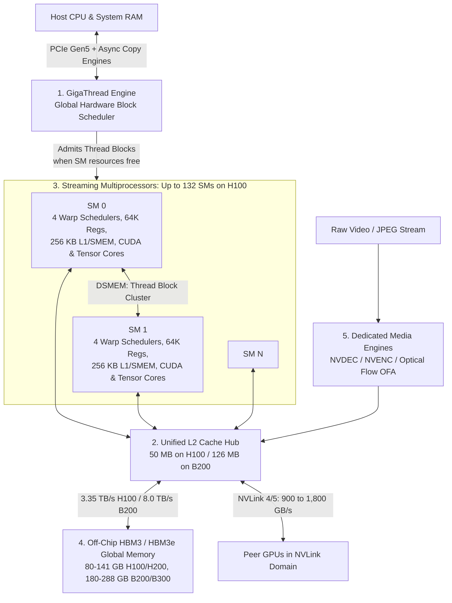
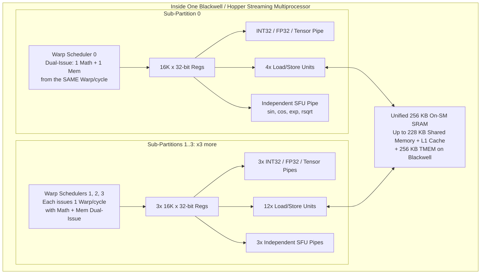
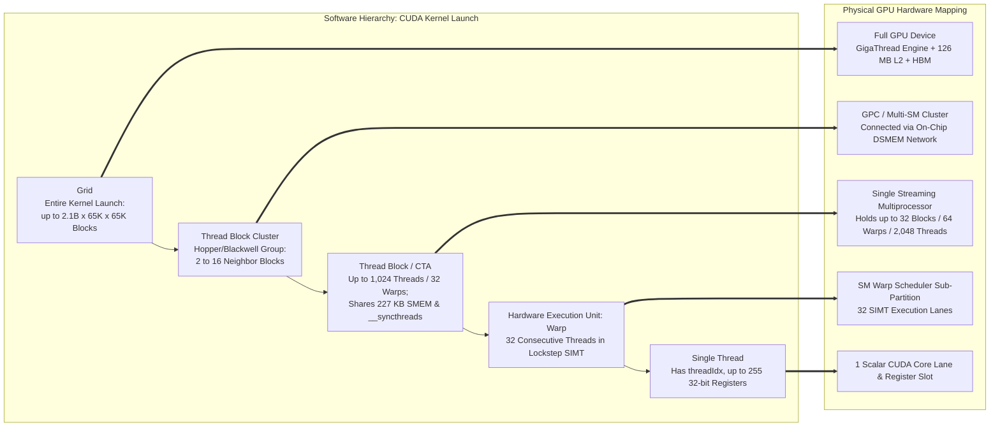
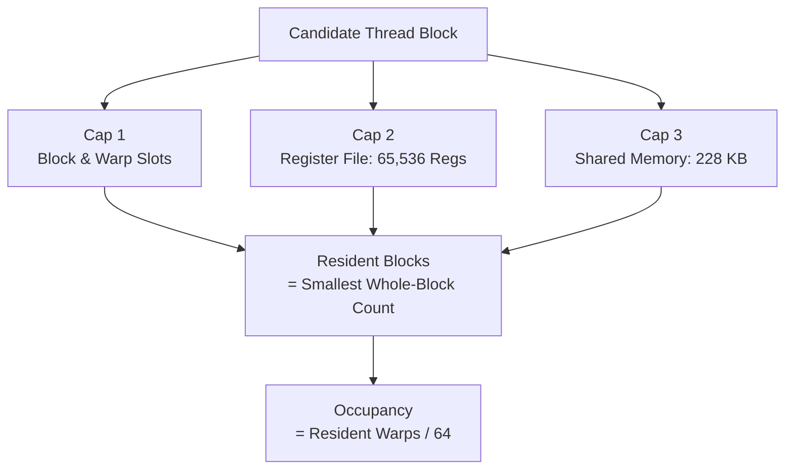
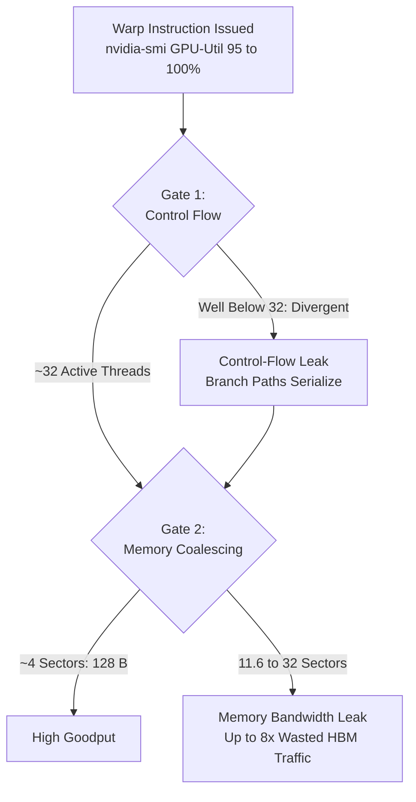

# 10.2 The execution model: threads, warps, blocks and SMs

| | |
|---|---|
| **Status** | Drafted (`execution_model_lab.py`: 25 checks pass; `nvcc` and `ncu` commands **untested** on live Nebius GPU VM) |
| **Level** | Intermediate |
| **Priority tier** | 2 |
| **Lab venue** | Nebius GPU + self-checking Python model (`code/part10/execution_model_lab.py`) |
| **Part** | Part 10: The GPU and CUDA |
| **Sources used** | *AI Systems Performance Engineering* Ch 6; *Parallel and High Performance Computing* Ch 10; `nvidia-devops` V2 Ch 1–12 & Labs 1–3; `nvidia-devops` VL4 Ch 1 |
| **Claim ledger** | `planning/ledgers/10-02.md` |

## Why this matters for AI infrastructure

A modern NVIDIA GPU is not a flat bag of 14,000 cores that automatically shares whatever code you throw at it. Instead, it is a hierarchical silicon factory governed by strict hardware admission gates and a lockstep 32-thread execution engine.

Even if you never write a raw CUDA C++ kernel from scratch, every production anomaly you debug on an AI cluster is shaped by this execution model. A machine learning engineer can launch a custom kernel with the maximum 1,024 threads per block hoping for maximum parallelism. Instead, occupancy drops to 15 percent and the GPU stalls on memory. A minor compiler update can bump a kernel from 40 registers per thread to 56 registers per thread and suddenly cut resident warps by a third. A kernel can report 91 percent achieved occupancy in Nsight Compute and 95 percent utilization in `nvidia-smi` while delivering terrible token throughput. Conversely, a shared-memory tiled kernel running at 45 percent occupancy can finish twice as fast as a naive kernel running at 90 percent occupancy. And two independent Python processes sharing a GPU without Multi-Instance GPU or Multi-Process Service can lose tens of microseconds to hardware context switching on every slice.

```text
Production Execution Model Anomalies vs Silicon Reality (ASP Ch 6, V2 Ch 2-9):
  - 1,024-Thread Block Trap:      48 regs/thread x 1,024 threads = 49,152 regs -> fits only 1 block/SM (32 warps = 50% cap)
  - +16 Register Cliff (40->56):  256-thread blocks drop from 6 blocks (48 warps = 75%) to 4 blocks (32 warps = 50%)
  - 95% GPU-Util, Low Goodput:    Divergent warps (19.4 / 32 active lanes) and uncoalesced loads (11.6 to 32 sectors/request)
  - Shared-GPU Time-Slice Thrash: Separate OS processes swap full GPU contexts across tens of microseconds and evict L2 cache
```

This chapter opens the silicon of modern NVIDIA Hopper H100 and Blackwell B200 GPUs. We trace work from the global GigaThread Engine down to the four dual-issue warp schedulers inside each Streaming Multiprocessor. Next, we derive exact formulas for launch geometry and SM occupancy. Finally, we examine the five warp states, the two Nsight Compute efficiency gates, and runtime verification with NVIDIA Compute Sanitizer.

:::tip In one minute
- **Silicon geography**. The GigaThread Engine assigns thread blocks to Streaming Multiprocessors, where they remain until completion. The unified L2 cache sits between all SMs, HBM controllers, and PCIe or NVLink interfaces.
- **Four mini-SMs per SM**. Each Blackwell or Hopper SM contains 4 independent warp schedulers. Each scheduler issues 1 warp per cycle and supports dual-issue of 1 math instruction plus 1 memory instruction from the same warp. Special Function Units run transcendentals on a separate pipeline.
- **Software-to-hardware hierarchy**. Threads group into 32-thread SIMT warps, and warps form Thread Blocks of up to 1,024 threads on one SM. Neighboring blocks form Thread Block Clusters sharing Distributed Shared Memory, and all blocks form the Grid.
- **Occupancy admission gates**. Resident blocks per SM are capped by the tightest of three hardware limits rounded down to whole blocks. Those limits are slot ceilings, the 65,536-register file, and the 228 KB shared-memory pool.
- **Two efficiency gates**. High occupancy does not guarantee high goodput. In Nsight Compute, verify control-flow efficiency (`smsp__thread_inst_executed_per_inst_executed.ratio` near 32) and memory coalescing (`l1tex__average_t_sectors_per_request_pipe_lsu_mem_global_op_ld.ratio` near 4 for 4-byte floats).
:::

---

## Prerequisites and outcomes

**Prerequisites**: Review CPU versus GPU throughput design, SIMT concepts, and theoretical FLOPs and bandwidth formulas from Chapter 10.1.

**Outcomes**: After completing this chapter, you will be able to:
1. Map the internal geography of a modern NVIDIA GPU across the GigaThread Engine, the unified L2 cache, Streaming Multiprocessors, DMA Copy Engines, and hardware media decoders.
2. Explain the four-partition architecture of a Blackwell or Hopper SM, including dual-issue warp scheduling across 16 Load/Store units and the decoupled Special Function Unit pipeline.
3. Map the software execution hierarchy of Thread, Warp, Thread Block, Thread Block Cluster, and Grid onto physical silicon, and translate terms across OpenCL, CUDA, HIP, AMD, and CPU loops.
4. Calculate 1D, 2D, and 3D kernel launch geometry, explain why the `if (idx < N)` bounds check prevents lazy `cudaErrorIllegalAddress` faults, and test forward compatibility with `CUDA_FORCE_PTX_JIT=1`.
5. Compute exact SM occupancy from thread, warp, block, register, and shared-memory limits, and tune residency using `nvcc -Xptxas=-v`, `__launch_bounds__`, and the CUDA Occupancy API.
6. Diagnose the five warp states, warp divergence, predication, and the two Nsight Compute efficiency gates for active lanes and global memory sectors.
7. Separate the four production scheduling layers, contrast raw GPU context switching against MIG and MPS, and catch memory, race, and barrier bugs in CI using `compute-sanitizer`.

---

## 1. Inside a modern NVIDIA GPU and the Streaming Multiprocessor

When a computer-vision training pipeline decodes JPEGs on the host CPU or calls `.cpu().numpy()` inside its training loop, `nvidia-smi` utilization oscillates between 0 percent and 100 percent every few seconds. The GPU finishes its matrix math in milliseconds and then starves waiting for data to cross the PCIe bus. Understanding why that happens requires looking inside the GPU die to see how compute engines, caches, copy engines, and media decoders interact.

### 1.1 Silicon geography: GigaThread Engine, L2 Cache, SMs, Copy Engines, and NVDEC

Think of a modern GPU as a hierarchical silicon factory. Data enters through the PCIe or NVLink loading dock and rests in the off-chip HBM warehouse. It then flows through the central L2 cache hub and is processed on dozens of Streaming Multiprocessor assembly lines. If you remove the heatsink from an NVIDIA Hopper H100 SXM5 or Blackwell B200 package, five hardware subsystems work together inside the processor die.



| Silicon subsystem | Hardware capacity (H100 / B200) | Architectural role and operational rule |
|---|---|---|
| **1. GigaThread Engine** | Global work distributor | Receives the launched grid of thread blocks and assigns each block to an SM with free registers, shared memory, and warp slots. Once admitted to an SM, a block never migrates to another SM. |
| **2. Unified L2 Cache** | **50 MB** (H100) / **126 MB** (B200) | Central coherent SRAM hub (~200-cycle latency) connecting all SMs, HBM controllers, PCIe, and NVLink interfaces. Reusing weight tiles in L2 avoids 300-to-1,000-cycle off-chip HBM trips. |
| **3. Streaming Multiprocessors (SMs)** | **108** (A100) / up to **132** (H100 SXM5) | Each Hopper SM holds **128** FP32 CUDA Cores, **4** Tensor Cores, **4** Texture Units, **65,536** 32-bit registers (**256 KB**), and **256 KB** unified L1/Shared memory (plus **256 KB** Tensor Memory on B200). |
| **4. Copy Engines (DMA)** | Asynchronous DMA controllers | Move bytes between pinned host RAM and GPU HBM over PCIe or NVLink without using SMs, allowing Batch `k + 1` transfers to overlap Batch `k` compute. |
| **5. Media Engines (`NVDEC`, `NVENC`, `OFA`)** | Dedicated fixed-function silicon | Decode and encode video and JPEGs plus optical flow outside the SMs. Offloading image decode via **NVIDIA DALI** eliminates the 0%-to-100% CPU starvation sawtooth. |

### 1.2 Inside one SM: four warp schedulers, dual-issue, and SFUs

If you zoom inside a single Streaming Multiprocessor on a Hopper or Blackwell GPU, the SM is not a single monolithic scheduler. Instead, it is divided into **four independent scheduling sub-partitions**, acting like four mini-SMs that share the on-chip 256 KB L1 Data Cache and Shared Memory SRAM.



Using the per-cycle SM scheduling rules from *AI Systems Performance Engineering* Chapter 6 (Table 6-1), every clock cycle inside an SM follows strict issue constraints.

| SM scheduling resource (per clock cycle) | Hardware value | Architectural rule and operational meaning |
|---|---|---|
| **Independent warp schedulers per SM** | **4** | Each SM is split into 4 sub-partitions ("mini-SMs"), each managing its own pool of up to `64 / 4 = 16` resident warps. |
| **Maximum warps issued per cycle per SM** | **4** (**1** per scheduler) | Up to 4 different warps (one in each sub-partition) can advance on the same clock cycle. |
| **Dual-issue capability per scheduler** | **1 Math + 1 Memory** op | Each scheduler can issue two independent instructions per cycle (1 arithmetic op on INT32/FP32/Tensor Core + 1 memory `LD/ST` op), provided both instructions come from the **same warp**. |
| **Maximum math + memory ops issued per cycle** | **4 Math + 4 Memory** (**8** total) | Across all 4 schedulers, an SM with well-mixed code can issue 4 math ops and 4 memory ops in a single clock cycle. |
| **Load/Store (`LD/ST`) pipelines per SM** | **16** (**4** per scheduler) | Memory requests flow through 16 combined `LD/ST` units to L1/Shared memory, L2 cache, or off-chip HBM. |
| **Special Function Unit (SFU) pipeline** | Separate decoupled pipeline | Transcendental operations (`sin`, `cos`, `exp`, `rcp`, `sqrt`) execute on a dedicated SFU pipeline outside the math+memory dual-issue pair, so attention `softmax` exponentials do not stall core issue. |

---

## 2. The thread hierarchy: Threads, Warps, Thread Blocks, Clusters, and Grids

A compiled CUDA binary can run on a small 2-SM test GPU today and scale across a 132-SM GPU tomorrow without code changes. CUDA achieves that generational scalability by organizing parallel software into a nested hierarchy that maps onto the physical hardware tree.

### 2.1 Software-to-hardware mapping and cross-vendor terminology

When a host program launches a kernel, CUDA decomposes the work across five software levels. Those levels are Thread, Warp, Thread Block or Cooperative Thread Array, Thread Block Cluster, and Grid.



1. **Thread**. The smallest software worker. Each thread executes the kernel function on its own data element using its own private registers, up to a hardware maximum of **255** 32-bit registers per thread.
2. **Warp**. When an SM admits a Thread Block, the hardware slices its threads into fixed bundles of **32** consecutive threads. Multidimensional blocks are linearized in row-major order first, placing threads 0 through 31 in Warp 0 and 32 through 63 in Warp 1. The warp is the fundamental hardware unit of SIMT scheduling.
3. **Thread Block**. A 1D, 2D, or 3D team of up to **1,024** threads or **32** warps, also called a Cooperative Thread Array. Every thread in a block runs on the **same physical SM**, sharing fast on-SM `__shared__` memory and synchronizing at barriers via `__syncthreads()`. Because each barrier forces fast warps to wait for the slowest warp in the block, kernels should minimize barrier points.
4. **Thread Block Cluster and Distributed Shared Memory**. Before Hopper, threads in different blocks could only share data through slower L2 cache or HBM. Hopper and Blackwell introduce **Thread Block Clusters**, which co-schedule neighboring blocks across SMs inside a Graphics Processing Cluster. Using hardware **Distributed Shared Memory**, threads in Block A can read, write, and atomically update Block B's shared memory over an on-chip SM-to-SM network. Cluster barriers synchronize those blocks without touching HBM, as expanded in Chapter 10.16.
5. **Grid**. The complete collection of Thread Blocks launched by one kernel call. Separate Thread Blocks execute independently in any order. A small GPU runs a few blocks at a time in a queue, while a large GPU dispatches over a hundred blocks simultaneously.

The table below combines the cross-vendor abstractions from *Parallel and High Performance Computing* Chapter 10 with the Blackwell B200 limits from *AI Systems Performance Engineering* Chapter 6.

| Abstraction / Hardware limit | OpenCL | AMD GPU (`HIP` / `MI50`) | NVIDIA CUDA (`H100` / `B200`) | CPU equivalent |
|---|---|---|---|---|
| **Full execution domain** | `NDRange` | `grid` / `extent` | **Grid** (`max X: 2,147,483,647; Y/Z: 65,535`) | Loop bounds / index set |
| **Max concurrent grids per device** | Device-dependent | Device-dependent | **128** concurrent grids (kernels) | Concurrent thread pools |
| **Shared-memory team** | `Work Group` | `block` / `tile` | **Thread Block (CTA)** (`max 1,024 threads / 32 warps`) | Cache-blocked loop tile |
| **Lockstep execution group** | `Subgroup` | `Wavefront` (**64** work items) | **Warp** (**32** threads) | SIMD vector register width |
| **Individual lane** | `Work Item` | `thread` | **Thread** (`max 255 registers/thread`) | Single loop iteration / lane |
| **Max active warps (subgroups) per SM/CU** | Device query | **40** wavefronts per CU (MI50) | **64** warps (**2,048** resident threads per SM) | SMT hardware threads |
| **Max active blocks (work groups) per SM/CU** | Device query | **40** work groups per CU (MI50) | **32** active thread blocks per SM | — |
| **Selected warps issued per cycle per SM/CU** | — | **4** per CU | **4** (**1** per warp scheduler) | Superscalar issue width |
| **Register file per SM** | — | Arch-dependent | **65,536** (`64K`) 32-bit registers (**256 KB**) | Physical vector register file |
| **L1 + Shared Memory SRAM per SM** | `Local memory` | `LDS` (**64 KB**) | **256 KB** total (`up to 228 KB shared/SM; 227 KB dynamic/block + 1 KB CUDA reserved`) | L1 data cache |

---

## 3. Kernel launch geometry, bounds checks, tile decomposition, and PTX compatibility

A kernel can pass unit tests on power-of-two batch sizes like 256 or 1,024, yet crash in production with `cudaErrorIllegalAddress` on a 63-token prompt. A compiled CUDA binary can also fail to load when deployed onto a newer GPU generation. Both bugs come from how launch geometry and binary compilation interact with the GPU runtime.

### 3.1 1D, 2D, and 3D indexing and the `if (idx < N)` bounds check

In GPU programming, often called "Me" programming, you replace the outer CPU `for` loop with a grid of threads where each thread computes its own global index. When the host launches `myKernel<<<blocksPerGrid, threadsPerBlock>>>(d_input, N)`, each thread calculates its unique 1D coordinate using three built-in variables: `blockIdx.x`, `blockDim.x`, and `threadIdx.x`.

```cpp
__global__ void myKernel(float* input, int N) {
    int idx = blockIdx.x * blockDim.x + threadIdx.x;
    if (idx < N) {          // Mandatory bounds check
        input[idx] *= 2.0f;
    }
}
```

Choosing `threadsPerBlock` and `blocksPerGrid` for a one-million-element array requires three rules. First, always pick `threadsPerBlock` as a multiple of 32, typically **256** (8 warps) or between 128 and 512. A 33-thread block allocates 2 warps (64 lanes) and leaves 31 lanes idle while consuming two warp slots. Starting at 256 threads per block fills every warp 100 percent and allows up to 8 blocks to reside per SM.

Second, use integer ceiling division to calculate `blocksPerGrid` so the grid launches enough blocks to cover every element. Third, always guard memory accesses with `if (idx < N)` so trailing threads in the final block or warp never read or write past the end of the array.

```text
Ceiling Grid Math & Out-of-Bounds Fault Mechanics (ASP Ch 6 pp. 188-193, execution_model.py):
  Formula: blocksPerGrid = (N + threadsPerBlock - 1) / threadsPerBlock

  1. Large Vector Example (N = 1,000,000, threadsPerBlock = 256):
     - blocksPerGrid = (1,000,000 + 255) // 256 = 3,907 blocks
     - Total Threads = 3,907 x 256 = 1,000,192 threads launched
     - Final Block (blockIdx.x = 3906): idx spans 999,936..1,000,191 -> last 192 threads have idx >= N

  2. Two-Warp Tail Example (N = 63, warpSize = 32):
     - Hardware allocates 2 warps = 64 threads (indices 0..31 in Warp 0, 32..63 in Warp 1)
     - Thread 64 has idx = 63 (the 64th element, 1 past the end of the 63-element array)
     - Without if (idx < N): Thread 64 writes out of bounds, setting a global hardware fault flag
     - Asynchronous Reporting: Host discovers cudaErrorIllegalAddress lazily at the next cudaDeviceSynchronize() or cudaMemcpy()
```

Because CUDA kernels execute asynchronously without per-thread operating system exceptions, an out-of-bounds memory access sets a global hardware fault flag for the entire launch. The host CPU only discovers that fault lazily on the next synchronous API call such as `cudaDeviceSynchronize()` or `cudaMemcpy()`, where it surfaces as `cudaErrorIllegalAddress`. During debugging, always pair kernel launches with `cudaGetLastError()` and `cudaDeviceSynchronize()`.

### 3.2 2D and 3D domain tile decomposition and halo trade-offs

When processing 2D images or 3D scientific volumes, engineers pass `dim3(Tx, Ty, Tz)` structures for `threadsPerBlock` and `blocksPerGrid`. Reproducing the four canonical domain decompositions from *Parallel and High Performance Computing* Chapter 10 (Table 10.3) illustrates how tile shape controls block counts.

| Domain type | Global domain size (`Gz x Gy x Gx`) | Block / Tile shape (`Tz x Ty x Tx`) | Threads per block (Tile size) | Grid dimensions (`NTz x NTy x NTx`) | Total work groups (Thread Blocks `NT`) |
|---|---|---|---|---|---|
| **1D vector** | `1,048,576` | `128` | `128` (4 warps) | `8,192` | **8,192** |
| **Small 2D tile** | `1024 x 1024` | `8 x 8` | `64` (2 warps) | `128 x 128` | **16,384** |
| **Large 2D tile** | `1024 x 1024` | `8 x 16` | `128` (4 warps) | `128 x 64` | **8,192** |
| **3D volume** | `128 x 128 x 128` | `4 x 4 x 8` | `128` (4 warps) | `32 x 32 x 16` | **16,384** |

Two physical trade-offs govern multidimensional tile selection. First, align the fastest-changing dimension (`blockDim.x`) to warps and cache lines so adjacent threads in a warp read contiguous memory addresses. Second, balance contiguous width against perimeter halo reloads. In stencil or convolution kernels, each tile loads a border halo of neighbor pixels from adjacent tiles. A flat 64 by 2 tile has a long perimeter that duplicates many HBM halo loads. A square or near-square tile such as 16 by 16 (256 threads) or 16 by 8 (128 threads) minimizes the perimeter-to-area ratio while preserving coalesced row reads. Using C++ lambda wrappers in portability frameworks such as SYCL, Kokkos, and Raja lets teams express these tiled loop bodies once across CPU and GPU backends.

### 3.3 Forward and backward binary compatibility (SASS, PTX, and `CUDA_FORCE_PTX_JIT=1`)

How can a PyTorch wheel or CUDA binary compiled years ago still execute on a brand-new Blackwell GPU? The NVIDIA compiler (`nvcc`) uses a two-stage compilation model combining architecture-specific machine code with a virtual intermediate representation.

1. **SASS (Streaming ASSembler)**. Native machine instructions compiled for one specific GPU architecture, such as `sm_80` for Ampere, `sm_90` for Hopper, or `sm_100` for Blackwell. Family-specific targets like `sm_100f` and `compute_100f` restrict portability to devices within that exact feature family. Native SASS runs only on the architecture family it was built for.
2. **PTX (Parallel Thread Execution)**. NVIDIA's virtual instruction-set intermediate representation. When you ship a fatbinary containing architecture-specific SASS cubins plus virtual PTX, any future GPU driver can Just-In-Time compile the embedded PTX into native machine code at startup.
3. **Pre-flight verification with `CUDA_FORCE_PTX_JIT=1`**. In continuous integration or node qualification tests, run your binary with the environment variable `CUDA_FORCE_PTX_JIT=1`. That flag forces the CUDA driver to ignore embedded SASS and JIT-compile the embedded PTX. If a build script omitted PTX from the fatbinary, the test fails immediately in CI rather than crashing in production on next-generation GPU nodes.

---

## 4. Residency, Occupancy, and how to calculate and tune them

A minor compiler change that adds 16 registers per thread can suddenly cut resident warps from 48 to 32. Launching 1,024 threads per block can also leave half the SM empty. Both behaviors come from how the SM admission gate calculates **Occupancy**, the ratio of active resident warps on an SM to the hardware maximum of 64 warps.

```text
SM Occupancy Definition (ASP Ch 6, V2 Ch 6):
  Occupancy (%) = (Active Resident Warps per SM / Maximum Supported Warps per SM (64)) x 100%
```

### 4.1 The block admission gate and worked register and shared-memory occupancy math

When the GigaThread Engine attempts to place a candidate Thread Block onto an SM, the hardware checks **three finite resource caps simultaneously**. Whichever cap is tightest determines how many whole blocks can reside on the SM at once.



A candidate block is defined by four numbers: `threadsPerBlock`, `warpsPerBlock`, `regsPerThread`, and `sharedMemPerBlock`.

| Admission cap | Hardware limit per SM | How it restricts resident blocks |
|---|---|---|
| **1. Slot ceilings** | Max **32** blocks; max **64** warps (**2,048** threads) | Caps resident blocks directly by `min(32, floor(64 / warpsPerBlock))`. |
| **2. Register file** | **65,536** 32-bit registers (max **255** per thread) | Max threads = `floor(65536 / regsPerThread)`; max blocks = `floor(max_threads / threadsPerBlock)`. |
| **3. Shared memory** | **228 KB** shared per SM (max **227 KB** dynamic/block) | Effective block SMEM = dynamic SMEM + **1 KB** reserved by CUDA; max blocks = `floor(228 KB / effective_smem)`. |

Unifying the Chapter 6 slot limits with the Volume 02 Chapter 6 register and shared-memory residency method into `calc_sm_occupancy` in `code/part10/execution_model.py` is **my inference**.

You can inspect a kernel's exact compile-time register count and local-memory spill footprint before running any profiler by passing `-Xptxas=-v` to `nvcc`.

```text
$ nvcc -O3 -Xptxas=-v kernel.cu -o kernel
ptxas info    : Compiling entry function '_Z6kernelPfS_m' for 'sm_90'
ptxas info    : Function properties for _Z6kernelPfS_m
    0 bytes stack frame, 0 bytes spill stores, 0 bytes spill loads
ptxas info    : Used 48 registers, 384 bytes cmem[0]
```

Now examine the **register cliff effect** using the worked calculations from Volume 02 Chapter 6 across an SM with 65,536 registers and 64 maximum warps.

```text
Worked SM Occupancy Derivations (65,536 Regs/SM, 64 Max Warps = 2,048 Threads/SM, 228 KB SMEM/SM):
  1. Balanced Kernel (256 threads/block = 8 warps, 32 regs/thread, 0 KB SMEM):
     - Reg limit: floor(65536 / 32) = 2,048 threads -> floor(2048 / 256) = 8 blocks -> 64 warps = 100.0% occupancy
  2. Moderate Registers (V2 Ch 6 Ex. 1: 256 threads/block = 8 warps, 40 regs/thread, 0 KB SMEM):
     - Reg limit: floor(65536 / 40) = 1,638 threads -> floor(1638 / 256) = 6 blocks (1,536 threads) -> 48 warps = 75.0%
  3. +16 Regs After Code Change (V2 Ch 6 Ex. 2: 256 threads/block = 8 warps, 56 regs/thread, 0 KB SMEM):
     - Reg limit: floor(65536 / 56) = 1,170 threads -> floor(1170 / 256) = 4 blocks (1,024 threads; 0.57 block dropped) -> 32 warps = 50.0%
  4. Oversized 1,024-Thread Block (V2 Ch 3: 1,024 threads/block = 32 warps, 48 regs/thread, 0 KB SMEM):
     - Reg limit: 1 block uses 1,024 x 48 = 49,152 regs (leaves 16,384 free; 2nd block needs 98,304) -> 1 block = 32 warps = 50.0%
     - Fix: Reducing block size to 256 threads at 48 regs fits floor(1365 / 256) = 5 blocks -> 40 warps = 62.5% occupancy
  5. Large Shared-Memory Tile (256 threads/block = 8 warps, 24 regs/thread, 64 KB dynamic SMEM):
     - SMEM limit: 64 KB dynamic + 1 KB CUDA reserved = 65 KB/block -> floor(228 KB / 65 KB) = 3 blocks -> 24 warps = 37.5%
```

| Scenario | Threads / block (warps) | Registers / thread | Dynamic SMEM / block | Max threads by regs | Resident blocks | Resident warps | SM Occupancy | Limiting resource |
|---|---|---|---|---|---|---|---|---|
| **1. Balanced kernel** | **256** (8 warps) | **32** regs | **0 KB** | **2,048** | **8** blocks | **64** warps | **100.0%** | Slot/Warp ceiling |
| **2. Moderate registers (V2 Ch 6 Ex. 1)** | **256** (8 warps) | **40** regs | **0 KB** | **1,638** | **6** blocks | **48** warps | **75.0%** | **Registers** |
| **3. +16 regs after edit (V2 Ch 6 Ex. 2)** | **256** (8 warps) | **56** regs | **0 KB** | **1,170** | **4** blocks | **32** warps | **50.0%** | **Registers** |
| **4. Oversized 1,024-thread block** | **1,024** (32 warps) | **48** regs | **0 KB** | **1,365** | **1** block | **32** warps | **50.0%** | **Registers + Block size** |
| **5. Large shared-memory tile** | **256** (8 warps) | **24** regs | **64 KB** (+1 KB) | **2,048** | **3** blocks | **24** warps | **37.5%** | **Shared Memory** |

Three engineering rules emerge directly from those numbers. First, partial blocks can never reside on an SM. In Row 3, increasing register usage from 40 to 56 registers per thread reduced the thread ceiling to 1,170 threads, which is 4.57 blocks of 256 threads. Because the SM only admits whole blocks, residency dropped from 6 blocks at 75 percent to 4 blocks at 50 percent in one step.

Second, launching 1,024 threads per block often backfires. At 48 registers per thread, one 1,024-thread block consumes 49,152 registers, leaving only 16,384 free registers. A second block cannot fit, so the SM runs only 1 block. If that single block hits a `__syncthreads()` barrier, the SM has zero other blocks to switch to. Reducing `threadsPerBlock` to 256 lets the SM pack 5 independent blocks.

Third, watch for register spilling above 255 registers per thread or non-zero spill stores and loads. When a thread exceeds the register budget, `nvcc` spills excess variables into Local Memory, which physically resides in off-chip HBM DRAM with hundreds of cycles of latency. Spilling to HBM hurts performance far more than running at slightly lower occupancy.

### 4.2 Why sufficient parallelism matters and why 100% occupancy is not the goal

Compare the two vector addition implementations on one million floats profiled with `nsys` and `ncu` in *AI Systems Performance Engineering* Chapter 6. The first kernel, `addSequential<<<1, 1>>>` or a naive Python loop, uses a single thread on one SM. The second kernel, `addParallel<<<3907, 256>>>` or vectorized PyTorch `C = A + B`, launches 3,907 blocks of 256 threads across all SMs simultaneously.

| Benchmark metric (`N = 1,000,000` floats, ASP Ch 6 Table 6-6) | `add_sequential` (`<<<1, 1>>>`) | `add_parallel` (`<<<3907, 256>>>`) | Speedup / Change |
|---|---|---|---|
| **Kernel execution time (ms)** | **48.21 ms** | **2.17 ms** | **22.2x faster** |
| **Overall GPU utilization (`nsys`)** | **1.5%** | **95.0%** | **1.5% to 95.0%** |
| **Achieved SM occupancy (`ncu` `sm__warps_active`)** | **1.3%** | **38.7%** | Hides HBM load latency |
| **Warp execution efficiency** | **3.1%** (1 / 32 lanes) | **100.0%** (32 / 32 lanes) | Full 32-lane SIMT utilization |

Look closely at the third row. The parallel kernel achieved a **22.2x** speedup and **95.0%** GPU utilization at only **38.7%** achieved occupancy. Why did it not need 100 percent occupancy? Occupancy is a means to hide latency rather than an end-to-end performance goal. Once an SM has enough independent warps to keep its pipelines busy during HBM loads, adding more resident warps does not make a memory-bound kernel faster. It merely places more warps in line waiting for the same saturated HBM bus. A tiled kernel that caches data in registers or shared memory often drops to 45 or 50 percent occupancy. Yet it runs twice as fast because it cuts off-chip HBM traffic in half.

You can prove whether a high-occupancy kernel has already hit the HBM bandwidth ceiling in a single Nsight Compute (`ncu`) pass.

```text
$ ncu --metrics sm__warps_active.avg.pct_of_peak_sustained_active,dram__throughput.avg.pct_of_peak_sustained_elapsed ./kernel
  sm__warps_active.avg.pct_of_peak_sustained_active     %    91.2
  dram__throughput.avg.pct_of_peak_sustained_elapsed    %    97.8
```

When `sm__warps_active` is **91.2%** and `dram__throughput` is **97.8%**, HBM memory bandwidth is completely saturated. Raising occupancy further will yield zero speedup.

### 4.3 Tuning occupancy with `__launch_bounds__` and the CUDA Occupancy API

When a kernel uses too many registers per thread and starves the SM of resident warps, engineers use two mechanisms to tune residency.

First, compile-time `__launch_bounds__(maxThreadsPerBlock, minBlocksPerMultiprocessor)` instructs `nvcc` to cap per-thread register allocation so at least `minBlocksPerMultiprocessor` blocks of size `maxThreadsPerBlock` fit on each SM. Watch out for the hardware ceiling trap documented in *AI Systems Performance Engineering* Chapter 6 on page 206. Writing `__launch_bounds__(256, 16)` requests 4,096 resident threads per SM, which exceeds the **2,048-thread** hardware limit on Blackwell and Hopper. The `ptxas` assembler ignores `.minnctapersm` and clamps residency to **8** blocks, or at most 32 registers per thread. Always ensure that `maxThreadsPerBlock * minBlocksPerMultiprocessor <= 2048`.

```text
ptxas warning : Value of threads per SM...is out of range. .minnctapersm will be ignored
```

Second, runtime `cudaOccupancyMaxPotentialBlockSize(&minGridSize, &bestBlockSize, myKernel, dynSmemBytes, 0)` queries the CUDA driver for the block size that maximizes SM occupancy for the kernel's compiled register count and dynamic shared memory. Because `minGridSize` only reports the minimum blocks needed to fill one wave across the GPU, compute your actual launch grid using `(N + bestBlockSize - 1) / bestBlockSize`.

---

## 5. Warp states, instruction dispatch, divergence, and the two efficiency gates

Having 48 or 64 warps resident on an SM does not guarantee that the SM can issue an instruction on the next clock cycle. Even when an SM issues instructions every cycle at 95 percent utilization, a kernel can lose most of its throughput through the two Nsight Compute efficiency gates.

### 5.1 The five warp states and scoreboard dependencies

At every clock cycle, each warp on an SM sits in one of five hardware states.

| Warp state | Hardware definition | What governs state transitions |
|---|---|---|
| **1. Active** | Resident on the SM with allocated registers and a warp slot, and not yet exited. | Admitted by the GigaThread Engine when block resources are free. |
| **2. Stalled** | Active, but **cannot issue** its next instruction on this clock cycle. | Waiting on an HBM/L2 memory load (`long_scoreboard`), an arithmetic or SMEM dependency (`short_scoreboard`), a `__syncthreads()` barrier, or a busy execution pipe. |
| **3. Eligible** | Active, all input operands are ready in registers (cleared by the hardware **Scoreboard**), and the target execution pipeline is free. | Ready to be picked by the sub-partition's warp scheduler. |
| **4. Selected** | The **1 Eligible warp** chosen by its sub-partition's warp scheduler to issue 1 (or 2 dual-issued) instruction(s) on this clock cycle. | Hardware warp scheduler priority policy. |
| **5. Completed** | All 32 threads in the warp have finished executing the kernel. | Releases the warp slot; when all warps in a block complete, the block's registers and shared memory are freed. |

Why does the gap between **Active** and **Eligible** matter? In dependent instructions such as `A = B + C; D = A * E;`, the hardware Scoreboard marks the warp **Stalled** until `A` is written back. If all 64 Active warps wait on an HBM load or a barrier at once, **Eligible** warps drop to 0 and the SM stalls despite 100 percent occupancy.

### 5.2 Warp divergence, predication, and the two Nsight Compute efficiency gates

When warps are Eligible and Selected on every cycle, how can a kernel still deliver poor token or record throughput? The answer lies in the **two hardware efficiency gates**: Control-Flow Efficiency and Memory Coalescing Efficiency.



| Efficiency gate | Nsight Compute (`ncu`) metric | Ideal value | Degraded example (V2 Ch 9) |
|---|---|---|---|
| **1. Control-Flow Efficiency** | `smsp__thread_inst_executed_per_inst_executed.ratio` | **32.0** active threads per instruction (**100%**) | **19.4** active threads (**60.62%** lane efficiency; divergent `if/else` inside a warp) |
| **2. Memory Coalescing** | `l1tex__average_t_sectors_per_request_pipe_lsu_mem_global_op_ld.ratio` | **4.0** sectors of **32 B** for a **128 B** float load (**1.0x**) | **11.6** sectors (**371.2 B**, **2.9x**) up to **32.0** sectors (**1,024 B**, **8.0x** wasted HBM traffic) |

```text
Two Efficiency Gates Math (V2 Ch 9, V2 Lab 03, execution_model.py):
  Gate 1 — Control-Flow Efficiency (32 lanes per warp):
    - Ideal Uniform Warp:     32.0 / 32 = 100.00% active-lane efficiency
    - V2 Ch 9 Fraud Kernel:   19.4 / 32 =  60.62% active-lane efficiency (39.38% wasted to branch divergence)
    - 50/50 Split (16 vs 16): 16.0 / 32 =  50.00% active-lane efficiency (2x serialized instruction passes)

  Gate 2 — Memory Coalescing Efficiency (32 threads x 4-byte float = 128 useful bytes; 1 sector = 32 bytes):
    - Coalesced (contiguous_copy): 4.0 sectors x 32 B =   128.0 B moved for 128 B useful -> 1.0x byte amplification
    - V2 Ch 9 Strided Example:    11.6 sectors x 32 B =   371.2 B moved for 128 B useful -> 2.9x byte amplification
    - Worst-Case Scattered Load:  32.0 sectors x 32 B = 1,024.0 B moved for 128 B useful -> 8.0x byte amplification
```

First, consider **Gate 1: Warp Divergence and Predication**. All 32 threads in a warp share one instruction pointer. When an `if/else` condition evaluates to true for 16 threads and false for the other 16 threads *within the same warp*, the warp suffers **Warp Divergence**. The SM first executes Path A with the 16 false lanes masked off, and then executes Path B with the 16 true lanes masked off, before reconverging. Execution time doubles and lane efficiency drops to 50 percent. Crucially, divergence occurs *only within a single 32-thread warp*. If Warp 0 takes Path A and Warp 1 takes Path B, there is zero warp divergence because each warp branches uniformly. For very short branch bodies, `nvcc` uses **predication**, issuing instructions unconditionally while a per-lane predicate bit controls register writeback.

Second, consider **Gate 2: Memory Coalescing**. When 32 threads in a warp each read a 4-byte float, the memory subsystem services the 128-byte load in **32-byte sectors**. Four sectors make up one 128-byte cache line. In a coalesced `contiguous_copy` kernel where adjacent threads read adjacent addresses, all 128 bytes sit in one aligned cache line, transferring **4 sectors**. In a `strided_copy` or scattered pointer-chasing kernel, each thread hits a different cache line. The hardware fetches up to **32 separate 32-byte sectors**, moving 1,024 bytes just to deliver 128 useful bytes and wasting **8.0x** of HBM bandwidth.

Combining the slot, register, and shared-memory limits with these two Nsight Compute gates into `diagnose_kernel_efficiency_gates` in `code/part10/execution_model.py` is **my inference**.

---

## 6. Production operations: the four scheduling layers, GPU Contexts, and Compute Sanitizer

Two Kubernetes pods sharing a GPU via operating system time-slicing can run more than twice as slowly as expected with high driver overhead in Nsight Systems. Similarly, `nvidia-smi` can succeed on the bare-metal host while `docker run --gpus all` fails inside a container. Answering both questions requires separating the four scheduling layers of an AI cluster.

### 6.1 The four scheduling layers and GPU Context Switching (Time-Slicing vs MIG vs MPS)

In production, SM warp scheduling sits at the bottom of a four-layer scheduling stack.

| Layer | Scheduler component | Scheduling unit | Classic failure mode and symptom |
|---|---|---|---|
| **1. Cluster layer** | Kubernetes (`kube-scheduler` / `KAI` / `Kueue`) or Slurm (`slurmctld`) | Pod, Job, or Node | Cross-NUMA placement or broken container GPU passthrough (`nvidia-smi` works on host, `docker run --gpus all` fails at the Container Toolkit / CDI boundary). |
| **2. Runtime layer** | Triton, vLLM, PyTorch process, or CUDA Driver | **GPU Context**, Request Batch, CUDA Stream | **GPU Context Switching thrash** (two OS processes time-slicing one GPU without MIG or MPS) or tiny batches underfilling the GPU. |
| **3. Kernel layer** | **GigaThread Engine** | Grid and Thread Blocks (CTAs) | Small grid tail effect or oversized **1,024-thread** blocks capping each SM at 1 active block. |
| **4. SM layer** | **4 Warp Schedulers per SM** | 32-thread Warps & Dual-Issued Instructions | Warp divergence (`19.4 / 32` lanes), uncoalesced sector amplification (`11.6` to `32` sectors), or register spilling to HBM local memory. |

Understanding **GPU Contexts** at Layer 2 is essential for multi-tenant platform architecture. Just as a Linux process owns a virtual address space, a CUDA process creates a **GPU Context** holding its device page tables, allocations, and hardware state. By default, an NVIDIA GPU executes **one hardware context at a time**. When two independent OS processes share one GPU without isolation, the driver must perform **GPU Context Switching**. Saving and restoring SM and page-table state takes tens of microseconds while both processes evict each other's L2 cache lines.

Never share a production GPU across heavy workloads using raw OS time-slicing alone. Instead, choose one of three supported architectures. Dedicate a whole GPU per process. Partition the GPU in hardware with **Multi-Instance GPU (MIG)** so each tenant receives physically isolated SMs, L2 cache banks, memory controllers, and an independent hardware context. Or enable **NVIDIA Multi-Process Service (MPS)** when cooperative processes from the same tenant need to share a single combined GPU context without context-switch stalls, as covered in Chapters 11.24 through 11.26.

### 6.2 Catching memory, race, and barrier bugs with NVIDIA Compute Sanitizer

A single kernel launch spawns millions of threads without per-thread OS page protection. Off-by-one indexing bugs or shared-memory race conditions can silently corrupt weights or trigger `cudaErrorIllegalAddress` crashes hours into a run. Integrate **NVIDIA Compute Sanitizer (`compute-sanitizer`)** into continuous integration pipelines using `--error-exitcode 1` and `--nvtx yes`.

| Compute Sanitizer tool | Command invocation | Functional bug class detected at runtime |
|---|---|---|
| **1. `memcheck`** (default) | `compute-sanitizer --tool memcheck --check-device-heap yes` | Out-of-bounds or misaligned accesses in global, local, and shared memory (such as a missing `if (idx < N)` check), hardware exceptions, and device heap leaks. |
| **2. `racecheck`** | `compute-sanitizer --tool racecheck` | Shared-memory (`__shared__`) data hazards: **Read-After-Write (RAW)**, **Write-After-Read (WAR)**, and **Write-After-Write (WAW)** races between threads in a block. |
| **3. `initcheck`** | `compute-sanitizer --tool initcheck` | Kernel threads reading from **uninitialized device global memory** (such as a forgotten `cudaMemcpy` or `cudaMemset`). |
| **4. `synccheck`** | `compute-sanitizer --tool synccheck` | Invalid barrier synchronization, such as placing `__syncthreads()` inside a divergent `if/else` branch where only some threads in the block reach the barrier, causing a hardware deadlock. |

---

## Commands and configurations that matter

### 1. Inspecting compile-time register usage and local-memory spills (`nvcc -Xptxas=-v`, untested on live Nebius GPU VM)

```bash
# Compile a CUDA file for Hopper (sm_90) + embedded PTX (compute_90) and print register/spill counts
nvcc -O3 -arch=compute_90 -code=sm_90,compute_90 -Xptxas=-v memory_patterns.cu -o memory_patterns

# Verify PTX forward compatibility by forcing runtime PTX JIT compilation
CUDA_FORCE_PTX_JIT=1 ./memory_patterns
```

### 2. Profiling timeline gaps (`nsys`) and SM occupancy and efficiency gates (`ncu`)

```bash
# 1. Nsight Systems (nsys): capture end-to-end host-to-device copies, kernel gaps, and NVTX ranges
nsys profile --stats=true -t cuda,nvtx -o parallel_nsys_report ./memory_patterns

# 2. Nsight Compute (ncu): inspect Occupancy, HBM throughput, Active-Lane efficiency, and Sectors/request
ncu --section SpeedOfLight \
  --metrics sm__warps_active.avg.pct_of_peak_sustained_active,dram__throughput.avg.pct_of_peak_sustained_elapsed,smsp__thread_inst_executed_per_inst_executed.ratio,l1tex__average_t_sectors_per_request_pipe_lsu_mem_global_op_ld.ratio \
  --target-processes all --print-summary per-gpu ./memory_patterns
```

### 3. Live DCGM and `nvidia-smi` host versus container boundary verification

```bash
# 1. Host baseline and streaming SM / memory / PCIe monitoring
nvidia-smi --query-gpu=index,name,driver_version,pstate,memory.used,utilization.gpu,utilization.memory,power.draw --format=csv
nvidia-smi dmon -s pucvmet -d 1

# 2. Verify container GPU passthrough (if host nvidia-smi works but this fails, fix Container Toolkit / CDI)
docker run --rm --gpus all nvidia/cuda:12.4.1-base-ubuntu22.04 nvidia-smi
```

### 4. CI functional verification with `compute-sanitizer`

```bash
# Fail CI with non-zero exit code if any out-of-bounds access, shared-memory race, or barrier bug occurs
compute-sanitizer --tool memcheck --error-exitcode 1 --nvtx yes ./memory_patterns
compute-sanitizer --tool racecheck --error-exitcode 1 ./memory_patterns
compute-sanitizer --tool initcheck --error-exitcode 1 ./memory_patterns
compute-sanitizer --tool synccheck --error-exitcode 1 ./memory_patterns
```

---

## How it fails

| Failure mode | Symptom | Root cause | Diagnosis & fix |
|---|---|---|---|
| **1. Register / block-size starvation on 1,024-thread blocks** | A custom CUDA or Triton kernel launched with `threadsPerBlock = 1024` runs slowly; `ncu` reports **15–50%** achieved occupancy and high `long_scoreboard` memory stalls. | At **48+** registers/thread, one 1,024-thread block consumes **49,152+** of the SM's **65,536** registers, preventing a second block from fitting on the SM. | Check `nvcc -Xptxas=-v`; reduce `threadsPerBlock` to **128** or **256** (or apply `__launch_bounds__(256, 4)`) so the SM packs 4 to 8 blocks and hides HBM latency across warps. |
| **2. Register spilling into off-chip HBM Local Memory** | After fusing kernels or unrolling loops, kernel latency spikes by **3x–5x** and HBM traffic jumps even though input tensor sizes did not grow. | Per-thread register demand exceeded **255** (or exceeded a tight `__launch_bounds__` cap), forcing `ptxas` to spill variables to **Local Memory** in slow HBM DRAM. | Inspect `nvcc -Xptxas=-v` for non-zero `bytes spill stores, bytes spill loads`; relax `__launch_bounds__`, reduce loop unrolling, or split the overly large fused kernel. |
| **3. High `GPU-Util` (95%) with poor throughput from Divergence + Uncoalesced loads** | `nvidia-smi` reports **95%** GPU utilization and high power draw, yet token or record throughput is a fraction of hardware peak. | Threads within warps diverge across `if/else` paths (`19.4 / 32` active lanes) or read strided memory (`11.6` to `32` sectors/request = **2.9x–8.0x** HBM byte amplification). | Run `ncu` on both efficiency-gate metrics; group inputs by branch outcome so whole 32-thread warps take uniform paths, and convert Array-of-Structures layouts to Structure-of-Arrays for coalesced 128-byte loads. |
| **4. Lazy `cudaErrorIllegalAddress` crash on non-multiple input sizes** | A kernel works on power-of-two batch sizes (`256`, `1024`), but crashes with `an illegal memory access was encountered` at `cudaDeviceSynchronize()` when given `N = 63` or `N = 1,000,000`. | The kernel omitted `if (idx < N)`, allowing trailing threads in the final warp or block (`idx >= N`) to read or write past the allocated buffer. | Run `compute-sanitizer --tool memcheck ./app` to pinpoint the exact offending line and add `if (idx < N)` (or 2D `if (x < width && y < height)`) guards. |
| **5. `0% -> 100% -> 0%` GPU utilization sawtooth (Host / Python loop starvation)** | `nvidia-smi dmon` shows GPU utilization oscillating between 0% and 100% every few seconds, or staying at **1.5%** during a Python loop. | Either the host CPU is bottlenecked decoding JPEGs in `DataLoader`, a debug `.cpu().numpy()` call is pulling a 10 GB tensor across the **63 GB/s** PCIe bus inside the loop, or Python is launching `N` tiny scalar kernels serially. | Remove `.cpu()` calls from inner loops, replace Python elementwise loops with vectorized PyTorch ops (`C = A + B` or `torch.compile`), and offload JPEG/video decoding to GPU `NVDEC` via **NVIDIA DALI**. |
| **6. Multi-process GPU context-switching thrash on shared nodes** | Two workloads placed on the same GPU via Kubernetes time-slicing run more than **2x** slower than when run separately, with high driver overhead in `nsys`. | Each OS process owns a separate **GPU Context**; without MIG or MPS, the driver spends tens of microseconds context-switching SM and page-table state while thrashing the shared L2 cache. | Partition the GPU into hardware-isolated **MIG** instances for multi-tenant Kubernetes pods, or enable **NVIDIA MPS** when cooperative processes from one job must share a GPU. |

---

## Hands-on lab

### Self-checking Python model (`code/part10/execution_model_lab.py` — verified here)

The module `code/part10/execution_model.py` implements the hardware tables, launch calculators, SM occupancy solver, `__launch_bounds__` validator, and Nsight Compute efficiency-gate analyzer from this chapter. Its test runner `code/part10/execution_model_lab.py` (along with `code/part10/kernel_efficiency_lab.py`) executes 25 automated checks verifying every worked example from the cited books and notes.

```text
What code/part10/execution_model_lab.py Verifies (25 Automated Checks):
  1. SM & Device Limits:     4 warp schedulers, dual-issue (4 math + 4 mem ops/cycle, 16 LD/ST units); warpSize 32, max 1,024 threads/block,
                             64 warps / 2,048 threads / 32 blocks per SM, 65,536 regs/SM (max 255/thread), 256 KB L1/SMEM (228 KB shared,
                             227 KB dynamic/block + 1 KB reserved), 50 MB (H100) vs 126 MB (B200) L2 cache, and 128 concurrent grids
  2. Cross-Vendor Map:       OpenCL/CUDA/HIP/AMD/CPU hierarchy map; NVIDIA SM (64 warps of 32) vs AMD MI50 CU (40 wavefronts of 64)
  3. Launch Geometry:        N = 1,000,000 at 256 threads/block -> 3,907 blocks (1,000,192 threads, 192 guarded tail threads); N = 63 on 64 threads -> 1 OOB lane
  4. Domain Decomposition:   1D/2D/3D tile decompositions producing 8,192 and 16,384 work groups (PHPC Ch 10 Table 10.3)
  5. Worked SM Occupancy:    256 threads/block at 40 regs -> 6 blocks (48 warps = 75.0%); at 56 regs -> 4 blocks (32 warps = 50.0%);
                             at 32 regs -> 8 blocks (100.0%); 1,024 threads at 48 regs -> 1 block (50.0%); 64 KB + 1 KB SMEM -> 3 blocks (37.5%)
  6. Launch Bounds & Table:  __launch_bounds__(256, 16) -> 4,096 > 2,048 ptxas warning & clamp to 8 blocks; add_sequential (48.21 ms) vs add_parallel (2.17 ms = 22.2x)
  7. Efficiency Gates:       19.4 / 32 = 60.62% active-lane efficiency; 11.6 sectors (371.2 B = 2.9x) and 32.0 sectors (1,024 B = 8.0x) vs 4.0 coalesced (1.0x)
```

Run the lab from the repository root.

```bash
python3 -B code/part10/execution_model_lab.py
```

Expected output verified in this repository.

```text
=== Chapter 10.2 Lab: The Execution Model — Threads, Warps, Blocks & SMs ===
  [PASS] ASP Ch6 Table 6-1: Blackwell SM has 4 warp schedulers, dual-issuing up to 4 math + 4 mem ops/cycle across 16 LD/ST units
  [PASS] ASP Ch6 Table 6-2: Warp size == 32, max threads/block == 1,024, max warps/block == 32
  [PASS] ASP Ch6 Table 6-3: Max resident warps/SM == 64, max resident threads/SM == 2,048, max active blocks/SM == 32
  [PASS] ASP Ch6 Table 6-5: 65,536 registers/SM (max 255/thread), 256 KB L1/SMEM (228 KB shared, 227 KB dynamic/block + 1 KB reserved)
  ...
  [PASS] V2 Ch9 worked example: 19.4 active threads/inst == 60.62% lane efficiency & 11.6 sectors/req == 371.2 B (2.9x amplification; both gates leaking)
  [PASS] V2 Ch9 worked example: 32 scattered sectors x 32 B transfers 1,024 B for 128 useful B (8.0x amplification) vs 4 coalesced sectors (1.0x)
  [PASS] Rejects threads_per_block > 1,024 hardware limit

Summary: 25 passed, 0 failed (total 25)
```

---

## Common first mistakes

- **Setting `threadsPerBlock = 1024` assuming bigger blocks always mean higher parallelism**. Above 32 registers per thread, a 1,024-thread block prevents a second block from fitting in the SM register file. That caps occupancy at 50 percent and leaves the SM with no backup blocks during `__syncthreads()` barriers. Start at 256 threads per block.
- **Choosing block sizes that are not multiples of 32**. Every partially filled warp still consumes one of the SM's warp slots while masking off inactive lanes on every instruction.
- **Chasing full occupancy when `dram__throughput` is already saturated**. Once HBM bandwidth is above 95 percent, adding more resident warps only increases memory queuing. A lower-occupancy kernel that reuses data in shared memory or registers is often much faster.
- **Writing `__launch_bounds__(256, 16)` without checking the SM thread limit**. Requesting 4,096 threads per SM exceeds the 2,048-thread ceiling, triggers a `ptxas` warning, and is ignored by the assembler.
- **Omitting `if (idx < N)` in kernels because test inputs were powers of two**. The first production request with an odd token count will write past the buffer and crash asynchronously with `cudaErrorIllegalAddress`.
- **Putting `.cpu()`, `.item()`, or `print(tensor)` inside a training or inference loop**. Copying a device tensor to host CPU RAM inside a loop forces a synchronous `cudaStreamSynchronize()` and drags execution down to PCIe speeds.
- **Sharing a GPU across multiple heavy processes without MIG or MPS**. Default OS time-slicing swaps entire GPU hardware contexts and thrashes the L2 cache.
- **Shipping CUDA binaries with only architecture-specific SASS and no PTX**. Without embedded PTX, the binary will fail to load on newer GPU generations. Running with `CUDA_FORCE_PTX_JIT=1` catches this in CI.

---

## Exercises

- Run `python3 -B code/part10/execution_model_lab.py` and inspect `code/part10/execution_model.py`. Use `calc_sm_occupancy` with a 256-thread block to sweep register counts from 24 to 80 and record the staircase of resident blocks and occupancy.
- Using `calc_sm_occupancy`, compare a kernel using 48 registers per thread across block sizes from 64 up to 1,024. Identify which block sizes maximize occupancy and explain why 1,024 drops to a single block.
- Call `calc_sm_occupancy` across dynamic shared memory sizes up to 113 KB and 114 KB. Remembering that CUDA reserves 1 KB per active block, explain why 113 KB fits two blocks in 228 KB while 114 KB drops to one block.
- Using `validate_launch_bounds`, test combinations of 256 and 512 threads per block against minimum block counts. State which pairs exceed the 2,048-thread SM ceiling and what register cap per thread each valid pair implies.
- Using `diagnose_kernel_efficiency_gates`, evaluate the Volume 02 Chapter 9 kernel where `ncu` reports 19.4 active threads per instruction and 11.6 sectors per global load request. Compare its HBM byte amplification against a worst-case 32 sectors per request.
- On a Nebius GPU VM, compile `memory_patterns.cu` from Volume 02 Lab 03 with `nvcc -O3 -Xptxas=-v`. Run `ncu` to compare sectors per request between contiguous and strided copies, and verify correctness with `compute-sanitizer`.

---

## Interview angles

- **Walk me through what happens in hardware from the moment PyTorch launches a CUDA kernel until instructions execute on an SM**.
  The host driver pushes the kernel launch descriptor across PCIe to the GPU's GigaThread Engine. The GigaThread Engine admits Thread Blocks onto Streaming Multiprocessors as soon as an SM has enough free thread and warp slots, registers, and shared memory. Once admitted, the SM splits the block into SIMT warps across its four warp-scheduler sub-partitions. Every cycle, each scheduler picks an Eligible warp with ready operands and dual-issues up to one math instruction plus one memory instruction.
- **An engineer increased register usage from 40 to 56 registers per thread on a 256-thread block and occupancy dropped from 75% to 50%, yet the kernel ran 15% faster. How is that possible**?
  At 40 registers per thread, the 65,536-register file fits six whole 256-thread blocks for 75 percent occupancy. At 56 registers per thread, the register file fits four whole blocks for 50 percent occupancy. However, occupancy only measures resident warp capacity. If those extra registers cached hot intermediate values on chip and eliminated slow HBM memory traffic while 32 warps were still enough to hide latency, total runtime improves.
- **Why can `nvidia-smi` show 95% utilization and `ncu` show 91% achieved occupancy while a kernel delivers only 20% of expected throughput**?
  Check the two efficiency gates in Nsight Compute. First, inspect `smsp__thread_inst_executed_per_inst_executed.ratio` for warp divergence, where values well below 32 mean warps execute with many lanes masked off. Second, inspect `l1tex__average_t_sectors_per_request_pipe_lsu_mem_global_op_ld.ratio` for uncoalesced memory access, where values near 11.6 to 32 instead of 4 for float loads cause up to an eightfold HBM bandwidth amplification.
- **What is the difference between Thread Block Shared Memory and Hopper or Blackwell Distributed Shared Memory**?
  Standard Shared Memory (`__shared__`, up to 227 KB dynamic per block) is scoped strictly to a single Thread Block executing on a single SM. Thread Block Clusters on Hopper and Blackwell group multiple blocks across neighboring SMs inside a GPC and link their shared-memory SRAM over an on-chip SM-to-SM network called Distributed Shared Memory. Threads across blocks in the cluster can read, write, and barrier-synchronize without going to L2 or HBM.
- **Why does running two separate training processes on the same GPU without MIG or MPS hurt performance even if their combined memory fits in HBM**?
  Each OS process creates its own GPU Context containing separate page tables, register state, and memory allocations. MIG physically partitions SMs, L2 banks, and memory controllers into independent hardware contexts, while MPS funnels cooperative processes into one shared context. Without either feature, the GPU driver must time-slice and context-switch across tens of microseconds while both processes evict each other's L2 cache lines.

---

## Checkpoint questions (20)

<details>
<summary>`&lt;strong>`1. What is the role of the GigaThread Engine, and can a Thread Block migrate to a different SM after it has been admitted?`&lt;/strong>`</summary>

The GigaThread Engine receives the grid of thread blocks from the host launch and assigns each block to an SM that has enough free registers, shared memory, and warp slots. Once admitted, a block can never migrate to another SM. It remains on that exact SM until every thread in the block finishes.

</details>

<details>
<summary>`&lt;strong>`2. How large is the unified L2 Cache on an NVIDIA Hopper H100 versus a Blackwell B200, and which hardware units connect through it?`&lt;/strong>`</summary>

The unified L2 cache is 50 MB on the Hopper H100 and 126 MB on the Blackwell B200. Every SM, every HBM memory controller, and every PCIe and NVLink interface connects through L2.

</details>

<details>
<summary>`&lt;strong>`3. How many independent warp schedulers reside inside a single Blackwell SM, and what are the rules for dual-issue per clock cycle?`&lt;/strong>`</summary>

Each Blackwell SM contains four independent warp schedulers across four sub-partitions. Each scheduler issues one warp per cycle and can dual-issue one arithmetic instruction plus one memory Load/Store instruction. Both dual-issued instructions must come from the exact same warp, never from two different warps in the same partition.

</details>

<details>
<summary>`&lt;strong>`4. Why does the Special Function Unit use a separate pipeline outside the main math and memory dual-issue pair, and which transformer operation benefits heavily from it?`&lt;/strong>`</summary>

Transcendental operations such as sine, cosine, exponential, reciprocal, and square root execute on a decoupled SFU pipeline outside the primary math and memory dual-issue pair. That separation allows the SM to issue exponentials without stalling core FP32, INT32, Tensor Core, or Load/Store instructions. Attention `softmax` exponentials in transformers benefit heavily from this pipeline.

</details>

<details>
<summary>`&lt;strong>`5. State the exact Blackwell B200 hardware limits for threads per warp, max threads and warps per block, max resident warps, threads, and blocks per SM, and max registers per SM and per thread.`&lt;/strong>`</summary>

Each warp contains 32 threads, and a Thread Block holds at most 1,024 threads or 32 warps. Each SM holds at most 64 resident warps, 2,048 resident threads, and 32 active blocks. The SM register file holds 65,536 registers totaling 256 KB, and a single thread can allocate at most 255 registers.

</details>

<details>
<summary>`&lt;strong>`6. How much total L1 and Shared Memory SRAM exists per SM on Blackwell and Hopper, how much can be configured as Shared Memory per SM, and why can a single Thread Block request at most 227 KB of dynamic shared memory?`&lt;/strong>`</summary>

Each SM contains 256 KB of unified L1 Data Cache and Shared Memory SRAM, of which up to 228 KB can be configured as Shared Memory per SM. A single Thread Block can request at most 227 KB of dynamic shared memory because CUDA reserves 1 KB of shared memory per active block.

</details>

<details>
<summary>`&lt;strong>`7. What are the OpenCL and AMD ROCm equivalents of a CUDA Grid, Thread Block, Warp, and Thread, and how does AMD's wavefront size on MI50 differ from NVIDIA's warp size?`&lt;/strong>`</summary>

In OpenCL, a Grid is an NDRange, a Thread Block is a Work Group, a Warp is a Subgroup, and a Thread is a Work Item. On AMD GPUs, they correspond to grid, block, Wavefront, and thread. An AMD MI50 wavefront contains 64 work items with up to 40 wavefronts per CU, whereas an NVIDIA warp contains 32 threads with up to 64 warps per SM.

</details>

<details>
<summary>`&lt;strong>`8. What is a Thread Block Cluster, and how does Distributed Shared Memory change inter-block communication across SMs?`&lt;/strong>`</summary>

A Thread Block Cluster is a group of neighboring thread blocks scheduled concurrently across SMs inside one Graphics Processing Cluster on Hopper and Blackwell GPUs. Distributed Shared Memory links those SMs' shared-memory banks over an on-chip network. Threads in one block can read, write, and atomically update another block's shared memory and synchronize with cluster barriers without touching L2 or HBM.

</details>

<details>
<summary>`&lt;strong>`9. For an input array of N = 1,000,000 elements and threadsPerBlock = 256, how many blocks and total threads are launched, and how many trailing threads must be guarded by `if (idx < N)`?`&lt;/strong>`</summary>

Ceiling division launches 3,907 blocks and 1,000,192 total threads across the grid. In the final block at index 3,906, thread indices run from 999,936 to 1,000,191. The last 192 threads fall past the one-million-element array and must be guarded by `if (idx < N)`.

</details>

<details>
<summary>`&lt;strong>`10. Why does omitting `if (idx < N)` on an array of size N = 63 cause an error that only surfaces later at `cudaDeviceSynchronize()`, and what error code is returned?`&lt;/strong>`</summary>

An input of 63 elements requires two warps totaling 64 threads, so the trailing thread at index 63 accesses one element past the end of the array. Because CUDA kernels execute asynchronously without per-thread OS exceptions, the out-of-bounds access sets a global hardware fault flag for the launch. The host CPU discovers the fault lazily at the next synchronous call such as `cudaDeviceSynchronize()`, which returns `cudaErrorIllegalAddress`.

</details>

<details>
<summary>`&lt;strong>`11. How do SASS and PTX differ, and how do you use `CUDA_FORCE_PTX_JIT=1` to verify forward compatibility?`&lt;/strong>`</summary>

SASS is architecture-specific machine code such as `sm_80`, `sm_90`, or `sm_100` that executes only on the GPU family it was compiled for. PTX is NVIDIA's virtual instruction-set intermediate representation that future drivers can Just-In-Time compile into native machine code at load time. Setting `CUDA_FORCE_PTX_JIT=1` forces the driver to ignore embedded SASS and JIT-compile PTX, catching missing PTX in CI before deploying to newer GPU hardware.

</details>

<details>
<summary>`&lt;strong>`12. Which `nvcc` compiler flag prints the exact per-thread register count and local-memory spill byte counts at compile time?`&lt;/strong>`</summary>

Passing `-Xptxas=-v` to `nvcc` prints the per-kernel register allocation count along with stack frame bytes, spill store bytes, and spill load bytes.

</details>

<details>
<summary>`&lt;strong>`13. Calculate the achieved theoretical SM occupancy for a 256-thread block (8 warps) using 40 registers/thread versus 56 registers/thread on an SM with 65,536 registers.`&lt;/strong>`</summary>

At 40 registers per thread, the register file fits 1,638 threads or six whole 256-thread blocks, which equals 48 warps or 75.0 percent occupancy. At 56 registers per thread, the register file fits 1,170 threads or four whole blocks, which equals 32 warps or 50.0 percent occupancy. Because partial blocks cannot reside on an SM, adding 16 registers drops occupancy by 25 percentage points.

</details>

<details>
<summary>`&lt;strong>`14. Why does launching a kernel with 1,024 threads per block at 48 registers/thread limit an SM to only 1 active block (50% occupancy)?`&lt;/strong>`</summary>

One 1,024-thread block at 48 registers per thread consumes 49,152 registers, leaving only 16,384 free registers out of 65,536. A second 1,024-thread block cannot fit, so the SM runs only one block of 32 warps for 50.0 percent occupancy. Reducing block size to 256 threads lets the SM pack five blocks or 40 warps for 62.5 percent occupancy.

</details>

<details>
<summary>`&lt;strong>`15. In Table 6-6 of *AI Systems Performance Engineering*, how much faster was `add_parallel` (`<<<3907, 256>>>`) than `add_sequential` (`<<<1, 1>>>`) on N = 1,000,000 floats, and what were its achieved occupancy and warp execution efficiency?`&lt;/strong>`</summary>

The parallel kernel finished in 2.17 ms compared to 48.21 ms for the sequential kernel, a 22.2x speedup, while raising GPU utilization from 1.5 percent to 95.0 percent. Its achieved occupancy was 38.7 percent and its warp execution efficiency was 100.0 percent, compared to 1.3 percent occupancy and 3.1 percent warp efficiency for the sequential kernel.

</details>

<details>
<summary>`&lt;strong>`16. What happens at compile time if you annotate a kernel with `__launch_bounds__(256, 16)` on a Blackwell or Hopper GPU, and why?`&lt;/strong>`</summary>

Specifying `__launch_bounds__(256, 16)` requests 4,096 resident threads per SM, which exceeds the 2,048-thread hardware limit. The `ptxas` assembler warns that the thread count is out of range, ignores `.minnctapersm`, and clamps the target to eight blocks or 2,048 threads.

</details>

<details>
<summary>`&lt;strong>`17. List and define the five practical warp states (`Active`, `Stalled`, `Eligible`, `Selected`, `Completed`).`&lt;/strong>`</summary>

An Active warp is resident on the SM with allocated registers and a warp slot. A Stalled warp is active but cannot issue its next instruction this cycle due to a memory wait, scoreboard dependency, barrier, or busy pipeline. An Eligible warp is active with all operands ready in registers and a free execution pipe. A Selected warp is the one Eligible warp chosen by a sub-partition scheduler to issue this cycle, and a Completed warp has exited the kernel.

</details>

<details>
<summary>`&lt;strong>`18. Why does `if (threadIdx.x < 16)` cause Warp Divergence while `if ((threadIdx.x / 32) == 0)` does not?`&lt;/strong>`</summary>

Warp divergence occurs only when threads inside the same 32-thread warp take different branches. The condition `threadIdx.x < 16` splits Warp 0 into 16 true lanes and 16 false lanes, forcing the SM to serialize both paths with inactive lanes masked off. Dividing `threadIdx.x` by 32 sends all 32 lanes of Warp 0 down one path and all other warps down the other path, keeping control flow uniform within every warp.

</details>

<details>
<summary>`&lt;strong>`19. In Nsight Compute (`ncu`), what do `smsp__thread_inst_executed_per_inst_executed.ratio = 19.4` and `l1tex__average_t_sectors_per_request_pipe_lsu_mem_global_op_ld.ratio = 32.0` (on 4-byte float loads) tell you about the kernel's efficiency?`&lt;/strong>`</summary>

An active-threads ratio of 19.4 means only 19.4 out of 32 warp lanes are active per instruction, giving 60.62 percent lane efficiency due to warp divergence. A global load ratio of 32.0 sectors per request on float loads means each warp load fetches 32 separate sectors totaling 1,024 bytes. Moving 1,024 bytes for 128 useful bytes represents an 8.0x HBM bandwidth amplification compared to four coalesced sectors.

</details>

<details>
<summary>`&lt;strong>`20. Name the four tools inside NVIDIA Compute Sanitizer (`compute-sanitizer`) and state the specific class of CUDA bug each tool detects.`&lt;/strong>`</summary>

`memcheck` detects out-of-bounds or misaligned accesses in global, local, and shared memory plus device heap leaks. `racecheck` detects shared-memory Read-After-Write, Write-After-Read, and Write-After-Write data hazards between threads in a block. `initcheck` detects reads from uninitialized device global memory, and `synccheck` detects illegal barrier synchronization such as `__syncthreads()` inside a divergent branch.

</details>

---

## Sources and review notes

```text
Primary Sources Read in Full for Chapter 10.2:
  1. Chris Fregly, AI Systems Performance Engineering (ai-systems-performance-engineering):
     - Chapter 6 (GPU Architecture, CUDA Programming, and Maximizing Occupancy, pp. 179-215):
       SIMT execution model, 4 warp schedulers ("4 mini-SMs") per SM with dual-issue of 1 math + 1 memory op per cycle
       from the same warp across 16 LD/ST units and independent SFU pipeline (pp. 180-182, Table 6-1); Threads, Warps,
       Thread Blocks (CTAs), Grids, Thread Block Clusters, and Distributed Shared Memory (DSMEM, pp. 182-185);
       Blackwell B200 thread/block/SM/grid/memory limits (Tables 6-2, 6-3, 6-4, 6-5, pp. 186-195); PTX/SASS forward &
       backward compatibility and CUDA_FORCE_PTX_JIT=1 (p. 187); 1D/2D/3D kernel launch configuration,
       (N + threadsPerBlock - 1) / threadsPerBlock (3,907 blocks for N = 1,000,000), N = 63 bounds check and lazy
       cudaErrorIllegalAddress reporting (pp. 188-193); addSequential / Python loop vs addParallel / vectorized PyTorch
       nsys & ncu benchmark (48.21 ms vs 2.17 ms = 22.2x speedup, 1.5% vs 95.0% GPU util, 1.3% vs 38.7% occupancy,
       3.1% vs 100.0% warp execution efficiency, pp. 201-205, Table 6-6); __launch_bounds__(256, 16) 4,096 > 2,048 ptxas
       warning and cudaOccupancyMaxPotentialBlockSize (pp. 206-207); NVIDIA Compute Sanitizer (memcheck, racecheck,
       initcheck, synccheck, pp. 207-208).

  2. Robert Robey & Yuliana Zamora, Parallel and High Performance Computing (parallel-and-high-performance-computing):
     - Chapter 10 (GPU programming model, Sections 10.1-10.2):
       OpenCL/CUDA/HIP/AMD/CPU programming abstraction terminology (Table 10.1); NVIDIA Volta/Ampere vs AMD MI50
       subgroup/work-group scheduler limits (Table 10.2); 1D/2D/3D domain tile decompositions (8,192 and 16,384 work
       groups, Table 10.3) and halo surface-area trade-offs; "Me" kernel programming model with C++ lambdas (SYCL, Kokkos, Raja).

  3. Migrated from nvidia-devops (and mapped files checked in the deep-read pass):
     - nvidia-zero-to-hero/volume-02/chapter-01-why-gpu-architecture-evolved.md
     - nvidia-zero-to-hero/volume-02/chapter-02-inside-a-modern-nvidia-gpu.md
     - nvidia-zero-to-hero/volume-02/chapter-03-threads-warps-blocks-and-sms.md
     - nvidia-zero-to-hero/volume-02/chapter-04-tensor-cores-rt-cores-and-specialized-engines.md
     - nvidia-zero-to-hero/volume-02/chapter-05-gpu-memory-hierarchy.md
     - nvidia-zero-to-hero/volume-02/chapter-06-scheduling-occupancy-and-instruction-dispatch.md
     - nvidia-zero-to-hero/volume-02/chapter-07-registers-shared-memory-and-local-memory.md
     - nvidia-zero-to-hero/volume-02/chapter-08-global-memory-l1-l2-and-hbm.md
     - nvidia-zero-to-hero/volume-02/chapter-09-divergence-coalescing-and-bottleneck-reasoning.md
     - nvidia-zero-to-hero/volume-02/chapter-10-gpu-topology-peer-access-and-data-paths.md
     - nvidia-zero-to-hero/volume-02/chapter-11-building-a-gpu-performance-model.md
     - nvidia-zero-to-hero/volume-02/chapter-12-volume-02-architecture-summary.md
     - nvidia-zero-to-hero/volume-02/labs/lab-01-inspect-gpu-architecture-and-topology.md
     - nvidia-zero-to-hero/volume-02/labs/lab-02-inspect-gpu-engine-and-memory-behavior.md
     - nvidia-zero-to-hero/volume-02/labs/lab-03-profile-memory-and-warp-efficiency.md
     - nvidia-zero-to-hero/volume-02/labs/lab-04-build-a-bottleneck-diagnosis-report.md
     - volume-04/01-gpu-architecture-topology-masterclass.md
```

### Verification and review notes

- **Verified in this repository**. Running `python3 -B code/part10/execution_model_lab.py` passes all 25 automated checks.
- **Labelled inferences**. Combining the Chapter 6 hardware limits with the Volume 02 Chapter 6 register residency method and Chapter 9 efficiency gates into `code/part10/execution_model.py` is **my inference**.
- **Not verified on live hardware**. Live execution of `nvcc`, `CUDA_FORCE_PTX_JIT=1`, `nsys`, `ncu`, `compute-sanitizer`, and `docker run --gpus all` was not run on a live GPU VM in this authoring environment.

