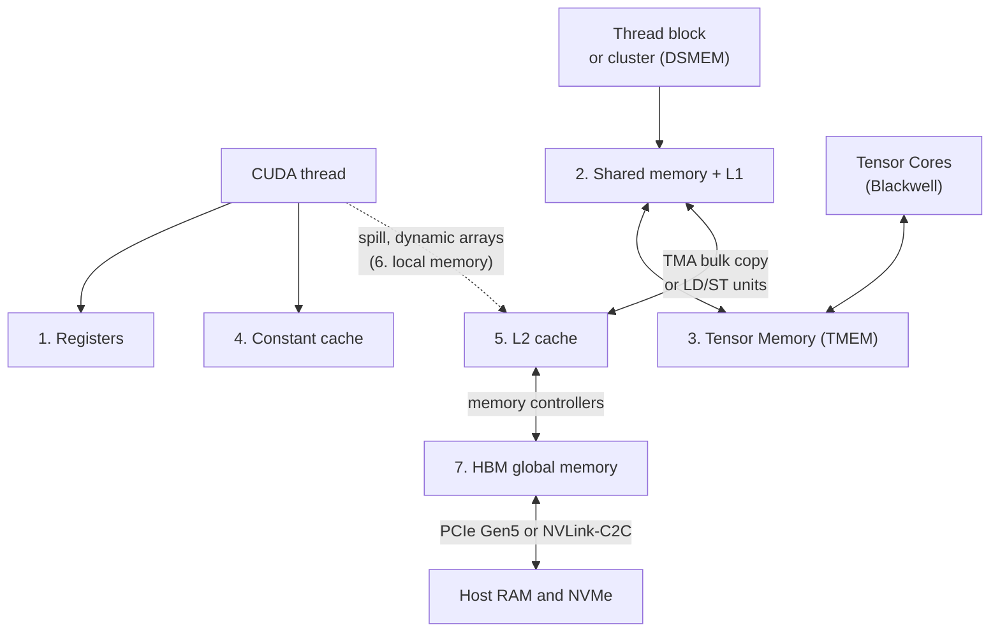
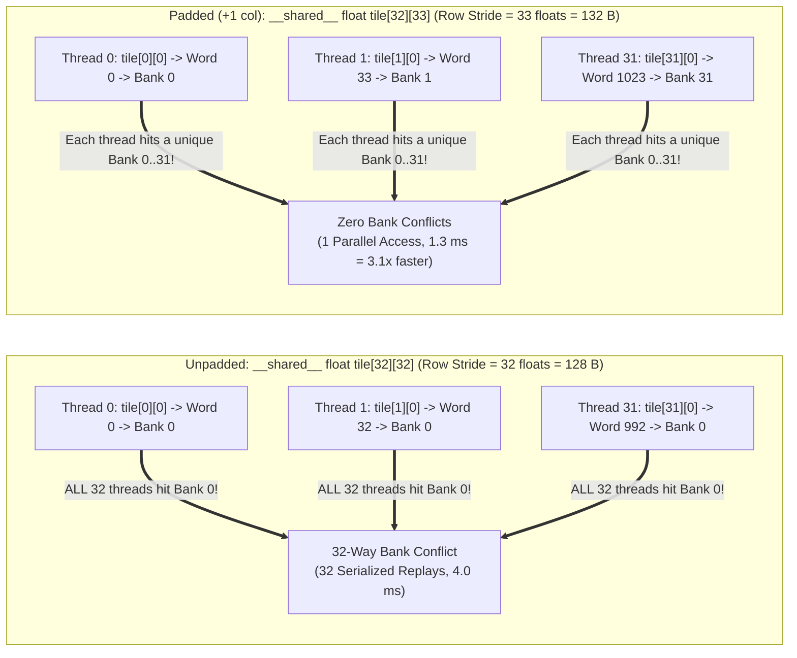

# 10.3 The GPU memory hierarchy

| | |
|---|---|
| **Status** | Drafted (`gpu_memory_hierarchy_lab.py`: 25 checks pass; `ncu`/`nvidia-smi` commands **untested** on live Nebius GPU VM) |
| **Level** | Intermediate |
| **Priority tier** | 2 |
| **Lab venue** | Nebius GPU + self-checking Python model (`code/part10/gpu_memory_hierarchy_lab.py`) |
| **Part** | Part 10: The GPU and CUDA |
| **Sources used** | *AI Systems Performance Engineering* Ch. 6 & Ch. 7; `nvidia-devops` V2 (Ch. 5, 7, 8, 9; Lab 3); `nvidia-devops` VL4 (Ch. 1 §3 & App. B) |

## Why this matters for AI infrastructure

A GPU can have 1,000+ TeraFLOPS of arithmetic horsepower and still crawl at a fraction of its capability because its execution pipelines spend 80% of their cycles waiting for bytes to arrive from memory. No single memory technology can be simultaneously tiny, 1-cycle fast, and 192 GB large, so every modern GPU is built around a **seven-tier memory hierarchy** stretching from 1-cycle per-thread **Registers** out to off-chip **High-Bandwidth Memory (`HBM3` / `HBM3e`)** and host CPU RAM.

As an AI infrastructure or platform engineer, you will diagnose memory-hierarchy bottlenecks constantly:
- Why does a 13B FP16 model (`26 GB` of weights) fit effortlessly inside an 80 GB `H100` with 54 GB to spare, yet hit a hard **~7.8 ms per-token latency floor** during unbatched LLM decode?
- Why did a compiler "optimization" that unrolled a loop and reduced instruction count make a kernel *slower* by spilling just 2 floats (`8 bytes`) per thread into **Local Memory**—silently generating **1.05 MB of extra HBM traffic** per launch?
- Why does a naive matrix transpose in fast on-chip **Shared Memory** stall 38% of the time on **4.8 million bank conflicts**, and why does changing `__shared__ float tile[32][32]` to **`tile[32][33]`** (adding 1 unused padding column) make it **3× faster**?
- Why does `nvidia-smi -q -d MEMORY` showing **`BAR1 Total: 256 MiB`** on an 80 GB GPU cripple CPU-to-GPU transfers because **Resizable BAR (`ReBAR` / Large BAR)** was left disabled in the server BIOS?

This chapter maps every tier of the GPU memory hierarchy (including Blackwell's dedicated **Tensor Memory `TMEM`** and **Tensor Memory Accelerator `TMA`**), derives the exact arithmetic for **128-byte cache-line coalescing**, **32-bank shared-memory conflicts**, and **register spilling**, and connects kernel-level access patterns to host-level **Resizable BAR**, **pinned memory**, **stream-ordered memory pools (`cudaMallocAsync` / `PYTORCH_ALLOC_CONF`)**, and **Unified Memory (`cudaMallocManaged`)**.

## Prerequisites and outcomes

**Prerequisites:**
- CPU versus GPU throughput design and peak HBM/PCIe bandwidth formulas (`10.1`).
- The execution hierarchy (`Thread → Warp → Thread Block → Cluster → Grid`), `SM` sub-partitions, and occupancy rules (`10.2`).

**Outcomes:** After completing this chapter, you will be able to:
1. Map all **seven device memory tiers** on Hopper and Blackwell GPUs—**Registers**, **Shared Memory / L1 Data Cache**, **Tensor Memory (`TMEM`)**, **Constant Memory Cache**, **L2 Cache** (`50 MB` on H100, `126 MB` on B200), **Local Memory**, and **Global Memory (`HBM3`/`HBM3e`)**—along with the five **Points of Coherency (`PoC`)**.
2. Explain why **Local Memory** describes *thread scope* rather than *physical location*, calculate the hidden HBM byte traffic caused by **register spilling**, and spot spills at compile time with `nvcc -O3 -Xptxas=-v`.
3. Stage data in **Shared Memory (`32 × 32` and `64 × 64` tiles)**, calculate **32-bank conflict** degrees (`bank = (byte_addr // 4) % 32`), eliminate 32-way column conflicts with **`[32][33]` padding** or **XOR index swizzling**, and bypass shared memory altogether for intra-warp reductions using **`__shfl_down_sync`** register shuffles.
4. Explain **128-byte cache-line coalescing** (`four 32-byte sectors`), contrast **Array-of-Structures (`AoS`)** with **Structure-of-Arrays (`SoA`)**, use **vectorized loads** (`float4` `16 B` on Hopper vs `32 B` `alignas(32)` on Blackwell), route immutable lookup tables through the **Read-Only Data Cache (`const __restrict__`)**, and overlap global-to-shared DMA using the **Tensor Memory Accelerator (`TMA`)** and `cuda::memcpy_async` double-buffering.
5. Separate **VRAM capacity** ("does it fit?") from **effective HBM bandwidth** ("how fast does it stream?"), verify **Resizable BAR (`BAR1` = full VRAM)** in `nvidia-smi -q -d MEMORY`, and tune **stream-ordered memory pools (`cudaMallocAsync`, `PYTORCH_ALLOC_CONF`)** and **Unified Memory (`cudaMemPrefetchAsync`, `cudaMemAdvise`)**.

---

## 1. The seven-tier GPU memory hierarchy and Points of Coherency

Every step further away from the SM's arithmetic units gives you roughly an order of magnitude more capacity at the cost of higher latency and lower per-SM bandwidth.

### 1.1 Architectural map from Registers and TMEM to L2, HBM3e, and Host RAM



| Level | Size | Latency | Notes |
|---|---|---|---|
| 1. Register file | 64K x 32-bit registers per SM (256 KB), max 255 per thread | about 1 cycle | On-chip, per SM |
| 2. Unified shared memory and L1 | 256 KB SRAM per SM (up to 228 KB shared: 227 KB dynamic per block plus 1 KB reserved) | about 20 to 30 cycles | Shared by the thread block, or the cluster through DSMEM |
| 3. Tensor Memory (TMEM) | 256 KB dedicated SRAM per SM on Blackwell | about 10 cycles | Managed through TMA and descriptors; used by 5th-gen Tensor Cores (`tcgen05` / UMMA) |
| 4. Constant cache | about 8 KB per SM in front of 64 KB of `__constant__` | about 1 cycle on a warp-uniform broadcast | |
| 5. L2 cache | 50 MB (H100) / 126 MB (B200), GPU-wide | about 200 cycles | Fed by TMA bulk async DMA or 16x LD/ST units |
| 6. Local memory | Logical, per thread | Goes through L1, L2 and HBM | Register spills and dynamic arrays |
| 7. HBM global memory | 80 to 141 GB (H100/H200), 180 to 288 GB (B200/B300) | about 800 cycles typical round trip | 3.35 TB/s (H100) / 8.0 TB/s (B200) through the memory controllers |
| Host link | Host CPU RAM (DDR5 / LPDDR5X) and NVMe (GPUDirect Storage) | n/a | PCIe Gen5 (63 GB/s, BAR1/ReBAR) or NVLink-C2C (900 GB/s coherent) |

The on-chip levels (1 to 4) run from about 1 to 30 cycles at TB/s to tens of TB/s per SM.

Using the Blackwell memory hierarchy specification table from *AI Systems Performance Engineering* Chapter 6 (Table 6-5) alongside Hopper `H100`:

| Memory tier | Visibility scope | Capacity (`Blackwell B200` / `Hopper H100`) | Typical latency | Approx. bandwidth | Who manages it & key rules |
|---|---|---|---|---|---|
| **1. Registers** | **Per thread** (private) | **64K 32-bit registers (`256 KB`) per SM**; max **`255` registers/thread** | **~1 cycle** | Tens of TB/s per SM | Compiler (`nvcc -Xptxas=-v`). Fastest storage; excess demand spills to Local Memory. |
| **2. Shared Memory & L1 Data Cache** | **Per Thread Block (`CTA`)** (or **Cluster** via `DSMEM`) | **256 KB combined SRAM per SM**; up to **`228 KB` shared/SM** (**`227 KB`** max dynamic/block + **`1 KB`** CUDA reserved), rest is L1 | **~20–30 cycles** | TB/s per SM (when bank-conflict-free) | Programmer (`__shared__`, `cudaFuncAttributePreferredSharedMemoryCarveout`) for SMEM; hardware for L1. |
| **3. Tensor Memory (`TMEM`, Blackwell)** | **Per SM (Tensor Cores)** | **256 KB dedicated SRAM per SM** (Blackwell `B200`/`B300`) | **~10 cycles** | Tens of TB/s to Tensor Cores | **Not pointer-addressable in C++**; holds Tensor Core accumulators/operands, fed via **TMA** and `tcgen05.mma` / `UMMA` descriptors. |
| **4. Constant Memory Cache** | **Per SM (Read-only)** | **~8 KB cache per SM** fronting **`64 KB`** device-wide `__constant__` space | **~1 cycle** (on warp broadcast) | TB/s-scale broadcast | Programmer (`__constant__`). Broadcasts in 1 cycle when all 32 warp lanes read the **exact same address** (RoPE tables, ALiBi slopes, LayerNorm gamma/beta, quant scales). |
| **5. L2 Cache** | **GPU-wide** (all SMs, NVLink, PCIe) | **`126 MB` on Blackwell B200** (`50 MB` on Hopper H100) | **~200 cycles** | Multi-TB/s aggregate | Hardware. Central coherence hub across all SMs, HBM partitions, NVLink, and PCIe DMA. |
| **6. Local Memory (Spill Space)** | **Per thread** (logical scope, **physically off-chip.**) | Backed by Global HBM DRAM | **100s → 1,000+ cycles** (on L1/L2 miss) | Up to HBM BW (`~8 TB/s` B200) | Compiler automatic fallback when registers spill (`>255` or launch-bounds cap) or for per-thread arrays indexed dynamically. |
| **7. Global Memory (`HBM3` / `HBM3e`)** | **Device-wide / System** | **`80 GB` H100**, **`141 GB` H200**, **`180–192 GB` B200**, **`~288 GB` B300** | **100s → 1,000+ cycles** (`~800` cycles typical) | **`3.35 TB/s` H100**, **`4.8 TB/s` H200**, **`~8.0 TB/s` B200** (`16 TB/s` per 2-GPU GB200/GB300) | Application (`cudaMalloc`, `cudaMallocAsync`). On B200, 8 HBM3e stacks (4 per reticle die across the `10 TB/s` chip-to-chip link) appear as one uniform address space. |

### 1.2 Points of Coherency (`PoC`) and tracing a memory request

When threads exchange data, the **Point of Coherency (`PoC`)**—the hardware level where one thread's write becomes visible to another—depends on how far apart the two threads sit in the execution hierarchy:
1. **Thread level:** Register File (private to one thread).
2. **Thread Block (`CTA`) level:** L1 / Shared Memory SRAM on a single SM (synchronized with `__syncthreads()`).
3. **Thread Block Cluster (`CTA Cluster`) level:** Multi-SM **Distributed Shared Memory (`DSMEM`)** within a Graphics Processing Cluster (synchronized with `cluster.sync()`).
4. **Device level:** Unified **L2 Cache** and **Global HBM** across all SMs on one GPU.
5. **System level:** Coherent memory across multiple GPUs and the host CPU over **NVLink / NVSwitch** and **NVLink-C2C** (or PCIe).

How do you tell in 5 seconds whether a slow workload is actually bottlenecked on the memory hierarchy rather than on compute or kernel launches? Run `nvidia-smi dmon -s ucm -c 3`:

```text
$ nvidia-smi dmon -s ucm -c 3
# gpu   sm   mem
# Idx     %     %
    0    18    89
    0    17    91
    0    19    88
```

When **`sm` sits at 17–19%** while **`mem` sits at 88–91%**, the SMs are starving while the memory interface is saturated. Next, run one Nsight Compute (`ncu`) pass on the L1 and L2 sector hit rates (`l1tex__t_sector_hit_rate.pct` and `lts__t_sector_hit_rate.pct`):
- **Low L1 (`12.4%`) and low L2 (`18.9%`) hit rates + high HBM traffic:** A streaming or uncoalesced access pattern is bypassing both caches and slamming HBM on almost every load—fix data layout (`SoA`), coalescing, or shared-memory tiling.
- **High L2 hit rate + high HBM traffic:** The working set slightly exceeds L2 capacity (`50 MB` H100 / `126 MB` B200) and is thrashing—reduce precision (`FP8`/`FP4`), fuse kernels, or adjust tile/batch size.

:::info In one minute: Section 1 takeaways
- The 7 device memory tiers trade capacity for speed: **Registers (~1 cycle) → TMEM (~10 cycles, 256 KB/SM on Blackwell) → Shared/L1 (~20–30 cycles, 256 KB/SM) → Constant Cache (~1 cycle broadcast) → L2 (~200 cycles, 50 MB H100 / 126 MB B200) → Local/Global HBM (~800 cycles, 3.35–8.0 TB/s)**.
- **Blackwell `TMEM`** (`256 KB/SM`) holds 5th-gen Tensor Core accumulators and operands on chip and is managed via **TMA** and `tcgen05` descriptors, not C++ pointers.
- Pair `nvidia-smi dmon -s ucm` (`sm%` vs `mem%`) with `ncu` L1/L2 hit rates (`l1tex__t_sector_hit_rate.pct`, `lts__t_sector_hit_rate.pct`) to pinpoint which tier is leaking.
:::

---

## 2. On-chip storage: Registers, Local Memory spills, Shared Memory tiling, Bank Conflicts, and Warp Shuffles

### 2.1 Registers versus Local Memory: why "Local" memory is physically off-chip

One of the most dangerous misnomers in CUDA is **Local Memory**. "Local" describes **logical visibility scope** (private to a single thread, just like a local variable in C), **not physical location**. Physically, Local Memory is allocated in **off-chip Global HBM DRAM** and routed through L1 and L2 cache.

The compiler (`nvcc`) places a thread's variables into slow Local Memory in two situations:
1. **Register spilling:** The kernel requires more live variables than fit in the per-thread register allocation (either exceeding the hardware ceiling of `255` registers/thread, or exceeding the per-thread register cap needed to satisfy `__launch_bounds__`).
2. **Dynamic array indexing:** A thread declares a local array (`float buf[32]`) and indexes it with a runtime variable (`buf[i]`) that the compiler cannot resolve to fixed register numbers at compile time.

You can catch register spilling at compile time—before ever running on a GPU—using `nvcc -O3 -Xptxas=-v`:

```text
# Healthy kernel: zero spills
ptxas info : Used 44 registers, 0 bytes spill stores, 0 bytes spill loads

# Regressed kernel after aggressive loop unrolling: 88 registers + spills!
ptxas info : Function properties for _Z6kernelPKfPfm
    64 bytes stack frame, 96 bytes spill stores, 128 bytes spill loads
ptxas info : Used 96 registers, 0 bytes cmem[0]
```

To see why even a tiny spill hurts bandwidth-bound workloads, reproduce the worked calculation from `nvidia-devops` Volume 02 Chapter 7:
- Suppose a kernel spills just **2 float values (`8 bytes`) per thread**, and launches `256` blocks of `256` threads (**`65,536` threads total**).
- Every spilled variable must be written out (`spill store`) and read back (`spill load`):
  ```text
  Extra Spill Traffic = 65,536 threads × 8 bytes × 2 (store + load) = 1,048,576 bytes (1.0 MiB ≈ 1.05 MB)
  ```
  That single launch silently injects **1.05 MB of extra cache/HBM traffic** that does not appear anywhere in your C++ or PyTorch source code.

### 2.2 Shared Memory tiling (`32 × 32` vs `64 × 64`) and data reuse

Unlike hardware-managed L1/L2 caches—where hardware heuristics decide what to evict—**Shared Memory (`__shared__`)** is an explicit, programmer-managed scratchpad in on-SM SRAM (`~20–30` cycles, up to `228 KB` per SM / `227 KB` dynamic per block on Hopper and Blackwell, configured via `cudaFuncAttributePreferredSharedMemoryCarveout`).

In a naive matrix multiplication `C = A × B` of size `N × N` (`N = 1,024`), each thread computing one element `C[row, col]` reads an entire row of `A` and column of `B` directly from Global HBM—re-fetching every element `N` times across different threads. **Shared-Memory Tiling** fixes this in four steps:
1. Threads in a `32 × 32` Thread Block (`1,024` threads) cooperatively load one `32 × 32` tile of `A` into `__shared__ float sA[32][32]` and one `32 × 32` tile of `B` into `sB[32][32]`.
2. The block calls `__syncthreads()` so all 1,024 loads finish before any thread reads the tile.
3. Each thread executes `32` multiply-accumulates (`for (int k = 0; k < 32; ++k) sum += sA[ty][k] * sB[k][tx]`) directly from 20-cycle Shared Memory—**reusing each HBM value 32×**.
4. The block calls `__syncthreads()` before advancing to the next tile along `K`.

Look at the measured impact of `32 × 32` shared-memory tiling from *AI Systems Performance Engineering* Chapter 7 (Table 7-4):

| Metric (`N = 1,024` FP32 matrix multiply, ASP Ch. 7 Table 7-4) | Before (`naiveMatMul` from HBM) | After (`tiledMatMul` in Shared Memory) | Why it changed |
|---|---|---|---|
| **Global memory load sectors (`32 B` each)** | `9,800` sectors | **`1,200` sectors** | **8.2× fewer DRAM reads** (each tile element fetched once per block instead of 32×). |
| **DRAM throughput (% of peak)** | `90%` (wasteful redundant traffic) | **`25%`** (`3.6×` lower pressure) | Redundant off-chip HBM fetches eliminated. |
| **Shared-memory throughput (% of peak)** | `52%` | **`99%`** | On-chip SRAM services the inner loop at ~100% efficiency. |
| **Achieved SM occupancy (%)** | `42%` | **`89%`** | Fewer HBM stalls allow resident warps to make continuous progress. |
| **Arithmetic intensity (FLOPs / byte)** | `1.5 FLOPs/byte` (`15 GFLOPS @ 10 GB/s`) | **`8.0 FLOPs/byte`** (`170 GFLOPS @ 21 GB/s`) | **5.3× higher arithmetic intensity**, shifting the kernel toward compute-bound. |
| **Sustained FP32 throughput** | `15 GFLOPS` | **`170 GFLOPS`** | **11.3× speedup** from shared-memory reuse alone. |

Why not keep doubling the tile size to `64 × 64` or `128 × 128` forever?
- Doubling a 2D tile's width and height **squares the reuse factor (`2×`) but quadruples Shared Memory capacity (`4×`)** and increases per-thread register pressure:
- As shown in *AI Systems Performance Engineering* Chapter 7 (pp. 233–234), a `64 × 64` tile (`16 KB` for `sA` + `16 KB` for `sB`) computed by a `32 × 32` (`1,024`-thread) block where each thread computes a `2 × 2` subtile requires **~12 to 22 registers per thread** (`22 × 1,024 = 22,528` registers/block). Even though 2 blocks (`45,056` registers) fit inside the SM's `65,536` register file, `2 × 1,024 = 2,048` threads already hits the SM's **hard 2,048-thread ceiling** (only **2 blocks/SM**). Libraries such as **NVIDIA CUTLASS**, **`cuBLAS`**, **`cuDNN`**, **OpenAI Triton**, and NVIDIA's Python **`cuTile` (`TileIR`)** autotune these hierarchical thread-, warp-, and block-tile dimensions automatically.

### 2.3 Shared-Memory 32-Bank Conflicts, `[32][33]` Padding, Swizzling, and Warp Shuffles (`__shfl_down_sync`)

Shared Memory is fast only when threads access **different banks in parallel**. On Hopper, Blackwell, and Ampere, Shared Memory is divided into **32 hardware banks**, each **4 bytes (`32 bits`, one `float`) wide**:
- Successive 4-byte words map to successive banks: word `w` (at byte address `4 * w`) lives in **`bank = w % 32`** (so the bank assignment repeats every **`32 floats = 128 bytes`**).
- If all 32 threads in a warp access **32 different banks** in the same cycle (such as row-major `tile[threadIdx.y][threadIdx.x]`, where `threadIdx.x` steps by `stride = 1` word), all 32 reads complete in **1 single transaction** (**conflict-free**).
- **The Broadcast Exception:** If all 32 threads in a warp read the **exact same address** (`stride = 0`, e.g., `tile[0][0]`), the hardware **broadcasts (multicasts)** that 4-byte word to all 32 lanes in **1 cycle with zero bank conflict**.
- **The 32-Way Bank Conflict Trap:** What happens during a matrix transpose (`transposeNaive`) when threads in a warp read down a **column** of `__shared__ float tile[32][32]` (`tile[threadIdx.x][threadIdx.y]`, or `arr[threadIdx.x * 32]`)?
  - Thread `t` (`t = 0..31`) reads word `t * 32 + col` (byte offset `t * 128 + 4*col`).
  - Because `(t * 32 + col) % 32 == col` for *every single thread `t` in the warp*, **all 32 threads hit the exact same bank (`bank = col`) at 32 different addresses**.
  - The hardware must serialize that single instruction into **32 sequential bank accesses** (**a 32-way bank conflict**).



How do you eliminate shared-memory bank conflicts?
1. **Fix 1 — Array Padding (`__shared__ float tile[32][33]`):** Adding **1 unused padding column** (`+1 float` per row, just `~3.1%` / `1 KB` overhead on a `32 × 32` tile) changes the row stride from `32` to **`33` words**. Because `33` and `32` are coprime (`33 % 32 == 1`), Thread `t` reading `tile[t][col]` accesses word `t * 33 + col`, which maps to **`bank = (t + col) % 32`**—putting all 32 threads in **32 distinct banks**. In *AI Systems Performance Engineering* Chapter 7 (Table 7-5), padding `tile[32][32]` to `tile[32][33]` reduced bank conflicts (`ncu` `l1tex__data_bank_conflicts_pipe_lsu.sum`) from **`4.8 million` to `0`**, raised shared-memory utilization from **`52%` to `100%`**, cut memory warp stalls from **`38%` to `0.5%`**, and sped up the transpose kernel by **3.1× (`4.0 ms → 1.3 ms`)**.
2. **Fix 2 — XOR Index Swizzling (used by `CUTLASS`):** Instead of allocating extra padding bytes, transform the column index with a bitwise XOR (`col_swizzled = col ^ row`), permuting bank assignments across rows with **zero memory overhead**.
3. **Fix 3 — Warp Shuffle Intrinsics (`__shfl_sync` / `__shfl_down_sync`) to bypass Shared Memory completely:**
   When threads only need to exchange or reduce data **within a single 32-thread warp**, do not write to Shared Memory at all. Warp shuffle intrinsics read another lane's register directly across the SM sub-partition in 5 logarithmic butterfly steps (`offset = 16, 8, 4, 2, 1`):
   ```cpp
   unsigned mask = __activemask();
   for (int offset = 16; offset > 0; offset >>= 1) {
       val += __shfl_down_sync(mask, val, offset);
   }
   // Lane 0 now holds the sum of all 32 threads: 0 shared memory bytes, 0 barriers, 0 bank conflicts!
   ```

:::info In one minute: Section 2 takeaways
- **Local Memory** is thread-scoped logical spill space backed by **off-chip HBM DRAM**; check `nvcc -O3 -Xptxas=-v` to ensure `0 bytes spill stores/loads`.
- Shared Memory has **32 banks × 4 bytes (`128 B` period)**: striding by `32` floats (`128 B`) causes a **32-way bank conflict**, whereas padding to **`tile[32][33]` (`stride = 33`)** or **XOR swizzling** achieves **0 bank conflicts** (`3.1×` speedup).
- Use **`__shfl_down_sync`** (or Cooperative Groups `__reduce_sync`) for intra-warp reductions directly in registers without touching Shared Memory.
:::

---

## 3. Global memory access: Coalescing, Vectorization, Read-Only Cache, and TMA Async Prefetch

### 3.1 128-byte cache-line coalescing and `AoS` versus `SoA`

Global memory (`HBM`) is accessed through the L2 and L1 caches in **128-byte cache lines**, where each 128-byte line is subdivided into **four 32-byte sectors**:
- **Optimal coalesced load (`4.0` sectors/request):** When the 32 threads in a warp read contiguous 4-byte `float` values starting at a 128-byte-aligned address (`in[idx]`), the entire warp's `32 × 4 B = 128 bytes` maps to **1 cache line (`4` sectors of `32 B`)**. Every byte fetched from HBM is used (**`100%` Global Memory Load Efficiency**).
- **Misaligned contiguous load (`5` to `8` sectors/request):** If the warp's starting address is shifted off a 128-byte boundary (for example, `+4 bytes`), the 128-byte request straddles two cache lines and fetches **5 sectors (`160 bytes` for `128` useful bytes = `80%` efficiency)**.
- **Strided or `AoS` load (`8.0` to `32.0` sectors/request):** If threads read `in[idx * 2]` (`stride = 2`) or read one field out of an **Array of Structures (`AoS`)**, a single warp spans two cache lines and fetches **8 sectors (`256 B` for `128 B` useful = `50%` efficiency)**; at `stride >= 8` or random scatter, the warp fetches **32 separate sectors (`1,024 B` for `128 B` useful = `12.5%` efficiency, an 8× bandwidth waste)**. Converting `AoS` to **Structure of Arrays (`SoA`)** places each field in its own contiguous array so adjacent threads always read adjacent addresses.

### 3.2 Vectorized loads (`float4` `16 B` on Hopper vs `32 B` `alignas(32)` on Blackwell)

Even when a scalar 4-byte load (`out[idx] = in[idx]`) is 100% coalesced, each warp still issues 32 separate 4-byte thread reads that the hardware coalescer must stitch together. **Vectorized memory access** packs multiple elements into a single wide load instruction per thread (relying on `cudaMalloc`'s guarantee of **`>= 256-byte` base pointer alignment**):
- **128-bit (`16-byte`) vector load (`float4`, standard on Ampere & Hopper):** Each thread loads four floats (`16 bytes`) in one instruction (`LD.E.128`). Across 32 threads, the warp moves **`512 bytes`** across **4 aligned 128-byte cache lines (`16` sectors, `4.0` sectors/transaction)** while cutting memory instruction count by **4×**.
- **256-bit (`32-byte`) vector load (Blackwell `B200` with `CUDA 13+`):** Blackwell introduces native **32-byte per-thread global vector loads** (`8 floats` via `alignas(32)` struct or `double4`). Across 32 threads, a single warp instruction moves **`1,024 bytes`** across **8 aligned 128-byte cache lines (`32` sectors)**, cutting memory instructions by **8×** (on Hopper, a 32-byte struct compiles into two 16-byte loads). Always verify pointer alignment (`uintptr_t(ptr) % 16 == 0` for `float4`, `% 32 == 0` for 32-byte vectors) before `reinterpret_cast`.

### 3.3 Read-Only Data Cache (`const __restrict__`) and Tensor Memory Accelerator (`TMA`)

Two hardware features on modern SMs eliminate the remaining global-memory stalls:
1. **Read-Only Data Cache (`const float* __restrict__`):**
   When many threads repeatedly look up values in an immutable table (such as token embeddings, RoPE frequencies, or quantization scales larger than the 64 KB `__constant__` space), omitting `const __restrict__` forces the compiler to assume the pointer might be aliased and modified—using normal coherent global loads that pollute L1/L2. Marking the pointer **`const __restrict__`** (or calling `__ldg()`) proves immutability and non-aliasing so the compiler routes loads through the low-latency **Read-Only Data Cache** path.
2. **Asynchronous Bulk Prefetching with the Tensor Memory Accelerator (`TMA`) and `cuda::memcpy_async`:**
   Even a coalesced, vectorized load stalls a warp if the SM's 16 `LD/ST` units must issue the addresses and wait ~800 cycles for HBM. On Hopper and Blackwell, the **Tensor Memory Accelerator (`TMA`)** is a dedicated hardware DMA engine inside the SM that copies 1D-to-5D tiles (including strided bounds) asynchronously between Global HBM and Shared Memory (`cp.async.bulk`) without using SM registers or `LD/ST` instruction slots.
   By allocating two ping-pong buffers in Shared Memory (`tile0`, `tile1`) and using the C++ `cuda::pipeline` API (`pipe.producer_acquire()`, `cuda::memcpy_async(...)`, `pipe.producer_commit()`, `pipe.consumer_wait()`, `pipe.consumer_release()`), the **TMA streams Tile `t` from HBM in the background while the SM's warps compute on Tile `t - 1`** (**double buffering**).

Compare all four Chapter 7 hardware-software optimizations side by side (from *AI Systems Performance Engineering* Chapter 7 Tables 7-1, 7-4, 7-5, 7-6, and 7-7):

| Optimization technique (ASP Ch. 7) | Before (Unoptimized) | After (Optimized) | Speedup & key profiler evidence (`ncu`) |
|---|---|---|---|
| **1. Global Memory Coalescing** (`stride=2` → `stride=1`, Table 7-1) | `4.8 ms`, `25%` DRAM peak, `23%` Load Eff, `8.0` sectors/req | **`1.3 ms`**, **`90%` DRAM peak**, **`99%` Load Eff**, **`4.0` sectors/req** | **3.7× faster** (`3.6×` higher effective DRAM throughput). |
| **2. Shared-Memory Tiling** (`32 × 32` GEMM tile, Table 7-4) | `15 GFLOPS` (`1.5 FLOPs/B`), `90%` DRAM, `9,800` sectors | **`170 GFLOPS`** (**`8.0 FLOPs/B`**), **`25%` DRAM**, **`1,200` sectors** | **11.3× higher GFLOPS** (`8.2×` fewer DRAM sector reads). |
| **3. Shared-Memory Padding** (`tile[32][32]` → `tile[32][33]`, Table 7-5) | `4.0 ms`, `4.8M` bank conflicts, `52%` SMEM util, `38%` stall | **`1.3 ms`**, **`0` bank conflicts**, **`100%` SMEM util**, **`0.5%` stall** | **3.1× faster** (~3.1% / 1 KB memory overhead). |
| **4. Read-Only Cache** (adding `const __restrict__`, Table 7-6) | `2.5 ms`, `52%` Load Eff, `600 GB/s` DRAM, `45%` SM Active | **`1.0 ms`**, **`97%` Load Eff**, **`200 GB/s` DRAM**, **`1,800 GB/s` L2**, **`93%` SM Active** | **2.5× faster** (`3×` less DRAM traffic, served from L1/L2 cache). |
| **5. `TMA` + `cuda::memcpy_async` Double-Buffering** (Table 7-7) | `18.0 ms`, `23%` Load Eff, `6.4` sectors/req, `62%` SM Active | **`7.0 ms`**, **`99%` Load Eff**, **`4.0` sectors/req**, **`100%` SM Active** | **2.6× faster** (~800-cycle HBM latency hidden behind compute). |

:::info In one minute: Section 3 takeaways
- Aim for **`4.0` sectors per request** (`128 B` cache line = `4 × 32 B` sectors) and **`>95%` Global Memory Load Efficiency** in `ncu`.
- Use **`float4` (`16 B`)** vector loads on Ampere/Hopper and **`32-byte` (`alignas(32)`)** vector loads on Blackwell (`CUDA 13+`), mark read-only tables **`const __restrict__`**, and use **`TMA` (`cuda::memcpy_async` + `cuda::pipeline`)** to double-buffer global-to-shared tile transfers.
:::

---

## 4. Device and Host-Device memory: Capacity vs Bandwidth, ReBAR, Memory Pools, and Unified Memory

### 4.1 Capacity ("Does it fit?") versus Bandwidth ("How fast does it stream?")

In cluster sizing and incident triage, never confuse **HBM capacity (`GB`)** with **HBM bandwidth (`TB/s`)**:
1. **Worked serving latency floor (`13B FP16` model on `H100`, V2 Ch. 5):**
   - A 13-billion-parameter model in `FP16` (`2 bytes/param`) occupies **`26.0 GB`** of weights—fitting inside an `80 GB` `H100` with **`54.0 GB`** of free VRAM to spare. Capacity is 100% satisfied.
   - However, during unbatched (`batch = 1`) autoregressive decode, the GPU must read all `26.0 GB` of weights from HBM for every single token generated. On an `H100 SXM` with **`3,350 GB/s` (`3.35 TB/s`)** peak HBM bandwidth, the theoretical minimum time per token from weight reads alone is:
     ```text
     Minimum Token Latency Floor = 26.0 GB / 3,350 GB/s = 0.007761 s ≈ 7.76 ms/token (~7.8 ms/token)
     ```
     No amount of extra free VRAM (`80 GB` vs `141 GB`) will lower that `7.76 ms` floor unless you either **increase HBM bandwidth** (`H200` at `4.8 TB/s`, `B200` at `8.0 TB/s`), **quantize weights** (`FP8` halves weights to `13 GB` → `3.88 ms`), or use **Continuous Batching** so one `26 GB` weight read is amortized across dozens of concurrent user requests.
2. **Worked bandwidth-utilization check (`16 GB` in `6 ms`, V2 Ch. 8):**
   - Suppose an elementwise kernel reads `8 GB` and writes `8 GB` (`16 GB` total) in **`6.0 ms`** on an `H100` (`3,350 GB/s` peak):
     ```text
     Effective Bandwidth = 16.0 GB / 0.006 s = 2,666.7 GB/s (79.6% ≈ 80% of 3,350 GB/s peak)
     ```
     At **~80% of physical peak**, the memory controllers are already saturated; the only way to speed up that step is **kernel fusion** (eliminating the intermediate 8 GB write + 8 GB read) or reduced precision.
   - Conversely, if the kernel achieves only **`500 GB/s` (`14.9% ≈ 15%` of peak)**, the hardware is *not* the limit—uncoalesced addressing or partition stride contention (overloading a subset of HBM memory controllers while others sit idle) is wasting the bus.

### 4.2 PCIe `BAR1` / Resizable BAR (`ReBAR`), Stream-Ordered Memory Pools, and Unified Memory

Beyond the GPU package itself, four host- and runtime-level memory settings directly govern production stability:

1. **PCIe `BAR1` and Resizable BAR (`ReBAR` / Large BAR):**
   **Base Address Register 1 (`BAR1`)** is the PCIe aperture window in the host CPU's physical address space through which the CPU and peer RDMA NICs (`GPUDirect RDMA`) map GPU HBM. Legacy BIOS defaults cap `BAR1` at **`256 MiB`**, forcing transfers to page through a tiny 256 MiB window. On every production GPU server, **Resizable BAR (`ReBAR` / Above 4G Decoding)** must be enabled in BIOS so `BAR1 Total` matches the full GPU VRAM (`81,920 MiB` on an 80 GB H100):
   ```text
   $ nvidia-smi -q -d MEMORY | grep -A 5 "BAR1"
       BAR1 Memory Usage
           Total                             : 81920 MiB
           Used                              : 2 MiB
           Free                              : 81918 MiB
   ```
   *(If `Total` shows `256 MiB`, enable Large BAR / Resizable BAR in BIOS immediately.)*
2. **Stream-Ordered Memory Pools (`cudaMallocAsync` / `cudaFreeAsync` and `PYTORCH_ALLOC_CONF`):**
   Traditional `cudaMalloc()` and `cudaFree()` are **synchronous across the entire GPU device** and invoke OS kernel calls (`mmap` / `ioctl`), causing context switches and pipeline stalls whenever a loop allocates temporary buffers.
   - In CUDA C++, use **`cudaMallocAsync(&ptr, bytes, stream)`** and **`cudaFreeAsync(ptr, stream)`** on a non-blocking stream (`cudaStreamCreateWithFlags(&s, cudaStreamNonBlocking)`), and tune pool retention with `cudaMemPoolSetAttribute(..., cudaMemPoolAttrReleaseThreshold, ...)` and `cudaMemPoolTrimTo`.
   - In PyTorch, the **caching memory allocator** implements this exact pool strategy automatically (configured via **`PYTORCH_ALLOC_CONF`**, formerly `PYTORCH_CUDA_ALLOC_CONF`, such as `expandable_segments:True` to prevent fragmentation OOMs).
3. **Unified Memory (`cudaMallocManaged`) and proactive prefetching (`cudaMemPrefetchAsync`):**
   `cudaMallocManaged()` creates a single pointer accessible from both CPU and GPU via hardware page faulting. On PCIe systems (`63 GB/s`), touching unmigrated pages inside a GPU kernel triggers expensive on-demand **page faults** across PCIe; on Grace Hopper (`GH200`) and Grace Blackwell (`GB200` / `GB300`), pages migrate over **`900 GB/s` coherent `NVLink-C2C`**. Even on Superchips, eliminate surprise page-fault stalls by prefetching and advising the driver before launching the kernel:
   ```cpp
   cudaMemAdvise(ptr, size, cudaMemAdviseSetPreferredLocation, gpuId);
   cudaMemAdvise(ptr, size, cudaMemAdviseSetReadMostly, gpuId);
   cudaMemAdvise(ptr, size, cudaMemAdviseSetAccessedBy, otherGpuId);
   cudaStreamAttachMemAsync(stream, ptr, 0, cudaMemAttachSingle);
   cudaMemPrefetchAsync(ptr, size, gpuId, stream);
   ```

*(Note: Combining the `BAR1` Resizable BAR check, pinned memory check, `cudaMallocAsync` pool check, and `cudaMemPrefetchAsync` Unified Memory check into `audit_host_device_memory_config` in `code/part10/gpu_memory_hierarchy.py` is **my inference**.)*

:::info In one minute: Section 4 takeaways
- **Capacity (`GB`)** decides whether weights + KV cache + activations fit; **Bandwidth (`TB/s`)** sets the per-token decode floor (`26 GB / 3,350 GB/s = 7.76 ms/token` for 13B FP16 on H100).
- Always verify **`BAR1 Total >= VRAM Total`** (`81,920 MiB` on 80 GB H100, never `256 MiB`) via `nvidia-smi -q -d MEMORY`.
- Replace synchronous `cudaMalloc`/`cudaFree` inside loops with stream-ordered **`cudaMallocAsync`/`cudaFreeAsync`** (or `PYTORCH_ALLOC_CONF=expandable_segments:True`), and pair `cudaMallocManaged` with **`cudaMemPrefetchAsync`** and **`cudaMemAdvise`**.
:::

---

## 5. Field notes from the Volume 02 memory chapters

These points come from `nvidia-zero-to-hero/volume-02/chapter-05-gpu-memory-hierarchy.md`, `chapter-07-registers-shared-memory-and-local-memory.md`, `chapter-08-global-memory-l1-l2-and-hbm.md` and `labs/lab-03-profile-memory-and-warp-efficiency.md`. All command outputs below are marked illustrative in those notes (not captured on real hardware), so treat the numbers as examples, not specifications.

### 5.1 Words that are easy to confuse

| Term | What it means | What it does not mean |
|---|---|---|
| Global memory | An address space: visible to every thread and block | A separate chip. A global load can be served by L1 or L2 and never reach HBM |
| HBM | The physical stacked DRAM on a wide interface that backs global memory on data-center GPUs | A software visibility rule |
| Local memory | Private to one thread (logical scope) | On-chip. It is backed by the device memory path |
| Peak bandwidth | The theoretical maximum transfer rate | What a kernel achieves. Effective bandwidth is the useful bytes delivered per second |

The notes list five measurable properties of a memory level: capacity, peak bandwidth, effective bandwidth, latency, and reuse (useful operations done before the data must be fetched again).

### 5.2 Locality, memory partitions and what to size

- **Temporal locality:** the same data is reused soon, so a cache can avoid a repeat HBM read.
- **Spatial locality:** nearby addresses are used together, so one transaction serves several values.
- **Working set:** if reuse happens only after the data was evicted, the cache gives little benefit.
- **Memory partitions:** HBM bandwidth is delivered in parallel across controllers and partitions. Address mapping spreads requests across them. A bad stride or layout can concentrate traffic on a few partitions while others sit idle, so a kernel can deliver far less than peak even when its accesses are coalesced.
- **Capacity plan must include runtime state.** Training: parameters, gradients, optimizer state, activations, communication buffers, checkpoints. Inference: weights, KV cache, temporary workspaces, batching buffers, and allocator reserves or fragmentation. Size for peak concurrency and sequence length, not for the moment after model load.
- **KV cache estimate (formula from the Volume 02 interview answer):** `2 x layers x heads x head_dim x sequence_length x batch_size x bytes_per_element`, where the 2 is key plus value. Unlike weights it grows with traffic.

### 5.3 Evidence patterns (illustrative outputs from the notes)

| Symptom | Evidence in the note | How to read it |
|---|---|---|
| Host-to-device copies dominate | `nsys stats` GPU trace: HtoD memcpy 61.2% (18.4 ms), compute kernel 4.1% (1.2 ms), DtoH memcpy 33.9% (10.2 ms) | The GPU is not the limit. Use pinned memory, fewer larger transfers, or overlap copy and compute |
| Scattered or strided loads | sectors per request 18.6 (ideal is about 4, worst case 32) | The warp fetches roughly 4 to 5 times more sectors than it uses |
| Shared-memory bank conflicts | `l1tex__data_bank_conflicts_pipe_lsu.sum` = 412,800 on a kernel expected to be conflict-free | A stride maps several lanes to one bank. Fix with a small padding or layout change, not a rewrite |
| A "faster" kernel got slower | `-Xptxas=-v` diff: 44 registers and 0 spills became 88 registers with 40 bytes spill stores and 48 bytes spill loads | Two costs at once: lower occupancy and new memory traffic |

Two rules from the same notes: forcing a lower register count (for example with a launch bound) can make a kernel slower because the live values spill instead of disappearing, and a compiler upgrade can change register allocation for unchanged source, so diff the `-Xptxas=-v` output between compiler versions. Shared memory and L1 share the same on-chip capacity on many architectures, so a kernel that takes more shared memory leaves less for L1.

### 5.4 Lab 03 worked comparison: contiguous versus strided copy (illustrative H100 run)

Two kernels copy `1 << 24` floats for 100 iterations. The strided kernel maps logical thread `i` to element `(i * 32) % count`.

| Metric | Contiguous | Strided |
|---|---:|---:|
| Elapsed time | 42.18 ms | 156.42 ms (about 3.7x) |
| Registers per thread | 16 | 20 |
| Spills | 0 bytes | 0 bytes |
| Memory throughput | 91.2% | 68.4% |
| L2 hit rate | 34.1% | 9.8% |
| Achieved occupancy | 87.4% | 85.9% |
| Sectors per request | 4.0 | 23.5 |

How the note reasons: occupancy is nearly identical, so residency is ruled out. Sectors per request (4.0 versus 23.5) and the L2 hit rate drop together explain the time gap, and the note warns that the modulo arithmetic in the strided kernel adds some cost of its own, so the conclusion should say what the evidence supports and what stays uncertain. A timing difference alone is not proof of a coalescing problem. If the strided kernel is not slower on your GPU, change the stride and array size and profile again instead of forcing the expected result.

### 5.5 Customer scenarios from the notes

- A recommendation model with large embedding lookups, irregular access and little reuse: the right discussion is capacity, bandwidth, cache behavior, data placement and batching, not Tensor Core throughput.
- A team compares GPUs by memory capacity and peak compute only. The workload streams large weights at small batch. Add bandwidth, L2 behavior, expected reuse and latency targets. The less compute-dense GPU can be the better fit if it meets the capacity and bandwidth need at lower cost.

---

## Commands and configurations that matter

### 1. Pre-flight check for `BAR1` (Resizable BAR), HBM usage, and streaming `sm%` vs `mem%` (untested on live Nebius GPU VM)

```bash
# 1. Confirm Resizable BAR (Large BAR1) maps full GPU VRAM (expect ~81920 MiB on H100 80GB, NOT 256 MiB!)
nvidia-smi -q -d MEMORY | grep -A 5 "BAR1"

# 2. Sample SM compute utilization (%) vs HBM memory interface busy (%) every 1 second
nvidia-smi dmon -s ucm -c 5
```

### 2. Inspecting register spills (`nvcc -Xptxas=-v`) and Nsight Compute memory counters (`ncu`)

```bash
# 1. Check compile-time register count and verify 0 bytes spill stores / 0 bytes spill loads
nvcc -O3 -arch=sm_90 -Xptxas=-v memory_patterns.cu -o memory_patterns

# 2. Profile L1/L2 hit rates, DRAM throughput, global load sectors/request, and shared-memory bank conflicts
ncu --metrics \
  dram__throughput.avg.pct_of_peak_sustained_elapsed,\
  l1tex__t_sector_hit_rate.pct,\
  lts__t_sector_hit_rate.pct,\
  l1tex__average_t_sectors_per_request_pipe_lsu_mem_global_op_ld.ratio,\
  l1tex__data_bank_conflicts_pipe_lsu.sum \
  ./memory_patterns
```

### 3. Configuring PyTorch's caching allocator pool to reduce VRAM fragmentation

```bash
# Use expandable virtual memory segments in PyTorch's caching allocator pool
export PYTORCH_ALLOC_CONF="expandable_segments:True"
```

---

## How it fails

| Failure mode | Symptom | Root cause | Diagnosis & fix |
|---|---|---|---|
| **1. Register spilling into off-chip Local Memory** | After unrolling a loop or adding local arrays, kernel latency jumps 2×–4× and `nvidia-smi dmon` shows elevated `mem%` for identical input tensors. | Thread register demand exceeded `255` (or exceeded the block's register budget), causing `ptxas` to spill variables to **Local Memory** (`65,536` threads spilling `8 B` = `1.05 MB` of hidden HBM traffic per launch). | Run `nvcc -O3 -Xptxas=-v` and check for non-zero **`spill stores` / `spill loads`**; reduce live variable scope, replace dynamically indexed per-thread arrays with Shared Memory, or adjust `__launch_bounds__`. |
| **2. 32-way Shared-Memory Bank Conflict on `32 × 32` tiles** | A kernel that stages a `32 × 32` float tile in `__shared__` memory achieves only ~50% of expected shared-memory bandwidth and stalls 38% of cycles on memory. | Threads in a warp read or write down a **column** of `__shared__ float tile[32][32]` (`stride = 32` floats = `128 bytes`), mapping all 32 lanes to the **exact same bank (`bank 0`)**. | Confirm with `ncu --metrics l1tex__data_bank_conflicts_pipe_lsu.sum`; pad the array to **`__shared__ float tile[32][33]`** (`stride = 33`, `0` conflicts, `3.1×` speedup) or apply XOR index swizzling. |
| **3. Uncoalesced / `AoS` global loads (`15–25%` achieved HBM bandwidth)** | `nvidia-smi dmon` shows `mem = 90%+` and `sm = 18%`, yet achieved bytes/sec (`useful_bytes / time`) is only 500 GB/s (~15% of H100 peak). | Threads read strided or scattered addresses (`AoS`), forcing the memory system to fetch **`8` to `32` sectors (`256`–`1,024 B`)** per warp instead of **`4` sectors (`128 B`)**. | Check `l1tex__average_t_sectors_per_request_pipe_lsu_mem_global_op_ld.ratio` in `ncu`; convert `AoS` to **`SoA`**, align pointers to 16/32 bytes, and use vectorized **`float4` (`16 B`)** or **Blackwell `32 B`** loads. |
| **4. Legacy `256 MiB` `BAR1` aperture bottleneck (`ReBAR` disabled)** | Host-to-device DMA transfers, `GPUDirect RDMA`, or peer-to-peer mappings crawl or fail with `BAR1` exhaustion errors on an 80 GB GPU node. | **Resizable BAR (`ReBAR` / Above 4G Decoding)** was left disabled in the server BIOS after a motherboard replacement or BIOS reset. | Run `nvidia-smi -q -d MEMORY \| grep -A 5 "BAR1"`. If `Total` is `256 MiB`, reboot into BIOS, enable **Above 4G Decoding** and **Resizable BAR**, and verify `Total` matches full VRAM (`81,920 MiB`). |
| **5. Synchronous `cudaMalloc` or unprefetched `cudaMallocManaged` stalls** | `nsys` timeline shows millisecond-scale gaps between kernel launches with frequent OS `ioctl`/`mmap` calls or GPU page-fault migrations. | The application calls synchronous `cudaMalloc`/`cudaFree` inside the training/serving loop, or touches `cudaMallocManaged` buffers on the GPU without prefetching. | Switch to stream-ordered **`cudaMallocAsync` / `cudaFreeAsync`** (or PyTorch's caching allocator pool), and call **`cudaMemPrefetchAsync`** + **`cudaMemAdvise`** before launching kernels on Unified Memory. |

---

## Hands-on lab

### Self-checking Python model (`code/part10/gpu_memory_hierarchy_lab.py` — verified here)

`code/part10/gpu_memory_hierarchy.py` implements the seven-tier Blackwell/Hopper memory specifications, capacity-versus-bandwidth evaluators, register-spill calculators, 128-byte cache-line coalescing/vectorization models, 32-bank shared-memory conflict solvers, and host-device `BAR1`/pool auditors, and `code/part10/gpu_memory_hierarchy_lab.py` runs **25 self-checks**:
1. **Blackwell 7-tier memory hierarchy & 5 Points of Coherency** (`Registers`, `Shared/L1`, `TMEM 256 KB/SM ~10 cycles non-pointer-addressable`, `Constant Cache`, `L2 126 MB`, `Local Memory in HBM`, `Global HBM3e`).
2. **Capacity vs Bandwidth decode floor** (`13B FP16 = 26.0 GB` inside `80 GB` H100 with `54.0 GB` free, setting a `7.76 ms/token` weight-read latency floor at `3,350 GB/s`).
3. **Register spilling** (`8 B` spilled/thread across `65,536` threads → `1,048,576 B = 1.05 MB` decimal / `1.0 MiB` hidden HBM traffic) and **effective bandwidth utilization** (`16 GB / 6 ms = 2,666.7 GB/s = 79.6%` of H100 peak vs `500 GB/s = 14.9%`).
4. **128-byte cache-line & 32-byte sector coalescing + vectorized loads** (aligned 4B scalar = `4` sectors / `100%` eff; misaligned `+4B` = `5` sectors across `2` lines / `80%` eff; `stride = 2` = `8` sectors / `50%` eff; `stride = 8` = `32` sectors / `12.5%` eff; `float4` `16B` = `512 B` across `4` lines / `16` sectors; Blackwell `32B` = `1,024 B` across `8` lines / `32` sectors).
5. **Shared-memory 32-bank conflict math** (`stride = 1` row = `32` banks / `1-way`; `stride = 32` unpadded `tile[32][32]` column = `1` bank / **`32-way conflict`**; `stride = 33` padded `tile[32][33]` column = `32` banks / **`0` conflicts**; `stride = 2` = `2-way`; `stride = 16` = `16-way`; `stride = 0` same-word = **1-cycle hardware broadcast**).
6. **All five ASP Chapter 7 Before/After benchmark tables** (Tables 7-1, 7-4, 7-5, 7-6, and 7-7) and **Host-Device `BAR1` (`81,920 MiB` vs `256 MiB`), pinned memory, `cudaMallocAsync`, and `cudaMemPrefetchAsync` audit checks**.

Run the lab from the repository root:

```bash
python3 -B code/part10/gpu_memory_hierarchy_lab.py
```

Expected output (verified in this repository):

```text
=== Chapter 10.3 Lab: The GPU Memory Hierarchy ===
  [PASS] ASP Ch6 Table 6-5: Tracks all 7 Blackwell memory tiers (Registers, Shared/L1, TMEM, Constant, L2 126MB, Local, Global HBM3e)
  [PASS] ASP Ch6 p.194: TMEM is 256 KB per SM dedicated to Tensor Cores (~10 cycles) and is not directly pointer-addressable in C++
  [PASS] ASP Ch6 p.196 & V2 Ch7: Local memory is thread-scoped logical spill space backed by off-chip HBM DRAM
  [PASS] ASP Ch6 Fig 6-15: 5 Points of Coherency (thread, thread_block_cta, thread_block_cluster, device, system)
  [PASS] V2 Ch5 worked example: 13B FP16 model == 26.0 GB (fits in 80 GB H100 with 54 GB free), weight-read floor == 7.76 ms/token (~7.8 ms)
  ...
  [PASS] VL4 Ch1 §3.4: 80 GB GPU with BAR1 == 81,920 MiB passes ReBAR check; BAR1 == 256 MiB flags legacy PCIe aperture bottleneck
  [PASS] ASP Ch6 & VL4 Ch1: Flags pageable host memory, synchronous cudaMalloc in loop, and unprefetched Unified Memory
  [PASS] Rejects invalid per-thread vector byte width
  [PASS] Rejects non-positive VRAM / BAR1 capacity

Summary: 25 passed, 0 failed (total 25)
```

---

## Common first mistakes

1. **Assuming "Local Memory" is fast on-SM memory:** Local Memory is a per-thread logical address space backed by **off-chip HBM DRAM** (`100s–1,000+` cycles on cache miss). Always check `nvcc -O3 -Xptxas=-v` for `spill stores` and `spill loads`.
2. **Declaring `__shared__ float tile[32][32]` when warps read columns:** Because Shared Memory has `32` banks of `4 bytes` (`128 bytes` per row), reading down a column of a `32`-wide float array hits the same bank across all 32 threads (**32-way bank conflict**). Pad to **`tile[32][33]`** (`+1` column).
3. **Forgetting `const __restrict__` on read-only lookup/embedding tables:** Without `const __restrict__`, the compiler cannot prove non-aliasing and skips the low-latency Read-Only Data Cache path.
4. **Casting unaligned offset pointers to `float4*` or 32-byte vector types:** While `cudaMalloc` guarantees `>= 256-byte` base alignment, adding an unaligned element offset (`ptr + 1`) before `reinterpret_cast<const float4*>` causes a misaligned address fault (`cudaErrorMisalignedAddress`).
5. **Calling synchronous `cudaMalloc` / `cudaFree` inside a request or training loop:** Synchronous allocations stall all streams on the GPU and trigger OS `ioctl`/`mmap` context switches; use **`cudaMallocAsync`/`cudaFreeAsync`** or framework memory pools.
6. **Ignoring `BAR1 Total: 256 MiB` in `nvidia-smi -q -d MEMORY`:** Leaving Resizable BAR disabled in BIOS forces CPU and RDMA mappings through a 256 MiB aperture.

---

## Exercises

1. Run `python3 -B code/part10/gpu_memory_hierarchy_lab.py` and inspect `code/part10/gpu_memory_hierarchy.py`. Use `evaluate_capacity_vs_decode_floor` to compare the weight-read latency floor of a `70B` model in `FP16` (`2 B/param`) vs `FP8` (`1 B/param`) and `FP4` (`0.5 B/param`) across `H100` (`3,350 GB/s`), `H200` (`4,800 GB/s`), and `B200` (`8,000 GB/s`).
2. Using `calc_register_spill_traffic`, calculate how many megabytes of extra HBM traffic are generated per launch when a kernel with `1,024` blocks of `256` threads spills `4` floats (`16 bytes`) per thread.
3. Call `calc_warp_coalescing_and_vector_loads(4, stride_elements=s, base_offset_bytes=0)` for strides `s = 1, 2, 4, 8, 16`. How many 32-byte sectors are fetched at each stride, and what is the resulting Global Memory Load Efficiency percentage?
4. Call `calc_shared_mem_bank_conflict(stride)` for `stride` values `0, 1, 2, 4, 8, 16, 32, 33`. Explain mathematically why even strides (`2, 4, 8, 16, 32`) cause bank conflicts while odd strides (`1, 33`) are 100% conflict-free.
5. Using `calc_effective_bandwidth_utilization`, evaluate a kernel on a Blackwell `B200` (`8,000 GB/s` peak) that reads `32 GB` and writes `32 GB` in `9.5 ms`. What percentage of peak HBM3e bandwidth is it achieving?
6. Using `audit_host_device_memory_config`, test a node where `vram_total_mib = 143360` (`H200 141 GB`) and `bar1_total_mib = 256`. What BIOS setting is misconfigured, and which `nvidia-smi` command verifies the fix?

---

## Interview angles

1. **"What is the difference between Global Memory, Local Memory, Shared Memory, Registers, and Blackwell's `TMEM`?"**
   *Answer:* **Registers** (`64K × 32-bit/SM`, ~1 cycle) are private per-thread on-SM SRAM; **Shared Memory** (`up to 228 KB/SM`, ~20–30 cycles) is per-block on-SM SRAM explicitly staged by the programmer; **Blackwell `TMEM`** (`256 KB/SM`, ~10 cycles) is dedicated on-SM SRAM for 5th-gen Tensor Core (`tcgen05` / `UMMA`) accumulators and operands managed via **TMA** descriptors rather than C++ pointers; **Global Memory** (`HBM3`/`HBM3e`, ~800 cycles, `3.35–8.0 TB/s`) is device-wide off-chip stacked DRAM; and **Local Memory** is a per-thread logical spill space that is **physically backed by off-chip HBM DRAM** when registers spill.
2. **"Why does a naive `32 × 32` Shared-Memory matrix transpose suffer a 32-way bank conflict, and why does declaring `tile[32][33]` fix it?"**
   *Answer:* Shared Memory has **32 banks × 4 bytes (`128 bytes` per row)**. In `tile[32][32]`, reading down a column steps by `32 floats = 128 bytes`, so all 32 threads in a warp land on the exact same bank (`(t * 32 + col) % 32 == col`), serializing the read 32 ways. Padding to `tile[32][33]` makes the row stride `33` floats (coprime to 32), so thread `t` lands in bank `(t * 33 + col) % 32 == (t + col) % 32`—32 distinct banks with **0 conflicts** (`3.1×` speedup for ~3% memory overhead).
3. **"A 13B FP16 model only uses 26 GB of an 80 GB H100, yet single-user token generation cannot get below ~8 ms/token. Why?"**
   *Answer:* Capacity (`26 GB < 80 GB`) only answers whether the model fits; autoregressive decode must stream all `26 GB` of weights from HBM for every output token. At `3,350 GB/s` (`3.35 TB/s`) peak bandwidth on an H100, `26 GB / 3,350 GB/s = 7.76 ms/token` is the physical weight-read latency floor—lower it by quantizing to `FP8`/`FP4`, upgrading to higher-bandwidth HBM (`H200`/`B200`), or using **Continuous Batching** to amortize each weight read across many concurrent sequences.
4. **"How does the Tensor Memory Accelerator (`TMA`) on Hopper and Blackwell improve memory-bound kernels?"**
   *Answer:* Instead of using the SM's 16 `LD/ST` units and thread registers to issue addresses and wait ~800 cycles for HBM, the **TMA** hardware DMA engine executes bulk 1D–5D global-to-shared copies (`cuda::memcpy_async` with `cuda::pipeline` / `cp.async.bulk`) in the background while the SM's warps compute on the previous tile in a ping-pong buffer (`2.6×` speedup and ~100% SM Active in Table 7-7).
5. **"What is `BAR1` in `nvidia-smi -q -d MEMORY`, and why is `256 MiB` a red flag on an AI node?"**
   *Answer:* `BAR1` is the PCIe Base Address Register aperture mapping GPU HBM into the host CPU/PCIe physical address space; `256 MiB` means **Resizable BAR (`ReBAR` / Large BAR)** is disabled in BIOS, bottlenecking host DMA and `GPUDirect RDMA` transfers that expect the full `80–192 GB` VRAM aperture to be mapped.

---

## Checkpoint questions (20)

<details>
<summary><strong>1. List the **seven tiers** of the Blackwell `B200` memory hierarchy from fastest to slowest, with their scope, capacity, and approximate latency.</strong></summary>

1. Registers (per thread, 64K x 32-bit per SM, about 1 cycle). 2. Shared memory and L1 (per block or cluster, 256 KB per SM, about 20 to 30 cycles). 3. Tensor Memory, TMEM (per SM, 256 KB, about 10 cycles, Blackwell). 4. Constant cache (about 8 KB per SM, about 1 cycle on a broadcast). 5. L2 cache (GPU-wide, 50 MB H100 or 126 MB B200, about 200 cycles). 6. Local memory (per thread, backed by HBM, 100s to 1,000+ cycles). 7. HBM global memory (80 to 141 GB on H100/H200, 180 to 288 GB on B200/B300, about 800 cycles typical).

</details>

<details>
<summary><strong>2. What is **Tensor Memory (`TMEM`)** on Blackwell (`256 KB/SM`), what is its approximate latency (`~10 cycles`), and how is data moved into and out of it if it is not pointer-addressable in C++?</strong></summary>

TMEM is 256 KB of dedicated SRAM per SM on Blackwell, with about 10 cycles latency, used by the 5th-generation Tensor Cores for accumulators and operands. It is not pointer-addressable in C++. Data moves in and out through TMA and tcgen05.mma / UMMA descriptors.

</details>

<details>
<summary><strong>3. What are the **five Points of Coherency (`PoC`)** for GPU threads, from narrowest to widest scope?</strong></summary>

Thread level: the register file. Thread block level: L1/shared memory on one SM (__syncthreads()). Cluster level: Distributed Shared Memory across SMs in a GPC (cluster.sync()). Device level: L2 and global HBM across all SMs. System level: coherent memory across GPUs and the host over NVLink, NVSwitch, NVLink-C2C, or PCIe.

</details>

<details>
<summary><strong>4. When `nvidia-smi dmon -s ucm` shows `sm = 18%` and `mem = 90%`, how do you use L1 and L2 hit rates in `ncu` (`l1tex__t_sector_hit_rate.pct` and `lts__t_sector_hit_rate.pct`) to distinguish a streaming/uncoalesced pattern from an L2-thrashing working set?</strong></summary>

sm 18% with mem 90% means the SMs are starving while the memory interface is saturated. Low L1 (12.4%) and low L2 (18.9%) hit rates with high HBM traffic point to a streaming or uncoalesced pattern bypassing both caches; fix layout (SoA), coalescing, or tiling. A high L2 hit rate with high HBM traffic means the working set slightly exceeds L2 (50 MB H100, 126 MB B200) and is thrashing; reduce precision, fuse kernels, or change tile or batch size.

</details>

<details>
<summary><strong>5. Why is **Local Memory** slow despite its name, and what two code patterns cause `nvcc` to place data in Local Memory?</strong></summary>

"Local" describes logical scope (private to a thread), not location. Local memory lives in off-chip HBM and is reached through L1 and L2. nvcc uses it for register spills (over 255 registers per thread, or the cap forced by __launch_bounds__) and for local arrays indexed with a runtime variable such as buf[i].

</details>

<details>
<summary><strong>6. If a kernel launches `256` blocks of `256` threads (`65,536` threads) and spills `2` floats (`8 bytes`) per thread, how many bytes (`1,048,576 B ≈ 1.05 MB`) of extra memory traffic are generated per launch?</strong></summary>

65,536 threads x 8 bytes x 2 (one spill store plus one spill load) = 1,048,576 bytes, about 1.05 MB of extra cache and HBM traffic per launch, which appears nowhere in the source code.

</details>

<details>
<summary><strong>7. How does `32 × 32` **Shared-Memory Tiling** change global memory sector reads (`9,800 → 1,200`), DRAM throughput (`90% → 25%`), arithmetic intensity (`1.5 → 8.0 FLOPs/B`), and GFLOPS (`15 → 170`) in Table 7-4 of *AI Systems Performance Engineering*?</strong></summary>

Global load sectors fall from 9,800 to 1,200 (8.2x fewer), DRAM throughput from 90% to 25%, arithmetic intensity rises from 1.5 to 8.0 FLOPs/byte (5.3x), and throughput from 15 to 170 GFLOPS (11.3x). Each tile element is fetched from HBM once per block instead of 32 times. Shared-memory throughput also rises from 52% to 99% and occupancy from 42% to 89%.

</details>

<details>
<summary><strong>8. Why does scaling a 2D Shared-Memory tile from `32 × 32` to `64 × 64` (with `1,024` threads and `22` registers/thread) cap SM residency at `2` blocks (`2,048` threads)?</strong></summary>

A 64 x 64 tile (16 KB for sA plus 16 KB for sB) computed by a 1,024-thread block with 22 registers per thread uses 22,528 registers per block. Two blocks (45,056 registers) fit the 65,536-register file, but 2 x 1,024 = 2,048 threads already reaches the SM's hard 2,048-thread ceiling, so only 2 blocks reside.

</details>

<details>
<summary><strong>9. How many banks and what bank width (`32 banks × 4 bytes`) does Shared Memory use on Hopper and Blackwell, and why does reading down a column of `__shared__ float tile[32][32]` cause a **32-way bank conflict**?</strong></summary>

32 banks, each 4 bytes wide; word w lives in bank w % 32, so the pattern repeats every 128 bytes. Reading down a column of tile[32][32], thread t reads word t x 32 + col, and (t x 32 + col) % 32 equals col for every thread, so all 32 threads hit the same bank at different addresses and the access is serialized into 32 steps.

</details>

<details>
<summary><strong>10. Under what condition can all 32 threads in a warp access the **same Shared-Memory (or Constant-Cache) bank** in **1 cycle with zero conflict**?</strong></summary>

When all 32 threads read the exact same address (stride 0, for example tile[0][0]), the hardware broadcasts that word to all lanes in 1 cycle with no conflict. The constant cache also broadcasts in about 1 cycle when all lanes read the same address.

</details>

<details>
<summary><strong>11. How does padding `__shared__ float tile[32][32]` to **`tile[32][33]`** eliminate bank conflicts, how much memory overhead does it add (`~3.1%` / `1 KB`), and what zero-overhead alternative does `CUTLASS` use (**XOR swizzling**)?</strong></summary>

Padding changes the row stride from 32 to 33 words. Since 33 and 32 are coprime, thread t reading tile[t][col] hits bank (t + col) % 32, so all 32 threads use distinct banks. The overhead is one extra float per row, about 3.1% or 1 KB for a 32 x 32 tile. In Table 7-5 conflicts fell from 4.8 million to 0 and the kernel went from 4.0 ms to 1.3 ms (3.1x). CUTLASS instead uses XOR swizzling (col ^ row), which permutes banks with zero memory overhead.

</details>

<details>
<summary><strong>12. How does `__shfl_down_sync` perform a 32-thread warp reduction in 5 steps without using Shared Memory or `__syncthreads()`?</strong></summary>

Each step adds the value from the lane offset away: __shfl_down_sync with offset 16, 8, 4, 2, 1 (five steps). Lanes read each other's registers directly, so lane 0 ends up holding the sum of all 32 threads with 0 shared-memory bytes, 0 barriers, and 0 bank conflicts.

</details>

<details>
<summary><strong>13. How many bytes are in a modern GPU cache line (`128 B`) and in each sector (`32 B`), and how many sectors does a 32-thread warp touch for: (a) an aligned contiguous 4B load (`4`), (b) a `+4B` misaligned contiguous load (`5`), (c) a `stride = 2` load (`8`), and (d) a scattered load (`32`)?</strong></summary>

A cache line is 128 bytes and a sector is 32 bytes (4 sectors per line). A 32-thread warp reading 4-byte floats touches 4 sectors when aligned and contiguous, 5 sectors when shifted by 4 bytes (160 B for 128 B useful, 80%), 8 sectors at stride 2 (256 B, 50%), and up to 32 sectors when scattered (1,024 B, 12.5%).

</details>

<details>
<summary><strong>14. Why does **Structure of Arrays (`SoA`)** achieve much higher Global Memory Load Efficiency than **Array of Structures (`AoS`)** when threads read a single field across records?</strong></summary>

With SoA each field has its own contiguous array, so adjacent threads read adjacent addresses and the warp fills whole cache lines. With AoS a single field is strided through memory, so the warp spans extra lines and fetches 8 sectors (50% efficiency) or up to 32 sectors (12.5%) for 128 useful bytes.

</details>

<details>
<summary><strong>15. What minimum pointer alignment does `cudaMalloc()` guarantee (`256 bytes`), and how many bytes per thread and per warp are moved by **`float4` (`16 B/thread = 512 B/warp`)** on Hopper versus **256-bit (`32 B/thread = 1,024 B/warp`)** vector loads on Blackwell (`CUDA 13+`)?</strong></summary>

cudaMalloc guarantees at least 256-byte base pointer alignment. A float4 load moves 16 B per thread, 512 B per warp (16 sectors across 4 cache lines), cutting memory instructions 4x. On Blackwell with CUDA 13 and later, a 256-bit load moves 32 B per thread, 1,024 B per warp (32 sectors across 8 lines), cutting instructions 8x. On Hopper a 32-byte struct compiles into two 16-byte loads.

</details>

<details>
<summary><strong>16. What does qualifying a read-only input pointer with **`const __restrict__`** allow the CUDA compiler and hardware to do, and how did it affect DRAM vs L2 throughput in Table 7-6?</strong></summary>

const __restrict__ (or __ldg()) tells the compiler the pointer is read-only and not aliased, so loads can use the low-latency read-only data cache path instead of normal coherent loads that pollute L1/L2. In Table 7-6 time fell from 2.5 ms to 1.0 ms (2.5x), DRAM traffic from 600 to 200 GB/s, with 1,800 GB/s served from L2 and load efficiency up from 52% to 97%.

</details>

<details>
<summary><strong>17. How do the **Tensor Memory Accelerator (`TMA`)** and `cuda::memcpy_async` (`cuda::pipeline`) hide ~800-cycle HBM latency, and why does offloading copies to `TMA` help the SM's 16 `LD/ST` units?</strong></summary>

TMA is a dedicated DMA engine in the SM that copies 1D to 5D tiles between HBM and shared memory without using registers or LD/ST instruction slots. With two ping-pong shared buffers and cuda::pipeline, TMA streams tile t in the background while warps compute on tile t - 1, hiding the roughly 800-cycle HBM latency. In Table 7-7 time fell from 18.0 ms to 7.0 ms (2.6x). The SM's 16 LD/ST units are no longer busy issuing addresses and waiting.

</details>

<details>
<summary><strong>18. Calculate the weight memory footprint (`26 GB`) and the unbatched decode weight-read latency floor (`7.76 ms/token`) for a `13B` `FP16` model on an `80 GB` `H100` (`3,350 GB/s`).</strong></summary>

13B parameters x 2 bytes = 26.0 GB of weights, leaving 54.0 GB free on an 80 GB H100. Decode at batch 1 reads all weights per token: 26.0 GB / 3,350 GB/s = 0.007761 s, about 7.76 ms per token. Extra free VRAM does not lower that floor; only more bandwidth, FP8 weights (13 GB, 3.88 ms), or continuous batching does.

</details>

<details>
<summary><strong>19. Why are `cudaMallocAsync` and `cudaFreeAsync` (and PyTorch's `PYTORCH_ALLOC_CONF` caching allocator pool) strongly preferred over synchronous `cudaMalloc` and `cudaFree` inside loops?</strong></summary>

cudaMalloc and cudaFree are synchronous across the whole device and make OS calls (mmap, ioctl), so allocating temporary buffers in a loop causes stalls. cudaMallocAsync and cudaFreeAsync are stream-ordered and draw from a pool you can tune (cudaMemPoolAttrReleaseThreshold, cudaMemPoolTrimTo). PyTorch's caching allocator already pools this way, and PYTORCH_ALLOC_CONF=expandable_segments:True helps avoid fragmentation OOMs.

</details>

<details>
<summary><strong>20. What are the five `cudaMemAdvise` / `cudaMemPrefetchAsync` / `cudaStreamAttachMemAsync` calls used to prevent on-demand page-fault stalls with **Unified Memory (`cudaMallocManaged`)**, and how do you verify **Resizable BAR (`BAR1`)** on a Linux GPU host?</strong></summary>

The chapter lists five calls: cudaMemAdvise with SetPreferredLocation, cudaMemAdvise with SetReadMostly, cudaMemAdvise with SetAccessedBy, cudaStreamAttachMemAsync, and cudaMemPrefetchAsync, issued before the kernel launch. To verify Resizable BAR, run nvidia-smi -q -d MEMORY | grep -A 5 "BAR1": BAR1 Total should match full VRAM (81,920 MiB on an 80 GB H100), and 256 MiB means Large BAR must be enabled in BIOS.

</details>

---

## Sources and review notes

### Sources read in full for this chapter
1. **Chris Fregly, *AI Systems Performance Engineering* (`ai-systems-performance-engineering`):**
   - Chapter 6 (*GPU Architecture, CUDA Programming, and Maximizing Occupancy*, pp. 193–201): Asynchronous memory allocation and memory pools (`cudaMallocAsync`, `cudaFreeAsync`, `cudaStreamNonBlocking`, `cudaMemPoolAttrReleaseThreshold`, `cudaMemPoolTrimTo`, `PYTORCH_ALLOC_CONF`, pp. 193–194), Blackwell 7-tier memory hierarchy specifications (Table 6-5: Registers, Shared/L1 `256 KB` with `228 KB` shared / `227 KB` dynamic + `1 KB` reserved and `cudaFuncAttributePreferredSharedMemoryCarveout`, Tensor Memory `TMEM` `256 KB/SM` ~10 cycles for `tcgen05` / `UMMA`, Constant Cache `~8 KB` fronting `64 KB`, L2 Cache `126 MB` on B200, Local Memory spill space in HBM, Global HBM3e `180–288 GB` @ `~8 TB/s` across 8 stacks on 2 dies linked at `10 TB/s`, and 5 Points of Coherency, pp. 194–198), and Unified Memory (`cudaMallocManaged`, `NVLink-C2C` `900 GB/s` vs PCIe page faults, `cudaMemPrefetchAsync`, `cudaMemAdvise`, `cudaStreamAttachMemAsync`, pp. 198–201).
   - Chapter 7 (*Profiling and Tuning GPU Memory Access Patterns*, pp. 216–253): Coalesced vs uncoalesced global memory access (`128-byte` cache lines = `4 × 32-byte` sectors, misaligned `5–8` sectors, `stride=2` `8` sectors, `AoS` vs `SoA`, Table 7-1 `4.8 ms → 1.3 ms = 3.7×`, pp. 216–223), Vectorized memory access (`cudaMalloc` `256 B` alignment, `float4` `16 B/thread = 512 B/warp` on Hopper vs `32 B/thread = 1,024 B/warp` `alignas(32)` on Blackwell `CUDA 13+`, pp. 223–226), Shared-memory tiling (`32 × 32` tile `32×` reuse, Table 7-4 `15 → 170 GFLOPS = 11.3×`, `64 × 64` tile register/thread budget, `CUTLASS`, `cuBLAS`, `cuDNN`, `cuTile` / `TileIR`, pp. 231–235), Avoiding shared-memory bank conflicts (`32 banks × 4 B = 128 B`, 1-cycle broadcast exception, `tile[32][32]` 32-way conflict vs `tile[32][33]` padding and XOR swizzling, Table 7-5 `4.0 ms → 1.3 ms = 3.1×`, pp. 235–241), Warp shuffle intrinsics (`__shfl_sync`, `__shfl_down_sync` butterfly reduction in registers, Cooperative Groups `__reduce_sync`, pp. 241–243), Read-only data caches (`const __restrict__`, `__ldg()`, texture/surface objects, Table 7-6 `2.5 ms → 1.0 ms = 2.5×`, pp. 243–246), and Asynchronous memory prefetching with the **Tensor Memory Accelerator (`TMA`)** (`cuda::memcpy_async`, `cuda::pipeline` ping-pong double buffering, `cp.async.bulk`, Table 7-7 `18 ms → 7 ms = 2.6×`, pp. 246–253).
2. **Migrated from `nvidia-devops`:**
   - `nvidia-zero-to-hero/volume-02/chapter-05-gpu-memory-hierarchy.md`
   - `nvidia-zero-to-hero/volume-02/chapter-07-registers-shared-memory-and-local-memory.md`
   - `nvidia-zero-to-hero/volume-02/chapter-08-global-memory-l1-l2-and-hbm.md`
   - `nvidia-zero-to-hero/volume-02/chapter-09-divergence-coalescing-and-bottleneck-reasoning.md` (completed migration together with `10.2`)
   - `nvidia-zero-to-hero/volume-02/labs/lab-03-profile-memory-and-warp-efficiency.md` (completed migration together with `10.2`)
   - `volume-04/01-gpu-architecture-topology-masterclass.md` (Section 3 GPU Memory Mental Model, HBM vs GDDR, Pinned vs Pageable, `BAR1` / Resizable BAR, and Appendix B Unified Memory & KV cache offload)

### Mapped notes checked in the 2026-10-25 deep-read pass

These files are assigned to this chapter in `planning/MIGRATION_MAP.md`. Status of each after the deep-read pass is listed below.

- `nvidia-zero-to-hero/volume-02/chapter-01-why-gpu-architecture-evolved.md`: checked for numbers only; background already in 10.1 section 3
- `nvidia-zero-to-hero/volume-02/chapter-02-inside-a-modern-nvidia-gpu.md`: not re-read in this pass; read earlier for 10.2, topic covered there
- `nvidia-zero-to-hero/volume-02/chapter-04-cuda-cores-tensor-cores-and-rt-cores.md`: not re-read in this pass; read earlier for 10.4, topic covered there
- `nvidia-zero-to-hero/volume-02/chapter-06-scheduling-occupancy-and-instruction-dispatch.md`: not re-read in this pass; read earlier for 10.2, topic covered there
- `nvidia-zero-to-hero/volume-02/chapter-10-gpu-topology-peer-access-and-data-paths.md`: read in full; nothing new for this chapter, its NVLink-versus-SYS arithmetic and degraded-link example are already in 10.6
- `nvidia-zero-to-hero/volume-02/chapter-11-building-a-gpu-performance-model.md`: read in full; nothing new for this chapter, roofline and bottleneck content is already in 10.5
- `nvidia-zero-to-hero/volume-02/chapter-12-volume-02-architecture-summary.md`: read in full; nothing new for this chapter, symptom map and anti-patterns are already in 10.5
- `nvidia-zero-to-hero/volume-02/labs/lab-01-inspect-gpu-architecture-and-topology.md`: read in part (the lspci versus nvidia-smi driver-init example only); not added, candidate for 10.8
- `nvidia-zero-to-hero/volume-02/labs/lab-02-inspect-gpu-engine-and-memory-behavior.md`: read in full; nothing new for this chapter, the container and Container Toolkit parts belong to 10.9 and 10.8
- `nvidia-zero-to-hero/volume-02/labs/lab-04-build-a-topology-aware-gpu-placement-plan.md`: read in part (the degraded NVLink example only); already in 10.6

### Run here
- `python3 -B code/part10/gpu_memory_hierarchy_lab.py` — **25 passed, 0 failed**.

### My own choices and inferences, labelled in the text
1. **Unified bank-conflict, sector-coalescing, and host-device memory auditor (`calc_shared_mem_bank_conflict`, `calc_warp_coalescing_and_vector_loads`, and `audit_host_device_memory_config` in `code/part10/gpu_memory_hierarchy.py` and Sections 2.3, 3.1, & 4.2):** Combining the 128-byte cache-line / 32-byte sector and 32-bank modulo rules from *AI Systems Performance Engineering* Chapter 7 with the `BAR1` Resizable BAR check (`VL4` Ch. 1 §3.4) and `cudaMallocAsync` / `cudaMemPrefetchAsync` checks (`ASP` Ch. 6) into deterministic Python validators is **my inference**.

### Not verified on live hardware
- `nvidia-smi -q -d MEMORY`, `nvidia-smi dmon -s ucm`, `nvcc -O3 -Xptxas=-v`, and `ncu` counter queries were not executed on a live GPU VM in this authoring environment.
