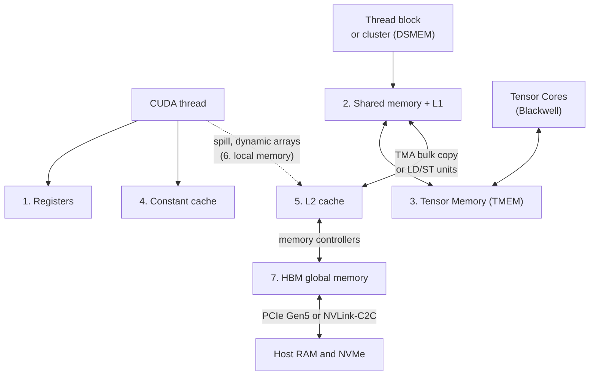
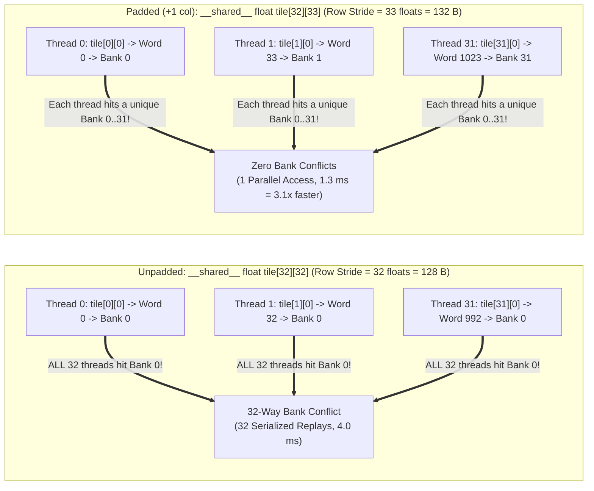

# 10.3 The GPU memory hierarchy

| | |
|---|---|
| **Status** | Drafted (`gpu_memory_hierarchy_lab.py`: 25 checks pass; `ncu`/`nvidia-smi` commands **untested** on live Nebius GPU VM) |
| **Level** | Intermediate |
| **Priority tier** | 2 |
| **Lab venue** | Nebius GPU + self-checking Python model (`code/part10/gpu_memory_hierarchy_lab.py`) |
| **Part** | Part 10: The GPU and CUDA |
| **Sources used** | *AI Systems Performance Engineering* Ch. 6 & Ch. 7; `nvidia-devops` V2 (Ch. 5, 7, 8, 9; Lab 3); `nvidia-devops` VL4 (Ch. 1 §3 & App. B) |

## Why this matters for AI infrastructure

A GPU can have over a thousand TeraFLOPS of arithmetic horsepower and still crawl at a tiny fraction of its capability. Execution pipelines frequently spend 80% of their cycles waiting for bytes to arrive from memory. No single storage technology can be simultaneously tiny, fast, and huge. Every modern GPU solves this physical trade-off with a seven-tier memory hierarchy stretching from single-cycle per-thread registers out to off-chip HBM3e and host CPU RAM.

As an AI infrastructure or platform engineer, you will diagnose memory-hierarchy bottlenecks constantly.
- A thirteen-billion-parameter FP16 model fits effortlessly inside an 80 GB H100 with plenty of room to spare. Yet it hits a hard latency floor during unbatched LLM decode.
- A compiler optimization that unrolls a loop and reduces instruction count can make a kernel slower. It does this by spilling just two float variables per thread into local memory.
- A naive matrix transpose in fast on-chip shared memory stalls heavily on bank conflicts. Adding a single unused padding column makes that kernel three times faster.
- A misconfigured server BIOS that leaves Resizable BAR disabled caps the host aperture at a tiny window. That setting cripples CPU-to-GPU transfers on an 80 GB GPU.

This chapter maps every tier of the GPU memory hierarchy, including Blackwell Tensor Memory and the Tensor Memory Accelerator. It derives the exact arithmetic for cache-line coalescing, shared-memory bank conflicts, and register spilling. Finally, it connects kernel-level access patterns to host-level Resizable BAR, pinned memory, stream-ordered memory pools, and Unified Memory.

```text
Key memory hierarchy diagnostic benchmarks:
- 13B FP16 weights (26 GB on 80 GB H100, 54 GB spare): ~7.8 ms/token unbatched decode floor.
- Spilling 2 floats (8 bytes) per thread across 65,536 threads: 1.05 MB extra HBM traffic per launch.
- Naive shared-memory transpose: 38% warp stalls on 4.8 million bank conflicts; [32][33] padding is 3x faster.
- Disabled Resizable BAR (ReBAR / Large BAR): BAR1 Total stuck at 256 MiB instead of 81,920 MiB.
```

## Prerequisites and outcomes

**Prerequisites:**
- CPU versus GPU throughput design and peak HBM and PCIe bandwidth formulas from the first chapter of this part.
- The execution hierarchy from thread to warp, block, cluster, and grid, along with sub-partitions and occupancy rules from the second chapter of this part.

**Outcomes:** After completing this chapter, you will be able to accomplish five primary objectives.
- First, map all seven device memory tiers on Hopper and Blackwell GPUs alongside the five Points of Coherency.
- Second, explain why local memory describes thread scope rather than physical location. You will also calculate the hidden HBM byte traffic caused by register spilling and spot spills at compile time with `nvcc -O3 -Xptxas=-v`.
- Third, stage data in shared memory tiles, calculate bank conflict degrees, and eliminate column conflicts with array padding or XOR index swizzling. You will also bypass shared memory for intra-warp reductions using `__shfl_down_sync` register shuffles.
- Fourth, explain cache-line coalescing, contrast Array of Structures with Structure of Arrays, and use vectorized loads. You will also route immutable lookup tables through the read-only data cache and overlap global-to-shared DMA using the Tensor Memory Accelerator and `cuda::memcpy_async` double-buffering.
- Fifth, separate VRAM capacity from effective HBM bandwidth, verify Resizable BAR in `nvidia-smi -q -d MEMORY`, and tune stream-ordered memory pools and Unified Memory.

---

## 1. The seven-tier GPU memory hierarchy and Points of Coherency

When an AI workload runs much slower than the GPU's peak math rating, engineers often guess blindly between changing batch sizes, rewriting kernels, or buying faster hardware. Without a clear map of where bytes sit and how many cycles each hop costs, you cannot tell whether threads are starving on off-chip DRAM or fighting over on-chip scratchpad capacity. Every step further away from the SM arithmetic units gives you roughly an order of magnitude more storage capacity at the cost of higher latency and lower per-SM bandwidth.

### 1.1 Architectural map from Registers and TMEM to L2, HBM3e, and Host RAM

The hardware organizes storage into fast on-chip tiers per SM, a shared GPU-wide L2 cache, off-chip HBM stacks, and the external host interconnect. On-chip levels respond in a few cycles at terabytes to tens of terabytes per second per SM. Off-chip HBM requires hundreds of cycles per round trip.



| Level | Size | Latency | Notes |
|---|---|---|---|
| 1. Register file | 64K x 32-bit registers per SM (256 KB), max 255 per thread | about 1 cycle | On-chip, per SM |
| 2. Unified shared memory and L1 | 256 KB SRAM per SM (up to 228 KB shared: 227 KB dynamic per block plus 1 KB reserved) | about 20 to 30 cycles | Shared by the thread block, or the cluster through DSMEM |
| 3. Tensor Memory (TMEM) | 256 KB dedicated SRAM per SM on Blackwell | about 10 cycles | Managed through TMA and descriptors; used by 5th-gen Tensor Cores (`tcgen05` / UMMA) |
| 4. Constant cache | about 8 KB per SM in front of 64 KB of `__constant__` | about 1 cycle on a warp-uniform broadcast | Per SM read-only broadcast cache |
| 5. L2 cache | 50 MB (H100) / 126 MB (B200), GPU-wide | about 200 cycles | Fed by TMA bulk async DMA or 16x LD/ST units |
| 6. Local memory | Logical, per thread | Goes through L1, L2 and HBM | Register spills and dynamic arrays |
| 7. HBM global memory | 80 to 141 GB (H100/H200), 180 to 288 GB (B200/B300) | about 800 cycles typical round trip | 3.35 TB/s (H100) / 8.0 TB/s (B200) through the memory controllers |
| Host link | Host CPU RAM (DDR5 / LPDDR5X) and NVMe (GPUDirect Storage) | n/a | PCIe Gen5 (63 GB/s, BAR1/ReBAR) or NVLink-C2C (900 GB/s coherent) |

The following table compares the full Blackwell memory hierarchy specification from *AI Systems Performance Engineering* Chapter 6 Table 6-5 alongside Hopper H100.

| Memory tier | Visibility scope | Capacity (Blackwell B200 / Hopper H100) | Typical latency | Approx. bandwidth | Who manages it & key rules |
|---|---|---|---|---|---|
| **1. Registers** | **Per thread** (private) | **64K 32-bit registers (256 KB) per SM**; max **255 registers/thread** | **~1 cycle** | Tens of TB/s per SM | Compiler (`nvcc -Xptxas=-v`). Fastest storage; excess demand spills to Local Memory. |
| **2. Shared Memory & L1 Data Cache** | **Per Thread Block (CTA)** (or **Cluster** via DSMEM) | **256 KB combined SRAM per SM**; up to **228 KB shared/SM** (**227 KB** max dynamic/block + **1 KB** CUDA reserved), rest is L1 | **~20–30 cycles** | TB/s per SM (when bank-conflict-free) | Programmer (`__shared__`, `cudaFuncAttributePreferredSharedMemoryCarveout`) for SMEM; hardware for L1. |
| **3. Tensor Memory (TMEM, Blackwell)** | **Per SM (Tensor Cores)** | **256 KB dedicated SRAM per SM** (Blackwell B200/B300) | **~10 cycles** | Tens of TB/s to Tensor Cores | **Not pointer-addressable in C++**; holds Tensor Core accumulators/operands, fed via **TMA** and `tcgen05.mma` / UMMA descriptors. |
| **4. Constant Memory Cache** | **Per SM (Read-only)** | **~8 KB cache per SM** fronting **64 KB** device-wide `__constant__` space | **~1 cycle** (on warp broadcast) | TB/s-scale broadcast | Programmer (`__constant__`). Broadcasts in 1 cycle when all 32 warp lanes read the **exact same address** (RoPE tables, ALiBi slopes, LayerNorm gamma/beta, quant scales). |
| **5. L2 Cache** | **GPU-wide** (all SMs, NVLink, PCIe) | **126 MB on Blackwell B200** (50 MB on Hopper H100) | **~200 cycles** | Multi-TB/s aggregate | Hardware. Central coherence hub across all SMs, HBM partitions, NVLink, and PCIe DMA. |
| **6. Local Memory (Spill Space)** | **Per thread** (logical scope, **physically off-chip.**) | Backed by Global HBM DRAM | **100s → 1,000+ cycles** (on L1/L2 miss) | Up to HBM BW (~8 TB/s B200) | Compiler automatic fallback when registers spill (>255 or launch-bounds cap) or for per-thread arrays indexed dynamically. |
| **7. Global Memory (HBM3 / HBM3e)** | **Device-wide / System** | **80 GB H100**, **141 GB H200**, **180–192 GB B200**, **~288 GB B300** | **100s → 1,000+ cycles** (~800 cycles typical) | **3.35 TB/s H100**, **4.8 TB/s H200**, **~8.0 TB/s B200** (16 TB/s per 2-GPU GB200/GB300) | Application (`cudaMalloc`, `cudaMallocAsync`). On B200, 8 HBM3e stacks (4 per reticle die across the 10 TB/s chip-to-chip link) appear as one uniform address space. |

### 1.2 Points of Coherency and tracing a memory request

When threads exchange data, a race condition occurs if the reader looks at a cache level that has not yet received the writer's update. The Point of Coherency is the specific hardware level where one thread's write becomes visible to another thread. That level depends directly on how far apart the two threads sit in the execution hierarchy.

1. **Thread level:** The register file is private to a single thread.
2. **Thread Block level:** The L1 and shared memory SRAM on a single SM serves a thread block and is synchronized with `__syncthreads()`.
3. **Thread Block Cluster level:** Multi-SM Distributed Shared Memory within a Graphics Processing Cluster serves a cluster and is synchronized with `cluster.sync()`.
4. **Device level:** The unified L2 cache and global HBM serve all SMs on one GPU.
5. **System level:** Coherent memory spans multiple GPUs and the host CPU over NVLink, NVSwitch, NVLink-C2C, or PCIe.

You can tell in five seconds whether a slow workload is bottlenecked on the memory hierarchy rather than on compute or kernel launches. Run `nvidia-smi dmon -s ucm -c 3` to sample SM and memory interface activity.

```text
$ nvidia-smi dmon -s ucm -c 3
# gpu   sm   mem
# Idx     %     %
    0    18    89
    0    17    91
    0    19    88
```

When SM utilization sits around 18% while memory utilization sits around 90%, the SMs are starving while the memory interface is saturated. Next, run one Nsight Compute pass on the L1 and L2 sector hit rates using `l1tex__t_sector_hit_rate.pct` and `lts__t_sector_hit_rate.pct` to separate two distinct failure modes.

| Cache hit pattern in `ncu` | Typical metrics | Root cause | Fix |
|---|---|---|---|
| **Low L1 and low L2 hit rates + high HBM traffic** | L1 `12.4%`, L2 `18.9%` | Streaming or uncoalesced access pattern bypasses both caches and slams HBM on almost every load | Fix data layout (SoA), coalescing, or shared-memory tiling |
| **High L2 hit rate + high HBM traffic** | Working set slightly exceeds L2 (50 MB H100 / 126 MB B200) | Cache thrashing as tiles are evicted right before reuse | Reduce precision (FP8/FP4), fuse kernels, or adjust tile/batch size |

:::info In one minute: Section 1 takeaways
- The seven device memory tiers trade capacity for speed, moving from registers and Blackwell TMEM out to shared memory, constant cache, L2 cache, and global HBM.
- Blackwell TMEM provides 256 KB per SM for fifth-generation Tensor Core accumulators and operands and is managed via TMA and `tcgen05` descriptors rather than C++ pointers.
- Pair `nvidia-smi dmon -s ucm` with `ncu` L1 and L2 sector hit rates (`l1tex__t_sector_hit_rate.pct` and `lts__t_sector_hit_rate.pct`) to pinpoint which tier is leaking performance.
:::

---

## 2. On-chip storage: Registers, Local Memory spills, Shared Memory tiling, Bank Conflicts, and Warp Shuffles

Even when data fits on chip, a single bad compiler decision or indexing stride can quietly route on-chip accesses into off-chip DRAM or serialize a 32-thread warp into 32 sequential steps. Kernel authors and performance engineers feel this when an apparent optimization, such as unrolling a loop or staging a matrix tile in shared memory, suddenly cuts throughput in half.

### 2.1 Registers versus Local Memory: why "Local" memory is physically off-chip

One of the most dangerous misnomers in CUDA is local memory. The word local describes logical visibility scope, meaning the variable is private to a single thread just like a local variable in C. It does not describe physical location. Physically, local memory is allocated in off-chip global HBM DRAM and routed through the L1 and L2 caches.

The `nvcc` compiler places a thread's variables into slow local memory in two situations.
- **Register spilling:** The kernel requires more live variables than fit in the per-thread register allocation. This happens when demand exceeds the hardware ceiling or exceeds the register cap forced by `__launch_bounds__`.
- **Dynamic array indexing:** A thread declares a local array such as `float buf[32]` and indexes it with a runtime variable `buf[i]`. The compiler cannot resolve runtime indices to fixed register numbers at compile time.

You can catch register spilling at compile time before ever running on a GPU by passing `nvcc -O3 -Xptxas=-v`.

```text
# Healthy kernel: zero spills
ptxas info : Used 44 registers, 0 bytes spill stores, 0 bytes spill loads

# Regressed kernel after aggressive loop unrolling: 88 registers + spills!
ptxas info : Function properties for _Z6kernelPKfPfm
    64 bytes stack frame, 96 bytes spill stores, 128 bytes spill loads
ptxas info : Used 96 registers, 0 bytes cmem[0]
```

To see why even a tiny spill hurts bandwidth-bound workloads, examine the worked calculation from the Volume 02 notes. Suppose a kernel spills just two float values per thread and launches a modest grid of thread blocks. Every spilled variable must be written out as a spill store and read back as a spill load.

```text
Worked register spill traffic calculation:
- Spilled per thread: 2 floats = 8 bytes
- Grid launch size: 256 blocks x 256 threads/block = 65,536 threads total
- Extra Spill Traffic = 65,536 threads x 8 bytes x 2 (store + load) = 1,048,576 bytes (1.0 MiB ≈ 1.05 MB)
```

That single kernel launch silently injects over a megabyte of extra cache and HBM traffic that does not appear anywhere in your C++ or PyTorch source code.

### 2.2 Shared Memory tiling and data reuse

Unlike hardware-managed L1 and L2 caches where hardware heuristics decide what to evict, shared memory declared with `__shared__` is an explicit, programmer-managed scratchpad in on-SM SRAM. On Hopper and Blackwell, the SM provides combined L1 and shared SRAM. The dynamic shared memory carveout per block is configured via `cudaFuncAttributePreferredSharedMemoryCarveout`.

In a naive matrix multiplication $C = A \times B$ of size $N \times N$, each thread computing one output element reads an entire row of $A$ and column of $B$ directly from global HBM. That pattern re-fetches every input element $N$ times across different threads. Shared-memory tiling fixes this redundant traffic in four cooperative steps.

- First, threads in a square thread block cooperatively load one tile of $A$ into `__shared__ float sA[32][32]` and one tile of $B$ into `sB[32][32]`.
- Second, the block calls `__syncthreads()` so all loads finish before any thread reads the staged tile.
- Third, each thread executes multiply-accumulates directly from fast shared memory, reusing each HBM value across the entire tile width.
- Fourth, the block calls `__syncthreads()` again before advancing to load the next tile along the reduction dimension.

The table below shows the measured impact of shared-memory tiling from *AI Systems Performance Engineering* Chapter 7.

| Metric (`N = 1,024` FP32 matrix multiply, *AI Systems Performance Engineering* Ch. 7 Table 7-4) | Before (`naiveMatMul` from HBM) | After (`tiledMatMul` in Shared Memory) | Why it changed |
|---|---|---|---|
| **Global memory load sectors (32 B each)** | 9,800 sectors | **1,200 sectors** | **8.2x fewer DRAM reads** (each tile element fetched once per block instead of 32x). |
| **DRAM throughput (% of peak)** | 90% (wasteful redundant traffic) | **25%** (3.6x lower pressure) | Redundant off-chip HBM fetches eliminated. |
| **Shared-memory throughput (% of peak)** | 52% | **99%** | On-chip SRAM services the inner loop at ~100% efficiency. |
| **Achieved SM occupancy (%)** | 42% | **89%** | Fewer HBM stalls allow resident warps to make continuous progress. |
| **Arithmetic intensity (FLOPs / byte)** | 1.5 FLOPs/byte (15 GFLOPS @ 10 GB/s) | **8.0 FLOPs/byte** (170 GFLOPS @ 21 GB/s) | **5.3x higher arithmetic intensity**, shifting the kernel toward compute-bound. |
| **Sustained FP32 throughput** | 15 GFLOPS | **170 GFLOPS** | **11.3x speedup** from shared-memory reuse alone. |

Why not keep doubling the tile size forever? Doubling a 2D tile's width and height doubles the reuse factor but quadruples shared memory capacity and increases per-thread register pressure. Libraries such as NVIDIA CUTLASS, `cuBLAS`, `cuDNN`, OpenAI Triton, and NVIDIA Python `cuTile` with `TileIR` autotune these hierarchical thread, warp, and block tile dimensions automatically.

```text
64 x 64 tile resource budget (ASP Ch. 7 pp. 233-234):
- Shared memory per block: 16 KB for sA + 16 KB for sB = 32 KB
- Block size: 32 x 32 = 1,024 threads (each thread computes a 2 x 2 subtile)
- Register demand: ~12 to 22 registers/thread -> 22 x 1,024 = 22,528 registers/block
- SM residency limit: 2 blocks use 45,056 registers (fits in 65,536), but 2 x 1,024 = 2,048 threads hits the hard 2,048-thread SM ceiling (max 2 blocks/SM).
```

### 2.3 Shared-Memory 32-Bank Conflicts, `[32][33]` Padding, Swizzling, and Warp Shuffles

Shared memory is fast only when threads access different hardware banks in parallel. On Hopper, Blackwell, and Ampere, shared memory is divided into hardware banks that are one float wide. Successive words map to successive banks according to `bank = (byte_addr // 4) % 32`.

- **Conflict-free stride-1 access:** When all threads in a warp read row-major elements `tile[threadIdx.y][threadIdx.x]`, adjacent threads step by one word. They hit distinct banks in a single transaction.
- **The Broadcast Exception:** When all threads in a warp read the exact same address such as `tile[0][0]`, the hardware broadcasts that word to all lanes in one cycle with zero bank conflict.
- **The Bank Conflict Trap:** During a naive matrix transpose `transposeNaive`, threads in a warp read down a column of `__shared__ float tile[32][32]` using `tile[threadIdx.x][threadIdx.y]` or `arr[threadIdx.x * 32]`. Every thread lands on the exact same bank at different addresses. The hardware must serialize the instruction into sequential replays.



Three practical techniques eliminate shared-memory bank conflicts.
- **Array Padding with `__shared__ float tile[32][33]`:** Adding one unused padding column changes the row stride so column width and bank count are coprime. Column reads map each thread in the warp to a unique bank and eliminate all conflicts.
- **XOR Index Swizzling:** Libraries like CUTLASS transform the column index with a bitwise XOR operation `col_swizzled = col ^ row`. This permutes bank assignments across rows with zero memory overhead.
- **Warp Shuffle Intrinsics (`__shfl_sync` and `__shfl_down_sync`):** When threads only need to exchange or reduce data within a single warp, do not write to shared memory at all. Warp shuffle intrinsics read another lane's register directly across the SM sub-partition in logarithmic butterfly steps. This matches Cooperative Groups `__reduce_sync` performance with zero shared memory and zero barriers.

```text
Bank conflict math & ASP Ch. 7 Table 7-5 transpose results:
- Shared memory layout: 32 banks x 4 bytes wide (bank assignment repeats every 32 floats = 128 bytes)
- Unpadded tile[32][32] column read: word = t * 32 + col -> bank = (t * 32 + col) % 32 == col (32-way conflict)
- Padded tile[32][33] column read: word = t * 33 + col -> bank = (t * 33 + col) % 32 == (t + col) % 32 (32 unique banks, since 33 and 32 are coprime)
- Padding overhead: +1 float/row = ~3.1% (~3.125%, 1 KB on a 32 x 32 tile)
- Nsight Compute (l1tex__data_bank_conflicts_pipe_lsu.sum): 4.8 million conflicts -> 0 conflicts
- Shared-memory utilization: 52% -> 100%; memory warp stalls: 38% -> 0.5%; kernel latency: 4.0 ms -> 1.3 ms (3.1x speedup)
- Warp shuffle reduction: 5 butterfly steps (offset = 16, 8, 4, 2, 1) across 32 threads
```

```cpp
unsigned mask = __activemask();
for (int offset = 16; offset > 0; offset >>= 1) {
    val += __shfl_down_sync(mask, val, offset);
}
// Lane 0 now holds the sum of all 32 threads: 0 shared memory bytes, 0 barriers, 0 bank conflicts!
```

:::info In one minute: Section 2 takeaways
- Local memory is a thread-scoped logical spill space backed by off-chip HBM DRAM; always check `nvcc -O3 -Xptxas=-v` to confirm zero spill stores and loads.
- Shared memory has 32 banks of 4 bytes each, so striding by 32 floats causes a 32-way bank conflict whereas padding to `tile[32][33]` or XOR swizzling achieves zero bank conflicts.
- Use `__shfl_down_sync` for intra-warp reductions directly in registers without touching shared memory.
:::

---

## 3. Global memory access: Coalescing, Vectorization, Read-Only Cache, and TMA Async Prefetch

A kernel can have plenty of HBM bandwidth on paper and still stall constantly if threads request scattered addresses or wait idle while data travels across the chip. When global memory loads are unaligned or strided, the memory controllers fetch many more cache sectors than the kernel actually uses. This saturates the HBM bus while delivering only a fraction of peak throughput to the SMs.

### 3.1 128-byte cache-line coalescing and AoS versus SoA

Global HBM memory is accessed through the L2 and L1 caches in aligned cache lines subdivided into sectors. When the threads in a warp issue a memory load, the hardware coalescer groups their target addresses into as few sector transactions as possible.

- **Optimal coalesced load:** When threads in a warp read contiguous float values starting at an aligned address `in[idx]`, the entire warp request maps to one cache line and achieves full load efficiency.
- **Misaligned contiguous load:** If the warp's starting address is shifted off a cache-line boundary, the contiguous request straddles two cache lines and fetches an extra sector.
- **Strided or AoS load:** When threads read strided addresses `in[idx * 2]` or read one field out of an Array of Structures, a single warp spans multiple cache lines and wastes most of the bytes transferred across the HBM bus. Converting an Array of Structures to a Structure of Arrays places each field in its own contiguous array so adjacent threads always read adjacent addresses.

| Access pattern (32 threads reading 4-byte floats = 128 useful bytes) | Sectors fetched (32 B each) | Total bytes transferred | Global Memory Load Efficiency | Notes |
|---|---|---|---|---|
| **Aligned contiguous (`stride = 1`, `coalescedCopy`)** | **4.0 sectors** (1 cache line) | 128 B | **100%** (99% measured) | Optimal coalescing. |
| **Misaligned contiguous (`+4 B` offset)** | **5 to 8 sectors** (2 cache lines) | 160 B (at 5 sectors) | **80%** | Straddles cache-line boundary. |
| **Stride-2 (`in[idx * 2]`, `uncoalescedCopy`) or narrow AoS** | **8.0 sectors** (2 cache lines) | 256 B | **50%** (23% measured) | Wastes half of transferred bytes. |
| **Stride ≥ 8 or random scatter** | **32.0 sectors** (up to 32 lines) | 1,024 B | **12.5%** | 8x bandwidth waste. |

### 3.2 Vectorized loads on Hopper and Blackwell

Even when a scalar load is fully coalesced, each warp still issues separate thread reads that the hardware coalescer must stitch together. Vectorized memory access packs multiple elements into a single wide load instruction per thread, relying on the `cudaMalloc` base pointer alignment guarantee. Always verify pointer alignment before casting an offset pointer to a vector type.

| Vector load width | Target architecture | Per-thread instruction & bytes | Per-warp bytes & cache lines | Instruction reduction | Alignment requirement |
|---|---|---|---|---|---|
| **128-bit (`float4`)** | Ampere & Hopper | `LD.E.128` (4 floats = **16 bytes/thread**) | **512 bytes/warp** across 4 lines (**16 sectors**, 4.0 sectors/tx) | **4x fewer** memory instructions | `uintptr_t(ptr) % 16 == 0` |
| **256-bit (`alignas(32)` struct or `double4`)** | Blackwell B200 (CUDA 13+) | Native 32-byte global load (8 floats = **32 bytes/thread**) | **1,024 bytes/warp** across 8 lines (**32 sectors**) | **8x fewer** memory instructions (compiles to two 16 B loads on Hopper) | `uintptr_t(ptr) % 32 == 0` |

### 3.3 Read-Only Data Cache and Tensor Memory Accelerator

Two additional hardware features on modern SMs eliminate the remaining global-memory stalls.
- **Read-Only Data Cache with `const __restrict__`:** When many threads repeatedly look up values in an immutable table larger than the constant cache, omitting `const __restrict__` forces the compiler to assume the pointer might be aliased and modified. That default path uses normal coherent global loads that pollute L1 and L2. Marking the pointer `const float* __restrict__` or calling `__ldg()` proves immutability and non-aliasing. The compiler then routes loads through the low-latency read-only data cache path.
- **Asynchronous Bulk Prefetching with the Tensor Memory Accelerator and `cuda::memcpy_async`:** Even a coalesced, vectorized load stalls a warp if the SM's load/store units must issue the addresses and wait hundreds of cycles for HBM. On Hopper and Blackwell, the Tensor Memory Accelerator is a dedicated hardware DMA engine inside the SM. It copies multidimensional tiles asynchronously between global HBM and shared memory via `cp.async.bulk` without using SM registers or load/store instruction slots. By allocating two ping-pong buffers in shared memory and coordinating them with the C++ `cuda::pipeline` API, TMA streams the next tile from HBM in the background while the SM's warps compute on the current tile.

```text
TMA double-buffering pipeline sequence (cuda::pipeline):
1. pipe.producer_acquire() -> 2. cuda::memcpy_async(...) -> 3. pipe.producer_commit()
4. pipe.consumer_wait()    -> 5. compute on staged tile  -> 6. pipe.consumer_release()
```

The table below compares all five hardware-software memory optimizations from *AI Systems Performance Engineering* Chapter 7.

| Optimization technique (*AI Systems Performance Engineering* Ch. 7) | Before (Unoptimized) | After (Optimized) | Speedup & key profiler evidence (`ncu`) |
|---|---|---|---|
| **1. Global Memory Coalescing** (`stride=2` → `stride=1`, Table 7-1) | 4.8 ms, 25% DRAM peak, 23% Load Eff, 8.0 sectors/req | **1.3 ms**, **90% DRAM peak**, **99% Load Eff**, **4.0 sectors/req** | **3.7x faster** (3.6x higher effective DRAM throughput). |
| **2. Shared-Memory Tiling** (`32 x 32` GEMM tile, Table 7-4) | 15 GFLOPS (1.5 FLOPs/B), 90% DRAM, 9,800 sectors | **170 GFLOPS** (**8.0 FLOPs/B**), **25% DRAM**, **1,200 sectors** | **11.3x higher GFLOPS** (8.2x fewer DRAM sector reads). |
| **3. Shared-Memory Padding** (`tile[32][32]` → `tile[32][33]`, Table 7-5) | 4.0 ms, 4.8M bank conflicts, 52% SMEM util, 38% stall | **1.3 ms**, **0 bank conflicts**, **100% SMEM util**, **0.5% stall** | **3.1x faster** (~3.1% / 1 KB memory overhead). |
| **4. Read-Only Cache** (adding `const __restrict__`, Table 7-6) | 2.5 ms, 52% Load Eff, 600 GB/s DRAM, 1,500 GB/s L2, 45% SM Active | **1.0 ms**, **97% Load Eff**, **200 GB/s DRAM**, **1,800 GB/s L2**, **93% SM Active** | **2.5x faster** (3x less DRAM traffic, served from L1/L2 cache). |
| **5. TMA + `cuda::memcpy_async` Double-Buffering** (Table 7-7) | 18.0 ms, 23% Load Eff, 6.4 sectors/req, 62% SM Active | **7.0 ms**, **99% Load Eff**, **4.0 sectors/req**, **100% SM Active** | **2.6x faster** (~800-cycle HBM latency hidden behind compute). |

:::info In one minute: Section 3 takeaways
- Aim for 4.0 sectors per request and above 95% Global Memory Load Efficiency in `ncu`.
- Use `float4` vector loads on Ampere and Hopper and 32-byte `alignas(32)` vector loads on Blackwell.
- Mark read-only lookup tables `const __restrict__`, and use TMA with `cuda::memcpy_async` and `cuda::pipeline` to double-buffer global-to-shared tile transfers.
:::

---

## 4. Device and Host-Device memory: Capacity vs Bandwidth, ReBAR, Memory Pools, and Unified Memory

A model can fit comfortably inside GPU memory with plenty of free space and still miss its production latency SLA. Platform engineers also hit mysterious multi-millisecond stalls between kernels when host BIOS settings cap the PCIe aperture or when training loops invoke synchronous OS memory allocators.

### 4.1 Capacity versus Bandwidth

In cluster sizing and incident triage, never confuse HBM capacity in gigabytes with HBM bandwidth in terabytes per second. Capacity decides whether the model weights, KV cache, and activations fit without an out-of-memory error. Bandwidth sets the physical speed limit on how fast those bytes stream into the SMs.

- **Worked serving latency floor on a 13B FP16 model:** A thirteen-billion-parameter model in half precision fits inside an H100 with plenty of free VRAM to spare. However, during unbatched autoregressive decode, the GPU must read all model weights from HBM for every single token generated. No amount of extra free VRAM will lower that per-token latency floor. You must increase HBM bandwidth, quantize weights to lower precision, or use continuous batching to amortize each weight read across concurrent requests.
- **Worked bandwidth-utilization check:** When an elementwise kernel processes data near physical peak bandwidth on an H100, the memory controllers are already saturated. The only way to speed up that step is kernel fusion or reduced precision. Conversely, if the kernel achieves only a small fraction of peak throughput, the hardware bus is not the limit. Uncoalesced addressing or partition stride contention is wasting bandwidth.

```text
Worked capacity vs. bandwidth derivations (V2 Ch. 5 & Ch. 8):
1. 13B FP16 decode floor on H100 SXM (80 GB VRAM, 3,350 GB/s = 3.35 TB/s peak):
   - Weight footprint = 13e9 params x 2 bytes = 26.0 GB (leaves 54.0 GB free VRAM)
   - Minimum Token Latency Floor = 26.0 GB / 3,350 GB/s = 0.007761 s ≈ 7.76 ms/token (~7.8 ms/token)
   - FP8 quantization (1 byte/param = 13.0 GB): 13.0 GB / 3,350 GB/s = 3.88 ms/token
   - Higher HBM bandwidth options: H200 at 4.8 TB/s (4,800 GB/s) or B200 at 8.0 TB/s (8,000 GB/s)

2. Elementwise bandwidth utilization check on H100 (8 GB read + 8 GB write = 16.0 GB in 6.0 ms):
   - Effective Bandwidth = 16.0 GB / 0.006 s = 2,666.7 GB/s (79.6% ≈ 80% of 3,350 GB/s peak -> saturated)
   - Pathological case = 500 GB/s (14.9% ≈ 15% of 3,350 GB/s peak -> uncoalesced or partition-strided)
```

### 4.2 PCIe BAR1 and Resizable BAR, Stream-Ordered Memory Pools, and Unified Memory

Beyond the GPU package itself, three host and runtime memory settings directly govern production stability.

- **PCIe BAR1 and Resizable BAR:** Base Address Register 1 is the PCIe aperture window in the host CPU physical address space. The CPU and peer RDMA NICs use this window to map GPU HBM for GPUDirect RDMA. Legacy BIOS defaults cap BAR1 at a tiny window, forcing transfers to page repeatedly. On every production GPU server, Resizable BAR and Above 4G Decoding must be enabled in the BIOS so BAR1 Total matches the full GPU VRAM.
- **Stream-Ordered Memory Pools (`cudaMallocAsync` and `PYTORCH_ALLOC_CONF`):** Traditional `cudaMalloc()` and `cudaFree()` are synchronous across the entire GPU device and invoke OS kernel calls (`mmap` and `ioctl`). Those calls cause context switches and pipeline stalls whenever a loop allocates temporary buffers. In CUDA C++, use `cudaMallocAsync(&ptr, bytes, stream)` and `cudaFreeAsync(ptr, stream)` on a non-blocking stream (`cudaStreamCreateWithFlags(&s, cudaStreamNonBlocking)`). You can tune pool retention with `cudaMemPoolSetAttribute(..., cudaMemPoolAttrReleaseThreshold, ...)` and `cudaMemPoolTrimTo`. In PyTorch, the caching memory allocator implements this pool strategy automatically via `PYTORCH_ALLOC_CONF`, formerly `PYTORCH_CUDA_ALLOC_CONF`. Set `expandable_segments:True` to prevent fragmentation OOMs.
- **Unified Memory (`cudaMallocManaged`) and proactive prefetching:** Calling `cudaMallocManaged()` creates a single pointer accessible from both CPU and GPU via hardware page faulting. On PCIe systems, touching unmigrated pages inside a GPU kernel triggers expensive on-demand page faults across the bus. On Grace Hopper GH200 and Grace Blackwell GB200 and GB300 systems, pages migrate over high-bandwidth coherent NVLink-C2C. Even on Superchips, eliminate surprise page-fault stalls by advising the driver and prefetching buffers before launching the kernel.

```text
$ nvidia-smi -q -d MEMORY | grep -A 5 "BAR1"
    BAR1 Memory Usage
        Total                             : 81920 MiB
        Used                              : 2 MiB
        Free                              : 81918 MiB
```

```cpp
cudaMemAdvise(ptr, size, cudaMemAdviseSetPreferredLocation, gpuId);
cudaMemAdvise(ptr, size, cudaMemAdviseSetReadMostly, gpuId);
cudaMemAdvise(ptr, size, cudaMemAdviseSetAccessedBy, otherGpuId);
cudaStreamAttachMemAsync(stream, ptr, 0, cudaMemAttachSingle);
cudaMemPrefetchAsync(ptr, size, gpuId, stream);
```

Combining the BAR1 Resizable BAR check, pinned memory check, `cudaMallocAsync` pool check, and `cudaMemPrefetchAsync` Unified Memory check into `audit_host_device_memory_config` in `code/part10/gpu_memory_hierarchy.py` is my inference.

:::info In one minute: Section 4 takeaways
- Capacity in gigabytes decides whether weights, KV cache, and activations fit; bandwidth in terabytes per second sets the per-token decode floor.
- Always verify that BAR1 Total is at least equal to VRAM Total via `nvidia-smi -q -d MEMORY`.
- Replace synchronous `cudaMalloc` and `cudaFree` inside loops with stream-ordered `cudaMallocAsync` and `cudaFreeAsync` or `PYTORCH_ALLOC_CONF=expandable_segments:True`. Pair `cudaMallocManaged` with `cudaMemPrefetchAsync` and `cudaMemAdvise`.
:::

---

## 5. Field notes from the Volume 02 memory chapters

When teams triage a slow training or inference job in production, they often misread profiler metrics because terms like global memory, local memory, and peak bandwidth sound interchangeable in casual conversation. Treating a timing gap as proof of uncoalesced loads without checking occupancy or L2 hit rates leads engineers to rewrite kernels that were actually stalled on host copies or partition contention.

These field notes come from the Volume 02 chapters and labs. All command outputs below are marked illustrative in those notes rather than captured on live hardware, so treat the numbers as diagnostic examples rather than hardware specifications.

### 5.1 Words that are easy to confuse

The notes highlight four pairs of memory terms that engineers regularly mix up during design reviews and incident calls. Every memory tier is characterized by five measurable properties: capacity, peak bandwidth, effective bandwidth, latency, and reuse. Reuse measures how many useful operations are performed on a piece of data before it must be fetched again.

| Term | What it means | What it does not mean |
|---|---|---|
| Global memory | An address space: visible to every thread and block | A separate chip. A global load can be served by L1 or L2 and never reach HBM |
| HBM | The physical stacked DRAM on a wide interface that backs global memory on data-center GPUs | A software visibility rule |
| Local memory | Private to one thread (logical scope) | On-chip. It is backed by the device memory path |
| Peak bandwidth | The theoretical maximum transfer rate | What a kernel achieves. Effective bandwidth is the useful bytes delivered per second |

### 5.2 Locality, memory partitions and what to size

Understanding why a kernel misses peak bandwidth or runs out of memory under load requires looking at locality, hardware partitions, and runtime state growth.

- **Temporal locality:** The same data is reused soon, so an on-chip cache can avoid a repeat HBM read.
- **Spatial locality:** Nearby addresses are used together, so a single cache transaction serves several thread values.
- **Working set:** If reuse happens only after the data has already been evicted from cache, the cache gives little benefit.
- **Memory partitions:** HBM bandwidth is delivered in parallel across multiple memory controllers and partitions, and hardware address mapping spreads requests across them. A bad stride or memory layout can concentrate traffic on a few partitions while others sit idle. This causes a kernel to deliver far less than peak bandwidth even when its accesses are coalesced.
- **Capacity plan must include runtime state:** Training requires parameters, gradients, optimizer state, activations, communication buffers, and checkpoints. Inference requires weights, KV cache, temporary workspaces, batching buffers, and allocator reserves or fragmentation headroom. Always size for peak concurrency and sequence length rather than the quiet moment right after model load.
- **KV cache estimate:** The KV cache byte footprint follows the formula below and grows dynamically with sequence length and traffic, unlike static model weights.

```text
KV cache byte footprint formula (Volume 02 interview note):
KV_cache_bytes = 2 x layers x heads x head_dim x sequence_length x batch_size x bytes_per_element
(where the factor of 2 accounts for Key plus Value tensors)
```

### 5.3 Evidence patterns

The table below summarizes four recurring profiler signatures from the Volume 02 notes and how to interpret them.

| Symptom | Evidence in the note | How to read it |
|---|---|---|
| Host-to-device copies dominate | `nsys stats` GPU trace: HtoD memcpy 61.2% (18.4 ms), compute kernel 4.1% (1.2 ms), DtoH memcpy 33.9% (10.2 ms) | The GPU is not the limit. Use pinned memory, fewer larger transfers, or overlap copy and compute |
| Scattered or strided loads | sectors per request 18.6 (ideal is about 4, worst case 32) | The warp fetches roughly 4 to 5 times more sectors than it uses |
| Shared-memory bank conflicts | `l1tex__data_bank_conflicts_pipe_lsu.sum` = 412,800 on a kernel expected to be conflict-free | A stride maps several lanes to one bank. Fix with a small padding or layout change, not a rewrite |
| A "faster" kernel got slower | `-Xptxas=-v` diff: 44 registers and 0 spills became 88 registers with 40 bytes spill stores and 48 bytes spill loads | Two costs at once: lower occupancy and new memory traffic |

Two operational rules follow from these patterns. First, forcing a lower register count with a launch bound can make a kernel slower because live values spill to local memory instead of disappearing. Second, a compiler upgrade can change register allocation for unchanged source code, so always diff the `-Xptxas=-v` output between compiler versions. Furthermore, shared memory and L1 share the same on-chip SRAM capacity on many architectures, so a kernel that carves out more shared memory leaves less room for L1.

### 5.4 Lab 03 worked comparison: contiguous versus strided copy

In Lab 03, two kernels copy `1 << 24` floats for one hundred iterations on an illustrative H100 run. The contiguous kernel maps thread `i` to element `i`, while the strided kernel maps logical thread `i` to element `(i * 32) % count`.

| Metric | Contiguous | Strided |
|---|---:|---:|
| Elapsed time | 42.18 ms | 156.42 ms (about 3.7x) |
| Registers per thread | 16 | 20 |
| Spills | 0 bytes | 0 bytes |
| Memory throughput | 91.2% | 68.4% |
| L2 hit rate | 34.1% | 9.8% |
| Achieved occupancy | 87.4% | 85.9% |
| Sectors per request | 4.0 | 23.5 |

Notice how the note reasons through the evidence. Achieved occupancy is nearly identical between the two runs, so warp residency is ruled out as the cause. Sectors per request jumping upward alongside the L2 hit rate drop together explain the elapsed time gap. The note also warns that the modulo arithmetic in the strided kernel adds some instruction cost of its own. A rigorous diagnosis states both what the evidence supports and what remains uncertain. A timing difference alone is never proof of a coalescing problem. If the strided kernel is not slower on your GPU, change the stride and array size and profile again instead of forcing the expected result.

### 5.5 Customer scenarios from the notes

- **Recommendation model with large embedding lookups:** When a workload has irregular access patterns and very little data reuse, focus on memory capacity, HBM bandwidth, cache behavior, data placement, and batching. Peak Tensor Core throughput is not the bottleneck.
- **Comparing GPUs for small-batch weight streaming:** When a team compares GPUs by memory capacity and peak compute alone for small-batch weight streaming, add HBM bandwidth, L2 behavior, reuse, and latency targets. A less compute-dense GPU can be the better fit if it meets the capacity and bandwidth need at lower cost.

---

## Commands and configurations that matter

### 1. Pre-flight check for BAR1, HBM usage, and streaming SM vs memory utilization

```bash
# 1. Confirm Resizable BAR (Large BAR1) maps full GPU VRAM (expect ~81920 MiB on H100 80GB, NOT 256 MiB!)
nvidia-smi -q -d MEMORY | grep -A 5 "BAR1"

# 2. Sample SM compute utilization (%) vs HBM memory interface busy (%) every 1 second
nvidia-smi dmon -s ucm -c 5
```

### 2. Inspecting register spills and Nsight Compute memory counters

```bash
# 1. Check compile-time register count and verify 0 bytes spill stores / 0 bytes spill loads
nvcc -O3 -arch=sm_90 -Xptxas=-v memory_patterns.cu -o memory_patterns

# 2. Profile L1/L2 hit rates, DRAM throughput, global load sectors/request, and shared-memory bank conflicts
ncu --metrics \
  dram__throughput.avg.pct_of_peak_sustained_elapsed,\
  l1tex__t_sector_hit_rate.pct,\
  lts__t_sector_hit_rate.pct,\
  l1tex__average_t_sectors_per_request_pipe_lsu_mem_global_op_ld.ratio,\
  l1tex__data_bank_conflicts_pipe_lsu.sum \
  ./memory_patterns
```

### 3. Configuring PyTorch's caching allocator pool to reduce VRAM fragmentation

```bash
# Use expandable virtual memory segments in PyTorch's caching allocator pool
export PYTORCH_ALLOC_CONF="expandable_segments:True"
```

---

## How it fails

| Failure mode | Symptom | Root cause | Diagnosis & fix |
|---|---|---|---|
| **1. Register spilling into off-chip Local Memory** | After unrolling a loop or adding local arrays, kernel latency jumps 2x–4x and `nvidia-smi dmon` shows elevated `mem%` for identical input tensors. | Thread register demand exceeded 255 (or exceeded the block's register budget), causing `ptxas` to spill variables to **Local Memory** (65,536 threads spilling 8 B = 1.05 MB of hidden HBM traffic per launch). | Run `nvcc -O3 -Xptxas=-v` and check for non-zero **spill stores / spill loads**; reduce live variable scope, replace dynamically indexed per-thread arrays with Shared Memory, or adjust `__launch_bounds__`. |
| **2. 32-way Shared-Memory Bank Conflict on 32 x 32 tiles** | A kernel that stages a 32 x 32 float tile in `__shared__` memory achieves only ~50% of expected shared-memory bandwidth and stalls 38% of cycles on memory. | Threads in a warp read or write down a **column** of `__shared__ float tile[32][32]` (stride = 32 floats = 128 bytes), mapping all 32 lanes to the **exact same bank (bank 0)**. | Confirm with `ncu --metrics l1tex__data_bank_conflicts_pipe_lsu.sum`; pad the array to **`__shared__ float tile[32][33]`** (stride = 33, 0 conflicts, 3.1x speedup) or apply XOR index swizzling. |
| **3. Uncoalesced / AoS global loads (15–25% achieved HBM bandwidth)** | `nvidia-smi dmon` shows `mem = 90%+` and `sm = 18%`, yet achieved bytes/sec (`useful_bytes / time`) is only 500 GB/s (~15% of H100 peak). | Threads read strided or scattered addresses (AoS), forcing the memory system to fetch **8 to 32 sectors (256–1,024 B)** per warp instead of **4 sectors (128 B)**. | Check `l1tex__average_t_sectors_per_request_pipe_lsu_mem_global_op_ld.ratio` in `ncu`; convert AoS to **SoA**, align pointers to 16/32 bytes, and use vectorized **`float4` (16 B)** or **Blackwell 32 B** loads. |
| **4. Legacy 256 MiB BAR1 aperture bottleneck (ReBAR disabled)** | Host-to-device DMA transfers, GPUDirect RDMA, or peer-to-peer mappings crawl or fail with BAR1 exhaustion errors on an 80 GB GPU node. | **Resizable BAR (ReBAR / Above 4G Decoding)** was left disabled in the server BIOS after a motherboard replacement or BIOS reset. | Run `nvidia-smi -q -d MEMORY \| grep -A 5 "BAR1"`. If `Total` is 256 MiB, reboot into BIOS, enable **Above 4G Decoding** and **Resizable BAR**, and verify `Total` matches full VRAM (81,920 MiB). |
| **5. Synchronous `cudaMalloc` or unprefetched `cudaMallocManaged` stalls** | `nsys` timeline shows millisecond-scale gaps between kernel launches with frequent OS `ioctl`/`mmap` calls or GPU page-fault migrations. | The application calls synchronous `cudaMalloc`/`cudaFree` inside the training/serving loop, or touches `cudaMallocManaged` buffers on the GPU without prefetching. | Switch to stream-ordered **`cudaMallocAsync` / `cudaFreeAsync`** (or PyTorch's caching allocator pool), and call **`cudaMemPrefetchAsync`** + **`cudaMemAdvise`** before launching kernels on Unified Memory. |

---

## Hands-on lab

### Self-checking Python model (`code/part10/gpu_memory_hierarchy_lab.py` — verified here)

The module `code/part10/gpu_memory_hierarchy.py` implements the seven-tier Blackwell and Hopper memory specifications, capacity-versus-bandwidth evaluators, register-spill calculators, cache-line coalescing models, shared-memory bank conflict solvers, and host-device BAR1 and pool auditors. Its companion script `code/part10/gpu_memory_hierarchy_lab.py` runs twenty-five self-checks across six core areas.

- **Blackwell memory hierarchy and Points of Coherency:** Validates registers, shared/L1, TMEM, constant cache, L2 cache, local memory, and global HBM3e.
- **Capacity versus bandwidth decode floor:** Evaluates the half-precision weight footprint inside an H100 and its weight-read latency floor.
- **Register spilling and effective bandwidth utilization:** Computes hidden HBM spill traffic and compares saturated versus uncoalesced HBM throughput.
- **Cache-line coalescing and vectorized loads:** Models sector counts and load efficiency across aligned, misaligned, strided, `float4`, and Blackwell vector accesses.
- **Shared-memory bank conflict math:** Verifies row accesses, unpadded column conflicts, padded `tile[32][33]` column accesses, even strides, and hardware broadcasts.
- **Benchmark tables and host-device config audits:** Checks all five optimization tables plus BAR1 Resizable BAR, pinned memory, `cudaMallocAsync`, and `cudaMemPrefetchAsync` rules.

```text
Lab verification parameters (25 self-checks):
- Blackwell tiers: TMEM = 256 KB/SM (~10 cycles, non-pointer-addressable); L2 = 126 MB (B200) vs 50 MB (H100).
- Decode floor: 13B FP16 = 26.0 GB on 80 GB H100 (54.0 GB free) -> 7.76 ms/token at 3,350 GB/s.
- Register spills: 8 B/thread across 65,536 threads -> 1,048,576 B = 1.05 MB decimal (1.0 MiB) traffic.
- Effective bandwidth: 16 GB / 6 ms = 2,666.7 GB/s (79.6% of H100 peak) vs 500 GB/s (14.9%).
- Coalescing: aligned 4B = 4 sectors (100% eff); +4B offset = 5 sectors across 2 lines (80% eff); stride 2 = 8 sectors (50% eff); stride 8 = 32 sectors (12.5% eff); float4 16B = 512 B across 4 lines (16 sectors); Blackwell 32B = 1,024 B across 8 lines (32 sectors).
- Bank conflicts: stride 1 = 32 banks (1-way); stride 32 = 1 bank (32-way conflict); stride 33 = 32 banks (0 conflicts); stride 2 = 2-way; stride 16 = 16-way; stride 0 = 1-cycle broadcast.
```

Run the lab from the repository root.

```bash
python3 -B code/part10/gpu_memory_hierarchy_lab.py
```

Expected output verified in this repository is shown below.

```text
=== Chapter 10.3 Lab: The GPU Memory Hierarchy ===
  [PASS] ASP Ch6 Table 6-5: Tracks all 7 Blackwell memory tiers (Registers, Shared/L1, TMEM, Constant, L2 126MB, Local, Global HBM3e)
  [PASS] ASP Ch6 p.194: TMEM is 256 KB per SM dedicated to Tensor Cores (~10 cycles) and is not directly pointer-addressable in C++
  [PASS] ASP Ch6 p.196 & V2 Ch7: Local memory is thread-scoped logical spill space backed by off-chip HBM DRAM
  [PASS] ASP Ch6 Fig 6-15: 5 Points of Coherency (thread, thread_block_cta, thread_block_cluster, device, system)
  [PASS] V2 Ch5 worked example: 13B FP16 model == 26.0 GB (fits in 80 GB H100 with 54 GB free), weight-read floor == 7.76 ms/token (~7.8 ms)
  ...
  [PASS] VL4 Ch1 §3.4: 80 GB GPU with BAR1 == 81,920 MiB passes ReBAR check; BAR1 == 256 MiB flags legacy PCIe aperture bottleneck
  [PASS] ASP Ch6 & VL4 Ch1: Flags pageable host memory, synchronous cudaMalloc in loop, and unprefetched Unified Memory
  [PASS] Rejects invalid per-thread vector byte width
  [PASS] Rejects non-positive VRAM / BAR1 capacity

Summary: 25 passed, 0 failed (total 25)
```

---

## Common first mistakes

- **Assuming local memory is fast on-SM memory:** Local memory is a per-thread logical address space backed by off-chip HBM DRAM that costs hundreds to over a thousand cycles on a cache miss. Always check `nvcc -O3 -Xptxas=-v` for `spill stores` and `spill loads`.
- **Declaring `__shared__ float tile[32][32]` when warps read columns:** Because shared memory has thirty-two banks, reading down a column of an unpadded float array hits the same bank across all threads in the warp and triggers a bank conflict. Pad the array to `tile[32][33]` by adding one column.
- **Forgetting `const __restrict__` on read-only lookup or embedding tables:** Without `const __restrict__`, the compiler cannot prove non-aliasing and skips the low-latency read-only data cache path.
- **Casting unaligned offset pointers to `float4*` or wide vector types:** While `cudaMalloc` guarantees base alignment, adding an unaligned element offset like `ptr + 1` before `reinterpret_cast<const float4*>` causes a misaligned address fault (`cudaErrorMisalignedAddress`).
- **Calling synchronous `cudaMalloc` or `cudaFree` inside a request or training loop:** Synchronous allocations stall all streams on the GPU and trigger OS `ioctl` and `mmap` context switches. Use `cudaMallocAsync` and `cudaFreeAsync` or framework memory pools instead.
- **Ignoring `BAR1 Total: 256 MiB` in `nvidia-smi -q -d MEMORY`:** Leaving Resizable BAR disabled in the BIOS forces CPU and RDMA mappings through a tiny aperture.

---

## Exercises

- **First exercise:** Run `python3 -B code/part10/gpu_memory_hierarchy_lab.py` and inspect `code/part10/gpu_memory_hierarchy.py`. Use `evaluate_capacity_vs_decode_floor` to compare the weight-read latency floor of a large language model across FP16, FP8, and FP4 on H100, H200, and B200 using the parameters in the block below.
- **Second exercise:** Using `calc_register_spill_traffic`, calculate how many megabytes of extra HBM traffic are generated per launch when a grid of thread blocks spills four floats per thread.
- **Third exercise:** Call `calc_warp_coalescing_and_vector_loads(4, stride_elements=s, base_offset_bytes=0)` for the stride values listed below. Determine how many sectors are fetched at each stride and the resulting Global Memory Load Efficiency percentage.
- **Fourth exercise:** Call `calc_shared_mem_bank_conflict(stride)` for the stride values listed below. Explain mathematically why even strides cause bank conflicts while odd strides are completely conflict-free.
- **Fifth exercise:** Using `calc_effective_bandwidth_utilization`, evaluate a kernel on a Blackwell B200 that reads and writes the buffer sizes listed below. Calculate what percentage of peak HBM3e bandwidth it achieves.
- **Sixth exercise:** Using `audit_host_device_memory_config`, test the node configuration listed below where BAR1 is capped at its legacy default. Identify which BIOS setting is misconfigured and which `nvidia-smi` command verifies the fix.

```text
Exercise input parameters for code/part10/gpu_memory_hierarchy.py:
- Exercise 1 (evaluate_capacity_vs_decode_floor): 70B model in FP16 (2 B/param), FP8 (1 B/param), FP4 (0.5 B/param) across H100 (3,350 GB/s), H200 (4,800 GB/s), B200 (8,000 GB/s).
- Exercise 2 (calc_register_spill_traffic): 1,024 blocks x 256 threads, spilling 4 floats (16 bytes) per thread.
- Exercise 3 (calc_warp_coalescing_and_vector_loads): stride_elements s = 1, 2, 4, 8, 16 with base_offset_bytes = 0 (32-byte sectors).
- Exercise 4 (calc_shared_mem_bank_conflict): stride values 0, 1, 2, 4, 8, 16, 32, 33.
- Exercise 5 (calc_effective_bandwidth_utilization): Blackwell B200 (8,000 GB/s peak), 32 GB read + 32 GB write in 9.5 ms.
- Exercise 6 (audit_host_device_memory_config): vram_total_mib = 143360 (H200 141 GB), bar1_total_mib = 256.
```

---

## Interview angles

- **"What is the difference between Global Memory, Local Memory, Shared Memory, Registers, and Blackwell's TMEM?"**
  *Answer:* Registers are private per-thread on-SM SRAM with single-cycle latency. Shared memory is per-block on-SM SRAM explicitly staged by the programmer. Blackwell TMEM is dedicated on-SM SRAM for fifth-generation Tensor Core accumulators and operands managed via TMA and `tcgen05` descriptors rather than C++ pointers. Global memory is device-wide off-chip stacked HBM DRAM. Local memory is a per-thread logical spill space physically backed by off-chip HBM DRAM when registers spill.
- **"Why does a naive Shared-Memory matrix transpose suffer a bank conflict, and why does declaring `tile[32][33]` fix it?"**
  *Answer:* Shared memory has thirty-two banks that repeat every thirty-two floats. In `tile[32][32]`, reading down a column steps by the exact bank period, so all threads in a warp land on the same bank and serialize the read. Padding to `tile[32][33]` makes the row stride coprime to the bank count. Each thread in the warp then lands in a distinct bank with zero conflicts.
- **"A 13B FP16 model only uses 26 GB of an 80 GB H100, yet single-user token generation cannot get below ~8 ms/token. Why?"**
  *Answer:* Capacity only answers whether the model fits in VRAM, whereas autoregressive decode must stream all model weights from HBM for every output token. Dividing the weight footprint by the H100 peak bandwidth sets the physical weight-read latency floor. You lower that floor by quantizing to FP8 or FP4, upgrading to higher-bandwidth HBM on H200 or B200, or using continuous batching.
- **"How does the Tensor Memory Accelerator on Hopper and Blackwell improve memory-bound kernels?"**
  *Answer:* Instead of using the SM's load/store units and thread registers to issue addresses and wait hundreds of cycles for HBM, the TMA hardware DMA engine executes bulk multidimensional global-to-shared copies in the background. It uses `cuda::memcpy_async` and `cuda::pipeline` while the SM's warps compute on the previous tile in a ping-pong buffer.
- **"What is BAR1 in `nvidia-smi -q -d MEMORY`, and why is 256 MiB a red flag on an AI node?"**
  *Answer:* BAR1 is the PCIe Base Address Register aperture mapping GPU HBM into the host CPU physical address space. Seeing a small legacy aperture means Resizable BAR is disabled in the server BIOS. That bottlenecks host DMA and GPUDirect RDMA transfers that expect the full VRAM aperture to be mapped.

---

## Checkpoint questions (20)

<details>
<summary>**1. List the seven tiers of the Blackwell B200 memory hierarchy from fastest to slowest, with their scope, capacity, and approximate latency.**</summary>

Registers are per-thread on-SM storage at about 1 cycle. Shared memory and L1 are per-block or per-cluster SRAM on the SM at about 20 to 30 cycles. Tensor Memory (TMEM) is per-SM dedicated SRAM on Blackwell at about 10 cycles. Constant cache is per-SM read-only cache at about 1 cycle on a broadcast. L2 cache is GPU-wide cache at about 200 cycles. Local memory is per-thread spill space backed by HBM, and HBM global memory is off-chip DRAM at about 800 cycles typical.

</details>

<details>
<summary>**2. What is Tensor Memory (TMEM) on Blackwell (256 KB/SM), what is its approximate latency (~10 cycles), and how is data moved into and out of it if it is not pointer-addressable in C++?**</summary>

TMEM is dedicated SRAM per SM on Blackwell used by the fifth-generation Tensor Cores for accumulators and operands. It is not pointer-addressable in C++. Data moves in and out through TMA and `tcgen05.mma` or UMMA descriptors.

</details>

<details>
<summary>**3. What are the five Points of Coherency (PoC) for GPU threads, from narrowest to widest scope?**</summary>

Thread level is the register file. Thread block level is L1 and shared memory on one SM synchronized with `__syncthreads()`. Cluster level is Distributed Shared Memory across SMs in a GPC synchronized with `cluster.sync()`. Device level is L2 and global HBM across all SMs. System level is coherent memory across GPUs and the host over NVLink, NVSwitch, NVLink-C2C, or PCIe.

</details>

<details>
<summary>**4. When `nvidia-smi dmon -s ucm` shows `sm = 18%` and `mem = 90%`, how do you use L1 and L2 hit rates in `ncu` (`l1tex__t_sector_hit_rate.pct` and `lts__t_sector_hit_rate.pct`) to distinguish a streaming/uncoalesced pattern from an L2-thrashing working set?**</summary>

Low SM utilization with high memory utilization means the SMs are starving while the memory interface is saturated. Low L1 and low L2 hit rates with high HBM traffic point to a streaming or uncoalesced pattern bypassing both caches, which you fix with SoA layout, coalescing, or tiling. A high L2 hit rate with high HBM traffic means the working set slightly exceeds L2 capacity and is thrashing, which you fix by reducing precision, fusing kernels, or adjusting tile and batch sizes.

</details>

<details>
<summary>**5. Why is Local Memory slow despite its name, and what two code patterns cause `nvcc` to place data in Local Memory?**</summary>

The word local describes logical scope private to a thread, not physical location. Local memory lives in off-chip HBM and is reached through L1 and L2. The `nvcc` compiler uses it for register spills when live variables exceed the per-thread register cap or `__launch_bounds__`, and for local arrays indexed with a runtime variable such as `buf[i]`.

</details>

<details>
<summary>**6. If a kernel launches 256 blocks of 256 threads (65,536 threads) and spills 2 floats (8 bytes) per thread, how many bytes (1,048,576 B ≈ 1.05 MB) of extra memory traffic are generated per launch?**</summary>

Multiplying total threads by spilled bytes per thread and doubling for one spill store plus one spill load equals 1,048,576 bytes, or about 1.05 MB of extra cache and HBM traffic per launch. That traffic appears nowhere in the C++ source code.

</details>

<details>
<summary>**7. How does 32 x 32 Shared-Memory Tiling change global memory sector reads (9,800 → 1,200), DRAM throughput (90% → 25%), arithmetic intensity (1.5 → 8.0 FLOPs/B), and GFLOPS (15 → 170) in Table 7-4 of *AI Systems Performance Engineering*?**</summary>

Each tile element is fetched from HBM once per block instead of thirty-two times. As a result, global load sectors drop from 9,800 to 1,200, DRAM throughput drops from 90% to 25%, arithmetic intensity rises from 1.5 to 8.0 FLOPs/byte, and sustained throughput jumps from 15 to 170 GFLOPS. Shared-memory throughput and SM occupancy also rise substantially.

</details>

<details>
<summary>**8. Why does scaling a 2D Shared-Memory tile from 32 x 32 to 64 x 64 (with 1,024 threads and 22 registers/thread) cap SM residency at 2 blocks (2,048 threads)?**</summary>

A 1,024-thread block using 22 registers per thread consumes 22,528 registers per block. Two blocks fit inside the 65,536-register file, but two blocks of 1,024 threads already hit the SM's hard 2,048-thread ceiling, so only two blocks can reside on the SM.

</details>

<details>
<summary>**9. How many banks and what bank width (32 banks x 4 bytes) does Shared Memory use on Hopper and Blackwell, and why does reading down a column of `__shared__ float tile[32][32]` cause a 32-way bank conflict?**</summary>

Shared memory has 32 banks that are each 4 bytes wide, so bank assignments repeat every 128 bytes. Reading down a column of `tile[32][32]`, thread `t` reads word `t * 32 + col`, which maps to bank `col` for every thread in the warp. All 32 threads hit the same bank at different addresses and serialize into 32 replays.

</details>

<details>
<summary>**10. Under what condition can all 32 threads in a warp access the same Shared-Memory (or Constant-Cache) bank in 1 cycle with zero conflict?**</summary>

When all threads in the warp read the exact same address with stride zero, such as `tile[0][0]`, the hardware broadcasts that word to all lanes in a single cycle with no conflict. The constant cache also broadcasts in about one cycle when all lanes read the same address.

</details>

<details>
<summary>**11. How does padding `__shared__ float tile[32][32]` to `tile[32][33]` eliminate bank conflicts, how much memory overhead does it add (~3.1% / 1 KB), and what zero-overhead alternative does CUTLASS use (XOR swizzling)?**</summary>

Padding changes the row stride from 32 to 33 words. Since 33 and 32 are coprime, thread `t` reading `tile[t][col]` hits bank `(t + col) % 32`, placing all 32 threads in distinct banks. The overhead is one extra float per row, and CUTLASS instead uses XOR swizzling (`col ^ row`) to permute banks with zero memory overhead.

</details>

<details>
<summary>**12. How does `__shfl_down_sync` perform a 32-thread warp reduction in 5 steps without using Shared Memory or `__syncthreads()`?**</summary>

Each butterfly step adds the value from the lane `offset` away using `__shfl_down_sync` across five halving offsets. Lanes read each other's registers directly, so lane zero ends up holding the sum of all threads in the warp with zero shared-memory bytes, zero barriers, and zero bank conflicts.

</details>

<details>
<summary>**13. How many bytes are in a modern GPU cache line (128 B) and in each sector (32 B), and how many sectors does a 32-thread warp touch for: (a) an aligned contiguous 4B load (4), (b) a +4B misaligned contiguous load (5), (c) a stride = 2 load (8), and (d) a scattered load (32)?**</summary>

A cache line is 128 bytes subdivided into four 32-byte sectors. A warp reading four-byte floats touches 4 sectors when aligned and contiguous, 5 sectors when shifted by four bytes, 8 sectors at stride two, and up to 32 sectors when scattered.

</details>

<details>
<summary>**14. Why does Structure of Arrays (SoA) achieve much higher Global Memory Load Efficiency than Array of Structures (AoS) when threads read a single field across records?**</summary>

With SoA each field has its own contiguous array, so adjacent threads read adjacent addresses and the warp fills whole cache lines. With AoS a single field is strided through memory, so the warp spans extra cache lines and fetches unneeded sectors.

</details>

<details>
<summary>**15. What minimum pointer alignment does `cudaMalloc()` guarantee (256 bytes), and how many bytes per thread and per warp are moved by `float4` (16 B/thread = 512 B/warp) on Hopper versus 256-bit (32 B/thread = 1,024 B/warp) vector loads on Blackwell (CUDA 13+)?**</summary>

The `cudaMalloc` allocator guarantees at least 256-byte base pointer alignment. A `float4` load moves 16 bytes per thread and 512 bytes per warp across four cache lines, cutting memory instructions fourfold. On Blackwell with CUDA 13+, a 256-bit load moves 32 bytes per thread and 1,024 bytes per warp across eight cache lines, cutting instructions eightfold.

</details>

<details>
<summary>**16. What does qualifying a read-only input pointer with `const __restrict__` allow the CUDA compiler and hardware to do, and how did it affect DRAM vs L2 throughput in Table 7-6?**</summary>

Adding `const __restrict__` or calling `__ldg()` proves the pointer is read-only and not aliased, routing loads through the read-only data cache path instead of coherent loads that pollute L1 and L2. In Table 7-6 this cut DRAM traffic from 600 to 200 GB/s, served 1,800 GB/s from L2, and sped up the kernel from 2.5 ms to 1.0 ms.

</details>

<details>
<summary>**17. How do the Tensor Memory Accelerator (TMA) and `cuda::memcpy_async` (`cuda::pipeline`) hide ~800-cycle HBM latency, and why does offloading copies to TMA help the SM's 16 LD/ST units?**</summary>

TMA is a dedicated DMA engine in the SM that copies multidimensional tiles between HBM and shared memory without using registers or load/store instruction slots. With two ping-pong shared buffers and `cuda::pipeline`, TMA streams the next tile in the background while warps compute on the current tile, hiding HBM latency and freeing the load/store units.

</details>

<details>
<summary>**18. Calculate the weight memory footprint (26 GB) and the unbatched decode weight-read latency floor (7.76 ms/token) for a 13B FP16 model on an 80 GB H100 (3,350 GB/s).**</summary>

Multiplying 13B parameters by two bytes equals 26.0 GB of weights, leaving 54.0 GB free on an 80 GB H100. Decode at batch one reads all weights per token, so dividing 26.0 GB by 3,350 GB/s gives about 7.76 ms per token. Extra free VRAM does not lower that floor; only higher bandwidth, lower-precision weights, or continuous batching does.

</details>

<details>
<summary>**19. Why are `cudaMallocAsync` and `cudaFreeAsync` (and PyTorch's `PYTORCH_ALLOC_CONF` caching allocator pool) strongly preferred over synchronous `cudaMalloc` and `cudaFree` inside loops?**</summary>

Standard `cudaMalloc` and `cudaFree` are synchronous across the whole device and invoke OS `mmap` and `ioctl` calls, stalling execution when called in a loop. The `cudaMallocAsync` and `cudaFreeAsync` calls are stream-ordered and draw from a configurable memory pool. PyTorch's caching allocator pools memory the same way, and `PYTORCH_ALLOC_CONF=expandable_segments:True` reduces fragmentation OOMs.

</details>

<details>
<summary>**20. What are the five `cudaMemAdvise` / `cudaMemPrefetchAsync` / `cudaStreamAttachMemAsync` calls used to prevent on-demand page-fault stalls with Unified Memory (`cudaMallocManaged`), and how do you verify Resizable BAR (BAR1) on a Linux GPU host?**</summary>

The five calls issued before kernel launch are `cudaMemAdvise` with `cudaMemAdviseSetPreferredLocation`, `cudaMemAdviseSetReadMostly`, and `cudaMemAdviseSetAccessedBy`, plus `cudaStreamAttachMemAsync` and `cudaMemPrefetchAsync`. To verify Resizable BAR, run `nvidia-smi -q -d MEMORY | grep -A 5 "BAR1"` and confirm BAR1 Total matches full VRAM rather than 256 MiB.

</details>

---

## Sources and review notes

### Sources read in full for this chapter

| Source | Chapters / files and key topics used |
|---|---|
| **Chris Fregly, *AI Systems Performance Engineering* (`ai-systems-performance-engineering`)** | **Ch. 6 (pp. 193–201):** Async memory allocation and pools (`cudaMallocAsync`, `cudaFreeAsync`, `cudaStreamNonBlocking`, `cudaMemPoolAttrReleaseThreshold`, `cudaMemPoolTrimTo`, `PYTORCH_ALLOC_CONF`, pp. 193–194); Blackwell 7-tier memory hierarchy (Table 6-5: Registers, Shared/L1 256 KB with 228 KB shared / 227 KB dynamic + 1 KB reserved and `cudaFuncAttributePreferredSharedMemoryCarveout`, Tensor Memory TMEM 256 KB/SM ~10 cycles for `tcgen05` / UMMA, Constant Cache ~8 KB fronting 64 KB, L2 Cache 126 MB on B200, Local Memory spill space in HBM, Global HBM3e 180–288 GB @ ~8 TB/s across 8 stacks on 2 dies linked at 10 TB/s, and 5 Points of Coherency, pp. 194–198); Unified Memory (`cudaMallocManaged`, NVLink-C2C 900 GB/s vs PCIe page faults, `cudaMemPrefetchAsync`, `cudaMemAdvise`, `cudaStreamAttachMemAsync`, pp. 198–201). |
| **Chris Fregly, *AI Systems Performance Engineering* (`ai-systems-performance-engineering`)** | **Ch. 7 (pp. 216–253):** Coalesced vs uncoalesced global memory access (128-byte cache lines = 4 x 32-byte sectors, misaligned 5–8 sectors, `stride=2` 8 sectors, AoS vs SoA, Table 7-1 4.8 ms → 1.3 ms = 3.7x, pp. 216–223); Vectorized memory access (`cudaMalloc` 256 B alignment, `float4` 16 B/thread = 512 B/warp on Hopper vs 32 B/thread = 1,024 B/warp `alignas(32)` on Blackwell CUDA 13+, pp. 223–226); Shared-memory tiling (32 x 32 tile 32x reuse, Table 7-4 15 → 170 GFLOPS = 11.3x, 64 x 64 tile register/thread budget, CUTLASS, `cuBLAS`, `cuDNN`, `cuTile` / `TileIR`, pp. 231–235); Shared-memory bank conflicts (32 banks x 4 B = 128 B, 1-cycle broadcast exception, `tile[32][32]` 32-way conflict vs `tile[32][33]` padding and XOR swizzling, Table 7-5 4.0 ms → 1.3 ms = 3.1x, pp. 235–241); Warp shuffle intrinsics (`__shfl_sync`, `__shfl_down_sync` butterfly reduction in registers, Cooperative Groups `__reduce_sync`, pp. 241–243); Read-only data caches (`const __restrict__`, `__ldg()`, texture/surface objects, Table 7-6 2.5 ms → 1.0 ms = 2.5x, pp. 243–246); Asynchronous memory prefetching with TMA (`cuda::memcpy_async`, `cuda::pipeline` ping-pong double buffering, `cp.async.bulk`, Table 7-7 18 ms → 7 ms = 2.6x, pp. 246–253). |
| **Migrated from `nvidia-devops`** | `nvidia-zero-to-hero/volume-02/chapter-05-gpu-memory-hierarchy.md`; `nvidia-zero-to-hero/volume-02/chapter-07-registers-shared-memory-and-local-memory.md` (`chapter-07-registers-shared-memory-and-local-memory.md`); `nvidia-zero-to-hero/volume-02/chapter-08-global-memory-l1-l2-and-hbm.md` (`chapter-08-global-memory-l1-l2-and-hbm.md`, including `16-byte` `float4` loads and `tile0`/`tile1` ping-pong staging); `nvidia-zero-to-hero/volume-02/chapter-09-divergence-coalescing-and-bottleneck-reasoning.md` (completed migration together with 10.2); `nvidia-zero-to-hero/volume-02/labs/lab-03-profile-memory-and-warp-efficiency.md` (completed migration together with 10.2); `volume-04/01-gpu-architecture-topology-masterclass.md` (Section 3 GPU Memory Mental Model, HBM vs GDDR, Pinned vs Pageable, BAR1 / Resizable BAR, and Appendix B Unified Memory & KV cache offload). |

### Mapped notes checked in the 2026-10-25 deep-read pass

These files are assigned to this chapter in `planning/MIGRATION_MAP.md`. The status of each file after the deep-read pass is listed in the table below.

| Mapped file | Disposition |
|---|---|
| `nvidia-zero-to-hero/volume-02/chapter-01-why-gpu-architecture-evolved.md` | Checked for numbers only; background already in 10.1 section 3. |
| `nvidia-zero-to-hero/volume-02/chapter-02-inside-a-modern-nvidia-gpu.md` | Not re-read in this pass; read earlier for 10.2, topic covered there. |
| `nvidia-zero-to-hero/volume-02/chapter-04-cuda-cores-tensor-cores-and-rt-cores.md` | Not re-read in this pass; read earlier for 10.4, topic covered there. |
| `nvidia-zero-to-hero/volume-02/chapter-06-scheduling-occupancy-and-instruction-dispatch.md` | Not re-read in this pass; read earlier for 10.2, topic covered there. |
| `nvidia-zero-to-hero/volume-02/chapter-10-gpu-topology-peer-access-and-data-paths.md` | Read in full; nothing new for this chapter, its NVLink-versus-SYS arithmetic and degraded-link example are already in 10.6. |
| `nvidia-zero-to-hero/volume-02/chapter-11-building-a-gpu-performance-model.md` | Read in full; nothing new for this chapter, roofline and bottleneck content is already in 10.5. |
| `nvidia-zero-to-hero/volume-02/chapter-12-volume-02-architecture-summary.md` | Read in full; nothing new for this chapter, symptom map and anti-patterns are already in 10.5. |
| `nvidia-zero-to-hero/volume-02/labs/lab-01-inspect-gpu-architecture-and-topology.md` | Read in part (the `lspci` versus `nvidia-smi` driver-init example only); not added, candidate for 10.8. |
| `nvidia-zero-to-hero/volume-02/labs/lab-02-inspect-gpu-engine-and-memory-behavior.md` | Read in full; nothing new for this chapter, the container and Container Toolkit parts belong to 10.9 and 10.8. |
| `nvidia-zero-to-hero/volume-02/labs/lab-04-build-a-topology-aware-gpu-placement-plan.md` | Read in part (the degraded NVLink example only); already in 10.6. |

### Run here
- Running `python3 -B code/part10/gpu_memory_hierarchy_lab.py` passes all 25 checks with 0 failures.

### My own choices and inferences, labelled in the text
- **Unified bank-conflict, sector-coalescing, and host-device memory auditor:** Combining the cache-line, sector, and bank modulo rules from *AI Systems Performance Engineering* with the BAR1 Resizable BAR check and `cudaMallocAsync` and `cudaMemPrefetchAsync` checks into deterministic Python validators is my inference. Those validators are `calc_shared_mem_bank_conflict`, `calc_warp_coalescing_and_vector_loads`, and `audit_host_device_memory_config` in `code/part10/gpu_memory_hierarchy.py`.

### Not verified on live hardware
- The commands `nvidia-smi -q -d MEMORY`, `nvidia-smi dmon -s ucm`, `nvcc -O3 -Xptxas=-v`, and `ncu` counter queries were not executed on a live GPU VM in this authoring environment.

