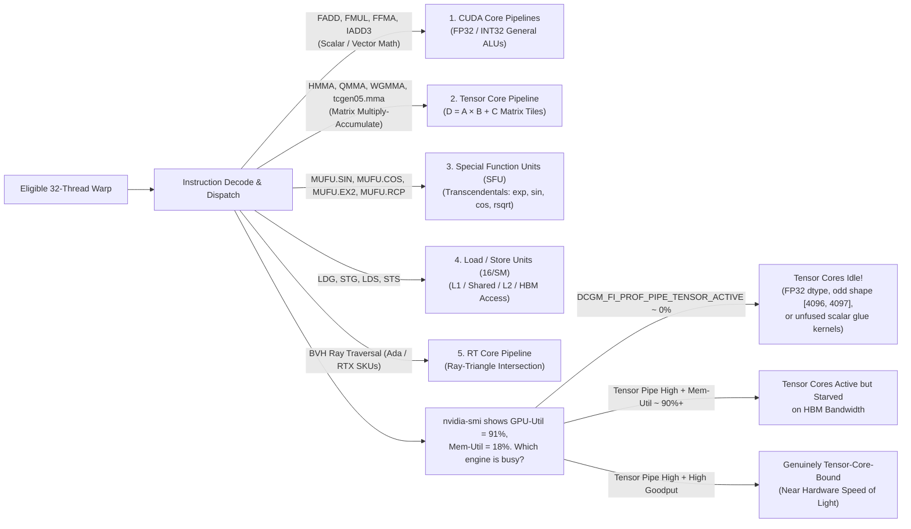
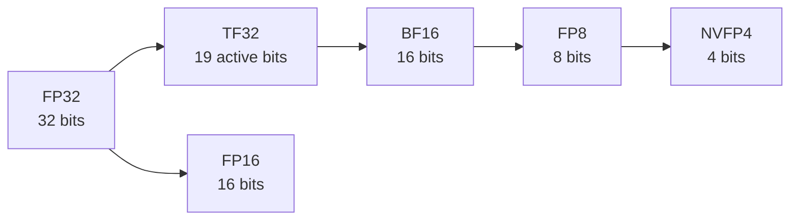
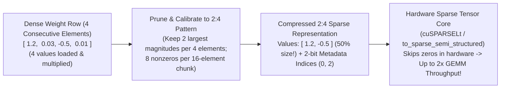
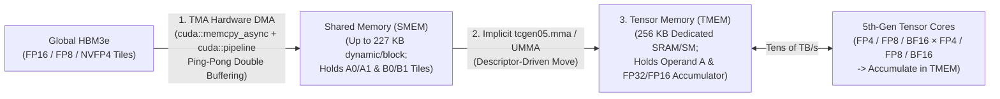

# 10.4 Tensor cores and numerical precision

| | |
|---|---|
| **Status** | Drafted (`tensor_cores_precision_lab.py`: 25 checks pass; GPU profiler commands **untested** on live Nebius GPU VM) |
| **Level** | Intermediate |
| **Priority tier** | 2 |
| **Lab venue** | Nebius GPU + self-checking Python model (`code/part10/tensor_cores_precision_lab.py`) |
| **Part** | Part 10: The GPU and CUDA |
| **Sources used** | *AI Systems Performance Engineering* Ch. 2, Ch. 6 & Ch. 9; `nvidia-devops` V2 (Ch. 1, Ch. 4) |

## Why this matters for AI infrastructure

When two workloads run on the exact same NVIDIA GPU, both can report 91% utilization in `nvidia-smi`, yet one finishes in 10 milliseconds while the other takes 500 milliseconds. The physical GPU is not one generic calculator. Each Streaming Multiprocessor contains multiple distinct execution engines: CUDA Cores, Tensor Cores, Special Function Units, Load/Store Units, and on graphics or universal SKUs, RT Cores. The top-level `nvidia-smi` utilization metric only reports that some engine was active during the sampling interval.

On a modern data center GPU such as Hopper H100 or Blackwell B200, the vast majority of the chip's mathematical horsepower lives inside its Tensor Cores. Unlocking those matrix pipelines requires satisfying a strict joint contract between hardware and software.
- On a Blackwell B200, standard scalar FP32 compute peaks at a tiny fraction of what dense NVFP4 Tensor Core compute delivers on the exact same silicon.
- Lowering precision does not just speed up matrix math. It shrinks every weight tensor in HBM and multiplies the number of weights carried inside every cache line.
- Yet a single unaligned matrix dimension or a missing PyTorch configuration flag (`torch.set_float32_matmul_precision('high')`) can cause the software stack to bypass the Tensor Cores silently. The workload then falls back to general arithmetic pipelines with zero error messages.

This chapter dissects the execution engines inside an SM and maps the exact bit layouts and dynamic-range trade-offs of every AI numerical format. It covers FP64, FP32, TF32, FP16, BF16, FP8, INT8, and NVFP4. It then explains how the Transformer Engine, structured sparsity, Blackwell Tensor Memory with TMA, and NVIDIA CUTLASS keep Tensor Cores running near peak utilization.

```text
Key Tensor Core and precision benchmarks:
- Blackwell B200 dual-die MCM: 2 x 104B = 208B transistors linked by 10 TB/s NV-HBI, 8 x 24 GB 8-Hi HBM3e = 192 GB physical / 180 GB usable @ ~8 TB/s, 126 MB L2 (63 MB/die) vs H100 80B transistors, 80 GB HBM3 @ 3.35 TB/s, 50 MB L2.
- Dense compute gap on B200: ~80 TeraFLOPS scalar FP32 vs 10 PetaFLOPS dense NVFP4 (15 PetaFLOPS on B300 Ultra) = 125x difference; NVL72 exceeds 1.4 ExaFLOPS FP4.
- 128-byte cache-line density: 32 FP32 values (4 B) -> 64 FP16/BF16 (2 B) -> 128 FP8/INT8 (1 B) -> 256 NVFP4/INT4 (0.5 B).
- Silent fallback triggers: unaligned matrix shape [4096, 4097] instead of [4096, 4096] or missing TF32/AMP flags.
```

## Prerequisites and outcomes

**Prerequisites:**
- CPU versus GPU throughput design and peak TFLOP/s formulas from the first chapter of this part.
- The SIMT execution hierarchy and four-partition SM warp schedulers from the second chapter of this part.
- The seven-tier GPU memory hierarchy and cache-line coalescing from the third chapter of this part.

**Outcomes:** After completing this chapter, you will be able to accomplish five primary objectives.
- First, distinguish the five execution pipelines inside an SM and diagnose whether a busy GPU is actually engaging its Tensor Cores.
- Second, compare the exact bit layouts, byte footprints, and cache-line densities of FP64, FP32, TF32, FP16, BF16, FP8 E4M3 and E5M2, INT8 DP4A versus MMA, and NVFP4 two-level micro-scaling.
- Third, explain why BF16 avoids gradient underflow without `GradScaler` whereas FP16 requires loss scaling. You will also configure TF32 and Automatic Mixed Precision (`torch.amp.autocast`) in PyTorch.
- Fourth, explain how the Transformer Engine, Blackwell TMEM and TMA (`tcgen05.mma`), and Blackwell hardware decompression work together to accelerate multi-trillion-parameter Mixture-of-Experts models.
- Fifth, validate hardware structured sparsity via `cuSPARSELt` and `to_sparse_semi_structured()`, size tiles for TMEM in CUTLASS, and audit matrix shapes for Tensor Core tile alignment.

---

## 1. Specialized execution engines inside an SM: CUDA Cores, Tensor Cores, RT Cores, and SFUs

When an AI service runs five times slower than expected while `nvidia-smi` reports 91% GPU utilization, infrastructure teams often assume the hardware is maxed out and buy more nodes. In reality, general-purpose hardware flexibility costs silicon area and power. Whenever a specific mathematical pattern dominates a workload, dedicated hardware datapaths deliver orders of magnitude more work per clock cycle and per watt, while leaving general scalar pipelines to handle glue logic.

### 1.1 How warp instructions route to specialized SM pipelines

When one of the SM's four warp schedulers selects an eligible 32-thread warp, the instruction decoder inspects the opcode and routes the instruction to one of five specialized execution pipelines.



> **dcgm-exporter 4.9.0 version note.** dcgm-exporter 4.9.0 (2026-11-06) renamed many default metrics and changed some units. For example `DCGM_FI_DEV_GPU_UTIL` (percent) became `DCGM_FI_DEV_GPU_UTIL_RATIO` (0 to 1), and `DCGM_FI_DEV_FB_USED` (MiB) became `DCGM_FI_DEV_FB_USED_BYTES`. The metric names in this chapter are the 4.8.x names. On a 4.9.0 exporter use the [full mapping in 17.4](../part-17-operations/04-dcgm-exporter-and-interpreting-gpu-metrics.md#14-what-dcgm-exporter-490-renamed), and change thresholds together with the unit.

| Execution engine | Primary operations | Where it is used in AI & HPC | Common operational misconception |
|---|---|---|---|
| **1. CUDA Cores** (FP32 / INT32 lanes) | Scalar/vector floating-point and integer math ($D = A \times B + C$ on single numbers), comparisons, indexing, reductions, bitwise logic. | Address calculation, activation functions (GeLU, SiLU), normalization (LayerNorm, RMSNorm), reductions, and custom non-matrix kernels. | **"More CUDA Cores = faster LLM."** CUDA Core counts are not comparable across generations and do not run dense transformer GEMMs on modern AI GPUs. |
| **2. Tensor Cores** (Matrix Engines) | Fused matrix-tile Multiply-Accumulate ($D = A \times B + C$ where $A, B, C, D$ are matrix tiles) across TF32, BF16, FP16, FP8, INT8, NVFP4 (plus FP64 DMP Tensor Cores on SXM HPC SKUs). | Linear projections (Q, K, V, O, MLP up/gate/down), attention score/value BMMs, and convolutions (`cuBLAS`, `cuDNN`, CUTLASS, Triton, TensorRT-LLM). | **"Tensor Cores turn on automatically for any code."** They only engage when dtype, matrix dimensions/alignment, and library/compiler kernels target MMA instructions. |
| **3. Special Function Units (SFUs)** | Hardware approximation of transcendental functions (`sin`, `cos`, `exp`, `log`, `rcp`, `rsqrt`). | Transformer **Attention softmax** (`exp(x)`) and **RMSNorm / LayerNorm** (`rsqrtf` inverse square root). | Ignoring SFU throughput: in long-context attention, softmax exponentials become a major bottleneck unless SFU pipelines are expanded (as in Hopper and Blackwell). |
| **4. Load / Store Units (LD/ST) & TMA** | Memory address generation and data movement between Registers, Shared Memory, TMEM, L2, and HBM. | Every kernel load and store (offloaded for bulk tiles by the **Tensor Memory Accelerator TMA**). | Confusing `nvidia-smi` GPU-Util with math activity when warps are simply stalled on LD/ST queues. |
| **5. RT Cores** (on L4, L40S, RTX) | Hardware **Bounding Volume Hierarchy (BVH)** tree traversal and ray-triangle intersection tests. | 3D rendering, Omniverse digital twins, ray-traced simulation, and spatial audio/wireless propagation. | **Using RT Core counts to justify an AI training/inference purchase.** RT Cores accelerate geometric ray intersections, *not* neural network matrix multiplications. |

### 1.2 Why `nvidia-smi` GPU-Util cannot prove Tensor Core usage

Suppose you run `nvidia-smi --query-gpu=utilization.gpu,utilization.memory --format=csv,noheader` during an inference test and observe the output below.

```text
91 %, 18 %
```

What does that pair of numbers actually prove?
- The low memory-interface busy time rules out an HBM bandwidth bottleneck.
- However, high GPU utilization is completely ambiguous between a high-speed Tensor Core GEMM and a slow scalar CUDA Core loop. If `nvidia-smi dmon -s ucm` shows high SM activity and low memory activity, yet your model's token throughput is far below expectation, the SMs are burning cycles on scalar CUDA Core pipelines. That happens when the matrix multiplication falls back to general FP32 or unaligned kernels, or when unfused elementwise glue operations dominate runtime.
- To verify Tensor Core engagement, always check the hardware pipeline counter in DCGM (`DCGM_FI_PROF_PIPE_TENSOR_ACTIVE`) or Nsight Compute (`sm__pipe_tensor_cycles_active.avg.pct_of_peak_sustained_active`).

:::info In one minute: Section 1 takeaways
- An SM routes instructions by opcode: CUDA Cores handle scalar and elementwise math, Tensor Cores handle fused matrix multiply-accumulate tiles, SFUs handle transcendentals, and RT Cores handle 3D ray-tracing BVH traversal rather than AI GEMMs.
- Top-level `nvidia-smi` utilization cannot distinguish scalar CUDA Core activity from Tensor Core activity; always inspect `DCGM_FI_PROF_PIPE_TENSOR_ACTIVE` or `ncu` Tensor Pipe metrics.
:::

---

## 2. Numerical precision formats: from FP64 and FP32 to TF32, BF16, FP8, INT8, and NVFP4

Choosing the wrong numerical format either wastes most of your GPU's memory bandwidth and Tensor Core throughput, or silently destroys model convergence when gradients underflow to zero. Training and inference engineers must understand how sign, exponent, and mantissa bits trade dynamic range against step granularity.

### 2.1 Bit layouts: Sign, Exponent, and Mantissa

Every floating-point number is stored as three distinct bit fields.
- **Sign bit:** A single bit indicates whether the value is positive or negative.
- **Exponent bits:** These bits determine the dynamic range, meaning the largest and smallest non-zero magnitudes representable before overflowing to infinity or NaN or underflowing to zero.
- **Mantissa bits:** Also called the fraction or significand, these bits determine the step precision between two adjacent powers of two.



| Format | Size | Where it runs | Bit layout (sign / exponent / mantissa) | Notes |
|---|---|---|---|---|
| FP32 | 32 bits (4 B) | CUDA cores | 1 / 8 / 23 | Range about 10^-38 to 10^38 |
| TF32 | 19 active bits in a 32-bit word | Tensor Core default for FP32 matmul | 1 / 8 / 10 | Same range as FP32, same precision as FP16 |
| FP16 | 16 bits (2 B) | Tensor Cores | 1 / 5 / 10 | Needs `GradScaler` in training. Narrow range (about 6x10^-5 to 65,504): underflow and overflow risk |
| BF16 | 16 bits (2 B) | Tensor Cores (workhorse training format) | 1 / 8 / 7 | Same range as FP32, so no `GradScaler` needed |
| FP8 | 8 bits (1 B) | Hopper and Blackwell Transformer Engine | E4M3: 1 / 4 / 3 (weights and forward activations). E5M2: 1 / 5 / 2 (gradients that need a wider range) | Halves footprint vs BF16 |
| NVFP4 | 4 bits (0.5 B) | Blackwell 2nd-gen Transformer Engine | 1 / 2 / 1 | Plus two-level micro-scaling (microblock and tensor scale) |

The table below provides the complete reference across all numerical formats used in HPC and AI, combining *AI Systems Performance Engineering* with the Volume 02 notes.

| Format | Sign / Exp / Mantissa bits | Storage size | Values per 128 B cache line | `[4096, 4096]` matrix size (16.78M elems) | Primary hardware engine & operational rule |
|---|---|---|---|---|---|
| **FP64** (Double) | 1 / 11 / 52 (64 bits) | 8.0 Bytes | 16 values | 128 MiB | FP64 pipelines / DMP Tensor Cores. Required for CFD, weather, and molecular dynamics where rounding errors explode. |
| **FP32** (Single) | 1 / 8 / 23 (32 bits) | 4.0 Bytes | **32 values** | **67.1 MB** (64 MiB) | Scalar CUDA Cores (~80 TFLOPS dense on B200). Used for master weights, Tensor Core accumulators, and sensitive reductions (LayerNorm, Softmax). |
| **TF32** (TensorFloat-32) | **1 / 8 / 10** (19 active bits in 32-bit word) | 4.0 Bytes (in HBM/regs) | **32 values** | **67.1 MB** (64 MiB) | **Tensor Cores** (Ampere+). Keeps FP32's 8-bit exponent range and FP16's 10-bit mantissa; accelerates FP32 matmuls without changing buffer sizes. |
| **FP16** (Half) | 1 / 5 / 10 (16 bits) | 2.0 Bytes | **64 values** | **33.6 MB** (32 MiB) | **Tensor Cores** (Volta+). Narrow **5-bit exponent** causes small gradients to underflow to zero unless you use **`GradScaler` loss scaling**. |
| **BF16** (Bfloat16) | **1 / 8 / 7** (16 bits) | 2.0 Bytes | **64 values** | **33.6 MB** (32 MiB) | **Tensor Cores** (Ampere+). Matches **FP32's 8-bit exponent range**; default format for LLM training because it **rarely/never requires `GradScaler`**. |
| **FP8** (E4M3 / E5M2) | 1 / 4 / 3 or 1 / 5 / 2 (8 bits) | 1.0 Byte | **128 values** | **16.8 MB** (16 MiB) | **Hopper & Blackwell Tensor Cores** (Transformer Engine). Halves HBM traffic vs BF16 and delivers **2x–3x** BF16 TFLOPS with FP32/TF32 accumulation. |
| **INT8** (8-bit Integer) | 1 sign + 7 integer (8 bits) | 1.0 Byte | **128 values** | **16.8 MB** (16 MiB) | **Tensor Core INT8 MMA** (`cuBLASLt` / CUTLASS / TorchAO) or **DP4A** (4 INT8 MACs/instruction on CUDA cores). Cuts weight traffic by **75%** vs FP32. |
| **NVFP4** (4-bit Float) | 1 / 2 / 1 (4 bits) + micro-scales | 0.5 Bytes | **256 values** | **8.4 MB** (8 MiB) | **Blackwell 5th-Gen Tensor Cores**. Uses **two-level micro-scaling**; reaches **10 PFLOPS dense on B200** (**15 PFLOPS on B300**) vs ~80 TFLOPS FP32 (**125x**). |

### 2.2 Why lowering precision wins twice: compute TFLOPS and 128-byte cache-line density

Lowering precision delivers a compound speedup across both compute pipelines and the memory hierarchy.
- **Reducing HBM memory traffic:** Moving from single precision down to BF16, FP8, or NVFP4 shrinks every weight tensor in HBM and packs many more weights into a single cache-line transaction. Furthermore, Blackwell introduces a dedicated hardware decompression engine. It reads compressed weights from HBM and decompresses them on the fly at load time before feeding the Tensor Cores.
- **Enabling TF32 and Automatic Mixed Precision in PyTorch:** By default, PyTorch leaves single-precision matrix multiplications on slower scalar CUDA Core paths (`'highest'`) unless you explicitly opt into TF32. For training and inference with BF16, wrap the forward pass in `torch.amp.autocast` with `dtype=torch.bfloat16` explicitly set. Omitting `dtype` defaults to FP16, whose narrow exponent requires `GradScaler`. Under `autocast` and `torch.compile` with TorchInductor, large GEMMs and convolutions dispatch to BF16 or FP16 Tensor Core kernels with FP32 accumulators. Numerically sensitive reductions such as LayerNorm, Softmax, and loss functions remain in FP32.

```text
Worked [4096, 4096] weight matrix footprint & cache-line comparison (16,777,216 elements):
- FP32 (4.0 B/elem): 67,108,864 bytes (≈ 67.1 MB, 64 MiB) -> 524,288 cache lines (32 values per 128 B line)
- FP16 / BF16 (2.0 B/elem): 33,554,432 bytes (≈ 33.6 MB, 32 MiB) -> 262,144 cache lines (64 values/line, 2.0x bandwidth reduction)
- FP8 / INT8 (1.0 B/elem): 16,777,216 bytes (≈ 16.8 MB, 16 MiB) -> 131,072 cache lines (128 values/line, 4.0x reduction)
- NVFP4 (0.5 B/elem): 8,388,608 bytes (≈ 8.4 MB, 8 MiB) -> 65,536 cache lines (256 values/line, 8.0x reduction)
```

```python
import torch

# 1. Opt into TF32 Tensor Cores for FP32 matmuls ('highest' | 'high' | 'medium')
torch.set_float32_matmul_precision('high')

# 2. Run forward pass in BF16 Automatic Mixed Precision (8-bit exponent -> no GradScaler needed)
with torch.amp.autocast("cuda", dtype=torch.bfloat16):
    output = model(input)
```

:::info In one minute: Section 2 takeaways
- TF32 stores 19 active bits inside a 32-bit word and accelerates FP32 matrix multiplications on Tensor Cores via `torch.set_float32_matmul_precision('high')`.
- BF16 matches FP32's 8-bit exponent range and avoids gradient underflow without `GradScaler`, whereas FP16 has a 5-bit exponent and requires `GradScaler`.
- Every 128-byte HBM transaction carries 32 FP32, 64 BF16 or FP16, 128 FP8 or INT8, or 256 NVFP4 values, and dense NVFP4 reaches 10 PFLOPS on Blackwell B200.
:::

---

## 3. The Transformer Engine, 2:4 Structured Sparsity, and feeding Tensor Cores with TMEM and TMA

When quantizing a model down to 8-bit FP8 or 4-bit NVFP4, a naive static cast across the entire neural network degrades accuracy whenever early layers or outlier activations overflow the tiny exponent range. Even when precision is stable, fifth-generation Tensor Cores compute tiles so quickly that storing accumulators in the standard register file or fetching operands with scalar load instructions would starve the matrix units.

### 3.1 The Transformer Engine and two-level micro-scaled NVFP4

NVIDIA's Transformer Engine solves low-bit accuracy loss through hardware-software co-design.
- **Dynamic per-layer precision and scaling:** The Transformer Engine inspects tensor amax histograms and dynamically selects FP16 or BF16 for noise-sensitive layers. It applies FP8 or NVFP4 on tolerant linear and expert layers, accumulating partial sums in higher precision inside the Tensor Cores.
- **Two-level micro-scaling in NVFP4:** With only four bits per weight, a single tensor-wide scaling factor cannot prevent outlier weights from crushing normal weights to zero. NVFP4 applies two-level scaling by combining a fine-grained per-microblock scale factor shared across a local group of weights with a higher-level tensor scale factor. This preserves model accuracy at half a byte per parameter.
- **Real-world impact on a giant MoE model:** On a Hopper H100 cluster where inter-node communication crossed InfiniBand and weights used wider formats, serving a multi-trillion-parameter MoE model was too slow for interactive chat. Moving the exact same model to a Blackwell GB200 NVL72 rack combining NVFP4, the second-generation Transformer Engine, HBM3e, and the NVLink domain delivered a massive throughput leap. It also cut first-token latency by two orders of magnitude.

| Metric (1.8-trillion-parameter MoE inference benchmark, ASP Ch. 2 pp. 27, 31) | Hopper H100 cluster (FP8/FP16 + InfiniBand) | Blackwell GB200 NVL72 rack (NVFP4 + 8.0 TB/s HBM3e + 1.8 TB/s NVLink 5) | Improvement |
|---|---|---|---|
| **Per-GPU token generation throughput** | ~3.4 tokens/sec per GPU | **~150 tokens/sec per GPU** | **~30x–44x real-time throughput leap** |
| **Time To First Token (TTFT)** | >5,000 ms (>5 seconds) | **~50 ms** | **100x reduction in first-token latency** |

### 3.2 Hardware 2:4 Structured Sparsity

Beginning with Ampere and continuing through Hopper and Blackwell, Tensor Cores include dedicated Sparse Tensor Core hardware that accelerates structured sparsity.



Three operational rules govern structured sparsity in *AI Systems Performance Engineering*.
- **The exact hardware rule:** In every contiguous block of four weights, at least two weights must be zero. Arbitrary unstructured sparsity with random zeros scattered outside that pattern receives zero hardware acceleration from Sparse Tensor Cores.
- **Inference-first workflow with `to_sparse_semi_structured()`:** Because gradients during backpropagation are dense and change sparsity patterns dynamically, structured sparsity is used primarily for post-training inference deployment. You prune and calibrate the trained model, convert weight tensors in PyTorch with `to_sparse_semi_structured()` backed by `cuSPARSELt`, and dispatch to Sparse Tensor Cores. That pipeline doubles throughput and halves weight memory traffic.
- **Batch-size amortization trap:** At `batch_size = 1`, the fixed overhead of reading sparse metadata indices and launching sparse kernels is not amortized, yielding little speedup. Serve with larger token batch sizes so the TMEM and Sparse Tensor Core pipelines stay saturated.

```text
Hardware 2:4 structured sparsity parameters (ASP Ch. 9 pp. 302-304):
- Pattern constraint: at most 2 nonzeros per 4 consecutive weights = 8 nonzeros per 16-element chunk (50% density)
- Metadata format: 2-bit indices per nonzero element; accelerated by cuSPARSELt and PyTorch to_sparse_semi_structured()
- Speedup & batching: up to 2x GEMM throughput and ~2x lower weight traffic when amortized at batch sizes of 128 to 256 tokens (little gain at batch_size = 1)
```

### 3.3 How TMA, SMEM, and TMEM feed Blackwell `tcgen05` Tensor Cores

On prior architectures like Volta and Ampere, Tensor Core MMA fragments and accumulators lived inside the SM's general register file, causing severe register pressure that reduced warp occupancy. Blackwell eliminates this bottleneck by adding dedicated Tensor Memory per SM.



The table below shows how much tile data fits inside a single SM's TMEM budget using double-buffered `stage_ab_tiles` pipelines.

| Tile shape & precision | Calculation (rows x cols x bytes/elem) | Exact byte footprint | Share of 256 KB (262,144 B) per-SM TMEM |
|---|---|---|---|
| **256 x 512 tile in FP16 / BF16 (2 B)** | `256 x 512 x 2` | **262,144 bytes (256.0 KiB)** | **100%** of TMEM (1 max tile) |
| **256 x 256 accumulator tile in FP32 (4 B)** | `256 x 256 x 4` | **262,144 bytes (256.0 KiB)** | **100%** of TMEM (1 max tile) |
| **256 x 256 operand tile in NVFP4 (0.5 B)** | `256 x 256 x 0.5` | **32,768 bytes (32.0 KiB)** | **12.5%** of TMEM (up to **8 tiles** fit in TMEM) |

---

### Reading the rack-level FP4 peak

Per-GPU numbers are hard to picture, so NVIDIA also quotes a rack total. A full NVL72 rack has 72 GPUs. Its theoretical Tensor Core throughput is over 1.4 exaFLOPS (1.4 × 10^18 floating-point operations per second) in 4-bit precision. That puts one rack in the range of the world's fastest supercomputers. The catch is the precision. The peak is measured at low FP4 precision, and real workloads do not always reach it.

Treat the rack number as a ceiling, not a forecast. It shows what the hardware can do when the math fits FP4. Your job is to measure how close your own kernels get to that ceiling, and to confirm that the accuracy holds at that precision.

### Adopting the precision features in your stack

NVIDIA's libraries and frameworks evolve with each generation. They add unified memory management and native FP8 and FP4 support, so the same code can use new hardware with few changes. The Transformer Engine (TE) is the main path. You adopt it by using its kernels and modules in frameworks such as PyTorch. FP8 and NVFP4 are applied when they preserve accuracy.

This is not a fully automatic decision for every layer in every framework. Check which layers run in which precision, and compare accuracy before you trust a faster run. Reduced precision is only a gain when the model still gives the same answers.

## 4. Using CUTLASS and auditing Tensor Core shape alignment

Even when a model uses reduced-precision tensors, two software mistakes frequently prevent kernels from reaching peak Tensor Core speed. First, writing raw matrix assembly by hand for every new GPU generation takes weeks of error-prone synchronization tuning. Second, leaving a single matrix dimension unaligned to a tile boundary forces high-level libraries to abandon aligned Tensor Core tiles and fall back to slow cleanup paths.

### 4.1 Why CUTLASS is preferred over hand-written MMA assembly

Writing a raw Blackwell `tcgen05.mma` or Hopper `wgmma` kernel by hand takes extensive effort. It requires managing TMA tensor descriptors, `cuda::pipeline` ping-pong stages in shared memory, TMEM accumulator lifecycles, warp specialization, and Thread Block Cluster DSMEM multicast. NVIDIA CUTLASS wraps that entire pipeline into a C++ template `cutlass::gemm::device::Gemm<..., cutlass::arch::OpClassTensorOp, cutlass::arch::Sm100>`. It also powers `cuBLAS`, `cuDNN`, and PyTorch's TorchInductor `max-autotune` backend under the hood.

The table below compares a hand-tuned MMA kernel against a CUTLASS GEMM template on half-precision inputs with single-precision accumulation from *AI Systems Performance Engineering* Chapter 9.

| Metric (FP16 inputs, FP32 accumulate, ASP Ch. 9 Table 9-1) | Hand-tuned MMA kernel | CUTLASS GEMM template | Operational takeaway |
|---|---|---|---|
| **Tensor Core utilization (`ncu`)** | **98%** | **98%** | Matches hand-tuned assembly within ~0–2%. |
| **Registers per thread (`-Xptxas=-v`)** | ~52 registers | ~60 registers | Well below the threshold that would reduce SM occupancy. |
| **Shared Memory per Thread Block (CTA)** | ~2 KB | ~4 KB | Negligible fraction of the 228 KB/SM budget. |
| **Engineering effort & portability** | Weeks per GPU generation | **A few lines of template code** | Automatically inherits TMEM, TMA, FP8, and NVFP4 upgrades. |

### 4.2 Auditing matrix dimensions for 16-byte Tensor Core alignment

Why does the PyTorch snippet below from the Volume 02 notes cause throughput to collapse even though `dtype=torch.float16` is explicitly set?

```python
w = torch.randn(4096, 4097, device="cuda", dtype=torch.float16)  # 4097 is NOT a multiple of 8!
x = torch.randn(32, 4097, device="cuda", dtype=torch.float16)
y = x @ w.T
```

Tensor Core hardware loads and multiplies matrix tiles aligned to sixteen-byte boundaries. When a dimension is odd or unaligned, the tensor fails tile alignment. That forces `cuBLAS` or CUTLASS either to fall back to a much slower unaligned scalar cleanup path or to pad the tensor at runtime. Always pad model vocabulary sizes, hidden dimensions, and batch sizes to the required element multiples shown below.

| Precision format | Element byte size | Required multiple for dimensions `M, N, K` (16-byte / 128-bit tile alignment) | Recommended TMA / large-tile padding multiple |
|---|---|---|---|
| **TF32** | 4.0 Bytes | Multiple of **4** (`16 B / 4 B`) | 64 or 128 |
| **FP16 / BF16** | 2.0 Bytes | Multiple of **8** (`16 B / 2 B`) | 64 or 128 |
| **FP8 / INT8** | 1.0 Byte | Multiple of **16** (`16 B / 1 B`) | 64 or 128 |
| **NVFP4** | 0.5 Bytes | Multiple of **32** (`16 B / 0.5 B`) | 64 or 128 |

Combining the element-alignment rule across TF32, FP16, FP8, and NVFP4 with the `dmon` and `ncu` pipeline diagnostic tree from the Volume 02 notes into `check_tensor_core_eligibility` in `code/part10/tensor_cores_precision.py` is my inference.

:::info In one minute: Section 3 & 4 takeaways
- The Transformer Engine dynamically pairs FP8 and two-level micro-scaled NVFP4 with high-precision accumulation in TMEM, dramatically accelerating large MoE models on GB200 NVL72.
- Hardware structured sparsity requires at most two nonzeros in every four consecutive weights via `to_sparse_semi_structured()` and `cuSPARSELt`, and needs large token batches to amortize metadata overhead.
- Use CUTLASS or `torch.compile` to reach peak Tensor Core utilization, and always align matrix dimensions `M, N, K` to sixteen-byte multiples.
:::

---

## Commands and configurations that matter

### 1. Enabling TF32, BF16 Automatic Mixed Precision, and 2:4 Sparsity in PyTorch

```python
import torch
from torch.sparse import to_sparse_semi_structured

# 1. Enable TF32 Tensor Cores for FP32 matmuls and convolutions (Ampere, Hopper, Blackwell)
torch.set_float32_matmul_precision("high")   # or torch.backends.cuda.matmul.allow_tf32 = True
torch.backends.cudnn.allow_tf32 = True

# 2. Run forward pass under BF16 Automatic Mixed Precision (8-bit exponent -> no GradScaler needed)
with torch.amp.autocast("cuda", dtype=torch.bfloat16):
    out = model(inputs)

# 3. Convert a pruned 2:4 weight matrix (aligned to multiples of 16/32) for Sparse Tensor Cores
# w_sparse = to_sparse_semi_structured(w_pruned_fp16)
```

### 2. Verifying Tensor Core pipeline activity vs scalar SM activity

```bash
# 1. Stream SM Active (1002), Tensor Pipe Active (1004), and DRAM Active (1005) via DCGM
dcgmi dmon -e 1002,1004,1005 -d 1000

# 2. Profile Tensor Core cycle utilization and instruction mix in Nsight Compute (ncu)
ncu --metrics \
  sm__pipe_tensor_cycles_active.avg.pct_of_peak_sustained_active,\
  sm__cycles_active.avg.pct_of_peak_sustained_elapsed,\
  dram__throughput.avg.pct_of_peak_sustained_elapsed \
  python3 benchmark_matmul.py
```

---

## How it fails

| Failure mode | Symptom | Root cause | Diagnosis & fix |
|---|---|---|---|
| **1. Silent FP32 scalar fallback (Tensor Pipe ~ 0%, SM Active ~ 92%)** | A PyTorch model runs at 90%+ GPU-Util on an H100 or B200, but throughput is 5x–10x lower than datasheet BF16/TF32 expectations. | The script runs in default `float32` (`'highest'` precision) without `torch.set_float32_matmul_precision('high')` or `torch.amp.autocast`, routing all GEMMs to scalar FP32 CUDA Cores. | Check `DCGM_FI_PROF_PIPE_TENSOR_ACTIVE` (1004) or `ncu` `sm__pipe_tensor_cycles_active`; enable `torch.set_float32_matmul_precision('high')` (TF32) or `torch.amp.autocast("cuda", dtype=torch.bfloat16)`. |
| **2. Unaligned matrix dimension (`[4096, 4097]`) breaks Tensor Core tiling** | `dtype` is correctly set to `torch.float16` or `bfloat16`, yet a linear layer or classifier head runs much slower than adjacent layers of similar size. | One or more matrix dimensions (`M, N, K`, such as an unpadded odd dimension 4,097) is not a multiple of 8 (FP16/BF16), 16 (FP8/INT8), or 32 (NVFP4), forcing fallback or unaligned cleanup kernels. | Pad vocabulary tables, hidden dimensions, and batch sizes to multiples of **8, 16, or 32** (64+ recommended for TMA tiles). |
| **3. Gradient underflow (NaN / zero gradients) when training in FP16** | Switching a training job from FP32 to `torch.float16` causes loss to diverge to NaN or stall after a few hundred steps. | FP16 has only a **5-bit exponent** (minimum normal value ~6 x 10^-5), so small backpropagated gradients underflow to 0.0 without loss scaling. | Switch training from FP16 to **BF16 (`dtype=torch.bfloat16`)**, which has the same **8-bit exponent** range as FP32, or wrap FP16 backward passes with `torch.cuda.amp.GradScaler()`. |
| **4. Zero speedup from FP8 or 2:4 Sparsity at `batch_size = 1`** | Converting a model to 2:4 semi-structured sparsity or FP8 produces almost no speedup during single-stream (`batch = 1`) testing. | At `M = 1`, fixed kernel-launch overhead, dynamic scale calculation, and 2-bit sparse metadata lookups dominate execution time and leave TMEM underutilized. | Benchmark and serve with **Continuous Batching** at effective token batch sizes of **128 to 256+** so Tensor Core and TMEM pipelines are amortized. |
| **5. Buying RT Core SKUs for dense LLM training** | A team procures PCIe graphics/rendering GPUs citing high "RT Core TFLOPS" on a marketing sheet, then hits severe interconnect and HBM bandwidth walls on multi-GPU LLM training. | **RT Cores** only accelerate ray-bounding-box/triangle intersections (BVH); LLM training requires **Tensor Cores**, **HBM3/HBM3e bandwidth**, and **NVLink/NVSwitch**. | Match the hardware to the workload's active engine: use L4/L40S when rendering/media/small-batch PCIe inference is the goal, and H100/H200/B200 SXM/NVL72 for heavy Tensor Core + HBM + NVLink workloads. |

---

## Hands-on lab

### Self-checking Python model (`code/part10/tensor_cores_precision_lab.py` — verified here)

The module `code/part10/tensor_cores_precision.py` encodes the SM execution engine table, numerical format bit-layouts, cache-line densities, matrix footprint calculators, Blackwell and Hopper benchmark ratios, structured sparsity validators, TMEM tile sizers, and Tensor Core shape alignment checkers. Its companion script `code/part10/tensor_cores_precision_lab.py` runs twenty-five self-checks across seven core areas.

- **Five SM execution engines:** Distinguishes CUDA Cores, Tensor Cores, RT Cores, Load/Store units, and SFUs, and verifies why RT Cores do not run AI GEMMs.
- **Exact bit layouts:** Verifies TF32 active bits, BF16 versus FP16 exponent ranges and `GradScaler` requirements, and FP8 E4M3 versus E5M2 bit fields.
- **Cache-line element density and matrix footprints:** Computes values per cache line and exact megabyte footprints for square weight matrices across FP32, FP16, FP8, and NVFP4.
- **Blackwell specifications and MoE benchmark:** Verifies transistor counts, NV-HBI bandwidth, HBM3e capacity, NVFP4 versus FP32 compute ratios, MoE throughput and TTFT gains, DP4A instruction throughput, and CUTLASS utilization.
- **Hardware structured sparsity validator:** Checks the two-nonzeros-per-four-elements rule and flags violating quads.
- **Blackwell per-SM TMEM tile sizing:** Evaluates how FP16, FP32, and NVFP4 tiles fit inside TMEM.
- **Tensor Core eligibility and pipeline diagnostic:** Flags FP32 scalar fallback, odd dimension misalignment, small-batch overhead, and HBM-starved versus compute-engaged Tensor Cores.

```text
Lab verification parameters (25 self-checks):
- Bit layouts: TF32 = 1/8/10 (19 active bits in 32-bit storage); BF16 = 1/8/7 (no GradScaler) vs FP16 = 1/5/10 (needs GradScaler); FP8 E4M3 = 1/4/3 vs E5M2 = 1/5/2.
- 128 B line density & [4096, 4096] footprint: 32 FP32 (67.1 MB) -> 64 FP16/BF16 (33.6 MB) -> 128 FP8/INT8 (16.8 MB) -> 256 NVFP4 (8.4 MB).
- Blackwell specs & benchmarks: 208B transistors, 10 TB/s NV-HBI, 192/180 GB HBM3e; B200 10 PFLOPS dense NVFP4 vs 80 TFLOPS FP32 = 125x; B300 15 PFLOPS = 1.5x B200; 1.8T MoE 3.4 -> 150 tokens/s/GPU and 5,000 ms -> 50 ms TTFT; DP4A = 4 INT8 MACs/inst; CUTLASS = 98% Tensor Core utilization.
- Sparsity & TMEM: 2 nonzeros per 4 elements = 8 per 16-element chunk = 50% density -> 2.0x speedup; 256 x 512 FP16 = 256.0 KiB and 256 x 256 FP32 = 256.0 KiB max out TMEM; 256 x 256 NVFP4 = 32.0 KiB fits 8 tiles.
- Eligibility checks: flags FP32 fallback, K = 4097 misalignment, and M = 1 small-batch overhead.
```

Run the lab from the repository root.

```bash
python3 -B code/part10/tensor_cores_precision_lab.py
```

Expected output verified in this repository is shown below.

```text
=== Chapter 10.4 Lab: Tensor Cores and Numerical Precision ===
  [PASS] V2 Ch4: Distinguishes all 5 SM execution engines (CUDA Cores, Tensor Cores, RT Cores, LD/ST, SFU)
  [PASS] V2 Ch4: RT Cores target ray-tracing BVH traversal and are not AI GEMM accelerators
  [PASS] ASP Ch9 p.308: TF32 has 8-bit exponent (like FP32) and 10-bit mantissa (like FP16) = 19 active bits in 32-bit storage
  [PASS] ASP Ch9 p.309: BF16 has 8-bit exponent (matching FP32, no GradScaler needed) vs FP16 5-bit exponent (requires GradScaler)
  ...
  [PASS] 16-byte tile alignment requires multiples of 4 for TF32 (4B), 8 for FP16/BF16 (2B), 16 for FP8/INT8 (1B), and 32 for NVFP4 (0.5B)
  [PASS] ASP Ch9 p.309: Batch size M=1 on FP8 warns that fixed launch/conversion overhead is not amortized
  [PASS] Rejects non-multiple-of-4 array length in 2:4 sparsity validator
  [PASS] Rejects unknown numerical format
  [PASS] Rejects non-positive TMEM tile dimensions
  [PASS] Rejects non-positive GEMM dimensions

Summary: 25 passed, 0 failed (total 25)
```

---

## Common first mistakes

- **Relying on `nvidia-smi` GPU-Util to verify Tensor Core usage:** High top-level utilization can reflect scalar FP32 CUDA Core activity with zero Tensor Core activity. Always inspect `DCGM_FI_PROF_PIPE_TENSOR_ACTIVE` or `ncu` `sm__pipe_tensor_cycles_active`.
- **Leaving PyTorch in default `'highest'` FP32 matmul mode when FP32 tensors are used:** Set `torch.set_float32_matmul_precision('high')` so single-precision matrix multiplications run on TF32 Tensor Cores.
- **Using `torch.amp.autocast("cuda")` without specifying `dtype=torch.bfloat16`:** Default `autocast` on CUDA uses `float16` with its narrow exponent, which can underflow or overflow without `GradScaler`. Pass `dtype=torch.bfloat16` on Ampere, Hopper, and Blackwell GPUs.
- **Using unpadded odd matrix dimensions:** Tensor Core MMA instructions require aligned tile dimensions, meaning multiples of eight for FP16 and BF16, sixteen for FP8 and INT8, and thirty-two for NVFP4.
- **Expecting arbitrary unstructured weight pruning to speed up Tensor Cores:** Only structured sparsity with at most two nonzeros per four consecutive weights formatted via `cuSPARSELt` and `to_sparse_semi_structured()` is accelerated in hardware by Sparse Tensor Cores.

---

## Exercises

- **First exercise:** Run `python3 -B code/part10/tensor_cores_precision_lab.py` and inspect `code/part10/tensor_cores_precision.py`. Use `compare_matrix_precision_footprint` to calculate the byte size and cache-line count of the Llama-3 MLP weight matrix specified below. Compare FP32, BF16, `FP8_E4M3`, and NVFP4.
- **Second exercise:** Using `NUMERICAL_FORMATS`, explain why TF32 and BF16 both have the exact same dynamic range as FP32. State which of the two has higher mantissa precision.
- **Third exercise:** Call `validate_2_to_4_structured_sparsity` on the two weight vectors shown in the block below. Explain why the second vector fails hardware validation even though half of its elements are zero.
- **Fourth exercise:** Using `calc_tmem_tile_fit`, check how many square tiles of the size listed below fit inside Blackwell's per-SM TMEM across FP32, BF16, FP8, and NVFP4.
- **Fifth exercise:** Call `check_tensor_core_eligibility(m, n, k, precision)` for the two vocabulary projection layer shapes listed below in `FP8_E4M3`. Determine which one is aligned for Tensor Core tiles and what the unaligned vocabulary size should be padded to.
- **Sixth exercise:** On a Nebius GPU VM, benchmark a square PyTorch matrix multiplication in `float32` with `torch.set_float32_matmul_precision('highest')` versus `'high'` for TF32 and `torch.bfloat16`. Watch `dcgmi dmon -e 1002,1004,1005` during the run.

```text
Exercise input parameters for code/part10/tensor_cores_precision.py:
- Exercise 1 (compare_matrix_precision_footprint): [8192, 28672] Llama-3 MLP weight matrix across FP32, BF16, FP8_E4M3, NVFP4 (128-byte cache lines).
- Exercise 2 (NUMERICAL_FORMATS): Compare TF32 (1/8/10), BF16 (1/8/7), and FP32 (1/8/23) (10 bits vs 7 bits mantissa).
- Exercise 3 (validate_2_to_4_structured_sparsity): 16-element Vector A [1, 0, 2, 0, ...] vs Vector B starting with [1, 2, 3, 0] and [0, 0, 0, 1] (50% density).
- Exercise 4 (calc_tmem_tile_fit): 128 x 128 tiles in 256 KB TMEM for FP32 (4 B), BF16 (2 B), FP8 (1 B), NVFP4 (0.5 B).
- Exercise 5 (check_tensor_core_eligibility): M = 128, N = 128256, K = 4096 vs M = 128, N = 50257, K = 4096 in FP8_E4M3 (16-byte tiles).
- Exercise 6 (live GPU benchmark, untested here): [8192, 8192] @ [8192, 8192] matmul with dcgmi dmon -e 1002,1004,1005.
```

---

## Interview angles

- **"Why does switching a model from FP32 to BF16 or FP8 speed up both compute-bound training and memory-bandwidth-bound inference?"**
  *Answer:* It wins on two fronts simultaneously. On the compute side, it shifts matrix multiplications off scalar FP32 CUDA Cores onto Tensor Cores that compute fused matrix tiles per cycle. On the memory side, it cuts every weight tensor's byte footprint by half for BF16 or by four times for FP8. That packs twice or four times as many weights into every cache line.
- **"Compare FP16, BF16, and TF32. Why did the industry standardize on BF16 for LLM training?"**
  *Answer:* FP16 has a narrow exponent range that causes small gradients to underflow to zero unless you maintain a dynamic `GradScaler`. BF16 trades three mantissa bits to keep the exact same exponent dynamic range as FP32. That eliminates gradient underflow and `GradScaler` complexity while still cutting memory in half. TF32 keeps FP32's exponent and FP16's mantissa inside a four-byte storage word so existing single-precision code can run on Tensor Cores via `torch.set_float32_matmul_precision('high')`.
- **"How does Blackwell's NVFP4 avoid accuracy collapse with only 4 bits per weight, and how fast is it relative to FP32?"**
  *Answer:* NVFP4 uses two-level micro-scaling in the second-generation Transformer Engine. It combines a fine-grained per-microblock scale factor with a tensor-level scale factor so local outliers do not crush neighboring weights. It accumulates partial products in higher precision inside per-SM TMEM, reaching 10 PetaFLOPS on Blackwell B200 and 15 PetaFLOPS on B300 Ultra compared to roughly 80 TeraFLOPS for dense FP32.
- **"What is hardware 2:4 structured sparsity, and why doesn't random 50% weight pruning get accelerated on NVIDIA GPUs?"**
  *Answer:* Hardware Sparse Tensor Cores are wired specifically for a semi-structured pattern where every group of four consecutive weights has at most two nonzero values. The weights are stored at half width with metadata indices via `cuSPARSELt` and `to_sparse_semi_structured()`. Random unstructured zeros cannot use that fixed multiplexer datapath and get zero hardware speedup.
- **"A developer's FP16 PyTorch model shows 92% SM utilization in `nvidia-smi dmon`, yet throughput is poor and `DCGM_FI_PROF_PIPE_TENSOR_ACTIVE` is near zero. What do you check?"**
  *Answer:* Check whether the layer dimensions fail sixteen-byte Tensor Core alignment, such as an odd dimension that triggered a fallback kernel. Also check whether runtime is dominated by unfused scalar elementwise and normalization kernels between small matrix multiplications. Fix the issue by padding dimensions to aligned multiples and enabling `torch.compile` with TorchInductor and CUTLASS fusion.

---

## Checkpoint questions (20)

<details>
<summary>**1. What are the five execution pipelines inside an SM, and which specific instruction classes does each pipeline execute?**</summary>

CUDA Cores execute scalar and vector FP32 and INT32 math (`FADD`, `FMUL`, `FFMA`, `IADD3`), indexing, and reductions. Tensor Cores execute fused matrix multiply-accumulate tiles (`HMMA`, `QMMA`, `WGMMA`, `tcgen05.mma`). SFUs execute transcendentals (`MUFU.SIN`, `MUFU.COS`, `MUFU.EX2`, `MUFU.RCP`). Load/Store units execute `LDG`, `STG`, `LDS`, and `STS`. RT Cores execute BVH ray traversal and ray-triangle intersection on L4, L40S, and RTX parts.

</details>

<details>
<summary>**2. Why is citing RT Core counts to justify an AI training or LLM serving server purchase a requirements error?**</summary>

RT Cores accelerate geometric ray intersections for rendering, digital twins, and ray-traced simulation. They do nothing for neural-network matrix multiplication, so their count says nothing about training or LLM serving performance.

</details>

<details>
<summary>**3. If `nvidia-smi` reports `utilization.gpu = 91%` and `utilization.memory = 18%`, what does it prove, what stays ambiguous, and which DCGM or `ncu` metric distinguishes the cases?**</summary>

The low memory figure rules out an HBM bandwidth bottleneck, but high GPU-Util is ambiguous between a fast Tensor Core GEMM and a slow scalar CUDA Core loop from fallback or unfused glue kernels. The diagnostic tree has three outcomes: Tensor pipe idle, Tensor pipe active but starved on HBM, and Tensor pipe active with high throughput. The metric that separates them is `DCGM_FI_PROF_PIPE_TENSOR_ACTIVE` or `sm__pipe_tensor_cycles_active` in `ncu`.

</details>

<details>
<summary>**4. State the exact bit breakdown (sign / exponent / mantissa) and byte storage size for FP32, TF32, FP16, and BF16.**</summary>

FP32 uses 1 sign, 8 exponent, and 23 mantissa bits in four bytes. TF32 uses 1 sign, 8 exponent, and 10 mantissa bits for 19 active bits inside a four-byte word. FP16 uses 1 sign, 5 exponent, and 10 mantissa bits in two bytes. BF16 uses 1 sign, 8 exponent, and 7 mantissa bits in two bytes.

</details>

<details>
<summary>**5. Why does FP16 training require `GradScaler` loss scaling while BF16 training rarely or never requires it?**</summary>

FP16 has a narrow 5-bit exponent, so small gradients underflow to zero unless `GradScaler` scales the loss. BF16 keeps FP32's 8-bit exponent range, so gradients do not underflow and `GradScaler` is rarely or never needed.

</details>

<details>
<summary>**6. How do you enable TF32 Tensor Core execution for FP32 matrix multiplications in PyTorch, and how do you enable BF16 Automatic Mixed Precision?**</summary>

For TF32, call `torch.set_float32_matmul_precision('high')`, since the default `'highest'` stays on the slower path. For BF16 AMP, wrap the forward pass in `with torch.amp.autocast("cuda", dtype=torch.bfloat16):`. Note that `autocast` defaults to FP16 if `dtype` is omitted.

</details>

<details>
<summary>**7. Under PyTorch `torch.amp.autocast`, which operations are cast to BF16/FP16 on Tensor Cores, which precision is used for matrix accumulation, and why are operations like LayerNorm and Softmax kept in FP32?**</summary>

Large GEMMs and convolutions go to BF16 or FP16 Tensor Core kernels with FP32 accumulators. Numerically sensitive reductions such as LayerNorm, Softmax, and loss functions stay in FP32, because their sums and exponentials need the extra precision.

</details>

<details>
<summary>**8. What are the two FP8 bit-layout variants (E4M3 and E5M2), and which one is preferred for weights/activations versus gradients?**</summary>

E4M3 uses 1 sign, 4 exponent, and 3 mantissa bits and is preferred for weights and forward activations. E5M2 uses 1 sign, 5 exponent, and 2 mantissa bits for a wider dynamic range and is preferred for gradients.

</details>

<details>
<summary>**9. How many values are carried in a single 128-byte HBM memory transaction for FP32 (32), FP16/BF16 (64), FP8/INT8 (128), and NVFP4 (256)?**</summary>

A 128-byte transaction carries 32 FP32 values, 64 FP16 or BF16 values, 128 FP8 or INT8 values, and 256 NVFP4 values. FP64 carries 16 values.

</details>

<details>
<summary>**10. Calculate the exact byte size (and decimal MB) of a `[4096, 4096]` weight matrix in FP32 (67.1 MB), FP16/BF16 (33.6 MB), FP8/INT8 (16.8 MB), and NVFP4 (8.4 MB).**</summary>

Multiplying 4,096 by 4,096 gives 16,777,216 elements. At four bytes per element, FP32 is about 67.1 MB, while FP16 and BF16 halve that to about 33.6 MB. FP8 and INT8 take about 16.8 MB, and NVFP4 takes about 8.4 MB.

</details>

<details>
<summary>**11. How does NVFP4 two-level micro-scaling work, and what is the dense NVFP4 peak throughput on Blackwell B200 (10 PFLOPS) and B300 Ultra (15 PFLOPS) compared to B200 dense FP32 (~80 TFLOPS)?**</summary>

NVFP4 uses two scale levels: a fine-grained scale per microblock of weights plus a higher-level tensor scale, so outliers do not crush normal weights. Dense NVFP4 peaks at 10 PFLOPS on B200 and 15 PFLOPS on B300, versus about 80 TFLOPS dense FP32 on B200.

</details>

<details>
<summary>**12. What does Blackwell's hardware decompression engine do when loading compressed weights from HBM?**</summary>

It reads compressed weights from HBM and decompresses them on the fly at load time before feeding the Tensor Cores, so less data crosses HBM.

</details>

<details>
<summary>**13. In NVIDIA's benchmark of a 1.8-trillion-parameter MoE model, how did per-GPU token throughput (3.4 vs 150 tokens/s/GPU) and first-token latency (>5 s vs ~50 ms) compare between H100 and GB200 NVL72?**</summary>

On H100 the MoE model served about 3.4 tokens/s per GPU with a first-token latency above 5,000 ms. On GB200 NVL72 with NVFP4, the second-generation Transformer Engine, and NVLink 5, it reached about 150 tokens/s per GPU with about 50 ms first-token latency.

</details>

<details>
<summary>**14. What is the difference between the DP4A instruction (4 INT8 MACs/instruction on CUDA cores) and Tensor Core INT8 MMA (`cuBLASLt` / CUTLASS / TorchAO)?**</summary>

DP4A runs on CUDA cores and performs four INT8 multiply-accumulates per instruction. Tensor Core INT8 MMA through `cuBLASLt`, CUTLASS, or TorchAO multiplies whole INT8 matrix tiles in the Tensor Core pipeline, cutting weight traffic by 75% versus FP32.

</details>

<details>
<summary>**15. State the exact hardware rule for 2:4 structured sparsity (2 nonzeros per 4 elements / 8 per 16-element chunk), name the PyTorch conversion function (`to_sparse_semi_structured()`) and NVIDIA library (`cuSPARSELt`), and explain why `batch_size = 1` sees little speedup.**</summary>

In every block of four consecutive weights at most two may be nonzero. Unstructured zeros get no hardware speedup. Convert tensors with `to_sparse_semi_structured()` backed by `cuSPARSELt`, and use larger token batches so metadata and launch costs are amortized.

</details>

<details>
<summary>**16. Why is 2:4 structured sparsity applied primarily to inference rather than training?**</summary>

Backpropagation gradients are dense and change sparsity patterns dynamically, so the fixed 2:4 pattern does not fit training. It is used after training: prune, calibrate, convert, and deploy for up to double throughput and half the weight traffic.

</details>

<details>
<summary>**17. How do TMA (HBM → SMEM), SMEM, and TMEM (256 KB/SM) (SMEM ↔ TMEM via `tcgen05.mma`) cooperate during a Blackwell Tensor Core GEMM, and how does accumulating in TMEM reduce register pressure?**</summary>

TMA copies tiles from HBM into shared memory, with ping-pong buffers coordinated via `cuda::pipeline`. A descriptor-driven `tcgen05.mma` or UMMA move brings operands from SMEM into TMEM, where the fifth-generation Tensor Cores read operands and accumulate without consuming the general register file.

</details>

<details>
<summary>**18. Show mathematically why a 256 x 512 FP16 tile (2 B) or a 256 x 256 FP32 tile (4 B) exactly maxes out a single SM's 256 KB (256 KiB) TMEM budget.**</summary>

Both tile shapes multiply out to 262,144 bytes, or 256 KiB, which equals the entire per-SM TMEM budget. By contrast, a 256 by 256 NVFP4 tile at half a byte per element is only 32 KiB, occupying an eighth of TMEM.

</details>

<details>
<summary>**19. In Table 9-1 of *AI Systems Performance Engineering*, how does a CUTLASS GEMM template (`cutlass::arch::OpClassTensorOp`, `Sm100`) compare against a hand-tuned MMA kernel in Tensor Core utilization (98% vs 98%), register count (~60 vs ~52), and Shared Memory (~4 KB vs ~2 KB)?**</summary>

Both reach 98% Tensor Core utilization. The CUTLASS template uses slightly more registers and shared memory per block than the hand-tuned kernel, but both stay well within the SM budget and CUTLASS requires only a few lines of template code.

</details>

<details>
<summary>**20. Why can changing a weight matrix's width from 4096 to 4097 in FP16 cause a dramatic drop in throughput, and what are the 16-byte element alignment multiples for TF32 (4), FP16/BF16 (8), FP8/INT8 (16), and NVFP4 (32)?**</summary>

Tensor Cores load tiles aligned to sixteen-byte boundaries. Because 4097 is not a multiple of eight, `cuBLAS` or CUTLASS falls back to a slower unaligned path or pads at runtime. Required multiples of `M, N, K` are 4 for TF32, 8 for FP16 and BF16, 16 for FP8 and INT8, and 32 for NVFP4.

</details>

---

## Sources and review notes

### Sources read in full for this chapter

| Source | Chapters / files and key topics used |
|---|---|
| **Chris Fregly, *AI Systems Performance Engineering* (`ai-systems-performance-engineering`)** | **Ch. 2 (pp. 24–31):** Blackwell B200 dual-die MCM (2 x 104B = 208B transistors linked by 10 TB/s NV-HBI, 8 x 24 GB 8-Hi HBM3e stacks = 192 GB physical / 180 GB usable @ ~8 TB/s, 126 MB L2 cache = 63 MB/die vs H100 80B transistors, 80 GB HBM3 @ 3.35 TB/s, 50 MB L2); Tensor Cores and Transformer Engine (FP16/BF16 → FP8 → NVFP4, >1.4 EFLOPS FP4 on NVL72); **1.8-trillion-parameter MoE benchmark** (H100 ~3.4 tokens/s/GPU @ >5 s TTFT vs GB200 NVL72 ~150 tokens/s/GPU @ ~50 ms TTFT). **Ch. 6 (p. 210):** 128-byte memory transaction density (32 FP32, 64 FP16, 128 FP8, 256 FP4 values) and Blackwell hardware weight decompression engine. |
| **Chris Fregly, *AI Systems Performance Engineering* (`ai-systems-performance-engineering`)** | **Ch. 9 (pp. 302–318):** 2:4 Structured Sparsity (2 of 4 / 8 of 16 nonzeros, `cuSPARSELt`, PyTorch `to_sparse_semi_structured()`, batch size 1 vs 128–256, pp. 302–304); Feeding Tensor Cores with TMEM (256 KB/SM) and TMA (`tcgen05.mma`, double-buffered `stage_ab_tiles`, pp. 305–308); TF32 and Automatic Mixed Precision (1/8/10 bit layout, `torch.set_float32_matmul_precision('high')`, `torch.amp.autocast("cuda", dtype=torch.bfloat16)`, `GradScaler`, pp. 308–309); BF16/FP16, FP8, and NVFP4 Reduced Precision (5-bit vs 8-bit exponent, two-level micro-scaling in NVFP4, B200 10 PFLOPS dense NVFP4 vs ~80 TFLOPS dense FP32, B300 15 PFLOPS dense NVFP4, 256 x 256 FP4 tile in TMEM, pp. 309–311); INT8 and DP4A (4 INT8 MACs/instruction, 75% weight traffic reduction vs FP32, TorchAO, `cuBLASLt`, p. 311); Transformer Engine, TMEM, and CUTLASS (256 x 512 FP16 = 256 KiB and 256 x 256 FP32 = 256 KiB TMEM tiles, `cutlass::gemm::device::Gemm<..., OpClassTensorOp, Sm100>`, Table 9-1 98% Tensor Core utilization, pp. 311–318). Sections of Ch. 9 on Roofline fundamentals, multilevel microtiling, kernel fusion, recomputation, and inline PTX/SASS are covered in Chapters 10.5 and 10.15. |
| **Migrated from `nvidia-devops`** | `nvidia-zero-to-hero/volume-02/chapter-04-cuda-cores-tensor-cores-and-rt-cores.md`; `nvidia-zero-to-hero/volume-02/chapter-01-why-gpu-architecture-evolved.md` (precision trade-offs section). |

### Added from general knowledge

| Item | Notes |
|---|---|
| **FP16 normal range figures** | About 6x10^-5 to 65,504 in the format table. |
| **Example matrix shapes** | `50,257` (a GPT-2-style vocabulary), `128,256`, and `28,672` (Llama-3 style dimensions) used in the failure table and exercises as illustrative shapes; check the real values in the model config. |

### Mapped notes checked in the 2026-10-25 deep-read pass

These files are assigned to this chapter in `planning/MIGRATION_MAP.md`. The status of each file after the deep-read pass is listed in the table below.

| Mapped file | Disposition |
|---|---|
| `nvidia-zero-to-hero/volume-02/chapter-02-inside-a-modern-nvidia-gpu.md` | Not re-read in this pass; read earlier for 10.2, topic covered there. |
| `nvidia-zero-to-hero/volume-02/chapter-03-threads-warps-blocks-and-sms.md` | Not re-read in this pass; read earlier for 10.2, topic covered there. |
| `nvidia-zero-to-hero/volume-02/chapter-05-gpu-memory-hierarchy.md` | Read in full; new material added to 10.3 section 5. |
| `nvidia-zero-to-hero/volume-02/chapter-06-scheduling-occupancy-and-instruction-dispatch.md` | Not re-read in this pass; read earlier for 10.2, topic covered there. |
| `nvidia-zero-to-hero/volume-02/chapter-07-registers-shared-memory-and-local-memory.md` | Read in full; new material added to 10.3 section 5. |
| `nvidia-zero-to-hero/volume-02/chapter-08-global-memory-l1-l2-and-hbm.md` | Read in full; new material added to 10.3 section 5. |
| `nvidia-zero-to-hero/volume-02/chapter-09-divergence-coalescing-and-bottleneck-reasoning.md` | Not re-read in this pass; read earlier for 10.2, topic covered there. |
| `nvidia-zero-to-hero/volume-02/chapter-10-gpu-topology-peer-access-and-data-paths.md` | Read in full; nothing new for this chapter, its NVLink-versus-SYS arithmetic and degraded-link example are already in 10.6. |
| `nvidia-zero-to-hero/volume-02/chapter-11-building-a-gpu-performance-model.md` | Read in full; nothing new for this chapter, roofline and bottleneck content is already in 10.5. |
| `nvidia-zero-to-hero/volume-02/chapter-12-volume-02-architecture-summary.md` | Read in full; nothing new for this chapter, symptom map and anti-patterns are already in 10.5. |
| `nvidia-zero-to-hero/volume-02/labs/lab-02-inspect-gpu-engine-and-memory-behavior.md` | Read in full; nothing new for this chapter, the container and Container Toolkit parts belong to 10.9 and 10.8. |
| `nvidia-zero-to-hero/volume-02/labs/lab-03-profile-memory-and-warp-efficiency.md` | Read in full; new material added to 10.3 section 5.4. |

### Run here
- Running `python3 -B code/part10/tensor_cores_precision_lab.py` passes all 25 checks with 0 failures.

### My own choices and inferences, labelled in the text
- **Tensor Core alignment and SM pipeline routing validator:** Combining the tile alignment multiples across TF32, FP16, BF16, FP8, INT8, and NVFP4 with the misalignment example and `dmon` plus `ncu` decision tree from the Volume 02 notes into a deterministic Python validator is my inference. That validator is `check_tensor_core_eligibility` in `code/part10/tensor_cores_precision.py`.

### Not verified on live hardware
- The commands `dcgmi dmon -e 1002,1004,1005` and `ncu --metrics sm__pipe_tensor_cycles_active...` (`Shared/L1`, `134.2` GB/s, `22` registers, cross-referenced with Chapter `10.1`) were not executed on a live GPU VM in this authoring environment.

