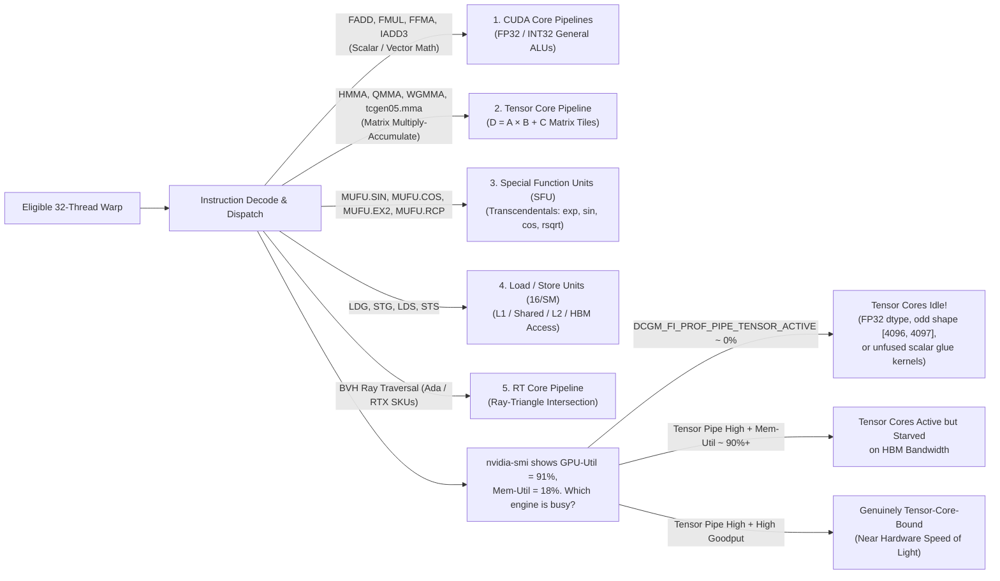
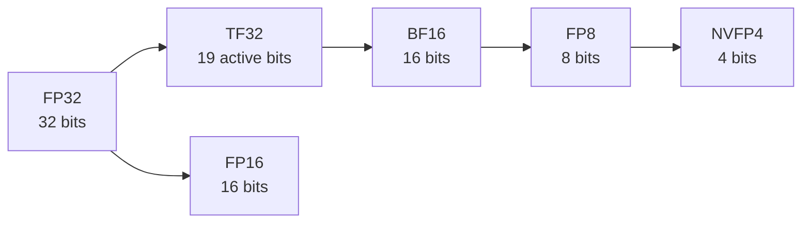
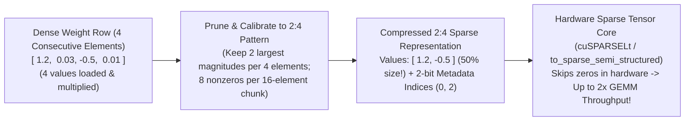
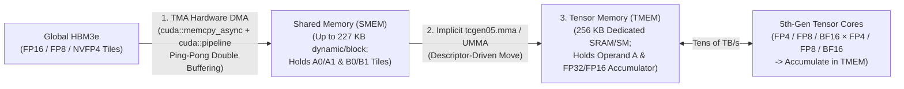

# 10.4 Tensor cores and numerical precision

| | |
|---|---|
| **Status** | Drafted (`tensor_cores_precision_lab.py`: 25 checks pass; GPU profiler commands **untested** on live Nebius GPU VM) |
| **Level** | Intermediate |
| **Priority tier** | 2 |
| **Lab venue** | Nebius GPU + self-checking Python model (`code/part10/tensor_cores_precision_lab.py`) |
| **Part** | Part 10: The GPU and CUDA |
| **Sources used** | *AI Systems Performance Engineering* Ch. 2, Ch. 6 & Ch. 9; `nvidia-devops` V2 (Ch. 1, Ch. 4) |

## Why this matters for AI infrastructure

When two workloads run on the exact same NVIDIA GPU, both can report `91%` utilization in `nvidia-smi`, yet one finishes in 10 milliseconds while the other takes 500 milliseconds. Why? Because the physical GPU is not one generic calculator: each Streaming Multiprocessor (`SM`) contains multiple distinct execution engines (**CUDA Cores**, **Tensor Cores**, **Special Function Units**, **Load/Store Units**, and on graphics/universal SKUs, **RT Cores**), and `nvidia-smi` `GPU-Util` only reports that *some* engine was active.

On a modern data center GPU such as Hopper `H100` or Blackwell `B200`, the vast majority of the chip's mathematical horsepower lives inside its **Tensor Cores**—and unlocking them is a joint hardware-and-software contract:
- On a Blackwell `B200`, standard scalar **FP32** compute peaks around **`~80 TeraFLOPS`**, whereas dense 4-bit **`NVFP4` Tensor Core** compute reaches **`10 PetaFLOPS`** (`15 PetaFLOPS` on `B300` Ultra)—a **125× difference** on the exact same silicon.
- Lowering precision does not just speed up matrix math; it shrinks every weight tensor in **HBM** and multiplies the number of weights carried inside every **128-byte cache line** (from `32` `FP32` values up to `256` `NVFP4` values).
- Yet a single unaligned matrix dimension (such as a weight matrix of shape `[4096, 4097]` instead of `[4096, 4096]`) or a missing PyTorch flag (`torch.set_float32_matmul_precision('high')`) can cause the software stack to bypass the Tensor Cores silently and fall back to general arithmetic pipelines with zero error messages.

This chapter dissects the execution engines inside an SM, maps the exact bit layouts and dynamic-range trade-offs of every AI numerical format (`FP64`, `FP32`, `TF32`, `FP16`, `BF16`, `FP8`, `INT8`, and `NVFP4`), and explains how the **Transformer Engine**, **2:4 Structured Sparsity**, **Blackwell Tensor Memory (`TMEM`) + `TMA`**, and **NVIDIA `CUTLASS`** keep Tensor Cores running at up to **98% utilization**.

## Prerequisites and outcomes

**Prerequisites:**
- CPU versus GPU throughput design and peak TFLOP/s formulas (`10.1`).
- The SIMT execution hierarchy (`Thread → Warp → Thread Block → Cluster → Grid`) and 4-partition SM warp schedulers (`10.2`).
- The 7-tier GPU memory hierarchy (`Registers`, `Shared/L1`, `TMEM`, `L2`, `HBM`) and 128-byte cache-line coalescing (`10.3`).

**Outcomes:** After completing this chapter, you will be able to:
1. Distinguish the five execution pipelines inside an SM (**CUDA Cores**, **Tensor Cores**, **RT Cores**, **Load/Store Units**, and **Special Function Units `SFUs`**) and diagnose whether a `91%`-busy GPU is actually engaging its Tensor Cores.
2. Compare the exact bit layouts (sign, exponent, mantissa), byte footprints, and 128-byte cache-line densities of **`FP64`**, **`FP32`**, **`TF32`**, **`FP16`**, **`BF16`**, **`FP8` (`E4M3` / `E5M2`)**, **`INT8` (`DP4A` vs MMA)**, and **`NVFP4` (two-level micro-scaling)**.
3. Explain why **`BF16`** avoids gradient underflow without `GradScaler` whereas **`FP16`** requires loss scaling, and configure **`TF32`** and **Automatic Mixed Precision (`torch.amp.autocast`)** in PyTorch.
4. Explain how the **Transformer Engine (`TE`)**, **Blackwell `TMEM` (`256 KB/SM`) + `TMA` (`tcgen05.mma`)**, and **Blackwell hardware decompression** work together—and why a 1.8-trillion-parameter MoE model jumped from `3.4 tokens/s/GPU` (`>5 s` TTFT) on `H100` to `150 tokens/s/GPU` (`~50 ms` TTFT) on `GB200 NVL72`.
5. Validate hardware **2:4 Structured Sparsity** (`2` nonzeros per `4` consecutive weights / `8` per `16`-element chunk via `cuSPARSELt` and `to_sparse_semi_structured()`), size tiles for `256 KB` `TMEM` in **`CUTLASS`**, and audit matrix shapes (`M, N, K`) for 16-byte Tensor Core tile alignment.

---

## 1. Specialized execution engines inside an SM: CUDA Cores, Tensor Cores, RT Cores, and SFUs

General-purpose hardware is flexible, but flexibility costs silicon area and watts; whenever a specific mathematical pattern dominates a workload, dedicated hardware datapaths deliver orders of magnitude more work per clock cycle and per watt.

### 1.1 How warp instructions route to specialized SM pipelines

When one of the SM's four warp schedulers selects an **Eligible** 32-thread warp, the instruction decoder inspects the instruction opcode and routes it to one of five specialized execution pipelines:



| Execution engine | Primary operations | Where it is used in AI & HPC | Common operational misconception |
|---|---|---|---|
| **1. CUDA Cores** (`FP32` / `INT32` lanes) | Scalar/vector floating-point and integer math (`D = A × B + C` on single numbers), comparisons, indexing, reductions, bitwise logic. | Address calculation, activation functions (`GeLU`, `SiLU`), normalization (`LayerNorm`, `RMSNorm`), reductions, and custom non-matrix kernels. | **"More CUDA Cores = faster LLM."** CUDA Core counts are not comparable across generations and do not run dense transformer `GEMM`s on modern AI GPUs. |
| **2. Tensor Cores** (Matrix Engines) | Fused matrix-tile Multiply-Accumulate (`D = A × B + C` where `A, B, C, D` are matrix tiles) across `TF32`, `BF16`, `FP16`, `FP8`, `INT8`, `NVFP4` (plus `FP64` DMP Tensor Cores on SXM HPC SKUs). | Linear projections (`Q, K, V, O`, MLP `up/gate/down`), attention score/value `BMM`s, and convolutions (`cuBLAS`, `cuDNN`, `CUTLASS`, `Triton`, `TensorRT-LLM`). | **"Tensor Cores turn on automatically for any code."** They only engage when dtype, matrix dimensions/alignment, and library/compiler kernels target MMA instructions. |
| **3. Special Function Units (`SFUs`)** | Hardware approximation of transcendental functions (`sin`, `cos`, `exp`, `log`, `rcp`, `rsqrt`). | Transformer **Attention `softmax`** (`exp(x)`) and **RMSNorm / LayerNorm** (`rsqrtf` inverse square root). | Ignoring `SFU` throughput: in long-context attention, `softmax` exponentials become a major bottleneck unless `SFU` pipelines are expanded (as in Hopper and Blackwell). |
| **4. Load / Store Units (`LD/ST`) & `TMA`** | Memory address generation and data movement between Registers, Shared Memory, `TMEM`, L2, and HBM. | Every kernel load and store (offloaded for bulk tiles by the **Tensor Memory Accelerator `TMA`**). | Confusing `nvidia-smi` `GPU-Util` with math activity when warps are simply stalled on `LD/ST` queues. |
| **5. RT Cores** (on `L4`, `L40S`, RTX) | Hardware **Bounding Volume Hierarchy (`BVH`)** tree traversal and ray-triangle intersection tests. | 3D rendering, Omniverse digital twins, ray-traced simulation, and spatial audio/wireless propagation. | **Using RT Core counts to justify an AI training/inference purchase.** RT Cores accelerate geometric ray intersections, *not* neural network matrix multiplications. |

### 1.2 Why `nvidia-smi` `GPU-Util: 91%` cannot prove Tensor Core usage

Suppose you run `nvidia-smi --query-gpu=utilization.gpu,utilization.memory --format=csv,noheader` during an inference test and observe:

```text
91 %, 18 %
```

What does `91 %, 18 %` prove?
- The low `18%` memory-interface busy time rules out an HBM bandwidth bottleneck.
- However, `91%` GPU utilization is **completely ambiguous** between a high-speed Tensor Core `GEMM` and a slow scalar CUDA Core loop. If `nvidia-smi dmon -s ucm` shows `sm = 91%` and `mem = 22%`, yet your model's tokens/sec are 5× below expectation, the SMs are burning cycles on scalar CUDA Core pipelines (either because the matmul fell back to general FP32/unaligned kernels, or because unfused elementwise glue ops dominate runtime).
- To verify Tensor Core engagement, always check the hardware pipeline counter in **DCGM** (**`DCGM_FI_PROF_PIPE_TENSOR_ACTIVE`**) or **Nsight Compute (`ncu`)** (`sm__pipe_tensor_cycles_active.avg.pct_of_peak_sustained_active`).

:::info In one minute: Section 1 takeaways
- An SM routes instructions by opcode: **CUDA Cores** handle scalar/elementwise math and indexing, **Tensor Cores** handle fused matrix multiply-accumulate tiles, **SFUs** handle `exp`/`rsqrt`/`sin`/`cos`, and **RT Cores** handle 3D ray-tracing `BVH` traversal (never AI `GEMM`s).
- `nvidia-smi` `GPU-Util` cannot distinguish scalar CUDA Core activity from Tensor Core activity; always check **`DCGM_FI_PROF_PIPE_TENSOR_ACTIVE`** or `ncu` Tensor Pipe metrics.
:::

---

## 2. Numerical precision formats: from `FP64` and `FP32` to `TF32`, `BF16`, `FP8`, `INT8`, and `NVFP4`

### 2.1 Bit layouts: Sign, Exponent (dynamic range), and Mantissa (precision)

Every floating-point number is stored as three bit fields:
1. **Sign (`1 bit`):** Positive (`0`) or negative (`1`).
2. **Exponent bits:** Determine the **dynamic range** (the largest and smallest non-zero magnitudes representable before overflowing to `Inf`/`NaN` or underflowing to `0`).
3. **Mantissa (fraction / significand) bits:** Determine the **granularity (precision)** between two adjacent powers of two.



| Format | Size | Where it runs | Bit layout (sign / exponent / mantissa) | Notes |
|---|---|---|---|---|
| FP32 | 32 bits (4 B) | CUDA cores | 1 / 8 / 23 | Range about 10^-38 to 10^38 |
| TF32 | 19 active bits in a 32-bit word | Tensor Core default for FP32 matmul | 1 / 8 / 10 | Same range as FP32, same precision as FP16 |
| FP16 | 16 bits (2 B) | Tensor Cores | 1 / 5 / 10 | Needs GradScaler in training. Narrow range (about 6x10^-5 to 65,504): underflow and overflow risk |
| BF16 | 16 bits (2 B) | Tensor Cores (workhorse training format) | 1 / 8 / 7 | Same range as FP32, so no GradScaler needed |
| FP8 | 8 bits (1 B) | Hopper and Blackwell Transformer Engine | E4M3: 1 / 4 / 3 (weights and forward activations). E5M2: 1 / 5 / 2 (gradients that need a wider range) | |
| NVFP4 | 4 bits (0.5 B) | Blackwell 2nd-gen Transformer Engine | 1 / 2 / 1 | Plus two-level micro-scaling (microblock and tensor scale) |

Here is the complete reference table across all formats used in HPC and AI (combining *AI Systems Performance Engineering* Chapters 2, 6, and 9 with `nvidia-devops` Volume 02 Chapters 1 and 4):

| Format | Sign / Exp / Mantissa bits | Storage size | Values per `128 B` cache line | `[4096, 4096]` matrix size (`16.78M` elems) | Primary hardware engine & operational rule |
|---|---|---|---|---|---|
| **`FP64`** (Double) | `1 / 11 / 52` (`64` bits) | `8.0 Bytes` | `16` values | `134.2 MB` (`128 MiB`) | FP64 pipelines / DMP Tensor Cores. Required for CFD, weather, and molecular dynamics where rounding errors explode. |
| **`FP32`** (Single) | `1 / 8 / 23` (`32` bits) | `4.0 Bytes` | **`32` values** | **`67.1 MB`** (`64 MiB`) | Scalar CUDA Cores (~80 TFLOPS dense on B200). Used for master weights, Tensor Core accumulators, and sensitive reductions (`LayerNorm`, `Softmax`). |
| **`TF32`** (TensorFloat-32) | **`1 / 8 / 10`** (`19` active bits in `32`-bit word) | `4.0 Bytes` (in HBM/regs) | **`32` values** | **`67.1 MB`** (`64 MiB`) | **Tensor Cores** (Ampere+). Keeps `FP32`'s 8-bit exponent range and `FP16`'s 10-bit mantissa; accelerates `FP32` matmuls without changing buffer sizes. |
| **`FP16`** (Half) | `1 / 5 / 10` (`16` bits) | `2.0 Bytes` | **`64` values** | **`33.6 MB`** (`32 MiB`) | **Tensor Cores** (Volta+). Narrow **5-bit exponent** causes small gradients to underflow to zero unless you use **`GradScaler` loss scaling**. |
| **`BF16`** (Bfloat16) | **`1 / 8 / 7`** (`16` bits) | `2.0 Bytes` | **`64` values** | **`33.6 MB`** (`32 MiB`) | **Tensor Cores** (Ampere+). Matches **`FP32`'s 8-bit exponent range**; default format for LLM training because it **rarely/never requires `GradScaler`**. |
| **`FP8`** (`E4M3` / `E5M2`) | `1 / 4 / 3` or `1 / 5 / 2` (`8` bits) | `1.0 Byte` | **`128` values** | **`16.8 MB`** (`16 MiB`) | **Hopper & Blackwell Tensor Cores** (`Transformer Engine`). Halves HBM traffic vs `BF16` and delivers **2×–3×** `BF16` TFLOPS with `FP32`/`TF32` accumulation. |
| **`INT8`** (8-bit Integer) | `1 sign + 7 integer` (`8` bits) | `1.0 Byte` | **`128` values** | **`16.8 MB`** (`16 MiB`) | **Tensor Core `INT8` MMA** (`cuBLASLt` / `CUTLASS` / `TorchAO`) or **`DP4A`** (`4 INT8 MACs/instruction` on CUDA cores). Cuts weight traffic by **75%** vs `FP32`. |
| **`NVFP4`** (4-bit Float) | `1 / 2 / 1` (`4` bits) + micro-scales | `0.5 Bytes` | **`256` values** | **`8.4 MB`** (`8 MiB`) | **Blackwell 5th-Gen Tensor Cores**. Uses **two-level micro-scaling**; reaches **`10 PFLOPS` dense on `B200`** (**`15 PFLOPS` on `B300`**) vs `~80 TFLOPS` `FP32` (**125×**). |

### 2.2 Why lowering precision wins twice: compute TFLOPS *and* 128-byte cache-line density

Look at the `[4096, 4096]` weight matrix comparison across the table above (`16,777,216` parameters):
1. **Halving (or quartering/eighthing) HBM memory traffic:**
   - In **`FP32` (`4 bytes`)**, reading that single weight matrix moves **`67,108,864 bytes` (`≈ 67.1 MB`, or `524,288` 128-byte cache lines)**.
   - In **`FP16` / `BF16` (`2 bytes`)**, the exact same matrix is **`33,554,432 bytes` (`≈ 33.6 MB`, `262,144` cache lines)**—a **2.0× bandwidth reduction**.
   - In **`FP8` / `INT8` (`1 byte`)**, it drops to **`16.8 MB`** (**4.0× reduction**), and in **`NVFP4` (`0.5 bytes`)**, it drops to **`8.4 MB`** (**8.0× reduction**), with **256 weights packed into every single 128-byte HBM transaction**.
   - Furthermore, Blackwell introduces a dedicated **hardware decompression engine** that can read 4-bit or 2-bit compressed weights from HBM and decompress them on the fly at load time before feeding the Tensor Cores.
2. **Enabling `TF32` and Automatic Mixed Precision (`AMP`) in PyTorch:**
   - By default, PyTorch leaves `FP32` matrix multiplications on slower scalar CUDA Core paths (`'highest'`) unless you opt into **`TF32`**:
     ```python
     import torch
     torch.set_float32_matmul_precision('high')  # 'highest' | 'high' | 'medium' -> enables TF32 Tensor Cores
     ```
   - For training and inference with `BF16` (which preserves `FP32`'s 8-bit exponent range so `GradScaler` is not needed, unlike `FP16` which defaults in `autocast` if `dtype` is omitted), wrap the forward pass in `torch.amp.autocast`:
     ```python
     with torch.amp.autocast("cuda", dtype=torch.bfloat16):
         output = model(input)
     ```
     Under `autocast` (and `torch.compile` / `TorchInductor`), large `GEMM`s and convolutions automatically dispatch to `BF16`/`FP16` Tensor Core kernels with **`FP32` accumulators**, while numerically sensitive reductions (`LayerNorm`, `Softmax`, loss functions) remain in **`FP32`**.

:::info In one minute: Section 2 takeaways
- **`TF32`** (`1 sign, 8 exp, 10 mantissa = 19 bits` in a 32-bit word) accelerates `FP32` matmuls on Tensor Cores via `torch.set_float32_matmul_precision('high')`.
- **`BF16`** (`1/8/7`) matches `FP32`'s 8-bit exponent range and avoids gradient underflow without `GradScaler`; **`FP16`** (`1/5/10`) has a narrow 5-bit exponent and requires `GradScaler`.
- Every 128-byte HBM transaction carries **`32` `FP32`**, **`64` `BF16`/`FP16`**, **`128` `FP8`/`INT8`**, or **`256` `NVFP4`** values; on Blackwell `B200`, dense `NVFP4` reaches **`10 PFLOPS`** (`15 PFLOPS` on `B300`) versus `~80 TFLOPS` dense `FP32` (**125×**).
:::

---

## 3. The Transformer Engine, 2:4 Structured Sparsity, and feeding Tensor Cores with `TMEM` and `TMA`

### 3.1 The Transformer Engine (`FP8` and two-level micro-scaled `NVFP4`)

When quantizing a model down to 8-bit (`FP8`) or 4-bit (`NVFP4`), a static, one-size-fits-all cast across the entire neural network can degrade accuracy if early layers or outlier activations overflow the tiny exponent range.

NVIDIA's **Transformer Engine (`TE`)** solves this through hardware-software co-design:
1. **Dynamic per-layer precision and scaling:** The Transformer Engine inspects tensor amax histograms and dynamically selects **`FP16`/`BF16`** for noise-sensitive layers while applying **`FP8`** (`E4M3` for weights/activations, `E5M2` for gradients) or **`NVFP4`** on tolerant linear and expert layers, accumulating partial sums in **`FP32` / `BF16` / `FP16`** inside Tensor Cores.
2. **Two-level micro-scaling in `NVFP4`:** With only 4 bits per weight (`1 sign, 2 exponent, 1 mantissa`), a single tensor-wide scaling factor cannot prevent outlier weights from crushing normal weights to zero. **`NVFP4`** applies **two-level scaling**: a fine-grained **per-microblock scale factor** shared across a tiny local group of weights, combined with a **higher-level tensor scale factor**—preserving model accuracy at 0.5 bytes per parameter.
3. **Real-world impact on a 1.8-trillion-parameter MoE model (ASP Ch. 2 pp. 27, 31):**
   - On a Hopper **`H100`** cluster (where inter-node communication crossed InfiniBand and weights used 8/16-bit formats), serving a **1.8-trillion-parameter MoE model** achieved only **`~3.4 tokens/sec per GPU`** with **`>5,000 ms` (`>5 seconds`) Time To First Token (`TTFT`)**—too slow for interactive chat.
   - On a Blackwell **`GB200 NVL72`** rack (combining **`NVFP4`**, 2nd-gen Transformer Engine, `8.0 TB/s` HBM3e, and the 72-GPU `1.8 TB/s` NVLink 5 domain), the exact same 1.8T MoE model reached **`~150 tokens/sec per GPU`** with **`~50 ms` `TTFT`**—roughly a **30×–44× real-time throughput leap** and a **100× reduction in first-token latency**.

### 3.2 Hardware 2:4 Structured Sparsity (`Sparse Tensor Cores` and `cuSPARSELt`)

Beginning with Ampere and continuing through Hopper and Blackwell, Tensor Cores include dedicated **Sparse Tensor Core** hardware that accelerates **2:4 structured sparsity**:



Three operational rules govern 2:4 structured sparsity (from *AI Systems Performance Engineering* Chapter 9):
1. **The exact hardware rule (`2` of `4` / `8` of `16`):** In every contiguous block of **4 weights**, at least **2 weights must be zero** (at most **2 nonzeros per 4 elements**, or **8 nonzeros per 16-element chunk**). Arbitrary unstructured sparsity (random zeros scattered without the 2-of-4 rule) receives **zero** hardware acceleration from Sparse Tensor Cores.
2. **Inference-first workflow (`to_sparse_semi_structured()`):** Because gradients during backpropagation are dense and change sparsity patterns dynamically, 2:4 structured sparsity is used primarily for **post-training inference deployment**: prune and fine-tune/calibrate the trained model, convert weight tensors in PyTorch with **`to_sparse_semi_structured()`** (backed by **`cuSPARSELt`**), and dispatch to Sparse Tensor Cores for up to **2× higher throughput** and **~2× lower weight memory traffic**.
3. **Batch-size amortization trap:** At **`batch_size = 1`**, the fixed overhead of reading 2-bit sparse metadata indices and launching sparse kernels is not amortized, yielding little speedup. Use batch sizes of **`128` to `256` tokens** so the `TMEM` and Sparse Tensor Core pipelines stay saturated.

### 3.3 How `TMA`, `SMEM`, and `TMEM` (`256 KB/SM`) feed Blackwell `tcgen05` Tensor Cores

On prior architectures (Volta/Ampere), Tensor Core `MMA` fragments and accumulators lived inside the SM's general **Register File**—causing severe register pressure that reduced warp occupancy. Blackwell eliminates this bottleneck with **256 KB (`262,144 bytes`) of dedicated Tensor Memory (`TMEM`) per SM**:



How much tile data fits inside Blackwell's **`256 KB` (`256 KiB = 262,144 B`) per-SM `TMEM`**?
- A **`256 × 512` tile in `FP16`/`BF16` (`2 bytes/elem`)** occupies `256 × 512 × 2 =` **`262,144 bytes = 256.0 KiB`** (**100%** of `TMEM`).
- A **`256 × 256` accumulator tile in `FP32` (`4 bytes/elem`)** occupies `256 × 256 × 4 =` **`262,144 bytes = 256.0 KiB`** (**100%** of `TMEM`).
- A **`256 × 256` operand tile in `NVFP4` (`0.5 bytes/elem`)** occupies only `256 × 256 × 0.5 =` **`32,768 bytes = 32.0 KiB`** (**12.5%** of `TMEM`, allowing up to **8 such tiles** in `TMEM`).

---

## 4. Using `CUTLASS` and auditing Tensor Core shape alignment

### 4.1 Why `CUTLASS` is preferred over hand-written `MMA` assembly

Writing a raw Blackwell `tcgen05.mma` or Hopper `wgmma` kernel by hand requires managing `TMA` tensor descriptors, `cuda::pipeline` ping-pong stages in Shared Memory, `TMEM` accumulator lifecycles, warp specialization, and Thread Block Cluster `DSMEM` multicast. **NVIDIA `CUTLASS`** wraps that entire pipeline into a C++ template (`cutlass::gemm::device::Gemm<..., cutlass::arch::OpClassTensorOp, cutlass::arch::Sm100>`)—and powers `cuBLAS`, `cuDNN`, and PyTorch's `TorchInductor` (`max-autotune`) backend under the hood.

Comparing a hand-tuned `MMA` kernel against a `CUTLASS` `GEMM` template on `FP16` inputs with `FP32` accumulation (from *AI Systems Performance Engineering* Chapter 9 Table 9-1):

| Metric (FP16 inputs, FP32 accumulate, ASP Ch. 9 Table 9-1) | Hand-tuned `MMA` kernel | `CUTLASS` `GEMM` template | Operational takeaway |
|---|---|---|---|
| **Tensor Core utilization (`ncu`)** | **`98%`** | **`98%`** | Matches hand-tuned assembly within ~0–2%. |
| **Registers per thread (`-Xptxas=-v`)** | `~52` registers | `~60` registers | Well below the threshold that would reduce SM occupancy. |
| **Shared Memory per Thread Block (`CTA`)** | `~2 KB` | `~4 KB` | Negligible fraction of the `228 KB/SM` budget. |
| **Engineering effort & portability** | Weeks per GPU generation | **A few lines of template code** | Automatically inherits `TMEM`, `TMA`, `FP8`, and `NVFP4` upgrades. |

### 4.2 Auditing matrix dimensions (`M, N, K`) for 16-byte Tensor Core alignment

Why did the PyTorch snippet in `nvidia-devops` Volume 02 Chapter 4:

```python
w = torch.randn(4096, 4097, device="cuda", dtype=torch.float16)  # 4097 is NOT a multiple of 8!
x = torch.randn(32, 4097, device="cuda", dtype=torch.float16)
y = x @ w.T
```

cause throughput to collapse even though `dtype=torch.float16` was set?
- Tensor Core hardware loads and multiplies matrix tiles aligned to **16-byte (`128-bit`) boundaries**:
  - For **`TF32` (`4 bytes/elem`)**: dimensions `M, N, K` should be multiples of **`4`** (`16 B / 4 B`).
  - For **`FP16` / `BF16` (`2 bytes/elem`)**: dimensions `M, N, K` should be multiples of **`8`** (`16 B / 2 B`).
  - For **`FP8` / `INT8` (`1 byte/elem`)**: dimensions `M, N, K` should be multiples of **`16`** (`16 B / 1 B`).
  - For **`NVFP4` (`0.5 bytes/elem`)**: dimensions `M, N, K` should be multiples of **`32`** (`16 B / 0.5 B`).
- When a dimension is `4097` (an odd number), the tensor fails 16-byte tile alignment and forces `cuBLAS` / `CUTLASS` either to fall back to a much slower unaligned/scalar cleanup path or to pad the tensor at runtime. Always pad model vocabulary sizes, hidden dimensions, and batch sizes to multiples of **8, 16, or 32** (or **64/128** for large `TMA` tiles).

*(Note: Combining the 16-byte element-alignment rule across `TF32`/`FP16`/`FP8`/`NVFP4` with the `dmon` + `ncu` pipeline diagnostic tree from Volume 02 Chapter 4 into `check_tensor_core_eligibility` in `code/part10/tensor_cores_precision.py` is **my inference**.)*

:::info In one minute: Section 3 & 4 takeaways
- The **Transformer Engine** dynamically pairs **`FP8` / `NVFP4`** (using two-level micro-scaling) with high-precision accumulation in **`TMEM` (`256 KB/SM`)**, boosting a 1.8T MoE model from **`3.4` to `150 tokens/s/GPU`** (`>5 s` to `50 ms` TTFT) on `GB200 NVL72`.
- **2:4 Structured Sparsity** requires at most **2 nonzeros in every 4 consecutive weights** (`to_sparse_semi_structured()` + `cuSPARSELt`) and needs batch sizes of **`128–256`** to amortize metadata overhead for up to **2× inference speedup**.
- Use **`CUTLASS`** (`cuBLAS` / `cuDNN` / `torch.compile`) to reach **98% Tensor Core utilization**, and always align `M, N, K` to **16-byte multiples** (`4` for `TF32`, `8` for `FP16`/`BF16`, `16` for `FP8`/`INT8`, `32` for `NVFP4`).
:::

---

## Commands and configurations that matter

### 1. Enabling `TF32`, `BF16` Automatic Mixed Precision, and 2:4 Sparsity in PyTorch

```python
import torch
from torch.sparse import to_sparse_semi_structured

# 1. Enable TF32 Tensor Cores for FP32 matmuls and convolutions (Ampere, Hopper, Blackwell)
torch.set_float32_matmul_precision("high")   # or torch.backends.cuda.matmul.allow_tf32 = True
torch.backends.cudnn.allow_tf32 = True

# 2. Run forward pass under BF16 Automatic Mixed Precision (8-bit exponent -> no GradScaler needed)
with torch.amp.autocast("cuda", dtype=torch.bfloat16):
    out = model(inputs)

# 3. Convert a pruned 2:4 weight matrix (aligned to multiples of 16/32) for Sparse Tensor Cores
# w_sparse = to_sparse_semi_structured(w_pruned_fp16)
```

### 2. Verifying Tensor Core pipeline activity vs scalar SM activity (`dcgmi` and `ncu`, untested on live Nebius GPU VM)

```bash
# 1. Stream SM Active (1002), Tensor Pipe Active (1004), and DRAM Active (1005) via DCGM
dcgmi dmon -e 1002,1004,1005 -d 1000

# 2. Profile Tensor Core cycle utilization and instruction mix in Nsight Compute (ncu)
ncu --metrics \
  sm__pipe_tensor_cycles_active.avg.pct_of_peak_sustained_active,\
  sm__cycles_active.avg.pct_of_peak_sustained_elapsed,\
  dram__throughput.avg.pct_of_peak_sustained_elapsed \
  python3 benchmark_matmul.py
```

---

## How it fails

| Failure mode | Symptom | Root cause | Diagnosis & fix |
|---|---|---|---|
| **1. Silent `FP32` scalar fallback (`Tensor Pipe ~ 0%`, `SM Active ~ 92%`)** | A PyTorch model runs at 90%+ `GPU-Util` on an `H100` or `B200`, but throughput is 5×–10× lower than datasheet `BF16`/`TF32` expectations. | The script runs in default `float32` (`'highest'` precision) without `torch.set_float32_matmul_precision('high')` or `torch.amp.autocast`, routing all `GEMM`s to scalar FP32 CUDA Cores. | Check `DCGM_FI_PROF_PIPE_TENSOR_ACTIVE` (`1004`) or `ncu` `sm__pipe_tensor_cycles_active`; enable `torch.set_float32_matmul_precision('high')` (`TF32`) or `torch.amp.autocast("cuda", dtype=torch.bfloat16)`. |
| **2. Unaligned matrix dimension (`[4096, 4097]`) breaks Tensor Core tiling** | `dtype` is correctly set to `torch.float16` or `bfloat16`, yet a linear layer or classifier head runs much slower than adjacent layers of similar size. | One or more matrix dimensions (`M, N, K`, such as an unpadded vocabulary size `50,257` or `4,097`) is not a multiple of `8` (`FP16`/`BF16`), `16` (`FP8`/`INT8`), or `32` (`NVFP4`), forcing fallback or unaligned cleanup kernels. | Pad vocabulary tables, hidden dimensions, and batch sizes to multiples of **8, 16, or 32** (`64`+ recommended for `TMA` tiles). |
| **3. Gradient underflow (`NaN` / zero gradients) when training in `FP16`** | Switching a training job from `FP32` to `torch.float16` causes loss to diverge to `NaN` or stall after a few hundred steps. | `FP16` has only a **5-bit exponent** (minimum normal value `~6 × 10^-5`), so small backpropagated gradients underflow to `0.0` without loss scaling. | Switch training from `FP16` to **`BF16` (`dtype=torch.bfloat16`)**, which has the same **8-bit exponent** range as `FP32`, or wrap `FP16` backward passes with `torch.cuda.amp.GradScaler()`. |
| **4. Zero speedup from `FP8` or `2:4` Sparsity at `batch_size = 1`** | Converting a model to `2:4` semi-structured sparsity or `FP8` produces almost no speedup during single-stream (`batch = 1`) testing. | At `M = 1`, fixed kernel-launch overhead, dynamic scale calculation, and 2-bit sparse metadata lookups dominate execution time and leave `TMEM` underutilized. | Benchmark and serve with **Continuous Batching** at effective token batch sizes of **`128` to `256+`** so Tensor Core and `TMEM` pipelines are amortized. |
| **5. Buying `RT Core` SKUs for dense LLM training** | A team procures PCIe graphics/rendering GPUs citing high "RT Core TFLOPS" on a marketing sheet, then hits severe interconnect and HBM bandwidth walls on multi-GPU LLM training. | **RT Cores** only accelerate ray-bounding-box/triangle intersections (`BVH`); LLM training requires **Tensor Cores**, **HBM3/HBM3e bandwidth**, and **NVLink/NVSwitch**. | Match the hardware to the workload's active engine: use `L4`/`L40S` when rendering/media/small-batch PCIe inference is the goal, and `H100`/`H200`/`B200` SXM/NVL72 for heavy Tensor Core + HBM + NVLink workloads. |

---

## Hands-on lab

### Self-checking Python model (`code/part10/tensor_cores_precision_lab.py` — verified here)

`code/part10/tensor_cores_precision.py` encodes the SM execution engine table, numerical format bit-layouts, 128-byte cache-line densities, `[4096, 4096]` matrix footprint calculators, Blackwell/Hopper benchmark ratios, 2:4 structured sparsity validators, `256 KB` `TMEM` tile sizers, and Tensor Core shape/alignment checkers, and `code/part10/tensor_cores_precision_lab.py` runs **25 self-checks**:
1. **5 SM execution engines** (`CUDA Cores`, `Tensor Cores`, `RT Cores`, `LD/ST`, `SFU`) and why `RT Cores` do not run AI `GEMM`s.
2. **Exact bit layouts** (`TF32` = `1/8/10 = 19` active bits in `32`-bit storage; `BF16` = `1/8/7` no `GradScaler` vs `FP16` = `1/5/10` needs `GradScaler`; `FP8 E4M3` = `1/4/3` vs `E5M2` = `1/5/2`).
3. **128-byte cache-line element density** (`32` `FP32`, `64` `FP16`/`BF16`, `128` `FP8`/`INT8`, `256` `NVFP4`) and **`[4096, 4096]` matrix footprints** (`67.1 MB` `FP32` → `33.6 MB` `FP16` → `16.8 MB` `FP8` → `8.4 MB` `NVFP4`).
4. **Blackwell `B200`/`B300` specs & 1.8T MoE benchmark** (`208B` transistors, `10 TB/s` `NV-HBI`, `192/180 GB` HBM3e; `B200` `10 PFLOPS` dense `NVFP4` vs `80 TFLOPS` `FP32` = `125×`; `B300` `15 PFLOPS` = `1.5×` `B200`; 1.8T MoE `3.4` → `150 tokens/s/GPU` and `5,000 ms` → `50 ms` TTFT; `DP4A` `4 INT8 MACs/inst`; `CUTLASS` `98%` Tensor Core utilization).
5. **Hardware `2:4` structured sparsity validator** (`2` nonzeros per `4` elements = `8` per `16`-element chunk = `50%` density → `2.0×` speedup; flags violating quads).
6. **Blackwell `256 KB` per-SM `TMEM` tile sizing** (`256 × 512` `FP16` = `256.0 KiB` and `256 × 256` `FP32` = `256.0 KiB` max out `TMEM`; `256 × 256` `NVFP4` = `32.0 KiB` fits `8` tiles).
7. **Tensor Core eligibility & pipeline diagnostic** (flags `FP32` scalar fallback, odd `K = 4097` misalignment, `M = 1` small-batch overhead, and HBM-starved vs compute-engaged Tensor Cores).

Run the lab from the repository root:

```bash
python3 -B code/part10/tensor_cores_precision_lab.py
```

Expected output (verified in this repository):

```text
=== Chapter 10.4 Lab: Tensor Cores and Numerical Precision ===
  [PASS] V2 Ch4: Distinguishes all 5 SM execution engines (CUDA Cores, Tensor Cores, RT Cores, LD/ST, SFU)
  [PASS] V2 Ch4: RT Cores target ray-tracing BVH traversal and are not AI GEMM accelerators
  [PASS] ASP Ch9 p.308: TF32 has 8-bit exponent (like FP32) and 10-bit mantissa (like FP16) = 19 active bits in 32-bit storage
  [PASS] ASP Ch9 p.309: BF16 has 8-bit exponent (matching FP32, no GradScaler needed) vs FP16 5-bit exponent (requires GradScaler)
  ...
  [PASS] 16-byte tile alignment requires multiples of 4 for TF32 (4B), 8 for FP16/BF16 (2B), 16 for FP8/INT8 (1B), and 32 for NVFP4 (0.5B)
  [PASS] ASP Ch9 p.309: Batch size M=1 on FP8 warns that fixed launch/conversion overhead is not amortized
  [PASS] Rejects non-multiple-of-4 array length in 2:4 sparsity validator
  [PASS] Rejects unknown numerical format
  [PASS] Rejects non-positive TMEM tile dimensions
  [PASS] Rejects non-positive GEMM dimensions

Summary: 25 passed, 0 failed (total 25)
```

---

## Common first mistakes

1. **Relying on `nvidia-smi` `GPU-Util` to verify Tensor Core usage:** `GPU-Util: 91%` can be 100% scalar FP32 CUDA Core activity with `0%` Tensor Core activity. Always inspect `DCGM_FI_PROF_PIPE_TENSOR_ACTIVE` or `ncu` `sm__pipe_tensor_cycles_active`.
2. **Leaving PyTorch in default `'highest'` `FP32` matmul mode when `FP32` tensors are used:** Set `torch.set_float32_matmul_precision('high')` so `FP32` matmuls run on **`TF32` Tensor Cores**.
3. **Using `torch.amp.autocast("cuda")` without specifying `dtype=torch.bfloat16`:** Default `autocast` on CUDA uses `float16` (`5-bit` exponent), which can underflow or overflow without `GradScaler`; pass `dtype=torch.bfloat16` on Ampere, Hopper, and Blackwell GPUs.
4. **Using unpadded odd matrix dimensions (such as `4,097` or `50,257`):** Tensor Core MMA instructions require 16-byte aligned tile dimensions (multiples of `8` for `FP16`/`BF16`, `16` for `FP8`/`INT8`, `32` for `NVFP4`).
5. **Expecting arbitrary unstructured weight pruning to speed up Tensor Cores:** Only **2:4 structured sparsity** (at most 2 nonzeros per 4 consecutive weights, formatted via `cuSPARSELt` / `to_sparse_semi_structured()`) is accelerated in hardware by Sparse Tensor Cores.

---

## Exercises

1. Run `python3 -B code/part10/tensor_cores_precision_lab.py` and inspect `code/part10/tensor_cores_precision.py`. Use `compare_matrix_precision_footprint` to calculate the byte size and 128-byte cache-line count of an `[8192, 28672]` Llama-3 MLP weight matrix across `FP32`, `BF16`, `FP8_E4M3`, and `NVFP4`.
2. Using `NUMERICAL_FORMATS`, explain why `TF32` (`1/8/10`) and `BF16` (`1/8/7`) both have the exact same dynamic range as `FP32` (`1/8/23`), and state which of the two has higher mantissa precision (`10` bits vs `7` bits).
3. Call `validate_2_to_4_structured_sparsity` on a 16-element weight vector where every second element is zero (`[1, 0, 2, 0, ...]`) versus one where the first four elements are `[1, 2, 3, 0]` and the next four are `[0, 0, 0, 1]`. Why does the second vector fail hardware 2:4 validation even though its overall density is still 50%?
4. Using `calc_tmem_tile_fit`, check how many `128 × 128` tiles fit inside Blackwell's `256 KB` per-SM `TMEM` for `FP32` (`4 B`), `BF16` (`2 B`), `FP8` (`1 B`), and `NVFP4` (`0.5 B`).
5. Call `check_tensor_core_eligibility(m, n, k, precision)` for a vocabulary projection layer of shape `M = 128, N = 128256, K = 4096` vs `M = 128, N = 50257, K = 4096` in `FP8_E4M3`. Which one is aligned for 16-byte Tensor Core tiles, and what should `50257` be padded to?
6. On a Nebius GPU VM (untested here), benchmark a `[8192, 8192] @ [8192, 8192]` PyTorch matmul in `float32` with `torch.set_float32_matmul_precision('highest')` vs `'high'` (`TF32`) and `torch.bfloat16`, while watching `dcgmi dmon -e 1002,1004,1005`.

---

## Interview angles

1. **"Why does switching a model from `FP32` to `BF16` or `FP8` speed up both compute-bound training and memory-bandwidth-bound inference?"**
   *Answer:* It wins on two fronts simultaneously: (1) on the **compute** side, it shifts matrix multiplications off scalar FP32 CUDA Cores onto **Tensor Cores** (which compute fused matrix tiles per cycle), and (2) on the **memory** side, it cuts every weight tensor's byte footprint by 2× (`BF16`: `67.1 MB → 33.6 MB` for a `4096 × 4096` matrix) or 4× (`FP8`: `16.8 MB`), packing `64` (`BF16`) or `128` (`FP8`) weights into every 128-byte HBM cache line instead of `32` (`FP32`).
2. **"Compare `FP16`, `BF16`, and `TF32`. Why did the industry standardize on `BF16` for LLM training?"**
   *Answer:* `FP16` (`1 sign, 5 exponent, 10 mantissa = 16 bits`) has a narrow 5-bit exponent range that causes small gradients to underflow to zero unless you maintain a dynamic `GradScaler`. **`BF16`** (`1 sign, 8 exponent, 7 mantissa = 16 bits`) trades 3 mantissa bits to keep the exact same **8-bit exponent dynamic range as `FP32`**, eliminating gradient underflow and `GradScaler` complexity while still cutting memory in half. **`TF32`** (`1 sign, 8 exponent, 10 mantissa = 19 bits` stored in a 32-bit word) keeps `FP32`'s 8-bit exponent and `FP16`'s 10-bit mantissa so existing 32-bit code can run on Tensor Cores via `torch.set_float32_matmul_precision('high')`.
3. **"How does Blackwell's `NVFP4` avoid accuracy collapse with only 4 bits per weight, and how fast is it relative to `FP32`?"**
   *Answer:* **`NVFP4`** (`1 sign, 2 exponent, 1 mantissa`) uses **two-level micro-scaling** in the 2nd-generation Transformer Engine—combining a fine-grained per-microblock scale factor with a tensor-level scale factor so local outliers do not crush neighboring weights—and accumulates partial products in higher precision (`BF16`/`FP16`/`FP32`) inside the `256 KB/SM` **`TMEM`**. On Blackwell `B200`, dense `NVFP4` reaches **`10 PetaFLOPS`** (`15 PetaFLOPS` on `B300` Ultra) compared to `~80 TeraFLOPS` dense `FP32` (**125× higher theoretical throughput**).
4. **"What is hardware 2:4 structured sparsity, and why doesn't random 50% weight pruning get accelerated on NVIDIA GPUs?"**
   *Answer:* Hardware **Sparse Tensor Cores** are wired specifically for a **2:4 semi-structured pattern** where **every group of 4 consecutive weights has at most 2 nonzero values** (`8` nonzeros per `16`-element chunk), stored at half width with 2-bit metadata indices (`cuSPARSELt` / `to_sparse_semi_structured()`). Random unstructured zeros cannot use that fixed multiplexer datapath and get zero hardware speedup.
5. **"A developer's `FP16` PyTorch model shows `92%` SM utilization in `nvidia-smi dmon`, yet throughput is poor and `DCGM_FI_PROF_PIPE_TENSOR_ACTIVE` is near zero. What do you check?"**
   *Answer:* Check whether (1) the layer dimensions (`M, N, K`, such as an odd vocabulary size `4097` or `50257`) fail 16-byte (`8`-element) Tensor Core alignment and triggered a fallback kernel, or (2) runtime is dominated by unfused scalar elementwise/normalization kernels between small matmuls; fix by padding dimensions to multiples of 8/16/32 and enabling `torch.compile` (`TorchInductor` / `CUTLASS` fusion).

---

## Checkpoint questions (20)

<details>
<summary><strong>1. What are the five execution pipelines inside an SM, and which specific instruction classes does each pipeline execute?</strong></summary>

CUDA Cores: scalar and vector FP32/INT32 math (FADD, FMUL, FFMA, IADD3), indexing, reductions. Tensor Cores: fused matrix multiply-accumulate tiles (HMMA, QMMA, WGMMA, tcgen05.mma). SFUs: transcendentals (MUFU.SIN, COS, EX2, RCP). Load/Store units, 16 per SM: LDG, STG, LDS, STS. RT Cores: BVH ray traversal and ray-triangle intersection on L4, L40S, and RTX parts.

</details>

<details>
<summary><strong>2. Why is citing **RT Core** counts to justify an AI training or LLM serving server purchase a requirements error?</strong></summary>

RT Cores accelerate geometric ray intersections for rendering, digital twins, and ray-traced simulation. They do nothing for neural-network matrix multiplication, so their count says nothing about training or LLM serving performance.

</details>

<details>
<summary><strong>3. If `nvidia-smi` reports `utilization.gpu = 91%` and `utilization.memory = 18%`, what does it prove, what stays ambiguous, and which `DCGM` or `ncu` metric distinguishes the cases?</strong></summary>

The 18% memory figure rules out an HBM bandwidth bottleneck, but 91% GPU-Util is ambiguous between a fast Tensor Core GEMM and a slow scalar CUDA Core loop (a matmul that fell back to FP32 or unaligned kernels, or unfused glue kernels). The chapter's diagnostic tree has three outcomes: Tensor pipe near 0% (idle), Tensor pipe high with memory about 90% (starved on HBM), and Tensor pipe high with good throughput (genuinely tensor-bound). The metric that separates them is DCGM_FI_PROF_PIPE_TENSOR_ACTIVE, or sm__pipe_tensor_cycles_active in ncu.

</details>

<details>
<summary><strong>4. State the exact bit breakdown (`sign / exponent / mantissa`) and byte storage size for **`FP32`**, **`TF32`**, **`FP16`**, and **`BF16`**.</strong></summary>

FP32: 1/8/23, 4 bytes. TF32: 1/8/10, 19 active bits inside a 32-bit word (4 bytes in HBM and registers). FP16: 1/5/10, 2 bytes. BF16: 1/8/7, 2 bytes.

</details>

<details>
<summary><strong>5. Why does **`FP16`** training require `GradScaler` loss scaling while **`BF16`** training rarely or never requires it?</strong></summary>

FP16 has a 5-bit exponent (range about 6x10^-5 to 65,504), so small gradients underflow to zero unless GradScaler scales the loss. BF16 keeps FP32's 8-bit exponent range, so gradients do not underflow and GradScaler is rarely or never needed.

</details>

<details>
<summary><strong>6. How do you enable **`TF32`** Tensor Core execution for `FP32` matrix multiplications in PyTorch, and how do you enable **`BF16`** Automatic Mixed Precision?</strong></summary>

TF32: torch.set_float32_matmul_precision('high') (the default 'highest' stays on the slower path). BF16 AMP: wrap the forward pass in with torch.amp.autocast("cuda", dtype=torch.bfloat16). Note that autocast defaults to FP16 if dtype is omitted.

</details>

<details>
<summary><strong>7. Under PyTorch `torch.amp.autocast`, which operations are cast to `BF16`/`FP16` on Tensor Cores, which precision is used for matrix **accumulation**, and why are operations like `LayerNorm` and `Softmax` kept in `FP32`?</strong></summary>

Large GEMMs and convolutions go to BF16/FP16 Tensor Core kernels with FP32 accumulators. Numerically sensitive reductions such as LayerNorm, Softmax, and loss functions stay in FP32, because their sums and exponentials need the extra precision.

</details>

<details>
<summary><strong>8. What are the two **`FP8`** bit-layout variants (`E4M3` and `E5M2`), and which one is preferred for weights/activations versus gradients?</strong></summary>

E4M3 (1/4/3) is used for weights and forward activations. E5M2 (1/5/2) has a wider range and is used for gradients.

</details>

<details>
<summary><strong>9. How many values are carried in a single **128-byte HBM memory transaction** for **`FP32` (`32`)**, **`FP16`/`BF16` (`64`)**, **`FP8`/`INT8` (`128`)**, and **`NVFP4` (`256`)**?</strong></summary>

A 128-byte transaction carries 32 FP32 values, 64 FP16/BF16 values, 128 FP8/INT8 values, and 256 NVFP4 values. FP64 carries 16.

</details>

<details>
<summary><strong>10. Calculate the exact byte size (and decimal MB) of a `[4096, 4096]` weight matrix in **`FP32` (`67.1 MB`)**, **`FP16`/`BF16` (`33.6 MB`)**, **`FP8`/`INT8` (`16.8 MB`)**, and **`NVFP4` (`8.4 MB`)**.</strong></summary>

[4096, 4096] is 16,777,216 elements. FP32: 67,108,864 bytes, about 67.1 MB. FP16/BF16: 33,554,432 bytes, about 33.6 MB. FP8/INT8: about 16.8 MB. NVFP4: about 8.4 MB (8x less than FP32, 256 weights per 128-byte transaction).

</details>

<details>
<summary><strong>11. How does **`NVFP4`** two-level micro-scaling work, and what is the dense `NVFP4` peak throughput on **Blackwell `B200` (`10 PFLOPS`)** and **`B300` Ultra (`15 PFLOPS`)** compared to `B200` dense `FP32` (`~80 TFLOPS`)?</strong></summary>

NVFP4 uses 4 bits (1/2/1) with two scale levels: a fine-grained scale per microblock of weights plus a higher-level tensor scale, so outliers do not crush normal weights. Dense NVFP4 peaks at 10 PFLOPS on B200 and 15 PFLOPS on B300, versus about 80 TFLOPS dense FP32 on B200, about 125x.

</details>

<details>
<summary><strong>12. What does Blackwell's **hardware decompression engine** do when loading compressed weights from HBM?</strong></summary>

It reads 4-bit or 2-bit compressed weights from HBM and decompresses them on the fly at load time, before feeding the Tensor Cores, so less data crosses HBM.

</details>

<details>
<summary><strong>13. In NVIDIA's benchmark of a **1.8-trillion-parameter MoE model**, how did per-GPU token throughput (`3.4` vs `150 tokens/s/GPU`) and first-token latency (`>5 s` vs `~50 ms`) compare between `H100` and `GB200 NVL72`?</strong></summary>

On H100 the 1.8-trillion-parameter MoE served about 3.4 tokens/s per GPU with a first-token latency above 5,000 ms. On GB200 NVL72 (NVFP4, second-generation Transformer Engine, NVLink 5 domain) it reached about 150 tokens/s per GPU with about 50 ms, roughly 30x to 44x the throughput and 100x lower first-token latency.

</details>

<details>
<summary><strong>14. What is the difference between the **`DP4A`** instruction (`4 INT8 MACs/instruction` on CUDA cores) and Tensor Core **`INT8` MMA** (`cuBLASLt` / `CUTLASS` / `TorchAO`)?</strong></summary>

DP4A runs on CUDA cores and performs 4 INT8 multiply-accumulates per instruction. Tensor Core INT8 MMA (through cuBLASLt, CUTLASS, or TorchAO) multiplies whole INT8 matrix tiles in the Tensor Core pipeline. INT8 cuts weight traffic by 75% versus FP32 either way.

</details>

<details>
<summary><strong>15. State the exact hardware rule for **2:4 structured sparsity** (`2` nonzeros per `4` elements / `8` per `16`-element chunk), name the PyTorch conversion function (`to_sparse_semi_structured()`) and NVIDIA library (`cuSPARSELt`), and explain why `batch_size = 1` sees little speedup.</strong></summary>

In every block of 4 consecutive weights at most 2 may be nonzero (8 nonzeros per 16-element chunk). Unstructured zeros get no hardware speedup. Convert with to_sparse_semi_structured() (backed by cuSPARSELt). At batch_size = 1 the cost of reading 2-bit metadata and launching sparse kernels is not amortized, so use batches of 128 to 256 tokens.

</details>

<details>
<summary><strong>16. Why is 2:4 structured sparsity applied primarily to **inference** rather than training?</strong></summary>

Backpropagation gradients are dense and change sparsity patterns dynamically, so the fixed 2:4 pattern does not fit training. It is used after training: prune, fine-tune or calibrate, convert, and deploy for up to 2x throughput and about 2x lower weight traffic.

</details>

<details>
<summary><strong>17. How do **`TMA`** (`HBM → SMEM`), **`SMEM`**, and **`TMEM` (`256 KB/SM`)** (`SMEM ↔ TMEM` via `tcgen05.mma`) cooperate during a Blackwell Tensor Core `GEMM`, and how does accumulating in `TMEM` reduce register pressure?</strong></summary>

TMA copies tiles from HBM into shared memory, with ping-pong buffers via cuda::pipeline. A descriptor-driven tcgen05.mma / UMMA move brings operands from SMEM into TMEM, where the 5th-generation Tensor Cores read operands and accumulate. Keeping accumulators in 256 KB of TMEM instead of the register file removes the register pressure that used to cut warp occupancy on Volta and Ampere.

</details>

<details>
<summary><strong>18. Show mathematically why a **`256 × 512` `FP16` tile (`2 B`)** or a **`256 × 256` `FP32` tile (`4 B`)** exactly maxes out a single SM's **`256 KB` (`256 KiB`) `TMEM`** budget.</strong></summary>

256 x 512 x 2 bytes = 262,144 bytes = 256 KiB. 256 x 256 x 4 bytes = 262,144 bytes = 256 KiB. Both equal the per-SM TMEM of 262,144 bytes. A 256 x 256 NVFP4 tile (0.5 bytes) is only 32 KiB, 12.5% of TMEM.

</details>

<details>
<summary><strong>19. In Table 9-1 of *AI Systems Performance Engineering*, how does a **`CUTLASS` `GEMM`** template (`cutlass::arch::OpClassTensorOp`, `Sm100`) compare against a hand-tuned `MMA` kernel in Tensor Core utilization (`98%` vs `98%`), register count (`~60` vs `~52`), and Shared Memory (`~4 KB` vs `~2 KB`)?</strong></summary>

Both reach 98% Tensor Core utilization. The CUTLASS template uses about 60 registers per thread versus about 52 for the hand-tuned kernel, and about 4 KB of shared memory per block versus about 2 KB. Both are small against the 228 KB per SM budget, and CUTLASS needs a few lines of template code instead of weeks per GPU generation.

</details>

<details>
<summary><strong>20. Why can changing a weight matrix's width from `4096` to `4097` in `FP16` cause a dramatic drop in throughput, and what are the 16-byte element alignment multiples for `TF32` (`4`), `FP16`/`BF16` (`8`), `FP8`/`INT8` (`16`), and `NVFP4` (`32`)?</strong></summary>

Tensor Cores load tiles aligned to 16-byte boundaries. 4097 is not a multiple of 8, so cuBLAS or CUTLASS falls back to a slower unaligned path or pads at runtime. Required multiples of M, N, K: TF32 4, FP16/BF16 8, FP8/INT8 16, NVFP4 32.

</details>

---

## Sources and review notes

### Sources read in full for this chapter
1. **Chris Fregly, *AI Systems Performance Engineering* (`ai-systems-performance-engineering`):**
   - Chapter 2 (*AI System Hardware Overview*, pp. 24–31): Blackwell `B200` dual-die MCM (`2 × 104B = 208B` transistors linked by `10 TB/s` `NV-HBI`, `8 × 24 GB` 8-Hi HBM3e stacks = `192 GB` physical / `180 GB` usable @ `~8 TB/s`, `126 MB` L2 cache = `63 MB/die` vs `H100` `80B` transistors, `80 GB` HBM3 @ `3.35 TB/s`, `50 MB` L2), Tensor Cores and Transformer Engine (`FP16`/`BF16` → `FP8` → `NVFP4`, `>1.4 EFLOPS` `FP4` on `NVL72`), and the **1.8-trillion-parameter MoE benchmark** (`H100` `~3.4 tokens/s/GPU` @ `>5 s` TTFT vs `GB200 NVL72` `~150 tokens/s/GPU` @ `~50 ms` TTFT).
   - Chapter 6 (*GPU Architecture, CUDA Programming, and Maximizing Occupancy*, p. 210): 128-byte memory transaction density (`32` `FP32`, `64` `FP16`, `128` `FP8`, `256` `FP4` values) and Blackwell hardware weight decompression engine.
   - Chapter 9 (*Increasing CUDA Kernel Efficiency and Arithmetic Intensity*, pp. 302–318): **2:4 Structured Sparsity** (`2` of `4` / `8` of `16` nonzeros, `cuSPARSELt`, PyTorch `to_sparse_semi_structured()`, batch size `1` vs `128–256`, pp. 302–304), **Feeding Tensor Cores with `TMEM` (`256 KB/SM`) and `TMA`** (`tcgen05.mma`, double-buffered `stage_ab_tiles`, pp. 305–308), **`TF32` and Automatic Mixed Precision** (`1/8/10` bit layout, `torch.set_float32_matmul_precision('high')`, `torch.amp.autocast("cuda", dtype=torch.bfloat16)`, `GradScaler`, pp. 308–309), **`BF16`/`FP16`, `FP8`, and `NVFP4` Reduced Precision** (`5-bit` vs `8-bit` exponent, two-level micro-scaling in `NVFP4`, `B200` `10 PFLOPS` dense `NVFP4` vs `~80 TFLOPS` dense `FP32`, `B300` `15 PFLOPS` dense `NVFP4`, `256 × 256` `FP4` tile in `TMEM`, pp. 309–311), **`INT8` and `DP4A`** (`4 INT8 MACs/instruction`, `75%` weight traffic reduction vs `FP32`, `TorchAO`, `cuBLASLt`, p. 311), and **Transformer Engine, `TMEM`, and `CUTLASS`** (`256 × 512` `FP16` = `256 KiB` and `256 × 256` `FP32` = `256 KiB` `TMEM` tiles, `cutlass::gemm::device::Gemm<..., OpClassTensorOp, Sm100>`, Table 9-1 `98%` Tensor Core utilization, pp. 311–318). *(Sections of Chapter 9 on Roofline fundamentals, multilevel microtiling, kernel fusion, recomputation, and inline PTX/SASS are covered in Chapters `10.5` and `10.15`.)*
2. **Migrated from `nvidia-devops`:**
   - `nvidia-zero-to-hero/volume-02/chapter-04-cuda-cores-tensor-cores-and-rt-cores.md`
   - `nvidia-zero-to-hero/volume-02/chapter-01-why-gpu-architecture-evolved.md` (precision trade-offs section)

### Added from general knowledge (not in the cited sources)

- The FP16 range figures (about 6x10^-5 to 65,504) in the format table.
- The example matrix shapes `50,257` (a GPT-2-style vocabulary), `128,256` and `28,672` (Llama-3 style dimensions) used in the failure table and exercises. They are illustrative shapes; check the real values in the model config.

### Mapped notes checked in the 2026-10-25 deep-read pass

These files are assigned to this chapter in `planning/MIGRATION_MAP.md`. Status of each after the deep-read pass is listed below.

- `nvidia-zero-to-hero/volume-02/chapter-02-inside-a-modern-nvidia-gpu.md`: not re-read in this pass; read earlier for 10.2, topic covered there
- `nvidia-zero-to-hero/volume-02/chapter-03-threads-warps-blocks-and-sms.md`: not re-read in this pass; read earlier for 10.2, topic covered there
- `nvidia-zero-to-hero/volume-02/chapter-05-gpu-memory-hierarchy.md`: read in full; new material added to 10.3 section 5
- `nvidia-zero-to-hero/volume-02/chapter-06-scheduling-occupancy-and-instruction-dispatch.md`: not re-read in this pass; read earlier for 10.2, topic covered there
- `nvidia-zero-to-hero/volume-02/chapter-07-registers-shared-memory-and-local-memory.md`: read in full; new material added to 10.3 section 5
- `nvidia-zero-to-hero/volume-02/chapter-08-global-memory-l1-l2-and-hbm.md`: read in full; new material added to 10.3 section 5
- `nvidia-zero-to-hero/volume-02/chapter-09-divergence-coalescing-and-bottleneck-reasoning.md`: not re-read in this pass; read earlier for 10.2, topic covered there
- `nvidia-zero-to-hero/volume-02/chapter-10-gpu-topology-peer-access-and-data-paths.md`: read in full; nothing new for this chapter, its NVLink-versus-SYS arithmetic and degraded-link example are already in 10.6
- `nvidia-zero-to-hero/volume-02/chapter-11-building-a-gpu-performance-model.md`: read in full; nothing new for this chapter, roofline and bottleneck content is already in 10.5
- `nvidia-zero-to-hero/volume-02/chapter-12-volume-02-architecture-summary.md`: read in full; nothing new for this chapter, symptom map and anti-patterns are already in 10.5
- `nvidia-zero-to-hero/volume-02/labs/lab-02-inspect-gpu-engine-and-memory-behavior.md`: read in full; nothing new for this chapter, the container and Container Toolkit parts belong to 10.9 and 10.8
- `nvidia-zero-to-hero/volume-02/labs/lab-03-profile-memory-and-warp-efficiency.md`: read in full; new material added to 10.3 section 5.4

### Run here
- `python3 -B code/part10/tensor_cores_precision_lab.py` — **25 passed, 0 failed**.

### My own choices and inferences, labelled in the text
1. **Tensor Core 16-byte alignment and SM pipeline routing validator (`check_tensor_core_eligibility` in `code/part10/tensor_cores_precision.py` and Section 4.2):** Combining the 16-byte (`128-bit`) tile alignment multiples (`4` for `TF32`, `8` for `FP16`/`BF16`, `16` for `FP8`/`INT8`, `32` for `NVFP4`) with the `[4096, 4097]` misalignment example and `dmon` + `ncu` decision tree from `nvidia-devops` Volume 02 Chapter 4 into a deterministic Python validator is **my inference**.

### Not verified on live hardware
- `dcgmi dmon -e 1002,1004,1005` and `ncu --metrics sm__pipe_tensor_cycles_active...` were not executed on a live GPU VM in this authoring environment.
