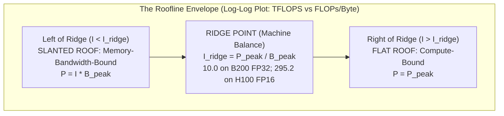
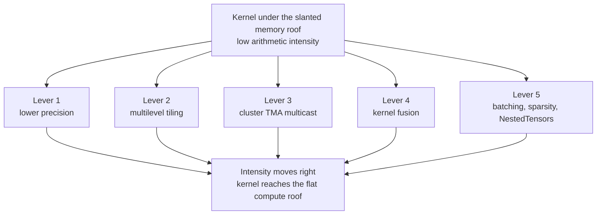
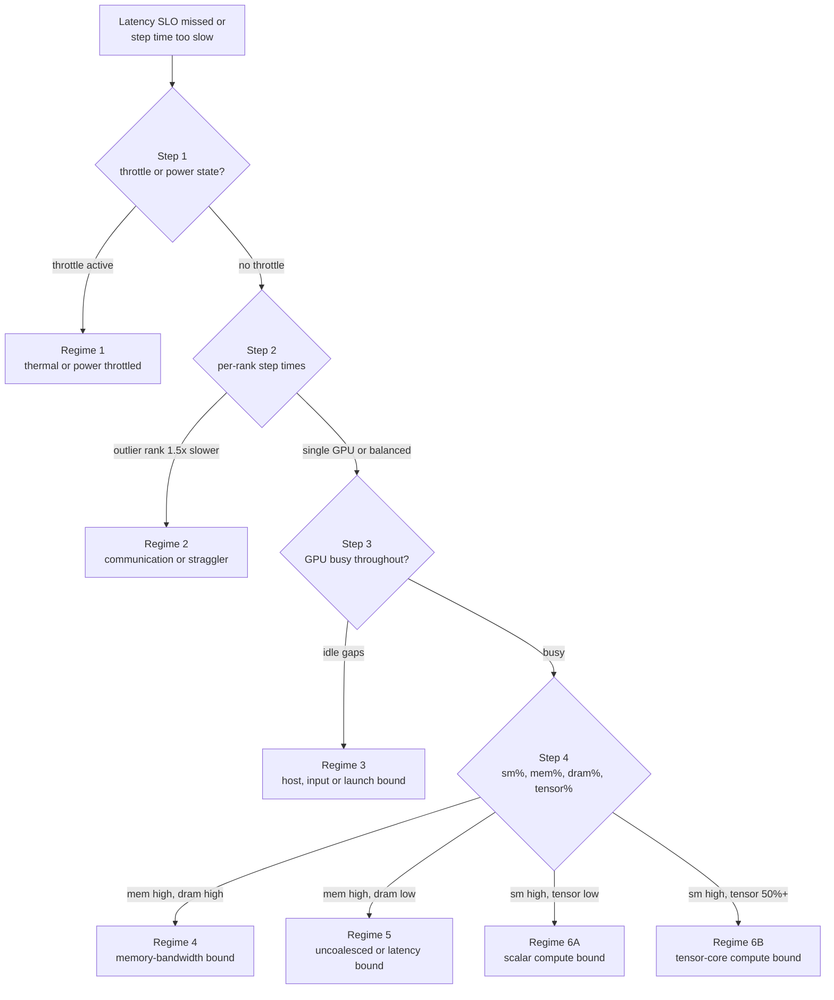

# 10.5 The roofline model and performance modelling

| Field | Value |
|---|---|
| Status | Drafted, with 25 checks passing in `roofline_model_lab.py` and `ncu` or `ert` commands untested on a live Nebius GPU VM |
| Level | Advanced |
| Priority tier | 2 |
| Lab venue | Nebius GPU and self-checking Python model in `code/part10/roofline_model_lab.py` |
| Part | Part 10: The GPU and CUDA |
| Sources used | *AI Systems Performance Engineering* Chapters 6, 7, and 9; *Parallel and High Performance Computing* Chapters 3 and 9; `nvidia-devops` Volume 17 Chapter 3 and Volume 2 Chapters 11 and 12 |

## Why this matters for AI infrastructure

An engineering leader can easily waste $500,000 upgrading an A100 cluster to H100 GPUs for a real-time inference service. Even though the H100 offers three times higher Tensor Core compute, a single-stream service spends almost all its time waiting on memory reads. Adding more GPUs to an overloaded large language model decode service also fails to lower single-request token latency. Every worker is already waiting on memory bandwidth.

Performance engineering begins before you open a profiler. It starts with an analytical model that connects what the workload demands to what the hardware can physically supply. Every processor is governed by its speeds and feeds.

- Speeds represent Peak Compute in FLOP/s. This measures how fast the arithmetic units and Tensor Cores crunch numbers once operands sit in registers.
- Feeds represent Peak Memory Bandwidth in GB/s or TB/s plus latency. This measures how fast the memory hierarchy, NVLink, and network deliver bytes to those arithmetic units.

The Roofline Model originated at Lawrence Berkeley National Laboratory. It combines both physical limits on a single log-log graph against a workload's Arithmetic Intensity in FLOPs per byte moved. The chart shows immediately whether a kernel is pinned under the Slanted Roof as a memory-bandwidth-bound workload or under the Flat Horizontal Roof as a compute-bound workload. That distinction dictates whether batching, quantization, shared-memory tiling, kernel fusion, TMA cluster multicast, or faster compute will actually improve throughput.

## Prerequisites and outcomes

Prerequisites for this chapter include the peak compute and memory bandwidth formulas, SIMT occupancy, the GPU memory hierarchy, and Tensor Core precision formats covered in earlier chapters of Part 10.

After completing this chapter, you will be able to achieve five concrete outcomes.

1. Define Arithmetic Intensity, Machine Balance, and the Ridge Point. Write the Roofline equation for attainable performance.
2. Calculate the exact Ridge Points of modern GPUs across scalar and dense Tensor Core execution modes on H100 SXM, H200 SXM, and Blackwell B200.
3. Prove mathematically why elementwise vector addition and single-request inference sit far below the ridge point. Explain how non-contiguous cache usage lowers the slanted memory roof.
4. Apply the five architectural levers that shift a memory-bound kernel rightward toward the compute roof. These levers include batching, reduced precision, multilevel tiling, Thread Block Cluster TMA multicast, and kernel fusion with recomputation.
5. Execute a hypothesis-driven GPU bottleneck elimination workflow across six system regimes. Separate host or launch delays, memory bandwidth saturation, uncoalesced latency stalls, scalar divergence, Tensor Core saturation, thermal or power throttling, and multi-GPU stragglers.

---

## 1. Speeds, feeds, and the Roofline equation

When a GPU kernel runs much slower than the datasheet promises, engineers often blame the compiler or assume they need a newer GPU. In reality, a processor can never compute faster than its arithmetic units execute instructions. It also can never compute faster than its memory system delivers the bytes those instructions require. In the time required to transfer the first byte over a high-performance network, a modern processor core can execute more than a thousand floating-point operations.

Think of a restaurant kitchen to visualize how compute and memory interact. Compute is the chef's chopping speed at the cutting board. Memory bandwidth is the waiter's running speed bringing ingredients from the pantry. Arithmetic Intensity is the recipe's ratio of chopping work to ingredients fetched.

- Making a simple salad has low Arithmetic Intensity below the Ridge Point. The waiter brings many ingredients and the chef cuts each one in half once. The chef finishes instantly and spends almost all the time waiting on the waiter under the Slanted Roof. Hiring a faster chef with more TFLOPS does nothing.
- Carving a carrot into an intricate swan has high Arithmetic Intensity above the Ridge Point. The waiter brings one carrot and the chef spends ten minutes making thousands of cuts under the Flat Roof. Hiring a faster waiter with more GB/s does nothing.

### 1.1 Arithmetic Intensity, Machine Balance, and the Ridge Point

To model any kernel quantitatively, we count the floating-point work W in FLOPs and the memory traffic Q in bytes moved between the limiting memory tier and the processor. Arithmetic Intensity I, which is also called Operational Intensity, is the ratio of operations to bytes moved. Given theoretical or empirical STREAM peak compute P_peak in TFLOPS and peak memory bandwidth B_peak in TB/s, the Roofline Equation defines the attainable performance ceiling.

```text
Arithmetic Intensity (I)        = Total FLOPs (W) / Total Bytes Moved (Q)             [FLOPs / Byte]
Ridge Point (I_ridge)           = Peak Compute (P_peak) / Peak Bandwidth (B_peak)     [FLOPs / Byte]
Attainable Performance (TFLOPS) = min( P_peak,  I * B_peak )
```



The exact coordinate on the horizontal axis where the slanted memory roof meets the flat compute roof is the Ridge Point. High-performance computing literature also calls this ratio the processor's Machine Balance. In *Parallel and High Performance Computing*, Machine Balance is expressed in FLOPs per word by multiplying FLOPs per byte by the word size. A standard word is 8 bytes for an FP64 double or 4 bytes for an FP32 float.

| Metric or Application Benchmark | Compute Rate | Bandwidth Rate | Balance in FLOPs/word | Intensity in FLOPs/byte | Roofline Regime |
|---|---|---|---|---|---|
| Theoretical CPU machine balance example | 236.8 GFLOP/s | 34.1 GiB/s | 56 FLOPs/word (55.55 exact) | 6.94 FLOPs/byte | Hardware ridge point |
| Empirical McCalpin STREAM balance example | 264.4 GFLOP/s | 22.0 GiB/s | 96 FLOPs/word (96.15 exact) | 12.02 FLOPs/byte | Empirical ridge point |
| CloverLeaf hydrodynamics mini-app (Intel Advisor and `likwid-perfctr`) | Measured | Measured | ~1 FLOP/word (~1 FLOP/load) | 0.11 to 0.3608 FLOPs/byte | Deep under slanted memory roof |
| Dense Linpack (HPL) and `mixbench` compute limit | Measured | Measured | 62.5 FLOPs/word (~65 FLOPs/load) | ~7.81 FLOPs/byte | On the flat compute roof |

### 1.2 Worked Example 1: FP32 Vector Addition on Blackwell

Elementwise kernels such as vector addition, activation functions, and bias adds often surprise engineers by utilizing less than 1% of a GPU's peak compute. Reproducing the worked analysis from *AI Systems Performance Engineering* shows why `C[i] = A[i] + B[i]` in FP32 is starving for memory bandwidth on a Blackwell B200 GPU. Each thread loads two floats, performs one addition, and writes back one float.

```text
Kernel: C[i] = A[i] + B[i] in FP32 (4 bytes per element,ASP Ch. 6 pp. 209-210, Fig. 6-21)
  Bytes read per element    = 4 B (A[i]) + 4 B (B[i]) = 8 bytes
  Bytes written per element = 4 B (C[i])              = 4 bytes
  Total memory traffic      = 8 + 4                   = 12 bytes
  Floating-point operations = 1 addition              = 1 FLOP
  Arithmetic Intensity (I)  = 1 FLOP / 12 bytes       = 0.083 FLOPs/byte (0.0833 exact)

Hardware Ceiling: Blackwell B200 Scalar FP32
  Peak scalar FP32 compute  = 80 TFLOPS
  Peak HBM3e bandwidth      = 8 TB/s (8.0 TB/s)
  Ridge Point (I_ridge)     = 80 TFLOPS / 8 TB/s      = 10.0 FLOPs/byte
  Attainable Performance    = 0.0833 * 8 TB/s         = 0.667 TFLOPS (< 1% of 80 TFLOPS, >120x below ridge)
```

Vector addition sits more than 120 times to the left of the B200 scalar FP32 ridge point. Even if the kernel saturates the entire HBM3e bus, the slanted roof caps its throughput at less than 1% of the scalar ceiling. Switching the data type to FP16, FP8, or NVFP4 shrinks the byte traffic and multiplies arithmetic intensity. However, the kernel still remains far to the left of the ridge point.

### 1.3 How uncoalesced or strided cache usage lowers the slanted roof

A kernel can fail to reach the slanted HBM roof even when it is completely memory-bound. The standard slanted roof assumes that your kernel uses every byte of every 128-byte cache line fetched from DRAM. When a row-major 2D array is traversed column-wise with a large stride, only a fraction of each cache line is used before eviction.

```text
Non-Contiguous Effective Bandwidth (PHPC Ch. 3 §3.1 p. 55):
  B_nc = U_cache * B_empirical

Example with 1 of 8 values used per cache line on an 8.0 TB/s GPU:
  U_cache               = 1 / 8 = 0.125 (12.5%)
  B_nc                  = 0.125 * 8.0 TB/s = 1.0 TB/s
  Effective Ridge Point = 80 TFLOPS / 1.0 TB/s = 80.0 FLOPs/byte (8x shift rightward)
```

Using only one out of eight values in each cache line drops effective memory bandwidth by eightfold. That lowers the slanted roof and pushes the effective ridge point eight times further to the right. Coalescing memory accesses so threads read contiguous addresses restores the full slanted roof.

:::info In one minute: Section 1 takeaways
- Arithmetic Intensity is FLOPs divided by bytes moved, and the Ridge Point is peak compute divided by peak memory bandwidth.
- Attainable performance is the minimum of peak compute and the product of Arithmetic Intensity and effective bandwidth.
- Workloads to the left of the ridge point are memory-bandwidth-bound under the slanted roof. Workloads to the right are compute-bound under the flat roof.
- Uncoalesced or strided accesses that use only a fraction U_cache of each cache line drop the slanted roof to `B_nc = U_cache * B_E`.
:::

---

## 2. Tensor Core ridge points and why Batch Size = 1 inference hits the memory wall

Hardware vendors market GPUs using peak Tensor Core TFLOPS. Those compute figures have grown much faster across generations than HBM memory bandwidth. Because the numerator of the Ridge Point formula has exploded while the denominator has grown modestly, the Ridge Point for Tensor Core workloads is orders of magnitude higher than for scalar FP32 code. Operators who ignore this gap regularly overspend on compute-heavy SKUs for memory-bound inference services.

### 2.1 Comparing Ridge Points across H100, H200, and Blackwell B200

To know how much data reuse a kernel needs before it can saturate the Tensor Cores, divide the target pipeline's peak TFLOPS by the GPU's HBM bandwidth. The table below compares scalar and dense Tensor Core ridge points across Hopper and Blackwell systems.

| GPU and Execution Mode | Peak Compute (P_peak) | Peak HBM Bandwidth (B_peak) | Ridge Point (I_ridge) | Operational Meaning |
|---|---|---|---|---|
| Blackwell B200 FP32 Scalar CUDA Cores | ~80 TFLOPS | 8.0 TB/s (8,000 GB/s) | 10.0 FLOPs/byte | Reaches compute roof with modest shared-memory tiling |
| Hopper H200 SXM FP16 or BF16 Dense Tensor Core | 989 TFLOPS | 4.8 TB/s (4,800 GB/s) | 206.0 FLOPs/byte | Higher HBM3e bandwidth lowers ridge point vs H100 and speeds up decode by 1.43x |
| Blackwell B200 BF16 or FP16 Dense Tensor Core | ~2,250 TFLOPS | 8.0 TB/s (8,000 GB/s) | 281.2 FLOPs/byte | Balanced with H100 and H200 for 16-bit training and prefill |
| Hopper H100 SXM FP16 or BF16 Dense Tensor Core | 989 TFLOPS | 3.35 TB/s (3,350 GB/s) | 295.2 FLOPs/byte (~295) | Needs ~295 FLOPs per HBM byte to saturate FP16 Tensor Cores |
| Blackwell B200 NVFP4 Dense Tensor Core | 10,000 TFLOPS (10 PFLOPS) | 8.0 TB/s (8,000 GB/s) | 1,250.0 FLOPs/byte | Requires large TMEM tiles, TMA multicast, and large token batches |

### 2.2 Mathematical proof: why Batch Size = 1 MLP/LLM inference is pinned under the Slanted Roof

Two production incidents from the cited notes illustrate this trap. In the first incident, a quantitative trading firm proposed spending $500,000 to upgrade from A100 to H100 GPUs for a real-time multilayer perceptron running at a batch size of 1. In the second incident, a 13B FP16 large language model serving single-request decode missed its latency targets while reporting 90% GPU utilization.

We can connect both stories to the H100 ridge point using exact matrix multiplication math. A linear layer multiplies an activation batch X of shape B by K by a weight matrix W of shape K by N to produce an output Y of shape B by N at b bytes per element. When the hidden dimensions K and N are much larger than the batch size B, reading the weight matrix dominates total HBM traffic.

```text
Exact GEMM Arithmetic Intensity for [B, K] x [K, N] at b bytes/element:
  Total FLOPs         = 2 * B * K * N
  Total HBM Bytes     = (B * K + K * N + B * N) * b
  I(B, K, N, b)       = (2 * B * K * N) / ((B * K + K * N + B * N) * b)

Asymptotic Regime when K, N >> B (for example K = 4096, N = 4096, B = 1):
  I                   ≈ (2 * B * K * N) / (K * N * b) = (2 * B) / b   [FLOPs / Byte]
```

Using this explicit symbolic formula `I(B, K, N, b)` to link the single-stream stories in the notes to the H100 ridge point is my inference. The table below evaluates a 4096 by 4096 linear layer across five batch and precision configurations on an H100 SXM GPU.

| Workload Scenario (`[B, 4096] x [4096, 4096]`) | Batch Size (B) | Precision (b) | Exact Intensity (I) | Position vs H100 Ridge (295.2) | Max Attainable TFLOPS on H100 | Active Roof and Verdict |
|---|---|---|---|---|---|---|
| 1. Unoptimized Trading MLP (V17 Ch. 3) | B = 1 | FP32 (4 B) | 0.50 FLOPs/byte | 590x below ridge | 1.67 TFLOPS | Slanted Roof; SMs sit >98% idle waiting on VRAM |
| 2. Single-Request LLM Decode (V2 Ch. 11) | B = 1 | FP16 (2 B) | 1.00 FLOPs/byte | 295x below ridge | 3.35 TFLOPS (3.348 exact, 0.34% of 989) | Slanted Roof; adding Tensor Core TFLOPS does nothing |
| 3. Quantized Trading MLP (TensorRT INT8) | B = 1 | INT8 (1 B) | 2.00 FLOPs/byte | 148x below ridge | 6.70 TFLOPS (4x faster than FP32) | Cuts HBM weight reads by 75% and quadruples speed on existing A100s |
| 4. Continuous-Batched LLM Decode | B = 64 | FP16 (2 B) | 62.06 FLOPs/byte | 4.8x below ridge | 207.9 TFLOPS (62x higher throughput) | Reuses each weight read across 64 active sequences |
| 5. Large-Batch Training or Prompt Prefill | B = 512 | FP16 (2 B) | 409.60 FLOPs/byte (409.6) | 1.39x above ridge | 989.0 TFLOPS (100% compute roof) | Flat Roof; Tensor Cores run at full speed of light |

Look closely at the contrast between single-stream execution and batched or quantized execution in the table above.

- At a batch size of 1 in FP16, arithmetic intensity sits nearly 300 times below the H100 ridge point. The slanted memory roof caps performance at a tiny fraction of peak compute. Buying a GPU with a higher flat compute roof cannot improve latency.
- Applying TensorRT INT8 quantization on the existing A100 GPUs shrinks each weight from four bytes to one byte. That cuts HBM byte traffic by three quarters and shifts arithmetic intensity four times to the right. The team gets a fourfold speedup with zero hardware capital expenditure.
- Raising the batch size during training or prompt prefill lifts arithmetic intensity above the ridge point onto the Flat Compute Roof. That unlocks the full Tensor Core throughput of the H100.

:::info In one minute: Section 2 takeaways
- An H100 SXM has an FP16 Tensor Core ridge point of 295.2 FLOPs/byte. An H200 SXM drops that ridge point to 206.0 FLOPs/byte thanks to higher HBM3e bandwidth.
- For a linear layer where K and N are much larger than B, arithmetic intensity is approximately `2 * B / b`. At a batch size of 1 in FP16, intensity is just 1.0 FLOP/byte.
- Never buy higher peak TFLOPS to fix a single-request latency problem. Instead quantize weights, use continuous batching, or select a GPU with higher HBM bandwidth.
:::

---

## 3. Five engineering levers to shift a workload rightward on the Roofline

When Nsight Compute shows your kernel sitting under the slanted memory roof, tuning arithmetic instructions will not make the kernel faster. You must increase its Arithmetic Intensity by shrinking the HBM bytes moved in the denominator or performing more useful operations per byte fetched. *AI Systems Performance Engineering* provides five concrete engineering levers to shift a memory-bound kernel rightward.



| Lever | Architectural Mechanism | Quantitative Impact from Chapter Sources |
|---|---|---|
| 1. Lower precision and hardware decompression | Halves or quarters the byte width of weights and activations in HBM | Moving from FP32 (4 B) to BF16 (2 B), FP8 or INT8 (1 B), or NVFP4 (0.5 B) cuts HBM bytes by 2x, 4x, or 8x |
| 2. Multilevel tiling across DRAM, shared memory, and registers | Stages tiles on chip so each global memory load is reused across many threads | A 32x32 shared-memory tile in Table 7-4 cuts DRAM sectors from 9,800 to 1,200, lifting intensity from 1.5 to 8.0 FLOPs/B and GFLOPS from 15 to 170 (11.3x speedup) |
| 3. Thread Block Cluster TMA multicast into DSMEM | One HBM tile fetch is multicast simultaneously to multiple thread blocks | A 2x2 cluster of 4 CTAs cuts global traffic by 4x (4.0x); opting into 16 CTAs via `cudaFuncAttributeNonPortableClusterSizeAllowed` reaches 16x (16.0x) |
| 4. Kernel fusion and in-register recomputation | Eliminates intermediate HBM writes and reads between chained operations | Fusing a 3-pass L2 norm into `fusedL2Norm` cuts traffic from 36 B to 12 B per element (3.0x reduction) and raises intensity from 0.111 to 0.25-0.333 FLOPs/B |
| 5. Batching, 2:4 structured sparsity, and NestedTensors | Amortizes weight reads across tokens and skips zero or padded values | Batching multiplies intensity by B; 2:4 sparsity via `to_sparse_semi_structured()` skips 50% zeros (~2x); NestedTensors remove zero-padding waste |

Each of these five levers targets a specific source of redundant memory traffic in the GPU hierarchy.

1. Reduced precision and hardware decompression cut the denominator of the Arithmetic Intensity equation directly. Every time you halve the byte width per weight, you double Arithmetic Intensity. You also simultaneously unlock higher Tensor Core TFLOPS ceilings.
2. Multilevel microtiling loads a tile from HBM into Shared Memory once and reuses each element across the thread block. Threads then stage smaller microtiles into registers or Blackwell TMEM using vectorized `float4` or `half2` loads.
3. Thread Block Cluster TMA multicast groups multiple cooperative thread arrays across neighboring SMs on Hopper and Blackwell. The Tensor Memory Accelerator fetches a shared tile from HBM once and multicasts it into the Distributed Shared Memory of all blocks in the cluster. Calling `cudaFuncSetAttribute` with `cudaFuncAttributeNonPortableClusterSizeAllowed` set to 1 scales the cluster beyond the portable limit of 8 up to 16 blocks.
4. Kernel fusion combines vertical chains or horizontal parallel branches into a single launch. Intermediate results stay in registers and Shared Memory `sdata[]` rather than bouncing through HBM. In `fusedL2Norm`, computing the reciprocal square root with the hardware SFU intrinsic `rsqrtf(sdata[0])` and multiplying avoids an expensive division. Recomputing cheap values like `x * x` in registers during activation checkpointing also trades abundant FLOPs for scarce HBM bandwidth.
5. Compiler and framework optimizations apply these techniques automatically in PyTorch. Using `torch.compile` with TorchInductor fuses pointwise chains. Calling `torch.nn.attention.sdpa_kernel(SDPBackend.FLASH_ATTENTION)` tiles attention in SRAM. Calling `to_sparse_semi_structured()` enables 2:4 sparsity on `cuSPARSELt`, and `torch.nested.nested_tensor` packs variable-length prompts without zero-padding.

---

## 4. Building a complete system performance model: the six bottleneck regimes

A single GPU kernel's Roofline is only one piece of a production AI service. When an inference endpoint misses its latency objective or a distributed training job slows down, `nvidia-smi` GPU utilization alone cannot tell you why. The GPU could be thermally throttled, starving for host input, waiting on an uncoalesced memory stall, or blocked on a slow peer rank. An end-to-end workload falls into one of six distinct system bottleneck regimes.



| Step | What You Check | Command or Telemetry Signal | Diagnostic Outcome and Engineering Fix |
|---|---|---|---|
| 1 | Thermal and power throttle state | `nvidia-smi --query-gpu=power.draw,power.limit,clocks.sm,clocks_throttle_reasons.active` | Active throttle flags indicate Regime 1 (`THERMAL_OR_POWER_THROTTLED`); fix airflow, liquid cooling, or power caps. Clean clocks (for example 305 W of 700 W at 1980 MHz with N/A throttle) rule out Regime 1 |
| 2 | Per-rank step time across workers | Compare `step_time_ms` across ranks (for example 48 and 51 ms on ranks 0-1 vs 142 and 139 ms on ranks 2-3, or 50 ms vs 140 ms) | A rank more than 1.5x slower (such as 2.96x) indicates Regime 2 (`MULTI_GPU_COMMUNICATION_OR_STRAGGLER_BOUND`); inspect `nvidia-smi topo -m`, PCIe x16 vs x4 width, and NUMA affinity |
| 3 | Continuous GPU activity vs idle gaps | `nvidia-smi dmon -s ucm` and `nsys` timeline | Low activity (Case A: sm=3-5% or 4%, mem=1-2% or 2%) indicates Regime 3 (`HOST_INPUT_OR_LAUNCH_LATENCY_BOUND`); fix CPU preprocessing, DataLoader workers, or capture small kernels into CUDA Graphs |
| 4 | Compare sm%, mem%, dram_peak%, and tensor_pipe% | `dmon` paired with `ncu` SpeedOfLight metrics | High mem (89-91% or 90%+) and high dram_peak (70%+) is Regime 4 (`MEMORY_BANDWIDTH_BOUND`). High mem with dram_peak below 40% and >4.0 sectors/request is Regime 5 (`MEMORY_TRANSACTION_UNCOALESCED_OR_LATENCY_BOUND`). High sm (92-95%) with tensor pipe &lt;15% is Regime 6A (`SCALAR_COMPUTE_OR_DIVERGENCE_BOUND_TENSOR_IDLE`), while tensor pipe ≥50% is Regime 6B (`TENSOR_COMPUTE_BOUND`) |

Encoding this four-step elimination decision tree from the cited notes into the deterministic `classify_gpu_workload_bottleneck` function in `code/part10/roofline_model.py` is my inference. Three concrete diagnostic captures from the notes demonstrate how quickly this sequence isolates the true bottleneck.

```text
1. Single-Line Throttle and Memory-Bound Proof (V2 Ch. 11 p. 326):
   $ nvidia-smi --query-gpu=utilization.gpu,utilization.memory,power.draw,power.limit,clocks.sm,clocks_throttle_reasons.active --format=csv,noheader
   94 %, 91 %, 305 W, 700 W, 1980 MHz, Active clock throttle reasons: N/A
   -> 305 W of 700 W at 1980 MHz with N/A throttle rules out Regime 1.
   -> 94% GPU util with 91% memory util proves Regime 4 or Regime 5.

2. Separating Case A (Host/Launch Starvation) from Case B (Memory-Bound) in dmon (V2 Ch. 12 p. 131):
   Case A: sm = 3-5% (4%),  mem = 1-2% (2%)   -> Regime 3: GPU is idle waiting on host or tiny launches.
   Case B: sm = 92-95% (93%), mem = 89-91% (90%) -> Regime 4/5: GPU is 100% busy waiting on memory traffic.

3. Catching a Multi-GPU Collective Straggler via Per-Rank Step Times (V2 Ch. 11 p. 340):
   rank 0: step_time_ms=48
   rank 1: step_time_ms=51
   rank 2: step_time_ms=142
   rank 3: step_time_ms=139
   -> Ranks 2 and 3 run 2.96x (~3x) slower (142 ms vs 48 ms), stalling fast ranks at every NCCL AllReduce barrier.
```

In the first capture, low power draw on an H100 while GPU utilization sits near 100% is a classic signature of a memory-bound kernel. Because the power-hungry Tensor Cores sit idle waiting on HBM reads, power draw stays low even at full boost clocks. You then separate Regime 4 from Regime 5 in Nsight Compute by inspecting `dram__throughput.avg.pct_of_peak_sustained_elapsed` and `l1tex__average_t_sectors_per_request_pipe_lsu_mem_global_op_ld.ratio`.

In the third capture, single-GPU profiling on Rank 0 looks healthy. Yet distributed scaling collapses because two slow ranks take nearly three times longer per step. Cross-checking `nvidia-smi topo -m` and `nvidia-smi -q -d PCI` reveals whether those slow ranks landed across a cross-socket SYS NUMA link or a downgraded PCIe slot.

### 4.2 Designing a production release performance gate

Without an automated performance gate in continuous integration, a minor compiler upgrade or kernel fusion change can silently regress production latency. Every model, compiler, or container release should record an eight-item baseline before promotion.

| Baseline Item | Metrics and Artifacts Recorded | Why It Matters in Production |
|---|---|---|
| 1. Workload and precision policy | Model version, architecture, and precision (`BF16`, `FP8`, `NVFP4`) | Prevents accidental fallback to slower scalar or unquantized paths |
| 2. Input shape and concurrency | Sequence length distribution, batch size, and request concurrency | Arithmetic intensity shifts dramatically with batch size B and sequence length |
| 3. Software stack versions | Driver, CUDA, cuBLAS, cuDNN, CUTLASS, and framework versions | Library updates can switch GEMM tile heuristics across releases |
| 4. Hardware SKU and verified topology | GPU SKU, `nvidia-smi topo -m`, BAR1 ReBAR status, and PCIe link width | Catches downgraded x4 PCIe slots or unaligned NUMA placements before launch |
| 5. End-to-end goodput and tail latency | Tokens/s or samples/s plus P50, P95, and P99 TTFT and TPOT after warm-up | Measures user-visible service performance rather than synthetic peak FLOP/s |
| 6. Device utilization counters | `dmon` sm% and mem%, DCGM Tensor Pipe active %, and `ncu` DRAM % of peak | Confirms which Roofline ceiling the workload is actually hitting |
| 7. Compile-time register and spill diff | `nvcc -Xptxas=-v` register count and spill store/load bytes | Catches a 52 to 96 register jump with 88 B spill stores and 96 B spill loads in 5 seconds |
| 8. Power draw, clocks, and energy | Power draw in W, total energy in kJ, `clocks.sm`, and active throttle reasons | Parallelizing CloverLeaf in *Parallel and High Performance Computing* Ch. 3 (p. 64) cut runtime by 15x while reducing total energy by 28.75% (28.7%) and DRAM energy by 23.29% (23.2%) |

---

## Commands and configurations that matter

The following commands collect hardware Roofline charts, run the six-regime elimination pass, and measure empirical bandwidth ceilings. Commands using `ncu` and `ert` are reference templates and were not executed on a live Nebius GPU VM in this environment.

### 1. Collecting a Roofline chart and Speed-of-Light report in Nsight Compute

Before running Nsight Compute in production staging, restrict profiling to the target kernel so replay overhead does not time out the job. The commands below export a full Roofline report and query Tensor Core and DRAM utilization percentages from the command line.

```bash
# 1. Collect the full Nsight Compute Roofline section set and export a report (.ncu-rep)
ncu --set roofline -o roofline_report ./my_kernel_app

# 2. Query achieved FLOP/s, DRAM % of peak, and Tensor Pipe % from the CLI
ncu --section SpeedOfLight --section SpeedOfLight_RooflineChart \
  --metrics sm__pipe_tensor_cycles_active.avg.pct_of_peak_sustained_active,dram__throughput.avg.pct_of_peak_sustained_elapsed \
  ./my_kernel_app
```

### 2. Running the 6-cause `nvidia-smi` elimination pass and per-rank straggler check

Before attaching a heavyweight profiler, run this lightweight three-command triage pass on the node. It checks throttle flags, streams paired SM and memory controller utilization every second, and compares per-rank step times across distributed logs.

```bash
# 1. Single-command elimination pass: GPU util, Mem util, Power vs Cap, SM Clock, and Throttle Reasons
nvidia-smi --query-gpu=index,utilization.gpu,utilization.memory,power.draw,power.limit,clocks.sm,clocks_throttle_reasons.active --format=csv

# 2. Stream paired SM compute (%) and Memory interface (%) every 1s
nvidia-smi dmon -s ucm -c 10

# 3. Compare per-rank step times across distributed workers to spot collective stragglers
for r in 0 1 2 3 4 5 6 7; do
  echo "rank $r: $(grep step_time_ms rank_${r}.log | tail -1)"
done
```

### 3. Empirical Roofline (`ERT`), `STREAM` / `BabelStream`, and `NERSC` Roofline plotting

Theoretical datasheet ceilings often exceed what real hardware can sustain. Lawrence Berkeley National Laboratory's Empirical Roofline Toolkit and the NERSC plotting scripts measure sustainable bandwidth and compute ceilings directly on the target GPU.

```bash
# 1. Run Lawrence Berkeley Lab's Empirical Roofline Toolkit (ERT) on a GPU node
git clone https://bitbucket.org/berkeleylab/cs-roofline-toolkit.git
cd cs-roofline-toolkit/Empirical_Roofline_Tool-1.1.0 && ./ert Config/config.V100_gpu

# 2. Plot custom kernel (Intensity, GFLOP/s) points against hardware ceilings using NERSC's script
git clone https://github.com/cyanguwa/nersc-roofline.git
```

---

## How it fails

Even experienced infrastructure teams misread telemetry when they skip Roofline calculations. The table below summarizes the four most common failure modes, their symptoms, and the exact fixes.

| Failure Mode | Production Symptom | Root Cause | Diagnosis and Fix |
|---|---|---|---|
| 1. Buying higher-TFLOPS GPUs for a Batch = 1 memory-bound service | Upgrading from A100 to H100 (3x more Tensor TFLOPS) yields minimal single-stream latency gains for $500k capex | At Batch Size = 1, GEMM arithmetic intensity is ~0.5 to 1.0 FLOP/byte, nearly 300x below the H100 295.2 FLOPs/byte ridge point under the Slanted Roof | Compute I vs I_ridge before buying hardware; quantize weights to INT8, FP8, or NVFP4 (4x to 8x rightward shift), enable Continuous Batching, or pick higher HBM bandwidth (H200 or B200) |
| 2. Over-fusing kernels until registers spill to Local Memory | Combining 5 elementwise and reduction kernels into one mega-kernel cuts launches but regresses step time by 30% | Live state jumped from 52 registers/thread (0 spills) to 96 registers/thread (88 B spill stores, 96 B spill loads), slashing occupancy and adding HBM spill traffic | Diff `nvcc -O3 -Xptxas=-v` across releases; split the mega-kernel at a natural boundary so spill stores and loads remain 0 |
| 3. Confusing Latency-Bound (Low Bandwidth) with Compute-Bound | `ncu` reports `dram__throughput = 18%` (or 20%) of peak so the team assumes memory is fine, yet `sm%` is also 20% and latency is high | The kernel is Memory-Latency-Bound or Uncoalesced: too few active warps to hide ~800-cycle HBM latency, pointer chasing, or strided access wasting 7 of 8 cache values (`B_nc = U_cache * B_E`) | Inspect `sm__warps_active`, `long_scoreboard` stalls, and `sectors_per_request` (> 4.0); increase occupancy and coalesce memory layout to Structure of Arrays (SoA) |
| 4. Multi-GPU scaling collapse from a single straggler rank | Single-GPU throughput hits 85% of the Roofline ceiling, but an 8-GPU DDP or FSDP job runs at 35% scaling efficiency | Ranks 2 and 3 run at 142 and 139 ms/step vs 48 and 51 ms/step on Ranks 0 and 1 due to a degraded x4 PCIe link, thermal throttle, or cross-socket SYS NUMA path | Log per-rank step times and run the `nvidia-smi` elimination query (`clocks.sm`, `clocks_throttle_reasons.active`, `nvidia-smi -q -d PCI`, `nvidia-smi topo -m`) across all 8 GPUs |

---

## Hands-on lab

### Self-checking Python model (`code/part10/roofline_model_lab.py` — verified here)

You can verify every formula, hardware ridge point, and bottleneck classification rule in this chapter right now using `code/part10/roofline_model.py` and `code/part10/roofline_model_lab.py`. The lab script runs 25 deterministic checks covering six core areas.

| Verification Group | What the Lab Script Checks | Key Numbers Verified |
|---|---|---|
| 1. Hardware Ridge Points | Scalar and Tensor Core ridge points across Hopper and Blackwell | B200 FP32 scalar = 10.0 FLOPs/B; H100 SXM FP16 = 295.2 FLOPs/B; H200 SXM FP16 = 206.0 FLOPs/B; B200 BF16 = 281.2 FLOPs/B; B200 NVFP4 = 1,250.0 FLOPs/B |
| 2. Vector Add and Cache Strides | Precision shifts and non-contiguous cache utilization | FP32 vector add = 1 FLOP / 12 B = 0.0833 FLOPs/B (>100x below 10.0); `U_cache = 12.5%` drops 8.0 TB/s bus to 1.0 TB/s |
| 3. Machine Balance in FLOPs/word | Theoretical vs empirical McCalpin STREAM balance | Theoretical `236.8 / 34.1 * 8 = 56 FLOPs/word`; empirical STREAM `264.4 / 22.0 * 8 = 96 FLOPs/word` |
| 4. GEMM Batch Size vs Ridge Point | Exact symbolic `[B, 4096] x [4096, 4096]` intensity across B and b | Batch = 1 FP16 gives I = 1.0 FLOP/B (`MEMORY_BOUND` at 3.348 TFLOPS on H100); INT8 shifts FP32 `0.5 -> 2.0 FLOPs/B`; Batch = 512 reaches `409.6 FLOPs/B > 295.2` (`COMPUTE_BOUND` at 989.0 TFLOPS) |
| 5. Fusion, TMA Multicast, and Energy | `fusedL2Norm` traffic, cluster reuse, and CloverLeaf energy savings | `fusedL2Norm` `36 B -> 12 B = 3.0x`; 4 CTAs = 4.0x portable reuse, 16 CTAs = 16.0x with `cudaFuncAttributeNonPortableClusterSizeAllowed`; CloverLeaf saves 28.75% total and 23.29% DRAM energy |
| 6. Six-Regime Bottleneck Classifier | End-to-end telemetry triage across all six system regimes | Verifies `HOST_INPUT_OR_LAUNCH_LATENCY_BOUND`, `MEMORY_BANDWIDTH_BOUND`, `MEMORY_TRANSACTION_UNCOALESCED_OR_LATENCY_BOUND`, `SCALAR_COMPUTE_OR_DIVERGENCE_BOUND_TENSOR_IDLE`, `TENSOR_COMPUTE_BOUND`, `THERMAL_OR_POWER_THROTTLED`, and `MULTI_GPU_COMMUNICATION_OR_STRAGGLER_BOUND` |

Run the lab from the repository root with the command below.

```bash
python3 -B code/part10/roofline_model_lab.py
```

Expected output verified in this repository is shown below.

```text
=== Chapter 10.5 Lab: The Roofline Model and Performance Modelling ===
  [PASS] ASP Ch6 p.209: Blackwell B200 FP32 scalar ridge point (80 TFLOPS / 8 TB/s) == 10.0 FLOPs/byte
  [PASS] V2 Ch11 worked example: H100 SXM FP16 Tensor Core ridge point (989 TFLOPS / 3.35 TB/s) == 295.2 FLOPs/byte (~295)
  [PASS] H200 SXM FP16 ridge point (989 / 4.80 == 206.0) is lower than H100; B200 NVFP4 ridge point (10,000 / 8.0) == 1,250.0 FLOPs/byte
  [PASS] ASP Ch6 p.209: FP32 vector add (1 FLOP / 12 B == 0.0833 FLOPs/B) is MEMORY_BOUND (>100x below 10.0 ridge point)
  ...
  [PASS] V2 Ch11 p.340: Rank step times (48, 51, 142, 139 ms) detect 2.96x straggler and classify as MULTI_GPU_COMMUNICATION_OR_STRAGGLER_BOUND
  [PASS] PHPC Ch3 p.64: Parallel CloverLeaf reduces total energy by 28.75% (28.7% truncated in book) and DRAM energy by 23.29% (23.2% truncated)
  [PASS] B200 BF16 Tensor Core ridge point (2,250 TFLOPS / 8.0 TB/s) == 281.2 FLOPs/byte
  [PASS] Rejects Thread Block Cluster size > 16 CTAs
  [PASS] Rejects zero cache_line_utilization
  [PASS] Rejects utilization percentage > 100%
  [PASS] Rejects invalid word byte size in machine balance calculator
  [PASS] Rejects non-positive GEMM batch size

Summary: 25 passed, 0 failed (total 25)
```

---

## Common first mistakes

New performance engineers tend to fall into four traps when applying the Roofline model to production GPU workloads.

1. Comparing a Tensor Core workload against the scalar FP32 ridge point leads to false confidence. A kernel with moderate arithmetic intensity is compute-bound on a scalar FP32 roof. Yet it sits deep in the memory-bound regime against a high Tensor Core roof.
2. Assuming high `utilization.memory` in `nvidia-smi` means the kernel achieves peak HBM bandwidth hides uncoalesced memory bugs. That counter only reports the fraction of time the memory controller was busy. An uncoalesced kernel can keep the controller busy almost continuously while delivering only a small fraction of peak useful bytes per second.
3. Treating low `power.draw` during high GPU utilization as a hardware fault wastes time chasing power supply issues. Memory-bound kernels leave power-hungry Tensor Cores idle waiting on HBM reads. They naturally draw modest power at full clock speed with zero throttle flags.
4. Enabling large Thread Block Clusters without profiling SM occupancy can backfire on small grids. While setting `cudaFuncAttributeNonPortableClusterSizeAllowed` increases TMA multicast reuse, co-scheduling sixteen blocks across a Graphics Processing Cluster can reduce active warp occupancy when grid dimensions are small.

---

## Exercises

The parameter sets for the exercises below are summarized in the reference block.

```text
Exercise Parameter Reference:
  Ex 1: calc_gemm_arithmetic_intensity(batch_m, 4096, 4096, 2.0) vs H200 (206.0), B200 BF16 (281.2), H100 (295.2 FLOPs/B)
  Ex 2: evaluate_roofline_point at I = 50.0 FLOPs/B on H100 (989 TFLOPS, 3.35 TB/s) vs H200 (989 TFLOPS, 4.80 TB/s -> 1.43x faster)
  Ex 3: evaluate_roofline_point(50.0, 1.0, 989.0, 3.35, cache_line_utilization=u) for u in {1.0, 0.5, 0.125}
  Ex 4: compare_kernel_fusion_and_cluster_multicast on 4-pass pipeline (4 * 12 = 48 B/elem -> 12 B/elem) + 2x2 (4-CTA) TMA cluster
```

1. Run `python3 -B code/part10/roofline_model_lab.py` and inspect `code/part10/roofline_model.py`. Use `calc_gemm_arithmetic_intensity` with the parameters in the reference block to find the exact minimum batch size required to cross the ridge point on H200 SXM, B200 BF16, and H100 SXM.
2. Using `evaluate_roofline_point`, compare the attainable TFLOPS of the kernel in Exercise 2 of the reference block on an H100 SXM versus an H200 SXM. Explain why the H200 runs this kernel faster even though both GPUs share the exact same compute ceiling.
3. Call `evaluate_roofline_point` across the three `cache_line_utilization` values shown in Exercise 3 of the reference block. Explain how poor cache-line utilization changes both attainable TFLOPS and the effective ridge point.
4. Using `compare_kernel_fusion_and_cluster_multicast`, calculate the combined HBM traffic reduction for the four-pass elementwise pipeline and cluster configuration in Exercise 4 of the reference block.
5. Call `classify_gpu_workload_bottleneck` on all seven test cases in `roofline_model_lab.py`. Write down the exact `nvidia-smi` and `ncu` commands you would run on Monday morning to verify each regime.
6. On a live Nebius GPU VM, which is untested here, run `ncu --set roofline -o report` on a PyTorch script comparing `torch.matmul` at single-stream versus large-batch execution. Inspect where both kernels land relative to the Tensor Core Ridge Point on the Nsight Compute chart.

---

## Interview angles

1. Question: A trading firm runs a single-stream MLP on A100 GPUs and wants to spend $500,000 upgrading to H100 GPUs for their higher Tensor Core TFLOPS. How do you advise them using the Roofline Model?
   Answer: Reject the compute-driven hardware upgrade. When matrix dimensions K and N are much larger than batch size B, arithmetic intensity is approximately `2 * B / b`. At a batch size of 1, the workload sits nearly 300 times below the H100 ridge point. It is pinned under the Slanted Memory Roof where SMs sit idle waiting on HBM. Instead, quantize the weights to INT8 with TensorRT on the existing A100 GPUs to cut HBM weight reads by three quarters and quadruple speed for zero hardware capex.
2. Question: What is the FP16 Ridge Point of an H100 SXM versus an H200 SXM, and why does that explain H200's advantage on LLM decode?
   Answer: Both GPUs offer the exact same dense FP16 Tensor Core compute ceiling. However, the H200 has higher HBM3e bandwidth than the H100, which lowers its ridge point from 295.2 down to 206.0 FLOPs/byte. Because autoregressive LLM decode operates at low arithmetic intensity under the slanted memory roof, the H200's steeper slanted roof directly increases decode throughput by 1.43x and reaches the compute roof at smaller batch sizes.
3. Question: Walk through what `nvidia-smi` reporting high GPU and memory utilization alongside low power draw and no active throttle reasons proves about a slow workload.
   Answer: Low power draw against the board cap at full boost clock with no active throttle reasons rules out thermal or power throttling. Power draw stays low despite high GPU utilization because power-hungry Tensor Cores sit idle while warps wait on the busy memory interface. That combination proves the workload is memory-bound.
4. Question: How does Thread Block Cluster TMA multicast on Hopper and Blackwell shift a kernel on the Roofline?
   Answer: In a Thread Block Cluster across neighboring SMs, the Tensor Memory Accelerator fetches a shared tile from HBM once and multicasts it into the Distributed Shared Memory of all blocks in the cluster simultaneously. That cuts global memory byte traffic by the cluster size, or up to sixteenfold on a Blackwell cluster with `cudaFuncAttributeNonPortableClusterSizeAllowed`. Shrinking the denominator multiplies arithmetic intensity by the same factor.
5. Question: Why can a kernel show low HBM bandwidth utilization in Nsight Compute and still be limited by the memory subsystem?
   Answer: The kernel is memory-latency-bound or uncoalesced rather than bandwidth-saturated. Either occupancy is too low or pointer-chasing dependencies are too serial to hide HBM access latency. Alternatively, strided memory access uses only one value per cache line so transactions are wasted without saturating peak HBM bytes per second.

---

## Checkpoint questions (20)

<details>
<summary>`&lt;strong>`1. Define speeds and feeds in processor architecture. Which one corresponds to the flat roof, and which corresponds to the slanted roof?`&lt;/strong>`</summary>

Speeds are the processor's peak arithmetic execution rate in FLOP/s. Feeds are the memory subsystem's peak delivery rate in bytes/s. The flat horizontal roof represents peak compute speeds, while the slanted roof represents arithmetic intensity multiplied by peak memory bandwidth feeds.

</details>

<details>
<summary>`&lt;strong>`2. Write the formula for Arithmetic Intensity, the Ridge Point, and the Roofline Equation for attainable performance.`&lt;/strong>`</summary>

Arithmetic Intensity I equals total FLOPs divided by total bytes moved from the limiting memory tier. The Ridge Point I_ridge equals peak compute divided by peak memory bandwidth. Attainable performance equals the minimum of P_peak and the product `I * B_peak`. Workloads left of the ridge are memory-bound, and workloads right of the ridge are compute-bound.

</details>

<details>
<summary>`&lt;strong>`3. How is Machine Balance in FLOPs/word calculated from FLOPs/byte for FP64 and FP32? Reproduce the theoretical and empirical STREAM balances from Chapter 3 of Parallel and High Performance Computing.`&lt;/strong>`</summary>

Multiply FLOPs/byte by the word size, which is 8 bytes for FP64 or 4 bytes for FP32.

```text
Theoretical Balance = (236.8 GFLOP/s / 34.1 GiB/s) * 8 B/word = 55.55 ≈ 56 FLOPs/word (6.94 FLOPs/byte)
Empirical STREAM    = (264.4 GFLOP/s / 22.0 GiB/s) * 8 B/word = 96.15 ≈ 96 FLOPs/word (12.02 FLOPs/byte)
```

</details>

<details>
<summary>`&lt;strong>`4. Calculate the arithmetic intensity of an FP32 vector addition kernel and compare it against Blackwell B200's scalar FP32 ridge point.`&lt;/strong>`</summary>

An FP32 vector addition reads two floats, writes one float for 12 bytes total, and performs 1 FLOP. That yields `1 / 12 = 0.0833 FLOPs/byte`. Against the B200 scalar FP32 ridge point of 10.0 FLOPs/byte, vector add sits more than 120x to the left and is capped at 0.667 TFLOPS.

</details>

<details>
<summary>`&lt;strong>`5. How does changing vector addition from FP32 to FP16, FP8, or NVFP4 change its arithmetic intensity?`&lt;/strong>`</summary>

Shrinking the element byte width cuts the denominator and increases arithmetic intensity proportionally from the FP32 baseline.

```text
FP32  (4.0 B/elem, 12 B total) : I = 1 / 12  = 0.0833 FLOPs/byte (1x baseline)
FP16  (2.0 B/elem,  6 B total) : I = 1 / 6   = 0.167  FLOPs/byte (2x shift)
FP8   (1.0 B/elem,  3 B total) : I = 1 / 3   = 0.333  FLOPs/byte (4x shift)
NVFP4 (0.5 B/elem, 1.5 B total): I = 1 / 1.5 = 0.667  FLOPs/byte (8x shift)
```

</details>

<details>
<summary>`&lt;strong>`6. State the equation for non-contiguous cache bandwidth and calculate the effective bandwidth on an 8.0 TB/s GPU when a column-wise stride uses only 1 of every 8 values in a cache line.`&lt;/strong>`</summary>

Non-contiguous bandwidth is `B_nc = U_cache * B_E`, where U_cache is the fraction of each cache line used before eviction. Using one of eight values gives `U_cache = 12.5%`, which reduces an 8.0 TB/s bus to 1.0 TB/s of useful data. That drops the slanted roof eightfold and shifts the scalar ridge point out to 80.0 FLOPs/byte.

</details>

<details>
<summary>`&lt;strong>`7. Calculate the dense Tensor Core Ridge Points for H100 SXM FP16, H200 SXM FP16, B200 BF16, and B200 NVFP4.`&lt;/strong>`</summary>

Divide each GPU's peak Tensor Core TFLOPS by its peak HBM bandwidth in TB/s.

```text
H100 SXM FP16 :    989 TFLOPS / 3.35 TB/s =   295.2 FLOPs/byte
H200 SXM FP16 :    989 TFLOPS / 4.80 TB/s =   206.0 FLOPs/byte
B200 BF16     :  2,250 TFLOPS / 8.00 TB/s =   281.2 FLOPs/byte
B200 NVFP4    : 10,000 TFLOPS / 8.00 TB/s = 1,250.0 FLOPs/byte
```

</details>

<details>
<summary>`&lt;strong>`8. Write the exact formula for the arithmetic intensity of a matrix multiplication of shape B by K times K by N with b bytes per element, and show why it simplifies when K and N are much larger than B.`&lt;/strong>`</summary>

Total compute is `2 * B * K * N` FLOPs and total HBM byte traffic is `(B * K + K * N + B * N) * b`. Exact intensity is therefore `2BKN / ((BK + KN + BN) * b)`. When K and N are much larger than B, the weight matrix read `K * N * b` dominates the denominator and the ratio simplifies to `2B / b`.

</details>

<details>
<summary>`&lt;strong>`9. What is the arithmetic intensity and maximum attainable TFLOPS on an H100 SXM for a 4096 by 4096 FP16 matrix multiply at Batch = 1 versus Batch = 512?`&lt;/strong>`</summary>

At Batch = 1 in FP16, arithmetic intensity is 1.00 FLOP/byte, so the slanted roof caps performance at 3.35 TFLOPS. At Batch = 512 in FP16, intensity reaches 409.6 FLOPs/byte. That crosses above the 295.2 ridge point and unlocks the full 989.0 TFLOPS flat compute roof.

</details>

<details>
<summary>`&lt;strong>`10. Why does quantizing a Batch = 1 FP32 MLP to INT8 quadruple its speed on an existing A100 when upgrading to an H100 without quantization barely helps?`&lt;/strong>`</summary>

At Batch = 1 in FP32, intensity is only 0.5 FLOPs/byte, pinning the kernel under the slanted memory roof where latency is governed by HBM weight reads. Quantizing to INT8 cuts weight bytes by three quarters and lifts intensity to 2.0 FLOPs/byte for a fourfold speedup on the existing A100. Higher Tensor Core TFLOPS only raise the flat roof that a single-stream kernel never reaches.

</details>

<details>
<summary>`&lt;strong>`11. How does 32 by 32 Shared-Memory Tiling shift a matrix-multiply kernel on the Roofline?`&lt;/strong>`</summary>

Loading each tile from HBM into Shared Memory once and reusing it across threads cuts global memory sector reads from 9,800 down to 1,200. In Table 7-4 of *AI Systems Performance Engineering*, that reuse lifts arithmetic intensity from 1.5 to 8.0 FLOPs/byte. Throughput jumps from 15 to 170 GFLOPS.

</details>

<details>
<summary>`&lt;strong>`12. How does Thread Block Cluster TMA Multicast reduce global memory traffic across a 4-CTA cluster, and what attribute is required on Blackwell to scale a cluster up to 16 CTAs?`&lt;/strong>`</summary>

In a 2 by 2 cluster of 4 CTAs, TMA multicast fetches a shared tile from HBM once and writes it simultaneously into the Distributed Shared Memory of all four SMs. That reduces global memory traffic by up to fourfold. Scaling a cluster beyond the portable limit of 8 up to 16 CTAs requires calling `cudaFuncSetAttribute` with `cudaFuncAttributeNonPortableClusterSizeAllowed` set to 1.

</details>

<details>
<summary>`&lt;strong>`13. Compare the global memory bytes moved per element and the arithmetic intensity of an unfused 3-pass L2 normalization pipeline versus the fused single-pass kernel.`&lt;/strong>`</summary>

An unfused three-pass pipeline launching separate square, reduce, and divide kernels moves 36 bytes per element across HBM for 0.111 FLOPs/byte. The single-pass `fusedL2Norm` kernel keeps intermediates in registers and Shared Memory and touches HBM for only 12 bytes per element. That lifts intensity to 0.25 to 0.333 FLOPs/byte and cuts HBM traffic threefold.

</details>

<details>
<summary>`&lt;strong>`14. Why does `fusedL2Norm` use `rsqrtf(sdata[0])` and multiplication instead of `sqrtf` and division?`&lt;/strong>`</summary>

Calling `rsqrtf` executes the fast hardware reciprocal square root intrinsic on the Special Function Unit pipeline. Multiplying each element by that precomputed reciprocal is much faster than executing a square root followed by a floating-point division per element.

</details>

<details>
<summary>`&lt;strong>`15. When is recomputing intermediate values on the fly faster than storing and reading them from HBM?`&lt;/strong>`</summary>

Whenever a kernel is memory-bandwidth-bound under the slanted roof, arithmetic cycles are abundant while HBM bandwidth is scarce. Recomputing cheap values like `x * x` in registers or recomputing activations during backward passes avoids HBM round trips. It also frees VRAM for larger batch sizes.

</details>

<details>
<summary>`&lt;strong>`16. How do PyTorch NestedTensor and 2:4 structured sparsity increase effective arithmetic intensity?`&lt;/strong>`</summary>

A `NestedTensor` packs variable-length sequences into a single buffer without zero-padding, ensuring every byte fetched from HBM carries real tokens. Calling `to_sparse_semi_structured()` enables 2:4 structured sparsity to skip 50% zero weights in hardware. That roughly doubles effective arithmetic intensity.

</details>

<details>
<summary>`&lt;strong>`17. In the 6-regime bottleneck elimination tree, what does `nvidia-smi` reporting 94% GPU-Util, 91% Mem-Util, 305 W of 700 W, 1980 MHz, and Throttle N/A rule out, and what does it prove?`&lt;/strong>`</summary>

Drawing 305 W of 700 W at 1980 MHz with no active throttle reasons rules out Regime 1 thermal or power throttling. Seeing 94% GPU utilization paired with 91% memory controller utilization proves the workload is in Regime 4 memory-bandwidth-bound or Regime 5 uncoalesced memory access. You separate those two regimes in `ncu` using DRAM peak throughput and sectors per request.

</details>

<details>
<summary>`&lt;strong>`18. How do you distinguish Case A from Case B in `nvidia-smi dmon`, and why do the two cases require opposite engineering fixes?`&lt;/strong>`</summary>

In Case A, where SM and memory utilization sit under 5%, the GPU is idle in Regime 3 due to host input starvation or tiny kernel launch overhead. You fix Case A by tuning CPU pipelines or applying CUDA Graphs. In Case B, where SM and memory utilization both sit near 90%+, the GPU is saturated waiting on memory in Regime 4 or 5, so you apply the Roofline intensity levers from Section 3.

</details>

<details>
<summary>`&lt;strong>`19. If single-GPU Roofline efficiency is 85%, but an 8-GPU job logs `step_time_ms` of 48, 51, 142, and 139 ms across ranks, what is the bottleneck and what two node-level commands do you run next?`&lt;/strong>`</summary>

Ranks 2 and 3 running nearly three times slower than Ranks 0 and 1 represent a Regime 2 straggler. The slow ranks stall all fast ranks at every `NCCL AllReduce` barrier. You immediately run `nvidia-smi topo -m` and `nvidia-smi -q -d PCI` to check whether the slow ranks traverse a cross-socket SYS link or sit in a downgraded PCIe slot.

</details>

<details>
<summary>`&lt;strong>`20. List the 8 items that belong in a production GPU release performance baseline, and state how much total and DRAM energy was saved by parallelizing CloverLeaf.`&lt;/strong>`</summary>

The eight baseline items are workload and precision policy, input shape and concurrency, driver and library versions, GPU SKU and verified topology, warm-up goodput and tail latency, device utilization counters, compile-time register and spill diffs, and power draw and clock state. Parallelizing CloverLeaf cut total energy by 28.75% and DRAM energy by 23.29%.

</details>

---

## Sources and review notes

### Sources read in full for this chapter

| Source Type | Citation and Path | Chapters and Topics Used |
|---|---|---|
| Gem Book 1 | Chris Fregly, *AI Systems Performance Engineering* (`ai-systems-performance-engineering`) | Chapter 6 (pp. 209-212, Fig. 6-21): Roofline equation, ridge point, FP32 vector add (`1 FLOP / 12 bytes = 0.083 FLOPs/byte`), Blackwell scalar FP32 ridge point (`80 TFLOPS / 8 TB/s = 10 FLOPs/byte`), precision shifts (`FP16`, `FP8`, `FP4`). Chapter 7 (Table 7-4): 32x32 tiling (`9,800 -> 1,200` sectors, `1.5 -> 8.0 FLOPs/B`, `15 -> 170 GFLOPS`). Chapter 9 (pp. 295-305): Multilevel microtiling, Thread Block Cluster TMA multicast (`2x2 = 4` CTAs for 4x reuse, up to 16 CTAs with `cudaFuncAttributeNonPortableClusterSizeAllowed` for 16x), `fusedL2Norm` (`36 B -> 12 B/elem`, `0.111 -> 0.25-0.333 FLOPs/B`, `rsqrtf`), 2:4 sparsity (`cuSPARSELt`), recomputation vs memory, `torch.compile`, `SDPBackend.FLASH_ATTENTION`, and `NestedTensor` |
| Gem Book 2 | Robert Robey and Yuliana Zamora, *Parallel and High Performance Computing* (`parallel-and-high-performance-computing`) | Chapter 3 (Sections 3.1-3.4, pp. 52-70): Speeds and feeds (`>1,000 FLOPs` per first network byte), Machine Balance in FLOPs/byte and FLOPs/word (`56 FLOPs/word` theoretical vs `96 FLOPs/word` empirical STREAM; Linpack `62.5 FLOPs/word` vs typical `~1 FLOP/word`), non-contiguous cache bandwidth (`B_nc = U_cache * B_E`, 1/8 cache line usage), McCalpin `STREAM`, Berkeley `Empirical Roofline Toolkit (ERT)`, `NERSC` Roofline script, Intel Advisor (`0.11 FLOPs/B`), and `likwid-perfctr` (`CloverLeaf` energy savings of `28.75%` / `28.7%` total and `23.29%` / `23.2%` DRAM). Chapter 9 (Sections 9.3.3-9.3.4, pp. 296-298): GPU `ERT` and `mixbench` (`1 FLOP/load` vs `65 FLOPs/load`) |
| Primary Notes | `nvidia-devops` Volumes 2 and 17 | `nvidia-zero-to-hero/volume-17/chapter-03-roofline-model-and-analytical-performance.md`, `nvidia-zero-to-hero/volume-02/chapter-11-building-a-gpu-performance-model.md`, and `nvidia-zero-to-hero/volume-02/chapter-12-volume-02-architecture-summary.md` |

### Run here

- Running `python3 -B code/part10/roofline_model_lab.py` verified all 25 checks (`Summary: 25 passed, 0 failed`).

### My own choices and inferences, labelled in the text

1. Writing out the symbolic matrix multiplication arithmetic-intensity formula `I(B, K, N, b) = (2 * B * K * N) / ((B*K + K*N + B*N) * b) ≈ (2 * B) / b` in Section 2.2 and `calc_gemm_arithmetic_intensity` in `code/part10/roofline_model.py` is my inference. It links the single-stream scenarios in the notes to the H100 ridge point.
2. Encoding the elimination workflow from the notes into the deterministic Python classifier `classify_gpu_workload_bottleneck` in `code/part10/roofline_model.py` and Section 4 is my inference.

### Not verified on live hardware

- Profiling commands using `ncu --set roofline`, `ert`, `mixbench`, and `likwid-perfctr` were not executed on a live GPU VM in this authoring environment.

