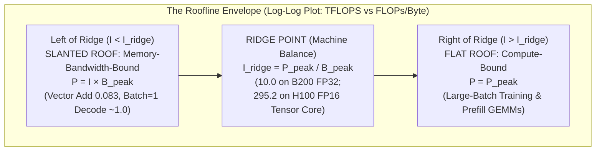
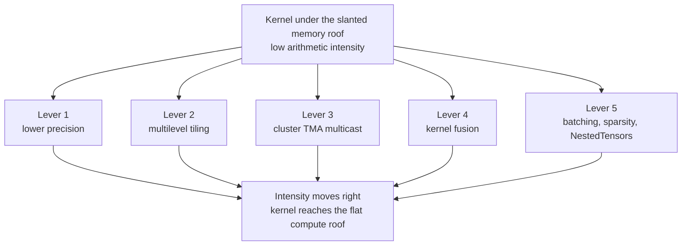
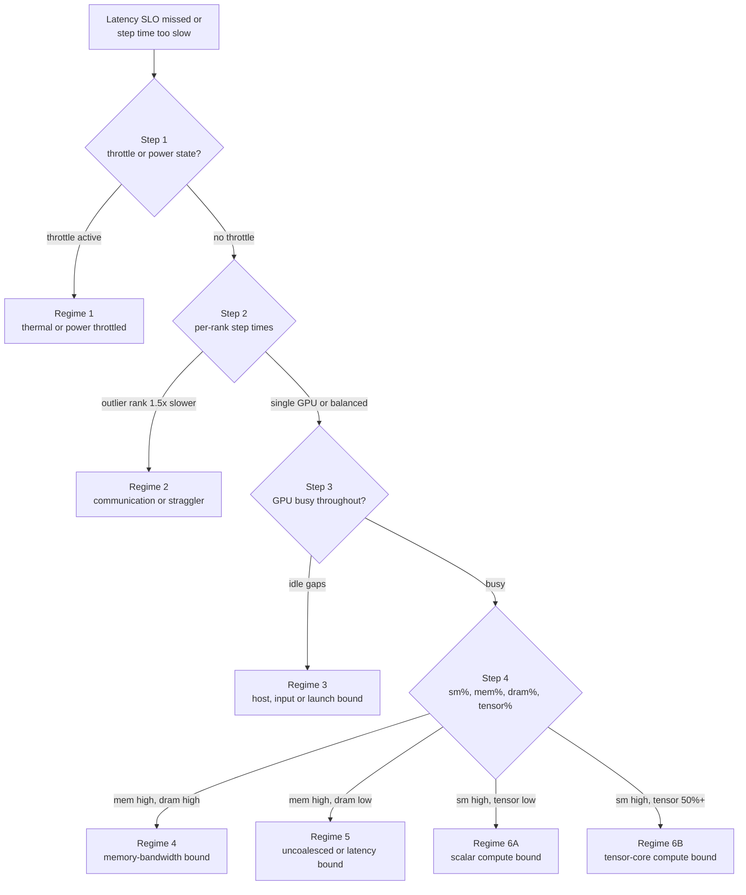

# 10.5 The roofline model and performance modelling

| | |
|---|---|
| **Status** | Drafted (`roofline_model_lab.py`: 25 checks pass; `ncu`/`ert` commands **untested** on live Nebius GPU VM) |
| **Level** | Advanced |
| **Priority tier** | 2 |
| **Lab venue** | Nebius GPU + self-checking Python model (`code/part10/roofline_model_lab.py`) |
| **Part** | Part 10: The GPU and CUDA |
| **Sources used** | *AI Systems Performance Engineering* Ch. 6 & Ch. 9; *Parallel and High Performance Computing* Ch. 3 & Ch. 9; `nvidia-devops` V17 (Ch. 3); `nvidia-devops` V2 (Ch. 11, Ch. 12) |

## Why this matters for AI infrastructure

Without running a single profiler, how can you prove mathematically that spending $500,000 to upgrade a cluster from `A100` to `H100` GPUs for a `Batch Size = 1` real-time inference workload will yield almost zero speedup from the H100's 3× higher Tensor Core TFLOPS? Or why adding more GPUs to a 90%-utilized LLM decode service fails to reduce single-request token latency?

Performance engineering begins before profiling: it begins with an analytical model connecting **what the workload demands** to **what the hardware can physically supply**. Every processor is governed by **"speeds and feeds"**:
1. **Speeds (Peak Compute FLOP/s):** How fast the arithmetic units and Tensor Cores can crunch numbers once operands are in registers.
2. **Feeds (Peak Memory Bandwidth in GB/s or TB/s, plus latency):** How fast the memory hierarchy, NVLink, and network can deliver bytes to those arithmetic units.

The **Roofline Model** (originated at Lawrence Berkeley National Laboratory) combines both physical limits on a single log-log graph against a workload's **Arithmetic Intensity (`FLOPs per byte moved`)**. It tells you immediately whether a kernel is pinned under the **Slanted Roof (Memory-Bandwidth-Bound)** or the **Flat Horizontal Roof (Compute-Bound)**, and dictates which engineering lever—batching, quantization, shared-memory tiling, kernel fusion, `TMA` cluster multicast, or faster compute—will actually move the needle.

## Prerequisites and outcomes

**Prerequisites:**
- Theoretical peak FLOP/s and memory bandwidth formulas (`10.1`), SIMT occupancy (`10.2`), the 7-tier GPU memory hierarchy (`10.3`), and Tensor Core precision formats (`10.4`).

**Outcomes:** After completing this chapter, you will be able to:
1. Define **Arithmetic Intensity (`FLOPs/byte`)**, **Machine Balance (`FLOPs/byte` or `FLOPs/word`)**, and the **Ridge Point**, and write the fundamental Roofline equation for attainable performance.
2. Calculate the exact Ridge Points of modern GPUs—from Blackwell's scalar `FP32` roof (`80 TFLOPS / 8 TB/s = 10.0 FLOPs/byte`) to `H100 SXM` `FP16` Tensor Cores (`989 TFLOPS / 3.35 TB/s ≈ 295.2 FLOPs/byte`), `H200 SXM` (`206.0 FLOPs/byte`), and Blackwell `B200` `NVFP4` (`1,250.0 FLOPs/byte`).
3. Prove mathematically why elementwise vector addition (`0.0833 FLOPs/byte`) and `Batch Size = 1` LLM/MLP inference (`~0.5` to `1.0 FLOP/byte`) sit two orders of magnitude below the ridge point, and how non-contiguous cache usage (`B_nc = U_cache × B_E`) lowers the slanted memory roof.
4. Apply the five architectural levers that shift a memory-bound kernel rightward toward the compute roof: **Batching**, **Reduced Precision (`FP16`/`FP8`/`INT8`/`NVFP4`)**, **Multilevel Tiling**, **Thread Block Cluster `TMA` Multicast** (`4×` on `2 × 2` CTAs, up to `16×`), and **Kernel Fusion + Recomputation** (`36 B → 12 B` per element in `fusedL2Norm`).
5. Execute a hypothesis-driven **six-regime GPU bottleneck elimination workflow** separating **Host/Launch**, **Memory-Bandwidth**, **Uncoalesced/Latency**, **Scalar/Divergence**, **Tensor-Compute**, **Thermal/Power Throttling**, and **Multi-GPU Straggler/Communication** bottlenecks.

---

## 1. Speeds, feeds, and the Roofline equation

A processor can never compute faster than its arithmetic units can execute instructions, and it can never compute faster than its memory system can deliver the bytes those instructions need.

Think of a restaurant kitchen:
- **Compute (`Peak FLOP/s`)** is the chef's chopping speed at the cutting board.
- **Memory Bandwidth (`Peak Bytes/s`)** is the waiter's running speed bringing ingredients from the pantry.
- **Arithmetic Intensity (`FLOPs / Byte`)** is the recipe's ratio of chopping work to ingredients fetched:
  - **Making a simple salad (`Low Arithmetic Intensity`, `< Ridge Point`):** The waiter brings 100 ingredients and the chef cuts each one in half once. The chef finishes instantly and spends 95% of the time waiting on the waiter (**Memory-Bandwidth-Bound, under the Slanted Roof**). Hiring a faster chef (`more TFLOPS`) does nothing.
  - **Carving a carrot into an intricate swan (`High Arithmetic Intensity`, `> Ridge Point`):** The waiter brings one carrot and the chef spends 10 minutes carving thousands of cuts (**Compute-Bound, under the Flat Roof**). Hiring a faster waiter (`more GB/s`) does nothing.

### 1.1 Arithmetic Intensity, Machine Balance, and the Ridge Point

For any kernel that executes `W` floating-point operations (`FLOPs`) while transferring `Q` bytes (`Bytes`) between the limiting memory tier (typically HBM DRAM) and the processor, **Arithmetic Intensity (`I`, also called Operational Intensity)** is:

```text
Arithmetic Intensity (I) = Total Floating-Point Operations (FLOPs) / Total Bytes Moved (Bytes)   [FLOPs / Byte]
```

Given a GPU with theoretical (or empirical STREAM) peak compute throughput `P_peak` (`TFLOPS`) and peak memory bandwidth `B_peak` (`TB/s`), the **Attainable Performance (`P_attainable`)** at arithmetic intensity `I` is governed by the **Roofline Equation**:

```text
Attainable Performance (TFLOPS) = min( Peak Compute (P_peak),  Arithmetic Intensity (I) × Peak Bandwidth (B_peak) )
```



The exact coordinate on the X-axis where the slanted memory roof intersects the flat compute roof is the **Ridge Point (`I_ridge`)**—known in HPC literature as the processor's **Machine Balance**:

```text
Ridge Point (I_ridge) = Peak Compute (FLOP/s) / Peak Memory Bandwidth (Bytes/s)   [FLOPs / Byte]
```

In *Parallel and High Performance Computing* Chapter 3 (§3.2.5), **Machine Balance** is also expressed in **`FLOPs per word`** by multiplying `FLOPs/byte` by the word size (`8 bytes` for an `FP64` double or `4 bytes` for an `FP32` float):
- **Theoretical Machine Balance example:** A processor with `236.8 GFLOP/s` peak compute and `34.1 GiB/s` theoretical memory bandwidth has a balance of `(236.8 / 34.1) × 8 bytes/word = 55.55 ≈ 56 FLOPs/word` (`6.94 FLOPs/byte`).
- **Empirical Machine Balance example (measured with McCalpin `STREAM`):** When the same system achieves `264.4 GFLOP/s` and `22.0 GiB/s` on `STREAM`, its empirical balance rises to `(264.4 / 22.0) × 8 = 96.15 ≈ 96 FLOPs/word` (`12.02 FLOPs/byte`).
- Most general scientific applications have an arithmetic intensity near **`~1 FLOP/word` (`0.11` to `0.36 FLOPs/byte`**, as measured by Intel Advisor and `likwid-perfctr` on the `CloverLeaf` hydrodynamics mini-app), placing them deep in the bandwidth-bound regime. By contrast, dense `Linpack` (`HPL`) matrix solvers reach **`62.5 FLOPs/word` (`~65 FLOPs/load`)**, pushing them onto the flat compute roof.

### 1.2 Worked Example 1: `FP32` Vector Addition on Blackwell (`0.0833` vs `10.0 FLOPs/byte`)

Let us reproduce the worked Roofline analysis from *AI Systems Performance Engineering* Chapter 6 (pp. 209–210, Figure 6-21):
1. **The Kernel (`C[i] = A[i] + B[i]` in `FP32`):**
   - Each thread loads two 32-bit floats (`A[i]` and `B[i]` = `4 + 4 = 8 bytes`), performs **1 floating-point addition (`1 FLOP`)**, and writes back one 32-bit float (`C[i]` = `4 bytes`).
   - Total memory traffic per operation = `8 + 4 = 12 bytes`.
   - **Arithmetic Intensity (`I`):**
     ```text
     I = 1 FLOP / 12 bytes = 0.0833 FLOPs/byte
     ```
2. **The Hardware Ceiling (Blackwell `B200` scalar `FP32`):**
   - Peak scalar `FP32` compute `P_peak ≈ 80 TFLOPS`, and peak `HBM3e` bandwidth `B_peak ≈ 8 TB/s`.
   - **Ridge Point (`I_ridge`):**
     ```text
     I_ridge = 80 TFLOPS / 8 TB/s = 10.0 FLOPs/byte
     ```
3. **The Verdict:** Vector add's arithmetic intensity (`0.0833 FLOPs/byte`) sits **more than 120× to the left of the `10.0 FLOPs/byte` ridge point**. Its maximum attainable compute on an `8 TB/s` B200 is `0.0833 × 8 TB/s =` **`0.667 TFLOPS`**—less than **1%** of the GPU's `80 TFLOPS` scalar `FP32` ceiling.

### 1.3 How uncoalesced or strided cache usage lowers the slanted roof (`B_nc = U_cache × B_E`)

The standard slanted roof assumes your kernel uses **100% of every 128-byte cache line** fetched from HBM. As shown in *Parallel and High Performance Computing* Chapter 3 (§3.1, p. 55), if a 2D array stored in row-major order is accessed column-wise (striding across rows so only `1` out of `8` values in each cache line is actually used before eviction), your **non-contiguous effective bandwidth (`B_nc`)** drops in proportion to the fraction of each cache line utilized (`U_cache`):

```text
B_nc = U_cache × B_empirical
```

If `U_cache = 1/8 = 12.5%`, an `8.0 TB/s` HBM3e bus delivers only **`1.0 TB/s`** of useful data, shifting the slanted roof downward by **8×** and pushing the effective ridge point 8× further to the right (from `10.0` out to `80.0 FLOPs/byte`).

:::info In one minute: Section 1 takeaways
- **Arithmetic Intensity** `I = FLOPs / Bytes`; **Ridge Point (Machine Balance)** `I_ridge = Peak FLOP/s / Peak Bandwidth`.
- **Attainable FLOP/s** `= min(Peak FLOP/s, I × Effective Bandwidth)`. If `I < I_ridge`, the workload is **Memory-Bandwidth-Bound** (under the slanted roof); if `I > I_ridge`, it is **Compute-Bound** (under the flat roof).
- Strided/uncoalesced accesses that use only a fraction `U_cache` of each cache line drop the slanted roof to `B_nc = U_cache × B_E`.
:::

---

## 2. Tensor Core ridge points and why `Batch Size = 1` inference hits the memory wall

### 2.1 Comparing Ridge Points across `H100`, `H200`, and `Blackwell B200`

Because Tensor Core TFLOPS have grown much faster than HBM bandwidth across GPU generations, the **Ridge Point** for Tensor Core workloads is orders of magnitude higher than for scalar `FP32` code:

| GPU & Execution Mode | Peak Compute (`P_peak`) | Peak HBM Bandwidth (`B_peak`) | Ridge Point (`I_ridge = P_peak / B_peak`) | Operational meaning |
|---|---|---|---|---|
| **Blackwell `B200` (`FP32` Scalar CUDA Cores)** | `~80 TFLOPS` | `8.0 TB/s` (`8,000 GB/s`) | **`10.0 FLOPs/byte`** | Easy to reach compute roof with modest reuse (`32 × 32` SMEM tiling reaches `8.0 FLOPs/B`). |
| **Hopper `H200 SXM` (`FP16`/`BF16` Dense Tensor Core)** | `989 TFLOPS` | `4.8 TB/s` (`4,800 GB/s`) | **`206.0 FLOPs/byte`** | Higher HBM3e bandwidth (`4.8` vs `3.35 TB/s`) lowers the ridge point vs `H100`, making decode 1.43× faster. |
| **Blackwell `B200` (`BF16`/`FP16` Dense Tensor Core)** | `~2,250 TFLOPS` | `8.0 TB/s` (`8,000 GB/s`) | **`281.2 FLOPs/byte`** | Balanced with `H100`/`H200` for 16-bit training and prefill. |
| **Hopper `H100 SXM` (`FP16`/`BF16` Dense Tensor Core)** | `989 TFLOPS` | `3.35 TB/s` (`3,350 GB/s`) | **`295.2 FLOPs/byte`** (`~295` in V2 Ch. 11) | Requires **~295 FLOPs per byte** read from HBM to saturate the FP16 Tensor Cores. |
| **Blackwell `B200` (`NVFP4` Dense Tensor Core)** | `10,000 TFLOPS` (`10 PFLOPS`) | `8.0 TB/s` (`8,000 GB/s`) | **`1,250.0 FLOPs/byte`** | Requires large tiles in `TMEM` (`256 KB/SM`), `TMA` multicast, and large token batches to stay compute-bound. |

### 2.2 Mathematical proof: why `Batch Size = 1` MLP/LLM inference is pinned under the Slanted Roof

Let us connect the two production stories from `nvidia-devops` Volume 17 Chapter 3 (the quantitative trading firm proposing a $500,000 `A100 → H100` upgrade for a `Batch Size = 1` MLP) and Volume 02 Chapter 11 (the `13B` `FP16` LLM missing latency SLOs at 90% GPU utilization) using exact `GEMM` arithmetic intensity math.

When a linear layer multiplies an activation batch `X` of shape `[B, K]` (where `B` is the batch size in tokens/samples and `K` is input hidden dimension) by a weight matrix `W` of shape `[K, N]` to produce output `Y` of shape `[B, N]`, using `b` bytes per element:
- **Total FLOPs** `= 2 × B × K × N` (`1` multiply + `1` add per output-inner-product element).
- **Total Bytes moved from HBM** `= (B×K + K×N + B×N) × b`.
- **Exact GEMM Arithmetic Intensity (`I`):**
  ```text
  I(B, K, N, b) = (2 × B × K × N) / ((B×K + K×N + B×N) × b)
  ```
  When the matrix dimensions `K, N` (such as `4,096 × 4,096`) are much larger than the batch size `B` (`K, N >> B`), the weight matrix read (`K × N × b`) completely dominates the denominator, simplifying to:
  ```text
  I ≈ (2 × B × K × N) / (K × N × b) = (2 × B) / b   [FLOPs / Byte]
  ```
  *(Note: Using this explicit `I(B, K, N, b)` derivation to connect the `Batch Size = 1` stories in Volume 17 Chapter 3 and Volume 02 Chapter 11 to the `295.2 FLOPs/byte` H100 ridge point is **my inference**.)*

Plug in real numbers for a `[4096, 4096]` layer on an **`H100 SXM` (`Ridge Point = 295.2 FLOPs/byte`, `Peak = 989 TFLOPS`, `BW = 3.35 TB/s`)**:

| Workload scenario (`[B, 4096] × [4096, 4096]`) | Batch size (`B`) | Precision (`b` bytes) | Exact Arithmetic Intensity (`I`) | Position vs `H100` Ridge (`295.2`) | Max Attainable TFLOPS on `H100` | Active Roof & Verdict |
|---|---|---|---|---|---|---|
| **1. Unoptimized Trading MLP (`V17 Ch. 3`)** | `B = 1` | `FP32` (`4 B`) | **`0.50 FLOPs/byte`** | `590×` below ridge | `1.67 TFLOPS` | **Slanted Roof (Memory-Bound)**. SMs sit >98% idle waiting on VRAM. |
| **2. Single-Request LLM Decode (`V2 Ch. 11`)** | `B = 1` | `FP16` (`2 B`) | **`1.00 FLOPs/byte`** | `295×` below ridge | **`3.35 TFLOPS`** (`0.34%` of `989 TFLOPS` | **Slanted Roof (Memory-Bound)**. Adding Tensor Core TFLOPS does nothing. |
| **3. Quantized Trading MLP (`TensorRT INT8`)** | `B = 1` | `INT8` (`1 B`) | **`2.00 FLOPs/byte`** | `148×` below ridge | `6.70 TFLOPS` (**4× faster than FP32.**) | Shrinking weights `4 B → 1 B` cuts HBM reads by **75%**, quadrupling speed on existing `A100`s. |
| **4. Continuous-Batched LLM Decode** | `B = 64` | `FP16` (`2 B`) | **`62.06 FLOPs/byte`** | `4.8×` below ridge | `207.9 TFLOPS` (**62× higher throughput.**) | Reuses each weight read across 64 sequences. |
| **5. Large-Batch Training / Prompt Prefill** | **`B = 512`** | `FP16` (`2 B`) | **`409.60 FLOPs/byte`** | **`1.39×` ABOVE ridge.** | **`989.0 TFLOPS` (100% Compute Roof** | **Flat Roof (Compute-Bound)**. Tensor Cores run at full speed of light. |

Look at Rows 1–3 versus Row 5:
- At **`Batch Size = 1`** in `FP16`, the arithmetic intensity is **`1.00 FLOP/byte`**—**295× below** the H100's `295.2 FLOPs/byte` ridge point. Even on a 989-TFLOPS H100, the slanted memory roof (`1.00 FLOP/B × 3.35 TB/s`) caps performance at **`3.35 TFLOPS`** (`0.34%` of peak compute). Buying a GPU with higher peak TFLOPS (raising the flat roof) cannot help a workload pinned under the slanted roof.
- By contrast, applying **`TensorRT INT8` quantization** on the existing `A100`s cuts bytes per weight from `4 B` (`FP32`) to `1 B` (`INT8`)—reducing HBM bytes read by **75%** and shifting arithmetic intensity **4× to the right** (`0.50 → 2.00 FLOPs/byte`), delivering a 4× latency reduction for $0 in hardware capex.
- And when `Batch Size` reaches **`B = 512`** (during training or long-prompt Prefill), arithmetic intensity reaches **`409.6 FLOPs/byte`**—crossing past `295.2` onto the **Flat Compute Roof** where all `989 TFLOPS` of the H100 are unlocked.

:::info In one minute: Section 2 takeaways
- On an `H100 SXM` (`989 TFLOPS` `FP16` / `3.35 TB/s`), the Tensor Core ridge point is **`295.2 FLOPs/byte`** (`206.0` on `H200` at `4.8 TB/s`).
- For a matrix multiply with `K, N >> B`, arithmetic intensity is `I ≈ 2B / b`: at **`Batch = 1` in `FP16` (`b = 2`)**, `I ≈ 1.0 FLOP/byte`—nearly 300× below the ridge point.
- Never buy higher peak TFLOPS to fix a `Batch = 1` latency problem; either **quantize (`INT8`/`FP8`/`NVFP4`)**, **increase batch size (`Continuous Batching`)**, or choose a GPU with **higher HBM bandwidth (`H200`/`B200`)**.
:::

---

## 3. Five engineering levers to shift a workload rightward on the Roofline

When Nsight Compute's Roofline chart shows your kernel sitting under the slanted memory roof (`I < I_ridge`), you must **increase its Arithmetic Intensity (`I = FLOPs / Bytes`)**—either by shrinking the denominator (`Bytes moved from HBM`) or by doing more useful operations per byte fetched. *AI Systems Performance Engineering* Chapter 9 provides five concrete levers:



Arithmetic intensity I = FLOPs / HBM bytes. The goal is I at or above the ridge point.

| Lever | What it does | Numbers from the chapter |
|---|---|---|
| 1. Lower precision and hardware decompression | Shrinks the HBM byte count | FP32 4 B, BF16 2 B, FP8 1 B, NVFP4 0.5 B: cuts the denominator by 2x, 4x or 8x |
| 2. Multilevel tiling (DRAM, shared memory, registers) | Reuses data on chip | A 32x32 shared-memory tile cuts DRAM sectors from 9,800 to 1,200, lifts intensity from 1.5 to 8.0 FLOPs/B and GFLOPS from 15 to 170 |
| 3. Thread block cluster TMA multicast (DSMEM) | One HBM tile load serves several blocks | A 2x2 cluster (4 CTAs) means 4x less traffic. Up to 16 CTAs with `NonPortableClusterSizeAllowed` means 16x |
| 4. Kernel fusion and in-register recomputation | Avoids HBM round trips | Fusing a 3-pass L2 norm cuts 36 B to 12 B per element (3x less traffic); recompute `x*x` or activations instead of storing them |
| 5. Batching, 2:4 sparsity and NestedTensors | Amortizes weight reads | Weight reads shared across B tokens; prune 50% zeros; pack variable-length prompts without zero-padding waste |

1. **Lever 1 — Reduced Precision (`FP16`/`BF16`, `FP8`, `INT8`, `NVFP4`) and Hardware Decompression:**
   Every time you halve the byte width per weight, you cut the denominator (`Bytes`) in half and **double Arithmetic Intensity** (`2×` for `BF16` vs `FP32`, `4×` for `FP8`/`INT8`, and `8×` for `NVFP4`), while simultaneously raising the flat compute roof onto faster Tensor Core pipelines (`10.4`).
2. **Lever 2 — Multilevel Microtiling (`HBM → Shared Memory → Registers / TMEM`):**
   Loading a `32 × 32` tile from HBM into Shared Memory once and reusing each element 32 times across threads in the block (and then staging microtiles in registers or Blackwell `TMEM` using vectorized `float4` / `half2` loads) reduced global memory sector reads from `9,800` to `1,200` and lifted arithmetic intensity from **`1.5` to `8.0 FLOPs/byte`** (`15 → 170 GFLOPS`, an **11.3× speedup** in Table 7-4).
3. **Lever 3 — Thread Block Cluster `TMA` Multicast (`DSMEM`):**
   On Hopper and Blackwell, a **Thread Block Cluster** groups multiple CTAs across neighboring SMs. Using the **Tensor Memory Accelerator (`TMA`) multicast** feature, a `2 × 2` cluster of **4 Thread Blocks (`CTAs`)** fetches a shared weight tile from Global HBM **only once** and multicasts it simultaneously into the Shared Memory (`DSMEM`) of all 4 SMs—cutting global memory bytes by **up to 4×** and multiplying arithmetic intensity by **4×**. On Blackwell, opting into non-portable cluster sizes via:
   ```cpp
   cudaFuncSetAttribute(myKernel, cudaFuncAttributeNonPortableClusterSizeAllowed, 1);
   ```
   allows clusters of up to **16 Thread Blocks (`16×` tile reuse)** beyond the default portable limit of 8 CTAs (`10.16`).
4. **Lever 4 — Kernel Fusion (Vertical & Horizontal) and Recomputation (`fusedL2Norm` worked example):**
   Consider L2-normalizing each row of a `[batch, hidden]` tensor: `norm_b = sqrt(sum_i(x[b,i]^2) + eps)`, followed by `y[b,i] = x[b,i] / norm_b`.
   - **Unfused 3-kernel pipeline (Square → Reduce → Divide):** Launches 3 separate kernels that write and re-read intermediate tensors to and from HBM, moving **`36 bytes per element`** (`3 passes × 12 bytes/pass`) for ~`4 FLOPs` of math:
     ```text
     Unfused Intensity ≈ 4 FLOPs / 36 bytes = 0.111 FLOPs/byte (or 1 FLOP / 12 B = 0.083 FLOPs/byte per pass)
     ```
   - **Fused single-pass kernel (`fusedL2Norm`):** Keeps the squared values and reduction sum inside **Registers and Shared Memory** (`sdata[]`), uses the fast hardware inverse-square-root intrinsic **`rsqrtf(sdata[0])`** on the **SFU** pipeline to multiply instead of dividing, and touches Global HBM for only **two reads and one write (`12 bytes per element`)**:
     ```text
     Fused Intensity ≈ 3 to 4 FLOPs / 12 bytes = 0.25 to 0.333 FLOPs/byte (3.0× reduction in HBM traffic!)
     ```
   - **Recomputation vs Memory trade-off:** Whenever a kernel is memory-bound, recomputing cheap expressions (`x * x` or intermediate activations during **Activation Checkpointing**) in registers is much faster than storing and reloading them from HBM, trading abundant FLOPs for scarce memory bandwidth and freeing VRAM for larger batch sizes.
5. **Lever 5 — PyTorch Compiler Fusion, `FlashAttention`, `NestedTensor`, and `2:4` Sparsity:**
   In PyTorch, `torch.compile` (`TorchInductor`) fuses chains of pointwise and reduction ops automatically; `torch.nn.attention.sdpa_kernel(SDPBackend.FLASH_ATTENTION)` tiles attention in SRAM; **2:4 structured sparsity** (`to_sparse_semi_structured()`) skips 50% zero weights (`~2×` intensity); and **`torch.nested.nested_tensor` (`NestedTensor` / ragged batches)** packs variable-length prompts into a single buffer without zero-padding, ensuring every byte fetched from HBM carries real tokens.

---

## 4. Building a complete system performance model: the six bottleneck regimes

A single GPU kernel's Roofline is only one piece of an AI service. As shown in `nvidia-devops` Volume 02 Chapters 11 and 12, an end-to-end workload can be constrained by **six distinct system regimes**, and `nvidia-smi` `GPU-Util` alone cannot tell them apart:



| Step | What you check | Command or signal | Outcome |
|---|---|---|---|
| 1 | Throttle and power state | `nvidia-smi --query-gpu=power.draw,power.limit,clocks.sm,clocks_throttle_reasons.active` | Throttle active (for example SW power cap, HW thermal slowdown): **Regime 1**, fix cooling, airflow or DLC, or the power cap. No throttle (for example 305 W of 700 W, 1980 MHz): go on |
| 2 | Per-rank step time in a multi-GPU job (for example ranks 0-1 at 50 ms against ranks 2-3 at 140 ms) | Compare ranks | A rank more than 1.5x slower, or high collective wait: **Regime 2**, check `nvidia-smi topo -m`, PCIe x16 link, NUMA affinity, InfiniBand/RoCE counters |
| 3 | Is the GPU busy the whole time | `nvidia-smi dmon -s ucm`, `nsys` timeline | Idle gaps (for example sm=4%, mem=2%): **Regime 3**, CPU tokenization or JPEG starvation, sync gaps, or tiny kernel launches (use CUDA Graphs) |
| 4 | Compare sm%, mem%, dram_peak% and tensor pipe% | `dmon` plus `ncu` SpeedOfLight | mem about 90%+ and dram_peak about 70%+: **Regime 4**, apply the Section 3 levers. mem about 90%+ but dram_peak below 40%: **Regime 5**, high sectors per request (above 4.0) or low occupancy, fix coalescing and warp residency. sm about 90%+ with tensor pipe below 15%: **Regime 6A**, tensor cores idle, enable TF32/BF16/FP8 and align M, N, K. sm about 90%+ with tensor pipe at 50% or more: **Regime 6B**, hardware ceiling reached, use 2:4 sparsity, FP4 or scale out |

*(Note: Encoding this 6-step elimination decision tree from `nvidia-devops` Volume 02 Chapters 11 and 12 into `classify_gpu_workload_bottleneck` in `code/part10/roofline_model.py` is **my inference**.)*

Look at the three concrete diagnostic proofs from Volume 02 Chapters 11 and 12 that power this decision tree:
1. **Ruling out thermal/power throttling and proving memory-bound execution in one line (V2 Ch. 11 p. 326):**
   ```text
   $ nvidia-smi --query-gpu=utilization.gpu,utilization.memory,power.draw,power.limit,clocks.sm,clocks_throttle_reasons.active --format=csv,noheader
   94 %, 91 %, 305 W, 700 W, 1980 MHz, Active clock throttle reasons: N/A
   ```
   - `power.draw = 305 W` (far below the `700 W` cap — typical of a memory-bound kernel where Tensor Cores are mostly waiting on HBM, `clocks.sm = 1980 MHz` (full boost clock), and `Active clock throttle reasons: N/A` immediately eliminate thermal and power throttling.
   - `utilization.memory = 91%` alongside `utilization.gpu = 94%` points directly to **Memory-Bandwidth-Bound (Regime 4)** or **Uncoalesced Memory (Regime 5)**, which you separate in `ncu` by checking `dram__throughput.avg.pct_of_peak_sustained_elapsed` and `l1tex__average_t_sectors_per_request_pipe_lsu_mem_global_op_ld.ratio`.
2. **Separating "Low Utilization" (Case A) from "High Utilization, Low Throughput" (Case B) with `dmon` (V2 Ch. 12 p. 131):**
   - **Case A (`sm = 3–5%, mem = 1–2%`):** The GPU has nothing to do (`Regime 3: Host / Input / Launch Bound`). Kernel tuning is useless here; fix CPU preprocessing, increase batching, or capture small kernels into **CUDA Graphs** (`10.18`).
   - **Case B (`sm = 92–95%, mem = 89–91%`):** The GPU is 100% busy waiting on memory traffic (`Regime 4/5`). Feeding it more work will only grow the queue; apply the Roofline levers from Section 3.
3. **Catching a multi-GPU collective straggler via per-rank step times (V2 Ch. 11 p. 340):**
   ```text
   $ for r in 0 1 2 3; do echo "rank $r: $(tail -1 rank_${r}.log)"; done
   rank 0: step_time_ms=48
   rank 1: step_time_ms=51
   rank 2: step_time_ms=142
   rank 3: step_time_ms=139
   ```
   When Ranks 2 and 3 run **~2.96× slower** (`142 ms` vs `48 ms`) than Ranks 0 and 1, every fast rank stalls at the `NCCL AllReduce` barrier waiting for the slow ranks. Cross-checking `nvidia-smi topo -m` and `nvidia-smi -q -d PCI` reveals whether Ranks 2 and 3 landed across a `SYS` NUMA socket link or a downgraded `x4` PCIe slot (`10.6`, `10.8`).

### 4.2 Designing a production release performance gate

Never roll out a model, compiler, or container update to production without an automated **8-item baseline and release performance gate**:
1. Workload version, model architecture, and precision policy (`BF16`, `FP8`, `NVFP4`).
2. Representative input shape, sequence length distribution, and batch size / concurrency.
3. Driver, CUDA, `cuBLAS`/`cuDNN`/`CUTLASS`, and framework versions.
4. GPU SKU and verified topology (`nvidia-smi topo -m`, `BAR1` ReBAR, PCIe width).
5. End-to-end **Goodput** (tokens/s, samples/s) and tail latency percentiles (**P50, P95, P99 TTFT and TPOT**) after a warm-up period.
6. Device counters (`dmon` `sm%`/`mem%`, `DCGM` Tensor Pipe active, `ncu` DRAM % of peak).
7. Compile-time artifact diff (`nvcc -Xptxas=-v` register and spill counts: e.g., catching a `52 → 96 regs` + `88 B spill stores` regression in 5 seconds before profiling.
8. Power draw (`W` / kJ) and clock state (`clocks.sm`, throttle reasons). Note from *Parallel and High Performance Computing* Chapter 3 (p. 64) that parallelizing and vectorizing a workload (`CloverLeaf` measured with `likwid-perfctr`) not only speeds up runtime by 15×, but also **reduces total energy consumption by `28.75%` (`28.7%`) and DRAM energy by `23.29%` (`23.2%`)** because the system finishes work and returns to idle much sooner.

---

## Commands and configurations that matter

### 1. Collecting a Roofline chart and Speed-of-Light report in Nsight Compute (`ncu`, untested on live Nebius GPU VM)

```bash
# 1. Collect the full Nsight Compute Roofline section set and export a report (.ncu-rep)
ncu --set roofline -o roofline_report ./my_kernel_app

# 2. Query achieved FLOP/s, DRAM % of peak, and Tensor Pipe % from the CLI
ncu --section SpeedOfLight --section SpeedOfLight_RooflineChart \
  --metrics sm__pipe_tensor_cycles_active.avg.pct_of_peak_sustained_active,dram__throughput.avg.pct_of_peak_sustained_elapsed \
  ./my_kernel_app
```

### 2. Running the 6-cause `nvidia-smi` elimination pass and per-rank straggler check

```bash
# 1. Single-command elimination pass: GPU util, Mem util, Power vs Cap, SM Clock, and Throttle Reasons
nvidia-smi --query-gpu=index,utilization.gpu,utilization.memory,power.draw,power.limit,clocks.sm,clocks_throttle_reasons.active --format=csv

# 2. Stream paired SM compute (%) and Memory interface (%) every 1s
nvidia-smi dmon -s ucm -c 10

# 3. Compare per-rank step times across distributed workers to spot collective stragglers
for r in 0 1 2 3 4 5 6 7; do
  echo "rank $r: $(grep step_time_ms rank_${r}.log | tail -1)"
done
```

### 3. Empirical Roofline (`ERT`), `STREAM` / `BabelStream`, and `NERSC` Roofline plotting

```bash
# 1. Run Lawrence Berkeley Lab's Empirical Roofline Toolkit (ERT) on a GPU node
git clone https://bitbucket.org/berkeleylab/cs-roofline-toolkit.git
cd cs-roofline-toolkit/Empirical_Roofline_Tool-1.1.0 && ./ert Config/config.V100_gpu

# 2. Plot custom kernel (Intensity, GFLOP/s) points against hardware ceilings using NERSC's script
git clone https://github.com/cyanguwa/nersc-roofline.git
```

---

## How it fails

| Failure mode | Symptom | Root cause | Diagnosis & fix |
|---|---|---|---|
| **1. Buying higher-TFLOPS GPUs for a `Batch = 1` memory-bound service** | Upgrading from `A100` to `H100` (3× more Tensor TFLOPS) yields disappointing single-stream latency gains relative to the $500k capex. | At `Batch Size = 1`, GEMM arithmetic intensity is `~0.5–1.0 FLOP/byte`—nearly **300× below** the H100's `295.2 FLOPs/byte` ridge point, so the workload is pinned under the **Slanted Memory Roof**. | Calculate `I` and compare to `I_ridge` before buying hardware; quantize weights to **`INT8`/`FP8`/`NVFP4`** (4×–8× rightward shift on X-axis), enable **Continuous Batching**, or choose higher-bandwidth HBM (`H200`/`B200`). |
| **2. Over-fusing kernels until registers spill to Local Memory** | Combining 5 elementwise and reduction kernels into one mega-kernel reduces kernel launch count, yet total step time *regresses* by 30%. | The fused kernel's live variable state jumped from `52` registers/thread (`0` spills) to `96` registers/thread (`88 B spill stores, 96 B spill loads`), slashing SM occupancy and adding HBM spill traffic. | Diff `nvcc -O3 -Xptxas=-v` across releases; split the mega-kernel at a natural boundary or cap fusion depth so `spill stores / loads == 0`. |
| **3. Confusing Latency-Bound (`Low Bandwidth`) with Compute-Bound** | `ncu` reports `dram__throughput = 18%` of peak, so the team assumes memory is not the problem—yet `sm%` is also only `20%` and latency is high. | The kernel is **Memory-Latency-Bound** (or **Uncoalesced**): either too few warps are resident to hide ~800-cycle HBM latency, pointer-chasing dependencies serialize loads, or strided access wastes 7 of 8 cache-line values (`B_nc = U_cache × B_E`). | Inspect `sm__warps_active` (occupancy), `long_scoreboard` stall reasons, and `sectors_per_request` (`> 4.0`); increase parallelism/occupancy and coalesce memory layout (`SoA`). |
| **4. Multi-GPU scaling collapse from a single straggler rank** | Single-GPU throughput hits 85% of the Roofline ceiling, but an 8-GPU DDP/FSDP job runs at 35% scaling efficiency. | Two ranks (`rank 2` and `rank 3` at `142 ms/step` vs `48 ms/step` on `rank 0–1`) sit on a degraded `x4` PCIe link, a thermally throttled GPU, or a cross-socket `SYS` NUMA path, holding all other ranks at every `NCCL AllReduce` barrier. | Log per-rank step times and run the `nvidia-smi` elimination query (`clocks.sm`, `clocks_throttle_reasons.active`, `nvidia-smi -q -d PCI`, `nvidia-smi topo -m`) across all 8 GPUs. |

---

## Hands-on lab

### Self-checking Python model (`code/part10/roofline_model_lab.py` — verified here)

`code/part10/roofline_model.py` implements the Roofline equation, hardware ridge-point catalog, `FLOPs/word` machine-balance calculator, exact symbolic `GEMM` arithmetic-intensity solver, kernel-fusion and `TMA` cluster-multicast evaluator, and 6-regime GPU bottleneck classifier, and `code/part10/roofline_model_lab.py` runs **25 self-checks**:
1. **Hardware Ridge Points** (`Blackwell B200 FP32 scalar` = `10.0 FLOPs/B`; `H100 SXM FP16 Tensor Core` = `295.2 FLOPs/B`; `H200 SXM FP16` = `206.0 FLOPs/B`; `B200 BF16` = `281.2 FLOPs/B`; `B200 NVFP4` = `1,250.0 FLOPs/B`).
2. **Vector-Add & Precision Shifts** (`FP32` vector add `1 FLOP / 12 B = 0.0833 FLOPs/B` is `>100×` below the `10.0` ridge point; switching to `FP16` and `FP8` doubles and quadruples intensity) and **Non-Contiguous Cache Bandwidth** (`U_cache = 12.5%` drops effective bandwidth from `8.0` to `1.0 TB/s`).
3. **Machine Balance in `FLOPs/word`** (`236.8 GFLOPS / 34.1 GiB/s × 8 B = 56 FLOPs/word` theoretical vs `264.4 / 22.0 × 8 = 96 FLOPs/word` empirical STREAM).
4. **GEMM Batch Size vs Ridge Point** (`Batch = 1` `[1, 4096] × [4096, 4096]` `FP16` has `I = 1.0 FLOP/B` → `MEMORY_BOUND` at `3.348 TFLOPS` on `H100`; `INT8` quantization quadruples `FP32` intensity `0.5 → 2.0 FLOPs/B`; `Batch = 512` reaches `409.6 FLOPs/B > 295.2` → `COMPUTE_BOUND` at `989.0 TFLOPS`).
5. **Kernel Fusion (`fusedL2Norm`: `36 B → 12 B = 3.0×` traffic reduction) & Thread Block Cluster `TMA` Multicast** (`4` CTAs = `4.0×` portable reuse; `16` CTAs = `16.0×` requiring `cudaFuncAttributeNonPortableClusterSizeAllowed`) and **`CloverLeaf` parallel energy reduction (`28.75%` total, `23.29%` DRAM)**.
6. **6-Category GPU Bottleneck Classifier** (`HOST_INPUT_OR_LAUNCH_LATENCY_BOUND`, `MEMORY_BANDWIDTH_BOUND`, `MEMORY_TRANSACTION_UNCOALESCED_OR_LATENCY_BOUND`, `SCALAR_COMPUTE_OR_DIVERGENCE_BOUND_TENSOR_IDLE`, `TENSOR_COMPUTE_BOUND`, `THERMAL_OR_POWER_THROTTLED`, and `MULTI_GPU_COMMUNICATION_OR_STRAGGLER_BOUND` on `2.96×` rank outlier).

Run the lab from the repository root:

```bash
python3 -B code/part10/roofline_model_lab.py
```

Expected output (verified in this repository):

```text
=== Chapter 10.5 Lab: The Roofline Model and Performance Modelling ===
  [PASS] ASP Ch6 p.209: Blackwell B200 FP32 scalar ridge point (80 TFLOPS / 8 TB/s) == 10.0 FLOPs/byte
  [PASS] V2 Ch11 worked example: H100 SXM FP16 Tensor Core ridge point (989 TFLOPS / 3.35 TB/s) == 295.2 FLOPs/byte (~295)
  [PASS] H200 SXM FP16 ridge point (989 / 4.80 == 206.0) is lower than H100; B200 NVFP4 ridge point (10,000 / 8.0) == 1,250.0 FLOPs/byte
  [PASS] ASP Ch6 p.209: FP32 vector add (1 FLOP / 12 B == 0.0833 FLOPs/B) is MEMORY_BOUND (>100x below 10.0 ridge point)
  ...
  [PASS] V2 Ch11 p.340: Rank step times (48, 51, 142, 139 ms) detect 2.96x straggler and classify as MULTI_GPU_COMMUNICATION_OR_STRAGGLER_BOUND
  [PASS] PHPC Ch3 p.64: Parallel CloverLeaf reduces total energy by 28.75% (28.7% truncated in book) and DRAM energy by 23.29% (23.2% truncated)
  [PASS] B200 BF16 Tensor Core ridge point (2,250 TFLOPS / 8.0 TB/s) == 281.2 FLOPs/byte
  [PASS] Rejects Thread Block Cluster size > 16 CTAs
  [PASS] Rejects zero cache_line_utilization
  [PASS] Rejects utilization percentage > 100%
  [PASS] Rejects invalid word byte size in machine balance calculator
  [PASS] Rejects non-positive GEMM batch size

Summary: 25 passed, 0 failed (total 25)
```

---

## Common first mistakes

1. **Comparing a workload's arithmetic intensity against the scalar `FP32` ridge point (`~10–20 FLOPs/B`) when the kernel runs on Tensor Cores (`~200–1,250 FLOPs/B`):** Always compute the ridge point using the peak TFLOPS of the **specific execution pipeline and precision** (`FP16`, `FP8`, `NVFP4`) your kernel targets.
2. **Assuming `utilization.memory = 90%` in `nvidia-smi` means the kernel is achieving 90% of peak HBM GB/s:** `utilization.memory` in `nvidia-smi` is only the percentage of time the memory controller was busy; an uncoalesced kernel can keep the controller busy 90% of the time while delivering only 15–25% of peak useful bytes/sec. Check `dram__throughput.avg.pct_of_peak_sustained_elapsed` in `ncu`.
3. **Treating low `power.draw` (`305 W` on a `700 W` H100) during 94% GPU utilization as a power-supply fault:** A memory-bound kernel leaves power-hungry Tensor Cores idle waiting on HBM reads, naturally drawing 300–400 W even at 100% `GPU-Util` with zero throttle flags active.
4. **Enabling 16-CTA Thread Block Clusters without profiling occupancy:** While 16-CTA clusters (`cudaFuncAttributeNonPortableClusterSizeAllowed`) increase `TMA` multicast reuse up to 16×, they require co-scheduling 16 blocks across a GPC and can reduce SM occupancy on smaller grids.

---

## Exercises

1. Run `python3 -B code/part10/roofline_model_lab.py` and inspect `code/part10/roofline_model.py`. Use `calc_gemm_arithmetic_intensity(batch_m, 4096, 4096, 2.0)` to find the exact minimum batch size `batch_m` required for a `[B, 4096] × [4096, 4096]` `FP16` matrix multiply to cross the ridge point on: (a) `H200 SXM` (`206.0 FLOPs/B`), (b) `B200 BF16` (`281.2 FLOPs/B`), and (c) `H100 SXM` (`295.2 FLOPs/B`).
2. Using `evaluate_roofline_point`, compare the attainable TFLOPS of a kernel with `I = 50.0 FLOPs/byte` on `H100 SXM` (`989 TFLOPS`, `3.35 TB/s`) versus `H200 SXM` (`989 TFLOPS`, `4.80 TB/s`). Why does `H200` run this kernel **1.43× faster** even though both GPUs have identical `989 TFLOPS` compute?
3. Call `evaluate_roofline_point(50.0, 1.0, 989.0, 3.35, cache_line_utilization=u)` for `u = 1.0`, `0.5`, and `0.125`. How does poor cache-line utilization affect attainable TFLOPS and the effective ridge point?
4. Using `compare_kernel_fusion_and_cluster_multicast`, calculate the combined HBM traffic reduction when a 4-pass elementwise pipeline (`4 × 12 = 48 B/elem`) is fused into 1 pass (`12 B/elem`) and paired with a `2 × 2` (`4`-CTA) `TMA` multicast cluster.
5. Call `classify_gpu_workload_bottleneck` on all seven test cases in `roofline_model_lab.py` and write down the exact `nvidia-smi` and `ncu` commands you would run on Monday morning for each regime.
6. On a Nebius GPU VM (untested here), run `ncu --set roofline -o report` on a PyTorch script comparing `torch.matmul` at `batch = 1` vs `batch = 512`, and inspect where both dots land relative to the Tensor Core Ridge Point in the Nsight Compute Roofline chart.

---

## Interview angles

1. **"A trading firm runs a `Batch Size = 1` MLP on `A100` GPUs and wants to spend $500,000 upgrading to `H100` GPUs for the H100's 3× higher Tensor Core TFLOPS. How do you advise them using the Roofline Model?"**
   *Answer:* Reject the compute-driven upgrade: for a matrix multiply with `K, N >> B`, arithmetic intensity is `I ≈ 2B / b`. At `Batch = 1` (`0.5 FLOPs/B` in `FP32` or `1.0 FLOP/B` in `FP16`), the workload sits nearly **300× to the left of the H100's `295.2 FLOPs/byte` ridge point**, pinned firmly under the **Slanted Memory Roof** where Tensor Cores sit >98% idle waiting on HBM reads. Instead of buying new GPUs for TFLOPS, quantize the weights to **`INT8` with TensorRT** on the existing `A100`s—cutting HBM bytes read by 75% and quadrupling effective bandwidth and speed for $0 in hardware capex.
2. **"What is the Ridge Point (Machine Balance) of an `H100 SXM` vs an `H200 SXM` in `FP16`, and why does it explain why `H200` is faster on LLM decode?"**
   *Answer:* Both `H100 SXM` and `H200 SXM` have **`989 TFLOPS`** of dense `FP16`/`BF16` Tensor Core compute, but `H100` has `3.35 TB/s` HBM3 (`Ridge Point = 989 / 3.35 = 295.2 FLOPs/byte`) while `H200` has `4.8 TB/s` HBM3e (`Ridge Point = 989 / 4.8 = 206.0 FLOPs/byte`). Because LLM decode operates at low arithmetic intensity under the slanted roof (`P = I × B_peak`), `H200`'s 1.43× steeper slanted roof directly increases decode tokens/sec by ~1.43× and reaches the flat compute roof at smaller batch sizes (`206` vs `295`).
3. **"Walk me through how `nvidia-smi` showing `94% GPU-Util, 91% Mem-Util, 305 W / 700 W, 1980 MHz, Throttle: N/A` diagnoses a slow workload."**
   *Answer:* `305 W` vs `700 W` with `Throttle: N/A` and full `1980 MHz` clocks immediately rules out thermal or power throttling; the low `305 W` power draw at `94%` utilization occurs because power-hungry Tensor Cores are mostly idle while warps wait on the `91%`-busy memory interface—proving the workload is **Memory-Bound**.
4. **"How does Thread Block Cluster `TMA` multicast on Hopper and Blackwell shift a kernel on the Roofline?"**
   *Answer:* In a `2 × 2` Thread Block Cluster (`4` CTAs across neighboring SMs), the **Tensor Memory Accelerator (`TMA`)** fetches a shared matrix tile from Global HBM once and multicasts it into the Distributed Shared Memory (`DSMEM`) of all 4 CTAs simultaneously—cutting HBM byte traffic by **up to 4×** (and up to **16×** on a 16-CTA Blackwell cluster with `cudaFuncAttributeNonPortableClusterSizeAllowed`), multiplying arithmetic intensity by 4×–16×.
5. **"Why can a kernel have low HBM bandwidth utilization (`20%` of peak) and still be memory-limited?"**
   *Answer:* It is **Memory-Latency-Bound** or **Uncoalesced**: either there are too few active warps (low occupancy) or serial pointer-chasing dependencies to keep the memory pipeline full, or strided access uses only 1 of 8 values per cache line (`B_nc = U_cache × B_E`), wasting transactions without saturating peak HBM bytes/sec.

---

## Checkpoint questions (20)

<details>
<summary><strong>1. Define **"speeds and feeds"** in processor architecture. Which one corresponds to the flat roof, and which corresponds to the slanted roof?</strong></summary>

Speeds are the processor's peak arithmetic rate (peak FLOP/s) and feeds are the memory system's peak delivery rate (peak bytes/s). The flat roof is peak compute (speeds). The slanted roof is arithmetic intensity times peak bandwidth (feeds).

</details>

<details>
<summary><strong>2. Write the formula for **Arithmetic Intensity (`I`)**, the **Ridge Point (`I_ridge`)**, and the **Roofline Equation** for attainable performance.</strong></summary>

Arithmetic Intensity I = total FLOPs / total bytes moved from the limiting memory tier (FLOPs per byte). Ridge Point I_ridge = peak compute (FLOP/s) / peak memory bandwidth (bytes/s). Roofline: attainable TFLOPS = min(P_peak, I x B_peak). Left of the ridge the kernel is memory-bound, right of it compute-bound.

</details>

<details>
<summary><strong>3. How is **Machine Balance** in **`FLOPs/word`** calculated from `FLOPs/byte` for `FP64` (`8-byte` word) and `FP32` (`4-byte` word)? Reproduce the theoretical (`56 FLOPs/word`) and empirical STREAM (`96 FLOPs/word`) balances from *Parallel and High Performance Computing* Chapter 3.</strong></summary>

Multiply FLOPs/byte by the word size (8 bytes for FP64, 4 bytes for FP32). Theoretical: (236.8 GFLOP/s / 34.1 GiB/s) x 8 = 55.55, about 56 FLOPs/word (6.94 FLOPs/byte). Empirical STREAM: (264.4 / 22.0) x 8 = 96.15, about 96 FLOPs/word (12.02 FLOPs/byte).

</details>

<details>
<summary><strong>4. Calculate the arithmetic intensity of an `FP32` vector addition kernel (`C[i] = A[i] + B[i]`, reading 2 floats and writing 1 float = `12 bytes` for `1 FLOP`), and compare it against Blackwell `B200`'s scalar `FP32` ridge point (`80 TFLOPS / 8 TB/s = 10.0 FLOPs/byte`).</strong></summary>

A vector add reads 8 bytes, writes 4, and does 1 FLOP: 1 / 12 = 0.0833 FLOPs/byte. The B200 scalar FP32 ridge point is 80 TFLOPS / 8 TB/s = 10.0 FLOPs/byte, so vector add sits more than 120x to the left. Attainable: 0.0833 x 8 TB/s = 0.667 TFLOPS, under 1% of the 80 TFLOPS ceiling.

</details>

<details>
<summary><strong>5. How does changing vector addition from `FP32` (`4 B`) to `FP16` (`2 B`), `FP8` (`1 B`), or `NVFP4` (`0.5 B`) change its arithmetic intensity?</strong></summary>

The bytes per element shrink, so intensity grows by the same factor: FP16 2x (about 0.167 FLOPs/byte), FP8 4x (about 0.333), NVFP4 8x (about 0.667), starting from 0.0833 for FP32. The kernel is still far left of the ridge point.

</details>

<details>
<summary><strong>6. State the equation for **non-contiguous cache bandwidth (`B_nc = U_cache × B_E`)** and calculate the effective bandwidth on an `8.0 TB/s` GPU when a column-wise stride uses only `1` of every `8` values in a cache line.</strong></summary>

B_nc = U_cache x B_E, where U_cache is the fraction of each cache line actually used. With 1 of 8 values used, U_cache = 12.5%, so an 8.0 TB/s bus delivers 1.0 TB/s of useful data, the slanted roof drops 8x, and the effective ridge point moves from 10.0 out to 80.0 FLOPs/byte.

</details>

<details>
<summary><strong>7. Calculate the dense Tensor Core **Ridge Points (`FLOPs/byte`)** for: (a) `H100 SXM` `FP16` (`989 TFLOPS / 3.35 TB/s`), (b) `H200 SXM` `FP16` (`989 TFLOPS / 4.80 TB/s`), (c) `B200` `BF16` (`2,250 TFLOPS / 8.0 TB/s`), and (d) `B200` `NVFP4` (`10,000 TFLOPS / 8.0 TB/s`).</strong></summary>

(a) H100 FP16: 989 / 3.35 = 295.2 FLOPs/byte. (b) H200 FP16: 989 / 4.8 = 206.0. (c) B200 BF16: 2,250 / 8.0 = 281.2. (d) B200 NVFP4: 10,000 / 8.0 = 1,250.0.

</details>

<details>
<summary><strong>8. Write the exact formula for the arithmetic intensity of a matrix multiplication `[B, K] × [K, N]` with `b` bytes per element, and show why it simplifies to `I ≈ 2B / b` when `K, N >> B`.</strong></summary>

FLOPs = 2 x B x K x N and bytes = (B x K + K x N + B x N) x b, so I = 2BKN / ((BK + KN + BN) x b). When K and N are much larger than B, the weight read K x N x b dominates the denominator and I is about 2B / b.

</details>

<details>
<summary><strong>9. What is the arithmetic intensity and maximum attainable TFLOPS on an `H100 SXM` for a `[1, 4096] × [4096, 4096]` `FP16` matrix multiply (`Batch = 1`) versus `[512, 4096] × [4096, 4096]` (`Batch = 512`)?</strong></summary>

Batch 1, FP16: I = 1.00 FLOPs/byte, so attainable = 1.00 x 3.35 TB/s = 3.35 TFLOPS (0.34% of 989). Batch 512, FP16: I = 409.6 FLOPs/byte, which is 1.39x above the 295.2 ridge, so attainable = the full 989 TFLOPS (flat roof).

</details>

<details>
<summary><strong>10. Why does quantizing a `Batch = 1` `FP32` MLP to `INT8` quadruple its speed on an existing `A100` when upgrading to an `H100`'s 3× faster Tensor Cores without quantization barely helps?</strong></summary>

At batch 1, intensity is only 0.5 FLOPs/byte in FP32, so the kernel sits far under the slanted roof and speed is set by HBM bytes read. INT8 cuts weight bytes 75% (0.5 to 2.0 FLOPs/byte), giving 4x on the existing A100. Faster Tensor Cores raise only the flat roof, which a batch-1 workload never reaches.

</details>

<details>
<summary><strong>11. How does `32 × 32` **Shared-Memory Tiling** shift a matrix-multiply kernel on the Roofline (`1.5 → 8.0 FLOPs/byte`, `15 → 170 GFLOPS` in Table 7-4)?</strong></summary>

Tiling loads each tile into shared memory once and reuses it 32 times, so DRAM sector reads drop from 9,800 to 1,200, arithmetic intensity rises from 1.5 to 8.0 FLOPs/byte, and throughput from 15 to 170 GFLOPS (11.3x), moving the kernel right along the roofline.

</details>

<details>
<summary><strong>12. How does **Thread Block Cluster `TMA` Multicast** reduce global memory traffic across a `2 × 2` (`4`-CTA) cluster, and what attribute is required on Blackwell to scale a cluster up to **16 CTAs**?</strong></summary>

In a 2 x 2 cluster of 4 CTAs, TMA multicast fetches a shared tile from HBM once and delivers it into the shared memory (DSMEM) of all 4 SMs, cutting global traffic up to 4x. Clusters of up to 16 CTAs need cudaFuncSetAttribute(kernel, cudaFuncAttributeNonPortableClusterSizeAllowed, 1), beyond the portable limit of 8.

</details>

<details>
<summary><strong>13. Compare the global memory bytes moved per element and the arithmetic intensity of an **unfused 3-pass L2 normalization pipeline (`36 bytes/elem`)** versus the **fused single-pass `fusedL2Norm` kernel (`12 bytes/elem`)**.</strong></summary>

Unfused (square, reduce, divide as 3 kernels): 36 bytes per element (3 passes x 12 bytes), about 4 FLOPs / 36 bytes = 0.111 FLOPs/byte. Fused single pass: 12 bytes per element (two reads and one write), about 3 to 4 FLOPs / 12 bytes = 0.25 to 0.333 FLOPs/byte, 3x less HBM traffic.

</details>

<details>
<summary><strong>14. Why does `fusedL2Norm` use `rsqrtf(sdata[0])` and multiplication instead of `sqrtf` and division?</strong></summary>

rsqrtf is the fast hardware inverse-square-root intrinsic on the SFU pipeline. Multiplying by the reciprocal is cheaper than a sqrtf followed by a division for every element.

</details>

<details>
<summary><strong>15. When is **recomputing** intermediate values on the fly (such as `x * x` or activation checkpointing) faster than storing and reading them from HBM?</strong></summary>

When the kernel is memory-bound: recomputing a cheap expression such as x * x, or activations under activation checkpointing, in registers trades abundant FLOPs for scarce bandwidth and frees VRAM for larger batches.

</details>

<details>
<summary><strong>16. How do PyTorch **`NestedTensor` (ragged tensors)** and **2:4 structured sparsity** increase effective arithmetic intensity?</strong></summary>

NestedTensor packs variable-length prompts into one buffer without zero padding, so every byte fetched from HBM carries real tokens. 2:4 sparsity skips 50% zero weights, about 2x intensity.

</details>

<details>
<summary><strong>17. In the 6-regime bottleneck elimination tree, what does `nvidia-smi` reporting `94% GPU-Util, 91% Mem-Util, 305 W / 700 W, 1980 MHz, Throttle: N/A` rule out, and what does it prove?</strong></summary>

305 W of 700 W, 1980 MHz, and "N/A" throttle reasons rule out thermal and power throttling (regime 1). 94% GPU-Util with 91% Mem-Util proves the workload is memory-bandwidth-bound (regime 4) or uncoalesced (regime 5). Separate those in ncu with dram__throughput.avg.pct_of_peak_sustained_elapsed and the sectors-per-request ratio.

</details>

<details>
<summary><strong>18. How do you distinguish **Case A (`sm = 4%, mem = 2%`)** from **Case B (`sm = 93%, mem = 90%`)** in `nvidia-smi dmon`, and why do the two cases require opposite engineering fixes?</strong></summary>

Case A (sm 3 to 5%, mem 1 to 2%): the GPU is idle, regime 3 (host, input, or launch bound). Fix CPU preprocessing, batching, or use CUDA Graphs, since kernel tuning is useless. Case B (sm 92 to 95%, mem 89 to 91%): the GPU is busy waiting on memory, regime 4 or 5. More work only lengthens the queue; apply the Roofline levers.

</details>

<details>
<summary><strong>19. If single-GPU Roofline efficiency is 85%, but an 8-GPU job logs `step_time_ms` of `48, 51, 142, 139 ms` across ranks, what is the bottleneck and what two node-level commands do you run next?</strong></summary>

Ranks 2 and 3 at 139 to 142 ms against 48 to 51 ms for ranks 0 and 1 (about 2.96x slower) is a communication or straggler problem (regime 2): the fast ranks wait at the NCCL AllReduce barrier. Next run nvidia-smi topo -m and nvidia-smi -q -d PCI to look for a SYS NUMA link or a downgraded x4 PCIe slot.

</details>

<details>
<summary><strong>20. List the **8 items** that belong in a production GPU release performance baseline, and state how much total and DRAM energy was saved by parallelizing `CloverLeaf` (`28.75%` and `23.29%`).</strong></summary>

The eight items: (1) workload version, model, precision policy; (2) input shape, sequence-length distribution, batch or concurrency; (3) driver, CUDA, cuBLAS/cuDNN/CUTLASS and framework versions; (4) GPU SKU and verified topology; (5) end-to-end goodput and P50/P95/P99 TTFT and TPOT after warm-up; (6) device counters (dmon, DCGM tensor pipe, ncu DRAM %); (7) compile-time artifact diff (registers and spills); (8) power draw and clock state. Parallelizing CloverLeaf cut total energy 28.75% and DRAM energy 23.29%.

</details>

---

## Sources and review notes

### Sources read in full for this chapter
1. **Chris Fregly, *AI Systems Performance Engineering* (`ai-systems-performance-engineering`):**
   - Chapter 6 (*GPU Architecture, CUDA Programming, and Maximizing Occupancy*, pp. 209–212): Roofline model definition, ridge point, `FP32` vector add worked example (`1 FLOP / 12 bytes = 0.083 FLOPs/byte`), Blackwell scalar `FP32` ridge point (`~80 TFLOPS / ~8 TB/s = 10 FLOPs/byte`, Fig. 6-21), and precision-driven rightward shifts (`FP16`, `FP8`, `FP4`).
   - Chapter 9 (*Increasing CUDA Kernel Efficiency and Arithmetic Intensity*, pp. 295–305): Multilevel microtiling (`DRAM → SMEM → Registers/TMEM`), Thread Block Cluster `TMA` multicast (`2 × 2 = 4` CTAs cutting HBM traffic by `4×`, up to `16` CTAs with `cudaFuncAttributeNonPortableClusterSizeAllowed` for `16×`), Kernel Fusion (vertical vs horizontal, `sin`+`sqrt`, and `fusedL2Norm` `36 B → 12 B/elem` = `0.111 → 0.25–0.333 FLOPs/B` with `rsqrtf`), Structured Sparsity (`2:4` `cuSPARSELt`), Recomputation vs Memory trade-off, and PyTorch `torch.compile`, `SDPBackend.FLASH_ATTENTION`, and `NestedTensor`.
2. **Robert Robey & Yuliana Zamora, *Parallel and High Performance Computing* (`parallel-and-high-performance-computing`):**
   - Chapter 3 (*Performance limits and profiling*, Sections 3.1–3.4, pp. 52–70): "Speeds and feeds" mental model (`>1,000 FLOPs` per first network byte), Arithmetic Intensity and **Machine Balance** in `FLOPs/byte` and `FLOPs/word` (`56 FLOPs/word` theoretical vs `96 FLOPs/word` empirical STREAM; `Linpack` `62.5 FLOPs/word` vs typical `~1 FLOP/word`), non-contiguous cache bandwidth formula (`B_nc = U_cache × B_E`, `1/8` cache-line usage), McCalpin `STREAM`, Berkeley `Empirical Roofline Toolkit (ERT)`, `NERSC` Roofline plotting script, Intel Advisor (`0.11 FLOPs/B`), and `likwid-perfctr` (`CloverLeaf` parallel vs serial energy savings: `28.75%` / `28.7%` total and `23.29%` / `23.2%` DRAM).
   - Chapter 9 (*GPU architectures and concepts*, Sections 9.3.3–9.3.4, pp. 296–298): GPU `ERT` and `mixbench` (`1 FLOP/load` vs `65 FLOPs/load`).
3. **Migrated from `nvidia-devops`:**
   - `nvidia-zero-to-hero/volume-17/chapter-03-roofline-model-and-analytical-performance.md`
   - `nvidia-zero-to-hero/volume-02/chapter-11-building-a-gpu-performance-model.md`
   - `nvidia-zero-to-hero/volume-02/chapter-12-volume-02-architecture-summary.md`

### Run here
- `python3 -B code/part10/roofline_model_lab.py` — **25 passed, 0 failed**.

### My own choices and inferences, labelled in the text
1. **Symbolic `GEMM` arithmetic-intensity formula (`calc_gemm_arithmetic_intensity` in `code/part10/roofline_model.py` and Section 2.2):** Writing out `I(B, K, N, b) = (2 × B × K × N) / ((B×K + K×N + B×N) × b) ≈ (2 × B) / b` to connect the `Batch Size = 1` MLP/LLM scenarios in `nvidia-devops` Volume 17 Chapter 3 and Volume 02 Chapter 11 to the `295.2 FLOPs/byte` H100 ridge point is **my inference**.
2. **Unified 6-regime GPU bottleneck classifier (`classify_gpu_workload_bottleneck` in `code/part10/roofline_model.py` and Section 4.1):** Encoding the elimination workflow from `nvidia-devops` Volume 02 Chapters 11 and 12 into a single deterministic Python classifier is **my inference**.

### Not verified on live hardware
- `ncu --set roofline`, `ert`, `mixbench`, and `likwid-perfctr` were not executed on a live GPU VM in this authoring environment.
