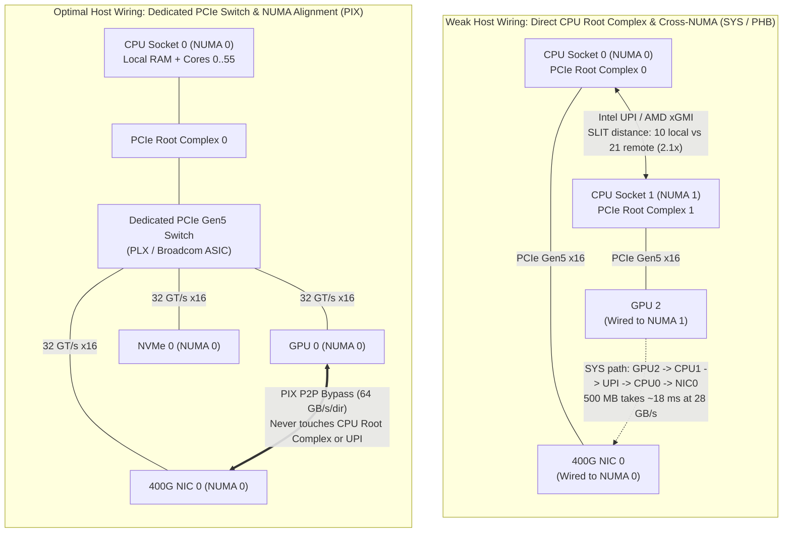
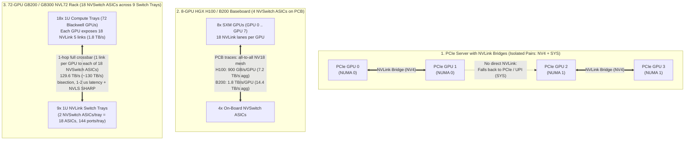

# 10.6 GPU interconnects: PCIe, NVLink, NVSwitch and NVLink-C2C

| | |
|---|---|
| Level | Intermediate |
| Priority tier | 2 |
| Lab venue | Nebius GPU |
| Part | Part 10: The GPU and CUDA |
| Sources used | `nvidia-devops` V7 Ch 2–3 & Labs 01–02; V2 Ch 10 & Lab 04; *AI Systems Performance Engineering* Ch 2 |
| Coverage file | `planning/coverage/chapters/10-06.md` |
| Claim ledger | `planning/ledgers/10-06.md` |

## Why this matters for AI infrastructure

An AI cluster is only as fast as its slowest wire. In Chapter `10.3`, we saw that an NVIDIA `H100` streams data out of on-package HBM3 at **`3,350 GB/s`** (`8,000 GB/s` on Blackwell `B200`), and in Chapter `10.5` we saw that keeping Tensor Cores near their flat Roofline ceiling requires feeding them without stalls. Yet the moment a tensor leaves a GPU to synchronize gradients, exchange Tensor Parallel (`TP`) activations, or reach a Network Interface Card (`NIC`), it hits the physical interconnect hierarchy on the motherboard and across the rack.

Consider a concrete production incident from `nvidia-devops` Volume 02 Chapter 10: a team launches a 4-GPU training job on a healthy dual-socket server. Two-GPU runs scale well, but four-GPU runs barely beat two GPUs. Every GPU passes health checks. When the engineer runs `nvidia-smi topo -m`, the physical truth appears: `GPU 0 ↔ GPU 1` and `GPU 2 ↔ GPU 3` are wired together by `NV4` (a direct 4-link NVLink bridge), whereas `GPU 0 ↔ GPU 2` and `GPU 1 ↔ GPU 3` show `SYS`—meaning every byte between those pairs must climb up the **PCIe Root Complex**, cross the inter-socket CPU link (**Intel `UPI`** or **AMD `xGMI`**), and descend the second socket's PCIe tree. All-reducing a **`500 MB` (`0.5 GB`)** gradient buffer takes **`0.5 GB / 900 GB/s ≈ 0.56 ms`** over a `900 GB/s` NVLink path, but **`0.5 GB / 28 GB/s ≈ 17.86 ms` (`~18 ms`)** over a `SYS` PCIe Gen4 path—**more than `30x` (`32.1x`) slower** for the exact same tensor.

Or consider two more field failures from `nvidia-devops` Volume 07 Chapters 2 and 3:
- A research team buys four **NVIDIA L40S PCIe** GPUs (`733 TFLOPS` FP8) and deploys a 70B LLM with 4-way Tensor Parallelism (`TP = 4`). Inference latency is unacceptably high because the L40S physically lacks NVLink connectors; every layer's `AllReduce` is forced across the `32–64 GB/s` PCIe bus while the Tensor Cores sit idle.
- A Kubernetes platform team sees identical dual-CPU, 4-GPU, single-400G-NIC nodes run fast on Node A and **`2x` slower on Node B**. Because the default Kubernetes scheduler is unaware of PCIe/NUMA locality, Node A happened to assign `GPU 0` and `GPU 1` (wired to `NUMA 0`, the same socket as the single 400G NIC), while Node B assigned `GPU 2` and `GPU 3` (`NUMA 1`), forcing every outbound network packet across the CPU's `UPI` link.

This chapter maps the four hardware interconnect tiers inside modern NVIDIA systems—**PCIe (`Gen4`/`Gen5`/`Gen6`), `NVLink` (`1.0` through `5.0`), `NVSwitch` (8-GPU baseboard and 72-GPU rack crossbars), and `NVLink-C2C` / `NV-HBI`**—and gives you the exact Linux and CUDA commands (`nvidia-smi topo -m`, `nvidia-smi topo -p2p r/w`, `lspci -Dtv`, `lspci -vv`, `numactl --hardware`, `p2pBandwidthLatencyTest`, and `nvidia-smi nvlink --status` / `--errorcounters`) to verify and enforce topology-aware placement in production.

:::tip In one minute
- **Four hardware interconnect tiers:**
  1. **On-package die-to-die (`NV-HBI`):** `10 TB/s` (`10,000 GB/s`) coherent link uniting the two reticle-limited GPU dies inside one Blackwell `B200`/`B300` package.
  2. **Superchip CPU-to-GPU (`NVLink-C2C`):** `~900 GB/s` bidirectional (`450 GB/s` per direction) **hardware cache-coherent** link between a Grace CPU and Hopper/Blackwell GPUs (`Unified CPU-GPU Memory` / `Extended GPU Memory`, `EGM`).
  3. **Scale-up GPU-to-GPU (`NVLink` & `NVSwitch`):** `900 GB/s` (`NVLink 4` on `H100`/`H200`) to `1,800 GB/s` (`1.8 TB/s`, `NVLink 5` on `B200`/`B300`) per GPU with `1–2 μs` small-message latency and **`NVLink SHARP` (`NVLS`)** in-switch reductions. **Crucial rule:** GPU-to-GPU caches over NVLink are **not** globally hardware cache-coherent; synchronization is enforced by `NCCL` or `NVSHMEM` (`PGAS`).
  4. **Host I/O bus (`PCIe`):** `32 GB/s` unidirectional on `Gen4 x16`, `64 GB/s` on `Gen5 x16` (`32 GT/s`), and `128 GB/s` on `Gen6 x16` (`B300`).
- **Topology labels (`nvidia-smi topo -m`):** From strongest to weakest: `X` (self) → `NV#` (`#` bonded NVLinks) → `PIX` (single PCIe switch/bridge) → `PXB` (multiple PCIe bridges without hitting CPU) → `PHB` (crosses CPU PCIe Host Bridge) → `NODE` (crosses host bridges within one NUMA node) → `SYS` (crosses inter-socket `UPI`/`xGMI`).
- **Three operational traps to audit:** (1) PCIe lane width downgrade (`LnkSta Width x4 (downgraded)` vs `LnkCap Width x16` cuts PCIe bandwidth `4x` from `64 GB/s` to `16 GB/s`); (2) enabling **MIG** (`mig.mode.current = Enabled`) disables CUDA Peer-to-Peer (`topo -p2p r` reports `CNS`) even across `NV18` hardware; and (3) a single failing NVLink lane (`Replay` / `CRC` errors in `nvidia-smi nvlink --errorcounters`) throttles an `NV18` pair without changing `topo -m`.
:::

---

## Prerequisites and outcomes

**Prerequisites:** Chapters `10.1`–`10.5` (GPU execution, HBM/SRAM memory hierarchy, Tensor Core precisions, and Roofline arithmetic intensity) and familiarity with DGX/HGX node layouts from Chapters `9.2`–`9.5`.

**Outcomes:** After completing this chapter, you will be able to:
1. Calculate unidirectional and bidirectional bandwidth across **PCIe `Gen4`, `Gen5`, and `Gen6` (`x16` vs downgraded `x4`)**, explain why direct CPU Root Complex wiring bottlenecks GPU-to-NIC traffic, and rank every path label in `nvidia-smi topo -m` (`X`, `NV#`, `PIX`, `PXB`, `PHB`, `NODE`, `SYS`).
2. Trace the evolution of **NVLink `1.0` through `5.0`** (`160 GB/s` to `1,800 GB/s` per GPU), contrast **NVLink Bridges** against **NVSwitch** non-blocking fabrics (`4` ASICs on an 8-GPU HGX baseboard vs `18` ASICs across `9` switch trays in an `NVL72` rack), and explain **`NVLink SHARP` (`NVLS`)** in-switch reductions.
3. Distinguish **hardware cache-coherent CPU-to-GPU `NVLink-C2C`** (`900 GB/s`, `EGM`) and **on-package `NV-HBI`** (`10 TB/s`) from **non-coherent GPU-to-GPU `NVLink`**, and explain how `NCCL`, `NVSHMEM` (`PGAS`), and `GPUDirect RDMA` (`nvidia-peermem`) coordinate memory access.
4. Execute a complete topology, Peer-to-Peer (`P2P`), and NUMA placement audit (`lspci -vv`, `numactl --hardware`, `nvidia-smi topo -p2p r`, `p2pBandwidthLatencyTest`, `nvidia-smi nvlink --errorcounters`, and Kubernetes Topology Manager `single-numa-node`).

---

## 1. PCIe, PCIe Switches, and NUMA Host Data Paths

### 1.1 The PCIe bandwidth ceiling (`Gen4`, `Gen5`, `Gen6`) and lane negotiation

The **Peripheral Component Interconnect Express (`PCIe`)** bus is the standard internal peripheral highway of a server motherboard, connecting CPUs, GPUs, network adapters (`NICs`), and `NVMe` SSDs. High-speed accelerators and `400G`/`800G` NICs plug into **16-lane (`x16`)** slots (`nvidia-devops` V7 Ch 2; *AI Systems Performance Engineering* Ch 2, p. 21):

| PCIe Generation | Signaling Rate per Lane | Unidirectional per Lane | `x16` Unidirectional Bandwidth | `x16` Bidirectional Bandwidth | Typical GPU / Platform Generation |
|---|---|---|---|---|---|
| **`PCIe Gen3 x16`** | `8 GT/s` | `~1 GB/s` | **`~16 GB/s`** | **`~32 GB/s`** | Pascal `P100` / Volta `V100` |
| **`PCIe Gen4 x16`** | `16 GT/s` | `~2 GB/s` | **`~32 GB/s`** | **`~64 GB/s`** | Ampere `A100` / Ada `L40S` |
| **`PCIe Gen5 x16`** | `32 GT/s` | `~4 GB/s` | **`~64 GB/s`** (`~63 GB/s` raw payload) | **`~128 GB/s`** | Hopper `H100` / `H200`, Blackwell `B200` |
| **`PCIe Gen6 x16`** | `64 GT/s` (PAM4) | `~8 GB/s` | **`~128 GB/s`** | **`~256 GB/s`** | Blackwell Ultra `B300` / `ConnectX-8` |

Compare those numbers to on-package GPU memory bandwidth: an `H100 SXM5` moves data out of HBM3 at **`3,350 GB/s`** (`8,000 GB/s` on `B200`). When an `H100` must push activations or gradients out over a **`64 GB/s` `PCIe Gen5 x16`** slot, it is forcing a **`3,350 GB/s` firehose through a `64 GB/s` drinking straw**—a **`52x` bandwidth step-down** (`125x` on a `B200` over `PCIe Gen5`).

Worse, a PCIe slot does not always run at its designed width. In `lspci -vv`, every PCIe device exposes two registers (`nvidia-devops` V7 Lab 01, Step 6):
- **`LnkCap` (Link Capability):** The maximum speed and lane width supported by the hardware (`Speed 32GT/s, Width x16`).
- **`LnkSta` (Link Status):** The speed and lane width actually negotiated right now (`Speed 32GT/s (ok), Width x16 (ok)`).

If a riser card is slightly unseated, a trace is marginal, or a link-training error occurs, the link can silently retrain down to **`LnkSta: Speed 32GT/s (ok), Width x4 (downgraded)`**. As modeled in `calc_pcie_link_bandwidth()` in `code/part10/gpu_interconnects.py`, dropping from `x16` (`16 lanes × 4 GB/s = 64 GB/s`) to `x4` (`4 lanes × 4 GB/s = 16 GB/s`) cuts unidirectional PCIe bandwidth by **`4x`** while `nvidia-smi` continues to report the GPU as online and healthy.

### 1.2 CPU Root Complex vs dedicated PCIe Switches (`PLX` / Broadcom) and `NUMA` boundaries

Even when every device negotiates `PCIe Gen5 x16 (ok)`, the path a packet takes across the motherboard depends on how the server OEM wired the PCIe hierarchy (`nvidia-devops` V7 Ch 2, Sections 2–3; see also Chapter `9.2` Section 2 for the specific DGX H100 4-switch layout):



1. **Direct CPU Root Complex attachment (`PHB` / `NODE`):** In lower-cost servers, PCIe slots wire directly into the CPU's integrated **PCIe Root Complex**. When `GPU 0` sends data to `NIC 0`, transactions must travel up to the CPU Root Complex, traverse internal CPU host bridges, and travel back down to the NIC—consuming CPU I/O bandwidth, adding latency, and often falling outside `NCCL`'s default GPUDirect RDMA distance limit.
2. **Dedicated PCIe Switches (`PIX` / `PXB`):** Purpose-built AI servers solder dedicated **PCIe Switch chips (`PLX` / Broadcom)** between the CPU Root Complex and the endpoints. When `GPU 0`, `NIC 0`, and a local `NVMe` drive hang off the **same PCIe Switch**, `GPU 0` can push packets directly through the switch to `NIC 0` (`GPUDirect RDMA`) or `NVMe 0` (`GPUDirect Storage`) via **Peer-to-Peer (`P2P`)** DMA without ever reaching the CPU.
3. **Dual-socket `NUMA` boundaries and the `UPI` / `xGMI` penalty (`SYS`):** Dual-socket servers split CPUs, DDR5 memory channels, and PCIe roots into two **Non-Uniform Memory Access (`NUMA`)** domains (`NUMA 0` and `NUMA 1`) linked by a socket-to-socket interconnect (**Intel `UPI`** or **AMD `xGMI`**). In `numactl --hardware`, the **System Locality Information Table (`SLIT`)** reports a baseline distance of **`10` for local access** and **`21` for cross-socket access**—a **`2.1x` latency penalty** on every remote memory touch (`nvidia-devops` V7 Lab 01, Step 1). When a GPU on `NUMA 1` transmits through a NIC on `NUMA 0`, every tensor packet must climb `CPU 1`'s Root Complex, cross the saturated `UPI`/`xGMI` link, and descend `CPU 0`'s Root Complex.

### 1.3 Reading the `nvidia-smi topo -m` path hierarchy and the `500 MB` worked comparison

Never guess how a server is wired or trust logical GPU indices (`GPU 0..N`), which can change across reboots, BIOS updates, or slot changes (`nvidia-devops` V2 Ch 10). Always map physical identity (`uuid` and `pci.bus_id`) and read the path labels in `nvidia-smi topo -m`:

| `nvidia-smi topo -m` Label | Physical Meaning | Crosses CPU Root Complex? | Crosses Inter-Socket (`UPI`/`xGMI`)? | Suitability for Heavy `TP` / `RDMA` |
|---|---|---|---|---|
| **`X`** | Self (same device) | No | No | N/A |
| **`NV#`** (e.g., `NV4`, `NV18`) | Connected across a bonded set of `#` **NVLink** lanes | **No** | **No** | **Optimal for GPU↔GPU** (`900–1,800 GB/s`) |
| **`PIX`** | Traverses **at most a single PCIe bridge/switch** | **No** | **No** | **Optimal for GPU↔NIC / GPU↔NVMe P2P** |
| **`PXB`** | Traverses **multiple cascaded PCIe bridges** without hitting the PCIe Host Bridge | **No** | **No** | **Good** (shared switch uplink contention possible) |
| **`PHB`** | Traverses a **PCIe Host Bridge** (typically the CPU Root Complex) | **Yes** | No | **Weak** (hits CPU root complex; avoid for GDR) |
| **`NODE`** | Traverses the interconnect **between PCIe Host Bridges within one NUMA node** | **Yes** | No | **Weak** (hits CPU host bridges; GDR often disabled) |
| **`SYS`** | Traverses PCIe **plus the SMP interconnect between NUMA sockets (`UPI`/`xGMI`)** | **Yes** | **Yes** | **Worst on host** (avoid for collectives & RDMA) |

To see how much a single path label changes training step time, walk through the worked calculation from `nvidia-devops` Volume 02 Chapter 10 (`compare_peer_transfer_time()` in `code/part10/gpu_interconnects.py`):
- **Payload:** A `500 MB` (`0.5 GB`) gradient buffer exchanged between two GPUs during one collective step.
- **Over a `900 GB/s` NVLink path (`NV18`):**
  ```text
  Transfer_Time_NVLink = 0.5 GB / 900 GB/s = 0.000556 s ≈ 0.56 ms
  ```
- **Over a `SYS` cross-socket PCIe Gen4 x16 path (`~28 GB/s` effective):**
  ```text
  Transfer_Time_SYS = 0.5 GB / 28 GB/s = 0.017857 s ≈ 17.86 ms (~18 ms)
  Slowdown_Factor   = 17.86 ms / 0.56 ms ≈ 32.1x (>30x slower)
  ```
A scheduler that pairs two ranks across a `SYS` link instead of an `NV#` link inflates that transfer by **more than `30x`**, turning intra-node communication into the dominant bottleneck of the training step.

---

## 2. NVLink (`1.0` to `5.0`), NVSwitch, and In-Switch SHARP (`NVLS`)

### 2.1 NVLink memory semantics and the five NVLink generations

Why couldn't NVIDIA simply add more PCIe lanes to fix intra-node GPU communication? Because Tensor Parallelism (`TP`), Expert Parallelism (`EP` for Mixture-of-Experts models), and high-frequency gradient synchronization require bandwidth within the same order of magnitude as HBM—hundreds to thousands of gigabytes per second—with microsecond latency.

**NVLink** is NVIDIA's high-speed, point-to-point wire protocol connecting GPU silicon directly to GPU silicon (`nvidia-devops` V7 Ch 3, Section 1; *AI Systems Performance Engineering* Ch 2, p. 27). Unlike Ethernet or TCP/IP (which package data into network frames using `Send`/`Receive` socket calls), NVLink exposes **NVLink Memory Semantics**: a CUDA kernel on `GPU 0` can issue native hardware **`Load` and `Store` instructions** directly to a virtual memory address backed by `GPU 1`'s HBM, or run asynchronous Copy Engine DMA (`cudaMemcpyPeerAsync`) across the link.

Across five hardware generations, per-GPU bidirectional NVLink bandwidth has scaled by **`11.25x`** (`NVLINK_GENERATIONS` in `code/part10/gpu_interconnects.py`):

| NVLink Generation | GPU Architecture | Representative GPU | Max NVLink Sub-Links per GPU | Bidirectional Bandwidth per Sub-Link | Total Bidirectional Bandwidth per GPU | Ratio vs `PCIe Gen5 x16` (`128 GB/s` bidir) |
|---|---|---|---|---|---|---|
| **`NVLink 1.0`** | Pascal | `P100` | `4` | `40 GB/s` | **`160 GB/s`** | `1.25x` |
| **`NVLink 2.0`** | Volta | `V100` | `6` | `50 GB/s` | **`300 GB/s`** | `2.34x` |
| **`NVLink 3.0`** | Ampere | `A100` | `12` | `50 GB/s` | **`600 GB/s`** | `4.69x` |
| **`NVLink 4.0`** | Hopper | `H100` / `H200` | `18` | `50 GB/s` (`~26.56 GB/s`/dir raw) | **`900 GB/s`** (`450 GB/s`/dir) | **`7.03x`** |
| **`NVLink 5.0`** | Blackwell | `B200` / `B300` | `18` | `100 GB/s` (`50 GB/s`/dir) | **`1,800 GB/s` (`1.8 TB/s`)** | **`14.06x`** |

### 2.2 NVLink Bridges on PCIe GPUs vs NVSwitch non-blocking fabrics (8-GPU baseboard to 72-GPU rack)

How are those 18 NVLink sub-links physically wired between GPUs? There are three distinct hardware topologies (`nvidia-devops` V7 Ch 3, Sections 1–2; *AI Systems Performance Engineering* Ch 2, pp. 26–30):



1. **Physical NVLink Bridges on PCIe GPUs (`NV4` / `NV2` pairs):** Standard PCIe motherboards cannot route high-frequency NVLink signals through the PCB. On PCIe cards that support NVLink (such as `H100 NVL`), an operator snaps a physical **NVLink Bridge clip** across the top edge of two adjacent PCIe cards. Bridges only connect GPUs in **isolated pairs** (or small 2–4 GPU islands). In a 4-GPU server with two bridged pairs (`GPU 0 ↔ GPU 1` on `NV4` and `GPU 2 ↔ GPU 3` on `NV4`), `GPU 0` still has **no NVLink path** to `GPU 2` or `GPU 3`—any 4-GPU collective must bottleneck through the `SYS` PCIe bus between the two islands. (And PCIe inference cards like the **`L40S`** have **zero NVLink fingers** at all, forcing 100% of multi-GPU traffic onto PCIe.)
2. **8-GPU HGX Baseboard with on-board `NVSwitch` (`NV18` all-to-all):** To connect 8 GPUs without a rat's nest of top-edge bridges, NVIDIA introduced the **`NVSwitch`** ASIC—a dedicated crossbar switch chip for NVLink traffic. As we saw in Chapter `9.2`, an 8-GPU `HGX H100` / `H200` baseboard solders **4 `NVSwitch` ASICs** directly onto the PCB. Each GPU routes its `18` NVLink lanes across the 4 switches so every GPU pair (`GPU 0 ↔ GPU 7`) communicates at the full **`900 GB/s`** (`1.8 TB/s` on `DGX B200`) in a single non-blocking hop (`NV18` in every off-diagonal cell of `nvidia-smi topo -m`).
3. **72-GPU `GB200` / `GB300 NVL72` Rack-Scale `NVSwitch` Crossbar (`130 TB/s`):** As covered in Chapter `9.5` and *AI Systems Performance Engineering* Chapter 2 (pp. 26–30), the `NVL72` rack extends the non-blocking NVSwitch fabric across **18 1U compute trays (`72` Blackwell GPUs)** and **9 1U NVLink switch trays**. Because each switch tray houses **2 `NVSwitch` ASICs** (`144` NVLink 5 ports at `100 GB/s` per tray), the rack contains **`9 × 2 = 18` `NVSwitch` ASICs**. Every GPU wires its **`18` NVLink 5 links** one-to-one across the **`18` `NVSwitch` ASICs** over the passive rear copper backplane. Any of the 72 GPUs reaches any other GPU in **one switch hop (`GPU → NVSwitch → GPU`)** with **`1–2 μs` small-message latency** (versus `5–10+ μs` and `50–100 GB/s` per port over scale-out InfiniBand/Ethernet NICs) and **`72 × 1.8 TB/s = 129.6 TB/s` (`~130 TB/s`)** of aggregate bisection bandwidth.

### 2.3 In-Network Collective Offload: `NVLink SHARP` (`NVLS`) vs InfiniBand `SHARP` (`CollNet`)

Wait—if 72 GPUs (or 8 GPUs) perform an `AllReduce` across an `NVSwitch` fabric, do the GPUs themselves have to pull every peer's gradient buffer, add them on their own Streaming Multiprocessors (`SMs`), and push the sum back out?

No. Modern `NVSwitch` ASICs (3rd-generation Hopper and 4th-generation Blackwell) embed dedicated **in-switch hardware reduction engines** called **`NVLink SHARP` (`NVLS`)** (*AI Systems Performance Engineering* Ch 2, "In-Network Aggregations with NVIDIA SHARP", pp. 30–31 & Figure 2-10):

- **`NVLink SHARP` (`NVLS`, scale-up inside an NVSwitch domain):** Instead of endpoints passing partial sums around a ring (`2(N-1)` steps), each GPU sends its gradient shard into the `NVSwitch` fabric. The **SHARP engines inside the `NVSwitch` ASICs** add the floating-point vectors in hardware inside the switch and multicast the reduced result back to all participating GPUs. This cuts data movement across the NVLink lanes, frees GPU `SMs` and Tensor Cores to keep running math kernels, and lowers collective latency.
- **InfiniBand `SHARP` (`CollNet`, scale-out across racks):** On `SHARP`-enabled Quantum InfiniBand switches, `NCCL`'s `CollNet` path offloads inter-node reductions into the network switch silicon in an analogous way. Together, intra-rack `NVLS` and inter-rack InfiniBand `SHARP` allow multi-rack clusters to scale collective operations with minimal SM overhead.

### 2.4 NVLink is not the only scale-up fabric

*AI Data Center Network Design and Technologies* Chapter 13 (read through the UALink section) explains where NVLink sits among scale-up designs. It says PCIe and CXL limits led to alternatives: NVLink (NVIDIA) and Infinity Fabric (AMD) are proprietary, while the Ultra Accelerator Link (UALink) consortium and the OCP's Scale-Up Ethernet Transport (SUE-T, announced October 2025) aim for open, multi-vendor scale-up. The book describes a scale-up system as one or more racks acting like one large accelerator, limited by physical constraints to **up to four racks or pods and up to 1,000 GPUs**, and says scale-up and scale-out **coexist** in an AI data center: scale-up for tightly coupled work, scale-out to grow capacity beyond it. This chapter covers NVLink only. The open standards are named here so you recognise them in vendor papers.

---

## 3. On-Package (`NV-HBI`) and Chip-to-Chip (`NVLink-C2C`) Interconnects & Cache Coherence Rules

### 3.1 The four hardware interconnect scales: `NV-HBI`, `NVLink-C2C`, `NVLink`, and `PCIe`

With Hopper and Blackwell, NVIDIA introduced two even tighter interconnects *above* board-level `NVLink`. You must keep all four hardware tiers—and their **hardware cache-coherence guarantees**—straight (*AI Systems Performance Engineering* Ch 2, pp. 20–30; `evaluate_interconnect_scales()` in `code/part10/gpu_interconnects.py`):

| Interconnect Tier | Physical Scope | Unidirectional Bandwidth | Bidirectional Bandwidth | Hardware Cache-Coherent? | Programming & Memory Model |
|---|---|---|---|---|---|
| **1. `NV-HBI` (High-Bandwidth Interface)** | **On-package die-to-die** between the two reticle-limited GPU dies (`104B` transistors + `96 GB` HBM3e each) inside one Blackwell `B200`/`B300` MCM | `5,000 GB/s` (`5 TB/s`) | **`10,000 GB/s` (`10 TB/s`)** | **Yes (fully coherent)** | Appears to CUDA and OS as **one unified GPU device** (`208B` transistors, `192 GB` raw / `180 GB` usable HBM3e, `126 MB` shared L2 cache). |
| **2. `NVLink-C2C` (Chip-to-Chip)** | **Superchip CPU-to-GPU** between Grace ARM CPU (`~480 GB` LPDDR5X @ `~500 GB/s`, `>100 MB` L3) and Hopper (`GH200`) or Blackwell (`GB200`/`GB300`) GPUs | **`450 GB/s`** | **`900 GB/s`** (`~7x` `PCIe Gen5 x16`) | **Yes (hardware cache-coherent CPU↔GPU)** | **Unified CPU-GPU Memory / Extended GPU Memory (`EGM`)**: CPU and GPU share one coherent virtual address space without explicit `cudaMemcpy`. |
| **3. `NVLink 4 / 5` & `NVSwitch`** | **Scale-up GPU-to-GPU** across an 8-GPU HGX baseboard or 72-GPU `NVL72` rack | `450 GB/s` (`NVLink 4`) / `900 GB/s` (`NVLink 5`) per GPU | **`900 GB/s`** (`H100`) / **`1,800 GB/s`** (`B200`) per GPU (`130 TB/s` rack) | **No (GPU L1/L2 caches are NOT globally coherent across GPUs)** | Global `P2P` load/store & **`NVSHMEM` (`PGAS`)** address space; **software (`NCCL` / `NVSHMEM`)** enforces synchronization and memory ordering. |
| **4. `PCIe Gen5 / Gen6 x16`** | **Host peripheral bus** between CPU Root Complex / PCIe Switch and GPU, NIC, or NVMe | `64 GB/s` (`Gen5`) / `128 GB/s` (`Gen6`) | **`128 GB/s`** (`Gen5`) / **`256 GB/s`** (`Gen6`) | **No** | Explicit DMA (`cudaMemcpyAsync`), `P2P` over PCIe switch (`PIX`/`PXB`), **`GPUDirect RDMA`** (`nvidia-peermem`), and **`GPUDirect Storage`** (`nvidia-fs`). |

### 3.2 Two critical architectural rules from *AI Systems Performance Engineering* Chapter 2

1. **`NVLink-C2C` is hardware cache-coherent for correctness, but `LPDDR5X` is still `~10x` slower than `HBM3e`:**
   On a `GB200` Superchip (`~480 GB` Grace `LPDDR5X` + `2 × 192 GB` (`180 GB` usable) `HBM3e` = **`~900 GB` of unified coherent memory**), a 500 GB model or massive recommendation embedding table that exceeds a single GPU's `180 GB` HBM3e can spill seamlessly into Grace's `LPDDR5X` over **`900 GB/s` (`450 GB/s`/dir) `NVLink-C2C`** without partitioning across nodes or hitting NVMe SSDs (*AI Systems Performance Engineering* Ch 2, pp. 21–22; see also Chapter `9.4` for Grace NUMA/THP tuning). However, accessing CPU `LPDDR5X` (`~500 GB/s`) across `NVLink-C2C` has higher latency and roughly **an order of magnitude (`~10x`) lower bandwidth** than local `HBM3e` (`8,000 GB/s`). Therefore, production runtimes keep hot weights, active KV cache, and current layer activations in `HBM3e`, and use **explicit asynchronous prefetching and staged pipelines** to stream cold layers or overflow tables from `LPDDR5X`.
2. **Only the CPU–GPU path (`NVLink-C2C`) is hardware cache-coherent; GPU-to-GPU NVLink is NOT globally cache-coherent:**
   As emphasized in *AI Systems Performance Engineering* Chapter 2 ("Multi-GPU Programming", p. 29), although `NVLink` and `NVSwitch` expose a **global physical/virtual address space** across all GPUs in a node or `NVL72` rack—allowing one GPU to directly load/store or execute **Partitioned Global Address Space (`PGAS`)** operations via **`NVSHMEM`** (NVIDIA's GPU-accelerated OpenSHMEM library)—**GPU L1/L2 caches are not hardware cache-coherent across different GPUs**. If `GPU 0` writes to `GPU 1`'s HBM over NVLink, hardware does not automatically snoop and invalidate `GPU 1`'s L1 cache lines. Instead, libraries such as **`NCCL`** and **`NVSHMEM`** (and across nodes, **`GPUDirect RDMA`** via the `nvidia-peermem` kernel module paired with `NVSHMEM` IBTA remote atomics) provide the explicit software barriers, fences, and synchronization required for correct multi-GPU execution.

---

## 4. Commands and Configurations That Matter

> **Untested here:** every command in this section is a reference template taken from the cited notes. None was run on a live GPU server while writing this chapter.

Below is the complete command sequence from `nvidia-devops` Volume 07 Labs 01–02 and Volume 02 Lab 04 to inventory PCIe/NUMA topology, verify PCIe link negotiation, validate `P2P` and `NVLink` health, and enforce NUMA-aligned placement.

### 4.1 Map CPU sockets, `SLIT` NUMA distances, PCIe tree, and sysfs `numa_node`

```bash
# 1. Inspect NUMA nodes, CPU core lists, local RAM, and SLIT distance matrix (10 local vs 21 remote = 2.1x)
numactl --hardware
lscpu -e=CPU,NODE,SOCKET,CORE,ONLINE

# 2. Record durable GPU inventory (NEVER rely on GPU index alone; record UUID and pci.bus_id)
nvidia-smi --query-gpu=index,uuid,name,pci.bus_id,driver_version --format=csv

# 3. Inspect the physical PCIe root port and switch tree ([10de:2330] = H100, [15b3:1021] = ConnectX-7)
lspci -Dtv
lspci -Dnn | grep -Ei 'NVIDIA|Ethernet|InfiniBand|Non-Volatile memory'

# 4. Cross-check Linux sysfs NUMA locality for every GPU, NIC, and NVMe BDF
# Note: a value of -1 means unknown locality (e.g., chipset NVMe); do NOT silently assume NUMA 0
for dev in $(lspci -D | grep -Ei 'NVIDIA|Ethernet|InfiniBand|Non-Volatile memory' | awk '{print $1}'); do
  printf "%-14s NUMA=%s\n" "$dev" "$(cat /sys/bus/pci/devices/$dev/numa_node 2>/dev/null || echo unknown)"
done
```

### 4.2 Verify PCIe negotiated link speed and width (`LnkCap` vs `LnkSta`)

```bash
# Check every NVIDIA GPU and ConnectX NIC for silent PCIe lane downgrades (e.g., Width x4 instead of x16)
for bdf in $(lspci -D | grep -Ei 'NVIDIA|Mellanox' | awk '{print $1}'); do
  echo "=== $bdf ==="
  sudo lspci -s "$bdf" -vv | grep -E 'LnkCap:|LnkSta:'
done
```

Expected healthy output on a `PCIe Gen5 x16` slot:
```text
LnkCap: Port #0, Speed 32GT/s, Width x16, ASPM not supported
LnkSta: Speed 32GT/s (ok), Width x16 (ok)
```

### 4.3 Inspect `nvidia-smi topo -m`, `topo -p2p`, and `nvlink` error counters

```bash
# 1. Print full GPU + NIC + NVMe topology matrix and P2P read/write capability matrices
nvidia-smi topo -m
nvidia-smi topo -p2p r
nvidia-smi topo -p2p w

# 2. Verify all NVLink sub-links are active (18 links x ~26.56 GB/s/dir on H100; 18 x 50 GB/s/dir on B200)
nvidia-smi nvlink --status

# 3. Check per-lane NVLink replay, recovery, and CRC error counters
nvidia-smi nvlink --errorcounters
```

### 4.4 Measure real Peer-to-Peer (`P2P`) bandwidth and latency (`p2pBandwidthLatencyTest`)

```bash
# Build and run CUDA Samples p2pBandwidthLatencyTest and simpleP2P during a maintenance window
git clone --depth 1 https://github.com/NVIDIA/cuda-samples.git
cd cuda-samples/Samples/5_Domain_Specific/p2pBandwidthLatencyTest
make -j"$(nproc)"
./p2pBandwidthLatencyTest
```

### 4.5 Enforce NUMA-aligned placement in Linux (`numactl`) and Kubernetes (`Topology Manager`)

When launching a process directly on Linux, bind CPU threads and host RAM to the GPU's local NUMA node (`nvidia-devops` V2 Lab 04, Step 10):
```bash
numactl --cpunodebind=0 --membind=0 ./train_rank_group_0.sh
```

On Kubernetes nodes where a subset of GPUs and a high-speed NIC share a NUMA socket (`nvidia-devops` V7 Ch 2 Customer Scenario), configure the **kubelet `Topology Manager`** and **`CPU Manager`** in `/var/lib/kubelet/config.yaml` so the kubelet queries device plugins (`nvidia-device-plugin`, `sriov-network-device-plugin`) for NUMA hints and rejects unaligned placements at pod admission time:
```yaml
apiVersion: kubelet.config.k8s.io/v1beta1
kind: KubeletConfiguration
cpuManagerPolicy: static
topologyManagerPolicy: single-numa-node
topologyManagerScope: container
```

---

## 5. How It Fails: Six Production Interconnect & Topology Failure Modes

The diagnostic model in `audit_interconnect_and_placement()` (`code/part10/gpu_interconnects.py`, where combining these six checks into a single automated acceptance gate is **my inference**) catches the six classic interconnect failures from `nvidia-devops` Volumes 02 and 07:

| # | Failure Mode | Production Symptom | Root Cause & Diagnostic Evidence | Fix |
|---|---|---|---|---|
| **1** | **Silent PCIe lane width downgrade (`x16 → x4`)** | `nvidia-smi` shows all GPUs healthy, but host-to-device data loading or `GPUDirect RDMA` on one GPU (`GPU 3`) is **`4x` slower** (`~16 GB/s` instead of `~63–64 GB/s`). | `sudo lspci -s <BDF> -vv \| grep -E 'LnkCap:\|LnkSta:'` shows `LnkCap: Speed 32GT/s, Width x16`, but **`LnkSta: Speed 32GT/s (ok), Width x4 (downgraded)`** after a riser or link-training event (`V7 Lab 01 Step 6`). | Reseat the GPU/riser or trigger a cold AC power cycle to retrain the PCIe link; if it retrains to `x4` under load, RMA the riser/motherboard slot. |
| **2** | **`MIG` enabled on one GPU silently disables `P2P` (`CNS`)** | `nvidia-smi topo -m` shows `NV18` between `GPU 0` and `GPU 1`, yet `simpleP2P` waives the test (`Peer access ... : No`) and multi-GPU collectives fall back to slow host-staged copies. | `nvidia-smi topo -p2p r` prints **`CNS`** (Chipset Not Supported) instead of `OK`, and `nvidia-smi -i 1 --query-gpu=mig.mode.current` reports **`Enabled`**. CUDA Peer-to-Peer memory access is unsupported across MIG-enabled GPUs regardless of physical NVLink wiring (`V7 Lab 02 §14`). | Disable MIG on all GPUs participating in the multi-GPU P2P job (`sudo nvidia-smi -i 1 -mig 0`, followed by a GPU reset). |
| **3** | **Degraded NVLink sub-link (`0.000 GB/s` or high `Replay`/`CRC` errors)** | `topo -m` still prints `NV18` (or `NV4`), but `p2pBandwidthLatencyTest` shows `GPU 0 ↔ GPU 3` bidirectional bandwidth dropped to **`312.4 GB/s`** instead of `~800+ GB/s` (`39%` of baseline). | Either `nvidia-smi nvlink --status` shows a sub-link at **`0.000 GB/s`** (`V2 Lab 04 §14`) or `nvidia-smi nvlink --errorcounters -i 3` shows **`Link 4: Replay Errors: 18422, CRC Errors: 211`** while other links read `0` (`V7 Lab 02 §14`). | Cordon the node and escalate a hardware RMA for the specific SXM GPU / NVLink bridge / baseboard trace with the `nvlink --errorcounters` log attached. |
| **4** | **Tensor Parallelism (`TP`) deployed on PCIe-only GPUs (`L40S`)** | A 70B LLM running with `TP = 4` across four `L40S` GPUs has high TTFT and ITL latency despite strong FP8 Tensor Core specs (`733 TFLOPS`). | The `L40S` physically lacks NVLink connectors. Every transformer layer's `TP` `AllReduce` is forced across the **`32–64 GB/s` PCIe bus** (`SYS` / `PHB` / `PIX`) instead of a `900 GB/s` NVSwitch mesh (`V7 Ch 3 Customer Scenario`). | Run smaller models (`TP = 1`) or Pipeline Parallelism on `L40S`, or migrate `TP ≥ 4` 70B+ workloads to `HGX H100`/`H200`/`B200` with `NVSwitch`. |
| **5** | **Naive GPU index pairing across two `NV4` islands (`SYS` hop)** | Scaling a training job from 2 GPUs to 4 GPUs on a 4-GPU bridged server makes steps slower; or a 2-GPU job assigned `GPU 0 + GPU 2` runs **`>30x` slower** on collective transfers (`~18 ms` vs `0.56 ms` for `500 MB`). | `nvidia-smi topo -m` shows two separate `NV4` pairs (`GPU 0 ↔ GPU 1` on `NUMA 0` and `GPU 2 ↔ GPU 3` on `NUMA 1`) with `SYS` between them (`V2 Ch 10`). Round-robin rank assignment paired `0+2` and `1+3` across the `SYS` link. | Pin 2-GPU jobs strictly to `{GPU 0, GPU 1}` or `{GPU 2, GPU 3}` by UUID, and align collective ring/tree order with the `NV4` islands. |
| **6** | **Cross-NUMA GPU-to-NIC placement on Kubernetes (`2x` slower node)** | Identical dual-CPU, 4-GPU, 1-NIC nodes run fast on Node A (`GPU 0,1` on `NUMA 0`) and **`2x` slower on Node B** (`GPU 2,3` on `NUMA 1`) when `NIC 0` is wired to `NUMA 0`. | Default Kubernetes scheduling ignores PCIe/NUMA locality, forcing `GPU 2,3` on Node B to push all network traffic across the CPU **`UPI` / `xGMI`** link (`SYS` to `NIC 0`, `V7 Ch 2 Customer Scenario`). | Enable kubelet **Topology Manager** (`topologyManagerPolicy: single-numa-node`) + `cpuManagerPolicy: static` (or install a second NIC on `NUMA 1`). Note that unaligned pods will be rejected with `Topology Affinity Error` rather than running degraded. |

---

## 6. Hands-On Lab: Verify PCIe Link Widths, NVLink Generations, P2P Matrices, and Topology Placement Policies

**Venue:** Any Linux machine or Nebius GPU VM with Python 3.10+ (no hardware GPU required to run the deterministic simulator; all live Linux/CUDA commands are provided in Section 4).

Run the self-checking lab script `code/part10/gpu_interconnects_lab.py`:

```bash
python3 code/part10/gpu_interconnects_lab.py
```

Expected output (`25 passed, 0 failed`):

```text
=== Chapter 10.6 Lab: GPU Interconnects: PCIe, NVLink, NVSwitch & NVLink-C2C ===
  [PASS] V7 Ch2 & ASP Ch2 p.21: PCIe x16 unidirectional bandwidth is 32 GB/s (Gen4), 64 GB/s (Gen5), and 128 GB/s (Gen6)
  [PASS] V7 Lab 01 Step 6: PCIe Gen5 x16 downgraded to Width x4 drops unidirectional bandwidth 4x from 64 GB/s to 16 GB/s
  [PASS] V7 Ch3: NVLink generations deliver 160 GB/s (P100), 300 GB/s (V100), 600 GB/s (A100), 900 GB/s (H100), and 1,800 GB/s (B200)
  [PASS] ASP Ch2 p.27: Hopper NVLink 4 uses 18 links x 50 GB/s (900 GB/s) and Blackwell NVLink 5 uses 18 links x 100 GB/s (1.8 TB/s)
  [PASS] V2 Ch10 worked example: 500 MB (0.5 GB) takes 0.56 ms on 900 GB/s NVLink vs 17.86 ms (~18 ms) on 28 GB/s SYS PCIe (>30x slower)
  [PASS] ASP Ch2 p.23: Blackwell NV-HBI die-to-die link is 10,000 GB/s (10 TB/s) and hardware cache-coherent
  [PASS] ASP Ch2 pp.21,29: NVLink-C2C (900 GB/s, 450 GB/s/dir) is hardware cache-coherent, whereas GPU-to-GPU NVLink is NOT globally cache-coherent
  [PASS] ASP Ch2 pp.28,30: NVL72 NVSwitch crossbar provides 129.6 TB/s (~130 TB/s) bisection and NVLink SHARP (NVLS) in-switch reductions
  [PASS] V7 Lab 01 Step 4: NV18 parses 18 bonded NVLink lanes and bypasses CPU root complex and NUMA socket links
  [PASS] V7 Ch2 & Lab 01: PIX and PXB stay on PCIe switches (preferred), whereas PHB and NODE hit CPU root complex and SYS crosses UPI/xGMI
  [PASS] Healthy NV18 GPU pair + PIX rail-aligned NIC + local NUMA CPU passes distributed_training audit
  [PASS] V2 Lab 04 Step 7: Single-GPU inference with local NUMA CPU passes even without NVLink peer group
  [PASS] V7 Ch3 Customer Scenario: Multi-GPU synchronized workload on PCIe-only/SYS pair (e.g., 4x L40S without NVLink) fails audit
  [PASS] V7 Lab 02 §14: MIG-enabled GPU (topo -p2p == CNS) blocks P2P even when topo -m shows NV18
  [PASS] V2 Lab 04 §14: Detects silent NVLink sub-link reporting 0.000 GB/s inside an NV4 pair
  [PASS] V7 Lab 02 §14: Detects NVLink replay/CRC errors (18,422 replay + 211 CRC) causing single-pair bandwidth drop
  [PASS] V7 Ch2 Customer Scenario: Distributed job using remote SYS NIC across UPI/xGMI is flagged for K8s Topology Manager
  [PASS] V7 Lab 01 Step 5: Flags sysfs numa_node == -1 against silently defaulting to NUMA node 0
  [PASS] V7 Lab 01 Step 1: Flags remote CPU/memory NUMA binding (2.1x SLIT distance 21 vs 10)
  [PASS] V7 Lab 01 Step 6: Flags PCIe LnkSta x4 downgrade during node acceptance audit
  [PASS] Rejects unsupported PCIe generation
  [PASS] Rejects sta_width > cap_width
  [PASS] Rejects non-positive payload_gb
  [PASS] Rejects invalid topo -m path label
  [PASS] Rejects unknown workload_profile

Summary: 25 passed, 0 failed (total 25)
```

---

## Exercises

1. **PCIe link-width downgrade audit:** A node acceptance script checks `nvidia-smi` and sees all 8 `H100` GPUs online, yet host-to-device staging on `GPU 3` (`0000:5d:00.0`) is `4x` slower than on `GPU 0` (`0000:1a:00.0`). Write the exact `lspci` command to compare `LnkCap` and `LnkSta`, and calculate the exact unidirectional and bidirectional bandwidth loss when a `PCIe Gen5 x16` slot retrains to `Width x4`.
2. **NVLink vs `SYS` collective step math:** Using `compare_peer_transfer_time()` in `code/part10/gpu_interconnects.py`, calculate how long it takes to transfer a `500 MB` (`0.5 GB`) gradient shard across (a) `NVLink 4.0` (`900 GB/s`), (b) `NVLink 5.0` (`1,800 GB/s`), and (c) a cross-socket `SYS` PCIe Gen4 path (`28 GB/s`). How many times slower is the `SYS` path than `NVLink 5.0`?
3. **Why `MIG` breaks `simpleP2P` on an `NV18` baseboard:** Two `H100 SXM5` GPUs on an HGX baseboard show `NV18` in `nvidia-smi topo -m`, yet `nvidia-smi topo -p2p r` prints `CNS` and `./simpleP2P` waives the test. Write the `nvidia-smi` query that proves why `P2P` is blocked and the command to restore `P2P` access.
4. **Hardware cache coherence across the four interconnect tiers:** A teammate claims that because `GB200 NVL72` connects 36 Grace CPUs and 72 Blackwell GPUs with `NVLink`, all 72 GPUs and 36 CPUs share hardware cache-coherent L1/L2 caches across the entire rack. Correct their mental model by stating the exact hardware cache-coherence boundary for `NV-HBI`, `NVLink-C2C`, and board/rack `NVLink 5`.
5. **Diagnosing a single degraded pair inside an `NV18` mesh:** During node commissioning, `p2pBandwidthLatencyTest` shows `1,587 GB/s` self-copy and `~800+ GB/s` bidirectional bandwidth for every GPU pair *except* `GPU 0 ↔ GPU 3`, which drops to `312.4 GB/s` even though `nvidia-smi topo -m` still shows `NV18`. Write the two `nvidia-smi nvlink` commands you run next and explain what `Replay Errors: 18422` and `CRC Errors: 211` on `Link 4` mean.
6. **Designing a 3-profile placement policy:** Given the 4-GPU, 2-NIC dual-socket host from `nvidia-devops` Volume 02 Lab 04 (`{GPU0, GPU1, NIC0}` on `NUMA 0` with `NV4`, and `{GPU2, GPU3, NIC1}` on `NUMA 1` with `NV4`), write the placement rules for `single_gpu_inference`, `multi_gpu_training`, and `distributed_training`, and explain how kubelet `topologyManagerPolicy: single-numa-node` enforces the distributed rule on Kubernetes.

---

## Checkpoint questions (20)

<details>
<summary><strong>1. State the unidirectional and bidirectional bandwidth of `PCIe Gen4 x16`, `PCIe Gen5 x16`, and `PCIe Gen6 x16`, and compare `PCIe Gen5 x16` to `H100` HBM3 bandwidth.</strong></summary>

- **`PCIe Gen4 x16` (`16 GT/s`):** `~32 GB/s` unidirectional / `~64 GB/s` bidirectional.
- **`PCIe Gen5 x16` (`32 GT/s`):** `~64 GB/s` unidirectional (`~63 GB/s` raw) / `~128 GB/s` bidirectional.
- **`PCIe Gen6 x16` (`64 GT/s`):** `~128 GB/s` unidirectional / `~256 GB/s` bidirectional.
An `H100 SXM5` has **`3,350 GB/s`** of internal HBM3 bandwidth—more than **`52x` faster** than a `64 GB/s` `PCIe Gen5 x16` slot.
</details>

<details>
<summary><strong>2. What is the architectural difference between wiring GPUs and NICs directly to the CPU's PCIe Root Complex versus wiring them behind a dedicated PCIe Switch (`PLX` / Broadcom)?</strong></summary>

When devices wire directly to the **CPU Root Complex (`PHB` / `NODE`)**, every GPU-to-NIC transfer must travel up into the CPU, cross internal CPU bridges, and travel back down to the NIC, adding latency and consuming CPU I/O bandwidth. When a GPU and NIC share a **dedicated PCIe Switch (`PIX`)**, the switch routes **Peer-to-Peer (`P2P`)** DMA packets directly between the GPU and NIC (`GPUDirect RDMA`), bypassing the CPU completely.
</details>

<details>
<summary><strong>3. What do `10` and `21` mean in the `node distances` matrix of `numactl --hardware`, and what happens when a GPU on `NUMA 1` transmits through a NIC on `NUMA 0`?</strong></summary>

In the Linux **System Locality Information Table (`SLIT`)**, `10` is the baseline relative cost of accessing memory on the local NUMA socket, and `21` means cross-socket access over the CPU interconnect (**Intel `UPI`** or **AMD `xGMI`**) costs **`2.1x`** as much latency. When a GPU on `NUMA 1` uses a NIC on `NUMA 0` (`SYS` path), every packet must climb `CPU 1`'s PCIe Root Complex, cross the saturated `UPI`/`xGMI` link, and descend `CPU 0`'s Root Complex.
</details>

<details>
<summary><strong>4. Rank the seven path labels in `nvidia-smi topo -m` (`X`, `NV#`, `PIX`, `PXB`, `PHB`, `NODE`, `SYS`) from strongest to weakest and define each one.</strong></summary>

1. **`X`:** Self (same device).
2. **`NV#`:** Connected across `#` bonded **NVLink** lanes (`NV4`, `NV18`).
3. **`PIX`:** Traverses **at most a single PCIe bridge/switch** (never hits CPU Root Complex).
4. **`PXB`:** Traverses **multiple PCIe bridges/switches** without hitting the PCIe Host Bridge.
5. **`PHB`:** Traverses a **PCIe Host Bridge** (typically the CPU Root Complex).
6. **`NODE`:** Traverses the interconnect **between PCIe Host Bridges within a single NUMA node**.
7. **`SYS`:** Traverses PCIe **plus the inter-socket NUMA interconnect (`UPI` / `xGMI`)**.
</details>

<details>
<summary><strong>5. Walk through the worked calculation comparing a `500 MB` (`0.5 GB`) gradient transfer over a `900 GB/s` NVLink path versus a `28 GB/s` `SYS` PCIe Gen4 path.</strong></summary>

- **Over `900 GB/s` NVLink (`NV18`):** `0.5 GB / 900 GB/s = 0.000556 s ≈ 0.56 ms`.
- **Over `28 GB/s` `SYS` PCIe Gen4:** `0.5 GB / 28 GB/s = 0.017857 s ≈ 17.86 ms` (`~18 ms`).
- **Slowdown:** `17.86 ms / 0.56 ms ≈ 32.1x` (**more than `30x` slower** for the identical `500 MB` buffer).
</details>

<details>
<summary><strong>6. State the per-GPU bidirectional bandwidth across all five generations of `NVLink` (`NVLink 1.0` through `NVLink 5.0`) and name a representative GPU for each.</strong></summary>

- **`NVLink 1.0` (`Pascal P100`):** **`160 GB/s`** (`4 links × 40 GB/s`).
- **`NVLink 2.0` (`Volta V100`):** **`300 GB/s`** (`6 links × 50 GB/s`).
- **`NVLink 3.0` (`Ampere A100`):** **`600 GB/s`** (`12 links × 50 GB/s`).
- **`NVLink 4.0` (`Hopper H100 / H200`):** **`900 GB/s`** (`18 links × 50 GB/s`).
- **`NVLink 5.0` (`Blackwell B200 / B300`):** **`1,800 GB/s` (`1.8 TB/s`, `18 links × 100 GB/s`)**.
</details>

<details>
<summary><strong>7. Why did a 4-GPU Tensor Parallel (`TP = 4`) 70B LLM deployment on four `NVIDIA L40S` PCIe GPUs suffer severe inference latency despite the `L40S` having strong FP8 Tensor Core throughput?</strong></summary>

Because the **`L40S` physically lacks NVLink connectors**—it cannot accept an NVLink Bridge or connect to an NVSwitch. Tensor Parallelism executes an `AllReduce` across all 4 GPUs on every transformer layer, forcing every synchronization step across the motherboard's `32–64 GB/s` PCIe bus while the Tensor Cores stall waiting for data.
</details>

<details>
<summary><strong>8. Contrast how an 8-GPU `HGX H100`/`B200` baseboard and a 72-GPU `GB200`/`GB300 NVL72` rack use `NVSwitch` ASICs to achieve a single-hop non-blocking crossbar.</strong></summary>

- **8-GPU HGX baseboard:** Solders **4 `NVSwitch` ASICs** onto the server PCB; each of the 8 SXM GPUs distributes its `18` NVLink lanes across the 4 switches (`900 GB/s`/GPU on H100; `1.8 TB/s`/GPU on B200).
- **72-GPU `NVL72` rack:** Disaggregates **9 1U NVLink switch trays**, each holding **2 `NVSwitch` ASICs (`144` ports/tray) = `18` `NVSwitch` ASICs total**. Each of the 72 Blackwell GPUs connects its **`18` NVLink 5 links** (`100 GB/s` each) **one link per `NVSwitch` ASIC** over the rear copper backplane, delivering a 1-hop (`GPU → NVSwitch → GPU`) full crossbar at **`129.6 TB/s` (`~130 TB/s`)** bisection bandwidth and **`1–2 μs`** small-message latency.
</details>

<details>
<summary><strong>9. What is `NVLink SHARP` (`NVLS`), and how does it differ from InfiniBand `SHARP` (`CollNet`)?</strong></summary>

- **`NVLink SHARP` (`NVLS`):** Uses dedicated hardware reduction engines built directly into the **`NVSwitch` ASICs** (inside an 8-GPU HGX node or 72-GPU `NVL72` rack) to aggregate gradients and multicast results in-switch, reducing NVLink traffic and freeing GPU SMs from running reduction math.
- **InfiniBand `SHARP` (`CollNet`):** Offloads multi-node reductions into the **scale-out Quantum InfiniBand network switches** across racks.
</details>

<details>
<summary><strong>10. What is `NV-HBI` on a Blackwell `B200` / `B300` GPU, and why did NVIDIA introduce it?</strong></summary>

Because a single monolithic chip is limited by the lithography reticle size (`~104 billion` transistors per die), Blackwell uses a **dual-die multichip module (`MCM`)** that bonds two GPU dies (`96 GB` HBM3e and `63 MB` L2 cache each) across a **`10 TB/s` (`10,000 GB/s`) on-package interconnect called `NV-HBI` (High-Bandwidth Interface)**. `NV-HBI` is fully hardware cache-coherent, so the two dies appear to CUDA and the OS as **one unified GPU** with `208 billion` transistors, `192 GB` raw (`180 GB` usable) HBM3e, and `126 MB` of L2 cache.
</details>

<details>
<summary><strong>11. How fast is `NVLink-C2C` on a Grace Hopper (`GH200`) or Grace Blackwell (`GB200`/`GB300`) Superchip, what is `Extended GPU Memory` (`EGM`), and why must you still stage hot data into HBM?</strong></summary>

`NVLink-C2C` provides **`~900 GB/s` bidirectional (`450 GB/s` per direction)** of **hardware cache-coherent** bandwidth between the Grace ARM CPU (`~480 GB` LPDDR5X at `~500 GB/s`) and the GPU(s)—about `7x` faster than `PCIe Gen5 x16`. Through **Unified CPU-GPU Memory / Extended GPU Memory (`EGM`)**, a GPU can directly read/write CPU LPDDR5X without explicit copies. However, LPDDR5X over C2C still has **`~10x` lower bandwidth and higher latency** than on-package `HBM3e` (`8,000 GB/s`), so hot weights and KV caches must stay in HBM while cold layers or overflow embedding tables are prefetched asynchronously from LPDDR5X.
</details>

<details>
<summary><strong>12. Are GPU L1/L2 caches globally hardware cache-coherent across multiple GPUs over `NVLink`? How do multi-GPU programs maintain memory consistency?</strong></summary>

**No.** Only the CPU–GPU path over `NVLink-C2C` (and the on-package `NV-HBI` link inside one Blackwell GPU) is hardware cache-coherent. Across different GPUs over `NVLink` and `NVSwitch`, there is a global address space for P2P and **`NVSHMEM` (`PGAS`)** loads/stores, but **GPU caches are not globally hardware cache-coherent**; software libraries (**`NCCL`** and **`NVSHMEM`**) must issue explicit synchronization barriers and memory fences.
</details>

<details>
<summary><strong>13. How does `lspci -vv` expose a silent PCIe lane-width downgrade on a GPU that looks healthy in `nvidia-smi`, and how much bandwidth is lost when `x16` retrains to `x4`?</strong></summary>

By comparing **`LnkCap` (Link Capability)** against **`LnkSta` (Link Status)**:
- Healthy: `LnkCap: Speed 32GT/s, Width x16` and `LnkSta: Speed 32GT/s (ok), Width x16 (ok)` (`~64 GB/s` per direction).
- Downgraded: `LnkSta: Speed 32GT/s (ok), Width x4 (downgraded)`, which cuts available PCIe bandwidth by **`4x`** down to **`~16 GB/s` per direction**.
</details>

<details>
<summary><strong>14. Why does `nvidia-smi topo -p2p r` report `CNS` and `./simpleP2P` refuse to run between `GPU 0` and `GPU 1` even when `nvidia-smi topo -m` shows `NV18`?</strong></summary>

Because **Multi-Instance GPU (`MIG`) mode is enabled (`mig.mode.current = Enabled`)** on at least one of the GPUs. MIG hardware-partitions a GPU into isolated instances and **disables CUDA Peer-to-Peer (`P2P`) memory access** across that GPU regardless of physical NVLink connectivity.
</details>

<details>
<summary><strong>15. If `nvidia-smi topo -m` shows `NV18` everywhere on an 8-GPU node, why can a single GPU pair (`GPU 0 ↔ GPU 3`) still run at only `312 GB/s` instead of `~800+ GB/s` in `p2pBandwidthLatencyTest`, and how do you prove the root cause?</strong></summary>

`nvidia-smi topo -m` only shows static topology discovery. A physical NVLink sub-link can either drop to `0.000 GB/s` in **`nvidia-smi nvlink --status`** or suffer heavy retransmissions from physical signal errors (**`Replay Errors`** and **`CRC Errors`** in **`nvidia-smi nvlink --errorcounters -i 3`**), throttling effective throughput across that pair until the faulty GPU/board is RMA'd.
</details>

<details>
<summary><strong>16. Why should production scripts and schedulers never rely solely on logical GPU index (`0, 1, 2, ...`) to identify devices?</strong></summary>

Logical GPU indices depend on OS/driver enumeration order and `CUDA_VISIBLE_DEVICES` remapping, and can shift after a reboot, BIOS update, or PCIe slot change. Always record and cross-reference the immutable **GPU `UUID`** (`GPU-3a1f9c02-...`) and physical **PCI bus address (`pci.bus_id`, e.g., `0000:1a:00.0`)** alongside `CUDA_DEVICE_ORDER=PCI_BUS_ID`.
</details>

<details>
<summary><strong>17. What does a value of `-1` in `/sys/bus/pci/devices/<BDF>/numa_node` mean, and how should a placement audit handle it?</strong></summary>

A value of `-1` means the Linux kernel / ACPI tables do not expose a specific NUMA node association for that PCIe device (common on chipset-attached NVMe controllers or certain BIOS configurations). You must record it as **`unknown`** and verify the physical root complex in `lspci -Dtv` rather than silently defaulting `-1` to `NUMA 0`.
</details>

<details>
<summary><strong>18. How do you configure Kubernetes on a multi-socket GPU node so the kubelet refuses to admit a distributed training pod whose GPU, CPU cores, and NIC span across different NUMA sockets?</strong></summary>

Configure the kubelet with **`cpuManagerPolicy: static`** and **`topologyManagerPolicy: single-numa-node`** (with `topologyManagerScope: container` or `pod`). The kubelet collects NUMA topology hints from the CPU manager, `nvidia-device-plugin`, and `sriov-network-device-plugin` and only admits the pod if all requested resources reside on a single NUMA node (rejecting unaligned pods with `Topology Affinity Error`).
</details>

<details>
<summary><strong>19. Contrast the topology placement requirements of `single_gpu_inference`, `multi_gpu_training` (single-node), and `distributed_training` (multi-node).</strong></summary>

- **`single_gpu_inference`:** Requires local NUMA CPU and host memory binding (`require_same_numa_cpu: true`), prefers a local NIC, and does **not** require a multi-GPU NVLink peer group.
- **`multi_gpu_training` (intra-node):** Requires the strongest available **GPU peer group (`NV#`)**, `P2P` enabled (`OK`), balanced GPU count, and local NUMA CPU/memory binding.
- **`distributed_training` (multi-node):** Requires all `multi_gpu_training` guarantees **plus** a locally attached high-speed RDMA NIC (`PIX` or `PXB`) and deterministic rank-to-device mapping.
</details>

<details>
<summary><strong>20. What role do `GPUDirect RDMA` (`nvidia-peermem`), `BlueField-3` DPUs, and `Co-Packaged Optics` (`CPO`) play when traffic leaves an `NVSwitch` domain for another rack or storage cluster?</strong></summary>

- **`GPUDirect RDMA` (`nvidia-peermem`):** Allows `ConnectX` NICs and `BlueField-3` DPUs to register GPU HBM and perform zero-copy RDMA transfers directly between the network wire and GPU memory over the PCIe switch (`PIX`) or Grace C2C without staging through host RAM or CPU kernels.
- **`BlueField-3` DPU:** Offloads and isolates storage (`NVMe-oF`), security, and control-plane processing from the host CPU.
- **`Co-Packaged Optics` (`CPO`):** Integrates silicon photonics optical transmitters directly beside the `Quantum-X800` / `Spectrum-X800` (`800 Gb/s` and `1.6 Tb/s`) switch silicon, shortening electrical traces to lower power and scale inter-rack fabrics across thousands of racks.
</details>

---

## Sources and review notes

### Primary sources read in full for this chapter
1. ***AI Systems Performance Engineering* (`ai-systems-performance-engineering`, Chris Fregly), Chapter 2 (*AI System Hardware Overview*, pp. 20–42):**
   - Grace Hopper (`GH200`) and Grace Blackwell (`GB200` / `GB300`) Superchips, `NVLink-C2C` (`~900 GB/s` bidirectional, `450 GB/s`/dir, hardware cache-coherent `Unified CPU-GPU Memory` / `Extended GPU Memory` `EGM`), `PCIe Gen5 x16` (`64 GB/s`/dir) vs `PCIe Gen6 x16` (`128 GB/s`/dir on `B300`), `LPDDR5X` (`~480 GB` at `~500 GB/s`, `~10x` lower bandwidth than `8 TB/s` `HBM3e`), Blackwell dual-die `MCM` (`2 × 104B = 208B` transistors, `192 GB` raw / `180 GB` usable `HBM3e`, `126 MB` L2 cache) linked by **`10 TB/s` `NV-HBI`**, `NVLink 5` (`18 links × 100 GB/s = 1.8 TB/s`/GPU, `1–2 μs` small-message latency), `NVSwitch` in `NVL72` (`9` switch trays × `2` ASICs = `18` `NVSwitch` ASICs, `144` ports/tray, `130 TB/s` (`129.6 TB/s`) 1-hop crossbar), non-coherent GPU-to-GPU caches over NVLink requiring `NCCL` or `NVSHMEM` (`PGAS`), **`NVLink SHARP` (`NVLS`)** in-switch reductions vs InfiniBand `SHARP` (`CollNet`), `GPUDirect RDMA` (`nvidia-peermem`), `BlueField-3` `NVMe-oF` offload, and `Co-Packaged Optics` (`CPO`).
2. **`nvidia-devops` Volume 07 Chapters 2–3 (`chapter-02-pcie-numa-and-host-data-paths.md`, 1,295 words; `chapter-03-nvlink-and-nvswitch.md`, 1,083 words) & Labs 01–02 (`lab-01-inspect-pcie-numa-and-gpu-topology.md`, 4,396 words; `lab-02-validate-peer-access-and-nvlink.md`, 1,811 words):**
   - `PCIe Gen4/Gen5 x16` vs `3,350 GB/s` HBM3, CPU Root Complex vs `PCIe Switches` (`PLX`/Broadcom), `NUMA` boundaries (`UPI`/`xGMI` and `SLIT` `10` vs `21` distance), `nvidia-smi topo -m` path hierarchy (`X`, `NV#`, `PIX`, `PXB`, `PHB`, `NODE`, `SYS`), `lspci -vv` `LnkCap` vs `LnkSta` (`Width x4 (downgraded)` = `4x` bandwidth drop from `64 GB/s` to `16 GB/s`), `NVLink 1.0–5.0` bandwidth table (`160`, `300`, `600`, `900`, `1,800 GB/s`), `NVLink Bridges` vs `NVSwitch`, `MIG` (`mig.mode.current = Enabled`) causing `topo -p2p r` `CNS`, `p2pBandwidthLatencyTest` + `nvidia-smi nvlink --errorcounters` (`Replay` / `CRC` errors), the 4x `L40S` `TP = 4` customer scenario, and the Kubernetes `Topology Manager` (`single-numa-node`) customer scenario.
3. **`nvidia-devops` Volume 02 Chapter 10 (`chapter-10-gpu-topology-peer-access-and-data-paths.md`, 3,396 words) & Lab 04 (`lab-04-build-a-topology-aware-gpu-placement-plan.md`, 2,712 words):**
   - Logical index vs physical identity (`UUID`, `pci.bus_id`, `numa_node`), the worked `500 MB` collective transfer (`0.56 ms` on `900 GB/s` NVLink vs `17.86 ms` (`~18 ms`) on `28 GB/s` `SYS` PCIe = `32.1x` slower), 4-GPU `NV4` island pairing trap, and the 3-profile placement policy (`single_gpu_inference`, `multi_gpu_training`, `distributed_training`).

### Explicitly labelled inferences
- Combining PCIe `LnkCap`/`LnkSta` width checks, `sysfs` `numa_node = -1` validation, `MIG`/`CNS` P2P checks, NVLink lane error counters, and the 3 workload placement profiles into the single deterministic Python auditor (`audit_interconnect_and_placement()` in `code/part10/gpu_interconnects.py`) is **my inference** synthesizing `V2 Ch 10/Lab 04` and `V7 Ch 2–3/Labs 01–02`.

### Source added after the coverage review
- *AI Data Center Network Design and Technologies* Chapter 13 (Section 2.4 above; read in part). *Distributed AI Systems* Chapter 2 (GPU hardware, networking and parallelism) was read for cross-checks only: its NVLink figures agree with this chapter (A100 600 GB/s, H100 900 GB/s, B200 1.8 TB/s per GPU, aggregate bidirectional; PCIe Gen4 x16 about 31.5 GB/s and Gen5 about 64 GB/s per direction). It adds no new facts, so it is not cited in the text.

### Run here
- `code/part10/gpu_interconnects_lab.py`: Summary: 25 passed, 0 failed (total 25)

### Not verified on live hardware
- `ai-data-center-network-design-and-technologies` Chapter 13 (Scale-Up Systems) was read through the UALink section only; its SUE-T and ESUN header details were not read.
- All `numactl`, `lspci -vv`, `nvidia-smi topo -m`, `nvidia-smi topo -p2p`, `nvidia-smi nvlink` and `p2pBandwidthLatencyTest` commands in Section 4 were not run on a live GPU server. The output examples (for example `312.4 GB/s`, `18,422` replay errors) are the notes' own examples.

### Not in the corpus
- "such as `H100 NVL`" as an example of a PCIe card with NVLink bridges is general knowledge and not in the cited notes (the Volume 04 note says only "NVLink Bridge (Pairs, 600 GB/s)").

### Corrections to the author's notes
- The "~900 GB of unified coherent memory" for a GB200 Superchip is approximate. Chapter 9.4 uses 864 GB (480 GB LPDDR5X plus 384 GB HBM3e). Treat 864 GB as the exact figure.
