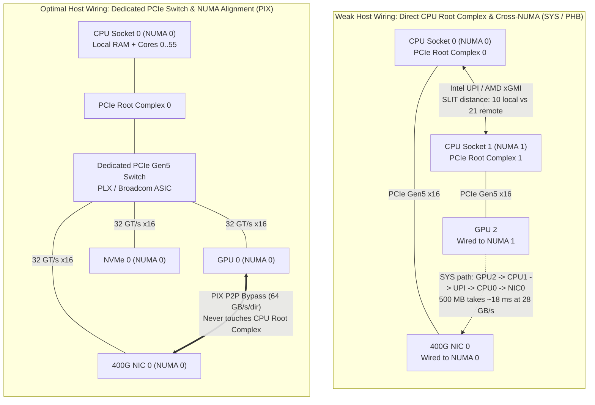
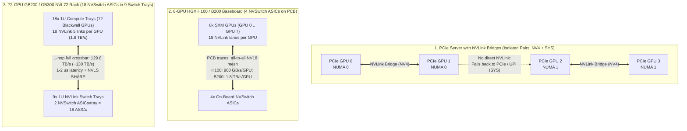

# 10.6 GPU interconnects: PCIe, NVLink, NVSwitch and NVLink-C2C

| Field | Value |
|---|---|
| Level | Intermediate |
| Priority tier | 2 |
| Lab venue | Nebius GPU |
| Part | Part 10: The GPU and CUDA |
| Coverage file | `planning/coverage/chapters/10-06.md` |
| Claim ledger | `planning/ledgers/10-06.md` |

## Why this matters for AI infrastructure

An AI cluster is only as fast as its slowest wire. Earlier in Part 10, you saw that an H100 GPU streams data out of on-package HBM3 at 3,350 GB/s. A Blackwell B200 reaches 8,000 GB/s. The Roofline chapter showed that keeping Tensor Cores near their flat compute ceiling requires feeding them without stalls. Yet the moment a tensor leaves a GPU to synchronize gradients, exchange Tensor Parallel activations, or reach a network card, it hits the motherboard and rack interconnect hierarchy. Each of those wires has a different width and speed, and the speed you get depends on which wires the data crosses.

Consider a production incident from the source notes for this chapter. A team launches a four-GPU training job on a healthy dual-socket server. Two-GPU runs scale well, but four-GPU runs barely beat two GPUs even though every device passes health checks. The GPUs themselves are fine, and the job still crawls. When the engineer runs `nvidia-smi topo -m`, the physical wiring explains the stall. Two GPUs share a fast bridge, and the other two share a second fast bridge, but the two pairs talk to each other only through the slow path between the CPU sockets. A collective that spans both pairs is limited by that slow path, and the health checks never look at it.

```text
Incident 1: Bridged 4-GPU Dual-Socket Server (V2 Ch. 10)
  GPU 0 <-> GPU 1 : NV4 (direct 4-link NVLink bridge on NUMA 0)
  GPU 2 <-> GPU 3 : NV4 (direct 4-link NVLink bridge on NUMA 1)
  GPU 0 <-> GPU 2 : SYS (climbs PCIe Root Complex, crosses CPU UPI/xGMI, descends second socket)
  500 MB (0.5 GB) gradient transfer over 900 GB/s NVLink : 0.5 / 900 = 0.56 ms
  500 MB (0.5 GB) gradient transfer over 28 GB/s SYS PCIe: 0.5 / 28  = 17.86 ms (~18 ms, 32.1x slower)
```

Two more field failures from the source notes show how interconnect blindness hurts both inference and Kubernetes platforms.

- A research team buys four L40S PCIe GPUs rated at 733 TFLOPS of FP8 compute and deploys a 70B large language model with four-way Tensor Parallelism. Inference latency is unacceptably high because the L40S physically lacks NVLink connectors. Every layer's AllReduce is forced across the slow PCIe bus while the Tensor Cores sit idle.
- A Kubernetes platform team sees identical dual-CPU, four-GPU, single-NIC nodes run fast on Node A and twice as slow on Node B. The default Kubernetes scheduler ignores PCIe and NUMA locality. Node A assigned GPUs wired to the same socket as the 400G NIC. Node B assigned GPUs on the remote socket and forced every network packet across the CPU socket link.

This chapter maps the four hardware interconnect tiers inside modern NVIDIA systems: PCIe, NVLink, NVSwitch, and NVLink-C2C alongside on-package NV-HBI. It also provides the exact Linux and CUDA commands to verify and enforce topology-aware placement in production. Read the two incidents above as the questions the rest of the chapter answers. Why was the bridge pair fast and the cross-pair path slow? Which wire carried the data, and how would you have known?

:::tip In one minute
- Four hardware interconnect tiers govern GPU data movement, summarized in the table below.
- Topology labels in `nvidia-smi topo -m` rank from strongest to weakest as X, NV#, PIX, PXB, PHB, NODE, and SYS.
- Three operational traps require automated checks. Watch for PCIe lane width downgrades from x16 to x4, MIG mode disabling Peer-to-Peer access with CNS status, and single-lane NVLink replay or CRC errors throttling an NV18 pair.
:::

| Interconnect Tier | Physical Scope | Peak Bandwidth | Hardware Cache Coherent? | Key Operational Rule |
|---|---|---|---|---|
| 1. On-package die-to-die (NV-HBI) | Connects two reticle-limited GPU dies inside one Blackwell B200 or B300 package | 10 TB/s (10,000 GB/s) bidirectional | Yes | Exposes both dies as one unified CUDA GPU |
| 2. Superchip CPU-to-GPU (NVLink-C2C) | Connects Grace ARM CPU to Hopper or Blackwell GPUs | ~900 GB/s bidirectional (450 GB/s per direction) | Yes | Enables Unified CPU-GPU Memory and Extended GPU Memory (EGM) |
| 3. Scale-up GPU-to-GPU (NVLink and NVSwitch) | Connects 8 GPUs on an HGX baseboard or 72 GPUs in an NVL72 rack | 900 GB/s (NVLink 4) to 1,800 GB/s or 1.8 TB/s (NVLink 5) per GPU, 1-2 us latency | No across GPUs | Supports NVLink SHARP (NVLS); requires NCCL or NVSHMEM (PGAS) synchronization |
| 4. Host I/O bus (PCIe) | Connects CPU Root Complex or PCIe switch to GPUs, NICs, and NVMe | 32 GB/s (Gen4 x16), 64 GB/s (Gen5 x16 at 32 GT/s), 128 GB/s (Gen6 x16 on B300) unidirectional | No | Audit `LnkSta` vs `LnkCap` for silent x4 downgrades |

The table is the map for the whole chapter. Tiers 1 and 2 sit inside a package or between a CPU and its GPU, and both are cache coherent. Tier 3 links GPUs to each other and is not coherent across GPUs. Tier 4 is the host bus that every NIC and NVMe drive uses, and it is the slowest of the four. The last column is the operational rule that you can check with a command.

---

## Prerequisites and outcomes

Prerequisites for this chapter include the GPU execution, memory hierarchy, Tensor Core precision, and Roofline chapters from Part 10. You should also know the DGX and HGX node layouts from Part 9.

This chapter works through four steps. It starts with PCIe bandwidth, lane negotiation, and the path labels that `nvidia-smi topo -m` prints, so you can rank any two devices in a server. It then follows NVLink across five hardware generations, compares NVLink bridges with NVSwitch fabrics, and explains how in-switch reductions speed up collectives. Next it separates the cache-coherent links, NV-HBI and NVLink-C2C, from the non-coherent GPU-to-GPU NVLink, and shows which software coordinates memory access across them. The last part is a full audit of topology, peer-to-peer access, and NUMA placement with Linux and CUDA tools, ending with Kubernetes Topology Manager policies.

---

## 1. PCIe, PCIe Switches, and NUMA Host Data Paths

Picture a training job that loads its next batch from host memory, writes a checkpoint to an NVMe drive, and pushes gradients to a network card, all within the same few milliseconds. Each of those trips crosses the motherboard's peripheral bus. If that host path is narrow, downgraded, or routed across CPU sockets, the fastest GPU in the world will stall waiting on host I/O. This section explains the three things that decide how wide and how direct that path is.

### 1.1 The PCIe bandwidth ceiling and lane negotiation

The Peripheral Component Interconnect Express bus is the standard internal highway of a server motherboard. It connects CPUs, GPUs, network adapters, and NVMe SSDs. High-speed accelerators and 400G or 800G NICs plug into 16-lane x16 slots, whose generational bandwidths are listed below. A lane is one pair of wires that carries data in each direction, so a x16 slot has sixteen of them.

| PCIe Generation | Signaling Rate per Lane | Unidirectional per Lane | x16 Unidirectional Bandwidth | x16 Bidirectional Bandwidth | Representative Platform |
|---|---|---|---|---|---|
| PCIe Gen3 x16 | 8 GT/s | ~1 GB/s | ~16 GB/s | ~32 GB/s | Pascal P100 and Volta V100 |
| PCIe Gen4 x16 | 16 GT/s | ~2 GB/s | ~32 GB/s | ~64 GB/s | Ampere A100 and Ada L40S |
| PCIe Gen5 x16 | 32 GT/s | ~4 GB/s | ~64 GB/s (~63 GB/s raw payload) | ~128 GB/s | Hopper H100 and H200, Blackwell B200 |
| PCIe Gen6 x16 | 64 GT/s (PAM4) | ~8 GB/s | ~128 GB/s | ~256 GB/s | Blackwell Ultra B300 and ConnectX-8 |

Read any row by multiplying the per-lane figure by sixteen. Gen5 gives about 4 GB/s per lane, and 16 lanes give about 64 GB/s in one direction. Bidirectional bandwidth is the same figure counted in both directions, which is why it is roughly double.

Compare those PCIe numbers to on-package GPU memory bandwidth. An H100 SXM5 moves data out of HBM3 at 3,350 GB/s, while a B200 moves data at 8,000 GB/s. When an H100 must push activations or gradients out over a 64 GB/s PCIe Gen5 x16 slot, it forces a firehose through a drinking straw. That represents a 52x bandwidth step-down on Hopper and a 125x step-down on Blackwell over PCIe Gen5. To check the first number, divide 3,350 by 64, which is about 52. The Blackwell figure comes from dividing 8,000 by 64, which gives 125.

Worse, a PCIe slot does not always run at its designed width. In `lspci -vv`, every PCIe endpoint exposes two link registers.

- `LnkCap` is Link Capability. It reports the maximum speed and lane width supported by the hardware.
- `LnkSta` is Link Status. It reports the speed and lane width actually negotiated right now.

If a riser card is slightly unseated, a motherboard trace is marginal, or a link-training error occurs, the slot can silently retrain down to four lanes. Meanwhile, `nvidia-smi` continues to report the GPU as healthy. As modeled in `calc_pcie_link_bandwidth` in `code/part10/gpu_interconnects.py`, a downgrade from x16 to x4 cuts unidirectional bandwidth fourfold from 64 GB/s down to 16 GB/s. Four lanes out of sixteen is one quarter of the wires, so one quarter of the bandwidth is the simple rule to remember. The danger is that nothing in the default health view tells you this has happened.

### 1.2 CPU Root Complex vs dedicated PCIe Switches and NUMA boundaries

Even when every device negotiates a healthy x16 link, the path a packet takes across the motherboard depends on how the server OEM wired the PCIe hierarchy. The OEM is the company that builds the server, and it decides where the slots connect. The diagram below contrasts weak direct-to-CPU wiring against optimal switch-based wiring.



Read the left half first. The GPU sits on one socket, the NIC sits on the other, and every packet has to climb to a root complex, cross the link between sockets, and descend again. The right half keeps everything under one switch, so the packet goes from the GPU to the NIC without passing the CPU. The rest of this section names the three rules that decide which picture you have.

Three architectural rules determine whether host traffic flies through a local switch or stalls inside the CPU sockets.

1. Direct CPU Root Complex attachment labels paths as PHB or NODE. In lower-cost servers, PCIe slots wire directly into the CPU's integrated PCIe Root Complex. When GPU 0 sends data to NIC 0, transactions must travel up into the CPU Root Complex, traverse internal CPU host bridges, and travel back down to the NIC. That path consumes CPU I/O bandwidth, adds latency, and often disables GPUDirect RDMA in NCCL. GPUDirect RDMA lets a NIC read GPU memory directly, and it is the fast path for multi-node traffic.
2. Dedicated PCIe Switches from PLX or Broadcom label paths as PIX or PXB. Purpose-built AI servers solder dedicated PCIe Switch ASICs between the CPU Root Complex and the endpoints, as seen in the four-switch DGX H100 layout in Chapter 9.2. When a GPU, a NIC, and a local NVMe drive hang off the same PCIe Switch, the GPU pushes packets directly through the switch via Peer-to-Peer DMA. Traffic never touches the CPU. DMA means the device moves the data itself, so the CPU only sets up the transfer.
3. Dual-socket NUMA boundaries and the UPI or xGMI penalty label paths as SYS. Dual-socket servers split CPUs, DDR5 memory channels, and PCIe roots into two Non-Uniform Memory Access domains linked by Intel UPI or AMD xGMI. NUMA means that memory is closer to some CPUs than others. In `numactl --hardware`, the System Locality Information Table reports a baseline distance of 10 for local access and 21 for cross-socket access. That represents a 2.1x latency penalty, since 21 divided by 10 is 2.1. When a GPU on NUMA 1 transmits through a NIC on NUMA 0, every packet must climb CPU 1's Root Complex, cross the saturated socket link, and descend CPU 0's Root Complex.

### 1.3 Reading the `nvidia-smi topo -m` path hierarchy and the 500 MB worked comparison

Never guess how a server is wired or trust logical GPU indices such as GPU 0 through GPU 7. Logical indices can shift across reboots, BIOS updates, or PCIe slot changes. Always record immutable physical identity using UUID and `pci.bus_id`, and inspect the path labels in `nvidia-smi topo -m`.

The label table below reads from the strongest path at the top to the weakest at the bottom. Each label says how far a packet travels. Find the label, then check the last column before you decide whether a pair is suitable for heavy tensor parallelism or RDMA.

| `nvidia-smi topo -m` Label | Physical Meaning | Crosses CPU Root Complex? | Crosses Inter-Socket Link? | Suitability for Heavy TP or RDMA |
|---|---|---|---|---|
| X | Self (same device) | No | No | Not applicable |
| NV# (such as NV4 or NV18) | Connected across `#` bonded NVLink lanes | No | No | Optimal for GPU-to-GPU (900-1,800 GB/s) |
| PIX | Traverses at most a single PCIe bridge or switch | No | No | Optimal for GPU-to-NIC and GPU-to-NVMe P2P |
| PXB | Traverses multiple cascaded PCIe bridges without hitting the Host Bridge | No | No | Good, though shared switch uplinks can contend |
| PHB | Traverses a PCIe Host Bridge (the CPU Root Complex) | Yes | No | Weak; hits CPU root complex and hurts GPUDirect RDMA |
| NODE | Traverses interconnect between PCIe Host Bridges within one NUMA node | Yes | No | Weak; hits CPU host bridges and often disables GDR |
| SYS | Traverses PCIe plus the inter-socket link (Intel UPI or AMD xGMI) | Yes | Yes | Worst on host; avoid for collectives and RDMA |

When you read the label for a pair, ask two questions in order. Does the path cross the CPU root complex? Does it cross the link between sockets? Each yes makes the path slower. A NV label never touches either one, which is why NVLink pairs are the fastest choice for tensor parallel traffic.

The worked calculation, implemented in `compare_peer_transfer_time` in `code/part10/gpu_interconnects.py`, shows how severely a single `SYS` hop inflates collective step time. Follow the three lines in order. Each one divides the same payload by a different speed, and the last line compares the two results.

```text
Payload: 500 MB (0.5 GB) gradient buffer exchanged between two GPUs
  Over 900 GB/s NVLink (NV18)     : 0.5 GB / 900 GB/s = 0.000556 s ≈ 0.56 ms
  Over 28 GB/s SYS PCIe Gen4 path : 0.5 GB / 28 GB/s  = 0.017857 s ≈ 17.86 ms (~18 ms)
  Slowdown Factor                 : 17.86 ms / 0.56 ms             ≈ 32.1x (>30x slower)
```

The same payload takes about 0.56 ms on the NVLink path and about 18 ms on the SYS path. The gap is not a small tuning difference. It comes from the wire itself, so no kernel change on the GPU can make up for it.

Pairing two training ranks across a cross-socket `SYS` link instead of an NVLink path inflates that gradient transfer by more than thirtyfold. Intra-node communication immediately becomes the dominant bottleneck of the training job. The practical lesson is that the pairing decision is made when you assign ranks to GPUs, long before any kernel runs.

---

## 2. NVLink, NVSwitch, and In-Switch SHARP (NVLS)

Why couldn't hardware designers simply add more PCIe lanes to solve intra-node GPU communication? Picture the traffic in a single tensor-parallel layer. Every GPU has to exchange its partial results with every other GPU, and it has to do that many times for each token. Tensor Parallelism, Expert Parallelism for Mixture-of-Experts models, and high-frequency gradient synchronization require bandwidth within the same order of magnitude as HBM. They need hundreds to thousands of gigabytes per second with microsecond latency, which standard motherboard PCIe traces cannot deliver. That is the gap NVLink was built to close.

### 2.1 NVLink memory semantics and the five NVLink generations

NVLink is NVIDIA's high-speed point-to-point wire protocol connecting GPU silicon directly to GPU silicon. Ethernet and TCP/IP package data into network frames using `Send` and `Receive` socket calls. By contrast, NVLink exposes native memory semantics. A CUDA kernel on GPU 0 can issue hardware `Load` and `Store` instructions directly to a virtual memory address backed by GPU 1's HBM. It can also run asynchronous Copy Engine DMA via `cudaMemcpyPeerAsync`. The difference is that a load or store reads or writes memory in place, while a socket call has to build and send a message.

Across five hardware generations, per-GPU bidirectional NVLink bandwidth has scaled by 11.25x, as cataloged in `NVLINK_GENERATIONS` in `code/part10/gpu_interconnects.py`. Check that factor yourself. The first generation totals 160 GB/s per GPU, and the fifth totals 1,800 GB/s. Dividing 1,800 by 160 gives 11.25.

| NVLink Generation | GPU Architecture | Representative GPU | Max Sub-Links per GPU | Bidirectional Bandwidth per Sub-Link | Total Bidirectional Bandwidth per GPU | Ratio vs PCIe Gen5 x16 (128 GB/s bidir) |
|---|---|---|---|---|---|---|
| NVLink 1.0 | Pascal | P100 | 4 | 40 GB/s | 160 GB/s | 1.25x |
| NVLink 2.0 | Volta | V100 | 6 | 50 GB/s | 300 GB/s | 2.34x |
| NVLink 3.0 | Ampere | A100 | 12 | 50 GB/s | 600 GB/s | 4.69x |
| NVLink 4.0 | Hopper | H100 and H200 | 18 | 50 GB/s (~26.56 GB/s/dir raw) | 900 GB/s (450 GB/s/dir) | 7.03x |
| NVLink 5.0 | Blackwell | B200 and B300 | 18 | 100 GB/s (50 GB/s/dir) | 1,800 GB/s (1.8 TB/s) | 14.06x |

The last column compares each generation with a PCIe Gen5 x16 slot. Read it as a ladder. Each rung is the number of times faster that generation is than one PCIe slot, in both directions combined. The jump from NVLink 4 to NVLink 5 comes from doubling the bandwidth of each sub-link, while the number of sub-links per GPU stays at eighteen.

### 2.2 NVLink Bridges on PCIe GPUs vs NVSwitch non-blocking fabrics

How are those eighteen NVLink sub-links physically wired between GPUs? Depending on whether you buy PCIe cards, an eight-GPU baseboard, or a 72-GPU rack, you get one of three very different hardware topologies. The diagram shows all three, and the numbered list below it explains each one.



The three pictures differ in one important way. In the first, a GPU has a fast partner and a slow path to everyone else. In the second and third, every GPU reaches every other GPU through the same switch fabric, so the path length does not depend on which two GPUs you pick. That is what the term non-blocking means in practice.

1. Physical NVLink Bridges on PCIe GPUs create isolated pairs labeled NV4 or NV2. Standard PCIe motherboards cannot route high-frequency NVLink signals through the board. On PCIe cards that support NVLink, such as H100 NVL or bridged A100 pairs providing 600 GB/s, an operator snaps a physical bridge clip across two adjacent cards. In a four-GPU server with two bridged pairs, GPU 0 still has no NVLink path to GPU 2 or GPU 3. Any four-GPU collective must bottleneck on the `SYS` PCIe bus. Furthermore, PCIe inference cards like the L40S have zero NVLink fingers, forcing all multi-GPU traffic onto PCIe.
2. An eight-GPU HGX baseboard solders four NVSwitch ASICs directly onto the PCB to form an all-to-all NV18 mesh. As covered in Chapter 9.2, each of the eight SXM GPUs distributes its 18 NVLink lanes across the four switches. Every GPU pair communicates at the full 900 GB/s on H100 or 1.8 TB/s on B200 in a single non-blocking hop. That fabric pools 640 GB of HBM3 on an eight-GPU H100 node. A non-blocking hop means the switch can carry every pair's traffic at full speed at the same time, so one busy pair does not slow the others.
3. A 72-GPU GB200 or GB300 NVL72 rack scales the non-blocking NVSwitch crossbar across an entire rack. As detailed in Chapter 9.5 and *AI Systems Performance Engineering* Chapter 2, the rack houses 18 compute trays containing 72 Blackwell GPUs and 9 NVLink switch trays. Each switch tray holds two NVSwitch ASICs, totaling 18 NVSwitch ASICs across the rack. Every GPU wires its 18 NVLink 5 links one-to-one across those 18 switch ASICs over the rear copper backplane. Any of the 72 GPUs reaches any peer in one switch hop with 1 to 2 us latency and 129.6 TB/s of bisection bandwidth. Bisection bandwidth is the rate at which half the rack can talk to the other half.

```text
NVSwitch Fabric Scaling Summary:
  8-GPU HGX H100 Baseboard :  8 GPUs * 0.9 TB/s =   7.2 TB/s aggregate across  4 on-board NVSwitch ASICs
  8-GPU HGX B200 Baseboard :  8 GPUs * 1.8 TB/s =  14.4 TB/s aggregate across  4 on-board NVSwitch ASICs
  72-GPU GB200/GB300 NVL72 : 72 GPUs * 1.8 TB/s = 129.6 TB/s (~130 TB/s) across 18 NVSwitch ASICs (9 trays * 2 ASICs/tray, 144 ports/tray)
  Latency Comparison       : 1-2 us over NVLink/NVSwitch vs 5-10+ us and 50-100 GB/s per port over scale-out InfiniBand/Ethernet NICs
```

The summary block turns the per-GPU speeds into fabric totals by multiplying the number of GPUs by the speed each one gets. For the H100 baseboard, eight times 0.9 gives 7.2 TB/s. For the NVL72 rack, 72 times 1.8 gives 129.6 TB/s. The last line puts the scale-up latency next to the scale-out latency, and that gap is why tensor parallelism stays inside the scale-up domain.

### 2.3 In-Network Collective Offload: NVLink SHARP (NVLS) vs InfiniBand SHARP (CollNet)

When 72 GPUs or 8 GPUs execute an AllReduce across an NVSwitch fabric, do the GPUs have to pull every peer's gradient buffer and sum them on their own Streaming Multiprocessors? An AllReduce is the step where every GPU ends up with the sum of everyone's gradients. In older ring algorithms requiring `2 * (N - 1)` steps, they did, which consumed valuable SM cycles and memory bandwidth. Each GPU spent part of its compute time on addition instead of on matrix math.

Modern third-generation Hopper and fourth-generation Blackwell NVSwitch ASICs eliminate that overhead by embedding hardware reduction engines called NVLink SHARP, or NVLS. SHARP stands for Scalable Hierarchical Aggregation and Reduction Protocol, and the engines live inside the switch chips.

- NVLink SHARP operates inside the scale-up NVSwitch domain. Each GPU sends its gradient shard into the NVSwitch fabric once. The SHARP engines inside the NVSwitch ASICs sum the floating-point vectors in switch hardware and multicast the reduced result back to all participating GPUs. This cuts NVLink data movement, frees GPU SMs to keep running math kernels, and lowers collective latency.
- InfiniBand SHARP, exposed in NCCL as CollNet, operates across racks on scale-out Quantum InfiniBand switches. It offloads inter-node reductions into the network switch silicon in an analogous manner. Multi-rack clusters can then scale collectives with minimal SM overhead. NCCL is NVIDIA's collective communication library, and CollNet is the name NCCL uses for this network-side path.

### 2.4 NVLink is not the only scale-up fabric

*AI Data Center Network Design and Technologies* Chapter 13 explains where NVLink sits among industry scale-up designs. Because PCIe and CXL bandwidth limits bottleneck tightly coupled accelerators, vendors created specialized scale-up fabrics. CXL is a memory and device protocol that runs over PCIe hardware. NVLink from NVIDIA and Infinity Fabric from AMD are proprietary protocols. Meanwhile, the Ultra Accelerator Link consortium and the Open Compute Project's Scale-Up Ethernet Transport announced in October 2025 aim for open multi-vendor scale-up interconnects.

*AI Data Center Network Design and Technologies* defines a scale-up system as one or more racks acting like a single large accelerator. Physical copper and optical reach constraints limit a scale-up domain to up to four racks or pods and up to 1,000 GPUs. Consequently, scale-up and scale-out fabrics coexist in every large AI data center. Scale-up handles latency-sensitive tensor and expert parallelism inside the pod, while scale-out Ethernet or InfiniBand grows capacity across pods. In practice, this means the fast fabric is kept for the traffic that needs it, and the slower network carries everything else.

---

### Why SHARP helps collectives

Collective operations, such as aggregating gradients during training, normally pass data among the GPUs and combine it there. SHARP moves part of that combining into the network. The NVSwitch fabric combines partial results as they pass through, so the data does not have to funnel through the GPUs. The GPUs are then free for more complex computation.

The benefits follow from that. Collective latency drops, and the total volume of data crossing the network falls. During distributed training, the heavy work of aggregating gradients or synchronizing parameters goes to the dedicated SHARP engines inside NVSwitch. Scaling stays efficient both within a rack and across racks. For very large models, every microsecond saved on a collective can add up to a real speedup.

SHARP is one of the most useful pieces NVIDIA gained in its 2019–2020 acquisition of Mellanox. If you are not using it yet, it is worth exploring. It can cut latency and traffic for collectives, and it often improves scaling for training jobs that are limited by communication.

## 3. On-Package (NV-HBI) and Chip-to-Chip (NVLink-C2C) Interconnects and Cache Coherence Rules

Picture an engineer who has just moved a model onto Grace Hopper Superchips. The code is correct on one GPU, and it runs on two. On a custom multi-GPU kernel, though, a value written by one GPU sometimes reads back stale on another. The bug is intermittent, and it only appears under load. Engineers building on Grace Hopper and Grace Blackwell Superchips often assume that every NVLink wire in the rack provides automatic hardware cache coherence. Cache coherence means that every processor sees the same latest value for a memory address, even when that value sits in a cache. That assumption causes subtle memory-consistency bugs when writing custom multi-GPU kernels. You must distinguish the four hardware interconnect tiers and their exact cache-coherence boundaries.

### 3.1 The four hardware interconnect scales: NV-HBI, NVLink-C2C, NVLink, and PCIe

With Hopper and Blackwell, NVIDIA introduced two chip-level interconnects above board-level NVLink. NV-HBI joins the two dies inside one package, and NVLink-C2C joins a CPU to a GPU on a superchip. The table below summarizes all four hardware tiers modeled in `evaluate_interconnect_scales` in `code/part10/gpu_interconnects.py`.

| Interconnect Tier | Physical Scope | Unidirectional Bandwidth | Bidirectional Bandwidth | Hardware Cache Coherent? | Programming and Memory Model |
|---|---|---|---|---|---|
| 1. NV-HBI (High-Bandwidth Interface) | On-package die-to-die between the two reticle-limited GPU dies (104B transistors, 96 GB HBM3e, 63 MB L2 each) inside one Blackwell B200 or B300 MCM | 5,000 GB/s (5 TB/s) | 10,000 GB/s (10 TB/s) | Yes (fully coherent) | Appears to CUDA and the OS as one unified GPU with 208B transistors, 192 GB raw (180 GB usable) HBM3e, and 126 MB shared L2 cache |
| 2. NVLink-C2C (Chip-to-Chip) | Superchip CPU-to-GPU between Grace ARM CPU (~480 GB LPDDR5X at ~500 GB/s, >100 MB L3) and Hopper (GH200) or Blackwell (GB200, GB300) GPUs | 450 GB/s | 900 GB/s (~7x PCIe Gen5 x16) | Yes (hardware cache-coherent CPU-to-GPU) | Unified CPU-GPU Memory and Extended GPU Memory (EGM); CPU and GPU share one coherent virtual address space without explicit `cudaMemcpy` |
| 3. NVLink 4 or 5 and NVSwitch | Scale-up GPU-to-GPU across an 8-GPU HGX baseboard or 72-GPU NVL72 rack | 450 GB/s (NVLink 4) or 900 GB/s (NVLink 5) per GPU | 900 GB/s (H100) or 1,800 GB/s (B200) per GPU (130 TB/s rack) | No (GPU L1/L2 caches are NOT globally coherent across GPUs) | Global P2P load/store and NVSHMEM (PGAS) address space; software (NCCL or NVSHMEM) enforces synchronization and memory ordering |
| 4. PCIe Gen5 or Gen6 x16 | Host peripheral bus between CPU Root Complex or PCIe Switch and GPU, NIC, or NVMe | 64 GB/s (Gen5) or 128 GB/s (Gen6) | 128 GB/s (Gen5) or 256 GB/s (Gen6) | No | Explicit DMA (`cudaMemcpyAsync`), P2P over PCIe switch (PIX, PXB), GPUDirect RDMA (`nvidia-peermem`), and GPUDirect Storage (`nvidia-fs`) |

Read the table with one question in mind for each row. Who can see whose memory, and does the hardware keep the copies in step? The first two rows say yes, because the hardware does the bookkeeping. The third row says no, which is the source of the bug in the opening story. The fourth row is not coherent either, but it is the host bus, so software moves the data explicitly with copies and DMA.

A simple way to choose among the tiers is to ask what the data is for. Data that lives inside one package stays on NV-HBI and needs no special care from you. A CPU that reads GPU memory, or the reverse, rides NVLink-C2C, and the hardware keeps both sides consistent. A tensor that leaves the node is different. It crosses NVLink between GPUs and then the PCIe bus to a NIC, and at each of those boundaries the consistency guarantees get weaker. The further the data travels, the more you should rely on a library such as NCCL and less on your own assumptions about what the caches hold.

### 3.2 Two critical architectural rules from AI Systems Performance Engineering Chapter 2

Two architectural rules govern how production runtimes manage memory across NVLink-C2C and multi-GPU NVLink fabrics. The first is about capacity and speed, and the second is about coherence. Both come from *AI Systems Performance Engineering* Chapter 2, and the block below holds the numbers that the first rule uses.

```text
GB200 Superchip Unified Coherent Memory Pool:
  Grace CPU LPDDR5X : ~480 GB at   ~500 GB/s (~10x lower bandwidth than HBM3e)
  2x B200 HBM3e     :  384 GB raw (2 * 192 GB; 360 GB usable at 2 * 180 GB) at 8,000 GB/s per GPU
  Total Pool        :  864 GB exact (~900 GB approximate in ASP Ch. 2 pp. 21-22) linked by 900 GB/s NVLink-C2C
```

The pool is large, but it is not uniform. The GPU reads its own HBM3e at 8,000 GB/s, while the Grace CPU's LPDDR5X delivers about 500 GB/s. A model that spills into the CPU memory is still reachable, but each access to that region is slower. Keep that in mind when you read the first rule below.

1. NVLink-C2C is hardware cache-coherent for correctness, but CPU LPDDR5X is still roughly ten times slower than on-package HBM3e. On a GB200 Superchip, a 500 GB model or massive recommendation embedding table that exceeds a single GPU's HBM3e can spill seamlessly into Grace's LPDDR5X over NVLink-C2C. That avoids partitioning across nodes or hitting NVMe SSDs. However, reading LPDDR5X across NVLink-C2C has higher latency and roughly an order of magnitude lower bandwidth than local HBM3e. Production runtimes therefore keep hot weights, active KV cache, and current layer activations in HBM3e. KV cache is the stored attention keys and values for each token that the model has already seen. Runtimes use asynchronous prefetching and staged pipelines to stream cold layers or overflow tables from LPDDR5X. Prefetching means fetching data before the kernel asks for it, so the wait is hidden behind other work.
2. Only the CPU-to-GPU path over NVLink-C2C and the on-package NV-HBI link are hardware cache-coherent; GPU-to-GPU NVLink is not globally cache-coherent. NVLink and NVSwitch expose a global address space across all GPUs in a node or NVL72 rack for direct loads, stores, and Partitioned Global Address Space operations via NVSHMEM. However, GPU L1 and L2 caches do not snoop peer writes. If GPU 0 writes to GPU 1's HBM over NVLink, hardware does not automatically invalidate GPU 1's L1 cache lines. Software libraries such as NCCL and NVSHMEM, along with GPUDirect RDMA via `nvidia-peermem` and InfiniBand remote atomics across nodes, must issue explicit barriers and memory fences. A barrier makes every participant wait until everyone reaches the same point, and a fence orders memory writes so that a later read sees them. The practical rule is simple. If the write crosses a GPU boundary, you need a library call or a fence to make it visible.

---

## 4. Commands and Configurations That Matter

These commands form the standard commissioning sequence for a new server. You inventory the PCIe and NUMA topology, verify the PCIe link negotiation, validate Peer-to-Peer and NVLink health, and then enforce NUMA-aligned placement for your jobs. Run them in that order, because each step depends on the one before it.

### 4.1 Map CPU sockets, SLIT NUMA distances, PCIe tree, and sysfs `numa_node`

Before launching distributed jobs on a new server, inspect the NUMA distance table, record immutable GPU UUIDs and PCI bus addresses, and verify every device's `numa_node` in sysfs. Sysfs is the Linux file tree that exposes hardware facts as small text files, and each device's `numa_node` file names the socket it is attached to.

```bash
# 1. Inspect NUMA nodes, CPU core lists, local RAM, and SLIT distance matrix (10 local vs 21 remote = 2.1x)
numactl --hardware
lscpu -e=CPU,NODE,SOCKET,CORE,ONLINE

# 2. Record durable GPU inventory (NEVER rely on GPU index alone; record UUID and pci.bus_id)
nvidia-smi --query-gpu=index,uuid,name,pci.bus_id,driver_version --format=csv

# 3. Inspect the physical PCIe root port and switch tree ([10de:2330] = H100, [15b3:1021] = ConnectX-7)
lspci -Dtv
lspci -Dnn | grep -Ei 'NVIDIA|Ethernet|InfiniBand|Non-Volatile memory'

# 4. Cross-check Linux sysfs NUMA locality for every GPU, NIC, and NVMe BDF
# Note: a value of -1 means unknown locality (e.g., chipset NVMe); do NOT silently assume NUMA 0
for dev in $(lspci -D | grep -Ei 'NVIDIA|Ethernet|InfiniBand|Non-Volatile memory' | awk '{print $1}'); do
  printf "%-14s NUMA=%s\n" "$dev" "$(cat /sys/bus/pci/devices/$dev/numa_node 2>/dev/null || echo unknown)"
done
```

Work through the four commands as a set. The first two describe the sockets and the GPUs by their stable identifiers. The third shows the physical tree, so you can see which GPU and NIC share a switch. The fourth joins the two views by putting a NUMA number next to each device's address. A value of -1 is not a number to trust, so treat it as a question to answer before you place any job.

### 4.2 Verify PCIe negotiated link speed and width (`LnkCap` vs `LnkSta`)

A GPU with a degraded PCIe riser still appears healthy in `nvidia-smi`. Always compare `LnkCap` against `LnkSta` in `lspci -vv` across all GPUs and ConnectX NICs. The check is simple. The capability line says what the hardware can do, and the status line says what it is doing now. If the two differ, the link has been downgraded.

```bash
# Check every NVIDIA GPU and ConnectX NIC for silent PCIe lane downgrades (e.g., Width x4 instead of x16)
for bdf in $(lspci -D | grep -Ei 'NVIDIA|Mellanox' | awk '{print $1}'); do
  echo "=== $bdf ==="
  sudo lspci -s "$bdf" -vv | grep -E 'LnkCap:|LnkSta:'
done
```

Expected healthy output on a PCIe Gen5 x16 slot is shown below. Compare the speed and width fields on the two lines. A healthy link shows the same speed and x16 width on both, and the status line carries the "ok" marks.

```text
LnkCap: Port #0, Speed 32GT/s, Width x16, ASPM not supported
LnkSta: Speed 32GT/s (ok), Width x16 (ok)
```

### 4.3 Inspect `nvidia-smi topo -m`, `topo -p2p`, and `nvlink` error counters

Static topology matrices do not reveal whether Peer-to-Peer access is blocked by MIG or whether a physical NVLink lane is throwing CRC errors. MIG is Multi-Instance GPU, a mode that splits one GPU into isolated slices. CRC stands for cyclic redundancy check, the error code that a link uses to detect corrupted data. Run all four commands below to audit both topology and link health.

```bash
# 1. Print full GPU + NIC + NVMe topology matrix and P2P read/write capability matrices
nvidia-smi topo -m
nvidia-smi topo -p2p r
nvidia-smi topo -p2p w

# 2. Verify all NVLink sub-links are active (18 links x ~26.56 GB/s/dir on H100; 18 x 50 GB/s/dir on B200)
nvidia-smi nvlink --status

# 3. Check per-lane NVLink replay, recovery, and CRC error counters
nvidia-smi nvlink --errorcounters
```

Start with `nvidia-smi topo -m` to see the labels, then use the two `topo -p2p` matrices to confirm that the labels really allow peer access. The status and error counter commands check the physical links underneath. A pair can show a healthy label and still have a dead link, so you need both views.

### 4.4 Measure real Peer-to-Peer (P2P) bandwidth and latency (`p2pBandwidthLatencyTest`)

During node commissioning or maintenance windows, build and run the CUDA Samples Peer-to-Peer benchmark to confirm that measured GB/s matches the hardware topology matrix. Peer-to-Peer means one GPU reads or writes another GPU's memory directly, without going through host memory. A maintenance window is a planned time when the node can be taken out of service.

```bash
# Build and run CUDA Samples p2pBandwidthLatencyTest and simpleP2P during a maintenance window
git clone --depth 1 https://github.com/NVIDIA/cuda-samples.git
cd cuda-samples/Samples/5_Domain_Specific/p2pBandwidthLatencyTest
make -j"$(nproc)"
./p2pBandwidthLatencyTest
```

The benchmark turns the labels into measured numbers. If the matrix says a pair is NVLink-connected but the measured bandwidth looks like PCIe, you have found a fault that the labels alone would hide.

### 4.5 Enforce NUMA-aligned placement in Linux (`numactl`) and Kubernetes (`Topology Manager`)

When launching a process directly on Linux, bind CPU threads and host RAM to the GPU's local NUMA node with `numactl`. The two flags say to run the threads on socket 0 and to allocate memory on socket 0. Keeping both on the same socket means the process never crosses the link between sockets.

```bash
numactl --cpunodebind=0 --membind=0 ./train_rank_group_0.sh
```

On Kubernetes nodes where a subset of GPUs and a high-speed NIC share a NUMA socket, configure the kubelet Topology Manager and CPU Manager in `/var/lib/kubelet/config.yaml`. The kubelet is the agent that runs pods on each node. It queries `nvidia-device-plugin` and `sriov-network-device-plugin` for NUMA hints and rejects unaligned placements at pod admission time. Admission time means the moment the pod is accepted onto the node, so a bad placement fails early and visibly instead of running slowly.

```yaml
apiVersion: kubelet.config.k8s.io/v1beta1
kind: KubeletConfiguration
cpuManagerPolicy: static
topologyManagerPolicy: single-numa-node
topologyManagerScope: container
```

Each of the three settings does one job. The CPU Manager policy gives the pod dedicated cores. The Topology Manager policy asks for all of the pod's devices to sit on one NUMA node. The scope says that the rule applies to each container. Together they make the Kubernetes scheduler respect the wiring you measured earlier.

---

## 5. How It Fails: Six Production Interconnect and Topology Failure Modes

Picture a node that passes every health check on the dashboard and still makes your job slow. Nobody has changed the code, and every GPU reports healthy. This section lists the six interconnect failures that cause that pattern most often, with the symptom you see, the evidence that proves the cause, and the fix. The diagnostic model in `audit_interconnect_and_placement` in `code/part10/gpu_interconnects.py` catches the six classic interconnect failures from the source notes. Turning these six checks into one automated acceptance gate is the handbook's own design, so you can run the whole set before a node takes real work.

| # | Failure Mode | Production Symptom | Root Cause and Diagnostic Evidence | Engineering Fix |
|---|---|---|---|---|
| 1 | Silent PCIe lane width downgrade (x16 to x4) | `nvidia-smi` shows all GPUs healthy, but host-to-device staging or GPUDirect RDMA on GPU 3 (`0000:5d:00.0` vs `0000:1a:00.0`) is 4x slower (~16 GB/s instead of ~63-64 GB/s) | `sudo lspci -s <BDF> -vv` shows `LnkCap: Speed 32GT/s, Width x16`, but `LnkSta: Speed 32GT/s (ok), Width x4 (downgraded)` after a riser event (V7 Lab 01 Step 6) | Reseat the GPU or riser and run a cold AC power cycle to retrain the PCIe link; RMA the riser or motherboard if it retrains to x4 |
| 2 | MIG enabled on one GPU silently disables P2P (CNS) | `nvidia-smi topo -m` shows NV18 between GPU 0 and GPU 1, yet `simpleP2P` waives the test (`Peer access ... : No`) and collectives fall back to host staging | `nvidia-smi topo -p2p r` prints CNS (Chipset Not Supported) instead of OK, and `nvidia-smi -i 1 --query-gpu=mig.mode.current` reports Enabled (V7 Lab 02 §14) | Disable MIG on all GPUs in the multi-GPU P2P job using `sudo nvidia-smi -i 1 -mig 0` followed by a GPU reset |
| 3 | Degraded NVLink sub-link (`0.000 GB/s` or high Replay/CRC errors) | `topo -m` still prints NV18 (or NV4), but `p2pBandwidthLatencyTest` shows `GPU 0 <-> GPU 3` bidirectional bandwidth dropped to 312.4 GB/s instead of ~800+ GB/s (39% of baseline, vs 1,587 GB/s self-copy) | Either `nvidia-smi nvlink --status` shows a sub-link at `0.000 GB/s` (V2 Lab 04 §14) or `nvidia-smi nvlink --errorcounters -i 3` shows `Link 4: Replay Errors: 18422, CRC Errors: 211` (V7 Lab 02 §14) | Cordon the node and escalate a hardware RMA for the faulty SXM GPU, bridge, or baseboard with the `nvlink --errorcounters` log |
| 4 | Tensor Parallelism (TP) deployed on PCIe-only GPUs (L40S) | A 70B LLM running with TP = 4 across four L40S GPUs has high TTFT and ITL latency despite 733 TFLOPS of FP8 Tensor Core compute | The L40S physically lacks NVLink connectors, forcing every layer's TP AllReduce across the 32-64 GB/s PCIe bus (SYS, PHB, or PIX) instead of a 900 GB/s NVSwitch mesh (V7 Ch 3) | Run smaller models (TP = 1) or Pipeline Parallelism on L40S, or migrate TP ≥ 4 70B+ workloads to HGX H100, H200, or B200 with NVSwitch |
| 5 | Naive GPU index pairing across two NV4 islands (SYS hop) | Scaling from 2 to 4 GPUs on a bridged server slows steps down, or a 2-GPU job assigned `GPU 0 + GPU 2` runs >30x slower on collectives (~18 ms vs 0.56 ms for 500 MB) | `nvidia-smi topo -m` shows two isolated NV4 pairs (`GPU 0 <-> GPU 1` on NUMA 0 and `GPU 2 <-> GPU 3` on NUMA 1) with SYS between them (V2 Ch 10); round-robin paired 0+2 and 1+3 across SYS | Pin 2-GPU jobs strictly to `{GPU 0, GPU 1}` or `{GPU 2, GPU 3}` by UUID (`GPU-3a1f9c02-...`) with `CUDA_DEVICE_ORDER=PCI_BUS_ID` |
| 6 | Cross-NUMA GPU-to-NIC placement on Kubernetes (2x slower node) | Identical dual-CPU, 4-GPU, 1-NIC nodes run fast on Node A (`GPU 0,1` on NUMA 0) and 2x slower on Node B (`GPU 2,3` on NUMA 1) when NIC 0 is wired to NUMA 0 | Default Kubernetes scheduling ignores PCIe/NUMA locality, forcing `GPU 2,3` on Node B to push all network traffic across the CPU UPI or xGMI link (SYS to NIC 0, V7 Ch 2) | Enable kubelet Topology Manager (`topologyManagerPolicy: single-numa-node`) and `cpuManagerPolicy: static`; unaligned pods are rejected with `Topology Affinity Error` |

The six rows share a pattern. In each one the health check passes, because the GPU is alive and the labels look right. The evidence sits one level deeper, in a link register, a P2P matrix, an error counter, or a NUMA number. That is why every row names the command that exposes the evidence. Start with the row whose symptom matches what you see, then run its evidence command before you touch any hardware.

Rows 1 and 3 are hardware faults, and the fix involves a physical action such as reseating a riser or escalating an RMA. Row 2 is a configuration fault that a command can undo. Rows 4 through 6 are placement faults, where the hardware is fine and the job lands on the wrong wires. A single automated gate can check all six, but you still need a person to act on the result for the hardware rows.

---

## 6. Hands-On Lab: Verify PCIe Link Widths, NVLink Generations, P2P Matrices, and Topology Placement Policies

You can run the deterministic interconnect and topology verification suite on any machine with Python 3.10 or newer. No physical GPU is required to run the simulator, while all live Linux and CUDA commands are provided in Section 4. The suite is a set of checks on the formulas and the audit rules, so it proves the arithmetic and the decision logic. It does not prove that your server is wired the way the checks assume.

The simulator was checked in this repository, and the live Linux and CUDA commands in Section 4 were not run on a GPU server. Treat those commands as a plan for your own node.

Run the self-checking lab script `code/part10/gpu_interconnects_lab.py` from the repository root.

```bash
python3 code/part10/gpu_interconnects_lab.py
```

Expected output with all 25 checks passing is shown below. Each line names the claim it checks, so a failure tells you which rule or number moved.

```text
=== Chapter 10.6 Lab: GPU Interconnects: PCIe, NVLink, NVSwitch & NVLink-C2C ===
  [PASS] V7 Ch2 & ASP Ch2 p.21: PCIe x16 unidirectional bandwidth is 32 GB/s (Gen4), 64 GB/s (Gen5), and 128 GB/s (Gen6)
  [PASS] V7 Lab 01 Step 6: PCIe Gen5 x16 downgraded to Width x4 drops unidirectional bandwidth 4x from 64 GB/s to 16 GB/s
  [PASS] V7 Ch3: NVLink generations deliver 160 GB/s (P100), 300 GB/s (V100), 600 GB/s (A100), 900 GB/s (H100), and 1,800 GB/s (B200)
  [PASS] ASP Ch2 p.27: Hopper NVLink 4 uses 18 links x 50 GB/s (900 GB/s) and Blackwell NVLink 5 uses 18 links x 100 GB/s (1.8 TB/s)
  [PASS] V2 Ch10 worked example: 500 MB (0.5 GB) takes 0.56 ms on 900 GB/s NVLink vs 17.86 ms (~18 ms) on 28 GB/s SYS PCIe (>30x slower)
  [PASS] ASP Ch2 p.23: Blackwell NV-HBI die-to-die link is 10,000 GB/s (10 TB/s) and hardware cache-coherent
  [PASS] ASP Ch2 pp.21,29: NVLink-C2C (900 GB/s, 450 GB/s/dir) is hardware cache-coherent, whereas GPU-to-GPU NVLink is NOT globally cache-coherent
  [PASS] ASP Ch2 pp.28,30: NVL72 NVSwitch crossbar provides 129.6 TB/s (~130 TB/s) bisection and NVLink SHARP (NVLS) in-switch reductions
  [PASS] V7 Lab 01 Step 4: NV18 parses 18 bonded NVLink lanes and bypasses CPU root complex and NUMA socket links
  [PASS] V7 Ch2 & Lab 01: PIX and PXB stay on PCIe switches (preferred), whereas PHB and NODE hit CPU root complex and SYS crosses UPI/xGMI
  [PASS] Healthy NV18 GPU pair + PIX rail-aligned NIC + local NUMA CPU passes distributed_training audit
  [PASS] V2 Lab 04 Step 7: Single-GPU inference with local NUMA CPU passes even without NVLink peer group
  [PASS] V7 Ch3 Customer Scenario: Multi-GPU synchronized workload on PCIe-only/SYS pair (e.g., 4x L40S without NVLink) fails audit
  [PASS] V7 Lab 02 §14: MIG-enabled GPU (topo -p2p == CNS) blocks P2P even when topo -m shows NV18
  [PASS] V2 Lab 04 §14: Detects silent NVLink sub-link reporting 0.000 GB/s inside an NV4 pair
  [PASS] V7 Lab 02 §14: Detects NVLink replay/CRC errors (18,422 replay + 211 CRC) causing single-pair bandwidth drop
  [PASS] V7 Ch2 Customer Scenario: Distributed job using remote SYS NIC across UPI/xGMI is flagged for K8s Topology Manager
  [PASS] V7 Lab 01 Step 5: Flags sysfs numa_node == -1 against silently defaulting to NUMA node 0
  [PASS] V7 Lab 01 Step 1: Flags remote CPU/memory NUMA binding (2.1x SLIT distance 21 vs 10)
  [PASS] V7 Lab 01 Step 6: Flags PCIe LnkSta x4 downgrade during node acceptance audit
  [PASS] Rejects unsupported PCIe generation
  [PASS] Rejects sta_width > cap_width
  [PASS] Rejects non-positive payload_gb
  [PASS] Rejects invalid topo -m path label
  [PASS] Rejects unknown workload_profile

Summary: 25 passed, 0 failed (total 25)
```

Read the summary line last. Twenty-five passes means every claim in the list held on the run. If you ever see a failure, start with the first line that names a number, because the numbers are the easiest thing to check by hand.

---

## Exercises

Each exercise is a short task for a node you are commissioning or a review you are doing. Work through them in order, because the later ones reuse numbers from the earlier ones.

1. A node acceptance script checks `nvidia-smi` and sees all eight H100 GPUs online, yet host-to-device staging on GPU 3 is four times slower than on GPU 0. Which `lspci` command compares `LnkCap` and `LnkSta` for one device? How much unidirectional bandwidth is lost when a PCIe Gen5 x16 slot retrains to Width x4?
2. Using `compare_peer_transfer_time` in `code/part10/gpu_interconnects.py`, how long does it take to transfer a 500 MB gradient shard across NVLink 4.0 at 900 GB/s? How long does it take across NVLink 5.0 at 1,800 GB/s? How long does it take across a cross-socket SYS PCIe Gen4 path at 28 GB/s?
3. Why does MIG break `simpleP2P` on an NV18 baseboard? Two H100 SXM5 GPUs on an HGX baseboard show NV18 in `nvidia-smi topo -m`, yet `nvidia-smi topo -p2p r` prints CNS and `./simpleP2P` waives the test. Which `nvidia-smi` query proves why Peer-to-Peer access is blocked? Which command restores it?
4. A teammate claims that because GB200 NVL72 connects 36 Grace CPUs and 72 Blackwell GPUs with NVLink, all 72 GPUs and 36 CPUs share hardware cache-coherent L1 and L2 caches across the entire rack. Is that claim correct? What is the exact hardware cache-coherence boundary for NV-HBI, NVLink-C2C, and rack NVLink 5?
5. During node commissioning, `p2pBandwidthLatencyTest` shows healthy self-copy and peer bandwidth for every GPU pair except GPU 0 and GPU 3. That pair drops to 312.4 GB/s even though `nvidia-smi topo -m` still shows NV18. Which two `nvidia-smi nvlink` commands would you run next? What do high Replay and CRC errors on Link 4 mean?
6. Consider the four-GPU, two-NIC dual-socket host. In that server, GPU 0, GPU 1, and NIC 0 sit on NUMA 0 with an NV4 bridge, while GPU 2, GPU 3, and NIC 1 sit on NUMA 1 with an NV4 bridge. What placement rule would you write for `single_gpu_inference`, `multi_gpu_training`, and `distributed_training`? How does kubelet `topologyManagerPolicy: single-numa-node` enforce the distributed rule on Kubernetes?

---

## Checkpoint questions (20)

<details>
<summary>**1. State the unidirectional and bidirectional bandwidth of PCIe Gen4 x16, PCIe Gen5 x16, and PCIe Gen6 x16, and compare PCIe Gen5 x16 to H100 HBM3 bandwidth.**</summary>

```text
PCIe Gen4 x16 (16 GT/s) :  ~32 GB/s unidirectional /  ~64 GB/s bidirectional
PCIe Gen5 x16 (32 GT/s) :  ~64 GB/s unidirectional / ~128 GB/s bidirectional (~63 GB/s raw payload)
PCIe Gen6 x16 (64 GT/s) : ~128 GB/s unidirectional / ~256 GB/s bidirectional
H100 SXM5 HBM3          : 3,350 GB/s (>52x faster than a 64 GB/s PCIe Gen5 x16 slot)
```

</details>

<details>
<summary>**2. What is the architectural difference between wiring GPUs and NICs directly to the CPU's PCIe Root Complex versus wiring them behind a dedicated PCIe Switch?**</summary>

When devices wire directly to the CPU Root Complex, labeled PHB or NODE, every GPU-to-NIC transfer must travel up into the CPU, cross internal CPU bridges, and travel back down to the NIC. That adds latency and consumes CPU I/O bandwidth. When a GPU and NIC share a dedicated PLX or Broadcom PCIe Switch, labeled PIX, the switch routes Peer-to-Peer DMA packets directly between the GPU and NIC via GPUDirect RDMA. Traffic bypasses the CPU completely.

</details>

<details>
<summary>**3. What do 10 and 21 mean in the node distances matrix of `numactl --hardware`, and what happens when a GPU on NUMA 1 transmits through a NIC on NUMA 0?**</summary>

In the Linux System Locality Information Table, 10 is the baseline relative cost of accessing memory on the local NUMA socket. A value of 21 means cross-socket access over Intel UPI or AMD xGMI costs 2.1x as much latency. When a GPU on NUMA 1 uses a NIC on NUMA 0 across a SYS path, every packet must climb CPU 1's PCIe Root Complex, cross the saturated socket interconnect, and descend CPU 0's Root Complex.

</details>

<details>
<summary>**4. Rank the seven path labels in `nvidia-smi topo -m` from strongest to weakest and define each one.**</summary>

```text
1. X    : Self (same device)
2. NV#  : Connected across # bonded NVLink lanes (such as NV4 or NV18)
3. PIX  : Traverses at most a single PCIe bridge or switch (never hits CPU Root Complex)
4. PXB  : Traverses multiple PCIe bridges or switches without hitting the PCIe Host Bridge
5. PHB  : Traverses a PCIe Host Bridge (typically the CPU Root Complex)
6. NODE : Traverses the interconnect between PCIe Host Bridges within a single NUMA node
7. SYS  : Traverses PCIe plus the inter-socket NUMA interconnect (Intel UPI or AMD xGMI)
```

</details>

<details>
<summary>**5. Walk through the worked calculation comparing a 500 MB gradient transfer over a 900 GB/s NVLink path versus a 28 GB/s SYS PCIe Gen4 path.**</summary>

```text
Over 900 GB/s NVLink (NV18)    : 0.5 GB / 900 GB/s = 0.000556 s ≈ 0.56 ms
Over 28 GB/s SYS PCIe Gen4     : 0.5 GB / 28 GB/s  = 0.017857 s ≈ 17.86 ms (~18 ms)
Slowdown Factor                : 17.86 ms / 0.56 ms             ≈ 32.1x (>30x slower)
```

</details>

<details>
<summary>**6. State the per-GPU bidirectional bandwidth across all five generations of NVLink and name a representative GPU for each.**</summary>

```text
NVLink 1.0 (Pascal P100)          :   160 GB/s ( 4 links *  40 GB/s)
NVLink 2.0 (Volta V100)           :   300 GB/s ( 6 links *  50 GB/s)
NVLink 3.0 (Ampere A100)          :   600 GB/s (12 links *  50 GB/s)
NVLink 4.0 (Hopper H100 / H200)   :   900 GB/s (18 links *  50 GB/s)
NVLink 5.0 (Blackwell B200 / B300): 1,800 GB/s (18 links * 100 GB/s = 1.8 TB/s)
```

</details>

<details>
<summary>**7. Why did a 4-GPU Tensor Parallel 70B LLM deployment on four NVIDIA L40S PCIe GPUs suffer severe inference latency despite strong FP8 Tensor Core throughput?**</summary>

The L40S physically lacks NVLink connectors and cannot attach to an NVLink Bridge or NVSwitch. Tensor Parallelism executes an AllReduce across all four GPUs on every transformer layer, forcing every synchronization step across the slow PCIe bus while the Tensor Cores stall waiting for activations.

</details>

<details>
<summary>**8. Contrast how an 8-GPU HGX H100 or B200 baseboard and a 72-GPU GB200 or GB300 NVL72 rack use NVSwitch ASICs to achieve a single-hop non-blocking crossbar.**</summary>

An eight-GPU HGX baseboard solders four NVSwitch ASICs onto the server PCB so each SXM GPU distributes its 18 NVLink lanes across the four switches. A 72-GPU NVL72 rack disaggregates nine 1U NVLink switch trays holding two NVSwitch ASICs each, totaling 18 NVSwitch ASICs across the rack. Every Blackwell GPU connects its 18 NVLink 5 links one-to-one across those 18 switch ASICs over the rear copper backplane for a single-hop crossbar with 129.6 TB/s bisection bandwidth.

</details>

<details>
<summary>**9. What is NVLink SHARP (NVLS), and how does it differ from InfiniBand SHARP (CollNet)?**</summary>

NVLink SHARP uses dedicated hardware reduction engines built directly into the NVSwitch ASICs inside an eight-GPU HGX node or 72-GPU NVL72 rack to sum gradients and multicast results in switch silicon. That reduces NVLink traffic and frees GPU SMs from running reduction math. InfiniBand SHARP, or CollNet, offloads multi-node reductions into scale-out Quantum InfiniBand network switches across racks.

</details>

<details>
<summary>**10. What is NV-HBI on a Blackwell B200 or B300 GPU, and why did NVIDIA introduce it?**</summary>

A single monolithic die is limited by the lithography reticle size to about 104 billion transistors. Blackwell therefore uses a dual-die multichip module that bonds two GPU dies across a 10 TB/s on-package interconnect called NV-HBI. NV-HBI is fully hardware cache-coherent, so the two dies appear to CUDA and the OS as one unified GPU with 208 billion transistors, 192 GB raw or 180 GB usable HBM3e, and 126 MB of L2 cache.

</details>

<details>
<summary>**11. How fast is NVLink-C2C on a Grace Hopper or Grace Blackwell Superchip, what is Extended GPU Memory (EGM), and why must you still stage hot data into HBM?**</summary>

NVLink-C2C provides 900 GB/s bidirectional, or 450 GB/s per direction, of hardware cache-coherent bandwidth between the Grace ARM CPU and the GPUs. Through Unified CPU-GPU Memory and Extended GPU Memory, a GPU can directly read and write CPU LPDDR5X without explicit copies. However, LPDDR5X over C2C still has roughly ten times lower bandwidth and higher latency than on-package HBM3e. Hot weights and KV caches must stay in HBM while cold layers or overflow tables are prefetched asynchronously.

</details>

<details>
<summary>**12. Are GPU L1 and L2 caches globally hardware cache-coherent across multiple GPUs over NVLink? How do multi-GPU programs maintain memory consistency?**</summary>

No. Only the CPU-to-GPU path over NVLink-C2C and the on-package NV-HBI link inside one Blackwell GPU are hardware cache-coherent. Across different GPUs over NVLink and NVSwitch, there is a global address space for P2P and NVSHMEM loads and stores, but GPU caches are not globally hardware cache-coherent. Software libraries such as NCCL and NVSHMEM must issue explicit synchronization barriers and memory fences.

</details>

<details>
<summary>**13. How does `lspci -vv` expose a silent PCIe lane-width downgrade on a GPU that looks healthy in `nvidia-smi`, and how much bandwidth is lost when x16 retrains to x4?**</summary>

You compare `LnkCap` against `LnkSta` in `lspci -vv`. A healthy Gen5 slot shows `LnkCap: Speed 32GT/s, Width x16` and `LnkSta: Speed 32GT/s (ok), Width x16 (ok)` for 64 GB/s per direction. A downgraded slot reports `LnkSta: Speed 32GT/s (ok), Width x4 (downgraded)`, which cuts available PCIe bandwidth fourfold down to 16 GB/s per direction.

</details>

<details>
<summary>**14. Why does `nvidia-smi topo -p2p r` report CNS and `./simpleP2P` refuse to run between GPU 0 and GPU 1 even when `nvidia-smi topo -m` shows NV18?**</summary>

Multi-Instance GPU mode is enabled (`mig.mode.current = Enabled`) on at least one of the GPUs. MIG hardware-partitions a GPU into isolated instances and disables CUDA Peer-to-Peer memory access across that GPU regardless of physical NVLink connectivity.

</details>

<details>
<summary>**15. If `nvidia-smi topo -m` shows NV18 everywhere on an 8-GPU node, why can a single GPU pair still run at only 312 GB/s instead of ~800+ GB/s in `p2pBandwidthLatencyTest`, and how do you prove the root cause?**</summary>

The `nvidia-smi topo -m` command only shows static topology discovery. A physical NVLink sub-link can drop to `0.000 GB/s` in `nvidia-smi nvlink --status`. Alternatively, it can suffer heavy retransmissions from physical signal errors shown as Replay Errors and CRC Errors in `nvidia-smi nvlink --errorcounters -i 3`. Those errors throttle effective throughput across that pair until the faulty hardware is replaced.

</details>

<details>
<summary>**16. Why should production scripts and schedulers never rely solely on logical GPU index to identify devices?**</summary>

Logical GPU indices depend on OS and driver enumeration order and `CUDA_VISIBLE_DEVICES` remapping, and can shift after a reboot, BIOS update, or PCIe slot change. Always record and cross-reference the immutable GPU UUID and physical PCI bus address `pci.bus_id` alongside `CUDA_DEVICE_ORDER=PCI_BUS_ID`.

</details>

<details>
<summary>**17. What does a value of -1 in `/sys/bus/pci/devices/<BDF>/numa_node` mean, and how should a placement audit handle it?**</summary>

A value of -1 means the Linux kernel and ACPI tables do not expose a specific NUMA node association for that PCIe device. That is common on chipset-attached NVMe controllers or certain BIOS configurations. You must record it as `unknown` and verify the physical root complex in `lspci -Dtv` rather than silently defaulting -1 to NUMA 0.

</details>

<details>
<summary>**18. How do you configure Kubernetes on a multi-socket GPU node so the kubelet refuses to admit a distributed training pod whose GPU, CPU cores, and NIC span across different NUMA sockets?**</summary>

Configure the kubelet with `cpuManagerPolicy: static` and `topologyManagerPolicy: single-numa-node` using container or pod scope. The kubelet collects NUMA topology hints from the CPU manager, `nvidia-device-plugin`, and `sriov-network-device-plugin`. It only admits the pod if all requested resources reside on a single NUMA node, rejecting unaligned pods with a `Topology Affinity Error`.

</details>

<details>
<summary>**19. Contrast the topology placement requirements of `single_gpu_inference`, `multi_gpu_training`, and `distributed_training`.**</summary>

- `single_gpu_inference` requires local NUMA CPU and host memory binding (`require_same_numa_cpu: true`), prefers a local NIC, and does not require a multi-GPU NVLink peer group.
- `multi_gpu_training` inside a single node requires the strongest available GPU peer group (`NV#`), P2P enabled (`OK`), balanced GPU count, and local NUMA CPU and memory binding.
- `distributed_training` across nodes requires all `multi_gpu_training` guarantees plus a locally attached high-speed RDMA NIC (`PIX` or `PXB`) and deterministic rank-to-device mapping.

</details>

<details>
<summary>**20. What role do GPUDirect RDMA (`nvidia-peermem`), BlueField-3 DPUs, and Co-Packaged Optics (CPO) play when traffic leaves an NVSwitch domain for another rack or storage cluster?**</summary>

- GPUDirect RDMA via `nvidia-peermem` allows ConnectX NICs and BlueField-3 DPUs to register GPU HBM. It performs zero-copy RDMA transfers directly between the network wire and GPU memory over a PCIe switch or Grace C2C without staging through host RAM.
- BlueField-3 DPUs offload and isolate storage (`NVMe-oF`), security, and control-plane processing from the host CPU.
- Co-Packaged Optics integrates silicon photonics optical transmitters directly beside Quantum-X800 and Spectrum-X800 switch silicon at 800 Gb/s and 1.6 Tb/s. That shortens electrical traces to lower power and scale inter-rack fabrics.

</details>

---

## Sources and review notes

### Primary sources read in full for this chapter

| Source Type | Citation and Path | Chapters and Topics Used |
|---|---|---|
| Gem Book 1 | Chris Fregly, *AI Systems Performance Engineering* (`ai-systems-performance-engineering`) | Chapter 2 (*AI System Hardware Overview*, pp. 20-42): Grace Hopper (`GH200`) and Grace Blackwell (`GB200`, `GB300`) Superchips, `NVLink-C2C` (`~900 GB/s` bidir, `450 GB/s`/dir, hardware cache-coherent `Unified CPU-GPU Memory` / `Extended GPU Memory` `EGM`), `PCIe Gen5 x16` (`64 GB/s`/dir) vs `PCIe Gen6 x16` (`128 GB/s`/dir on `B300`), `LPDDR5X` (`~480 GB` at `~500 GB/s`, `~10x` slower than `8 TB/s` `HBM3e`), Blackwell dual-die `MCM` (`2 * 104B = 208B` transistors, `192 GB` raw / `180 GB` usable `HBM3e`, `126 MB` L2) linked by `10 TB/s` `NV-HBI`, `NVLink 5` (`18 links * 100 GB/s = 1.8 TB/s`/GPU, `1-2 us` latency), `NVSwitch` in `NVL72` (`9` switch trays * `2` ASICs = `18` ASICs, `144` ports/tray, `130 TB/s` / `129.6 TB/s` 1-hop crossbar), non-coherent GPU-to-GPU caches over NVLink requiring `NCCL` or `NVSHMEM` (`PGAS`), `NVLink SHARP` (`NVLS`) vs InfiniBand `SHARP` (`CollNet`), `GPUDirect RDMA` (`nvidia-peermem`), `BlueField-3` `NVMe-oF`, and `Co-Packaged Optics` (`CPO`) |
| Gem Book 2 | *AI Data Center Network Design and Technologies* (`ai-data-center-network-design-and-technologies`) and *Distributed AI Systems* (`distributed-ai-systems`) | *AI Data Center Network Design and Technologies* Chapter 13 (Scale-Up Systems, read through UALink section): PCIe/CXL limits, proprietary NVLink and AMD Infinity Fabric vs open UALink and OCP SUE-T (October 2025), scale-up ceiling of up to 4 racks/pods and up to 1,000 GPUs. *Distributed AI Systems* Chapter 2 was read for cross-checks (agrees on A100 600 GB/s, H100 900 GB/s, B200 1.8 TB/s, PCIe Gen4 31.5 GB/s, Gen5 64 GB/s) |
| Primary Notes 1 | `nvidia-devops` Volume 7 Chapters 2 and 3 and Labs 01 and 02 | `chapter-02-pcie-numa-and-host-data-paths.md` (1,295 words), `chapter-03-nvlink-and-nvswitch.md` (1,083 words), `lab-01-inspect-pcie-numa-and-gpu-topology.md` (4,396 words), and `lab-02-validate-peer-access-and-nvlink.md` (1,811 words): PCIe Gen4/Gen5 vs 3,350 GB/s HBM3, Root Complex vs PLX/Broadcom switches, NUMA UPI/xGMI SLIT 10 vs 21, `topo -m` labels, `lspci -vv` `LnkCap` vs `LnkSta` x4 downgrade, NVLink 1.0-5.0 table, MIG `CNS`, `p2pBandwidthLatencyTest`, `nvlink --errorcounters`, 4x L40S TP=4 scenario, and K8s Topology Manager `single-numa-node` |
| Primary Notes 2 | `nvidia-devops` Volume 2 Chapter 10 and Lab 04 | `chapter-10-gpu-topology-peer-access-and-data-paths.md` (3,396 words) and `lab-04-build-a-topology-aware-gpu-placement-plan.md` (2,712 words): logical index vs UUID/`pci.bus_id`/`numa_node`, worked 500 MB transfer (`0.56 ms` on 900 GB/s NVLink vs `17.86 ms` on 28 GB/s SYS PCIe = `32.1x` slower), 4-GPU NV4 island pairing trap, and 3-profile placement policy |

### Explicitly labelled inferences

- Combining PCIe `LnkCap` and `LnkSta` width checks, sysfs `numa_node = -1` validation, MIG `CNS` Peer-to-Peer checks, NVLink lane error counters, and the three workload placement profiles into the single deterministic Python auditor `audit_interconnect_and_placement` in `code/part10/gpu_interconnects.py` is my inference. It synthesizes Volume 2 Chapter 10 and Lab 04 with Volume 7 Chapters 2 and 3 and Labs 01 and 02.

### Run here

- Running `python3 code/part10/gpu_interconnects_lab.py` verified all 25 checks (`Summary: 25 passed, 0 failed (total 25)`).

### Not verified on live hardware

- *AI Data Center Network Design and Technologies* Chapter 13 was read through the UALink section only; its SUE-T and ESUN header details were not read.
- All `numactl`, `lspci -vv`, `nvidia-smi topo -m`, `nvidia-smi topo -p2p`, `nvidia-smi nvlink`, and `p2pBandwidthLatencyTest` commands in Section 4 were not run on a live GPU server. The output figures such as 312.4 GB/s and 18,422 replay errors (along with `26`–`31` GB/s PCIe examples across Volume `07` and Chapters `10.1`, `10.3`, and `10.5`) come from the cited notes.

### Not in the corpus

- Naming H100 NVL as an example of a PCIe card with NVLink bridges is general hardware knowledge; the Volume 4 note says only NVLink Bridge pairs at 600 GB/s.

### Corrections to the author's notes

- The figure of roughly 900 GB of unified coherent memory for a GB200 Superchip in *AI Systems Performance Engineering* Chapter 2 is approximate. Chapter 9.4 uses the exact sum of 864 GB from 480 GB LPDDR5X plus 384 GB HBM3e.

