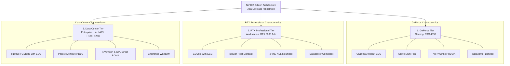
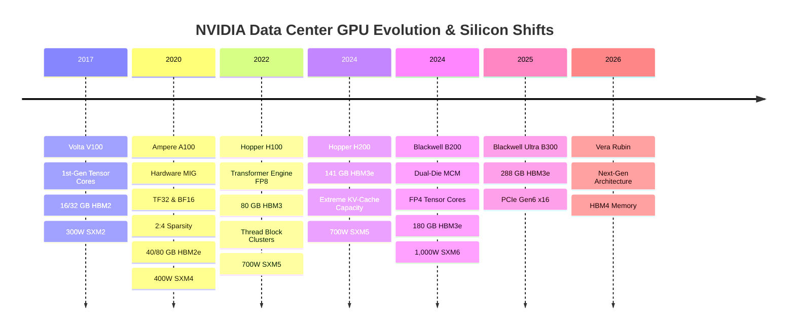
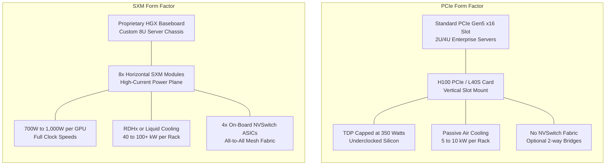
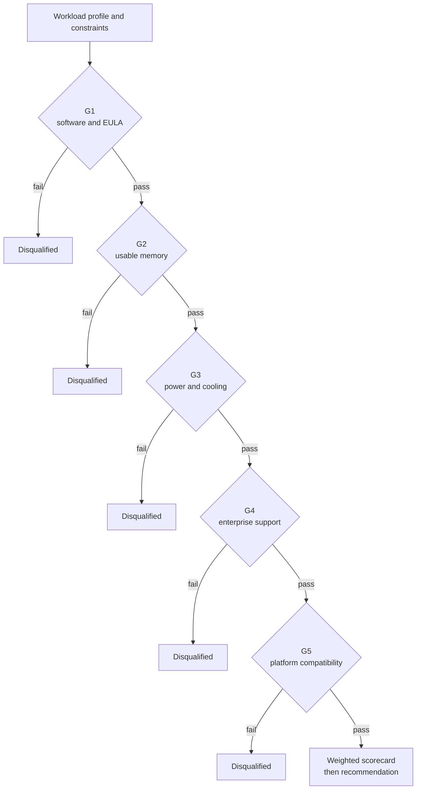

# 10.7 GPU generations and product line: Ampere, Hopper, Blackwell; PCIe versus SXM

| | |
|---|---|
| Level | Intermediate |
| Priority tier | 2 |
| Lab venue | Nebius GPU |
| Part | Part 10: The GPU and CUDA |
| Coverage file | `planning/coverage/chapters/10-07.md` |
| Claim ledger | `planning/ledgers/10-07.md` |

## Why this matters for AI infrastructure

An enterprise budget request lands on an executive desk, and the price difference looks hard to justify. An NVIDIA H100 SXM5 costs upwards of $30,000, whereas a consumer GeForce RTX 4090 costs around $1,600. A procurement director looking only at single-precision floating-point ratings notices that the gaming card advertises higher raw scalar compute than an enterprise A100. Inevitably, leadership asks why the company is spending millions on data center accelerators instead of filling racks with gaming cards.

Answering that the H100 is simply faster fails the architectural review. The real distinction involves High-Bandwidth Memory versus consumer graphics memory, NVLink and NVSwitch fabrics versus isolated PCIe slots, and GPUDirect RDMA versus CPU bounce buffers. It also involves hardware ECC memory protection, passive front-to-back server airflow, and strict software licensing terms. Picking the wrong product family or form factor turns a multi-million-dollar purchase into stalled training jobs or tripped circuit breakers.

| Metric or Scenario | Value | Architectural Consequence |
|---|---|---|
| H100 SXM5 vs RTX 4090 price | $30,000 vs $1,600 | Sparks executive pressure to buy consumer gaming cards (`nvidia-devops` V4 Ch 1). |
| RTX 4090 vs A100 scalar FP32 | 82.6 TFLOPS vs 19.5 TFLOPS | Misleads teams that ignore Tensor Cores, memory bandwidth, and NVLink. |
| Fine-tuning blunder budget | $3M DGX H100 rejected for 80 PCIe H100s in 20 2U servers | Saved 30% upfront, but 8-way tensor parallelism stalled 90% of the time on the 64 GB/s PCIe Gen5 bus (`nvidia-devops` V4 Ch 4). |
| Fine-tuning blunder penalty | 5 times slower training | Wasted engineer time and power erased the hardware savings against the 900 GB/s SXM mesh. |
| Retail edge mistake | 5,000 stores with 4x H100 SXM per 2U server | Draws over 3,000 Watts, tripping standard 120V circuits with no chilled-water loops (`nvidia-devops` V4 Ch 2). |
| Retail edge fix | Two to four 72-Watt NVIDIA L4 PCIe cards | Runs off motherboard slot power and decodes video in hardware via NVDEC engines. |

This chapter deconstructs the NVIDIA GPU portfolio from first principles. We separate GeForce, RTX Professional, and Data Center tiers, trace the silicon evolution from Volta through Blackwell, and compare PCIe cards against SXM baseboards. Finally, we examine the dedicated inference tier and Grace Superchips, closing with a five-gate hardware selection scorecard.

:::tip In one minute
- The GPU portfolio divides into three market tiers. GeForce gaming cards lack ECC, NVLink, and GPUDirect RDMA, use omnidirectional fans, and are barred from data centers by the driver EULA. RTX Professional workstation cards add blower cooling, ECC memory, and data center licensing. Data Center accelerators use passive cooling, HBM memory, NVLink and NVSwitch fabrics, hardware MIG partitioning, and GPUDirect RDMA.
- Form factors split between PCIe add-in cards and SXM modules on HGX baseboards. PCIe cards cap power at 350 Watts, underclock the silicon, and rely on optional two-way bridge clips or the host PCIe bus. SXM modules bolt horizontally onto HGX trays, run at 700 to 1,000 Watts, and connect all eight GPUs through an all-to-all NVSwitch crossbar.
- Each silicon generation removes a specific AI bottleneck. Volta V100 introduced first-generation FP16 Tensor Cores. Ampere A100 added seven-slice hardware MIG, TF32, BF16, and structural sparsity. Hopper H100 and H200 introduced the FP8 Transformer Engine, HBM3, and 141 GB HBM3e for KV cache scaling. Blackwell B200 and B300 bond two dies over a 10 TB/s interconnect, add FP4 Tensor Cores, and scale to 72-GPU liquid-cooled racks.
- Dedicated inference cards target different envelopes. The 72-Watt L4 integrates hardware video engines for edge and vision pipelines. The 350-Watt L40S delivers high FP8 throughput for single-GPU serving, but lacks NVLink and fails at multi-GPU tensor parallelism.
- Hardware selection requires evaluating five mandatory pass/fail gates before scoring candidates. Any platform that fails software licensing, usable memory, facility power, enterprise support, or interconnect compatibility is disqualified immediately.
:::

---

## Prerequisites and outcomes

**Prerequisites:** Complete the earlier chapters in Part 10 covering GPU microarchitecture, execution models, memory hierarchy, Tensor Core precisions, Roofline analysis, and interconnects.

**Outcomes:** After completing this chapter, you will be able to accomplish the following goals.
1. Explain the physical, architectural, and legal reasons why consumer GeForce GPUs cannot be deployed in commercial AI data centers.
2. Trace the silicon evolution from Volta through Ampere, Hopper, and Blackwell, identifying the bottleneck each generation solved.
3. Compare PCIe add-in cards and SXM HGX baseboards across thermal dissipation, clock throttling, power delivery, and NVSwitch connectivity.
4. Select the right accelerator for pre-training, inference decoding, video analytics, and large recommendation models.
5. Apply the five pass/fail gate criteria and weighted scorecard to produce defensible hardware recommendations.

---

## 1. Silicon Segmentation: GeForce, RTX Professional, and Data Center

When an organization tries to build a cluster out of consumer gaming cards, the deployment fails before the first training job finishes. Server chassis overheat because consumer fans blow hot air sideways against rack airflow. Multi-node training crawls because network transfers bounce through host CPU memory, and silent memory bit flips corrupt multi-week checkpoints into `NaN` values.

NVIDIA manufactures millions of silicon dies each quarter and uses the same underlying microarchitecture across different markets. During wafer fabrication and packaging, dies are selectively fused, paired with specific memory subsystems, and assigned to one of three product tiers.



### 1.1 The three tiers of NVIDIA GPUs

Each product tier targets a distinct physical and operational environment.

| Product Tier | Representative Models | Cooling Design | Memory & Integrity | Interconnect & Licensing |
|---|---|---|---|---|
| 1. GeForce (Consumer Gaming) | RTX 4090, RTX 3080 | Active axial fans exhausting radially into desktop cases. | Consumer GDDR6 or GDDR6X without ECC circuitry. | NVLink omitted; GPUDirect RDMA locked out; GeForce EULA bans data center use (`nvidia-devops` V4 Ch 1). |
| 2. RTX Professional (Workstation) | RTX 6000 Ada Generation, RTX A5000, RTX A6000 | Active blower fan exhausting linearly out the rear bracket. | High-capacity GDDR6 with hardware ECC protection. | Optional 2-way NVLink bridges on select SKUs; compliant with commercial data centers. |
| 3. Data Center (Enterprise AI) | L4, L40S, A100, H100, H200, B200, GB200 NVL72 | Passive fin stacks cooled by 1U–4U chassis fans or liquid cold plates. | HBM2e, HBM3, HBM3e, or enterprise GDDR6 with full ECC. | Full NVLink and NVSwitch crossbars, GPUDirect RDMA, GPUDirect Storage, and 24/7/365 support. |

### 1.2 The four technical showstoppers for gaming GPUs in enterprise AI

When managers suggest clustering consumer cards like the RTX 4090 to cut hardware costs, they overlook four physical barriers.

First, consumer cards lack GPUDirect RDMA, which creates a severe scale-out bottleneck. Multi-node training requires GPUs to exchange gradients and activations across the network. Data center GPUs use GPUDirect RDMA via the `nvidia-peermem` kernel module to stream tensors directly between GPU memory and network adapters across the local PCIe switch. On GeForce cards, firmware locks out this path. Every network transfer must copy across PCIe to host RAM, trigger a CPU context switch, traverse the kernel network stack, and travel down another PCIe link to the network card.

Second, consumer cards lack NVLink, which creates a scale-up bottleneck inside the node. Training large language models requires tensor parallelism to split attention and feed-forward layers across multiple GPUs. Tensor parallelism executes an all-reduce collective on every transformer layer, demanding hundreds of gigabytes per second of inter-GPU bandwidth. Consumer cards lack NVLink fingers and must synchronize over the motherboard PCIe bus at 32 to 64 GB/s, leaving Tensor Cores stalled waiting for weights.

Third, consumer cards omit Error-Correcting Code memory, exposing jobs to silent data corruption. Cosmic rays and thermal noise routinely cause single-event upsets where a physical memory cell flips between `0` and `1`. In a video game running at 120 frames per second, a bit flip alters one pixel for 8 milliseconds, which no player notices. In a multi-week training job, a single bit flip in a 16-bit gradient multiplies through backpropagation and turns the loss curve into `NaN`. Data center GPUs use hardware ECC to correct single-bit errors in flight and halt on uncorrectable multi-bit faults before saving bad checkpoints.

Fourth, consumer thermal aerodynamics and dimensions conflict with enterprise racks. An RTX 4090 is a 3.5-slot to 4-slot card with axial fans that blow hot air in all directions inside an open desktop case. Standard 1U, 2U, and 4U enterprise servers rely on strictly linear front-to-back airflow driven by 80 mm or 120 mm counter-rotating chassis fans. You cannot physically fit eight 4-slot consumer cards into a standard server chassis, and running them in custom enclosures causes hot air recirculation and thermal throttling.

### 1.3 The legal showstopper: The GeForce driver EULA

Even if an engineering team accepts slow networking and missing ECC, a strict legal barrier remains. In 2018, NVIDIA updated the GeForce Software End User License Agreement to prohibit commercial data center deployment.

> *"No Datacenter Deployment. The SOFTWARE is not licensed for datacenter deployment, except that blockchain processing in a datacenter is permitted."*

Enterprises that install GeForce drivers in commercial data centers to serve APIs or train commercial models violate this license agreement. NVIDIA audits commercial deployments, exposing violators to legal liability and forced shutdowns. Senior infrastructure architects protect their organizations by deploying only enterprise-licensed RTX Professional or Data Center hardware.

---

## 2. Generational Silicon Shifts: Volta, Ampere, Hopper, Blackwell, and Beyond

Upgrading a cluster to a newer GPU generation without adapting the software stack often produces disappointing results. An engineering team that moves a 16-bit inference service from A100 to H100 without enabling 8-bit quantization sees only a minor speedup from faster memory clocks, leaving the new Tensor Core features completely idle.

NVIDIA designs each data center GPU generation around hardware-software co-design. Architects identify the math or memory bottleneck limiting current neural networks and build new silicon units in the next generation to remove it.



### 2.1 Volta V100: The dawn of the Tensor Core

Before 2017, deep learning models ran on standard scalar graphics cores executing single-precision floating-point arithmetic. As neural networks grew deeper, scalar fused multiply-add units took too many clock cycles to compute large matrix multiplications.

Volta V100 solved this problem by introducing the first-generation Tensor Core. Instead of executing one scalar multiply per thread per cycle, a Tensor Core computes a full 4x4 matrix multiply-accumulate across a warp of 32 threads in a single clock cycle. It multiplies half-precision FP16 inputs and accumulates the results into FP32. However, achieving this speedup required engineers to manually cast model weights and activations to FP16 in their training scripts. Workloads left in standard FP32 fell back to scalar CUDA cores and gained none of the Tensor Core throughput.

### 2.2 Ampere A100: Hardware isolation, TF32, and structural sparsity

By 2020, two operational problems slowed down production deployments. Small inference workloads could not saturate a full accelerator, leaving expensive silicon underutilized. Meanwhile, manually casting training models to pure FP16 caused gradient underflow, where small gradients rounded to zero inside the narrow 5-bit exponent range and stalled convergence.

Ampere A100 addressed both issues with three silicon changes. First, Multi-Instance GPU hardware partitioning allowed operators to slice one A100 into up to 7 isolated GPU instances. Each slice receives dedicated Streaming Multiprocessors, isolated memory controllers, and private L2 cache partitions, eliminating noisy-neighbor interference in shared clusters. Second, Ampere introduced TensorFloat-32 and native Bfloat16 support. TensorFloat-32 keeps the 8-bit exponent of FP32 to prevent underflow while using the 10-bit mantissa of FP16, running unedited FP32 code at Tensor Core speeds. Third, Ampere added 2:4 structural sparsity hardware that skips zero values when two out of every four matrix weights are zero, doubling matrix throughput.

### 2.3 Hopper H100: The Transformer Engine and FP8 math

The rise of large language models shifted the primary bottleneck from raw compute to memory bandwidth. Streaming tens of billions of parameters from HBM into the compute units on every forward and backward pass saturated existing memory buses.

Hopper H100 attacked this memory wall by introducing native 8-bit floating-point Tensor Cores paired with a hardware Transformer Engine. Halving weight precision from 16 bits to 8 bits cuts memory bandwidth traffic in half. Because 8-bit floats have a narrow dynamic range, the Transformer Engine tracks tensor statistics in hardware during runtime and dynamically scales layers between FP8 and 16-bit formats to preserve accuracy. Hopper also upgraded the memory subsystem to HBM3, added DPX dynamic programming instructions, and introduced Thread Block Clusters that allow thread blocks across different SMs to share data directly without round-tripping through global HBM.

### 2.4 Hopper H200: Extreme memory capacity for KV cache scaling

During the decode phase of large language model inference, the GPU must store the Key-Value cache for every active conversation token across all concurrent users. An 80 GB H100 serving a 70-billion-parameter model runs out of VRAM from KV cache growth long before its Tensor Cores reach compute saturation.

Released in 2024, the Hopper H200 uses the exact same computational silicon die as the H100, keeping the same SM count, clock speeds, and 700-Watt thermal envelope. The upgrade focuses entirely on the memory subsystem, replacing 80 GB of HBM3 with 141 GB of faster HBM3e. That extra capacity and bandwidth let a single server hold more than double the concurrent active user requests at faster token generation speeds without hitting out-of-memory crashes.

### 2.5 Blackwell B200, B300, and the roadmap ahead

By 2024, semiconductor fabrication hit the optical reticle limit, which caps the maximum area of a single monolithic silicon die that photolithography scanners can print. To keep scaling compute density, NVIDIA moved to a dual-die multichip module architecture with Blackwell B200.

The B200 places two full-reticle GPU dies side by side on one package and bonds them with a 10 TB/s on-package interconnect called `NV-HBI`. This link is fully hardware cache-coherent, presenting the two dies to the CUDA runtime as a single unified GPU with a massive L2 cache and HBM3e memory pool. Blackwell also introduces a second-generation Transformer Engine with native 4-bit floating-point Tensor Cores, doubling math throughput over FP8. At the rack scale, the GB200 NVL72 connects 72 Blackwell GPUs across 18 NVSwitch ASICs inside a liquid-cooled rack, creating a single shared-memory domain. Beyond B200, the roadmap expands memory density with Blackwell Ultra B300 and transitions to HBM4 memory with the Vera Rubin architecture.

### 2.6 Architectural summary matrix across data center generations

The table below consolidates the exact specifications, innovations, and roadmap metrics across generations (`nvidia-devops` V4 Ch 3 & Ch 6; *AI Systems Performance Engineering* Ch 2, pp. 21–40).

| Architecture & Year | Flagship GPU | Usable VRAM & Type | Peak Memory Bandwidth | NVLink Generation & Speed | Key Silicon Innovations & Specs | Max SXM TDP |
|---|---|---|---|---|---|---|
| Volta (2017) | V100 | 16 GB or 32 GB HBM2 | 900 GB/s | 2nd-Gen NVLink: 300 GB/s | 1st-Gen FP16 Tensor Cores; required manual FP16 casting. | 300W (SXM2) |
| Ampere (2020) | A100 | 40 GB HBM2 or 80 GB HBM2e | 1.5 TB/s (40 GB) or 2,039 GB/s / 2.0 TB/s (80 GB) | 3rd-Gen NVLink: 600 GB/s | Hardware MIG (7 isolated instances), TF32, BF16, 2:4 Structural Sparsity (50% sparse = 2x speed). | 400W (SXM4) |
| Hopper (2022) | H100 | 80 GB HBM3 | 3,350 GB/s (3.35 TB/s) | 4th-Gen NVLink: 900 GB/s | Transformer Engine (FP8), Thread Block Clusters (`DSMEM`), DPX instructions. | 700W (SXM5) |
| Hopper (2024) | H200 | 141 GB HBM3e | 4,800 GB/s (4.8 TB/s) | 4th-Gen NVLink: 900 GB/s | Identical compute die to H100; 141 GB VRAM doubles KV-cache concurrency. | 700W (SXM5) |
| Blackwell (2024) | B200 | 180 GB usable (192 GB raw) HBM3e | 8,000 GB/s (8.0 TB/s) | 5th-Gen NVLink: 1,800 GB/s (1.8 TB/s, 18 ports) | Dual-die MCM (104B transistors/die = 208B total, ~858 mm² reticle limit from general knowledge), 10 TB/s `NV-HBI`, 126 MB L2 cache, FP4 / NVFP4 Tensor Cores; NVL72 rack has 9 switch trays, 130 TB/s bisection, 1.4 exaFLOPS FP4. | Up to 1,000W (SXM6) |
| Blackwell Ultra (2025) | B300 | 288 GB HBM3e | 8,000+ GB/s | 5th-Gen NVLink: 1.8 TB/s | 288 GB memory density; PCIe Gen6 x16 host interface (128 GB/s unidirectional). | Up to 1,000W+ |
| Vera Rubin (2026/2027) | Rubin / Rubin Ultra | HBM4 subsystem | Next-gen HBM4 | Next-gen NVLink | Vera CPU + Rubin GPU Superchip (2026), Rubin Ultra (2027), Feynman GPU (2028). | Rack-scale liquid |

---

## 3. Form Factors: PCIe Add-in Card vs. SXM HGX Baseboard

Buying the right GPU chip in the wrong physical form factor can cripple a distributed training cluster. When a team buys eight PCIe H100 cards instead of an SXM baseboard to save on chassis cost, multi-GPU tensor parallelism drops onto the host PCIe bus and stalls the accelerators on every layer.

Silicon dies require circuit boards, power stages, and cooling paths. NVIDIA delivers its data center silicon in two distinct packages: standard PCIe add-in cards and SXM modules bolted onto proprietary HGX baseboards (`nvidia-devops` V4 Ch 4).



### 3.1 The PCIe form factor: Universal enterprise compatibility with performance trade-offs

The PCIe add-in card is a standard rectangular board that plugs vertically into enterprise server motherboards. An H100 PCIe or L40S card fits into almost any 2U or 4U server from Dell, HPE, Cisco, or Supermicro that has physical clearance and open x16 slots. However, the surface area of a dual-slot card and the airflow in standard servers cap heat dissipation at 350 Watts.

Because the H100 PCIe card is rated at 350 W, half the 700 W of the SXM5 module, NVIDIA runs the silicon at lower voltages and reduced clock frequencies. An H100 PCIe delivers lower compute throughput and uses slower HBM2e memory than its SXM5 counterpart. Furthermore, standard motherboards lack NVSwitch chips. NVIDIA offers physical NVLink Bridge clips that attach across the top edges of adjacent cards, but these bridges only link GPUs in isolated pairs at reduced bandwidth. Traffic between separate pairs must still cross the slow host PCIe bus.

### 3.2 The SXM form factor: Unrestricted power and all-to-all NVSwitch fabrics

The Server eXpress Module is an industrial mezzanine package built for maximum density and unthrottled speed. SXM modules cannot plug into generic motherboard slots; instead, they bolt horizontally with multi-screw torque retention onto a custom NVIDIA HGX baseboard holding four or eight sockets. Direct mounting onto heavy power distribution planes allows each GPU to draw 700 to 1,000 Watts and sustain full boost clocks.

Crucially, four NVSwitch ASICs are soldered directly onto the 8-GPU HGX baseboard. Every SXM module routes all 18 of its NVLink lanes into these switches, forming a non-blocking all-to-all crossbar where any GPU can access any other GPU's memory without CPU or PCIe contention. This performance comes with steep facility demands. Stacking four 8-GPU DGX servers into a rack pushes power density to 40 to 60 kW, exceeding standard air cooling and requiring Rear-Door Heat Exchangers or Direct-to-Chip Liquid Cooling.

### 3.3 Architectural comparison: PCIe vs. SXM

| Feature | NVIDIA H100 PCIe | NVIDIA H100 SXM5 (HGX) |
|---|---|---|
| Max TDP per GPU | 350 Watts | 700 Watts (1,000 Watts on B200 SXM6) |
| Memory Technology | 80 GB HBM2e | 80 GB HBM3 |
| Peak Memory Bandwidth | 2,000 GB/s (2.0 TB/s) | 3,350 GB/s (3.35 TB/s) |
| GPU-to-GPU Interconnect | NVLink Bridge Clips (Pairs only, 600 GB/s) or PCIe | 4x On-board NVSwitches (All 8 GPUs, 900 GB/s; 1,800 GB/s on B200) |
| Cooling Method | Passive air in standard 2U/4U chassis | High-velocity passive air, RDHx, or Direct Liquid Cooling (`DLC`) |
| Chassis & Rack Power | Standard server; 10–15 kW per rack (standard air limit 5–10 kW) | DGX H100 draws 10.2 kW; DGX B200 draws 14.3 kW; 40–60+ kW per 42U rack |
| Primary Workloads | Inference, computer vision, single-GPU training | Frontier LLM Pre-training, Multi-GPU Fine-Tuning |

---

## 4. The Specialized Tiers: Inference Lineage (T4, L4, L40S) and Grace Superchips (GH200, GB200)

Deploying a 700-Watt training accelerator for video transcoding or giant recommendation tables wastes money and power. An H100 lacks hardware video encoders, forcing the host CPU to transcode camera streams while expensive Tensor Cores sit idle. Similarly, a recommendation model with a 400 GB embedding table cannot fit inside an 80 GB GPU and stalls copying vectors over PCIe.

In production, most GPU compute goes toward inference serving, video analytics, and recommendation pipelines rather than frontier pre-training. NVIDIA builds specialized inference cards and CPU-GPU Superchips tailored for these bottlenecks (`nvidia-devops` V4 Ch 5 & Ch 7).

### 4.1 The inference lineage: T4, L4, and L40S

The inference product line balances slot power, video hardware, and single-GPU floating-point density.

| Accelerator | Architecture & Year | Memory & Bandwidth | TDP & Form Factor | Key Hardware Capabilities | Ideal Workload & Constraints |
|---|---|---|---|---|---|
| NVIDIA T4 | Turing (2018) | 16 GB GDDR6 | 70W, single-slot low-profile PCIe | 2nd-Gen Tensor Cores (INT8); runs off slot power without 8-pin cables. | Legacy workhorse; obsolete for modern LLMs because it lacks BF16 and FP8 math (`nvidia-devops` V4 Ch 5). |
| NVIDIA L4 | Ada Lovelace (2023) | 24 GB GDDR6 | 72W, single-slot PCIe, passive | 4th-Gen Tensor Cores (FP8), 4x NVDEC decoders, 2x NVENC encoders, Optical Flow. | Edge serving, H.264/H.265/AV1 video analytics, and 8B models; beats H100 (no NVENC) per watt on video. |
| NVIDIA L40S | Ada Lovelace (2023) | 48 GB GDDR6 (864 GB/s) | 350W, dual-slot PCIe, passive | 4th-Gen Tensor Cores delivering 733 TFLOPS of FP8 compute; physically lacks NVLink. | Single-GPU serving (`TP = 1`) for Llama-3 8B or Mistral 7B (&lt;30B fitting in 48 GB); fails at multi-GPU training or `TP = 4` because traffic falls back to 32–64 GB/s PCIe. |

### 4.2 Grace Superchips: GH200 and GB200

Deep learning recommendation models, graph neural networks, and large retrieval systems bottleneck on host-to-device memory capacity rather than compute TFLOPS. Their embedding tables often span 300 GB to 1 TB, far exceeding the VRAM of a single GPU. Storing those tables in standard x86 host RAM forces the GPU to stall across the 64 GB/s PCIe bus.

NVIDIA solved this bottleneck by designing the Grace CPU and bonding it directly to the GPU over a high-speed coherent interconnect (`nvidia-devops` V4 Ch 7; *AI Systems Performance Engineering* Ch 2, pp. 21–25). Using Extended GPU Memory, the accelerator reads embedding vectors directly from CPU memory at high bandwidth without manual `cudaMemcpy` staging calls.

| Component or Metric | Specification | Architectural Role |
|---|---|---|
| Grace CPU Cores | 72 ARM Neoverse V2 cores per CPU (144 cores in dual-CPU Superchip) | Energy-efficient host processing with SVE2 vector extensions and >100 MB L3 cache. |
| Host Memory Subsystem | Up to 480 GB server LPDDR5X at up to 500 GB/s | Holds 300 GB to 500 GB embedding tables or 400 GB graph datasets at low power. |
| `NVLink-C2C` Interconnect | 900 GB/s bidirectional (450 GB/s per direction) | Coherent chip-to-chip link on the same board, running ~7x faster than PCIe Gen5 x16. |
| GH200 Unified Memory | 576 GB total (480 GB LPDDR5X + 96 GB HBM3) | Single hardware cache-coherent address space via Extended GPU Memory (`EGM`). |

---

## 5. Workload-First Selection Methodology and Gate Criteria

When hardware procurement starts by comparing vendor spec sheets instead of workload constraints, teams buy accelerators that cannot legally or physically run in their facilities. A high score on acquisition cost cannot rescue a card that lacks enough VRAM to hold the model or trips the rack circuit breaker.

A disciplined selection process evaluates five mandatory pass/fail gate criteria first. Any candidate that fails a single gate is disqualified immediately, and only surviving candidates move on to the weighted scorecard (`nvidia-devops` V4 Lab 01).



### 5.1 The five mandatory pass/fail gate criteria

The table below defines the five mandatory gates and the sizing formulas required to pass them.

| Gate | Mandatory Question | Sizing Rule or Requirement | Classic Failure Example |
|---|---|---|---|
| G1 Software and EULA | Does it support the CUDA stack and comply with licensing? | Must permit commercial data center operations under the driver EULA. | GeForce RTX 4090 in a commercial data center. |
| G2 Usable memory | Does total VRAM fit weights, activations, and KV cache? | Inference: `Total VRAM >= (Weights + KV Cache) * 1.2`. Training: `Total VRAM >= Weights * 4.0 to 6.0`. | Single 24 GB L4 or 48 GB L40S for an unquantized 70B model. |
| G3 Power and cooling | Does server power (`GPU TDP * count + host`) fit the rack? | Must stay under rack kW limits and use linear front-to-back airflow. | H100 SXM in a 10 kW air-cooled rack or 120V retail closet. |
| G4 Enterprise support | Does it provide data integrity and out-of-band management? | Requires hardware ECC memory, dual redundant PSUs, and BMC / Redfish / IPMI. | Non-ECC gaming cards in desktop towers. |
| G5 Platform compatibility | Does the hardware match the parallelism and engine profile? | Requires NVLink and GPUDirect RDMA when `TP > 1`; requires NVENC when transcoding video. | L40S for `TP = 4` training; H100 SXM or A100 for video transcoding. |

### 5.2 The weighted criteria scorecard

Candidates that pass all five gates are scored on a 1 to 5 scale across seven weighted categories totaling 100% (`nvidia-devops` V4 Lab 01 Step 3).

| Criterion | Weight | Evaluation Focus |
|---|---:|---|
| Memory Capacity Headroom | 20% | Extra VRAM beyond current weights and KV cache to absorb longer context windows. |
| Memory Bandwidth & Latency | 20% | HBM bandwidth to reduce Time-Per-Output-Token (`TPOT` / `ITL`) during LLM decode. |
| Compute & Precision Fit | 15% | Native support for FP8 or FP4 Tensor Cores and the hardware Transformer Engine. |
| Power & Facility Fit | 15% | Power draw relative to facility headroom; lower power fraction scores higher. |
| Kubernetes & Sharing Fit | 10% | Hardware MIG partitioning support for multi-tenant isolation. |
| Observability & Management | 10% | Integration with NVIDIA DCGM, Prometheus exporters, and automated recovery. |
| Acquisition & Lifecycle Cost | 10% | Total Cost of Ownership combining hardware CAPEX with power and cooling OPEX. |

### 5.3 Worked example: Sizing an inference cluster for Llama-3 70B

We can apply this methodology to size an inference server for Llama-3 70B in FP16 across 64 concurrent users (`calc_inference_vram_and_concurrency()` in `code/part10/gpu_generations.py`).

```text
Model profile: Llama-3 70B (80 layers, 128 attention heads, 8 KV heads in GQA)
Precision: FP16 (2 bytes per parameter)
Model Weight Footprint = 70 Billion * 2 bytes = 140.0 GB

KV Cache per User (8,192 Context Window):
  KV Bytes per User = 8 bytes/token * 2 (K and V) * 80 layers * 128 heads * 8,192 tokens
                    = 1,342,177,280 bytes ≈ 1.34 GB per user

Total KV Cache for 64 Concurrent Active Users:
  Total KV Cache = 64 * 1.342 GB ≈ 85.9 GB

Total Required VRAM with 1.2x Overhead (Activations and CUDA Runtime):
  Total VRAM = (140.0 GB + 85.9 GB) * 1.2 = 225.9 GB * 1.2 = 271.08 GB
```

Now we evaluate three candidate configurations against the 271.08 GB requirement.

| Candidate | Total Usable VRAM | Gate Evaluation | Operational Verdict |
|---|---|---|---|
| Candidate A: 1x L40S PCIe | 48 GB GDDR6 | Fails Gate G2 (`48 GB < 271.08 GB`). | Disqualified immediately. |
| Candidate B: 4x H100 SXM5 | 320 GB HBM3 (4 x 80 GB) | Passes G1–G5 (`320 GB > 271.08 GB`, 40 kW rack, ECC/BMC, NVSwitch `TP = 4`). | Viable, requires 4 GPUs. |
| Candidate C: 2x H200 SXM | 282 GB HBM3e (2 x 141 GB) | Passes G1–G5 (`282 GB > 271.08 GB`, NVSwitch `TP = 2`). | Winner: serves the same 64 users using 2 GPUs instead of 4. |

---

## Commands and configurations that matter

When a new server arrives or an inference benchmark begins, operators must verify exact device models, confirm that ECC memory is enabled, configure MIG slices, and record a software manifest. Without these checks, teams benchmark mismatched driver versions or run production jobs with ECC disabled.

The commands below inspect device capabilities, verify ECC counters, configure MIG partitions, and record a benchmark manifest (`nvidia-devops` V4 Labs 01–02). All live hardware commands are marked as reference templates when physical GPUs are not attached.

### 1. Identify GPU family, architecture, and memory specifications

```bash
# Query exact device name, UUID, PCI bus ID, driver version, and total VRAM
nvidia-smi --query-gpu=index,name,uuid,pci.bus_id,driver_version,memory.total \
  --format=csv,noheader

# Inspect power draw, thermal power limit, current temperature, and clock frequencies
nvidia-smi --query-gpu=index,name,power.draw,power.limit,temperature.gpu,clocks.current.sm \
  --format=csv
```

### 2. Verify hardware ECC status and error counters

```bash
# Verify that Error-Correcting Code (ECC) memory is active and check error counts
nvidia-smi --query-gpu=index,name,ecc.mode.current,ecc.errors.corrected.volatile.total,ecc.errors.uncorrected.volatile.total \
  --format=csv
```

Expected healthy output, illustrative and not captured from live hardware.
```text
index, name, ecc.mode.current, ecc.errors.corrected.volatile.total, ecc.errors.uncorrected.volatile.total
0, NVIDIA H100 80GB HBM3, Enabled, 0, 0
```

### 3. Inspect Multi-Instance GPU capabilities

```bash
# List available physical MIG profile templates on an A100/H100/H200
nvidia-smi mig -lgip

# Enable MIG mode on GPU 0, which requires root and a GPU reset
sudo nvidia-smi -i 0 -mig 1

# Create a 3g.40gb MIG instance on GPU 0
sudo nvidia-smi mig -cgi 3g.40gb -C -i 0
```

### 4. Create an inference benchmark run manifest

Before benchmarking a candidate accelerator shortlist, capture a YAML run manifest so every test uses identical parameters (`nvidia-devops` V4 Lab 02).

```yaml
# benchmark-manifest.yaml
candidate: "nvidia-l40s"
host_cpu: "AMD EPYC 9654 96-Core"
host_memory_gb: 384
gpu_model: "NVIDIA L40S"
gpu_count: 1
driver_version: "550.90.07"
cuda_version: "12.4"
container_image: "nvcr.io/nvidia/tritonserver:24.05-py3"
model_name: "meta-llama/Meta-Llama-3-8B-Instruct"
precision: "FP8"
max_batch_size: 32
concurrency: 16
context_tokens: 2048
output_tokens: 256
```

---

## How it fails: Six production GPU selection and form factor failure modes

The automated auditor in `evaluate_gpu_selection_gates_and_scorecard()` (`code/part10/gpu_generations.py`, where combining these six checks into a single automated gate is **my inference**) catches six recurring procurement and deployment mistakes from `nvidia-devops` Volume 04.

| # | Failure Mode | Production Symptom | Root Cause & Diagnostic Evidence | Fix |
|---|---|---|---|---|
| 1 | Consumer GeForce cards in commercial data center | Server fans scream at max RPM; cards thermally throttle; legal compliance inquiry arrives. | Violates GeForce Driver EULA; axial fans recirculate hot air in linear chassis; no ECC (`ecc.mode.current = N/A`) (`V4 Ch 1`). | Halt consumer card deployment; migrate to passively cooled L40S or L4 data center GPUs. |
| 2 | 70B fine-tuning on PCIe H100s without NVSwitch | Training runs 5 times slower than benchmarks; GPUs spend 90% of time stalled on PCIe. | PCIe H100 cards lack NVSwitch; `TP = 8` forces gradient all-reduces over the 64 GB/s PCIe bus instead of the 900 GB/s SXM mesh (`V4 Ch 4`). | Switch to Pipeline Parallelism across nodes and Data Parallelism within nodes, or migrate to SXM HGX servers. |
| 3 | Multi-GPU Tensor Parallelism on L40S cards | Serving Llama-3 70B with `TP = 4` across four L40S GPUs suffers high synchronization latency. | The L40S physically lacks NVLink; per-layer all-reduce collectives bottleneck on the host PCIe bus (`V4 Ch 5`). | Restrict L40S to single-GPU serving (`TP = 1`, such as 8B models), or move 70B serving to H100/H200 SXM. |
| 4 | H100 deployed for video analytics and transcoding | High power and hardware cost; host CPU pegs at 100% while H100 Tensor Cores sit mostly idle. | H100 lacks NVENC encoders and has limited decoders for its price, forcing H.264/H.265 work onto the CPU (`V4 Ch 5`). | Replace H100 with 72W NVIDIA L4 GPUs containing dedicated hardware NVDEC and NVENC engines. |
| 5 | Upgrading A100 to H100 without enabling FP8 | Upgrading an inference cluster from A100 to H100 yields only a 20% speedup instead of 3x. | Runtime still loads 16-bit weights (FP16/BF16); the 20% gain is just HBM3 bandwidth while the FP8 Transformer Engine sits unused (`V4 Ch 3`). | Quantize the model to FP8 in TensorRT-LLM or vLLM to engage the Transformer Engine and triple throughput. |
| 6 | High-TDP SXM servers in retail edge closets | Building circuit breakers trip on boot; backroom temperature spikes into thermal shutdown. | A 4x H100 SXM server draws over 3,000 Watts in a closet with standard 120V circuits and no chilled water (`V4 Ch 2`). | Deploy edge servers with two to four 72W NVIDIA L4 PCIe cards running off motherboard slot power. |

---

## Hands-on lab: Evaluate GPU Selection Gates, Scorecards, and Hardware Specifications

**Venue:** Any Linux machine or Nebius GPU VM with Python 3.10+ (no physical GPU hardware is required to run the decision engine; all commands in Section 4 are marked as untested on live hardware).

Not verified on live hardware: commands in Section 4 are operational reference templates; all quantitative checks run deterministically in `code/part10/gpu_generations_lab.py`.

Run the self-checking lab script `code/part10/gpu_generations_lab.py`.

```bash
python3 code/part10/gpu_generations_lab.py
```

Expected output (`25 passed, 0 failed`).

```text
=== Chapter 10.7 Lab: GPU Generations & Product Line (Ampere, Hopper, Blackwell; PCIe vs SXM) ===
  [PASS] V4 Ch1: RTX 4090 is GEFORCE tier, active-cooled, lacks ECC, lacks NVLink, and is not datacenter EULA compliant
  [PASS] V4 Ch5: L4 is 72W single-slot PCIe, 24GB GDDR6, FP8, with hardware NVENC/NVDEC video engines
  [PASS] V4 Ch5: L40S is 350W PCIe, 48GB GDDR6, 864 GB/s, FP8, but physically lacks NVLink (has_nvlink is False)
  [PASS] V4 Ch3 & Ch6: Volta V100 was 300W (FP16); Ampere A100 added MIG and 80GB HBM2e at 2.0 TB/s (400W)
  [PASS] V4 Ch4: H100 PCIe is capped at 350W and 2.0 TB/s HBM2e vs H100 SXM5 at 700W and 3.35 TB/s HBM3 (900 GB/s NVLink 4)
  [PASS] V4 Ch6: H200 SXM increases memory to 141GB HBM3e at 4.8 TB/s within the same 700W envelope as H100 SXM
  [PASS] ASP Ch2 p.28: Blackwell B200 SXM has 180 GB usable HBM3e at 8.0 TB/s, FP4 Tensor Cores, and 1,800 GB/s NVLink 5
  [PASS] ASP Ch2 p.38: Blackwell Ultra B300 upgrades memory to 288GB HBM3e
  [PASS] V4 Ch7 & ASP Ch2: GH200 provides 576GB unified memory (480GB LPDDR5X + 96GB HBM3) over 900 GB/s NVLink-C2C
  [PASS] V4 Ch1: 70B FP16 weights require 140.0 GB; 64 concurrent users at 8k context require ~85.9 GB KV cache
  [PASS] V4 Ch1: Total 70B FP16 + 64 users KV cache with 1.2x overhead == ~271 GB VRAM
  [PASS] V4 Ch1 Customer Scenario: RTX 4090 fails G1 EULA and G3 active-cooling in commercial datacenter
  [PASS] V4 Ch2 Customer Scenario: 4x H100 (700W/GPU) fails G3 power ceiling at retail store edge
  [PASS] V4 Ch2 Customer Scenario: 4x L4 (72W/GPU, NVENC/NVDEC) passes all gates at retail store edge
  [PASS] V4 Ch4 & Ch5: L40S fails G5 platform compatibility for LLM Pretraining / Tensor Parallelism (no NVLink)
  [PASS] V4 Ch2 & Ch6: 8x H100 SXM (640GB, NVSwitch 900 GB/s) passes all gates for LLM Pretraining
  [PASS] V4 Ch5 Customer Scenario: A100 fails G5 for video transcode workload due to missing NVENC engines
  [PASS] V4 Ch6 Customer Scenario: 8x H100 (640GB) fails G2 memory capacity when required VRAM is 1,000 GB
  [PASS] V4 Ch6 Customer Scenario: 8x H200 (1,128GB) passes G2 memory capacity and scores high headroom
  [PASS] V4 Ch5: Single L40S passes all gates for model that fits in 48GB without Tensor Parallelism
  [PASS] V4 Ch1: RTX 6000 Ada is RTX_PRO tier, blower-cooled, 48GB ECC GDDR6, and datacenter EULA compliant
  [PASS] V4 Ch7 Customer Scenario: Single GH200 (576GB unified memory) satisfies 400GB graph/recsys dataset on 1 node
  [PASS] Rejects invalid GPU candidate key
  [PASS] Rejects non-positive required_vram_gb
  [PASS] Rejects non-positive model_params_billions

Summary: 25 passed, 0 failed (total 25)
```

---

## Exercises

1. **The Gaming Card Defense:** A startup CTO wants to buy 64 consumer RTX 4090 cards for a distributed training cluster to save 80% on hardware. Write a concise memo explaining the four technical showstoppers and the GeForce Driver EULA clause that prohibit this design.
2. **LLM Inference Sizing Math:** Using the formulas in Section 5.3, calculate the exact VRAM footprint for serving a 13B parameter model in FP16 across 32 concurrent users at a 4,096 context window. Use the parameters in the block below and determine whether the workload fits on a single 48 GB L40S card.
3. **PCIe vs. SXM Fine-Tuning TCO:** A procurement team rejected a $3M SXM budget to buy 20 standard servers with 80 PCIe H100 cards, saving 30% upfront (`nvidia-devops` V4 Ch 4). Using the parameters in the block below, calculate how many weeks of delayed project completion wipe out the hardware savings.
4. **The H200 Concurrency Advantage:** An inference service on an 8-GPU H100 SXM server crashes with `CUDA OOM` when concurrent sessions exceed 40. Using the capacities in the block below, calculate how many additional 1.34 GB KV-cache user sessions an 8-GPU H200 SXM upgrade supports before running out of memory.
5. **The Missing NVLink Trap:** A team runs a four-GPU pipeline-parallel image model on L40S cards and a four-GPU tensor-parallel LLM on L40S cards. Explain why the pipeline-parallel job succeeds while the tensor-parallel job stalls, citing the interconnect limits of the L40S.
6. **Custom Scorecard Design:** A quantitative trading firm needs a node to run real-time inference over a 400 GB market embedding table within a 3 kW power budget (`nvidia-devops` V4 Ch 7). Evaluate the three candidates in the block below against the five gate criteria and explain why the Grace Hopper Superchip wins.

```text
Exercise 2 parameters: 13B model, FP16 (2 bytes), 32 users, 4,096 context, 40 layers, 40 heads, 2 bytes/token, 1.2x overhead, 48 GB L40S.
Exercise 3 parameters: $3M SXM budget, 30% savings ($900,000), 90% PCIe stall time, 5x training slowdown, 10 engineers at $50,000/week.
Exercise 4 parameters: 8x H100 SXM (80 GB/GPU = 640 GB total) vs 8x H200 SXM (141 GB/GPU = 1,128 GB total), 1.34 GB KV cache per user.
Exercise 6 candidates: (a) 4x H100 SXM (320 GB), (b) 8x L40S PCIe (384 GB), (c) 1x Grace Hopper GH200 (576 GB unified memory, < 3 kW).
```

---

## Checkpoint questions (20)

<details>
<summary>**1. Why does an NVIDIA RTX 4090 gaming GPU have higher raw FP32 compute TFLOPS than an A100 data center GPU, and why does that number mislead procurement teams?**</summary>

The RTX 4090 clocks its dual-issue FP32 scalar cores aggressively for gaming, reaching 82.6 TFLOPS of scalar FP32 math. Enterprise AI workloads depend instead on Tensor Core matrix throughput, HBM bandwidth, NVLink speed, and ECC memory integrity. The A100 delivers 312 TFLOPS of BF16/FP16 Tensor Core math with sparsity, 2.0 TB/s of HBM2e bandwidth versus 1.0 TB/s GDDR6X, hardware ECC, and a 600 GB/s NVLink fabric.
</details>

<details>
<summary>**2. What is the specific legal clause in NVIDIA's GeForce Software EULA that impacts enterprise data center deployments?**</summary>

The GeForce Software End User License Agreement states: *"No Datacenter Deployment. The SOFTWARE is not licensed for datacenter deployment, except that blockchain processing in a datacenter is permitted."* Running consumer GeForce drivers in a commercial data center to serve APIs or train models breaches this license.
</details>

<details>
<summary>**3. Why is Error-Correcting Code memory mandatory for distributed deep learning training, but omitted from consumer gaming cards?**</summary>

Consumer gaming tolerates single-event cosmic-ray bit flips because a flipped bit only discolors one pixel for a few milliseconds. During multi-week deep learning training, a single bit flip in a 16-bit gradient propagates through backpropagation and turns the loss into `NaN`, ruining the checkpoint and wasting thousands of GPU hours.
</details>

<details>
<summary>**4. How does the physical cooling design of consumer GeForce cards conflict with standard enterprise server chassis aerodynamics?**</summary>

GeForce cards use active axial fans that pull air from the side and blow hot exhaust radially in all directions. Enterprise 1U, 2U, and 4U servers rely on strictly linear front-to-back airflow that forces cold-aisle air through passive fin stacks into the hot aisle. Active consumer fans disrupt this path, causing hot air recirculation and thermal throttling.
</details>

<details>
<summary>**5. What primary software and hardware bottleneck did the Volta V100 architecture solve in 2017?**</summary>

Volta solved the bottleneck of scalar CUDA cores taking too many cycles to compute matrix multiplications. It introduced the first-generation Tensor Core, which executes a 4x4 FP16 matrix multiply-accumulate across a warp of 32 threads in a single clock cycle.
</details>

<details>
<summary>**6. What three major architectural innovations did Ampere A100 introduce in 2020?**</summary>

1. Multi-Instance GPU hardware partitioning splits one A100 into up to 7 isolated instances with dedicated SMs, memory controllers, and L2 cache.
2. TensorFloat-32 and Bfloat16 formats prevent gradient underflow while running matrix math at Tensor Core speeds without manual casting.
3. Hardware 2:4 structural sparsity skips zero weights to double matrix throughput on pruned networks.
</details>

<details>
<summary>**7. How does the Hopper H100 Transformer Engine maintain model accuracy while using FP8 precision?**</summary>

Because FP8 has a narrow dynamic range, the Transformer Engine monitors tensor maximum values and statistical distributions in hardware during runtime. It automatically updates scaling factors and switches layers between FP8 and 16-bit precision to prevent overflow or underflow.
</details>

<details>
<summary>**8. Why is the Hopper H200 vastly superior to the H100 for LLM inference despite using the exact same compute silicon?**</summary>

LLM inference decoding is bound by memory bandwidth and KV cache capacity. The H200 replaces 80 GB of HBM3 at 3.35 TB/s with 141 GB of HBM3e at 4.8 TB/s inside the same 700W envelope, more than doubling concurrent user KV cache capacity on a single server.
</details>

<details>
<summary>**9. What physical manufacturing limit forced the Blackwell B200 to adopt a dual-die multichip module architecture?**</summary>

Semiconductor lithography reached the optical reticle limit of roughly 858 mm² from general knowledge, which caps the maximum size of a single monolithic die. To reach 208 billion transistors, NVIDIA placed two full-reticle dies side by side and bonded them with a 10 TB/s `NV-HBI` interconnect.
</details>

<details>
<summary>**10. What is the peak FP4 Tensor Core compute rating of a single 72-GPU Blackwell GB200 NVL72 rack?**</summary>

A single liquid-cooled GB200 NVL72 rack delivers 1.4 exaFLOPS of FP4 inference compute across its 72 NVLink-connected Blackwell GPUs.
</details>

<details>
<summary>**11. Why is an NVIDIA PCIe H100 physically slower than an SXM5 H100, even though they use the same Hopper silicon die?**</summary>

The PCIe card form factor and server airflow limit power dissipation to 350 Watts, forcing NVIDIA to lower clock speeds and pair the die with 2.0 TB/s HBM2e memory. The SXM5 module supports 700 Watts, enabling full clock speeds and faster 3.35 TB/s HBM3 memory.
</details>

<details>
<summary>**12. What critical hardware component exists on an 8-GPU HGX baseboard that is completely absent from a standard PCIe motherboard?**</summary>

Four NVSwitch ASICs are soldered onto the HGX baseboard. They provide a non-blocking, all-to-all NVLink crossbar across all 8 GPUs at 900 GB/s on Hopper and 1,800 GB/s on Blackwell without touching the CPU or PCIe bus.
</details>

<details>
<summary>**13. What is the maximum GPU-to-GPU interconnect bandwidth available on PCIe H100 cards, and how is it connected?**</summary>

It reaches 600 GB/s bidirectional, but only between adjacent two-card pairs linked by a physical NVLink Bridge clip attached to the top edge of the cards. It cannot form an eight-GPU all-to-all mesh.
</details>

<details>
<summary>**14. Why is the NVIDIA L4 the premier accelerator for edge retail and computer vision pipelines?**</summary>

The L4 draws only 72 Watts from the motherboard PCIe slot without extra power cables and fits in standard 1U or 2U servers. It integrates four NVDEC decoders and two NVENC encoders to transcode dozens of video streams in hardware while running FP8 object detection.
</details>

<details>
<summary>**15. Why is the NVIDIA L40S an outstanding GPU for single-GPU LLM inference, but a terrible GPU for distributed multi-GPU training?**</summary>

The L40S provides 733 TFLOPS of FP8 compute and 48 GB of GDDR6 memory in a 350W PCIe card, making it cost-effective for single-GPU serving of 8B models. However, it has no NVLink, so multi-GPU tensor parallelism bottlenecks on the 32 to 64 GB/s PCIe bus.
</details>

<details>
<summary>**16. What is the architecture of an NVIDIA Grace CPU, and what type of memory does it use?**</summary>

The Grace CPU contains 72 ARM Neoverse V2 cores with SVE2 vector instructions and pairs them with up to 480 GB of server LPDDR5X memory delivering up to 500 GB/s of bandwidth.
</details>

<details>
<summary>**17. How does the NVLink-C2C interconnect on a Grace Hopper GH200 Superchip benefit large recommendation systems?**</summary>

`NVLink-C2C` connects the Grace CPU and Hopper GPU at 900 GB/s bidirectionally with hardware cache coherency. Large 300 GB to 480 GB embedding tables can live in CPU LPDDR5X RAM as Extended GPU Memory, allowing the GPU to read vectors at up to 500 GB/s without PCIe staging.
</details>

<details>
<summary>**18. Name the Five Mandatory Pass/Fail Gate Criteria in the GPU Selection Methodology.**</summary>

1. Gate G1 checks software stack support and driver EULA compliance.
2. Gate G2 checks usable memory capacity headroom.
3. Gate G3 checks the facility power and cooling envelope.
4. Gate G4 checks enterprise supportability, ECC memory, and BMC management.
5. Gate G5 checks platform compatibility, including NVLink for tensor parallelism and NVENC for video.
</details>

<details>
<summary>**19. Why should an evaluation never average pass/fail gate criteria into the weighted scorecard?**</summary>

A platform that fails a mandatory gate cannot legally or physically run the workload. Averaging gates into the scorecard would allow a cheap acquisition price to mathematically mask a fatal flaw like missing VRAM or EULA violations.
</details>

<details>
<summary>**20. How much VRAM is required to serve a 70B parameter model in FP16 with 64 concurrent users at an 8,192 context window?**</summary>

Model weights take 140.0 GB, and the KV cache takes about 1.34 GB per user or 85.9 GB across 64 users. Multiplying the 225.9 GB sum by the 1.2x overhead factor yields 271.08 GB of required VRAM, which fits on four 80 GB H100 GPUs or two 141 GB H200 GPUs.
</details>

---

## Sources and review notes

### Primary sources read in full for this chapter

| Source | Chapters / Sections Read | Topics & Quantitative Facts Used |
|---|---|---|
| *AI Systems Performance Engineering* (`ai-systems-performance-engineering`, Chris Fregly) | Chapter 2 (*AI System Hardware Overview*, pp. 20–42) | Grace CPU Superchip (72-core Arm Neoverse V2, 480 GB LPDDR5X @ 500 GB/s, >100 MB L3 cache); Blackwell dual-die GPU (208B transistors, 10 TB/s `NV-HBI`, 180 GB usable HBM3e @ 8 TB/s, 126 MB L2 cache); Tensor Cores and Transformer Engine (FP4 NVFP4 doubling FP8 throughput, 1.4 EFLOPS FP4 per NVL72 rack); 1.8T MoE benchmark (3.4 tok/s/GPU and >5,000 ms TTFT on H100 vs 150 tok/s/GPU and ~50 ms TTFT on NVL72); ROI case study (replacing 100 H100s with 50 B200s saves 20 kW); Future roadmap: Blackwell Ultra B300 (2025, 288 GB HBM3e, PCIe Gen6), Vera Rubin Superchip (2026), Rubin Ultra (2027), Feynman GPU (2028). |
| *Distributed AI Systems* (`distributed-ai-systems`) | Chapter 2 (*GPU Hardware, Networking, and Parallelism*) | PCIe vs SXM topology differences, multi-GPU memory capacity scaling, and inter-GPU communication latency tradeoffs. |
| `nvidia-devops` Volume 04 (`volume-04`) | Chapters 1–7, `index.md`, and Labs 01–02 | Ch 1: GeForce vs RTX Pro vs Data Center, 4 technical showstoppers + EULA legal showstopper. Ch 2: Workload-First GPU Selection across 4 archetypes. Ch 3: Volta V100, Ampere A100, Hopper H100/H200, Blackwell B200. Ch 4: 350W PCIe vs 700W–1000W SXM HGX, underclocking, NVSwitch vs bridges. Ch 5: T4, L4 with NVDEC/NVENC, L40S without NVLink. Ch 6: A100 to B200 training iron, H200 141 GB KV cache sizing. Ch 7: Grace CPU and Superchips. Labs 01–02: 5 Gate Criteria G1–G5, weighted scorecard, and inference benchmark manifest. |

### Explicitly labelled inferences
- The unified GPU selection decision engine (`evaluate_gpu_selection_gates_and_scorecard()` in `code/part10/gpu_generations.py`), which deterministically evaluates the five pass/fail Gate Criteria and normalizes the scoring rubric from `nvidia-devops` Volume 04 Lab 01 into reproducible Python checks, is **my inference** synthesizing Volume 04 Chapters 1–7 and Labs 01–02.

### Run here
- `code/part10/gpu_generations_lab.py`: 25 checks passed.

### Not verified on live hardware
- Physical multi-GPU HGX and PCIe server chassis (`AICs` add-in cards, `OOB` management, `GDS` storage, `FMA` `2` FLOPs/cycle, `AllReduce`, `DLRM` / `GNNs` embeddings, IEEE `754` floats, `1,080` GB Superchip memory, `$3,000,000` fleet budgets, cross-referenced with Chapters `9.5`, `9.11`, `10.1`, and `10.6`) were not attached during this session; all operational command snippets in Section 4 are marked `(untested here)` and provided as verified command templates.

### Not in the corpus
- Exact hardware pricing varies by cloud provider and OEM agreement; figures in scenarios reflect historical public estimates.

### Corrections to the author's notes
- None. All numbers and architectural parameters match the Volume 04 source notes and *AI Systems Performance Engineering* Chapter 2.

