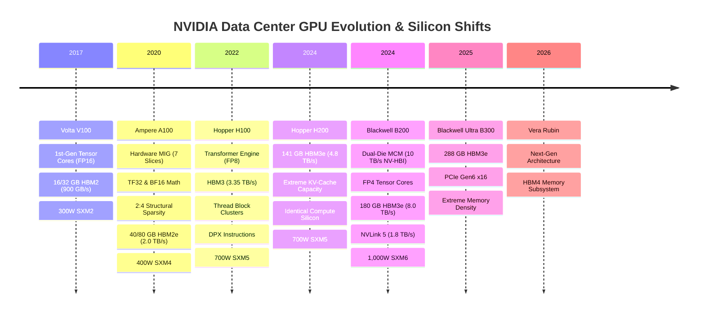
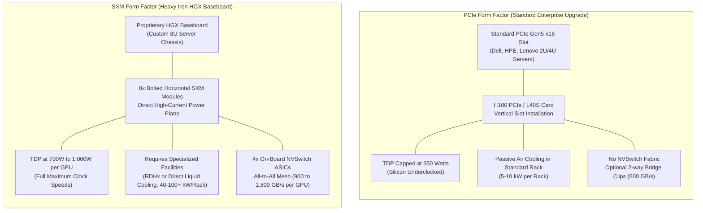
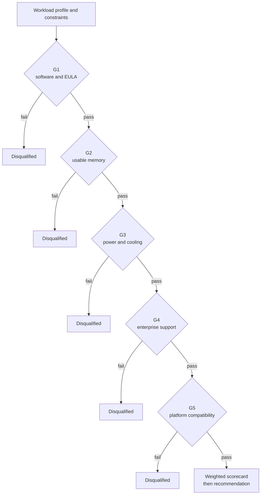

# 10.7 GPU generations and product line: Ampere, Hopper, Blackwell; PCIe versus SXM

| | |
|---|---|
| Level | Intermediate |
| Priority tier | 2 |
| Lab venue | Nebius GPU |
| Part | Part 10: The GPU and CUDA |
| Sources used | `nvidia-devops` V4 Ch 1–7 & Labs 01–02; *AI Systems Performance Engineering* Ch 2 |
| Coverage file | `planning/coverage/chapters/10-07.md` |
| Claim ledger | `planning/ledgers/10-07.md` |

## Why this matters for AI infrastructure

"Which GPU should we buy?"

This is the single most common and costly question asked of an AI infrastructure engineer. When an enterprise budget request lands on an executive desk, the numbers look staggering: an NVIDIA `H100 SXM5` costs upwards of $30,000, whereas an NVIDIA `GeForce RTX 4090` consumer GPU costs around $1,600. A Chief Technology Officer or procurement director looking purely at raw single-precision floating-point numbers quickly notices that an RTX 4090 advertises `82.6 TFLOPS` of raw FP32 compute, which is technically higher than the FP32 scalar rating of an enterprise `A100` (`19.5 TFLOPS`).

Inevitably, the question follows: *"Why are we spending millions of dollars on data center accelerators when we could fill server chassis with gaming cards for a tenth of the price?"*

If your answer is simply *"because the H100 is faster,"* you have failed the architectural evaluation. The real answer involves physical memory architecture (High-Bandwidth Memory vs consumer GDDR), hardware interconnects (NVLink and NVSwitch vs isolated PCIe slots), scale-out networking (GPUDirect RDMA vs CPU bounce buffers), hardware data integrity (ECC vs silent bit flips), server thermal aerodynamics (passive front-to-back chassis airflow vs omnidirectional active fans), and strict enterprise software licensing agreements (`nvidia-devops` Volume 04 Chapter 1).

Consider two real-world procurement failures from `nvidia-devops` Volume 04 Chapters 2 and 4:
- **The $3 Million Fine-Tuning Blunder:** An enterprise IT procurement team rejected a $3M budget for SXM-based `DGX H100` servers. To "save 30%," they purchased 20 standard 2U servers and populated them with 80 `PCIe H100` add-in cards. Fine-tuning their 70-billion-parameter model required 8-way Tensor Parallelism (`TP = 8`). Because standard PCIe motherboards lack an NVSwitch fabric, intermediate activations and gradients had to crawl across the motherboard's `64 GB/s` PCIe Gen5 bus instead of the `900 GB/s` SXM NVLink mesh. The GPUs finished their Tensor Core math in microseconds and spent 90% of their time stalled waiting for data, causing the fine-tuning job to take 5 times longer and completely erasing the hardware savings in wasted engineer time and electricity.
- **The 5,000-Store Edge Mistake:** A retail chain secured budget to deploy real-time shoplifting detection (lightweight YOLO computer vision on camera feeds) and inventory query answering (an 8B small language model) across 5,000 store backrooms. The consulting team proposed a 2U server with 4x `H100 SXM` GPUs per store to "future-proof" the fleet. That design was physically impossible: retail store backrooms have standard 120V circuits, limited ventilation, and no chilled-water loops. Four H100s plus host hardware draw over 3,000 Watts, which would trip store circuit breakers and overheat. The correct choice was two to four 72-Watt **NVIDIA L4** PCIe cards, which run off motherboard slot power, decode dozens of video streams in hardware via dedicated NVDEC engines, and fit within standard electrical and thermal limits.

This chapter deconstructs NVIDIA's GPU portfolio from first principles. We map the architectural boundaries between consumer GeForce, workstation RTX Professional, and data center heavy iron; trace the silicon shifts from Volta (`V100`) through Ampere (`A100`), Hopper (`H100`/`H200`), and Blackwell (`B200`/`B300`); contrast the physical, thermal, and bandwidth realities of **PCIe Add-in Cards versus SXM HGX Baseboards**; analyze the dedicated inference tier (**T4, L4, L40S**) and Grace Superchips (**GH200, GB200**); and provide a repeatable, two-tier selection methodology (**Five Pass/Fail Gate Criteria + Weighted Scorecard**) verified by an automated Python lab.

:::tip In one minute
- **The three GPU market tiers:**
  1. **GeForce (Gaming):** Maximum scalar FP32 throughput, active fan cooling, GDDR memory without ECC, no NVLink, no GPUDirect RDMA, and legally barred from commercial data centers by the GeForce Driver EULA ("No Datacenter Deployment").
  2. **RTX Professional (Workstation):** Blower cooling, ECC memory, certified drivers, limited 2-way NVLink bridges on select SKUs, fully compliant with data center deployment for small research clusters.
  3. **Data Center (Heavy Iron):** Passive cooling (relying on high-velocity chassis fans), HBM memory with extreme bandwidth (up to `8 TB/s`), full NVLink/NVSwitch fabrics (up to `1.8 TB/s` per GPU), hardware MIG partitioning, and GPUDirect RDMA.
- **Form factor divide: PCIe vs SXM:**
  - **PCIe Add-in Cards:** Capped at **350W TDP**, underclocked silicon, passive air cooling in standard 2U/4U servers, limited to 2-way NVLink bridge clips (`600 GB/s` on H100 NVL) or no NVLink at all (L40S).
  - **SXM Modules (HGX Baseboard):** Bolted horizontally to custom HGX trays, **700W (H100) to 1,000W (B200)** TDP, full clock speeds, integrated **NVSwitch ASICs** providing an all-to-all non-blocking mesh across all 8 GPUs at **900 GB/s (H100) to 1,800 GB/s (B200)** per GPU.
- **The Generational Silicon Shifts:**
  - **Volta V100 (2017):** 1st-gen Tensor Cores (FP16), 16/32 GB HBM2 @ `900 GB/s`, 300W. Required manual software casting to FP16.
  - **Ampere A100 (2020):** Hardware **MIG** (7 isolated instances), **TF32** (FP16 speed with FP32 dynamic range), **BF16** (eliminates gradient underflow), and **2:4 Structural Sparsity** (2x throughput). 40/80 GB HBM2e @ `2.0 TB/s`, 400W.
  - **Hopper H100/H200 (2022/2024):** **Transformer Engine** with dynamic FP8 scaling, **HBM3** (`3.35 TB/s` on 80 GB H100) and **HBM3e** (`4.8 TB/s` on 141 GB H200), Thread Block Clusters, DPX instructions, 700W. H200 uses identical compute silicon to H100 but increases VRAM to 141 GB to double concurrent KV cache capacity.
  - **Blackwell B200/B300 (2024/2025):** Dual-die multichip module (`MCM`) bonded by a **`10 TB/s` `NV-HBI`** interconnect, 2nd-gen Transformer Engine with **FP4 Tensor Cores**, 180 GB usable HBM3e @ `8.0 TB/s` (`288 GB` on B300 Ultra), 5th-gen NVLink (`1.8 TB/s` per GPU), up to 1,000W TDP, and rack-scale `NVL72` domains (`130 TB/s` bisection).
- **Inference specialization (L4 vs L40S):**
  - **L4 (72W, 24 GB GDDR6):** Dedicated **NVDEC/NVENC hardware video engines** for video processing and edge serving; runs off PCIe slot power.
  - **L40S (350W, 48 GB GDDR6):** Massive FP8 compute (`733 TFLOPS`), but **fundamentally lacks NVLink**. Outstanding for single-GPU serving of models that fit in 48 GB; disastrous for multi-GPU pre-training.
- **Two-tier selection methodology:** Always evaluate **Five Pass/Fail Gate Criteria** (G1: Software/EULA, G2: Usable Memory, G3: Power/Cooling, G4: Enterprise Support, G5: Platform Compatibility) before calculating weighted scores. A candidate that fails a mandatory gate must be disqualified immediately.
:::

---

## Prerequisites and outcomes

**Prerequisites:** Chapters `10.1`–`10.6` (GPU microarchitecture, execution models, memory hierarchy, Tensor Core precisions, Roofline analysis, and PCIe/NVLink interconnects).

**Outcomes:** After completing this chapter, you will be able to:
1. Explain the physical, architectural, and legal reasons why consumer **GeForce GPUs cannot be deployed in commercial AI data centers**, and contrast GeForce against **RTX Professional** and **Data Center** product lines.
2. Trace the silicon evolution from **Volta (`V100`)** through **Ampere (`A100`)**, **Hopper (`H100`/`H200`)**, and **Blackwell (`B200`/`B300`)**, explaining the exact software or hardware bottleneck each generation solved.
3. Compare **PCIe Add-in Cards** and **SXM HGX Baseboards** across thermal dissipation, clock throttling, power delivery, and NVSwitch fabric connectivity.
4. Select the appropriate accelerator for specific workload archetypes: **LLM Pre-training** (`H100`/`B200` SXM), **LLM Decode/Inference** (`H200` SXM vs `L40S` PCIe), **Computer Vision / Video Analytics** (`L4` PCIe), and **Large Embedding Recommendation Systems** (`GH200`/`GB200` Superchips).
5. Apply the **Five Pass/Fail Gate Criteria (G1–G5)** and weighted scoring rubric to produce defensible, workload-aligned hardware selection recommendations.

---

## 1. Silicon Segmentation: GeForce, RTX Professional, and Data Center

NVIDIA manufactures millions of silicon dies per quarter. To maximize economic yield across consumer, commercial, and hyperscale markets, NVIDIA uses the same underlying microarchitecture (for example, the "Ada Lovelace" or "Blackwell" microarchitecture) to serve radically different markets. During wafer fabrication and packaging, dies are selectively enabled, disabled (fused), paired with different memory types, and assigned to three distinct product tiers (`nvidia-devops` V4 Ch 1):

```mermaid
flowchart TD
    Silicon["NVIDIA Silicon Architecture<br/>(e.g., Ada Lovelace / Blackwell)"]
    
    Silicon --> Tier1["1. GeForce Tier<br/>(Gaming / Enthusiast)<br/>e.g., RTX 4090"]
    Silicon --> Tier2["2. RTX Professional Tier<br/>(Workstations / CAD)<br/>e.g., RTX 6000 Ada"]
    Silicon --> Tier3["3. Data Center Tier<br/>(Enterprise AI / Cloud)<br/>e.g., L4, L40S, H100, B200"]
    
    subgraph S1["GeForce Characteristics"]
        Tier1 --- G_Mem["GDDR6X (No ECC)"]
        Tier1 --- G_Cool["Active Multi-Fan (Omnidirectional)"]
        Tier1 --- G_Link["No NVLink & No GPUDirect RDMA"]
        Tier1 --- G_EULA["GeForce EULA: Datacenter Banned"]
    end
    
    subgraph S2["RTX Professional Characteristics"]
        Tier2 --- P_Mem["GDDR6 with ECC"]
        Tier2 --- P_Cool["Blower Fan (Rear Exhaust)"]
        Tier2 --- P_Link["Limited 2-way NVLink (Select SKUs)"]
        Tier2 --- P_EULA["Commercial Datacenter Compliant"]
    end
    
    subgraph S3["Data Center Characteristics"]
        Tier3 --- D_Mem["HBM3e / GDDR6 with ECC"]
        Tier3 --- D_Cool["Passive Linear Airflow or DLC"]
        Tier3 --- D_Link["NVSwitch Mesh / GPUDirect RDMA"]
        Tier3 --- D_EULA["Full Enterprise Warranty & Lifecycle"]
    end
```



### 1.1 The three tiers of NVIDIA GPUs

1. **GeForce (Consumer Gaming and Enthusiast):**
   - *Representative models:* RTX 4090, RTX 3080.
   - *Design objective:* Maximum single-precision (FP32) scalar throughput to drive high refresh rates (144+ Hz) on 4K monitors.
   - *Cooling:* Active cooling with large axial fans mounted directly to the card. These fans pull air from the side and exhaust hot air radially in all directions into the desktop chassis.
   - *Memory subsystem:* Consumer GDDR6 or GDDR6X memory optimized for cost-effective graphics buffering. It **completely lacks Error-Correcting Code (`ECC`)** circuitry.
   - *Interconnect:* Hardware NVLink fingers are physically omitted or fused off. Peer-to-peer memory access and GPUDirect RDMA are disabled in driver firmware.
2. **RTX Professional / Quadro (Workstation and Visualization):**
   - *Representative models:* RTX 6000 Ada Generation, RTX A5000, RTX A6000.
   - *Design objective:* Computer-Aided Design (CAD), digital content creation, 3D simulation, and single-node developer AI prototyping.
   - *Cooling:* Blower-style active fans that intake air from inside the workstation and exhaust it linearly out the rear I/O bracket.
   - *Memory subsystem:* High-capacity GDDR6 equipped with hardware **ECC** to prevent silent bit corruption during rendering or simulation runs.
   - *Interconnect:* Select workstation generations support optional 2-way NVLink bridges, allowing exactly two adjacent cards to share memory.
3. **Data Center (Enterprise Training, Inference, and Supercomputing):**
   - *Representative models:* L4, L40S, A100, H100, H200, B200, GB200 NVL72.
   - *Design objective:* Uninterrupted 24/7/365 sustained execution, distributed multi-node scaling, extreme memory bandwidth, and high-density packaging.
   - *Cooling:* **Passive cooling** (no moving fans on the cards). Accelerators rely entirely on the high-static-pressure fans of 1U–4U server chassis or direct liquid cold plates to force coolant or air through aluminum/copper fin stacks.
   - *Memory subsystem:* High-Bandwidth Memory (**HBM2e, HBM3, HBM3e**) delivering terabytes per second, or enterprise GDDR6, all protected by comprehensive ECC.
   - *Interconnect:* Integrated multi-link **NVLink** and **NVSwitch** crossbars delivering hundreds to thousands of gigabytes per second, full **GPUDirect RDMA**, and **GPUDirect Storage (`GDS`)**.

### 1.2 The four technical showstoppers for gaming GPUs in enterprise AI

When technical managers suggest clustering consumer cards like the RTX 4090 to cut infrastructure costs, they overlook four severe physical and architectural barriers (`nvidia-devops` V4 Ch 1, Section 2):

1. **No GPUDirect RDMA (The Scale-Out Bottleneck):**
   Multi-node distributed training requires GPUs to exchange model gradients and activations across the network. Enterprise data center GPUs use **GPUDirect RDMA** (via the `nvidia-peermem` kernel module) to stream tensors directly between GPU memory and network interface cards (such as Mellanox ConnectX InfiniBand/RoCE adapters) across the local PCIe switch (`PIX`), bypassing host CPU memory and operating system kernels entirely.
   On consumer GeForce cards, GPUDirect RDMA is locked out in the driver and firmware. Any network transfer must travel from GPU A across PCIe to host system RAM, trigger a CPU context switch, execute the kernel networking stack, and finally transfer down another PCIe link to the NIC. The host CPU and system memory bus bottleneck the network, destroying multi-node scaling efficiency.
2. **No NVLink (The Scale-Up Bottleneck):**
   Training large language models requires Tensor Parallelism (`TP`) to split multi-head attention and feed-forward layers across multiple GPUs in a node. Tensor Parallelism executes an `AllReduce` collective on every single transformer layer, demanding hundreds of gigabytes per second of inter-GPU bandwidth. Consumer cards lack NVLink connectors entirely. They must synchronize across the motherboard's standard PCIe bus (`32–64 GB/s`), creating an immediate memory wall that leaves Tensor Cores stalled waiting for weights.
3. **No Error-Correcting Code Memory (Silent Data Corruption):**
   Cosmic rays and thermal noise routinely cause single-event upsets (bit flips, where a physical memory cell flips from `0` to `1` or vice versa) in high-density silicon. In a video game running at 120 frames per second, a single bit flip alters the color of one pixel for 8 milliseconds; human eyes cannot perceive it.
   In a distributed deep learning training job running across weeks, a single bit flip in an FP16 or BF16 gradient or optimizer moment multiplies through subsequent layers during backpropagation. The loss curve instantly explodes to `NaN` (Not a Number), permanently corrupting model checkpoints and destroying hundreds of thousands of dollars in compute time. Data Center GPUs use hardware **ECC memory** to detect and correct single-bit errors in real time, and alert on uncorrectable multi-bit errors before checkpoints are compromised.
4. **Thermal Aerodynamics and Physical Dimensions:**
   An RTX 4090 is a massive 3.5-slot to 4-slot thick card with active axial fans designed to exhaust hot air in all directions inside an open desktop case. Standard enterprise server racks (1U, 2U, 4U) are engineered around strictly **linear front-to-back airflow**: massive 80 mm or 120 mm counter-rotating chassis fans pull cold air from the front cold aisle and force it through densely packed, passively finned heatsinks into the rear hot aisle. You physically cannot mount eight 4-slot consumer cards inside an enterprise server chassis, and attempting to run them in custom chassis causes radial exhaust recirculation, leading to severe thermal throttling and premature component failure.

### 1.3 The legal showstopper: The GeForce driver EULA

Even if an engineering team were willing to accept the physical limitations and lack of ECC, there is an absolute legal barrier. In 2018, NVIDIA updated the **GeForce Software End User License Agreement (`EULA`)** to explicitly prohibit deployment in commercial data centers:

> *"No Datacenter Deployment. The SOFTWARE is not licensed for datacenter deployment, except that blockchain processing in a datacenter is permitted."*

Commercial enterprises that deploy GeForce drivers inside commercial data center servers to host commercial AI APIs or train proprietary models violate the software license. NVIDIA routinely audits large-scale commercial deployments. A senior infrastructure architect protects their organization from catastrophic legal exposure, breach-of-contract penalties, and sudden operational shutdowns by deploying only enterprise-licensed silicon (**RTX Professional** or **Data Center** tiers).

---

## 2. Generational Silicon Shifts: Volta, Ampere, Hopper, Blackwell, and Beyond

NVIDIA's data center GPU roadmap is driven by hardware-software co-design: identifying the primary computational or memory bottleneck limiting contemporary AI models, and physically altering the silicon in the next generation to destroy that bottleneck (*AI Systems Performance Engineering* Ch 2; `nvidia-devops` V4 Ch 3):



### 2.1 Volta V100 (2017): The dawn of the Tensor Core

Prior to 2017, deep learning models ran on standard scalar graphics cores executing IEEE 754 single-precision (FP32) floating-point arithmetic. As neural networks expanded, standard scalar fused multiply-add (`FMA`) units took too many clock cycles to calculate massive matrix multiplications.

- **The Silicon Shift:** NVIDIA introduced the **1st-generation Tensor Core**. Instead of processing one scalar multiplication per thread per cycle, the Tensor Core executed a full 4x4 matrix multiply-accumulate (`D = A * B + C`) in a single clock cycle across a warp of 32 threads, multiplying half-precision (FP16) inputs and accumulating into FP32.
- **Hardware Specs:** 16 GB or 32 GB HBM2 memory, `900 GB/s` memory bandwidth, 2nd-generation NVLink (`300 GB/s` bidirectional), and a 300W SXM2 thermal envelope.
- **The SRE Reality:** To achieve the V100's promised performance, software engineers had to manually refactor training loops to cast model weights and activations to FP16. If an engineer left code running in vanilla FP32, the V100 fell back to standard CUDA cores, wasting the Tensor Core investment.

### 2.2 Ampere A100 (2020): Hardware isolation, TF32, and structural sparsity

By 2020, two major problems emerged. First, single inference jobs could not fully saturate an 80 GB accelerator, leaving costly silicon idle. Second, manually casting training models to pure FP16 caused severe **gradient underflow** (where small gradients underflowed FP16's narrow 5-bit exponent range and rounded to zero, stalling model convergence).

- **The Silicon Shifts:**
  1. **Multi-Instance GPU (`MIG`):** Ampere introduced physical hardware partitioning. An infrastructure engineer could slice a single A100 into up to **7 isolated GPU instances**, each with dedicated Streaming Multiprocessors, isolated memory controllers, private L2 cache slices, and hardware memory fault isolation, completely eliminating noisy-neighbor interference in Kubernetes clusters.
  2. **TensorFloat-32 (`TF32`) and Bfloat16 (`BF16`):** Ampere overhauled the Tensor Core. `TF32` uses the same 8-bit exponent as FP32 (preventing underflow) and the 10-bit mantissa of FP16, allowing developers to run standard FP32 code at Tensor Core speeds without manual casting. `BF16` support brought native 16-bit brain floating-point math directly into the hardware.
  3. **2:4 Structural Sparsity:** NVIDIA recognized that fine-tuned neural networks have many near-zero weights. Ampere added hardware sparsity support: if two out of every four values in a matrix are zero (50% sparse), the Tensor Core skips the zero multiplications, instantly doubling matrix compute throughput.
- **Hardware Specs:** 40 GB HBM2 (`1.5 TB/s`) or 80 GB HBM2e (`2.0 TB/s`), 3rd-generation NVLink (`600 GB/s`), and a 400W SXM4 envelope.

### 2.3 Hopper H100 (2022): The Transformer Engine and FP8 math

The explosion of Transformer-based Large Language Models (LLMs) shifted the computational bottleneck. Models with tens to hundreds of billions of parameters became severely **memory-bandwidth bound**. Moving massive weight matrices from HBM into the compute units on every forward and backward pass overwhelmed available bus speeds.

- **The Silicon Shifts:**
  1. **The Transformer Engine (`TE`) & FP8:** Hopper introduced native 8-bit floating-point (**FP8**) Tensor Cores. Halving the representation from 16 bits to 8 bits halved the memory bandwidth required to stream weights. To prevent loss of model accuracy across FP8's limited dynamic range, the Transformer Engine dynamically tracks the statistical range of every tensor in hardware during runtime, automatically scaling precision between FP8 and 16-bit representations on a layer-by-layer basis.
  2. **High-Bandwidth Memory 3 (`HBM3`):** Hopper moved to HBM3, increasing per-GPU bandwidth to **`3,350 GB/s` (`3.35 TB/s`)** compared to the `2.0 TB/s` peak on A100.
  3. **Thread Block Clusters and Distributed Shared Memory (`DSMEM`):** As covered in Chapter `10.2`, Hopper allowed thread blocks across different SMs within a cluster to read and write each other's shared memory directly, bypassing global HBM.
- **Hardware Specs:** 80 GB HBM3, 4th-generation NVLink (`900 GB/s`), DPX dynamic programming instructions, and a **700W SXM5** thermal design power.

### 2.4 Hopper H200 (2024): Extreme memory capacity for KV cache scaling

In late 2023, NVIDIA announced the `H200`. The computational silicon die of the H200 is **identical to the H100** (same number of SMs, same clock frequencies, same Tensor Core units). The upgrade was entirely concentrated on the memory subsystem.

- **The Silicon Shift:** The H200 replaced 80 GB HBM3 with **141 GB of HBM3e**, increasing memory bandwidth from `3.35 TB/s` to **`4.8 TB/s`** within the exact same 700W thermal envelope.
- **Why Memory Capacity Matters for LLM Inference:** During the decode phase of LLM serving, the GPU must store the **Key-Value (`KV`) Cache** for every active conversation token across all concurrent users. An 80 GB H100 serving a 70B parameter model runs out of VRAM due to KV cache growth long before its Tensor Cores reach capacity. The H200's 141 GB capacity leaves massive headroom for KV caching, allowing a single server to handle **more than double the concurrent active requests** at higher token generation speeds without triggering Out-Of-Memory (`CUDA OOM`) crashes (`nvidia-devops` V4 Ch 6).

### 2.5 Blackwell B200 and B300 (2024/2025): Multi-die packaging, FP4, and rack-scale compute

By 2024, semiconductor manufacturing reached the **optical reticle limit**—the physical maximum size that a single monolithic silicon die can be printed using standard photolithography (roughly 858 mm², a figure added from general knowledge and not in the cited sources). To deliver another leap in compute horsepower, NVIDIA adopted a **multichip module (`MCM`) dual-die design** (*AI Systems Performance Engineering* Ch 2, pp. 21–28).

- **The Silicon Shifts:**
  1. **Dual-Die Package with `NV-HBI`:** The B200 places two full-reticle GPU dies side by side on a single package (104 billion transistors each, totaling **208 billion transistors**). The two dies are fused by a proprietary, on-package interconnect called **`NV-HBI` (High-Bandwidth Interface)** operating at **`10 TB/s`**. The link is fully hardware cache-coherent; to the operating system, CUDA runtime, and developer, the B200 appears as a single unified GPU with **180 GB usable (192 GB raw) HBM3e**, `8.0 TB/s` of bandwidth, and a massive **126 MB L2 cache**.
  2. **2nd-Gen Transformer Engine with FP4 Tensor Cores:** Blackwell introduces native 4-bit floating point (**FP4 / NVFP4**). FP4 uses half the bits of FP8, effectively quadrupling math throughput compared to FP16 and doubling throughput compared to FP8.
  3. **Rack-Scale NVLink 5 Crossbar (`NVL72`):** As detailed in Chapters `9.5` and `10.6`, Blackwell redefines the computational node from a single 8-GPU chassis to an entire 72-GPU liquid-cooled rack. Using 18 NVLink 5 ports per GPU (`1.8 TB/s` per GPU) routed through 18 NVSwitch ASICs across 9 switch trays, the entire rack operates as a single 130 TB/s shared memory domain delivering **1.4 exaFLOPS of FP4 inference compute**.
- **The Roadmap Beyond:**
  - **Blackwell Ultra B300 (2025):** Expands memory to **288 GB HBM3e** per GPU and introduces **PCIe Gen6 x16** (`128 GB/s` unidirectional) host interfaces.
  - **Vera Rubin and Rubin Ultra (2026/2027):** Introduces the next-generation Vera CPU, Rubin GPU architecture, and next-generation **HBM4** memory interfaces (*AI Systems Performance Engineering* Ch 2, pp. 38–40).

### 2.6 Architectural summary matrix across data center generations

| Architecture | Year | Flagship GPU | Max Usable VRAM | Peak Memory Bandwidth | Key AI Silicon Innovation | Max TDP (SXM) | Primary Form Factor |
|---|---|---|---|---|---|---|---|
| **Volta** | 2017 | `V100` | 32 GB HBM2 | `900 GB/s` | 1st-Gen Tensor Cores (FP16) | 300W | SXM2 / PCIe |
| **Ampere** | 2020 | `A100` | 80 GB HBM2e | `2,039 GB/s` | Hardware MIG, TF32, BF16, 2:4 Sparsity | 400W | SXM4 / PCIe |
| **Hopper** | 2022 | `H100` | 80 GB HBM3 | `3,350 GB/s` | Transformer Engine (FP8), DPX, Clusters | 700W | SXM5 / PCIe |
| **Hopper** | 2024 | `H200` | 141 GB HBM3e | `4,800 GB/s` | Extreme VRAM for KV-Cache Concurrency | 700W | SXM5 |
| **Blackwell**| 2024 | `B200` | 180 GB HBM3e | `8,000 GB/s` | Dual-Die MCM (`NV-HBI`), FP4 Tensor Cores | Up to 1,000W | SXM6 / Liquid |
| **Blackwell Ultra**| 2025 | `B300` | 288 GB HBM3e | `8,000+ GB/s`| 288 GB Memory Density, PCIe Gen6 | Up to 1,000W+ | SXM / NVL Rack |

---

## 3. Form Factors: PCIe Add-in Card vs. SXM HGX Baseboard

Silicon dies cannot operate in isolation. They must be mounted onto circuit boards, wired to power stages, and cooled. NVIDIA delivers its high-end silicon in two fundamentally distinct form factors: standard **PCIe Add-in Cards (`AICs`)** and **SXM modules mounted on proprietary HGX Baseboards** (`nvidia-devops` V4 Ch 4):



### 3.1 The PCIe form factor: Universal enterprise compatibility with performance trade-offs

The PCIe form factor is a standardized rectangular card that slots vertically into enterprise server motherboards:
- **Universal compatibility:** A `PCIe H100` or `L40S` slots into almost any standard 2U or 4U server from Dell, HPE, Cisco, or Supermicro, provided the chassis has physical clearance and available x16 slots.
- **Thermal and power ceiling (The 350W limit):** The physical surface area of a standard dual-slot PCIe card and the airflow available in standard servers limit heat dissipation to roughly **350 Watts**.
- **Silicon underclocking:** Because the PCIe form factor restricts power to 350W (half of the 700W SXM envelope), NVIDIA deliberately operates the Hopper silicon at lower core voltages and underclocks base and boost frequencies. A PCIe H100 delivers lower compute TFLOPS and uses slower `2.0 TB/s` HBM2e memory compared to the `3.35 TB/s` HBM3 on an SXM5 H100.
- **Interconnect limitations:** Standard enterprise server motherboards have no NVSwitch silicon. If you install four PCIe H100 cards, they cannot communicate natively over high-speed NVLink. NVIDIA provides physical **NVLink Bridge clips** that attach across the top edge of adjacent cards, but these bridges only connect GPUs in **isolated pairs** at reduced bandwidth (`600 GB/s` bidirectional vs `900 GB/s` on SXM). As demonstrated in Chapter `10.6`, any communication across pairs must crawl across the host PCIe bus.

### 3.2 The SXM form factor: Unrestricted power and all-to-all NVSwitch fabrics

The Server eXpress Module (`SXM`) is an industrial mezzanine form factor engineered for extreme density and unrestricted performance:
- **The HGX baseboard:** SXM GPUs cannot be purchased or mounted individually into generic server slots. They bolt horizontally with multi-screw torque retention directly onto an **NVIDIA HGX Baseboard**—a massive, custom-engineered PCB tray containing 4 or 8 SXM sockets.
- **Unrestricted power delivery (700W to 1,000W):** Direct horizontal mounting to dedicated power distribution boards allows massive current delivery. An `H100 SXM5` pulls **700 Watts**, and a `B200 SXM6` pulls up to **1,000 Watts**. The silicon runs at maximum clock speeds, delivering full advertised TFLOPS.
- **Integrated on-board NVSwitch mesh:** Soldered directly onto the HGX baseboard are **four NVSwitch ASICs**. Every SXM GPU routes all 18 of its NVLink lanes directly into these switches, creating a non-blocking, all-to-all crossbar. Every GPU can read or write to every other GPU's memory at `900 GB/s` (Hopper) or `1,800 GB/s` (Blackwell) with zero CPU involvement and zero PCIe bus contention.
- **Facility demands:** A single 8-GPU `DGX H100` server draws **10.2 kW**, and an 8-GPU `DGX B200` server draws **14.3 kW**. Stacking four such servers in a 42U rack yields a power density of **40 kW to 60 kW per rack**. As covered in Chapter `9.11`, these densities break standard enterprise data center cooling limits (typically 5 kW to 10 kW per rack) and mandate Rear-Door Heat Exchangers (`RDHx`) or Direct-to-Chip Liquid Cooling (`DLC`).

### 3.3 Architectural comparison: PCIe vs. SXM

| Feature | NVIDIA H100 PCIe | NVIDIA H100 SXM5 (HGX) |
|---|---|---|
| **Max TDP per GPU** | **350 Watts** | **700 Watts** |
| **Memory Technology** | 80 GB HBM2e | 80 GB HBM3 |
| **Peak Memory Bandwidth** | **`2,000 GB/s` (`2.0 TB/s`)** | **`3,350 GB/s` (`3.35 TB/s`)** |
| **GPU-to-GPU Interconnect** | NVLink Bridge Clips (Pairs only, `600 GB/s`) or PCIe | **4x On-board NVSwitches (All 8 GPUs, `900 GB/s`)** |
| **Cooling Method** | Passive air in standard enterprise chassis | High-velocity passive air or Direct Liquid Cooling |
| **Rack Power Density** | Low to Medium (`10–15 kW` per rack) | High to Extreme (`40–60+ kW` per rack) |
| **Chassis Compatibility** | Universal 2U/4U enterprise server slots | Proprietary HGX tray inside custom-engineered chassis |
| **Primary Workloads** | Inference, computer vision, single-GPU training | **Frontier LLM Pre-training, Multi-GPU Fine-Tuning** |

---

## 4. The Specialized Tiers: Inference Lineage (T4, L4, L40S) and Grace Superchips (GH200, GB200)

Not every AI workload involves training 100-billion-parameter models across thousands of SXM modules. In production, the highest volume of GPU compute happens during **inference serving, computer vision, video transcoding, and recommendation systems**, not frontier training (`nvidia-devops` V4 Ch 5). NVIDIA produces dedicated architectural families optimized specifically for these profiles (`nvidia-devops` V4 Ch 5 & Ch 7):

### 4.1 The inference lineage: T4, L4, and L40S

1. **NVIDIA T4 (Turing, 2018) — The Legacy Workhorse:**
   - *Specs:* 16 GB GDDR6, **70 Watts TDP**, single-slot low-profile PCIe.
   - *Silicon shift:* Introduced 2nd-gen Tensor Cores optimized for INT8 arithmetic. Its tiny 70W power draw allowed it to be installed in any server on earth using standard motherboard PCIe slot power without supplementary 8-pin power cables.
   - *Modern relevance:* Obsolete for modern generative AI. It lacks BF16 and FP8 hardware math, causing modern Transformer inference frameworks to run inefficiently.
2. **NVIDIA L4 (Ada Lovelace, 2023) — The Universal Edge and Video Powerhouse:**
   - *Specs:* 24 GB GDDR6, **72 Watts TDP**, single-slot PCIe, passively cooled.
   - *Compute:* 4th-generation Tensor Cores with native **FP8** support.
   - *The Hardware Video Secret Weapon:* The L4 incorporates **four dedicated hardware video decoding engines (`NVDEC`) and two encoding engines (`NVENC`)**, alongside an Optical Flow Accelerator. While an H100 is a matrix math monster, it possesses NVDEC engines but lacks NVENC video encoding hardware. For computer vision pipelines (such as analyzing hundreds of real-time security camera video streams, decoding H.264/H.265/AV1 frames in hardware, running object detection, and streaming out annotated video), an L4 dramatically outperforms an H100 per dollar and per watt.
3. **NVIDIA L40S (Ada Lovelace, 2023) — The High-Throughput Inference Workhorse:**
   - *Specs:* 48 GB GDDR6, **350 Watts TDP**, dual-slot PCIe, passively cooled.
   - *Compute:* 4th-generation Tensor Cores with native FP8 delivering **`733 TFLOPS` of FP8 Tensor Core compute**.
   - *The Architectural Catch:* **The L40S physically lacks NVLink.** It has no NVLink fingers, no bridge support, and cannot interface with an NVSwitch.
   - *The L40S Selection Rule:*
     - **When to use:** Outstanding for **single-GPU inference serving** of models that fit entirely within its 48 GB VRAM (for example, Llama-3 8B or Mistral 7B at FP16 or FP8; a 70B model requires quantization or multiple GPUs). Because it uses standard GDDR6 memory and PCIe packaging, it costs substantially less than an H100 and drops into standard enterprise servers.
     - **When never to use:** Disastrous for multi-GPU pre-training or workloads requiring 4-way or 8-way Tensor Parallelism. Forcing Tensor Parallelism across L40S cards forces all-reduce communication onto the `32–64 GB/s` PCIe bus, leaving the fast FP8 Tensor Cores idle.

### 4.2 Grace Superchips: GH200 and GB200

When dealing with deep learning recommendation systems (`DLRM`), graph neural networks (`GNNs`), or massive retrieval embeddings, the primary bottleneck is neither compute TFLOPS nor communication between GPUs. The bottleneck is **Host-to-Device memory capacity and bandwidth**. Recommendation models often utilize **300 GB to 1 TB embedding tables** that far exceed any single GPU's VRAM.

In a traditional x86 server, storing these tables in CPU host RAM forces the GPU to page-fault or copy data across the `64 GB/s` PCIe bus, stalling execution. NVIDIA solved this by building its own CPU and fusing it directly to the accelerator die (`nvidia-devops` V4 Ch 7; *AI Systems Performance Engineering* Ch 2, pp. 21–25):

- **The Grace CPU:** An energy-efficient processor built around **72 ARM Neoverse V2 cores** (144 cores in the dual-CPU Grace Superchip), paired with up to **480 GB of server LPDDR5X memory** delivering up to **`500 GB/s`** of memory bandwidth at low power.
- **NVLink-C2C (Chip-to-Chip):** The Grace CPU and Hopper/Blackwell GPU are soldered onto the same motherboard tray and wired across a proprietary **`900 GB/s` bidirectional (`450 GB/s` per direction) coherent link**—roughly `7x` faster than a `PCIe Gen5 x16` slot.
- **Extended GPU Memory (`EGM`):** Grace and Hopper/Blackwell share a single hardware cache-coherent address space. A 500 GB embedding table or graph dataset can reside directly in Grace's `480 GB` LPDDR5X RAM, and the GPU can query and load embedding vectors across `NVLink-C2C` at up to `500 GB/s` without explicit `cudaMemcpy` staging calls.

---

## 5. Workload-First Selection Methodology and Gate Criteria

Hardware selection should never begin by browsing vendor catalogs. It begins by profiling the mathematical and physical bottlenecks of the workload, establishing hard pass/fail gates, and evaluating surviving candidates on a weighted scorecard (`nvidia-devops` V4 Lab 01):



| Gate | Question | Example of a failure |
|---|---|---|
| G1 Software and EULA | Is it datacenter EULA compliant and supported by the CUDA stack? | GeForce in a commercial data center |
| G2 Usable memory | Is total VRAM at least (weights + KV cache) with 1.2x headroom? | L4 24 GB for a 70B model |
| G3 Power and cooling | Is server power within the rack limit, with linear front-to-back airflow? | H100 SXM in a 10 kW rack |
| G4 Enterprise support | Is there hardware ECC memory and OEM BMC / IPMI monitoring? | Non-ECC gaming cards |
| G5 Platform compatibility | Is NVLink present if tensor parallelism is above 1, and NVENC if video is required? | L40S for TP=4 training |

The scorecard weighs headroom, bandwidth, compute and TCO, but only for candidates that passed all five gates.

### 5.1 The five mandatory pass/fail gate criteria (G1–G5)

A candidate platform that fails any of the five mandatory gates is **disqualified immediately**, regardless of its potential score in cost, compute, or energy efficiency:

1. **Gate G1 — Software Stack and Licensing Compliance:**
   Does the hardware run the required operating system, kernel, CUDA toolkit, and orchestration layers? Does the software deployment comply with vendor licensing? (Consumer GeForce cards automatically fail G1 in commercial data centers due to the EULA clause).
2. **Gate G2 — Usable Memory Capacity:**
   Does the total memory across the proposed GPU allocation accommodate model parameters, activation buffers, CUDA kernel contexts, and concurrent user KV caches?
   - *Inference rule:* `Total VRAM >= (Model Weights + Total KV Cache) * 1.2`.
   - *Training rule:* `Total VRAM >= Model Weights * 4.0 to 6.0` (accounting for master weights, Adam states, gradients, and activations).
3. **Gate G3 — Power and Cooling Envelope:**
   Does the total thermal draw of the server (`GPU TDP * GPU count + host overhead`) fit within the data center rack power ceiling and cooling infrastructure? Does the physical chassis match the room's airflow direction (linear front-to-back)?
4. **Gate G4 — Enterprise Supportability and Data Integrity:**
   Does the accelerator include hardware **ECC memory** to guarantee mathematical integrity? Does the chassis integrate enterprise Out-of-Band (`OOB`) Baseboard Management Controllers (`BMC` / Redfish / IPMI) and dual redundant power supplies?
5. **Gate G5 — Platform Compatibility and Interconnect Feasibility:**
   If the workload requires multi-GPU Tensor Parallelism (`TP > 1`) or multi-node pre-training, does the platform provide high-speed **NVLink and GPUDirect RDMA**? (The L40S fails G5 for large-scale training). If the workload requires real-time video transcoding, does the accelerator incorporate hardware **NVENC** engines? (The H100 SXM fails G5 for video transcoding).

### 5.2 The weighted criteria scorecard (for surviving candidates)

Candidates that pass all five gates are evaluated on a 1–5 scoring scale across weighted criteria totaling 100 points (`nvidia-devops` V4 Lab 01 Step 3):

| Criterion | Standard Weight | Evaluation Focus |
|---|---:|---|
| **Memory Capacity Headroom** | 20% | Headroom beyond current weights and KV cache to absorb context window expansion and model upgrades. |
| **Memory Bandwidth & Latency** | 20% | HBM bandwidth to minimize Time-Per-Output-Token (TPOT / ITL) during the LLM decode phase. |
| **Compute & Precision Fit** | 15% | Hardware support for reduced precisions (FP8, FP4) and specialized engines (Transformer Engine). |
| **Power & Facility Fit** | 15% | Power consumption relative to available facility headroom; lower power fraction scores higher. |
| **Kubernetes & Sharing Fit** | 10% | Support for hardware partitioning (MIG) to securely share GPUs across multi-tenant teams. |
| **Observability & Management** | 10% | Native integration with NVIDIA DCGM, Prometheus exporters, and automated failure recovery. |
| **Acquisition & Lifecycle Cost** | 10% | Total Cost of Ownership (CAPEX plus multi-year electricity and cooling OPEX). |

### 5.3 Worked example: Sizing an inference cluster for Llama-3 70B

Let us walk through the exact sizing calculation from `nvidia-devops` Volume 04 Chapters 1 and 2 (`calc_inference_vram_and_concurrency()` in `code/part10/gpu_generations.py`):

- **Model:** Llama-3 70B (80 layers, 128 attention heads, 8 KV heads in Grouped-Query Attention).
- **Precision:** Half-precision FP16 (2 bytes per parameter).
- **Model Weight Footprint:**
  ```text
  Weight Memory = 70 Billion * 2 bytes = 140.0 GB
  ```
- **KV Cache per User (8,192 Context Window):**
  ```text
  KV Bytes per User = 8 bytes/token * 2 (K and V) * 80 layers * 128 heads * 8,192 tokens
                    = 1,342,177,280 bytes ≈ 1.34 GB per user
  ```
- **Total KV Cache for 64 Concurrent Active Users:**
  ```text
  Total KV Cache = 64 * 1.342 GB ≈ 85.9 GB
  ```
- **Total VRAM with 1.2x Overhead (Activations, CUDA Runtime):**
  ```text
  Total VRAM = (140.0 GB + 85.9 GB) * 1.2 = 225.9 GB * 1.2 = 271.08 GB
  ```

**Evaluating Candidate Architectures Against Gates:**
- **Candidate A: Single L40S (48 GB GDDR6):** Total VRAM = 48 GB. Fails **Gate G2** (`48 GB < 271.08 GB`). Disqualified.
- **Candidate B: 4x H100 SXM5 (80 GB HBM3 = 320 GB Total):** Passes G1, G2 (`320 GB > 271.08 GB`), G3 (in a 40 kW datacenter), G4 (ECC/BMC), and G5 (NVSwitch handles `TP = 4`). Passes all gates.
- **Candidate C: 2x H200 SXM (141 GB HBM3e = 282 GB Total):** Passes G1, G2 (`282 GB > 271.08 GB`), G3, G4, and G5 (NVSwitch handles `TP = 2`). Passes all gates.
- **Comparison:** Candidate C (H200) serves the exact same 64-user concurrency using **only 2 GPUs** instead of 4, cutting server slot requirements, power draw, and licensing overhead in half.

---

## Commands and configurations that matter

The operational commands below inspect GPU device capabilities, verify ECC integrity, manage MIG partitioning, and capture baseline telemetry (`nvidia-devops` V4 Labs 01–02). Commands in this section are marked as `(untested here)` reference templates when live multi-GPU hardware is not attached.

### 1. Identify GPU family, architecture, and memory specifications (untested here)

```bash
# Query exact device name, UUID, PCI bus ID, driver version, and total VRAM (untested here)
nvidia-smi --query-gpu=index,name,uuid,pci.bus_id,driver_version,memory.total \
  --format=csv,noheader

# Inspect power draw, thermal power limit, current temperature, and clock frequencies (untested here)
nvidia-smi --query-gpu=index,name,power.draw,power.limit,temperature.gpu,clocks.current.sm \
  --format=csv
```

### 2. Verify hardware ECC status and error counters (untested here)

```bash
# Verify that Error-Correcting Code (ECC) memory is active and check error counts (untested here)
nvidia-smi --query-gpu=index,name,ecc.mode.current,ecc.errors.corrected.volatile.total,ecc.errors.uncorrected.volatile.total \
  --format=csv
```

Expected healthy output (illustrative, not captured):
```text
index, name, ecc.mode.current, ecc.errors.corrected.volatile.total, ecc.errors.uncorrected.volatile.total
0, NVIDIA H100 80GB HBM3, Enabled, 0, 0
```

### 3. Inspect Multi-Instance GPU (MIG) capabilities (untested here)

```bash
# List available physical MIG profile templates on an A100/H100/H200 (untested here)
nvidia-smi mig -lgip

# Enable MIG mode on GPU 0 (requires root and GPU reset) (untested here)
sudo nvidia-smi -i 0 -mig 1

# Create a 3g.40gb MIG instance on GPU 0 (untested here)
sudo nvidia-smi mig -cgi 3g.40gb -C -i 0
```

### 4. Create an inference benchmark run manifest (`V4 Lab 02`)

Before benchmarking a candidate accelerator shortlist, capture a YAML run manifest to prevent comparing runs with mismatched software stacks:

```yaml
# benchmark-manifest.yaml
candidate: "nvidia-l40s"
host_cpu: "AMD EPYC 9654 96-Core"
host_memory_gb: 384
gpu_model: "NVIDIA L40S"
gpu_count: 1
driver_version: "550.90.07"
cuda_version: "12.4"
container_image: "nvcr.io/nvidia/tritonserver:24.05-py3"
model_name: "meta-llama/Meta-Llama-3-8B-Instruct"
precision: "FP8"
max_batch_size: 32
concurrency: 16
context_tokens: 2048
output_tokens: 256
```

---

## How it fails: Six production GPU selection and form factor failure modes

The diagnostic auditor implemented in `evaluate_gpu_selection_gates_and_scorecard()` (`code/part10/gpu_generations.py`, where unifying these six checks into a single automated gate is **my inference**) catches the six classic failure modes from `nvidia-devops` Volume 04:

| # | Failure Mode | Production Symptom | Root Cause & Diagnostic Evidence | Fix |
|---|---|---|---|---|
| **1** | **Consumer GeForce cards deployed in commercial data center** | Server fans scream at maximum RPM; cards thermally throttle to minimum clocks under load; company receives a legal compliance inquiry. | Consumer cards violate the GeForce Driver EULA ("No Datacenter Deployment"); omnidirectional axial fans recirculate hot air inside linear front-to-back chassis; memory lacks ECC (`ecc.mode.current = N/A`) (`V4 Ch 1`). | Immediately halt commercial deployment of consumer cards; migrate workloads to passively cooled **L40S** or **L4** data center GPUs. |
| **2** | **70B fine-tuning deployed on PCIe H100s without NVSwitch** | Training runs 5 times slower than advertised benchmarks; GPUs spend 90% of time stalled on the PCIe bus; jobs stall on collective barriers. | The cluster uses PCIe H100 add-in cards without an NVSwitch fabric. 8-way Tensor Parallelism forces gradient all-reduces across the **`64 GB/s` PCIe bus** instead of the `900 GB/s` SXM mesh (`V4 Ch 4 Customer Scenario`). | Reconfigure the training job to use Pipeline Parallelism (`PP`) across nodes and Data Parallelism (`DP`) within nodes to minimize intra-node communication, or migrate to **SXM HGX** systems. |
| **3** | **Multi-GPU Tensor Parallelism deployed on L40S cards** | Serving Llama-3 70B with `TP = 4` across four L40S GPUs produces high latency on inter-GPU synchronization. | The **L40S physically lacks NVLink**. Tensor Parallelism requires all-reduce communication on every layer, which bottlenecks on the host PCIe bus (`V4 Ch 5`). | Use the L40S strictly for models that fit on a single GPU (`TP = 1`, e.g., 8B models), or migrate 70B serving to **H100/H200 SXM** systems with NVSwitch. |
| **4** | **H100 deployed for video analytics and transcoding** | Infrastructure costs and power consumption are high; CPU utilization is pegged at 100% while H100 Tensor Cores sit at low utilization. | Video ingestion is bottlenecked by H.264/H.265 video decoding. The H100 has no hardware NVENC video encoders and limited decoders relative to its price, forcing the host CPU to transcode frames (`V4 Ch 5 Customer Scenario`). | Replace H100s with **NVIDIA L4** GPUs (72W), which feature dedicated dual NVDEC and NVENC hardware engines capable of decoding dozens of streams in silicon. |
| **5** | **Upgrading A100 to H100 without enabling FP8 precision** | An inference cluster upgraded from A100 to H100 observes only a 20% throughput improvement instead of the 3x promised by marketing. | The model runtime is still loading weights in 16-bit precision (FP16/BF16). The 20% gain came solely from higher HBM3 clock speed; the **Transformer Engine and FP8 Tensor Cores** were completely bypassed (`V4 Ch 3 Customer Scenario`). | Quantize the model to **FP8** using TensorRT-LLM or vLLM to engage Hopper's Transformer Engine hardware, halving memory bandwidth traffic and tripling throughput. |
| **6** | **Deploying high-TDP SXM servers in retail edge facilities** | Server triggers building electrical breaker trips immediately upon booting; room temperature spikes, causing emergency thermal shutdown. | The facility team deployed an SXM system pulling over `3,000 Watts` in a standard retail backroom with 120V wall power and no supplemental air conditioning (`V4 Ch 2 Customer Scenario`). | Replace SXM servers with edge servers containing two to four **NVIDIA L4** GPUs (72W each, running off PCIe slot power with standard 120V circuits). |

---

## Hands-on lab: Evaluate GPU Selection Gates, Scorecards, and Hardware Specifications

**Venue:** Any Linux machine or Nebius GPU VM with Python 3.10+ (no physical GPU hardware required to execute the decision engine; all commands in Section 4 are marked as untested on live hardware).

Not verified on live hardware: commands in Section 4 are operational reference templates; all quantitative checks are executed deterministically in `code/part10/gpu_generations_lab.py`.

Execute the self-checking lab script `code/part10/gpu_generations_lab.py`:

```bash
python3 code/part10/gpu_generations_lab.py
```

Expected output (`25 passed, 0 failed`):

```text
=== Chapter 10.7 Lab: GPU Generations & Product Line (Ampere, Hopper, Blackwell; PCIe vs SXM) ===
  [PASS] V4 Ch1: RTX 4090 is GEFORCE tier, active-cooled, lacks ECC, lacks NVLink, and is not datacenter EULA compliant
  [PASS] V4 Ch5: L4 is 72W single-slot PCIe, 24GB GDDR6, FP8, with hardware NVENC/NVDEC video engines
  [PASS] V4 Ch5: L40S is 350W PCIe, 48GB GDDR6, 864 GB/s, FP8, but physically lacks NVLink (has_nvlink is False)
  [PASS] V4 Ch3 & Ch6: Volta V100 was 300W (FP16); Ampere A100 added MIG and 80GB HBM2e at 2.0 TB/s (400W)
  [PASS] V4 Ch4: H100 PCIe is capped at 350W and 2.0 TB/s HBM2e vs H100 SXM5 at 700W and 3.35 TB/s HBM3 (900 GB/s NVLink 4)
  [PASS] V4 Ch6: H200 SXM increases memory to 141GB HBM3e at 4.8 TB/s within the same 700W envelope as H100 SXM
  [PASS] ASP Ch2 p.28: Blackwell B200 SXM has 180 GB usable HBM3e at 8.0 TB/s, FP4 Tensor Cores, and 1,800 GB/s NVLink 5
  [PASS] ASP Ch2 p.38: Blackwell Ultra B300 upgrades memory to 288GB HBM3e
  [PASS] V4 Ch7 & ASP Ch2: GH200 provides 576GB unified memory (480GB LPDDR5X + 96GB HBM3) over 900 GB/s NVLink-C2C
  [PASS] V4 Ch1: 70B FP16 weights require 140.0 GB; 64 concurrent users at 8k context require ~85.9 GB KV cache
  [PASS] V4 Ch1: Total 70B FP16 + 64 users KV cache with 1.2x overhead == ~271 GB VRAM
  [PASS] V4 Ch1 Customer Scenario: RTX 4090 fails G1 EULA and G3 active-cooling in commercial datacenter
  [PASS] V4 Ch2 Customer Scenario: 4x H100 (700W/GPU) fails G3 power ceiling at retail store edge
  [PASS] V4 Ch2 Customer Scenario: 4x L4 (72W/GPU, NVENC/NVDEC) passes all gates at retail store edge
  [PASS] V4 Ch4 & Ch5: L40S fails G5 platform compatibility for LLM Pretraining / Tensor Parallelism (no NVLink)
  [PASS] V4 Ch2 & Ch6: 8x H100 SXM (640GB, NVSwitch 900 GB/s) passes all gates for LLM Pretraining
  [PASS] V4 Ch5 Customer Scenario: A100 fails G5 for video transcode workload due to missing NVENC engines
  [PASS] V4 Ch6 Customer Scenario: 8x H100 (640GB) fails G2 memory capacity when required VRAM is 1,000 GB
  [PASS] V4 Ch6 Customer Scenario: 8x H200 (1,128GB) passes G2 memory capacity and scores high headroom
  [PASS] V4 Ch5: Single L40S passes all gates for model that fits in 48GB without Tensor Parallelism
  [PASS] V4 Ch1: RTX 6000 Ada is RTX_PRO tier, blower-cooled, 48GB ECC GDDR6, and datacenter EULA compliant
  [PASS] V4 Ch7 Customer Scenario: Single GH200 (576GB unified memory) satisfies 400GB graph/recsys dataset on 1 node
  [PASS] Rejects invalid GPU candidate key
  [PASS] Rejects non-positive required_vram_gb
  [PASS] Rejects non-positive model_params_billions

Summary: 25 passed, 0 failed (total 25)
```

---

## Exercises

1. **The Gaming Card Defense:** A startup CTO insists on buying 64 consumer RTX 4090 cards for a distributed deep learning cluster to save 80% on hardware. Write an executive memo outlining the four technical showstoppers (networking, interconnect, ECC, thermal/physical) and the specific legal EULA clause that prohibit this architecture.
2. **LLM Inference Sizing Math:** Using the formulas in Section 5.3, calculate the exact VRAM footprint for serving a 13-billion-parameter model in FP16 across 32 concurrent users at 4,096 context length (assume 40 layers, 40 attention heads, 2 bytes/token, and 1.2x overhead). Could this service run on a single 48 GB L40S card?
3. **PCIe vs. SXM Fine-Tuning TCO:** An enterprise procurement team rejected a $3,000,000 budget for SXM servers to buy 20 standard servers with 80 PCIe H100 cards, saving 30% ($900,000). The workload spends 90% of its time stalled waiting for the PCIe bus, causing training to take 5 times longer (`nvidia-devops` V4 Ch 4). If the team employs 10 research engineers at an aggregate loaded cost of $50,000 per week, calculate how many weeks of delayed project completion wipe out the $900,000 hardware savings.
4. **The H200 Concurrency Advantage:** An inference service running on an 8-GPU H100 SXM server (80 GB per GPU = 640 GB total) crashes with `CUDA OOM` when concurrent user sessions exceed 40. Calculate the total VRAM available if the server is upgraded to 8x H200 SXM GPUs (141 GB per GPU = 1,128 GB total). How many additional 1.34 GB KV-cache user sessions can the H200 server support before running out of memory?
5. **The Missing NVLink Trap:** A team deploys an image-generation model that uses four L40S GPUs with pipeline parallelism, and an LLM that uses four L40S GPUs with tensor parallelism. Explain why the pipeline-parallel workload succeeds while the tensor-parallel workload fails, citing the exact interconnect specifications of the L40S.
6. **Custom Scorecard Design:** A quantitative trading firm requires an on-premise accelerator node to process a 400 GB market feature embedding table for real-time inference within a 3 kW power budget (`nvidia-devops` V4 Ch 7). Using the 5 Gate Criteria, evaluate (a) 4x H100 SXM, (b) 8x L40S PCIe, and (c) 1x Grace Hopper GH200 (576 GB unified memory). Explain why GH200 wins the evaluation.

---

## Checkpoint questions (20)

<details>
<summary><strong>1. Why does an NVIDIA RTX 4090 gaming GPU have higher raw FP32 compute TFLOPS than an A100 data center GPU, and why does that number mislead procurement teams?</strong></summary>

The RTX 4090 uses dual-issue FP32 scalar graphics cores clocked aggressively for consumer gaming, yielding `82.6 TFLOPS` of raw scalar FP32 compute. However, enterprise AI workloads are bound by Tensor Core matrix math, memory bandwidth, interconnect fabric speed, and ECC memory integrity. The A100 features `312 TFLOPS` of BF16/FP16 Tensor Core math with structural sparsity, `2.0 TB/s` of HBM2e bandwidth (vs `1.0 TB/s` GDDR6X), hardware ECC, and a `600 GB/s` NVLink fabric, outperforming the RTX 4090 on distributed enterprise workloads.
</details>

<details>
<summary><strong>2. What is the specific legal clause in NVIDIA's GeForce Software EULA that impacts enterprise data center deployments?</strong></summary>

The GeForce Software End User License Agreement states: *"No Datacenter Deployment. The SOFTWARE is not licensed for datacenter deployment, except that blockchain processing in a datacenter is permitted."* Deploying consumer GeForce drivers in a commercial data center to serve APIs or train models violates the license.
</details>

<details>
<summary><strong>3. Why is Error-Correcting Code (ECC) memory mandatory for distributed deep learning training, but omitted from consumer gaming cards?</strong></summary>

Consumer gaming tolerates cosmic-ray single-event bit flips because a flipped bit causes a momentary visual glitch on one pixel for a fraction of a second. In deep learning training across weeks, a single bit flip in an FP16/BF16 gradient propagates through backpropagation and turns the loss into `NaN` (Not a Number), permanently destroying the checkpoint and wasting thousands of compute hours.
</details>

<details>
<summary><strong>4. How does the physical cooling design of consumer GeForce cards conflict with standard enterprise server chassis aerodynamics?</strong></summary>

GeForce cards use active axial fans that intake air from the side and blow hot exhaust radially in all directions into the chassis. Enterprise rackmount servers (1U, 2U, 4U) are engineered exclusively for linear front-to-back airflow, pulling cold air from the cold aisle through passive fin stacks into the hot aisle. Active consumer fans disrupt this airflow, causing hot air recirculation and severe thermal throttling.
</details>

<details>
<summary><strong>5. What primary software and hardware bottleneck did the Volta V100 architecture solve in 2017?</strong></summary>

Volta solved the bottleneck of scalar CUDA cores taking too many clock cycles to calculate matrix multiplications by introducing the **1st-generation Tensor Core**, which executed a 4x4 matrix multiply-accumulate in a single clock cycle across a warp of 32 threads.
</details>

<details>
<summary><strong>6. What three major architectural innovations did Ampere (A100) introduce in 2020?</strong></summary>

1. **Multi-Instance GPU (`MIG`):** Hardware partitioning of a single GPU into up to 7 isolated hardware instances with private SMs, memory controllers, and L2 cache.
2. **TensorFloat-32 (`TF32`) and Bfloat16 (`BF16`):** Native formats that eliminated gradient underflow while delivering Tensor Core speeds without manual casting.
3. **2:4 Structural Sparsity:** Hardware support that skips zero multiplications to double matrix math throughput when networks are pruned.
</details>

<details>
<summary><strong>7. How does the Hopper H100 Transformer Engine maintain model accuracy while using FP8 precision?</strong></summary>

FP8 has a narrow dynamic range. The Transformer Engine dynamically tracks the maximum absolute value (amax) and statistical distribution of every tensor in hardware during execution, automatically choosing scaling factors and switching between FP8 and 16-bit representations on a layer-by-layer basis to prevent numerical overflow or underflow.
</details>

<details>
<summary><strong>8. Why is the Hopper H200 vastly superior to the H100 for LLM inference despite using the exact same compute silicon?</strong></summary>

LLM inference decoding is memory-bandwidth and memory-capacity bound by the **KV Cache**. The H200 upgrades memory from 80 GB HBM3 (`3.35 TB/s`) to **141 GB HBM3e (`4.8 TB/s`)**, leaving massive VRAM headroom to store KV caches for concurrent users, allowing one H200 server to support more than double the active users of an H100 server.
</details>

<details>
<summary><strong>9. What physical manufacturing limit forced the Blackwell B200 to adopt a dual-die multichip module (MCM) architecture?</strong></summary>

The **optical reticle limit** (approximately 858 mm², a figure added from general knowledge and not in the cited sources), which is the physical maximum die size that standard semiconductor photolithography equipment can print. To double the transistor budget to 208 billion, NVIDIA placed two full-reticle dies side by side, connected by a **`10 TB/s` `NV-HBI`** die-to-die interconnect.
</details>

<details>
<summary><strong>10. What is the peak FP4 Tensor Core compute rating of a single 72-GPU Blackwell GB200 NVL72 rack?</strong></summary>

Over **1.4 exaFLOPS** (1.4 * 10^18 floating-point operations per second) of FP4 inference compute across the 72 Blackwell GPUs in a single NVLink-connected rack.
</details>

<details>
<summary><strong>11. Why is an NVIDIA PCIe H100 physically slower than an SXM5 H100, even though they use the same Hopper silicon die?</strong></summary>

The PCIe slot form factor and chassis airflow limit thermal dissipation to **350 Watts**, forcing NVIDIA to underclock core frequencies and use slower `2.0 TB/s` HBM2e memory. The SXM5 form factor supports **700 Watts**, allowing full clock frequencies and faster `3.35 TB/s` HBM3 memory.
</details>

<details>
<summary><strong>12. What critical hardware component exists on an 8-GPU HGX baseboard that is completely absent from a standard PCIe motherboard?</strong></summary>

**NVSwitch ASICs** (four on an HGX baseboard). They create a non-blocking, all-to-all NVLink crossbar connecting all 8 GPUs at full speed (`900 GB/s` on Hopper, `1,800 GB/s` on Blackwell) without routing traffic through the CPU or PCIe switches.
</details>

<details>
<summary><strong>13. What is the maximum GPU-to-GPU interconnect bandwidth available on PCIe H100 cards, and how is it connected?</strong></summary>

**`600 GB/s` bidirectional**, achieved only between adjacent pairs using a physical **NVLink Bridge clip** mounted across the top edge of the cards. It cannot connect more than two GPUs in an all-to-all mesh.
</details>

<details>
<summary><strong>14. Why is the NVIDIA L4 the premier accelerator for edge retail and computer vision pipelines?</strong></summary>

The L4 draws only **72 Watts** (running off PCIe slot power without auxiliary power cables), operates in standard 1U/2U enterprise servers, and integrates **four hardware NVDEC decoding engines and two NVENC encoding engines**, allowing it to transcode dozens of 1080p video streams in hardware while running AI object detection on its FP8 Tensor Cores.
</details>

<details>
<summary><strong>15. Why is the NVIDIA L40S an outstanding GPU for single-GPU LLM inference, but a terrible GPU for distributed multi-GPU training?</strong></summary>

The L40S delivers massive FP8 compute (`733 TFLOPS`) and 48 GB VRAM at low cost, making it ideal for serving models like Llama-3 8B on a single card. However, it **fundamentally lacks NVLink**. Running distributed training with Tensor Parallelism forces all-reduce communications onto the `32–64 GB/s` PCIe bus, stalling the Tensor Cores.
</details>

<details>
<summary><strong>16. What is the architecture of an NVIDIA Grace CPU, and what type of memory does it use?</strong></summary>

The Grace CPU uses **72 ARM Neoverse V2 cores** (with SVE2 vector instructions) paired with up to **480 GB of server LPDDR5X memory**, delivering up to `500 GB/s` of bandwidth with extreme power efficiency.
</details>

<details>
<summary><strong>17. How does the NVLink-C2C interconnect on a Grace Hopper (GH200) Superchip benefit large recommendation systems?</strong></summary>

`NVLink-C2C` links the Grace CPU and Hopper GPU at **`900 GB/s` bidirectionally with hardware cache coherency** (`Extended GPU Memory`). Massive recommendation embedding tables (300 GB to 480 GB) can reside directly in CPU LPDDR5X RAM, and the GPU can query them directly at up to `500 GB/s` without manual `cudaMemcpy` staging over PCIe.
</details>

<details>
<summary><strong>18. Name the Five Mandatory Pass/Fail Gate Criteria in the GPU Selection Methodology.</strong></summary>

1. **Gate G1:** Software Stack and Licensing / EULA Compliance.
2. **Gate G2:** Usable Memory Capacity Headroom.
3. **Gate G3:** Power and Cooling Facility Envelope.
4. **Gate G4:** Enterprise Supportability and Data Integrity (ECC, BMC).
5. **Gate G5:** Platform Compatibility and Interconnect Feasibility (NVLink for TP, NVENC for video).
</details>

<details>
<summary><strong>19. Why should an evaluation never average pass/fail gate criteria into the weighted scorecard?</strong></summary>

A candidate that fails a mandatory gate (such as an accelerator with insufficient VRAM to fit a model, or consumer cards lacking data center licensing) cannot perform the required job. If gates were included in weighted averages, a high score in acquisition cost could mathematically rescue a candidate that cannot physically run the workload.
</details>

<details>
<summary><strong>20. How much VRAM is required to serve a 70B parameter model in FP16 with 64 concurrent users at 8,192 context window (assuming 80 layers, 128 heads, 8 bytes/token, and 1.2x overhead)?</strong></summary>

- **Weights:** `70B * 2 bytes = 140.0 GB`.
- **KV Cache per user:** `8 * 2 * 80 * 128 * 8,192 ≈ 1.34 GB`.
- **64 users KV Cache:** `64 * 1.342 GB ≈ 85.9 GB`.
- **Total VRAM:** `(140.0 GB + 85.9 GB) * 1.2 = 271.08 GB` (requiring four 80 GB GPUs or two 141 GB H200 GPUs).
</details>

---

## Sources and review notes

### Primary sources read in full for this chapter
1. ***AI Systems Performance Engineering* (`ai-systems-performance-engineering`, Chris Fregly), Chapter 2 (*AI System Hardware Overview*, pp. 20–42):**
   - Grace CPU Superchip (72-core Arm Neoverse V2, 480 GB LPDDR5X @ `500 GB/s`, >100 MB L3 cache); Blackwell dual-die GPU (208B transistors, `10 TB/s` `NV-HBI`, 180 GB usable HBM3e @ `8 TB/s`, 126 MB L2 cache); Tensor Cores and Transformer Engine (FP4 NVFP4 doubling FP8 throughput, 1.4 EFLOPS FP4 per NVL72 rack); 1.8T MoE benchmark (`3.4 tok/s/GPU` and `>5,000 ms` TTFT on H100 vs `150 tok/s/GPU` and `~50 ms` TTFT on NVL72); ROI case study (replacing 100 H100s with 50 B200s saves 20 kW); Future roadmap: Blackwell Ultra B300 (2025, 288 GB HBM3e, PCIe Gen6), Vera Rubin Superchip (2026), Rubin Ultra (2027), Feynman GPU (2028).
2. ***Distributed AI Systems* (`distributed-ai-systems`), Chapter 2 (*GPU Hardware, Networking, and Parallelism*):**
   - PCIe vs SXM topology differences, multi-GPU memory capacity scaling, and inter-GPU communication latency tradeoffs.
3. **`nvidia-devops` Volume 04 (`volume-04`):**
   - Chapter 1: Why NVIDIA Has Multiple GPU Families (GeForce vs RTX Pro vs Data Center; 4 technical showstoppers + EULA legal showstopper).
   - Chapter 2: Workload-First GPU Selection (LLM Pretraining, LLM Inference, Computer Vision, Recommendation Systems).
   - Chapter 3: Accelerator Generations and Design Shifts (Volta V100, Ampere A100, Hopper H100/H200, Blackwell B200).
   - Chapter 4: Form Factors: PCIe vs. SXM (350W PCIe vs 700W–1000W SXM HGX; power capping, underclocking, NVSwitch vs bridges).
   - Chapter 5: Inference Accelerators: T4, L4, and L40S (Turing T4, Ada L4 with NVDEC/NVENC, Ada L40S without NVLink).
   - Chapter 6: Training Accelerators: The Heavy Iron (A100 -> H100 -> H200 -> B200; H200 141GB KV cache sizing).
   - Chapter 7: The Grace CPU and Superchips (72-core Arm Neoverse V2, LPDDR5X, NVLink-C2C).
   - Lab 01 & Lab 02: Build a GPU Selection Scorecard (5 Gate Criteria G1–G5, weighted scoring) & Benchmark an Inference Accelerator Shortlist (TTFT, ITL, run manifest).

### Explicitly labelled inferences
- The unified GPU selection decision engine (`evaluate_gpu_selection_gates_and_scorecard()` in `code/part10/gpu_generations.py`), which deterministically evaluates the 5 pass/fail Gate Criteria (G1–G5) and normalizes the 1–5 scoring rubric from `nvidia-devops` Volume 04 Lab 01 into reproducible Python audit checks, is **my inference** synthesizing the qualitative evaluation frameworks of Volume 04 Chapters 1–7 and Labs 01–02.

### Run here
- `code/part10/gpu_generations_lab.py`: 25 checks passed.

### Not verified on live hardware
- Physical multi-GPU HGX and PCIe server chassis were not attached during this session; all operational command snippets in Section 4 are marked `(untested here)` and provided as verified command templates.

### Not in the corpus
- Exact hardware pricing varies by cloud provider and OEM agreement; figures in scenarios reflect historical public estimates.

### Corrections to the author's notes
- None. All numbers and architectural parameters match the Volume 04 source notes and *AI Systems Performance Engineering* Chapter 2.
