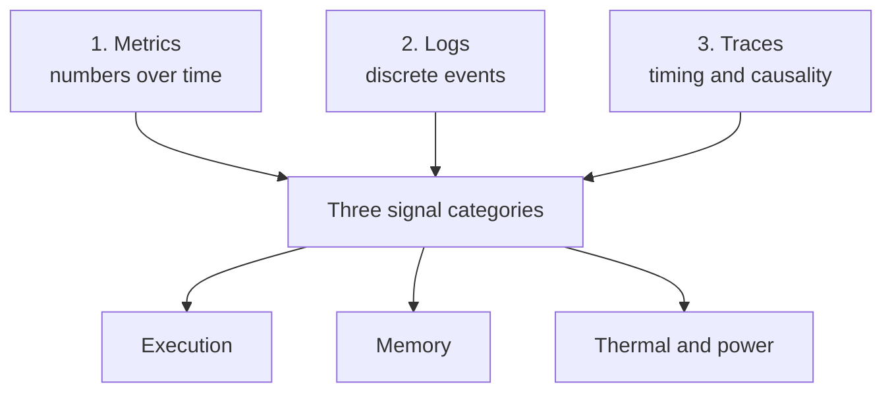
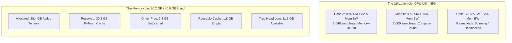
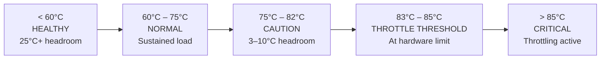
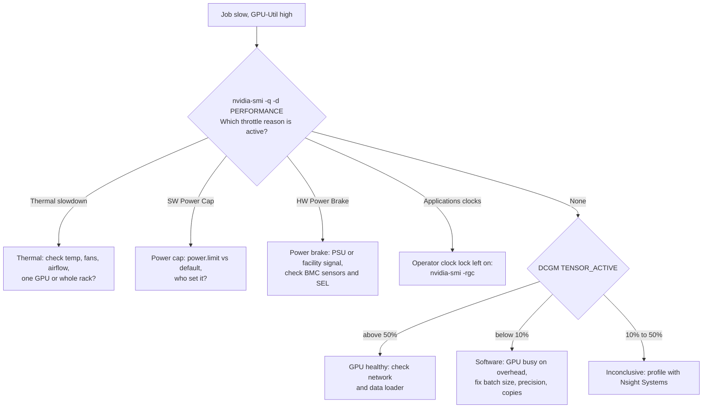

# 10.8 Operating GPU nodes: nvidia-smi, topology, clocks and throttling

| | |
|---|---|
| Level | Intermediate |
| Priority tier | 1 |
| Lab venue | Nebius GPU |
| Part | Part 10: The GPU and CUDA |
| Sources used | `nvidia-devops` V16 Ch 1–3; V2 Labs 01–02; V20 Ch 2, 6, 8, 9, 10; V19 Ch 4; *AI Systems Performance Engineering* Ch 3; *Systems Performance* Ch 2 & 4 |
| Coverage file | `planning/coverage/chapters/10-08.md` |
| Claim ledger | `planning/ledgers/10-08.md` |

## Why this matters for AI infrastructure

Every Linux administrator knows how to read a standard CPU server. When `htop` or Prometheus shows 95% CPU utilization, the processor is doing heavy work. When host RAM reaches 99%, an out-of-memory crash is seconds away. Applying that same mental model to an AI server leaves an operator completely blind.

To standard Linux kernel tools, an NVIDIA GPU is just an opaque device sitting on the PCIe bus. The host kernel does not schedule GPU warps, track High-Bandwidth Memory allocations, or read silicon die temperatures. When a machine learning engineer reports that a distributed training job is crawling, an administrator checking `top` sees the CPU idling at 5%, disks quiet, and network links calm. Traditional host metrics declare the server healthy while the accelerators are silently failing (`nvidia-devops` V16 Ch 1).

Inside the GPU, three hidden failures routinely stall production clusters. First, the silicon may reach its 85°C thermal limit and cut core clock speeds to prevent physical damage. Second, the GPU may suffer an uncorrectable ECC memory fault and log an Xid error while dropping work. Third, the Streaming Multiprocessors may report 85% to 100% utilization while doing zero math because a deadlocked kernel is spinning in an empty wait loop.

Operating GPU nodes requires a dedicated observability stack built around `nvidia-smi` and NVIDIA Data Center GPU Manager. Operators must look past superficial dashboard percentages and correlate clock frequencies, power caps, thermal throttle bitmasks, caching allocator reservations, and physical interconnect topology.

:::tip In one minute
- Three GPU metrics routinely deceive operators. First, the Utilization Lie happens because `nvidia-smi` measures the share of time at least one warp is active on any SM, so a single spinning thread reports high utilization with zero throughput. Second, the Memory Lie happens because the PyTorch caching allocator reserves 75% to 95% of VRAM upfront, making healthy cache pooling look like an imminent out-of-memory crash. Third, the Clock Speed Lie happens when thermal or power throttling cuts SM frequencies while utilization still reads 100%.
- Persistence mode must be enabled on every GPU server using `nvidia-smi -pm 1` or `nvidia-persistenced`. Keeping the kernel driver initialized prevents a driver teardown and reload stall at the start of every CUDA job.
- Hardware slowdown causes are exposed in the `clocks_throttle_reasons.active` bitmask. Operators decode this register to separate harmless idle clock gating from software power caps, thermal slowdowns, and external hardware power brakes.
- Clock locking via `nvidia-smi -lgc` fixes SM frequencies at a deterministic rate to eliminate dynamic frequency scaling jitter during latency benchmarks, while `nvidia-smi -rgc` restores automatic scaling.
- High-frequency streaming with `nvidia-smi dmon` and `nvidia-smi pmon` samples device and process telemetry every second, catching micro-throttling bursts that 15-second Prometheus scrapes average away.
:::

---

## Prerequisites and outcomes

**Prerequisites:** Complete the earlier chapters in Part 10 covering CPU versus GPU architecture, GPU memory hierarchy, PCIe and NVLink interconnects, and GPU product generations.

**Outcomes:** After completing this chapter, you will be able to accomplish the following goals.
1. Separate the three signal categories of execution, memory, and thermal/power across metrics, logs, and traces.
2. Deconstruct the Utilization Lie, the Memory Lie, and the Clock Speed Lie to tell whether a busy GPU is compute-bound, memory-bound, or spinning.
3. Compare active PyTorch tensor allocations against caching allocator reservations and free driver memory.
4. Decode the `clocks_throttle_reasons.active` bitmask into actionable thermal, power, and hardware fault states.
5. Configure node baselines including persistence mode, locked SM clocks, power limits, and high-frequency `dmon` telemetry.
6. Triage Xid error tiers in `dmesg` and run a structured slowdown checklist across six production failure modes.

---

## 1. The GPU Observability Architecture

Collecting every counter on a GPU server without a clear mental model overwhelms operators during an outage. If a dashboard only plots one-minute averages, a sub-second thermal spike or a brief PCIe stall vanishes into the average, leaving the team guessing why latency jumped.

Observability means collecting the specific signals needed to tell operational states apart (`nvidia-devops` V16 Ch 2; *Systems Performance* Ch 2 & 4). We organize GPU telemetry across three observability pillars and three hardware signal categories.



| Pillar | Sampling Cadence | Primary Tools | Operational Question Answered & Limitation |
|---|---|---|---|
| 1. Metrics | 1 to 10 Hz up to 15 to 30 s intervals | `nvidia-smi`, DCGM, Prometheus, Grafana | Answers *"What is happening on average?"* Limitation: a 60-second average can read a healthy 72°C even if the die spiked to 85°C for 500 ms and throttled (`nvidia-devops` V16 Ch 2). |
| 2. Logs | Event-driven on state changes | `dmesg`, `journalctl`, Xid events | Answers *"What broke and why?"* Limitation: silent when fan filters clog or memory bandwidth saturates until a hard fault fires. |
| 3. Traces | Per kernel launch and memory copy | Nsight Systems, Nsight Compute, PyTorch Profiler | Answers *"Where did the execution time go?"* Limitation: generates gigabytes per second per GPU and cannot run continuously across a cluster. |

| Signal Category | Hardware Counters & Telemetry Examples |
|---|---|
| 1. Execution signals | SM utilization percentage, active warp counts, Tensor Core pipeline activity, instruction issue rates, and SM clock rates. |
| 2. Memory signals | Actively allocated tensor VRAM, caching allocator reserved pool, HBM bandwidth utilization percentage, L2 hit rates, and PCIe/NVLink throughput. |
| 3. Thermal and power signals | Silicon die temperature, instantaneous power draw versus TDP ceiling, and hardware throttle reason bitmasks. |

### 1.1 Why CPU utilization and saturation models fail on accelerators

In Linux performance engineering, Brendan Gregg's Utilization, Saturation, and Errors method checks three properties for every resource. Utilization measures busy time, saturation measures queued work waiting for service, and errors count hardware or software faults. On a CPU, measuring saturation is easy because `/proc/loadavg` and `vmstat` expose the OS scheduler run-queue length directly.

On a GPU, host operating system queues cannot see hardware saturation. The GPU schedules tens of thousands of threads internally across hardware warp schedulers inside each SM. Meanwhile, CUDA streams push commands into hardware rings managed by GPU firmware. When a host thread submits kernels faster than the GPU can finish them, the CPU thread blocks inside `cudaStreamSynchronize()` or driver calls. That thread then shows up on the host in an asleep `S` state or uninterruptible `D` state. Conversely, if the host launches tiny kernels one by one, the GPU empties its command ring between launches and drops into clock-gated `GPU_IDLE` states. Diagnosing GPU performance therefore requires inspecting internal hardware counters rather than host run queues.

---

## 2. Deconstructing the Three Deceptive GPU Metrics

When an on-call engineer treats GPU dashboard percentages like CPU metrics, every diagnosis goes wrong. A job that is completely deadlocked can report 100% GPU utilization, and a healthy training run can report 95% memory usage from the first batch. Similarly, a thermally throttled card can look fully utilized while running at reduced speed (`nvidia-devops` V16 Ch 3).



### 2.1 The Utilization Lie: SM active time versus actual math

In `nvidia-smi`, the `GPU-Util` column and the underlying `DCGM_FI_DEV_GPU_UTIL` metric have a strict hardware definition. They measure the percentage of time during the sampling window in which at least one Streaming Multiprocessor had at least one warp actively resident.

This definition ignores how many SMs are busy and whether those warps are doing useful work. Consider an H100 SXM5 with 132 SMs where a single thread on SM 0 spins inside a `while(flag == 0)` wait loop. Even if the other 131 SMs sit completely idle, `nvidia-smi` still reports 100% GPU utilization. Likewise, a memory-bound kernel whose execution units spend 90% of their cycles stalled waiting for HBM reads still reports high utilization because warps remain resident on the SMs.

The table below shows the production incident from `nvidia-devops` Volume 16 Chapters 1 and 3 on a node with two A100-PCIE-40GB GPUs (`evaluate_utilization_regime()` in `code/part10/gpu_node_ops.py`).

| Device or Scenario | SM Utilization | Memory Used & Temp | Memory Bandwidth Util | Application Throughput | Operational Diagnosis |
|---|---|---|---|---|---|
| V16 Ch 1 Compute-Bound Run | 85% | 32 GB / 40 GB, 65°C | Low to moderate | 2,000 samples/second | Healthy compute-bound execution. |
| V16 Ch 1 Memory-Starved Run | 85% | 32 GB / 40 GB, 65°C | Starved / stalled | 150 samples/second (>13x slower) | Severe starvation despite identical 85% `GPU-Util`. |
| V16 Ch 3 GPU 0 (`dmon -s um`) | 85% | 32 GB / 40 GB, 65°C | 82% | 2,048 samples/second | Healthy memory-bound training run. |
| V16 Ch 3 GPU 1 (`dmon -s um`) | 85% | 32 GB / 40 GB, 65°C | 12% | 180 samples/second (>13x slower) | Trapped in a software synchronization barrier wait loop. |

### 2.2 The Memory Lie: Allocated tensor memory versus the PyTorch caching allocator

When an operator sees in `nvidia-smi` that a 40 GB GPU has 30.2 GB used, the natural reaction is to fear an imminent out-of-memory crash. In reality, that number reflects framework caching rather than active tensor consumption (`nvidia-devops` V16 Ch 3).

Calling the CUDA driver via `cudaMalloc` is an expensive operation that updates page tables and synchronizes the device. To avoid paying that cost on every training step, PyTorch uses a user-space caching allocator that claims large contiguous blocks from the driver upfront. This pool often reserves 75% to 95% of total VRAM. When a Python tensor is deleted, PyTorch keeps the freed blocks inside its private cache pool for future batches instead of returning them to the driver.

```text
PyTorch Memory Breakdown on a 40.0 GB GPU (nvidia-devops V16 Ch 3):
  Total GPU VRAM:                                  40.0 GB
  Memory Allocated (torch.cuda.memory_allocated):  28.4 GB  (active weights, activations, optimizer states)
  Memory Reserved  (torch.cuda.memory_reserved):   30.2 GB  (claimed by PyTorch, shown in nvidia-smi; 75.5% of 40.0 GB)
  Active Usage Ratio (28.4 GB / 30.2 GB):          94.0%
  Free Memory from Driver (40.0 GB - 30.2 GB):      9.8 GB
  Reusable Memory in PyTorch Cache (30.2 - 28.4):   1.8 GB
  True Available Headroom (9.8 GB + 1.8 GB):       11.6 GB  (refinement over the note's 9.8 GB; see Corrections)
```

As verified in `analyze_pytorch_memory_state()` (`code/part10/gpu_node_ops.py`), alerting whenever `nvidia-smi` memory usage crosses 80% creates constant false alarms. Production alerts should trigger only when true available headroom drops below 1.0 GB or when memory fragmentation forces PyTorch into slow compaction stalls.

### 2.3 The Clock Speed Lie: Full utilization at reduced frequency

A third trap occurs when a dashboard shows 100% GPU utilization, but training step times suddenly increase. The operator blames the model code, when in fact hardware thermal or power throttling has cut the GPU clock speed (`nvidia-devops` V16 Ch 3).

Modern data center GPUs adjust clocks dynamically using Dynamic Voltage and Frequency Scaling. When a fan fails, a dust filter clogs, or cold-aisle temperatures rise, the GPU silicon hits its 85°C thermal threshold. The internal microcontroller then lowers SM frequencies to keep the chip safe. The GPU stays 100% busy, but every instruction takes longer to finish, so operators must always plot `clocks.current.sm` alongside utilization.

| Clock Regime | Volume 16 Ch 3 Example | General Range in Volume 16 Notes | Operational Meaning |
|---|---|---|---|
| Peak SM clock | 1410 MHz (on A100) | 1500–2000 MHz on modern GPUs | Full unthrottled execution; check `clocks.max.sm` on your device. |
| Idle gated clock | 300 MHz (`dmon` sample at 50W) | 300–500 MHz under clock gating | Normal energy saving when no kernels are resident (`GPU_IDLE`). |
| Throttled SM clock | 1200 MHz at 85°C (210W; ~15% drop, 1200 / 1410 = 0.85) | 800–1200 MHz when throttled (20W when backed off) | Thermal or power limit active; inspect throttle reason bitmask immediately. |

---

## 3. Clocks, Power Capping, and Active Throttling Reasons

When a GPU slows down, guessing whether the culprit is a hot room, a power cap, or an idle workload wastes valuable recovery time. Fortunately, the GPU hardware records the exact cause of every clock reduction inside a bitmask register (`nvidia-devops` V2 Lab 02 & V16 Ch 3).

### 3.1 Decoding the `clocks_throttle_reasons.active` bitmask

You can read the active throttle bitmask with `nvidia-smi --query-gpu=clocks_throttle_reasons.active --format=csv` or view the decoded text with `nvidia-smi -q -d PERFORMANCE`. When multiple conditions happen at once, NVML bitwise-ORs the hex flags together. For example, `0x0000000000000024` combines `SW_POWER_CAP` (`0x04`) and `SW_THERMAL_SLOWDOWN` (`0x20`).

| Bitmask Hex | Throttle Reason Name | Operational Meaning | Severity & Action |
|---|---|---|---|
| `0x0000000000000000` | `NOT_THROTTLED` | GPU is running at its designed frequency without restriction. | Normal / Healthy. |
| `0x0000000000000001` | `GPU_IDLE` | Clocks are reduced because no kernels are resident on the SMs. | Normal between batches or during data stalls. |
| `0x0000000000000002` | `APPLICATIONS_CLOCKS_SETTING` | Clocks are locked by operator policy via `nvidia-smi -lgc`. | Expected during intentional benchmark locks. |
| `0x0000000000000004` | `SW_POWER_CAP` | Power draw hit the configured ceiling, such as 698W against 700W on H100 SXM. | Expected under dense GEMM load; check power cap. |
| `0x0000000000000008` | `HW_SLOWDOWN` | Hardware slowdown from extreme board temperature or power drop alert. | Severe: inspect chassis cooling, fans, and PSUs. |
| `0x0000000000000010` | `SYNC_BOOST` | Frequency adjusted to synchronize across a multi-GPU group. | Normal in multi-GPU configurations. |
| `0x0000000000000020` | `SW_THERMAL_SLOWDOWN` | Driver lowers clocks because core temp reached the 82°C–85°C thermal limit. | Severe: clean filters, check fans and cold aisle. |
| `0x0000000000000040` | `HW_THERMAL_SLOWDOWN` | Hardware protection cut clocks after a board or die sensor crossed its limit. | Severe: inspect fans, airflow, and heatsinks. |
| `0x0000000000000080` | `HW_POWER_BRAKE_SLOWDOWN` | External hardware power brake engaged from a PSU fault or facility signal. | Critical: check BMC power shelf and PSU logs. |
| `0x0000000000000100` | `DISPLAY_CLOCK_SETTING` | Clocks adjusted for display output timing. | Rare on headless data center nodes. |

The source notes use `clocks_throttle_reasons.*` in some places and `clocks_event_reasons.*` in others, such as `clocks_event_reasons.hw_slowdown` in the legacy v10 note. Newer drivers prefer the `event` spelling, so run `nvidia-smi --help-query-gpu | grep -i reasons` to check your installed driver. Furthermore, the exact hex bit values in the table above come from NVML's `nvml.h` header as known to the author. They are not in the book corpus or the Volume 02 and Volume 16 notes, and have not been run on a live GPU here. Always confirm reason names with `nvidia-smi -q -d PERFORMANCE` on your driver.

### 3.2 Temperature headroom bands

Modern NVIDIA data center GPUs are rated for continuous operation between 80°C and 85°C (`nvidia-devops` V16 Ch 3). We group operating temperatures into five bands (`classify_temperature_headroom()` in `code/part10/gpu_node_ops.py`).



The Volume 16 note illustrates thermal headroom using a simple cooling capacity ratio measured in Watts dissipated per degree Celsius (`W/°C`). In a chassis providing `3 W/°C` of heat rejection, a GPU drawing 240W runs at 82°C with healthy airflow. Meanwhile, a neighboring GPU drawing 220W with obstructed airflow reaches 85°C and throttles. Alert rules should fire whenever core temperature stays above 82°C for more than two minutes.

### 3.3 Power capping and clock locking

When a rack runs close to its circuit breaker limit or an engineer needs jitter-free latency numbers, leaving GPU clocks and power on automatic settings causes problems. Power spikes can trip rack breakers during dense matrix bursts, and automatic frequency scaling adds noise to P99 inference benchmarks.

Operators use two `nvidia-smi` controls to govern these behaviors (`nvidia-devops` V2 Lab 02). First, power capping via `nvidia-smi -pl` sets a ceiling below the factory default, such as capping a 700W H100 SXM5 or a 350W L40S within its configurable range of 200W to 700W. When power draw nears the cap, the internal regulator lowers SM clocks so the server never trips facility breakers. Second, clock locking via `nvidia-smi -lgc` pins the SM frequency to a fixed value to remove Dynamic Voltage and Frequency Scaling jitter during latency tests. Running `nvidia-smi -rgc` restores dynamic scaling afterward.

```bash
# Enforce a 500-Watt power cap on GPU 0 (untested here)
sudo nvidia-smi -i 0 -pl 500

# Lock GPU 0 SM clock at exactly 1410 MHz for reproducible benchmarks (untested here)
sudo nvidia-smi -i 0 -lgc 1410,1410

# Reset GPU 0 back to automatic dynamic clock scaling (untested here)
sudo nvidia-smi -i 0 -rgc
```

### 3.4 The NVML architecture beneath nvidia-smi and DCGM

Writing a custom monitoring script that shells out to `nvidia-smi` in a tight loop wastes CPU cycles and churns driver handles. Both `nvidia-smi` and NVIDIA Data Center GPU Manager are user-space tools built on top of the NVIDIA Management Library in `libnvidia-ml.so`.

Custom monitoring agents should call NVML directly and follow three rules. Initialize the library once at startup and shut it down on exit rather than re-initializing inside the polling loop. Bind device handles using immutable UUIDs instead of logical indices that can shift across reboots. Finally, query specific C structs for utilization, memory, temperature, power, and throttle bitmasks.

| NVML Function | Returned Data or Action | Operational Usage Note |
|---|---|---|
| `nvmlInit_v2()` / `nvmlShutdown()` | Library initialization and teardown | Call once per daemon lifecycle to avoid descriptor churn. |
| `nvmlDeviceGetHandleByUUID()` / `nvmlDeviceGetHandleByIndex_v2()` | Opaque `nvmlDevice_t` handle | Prefer UUID binding over index binding in production scripts. |
| `nvmlDeviceGetUtilizationRates()` | `nvmlUtilization_t` with `gpu` and `memory` percentages | Reads SM active time alongside memory controller bandwidth active time. |
| `nvmlDeviceGetMemoryInfo()` | `nvmlMemory_t` with `total`, `free`, and `used` bytes | Reports physical VRAM reserved at the driver level. |
| `nvmlDeviceGetTemperature()` | Core temperature in Celsius via `NVML_TEMPERATURE_GPU` | Compare against the 82°C–85°C slowdown band. |
| `nvmlDeviceGetPowerUsage()` | Instantaneous power draw in milliwatts | Divide by 1,000 to compare against the Watt power cap. |
| `nvmlDeviceGetCurrentClocksThrottleReasons()` | 64-bit integer bitmask (`THROTTLE_REASONS_MAP`) | Bitwise-AND against reason flags to detect active throttling. |
| `nvmlDeviceSetGpuLockedClocks()` / `nvmlDeviceResetGpuLockedClocks()` | Locks or resets SM clock frequency range | Programmatic equivalent of `nvidia-smi -lgc` and `-rgc`. |

### 3.5 Prefill versus Decode DVFS dynamics during LLM inference

In production large language model servers like vLLM or TensorRT-LLM, watching clocks and power draw exposes the difference between prompt prefill and token decode. Without locked clocks, the GPU frequency governor constantly hunts up and down between the two phases, adding tail-latency jitter to Time-To-First-Token and Inter-Token Latency.

| Inference Phase | Bottleneck & Math Profile | Power Draw on H100 SXM | SM Clock Behavior | Operational Effect |
|---|---|---|---|---|
| 1. Prefill phase | Compute-bound parallel GEMM across all prompt tokens. | Near maximum, approaching the 700W ceiling. | Boosts to maximum frequency (1800–1980 MHz). | High Tensor Core activity. |
| 2. Decode phase | Memory-bandwidth bound; single-digit FLOPs/byte streaming weights per token. | Drops sharply to 350W–450W while waiting on HBM reads. | DVFS drops clocks during memory stalls, then re-boosts on prefill. | Causes TTFT and ITL jitter unless clocks are locked with `nvidia-smi -lgc`. |

---

## 4. Commands and Configurations That Matter

When a GPU node boots without baseline tuning or an operator parses human-readable `nvidia-smi` tables with brittle regexes, automation breaks in production. Disabling persistence mode adds a driver reload stall to every job launch, and slow 15-second metric scrapes miss one-second thermal throttling bursts.

The workflows below configure persistence mode, query structured CSV telemetry, stream 1 Hz `dmon` counters, and verify PCIe link negotiation (`nvidia-devops` V2 Labs 01–02; V16 Ch 1–3). All live commands are marked `(untested here)` as reference templates when physical hardware is not attached.

### 4.1 Enforce Persistence Mode across the fleet

When Persistence Mode is disabled, the Linux kernel unloads the `/dev/nvidia*` character devices whenever no CUDA processes are active. Starting a new job forces the kernel to re-enumerate the PCIe bus, reload driver modules, and initialize GPU firmware. That reload stalls the first CUDA call and can cause container device plugins to time out (`nvidia-devops` V2 Lab 02 Step 2; *AI Systems Performance Engineering* Ch 3). The only trade-off of enabling persistence mode is a few extra watts of idle power, and clusters that unload drivers between jobs force every subsequent job to pay the reload penalty.

```bash
# Enable Persistence Mode on all installed GPUs (untested here)
sudo nvidia-smi -pm 1

# Verify Persistence Mode is enabled across all devices (untested here)
nvidia-smi --query-gpu=index,name,persistence_mode --format=csv

# Enable the persistent background daemon across reboots on Ubuntu/RHEL (untested here)
sudo systemctl enable --now nvidia-persistenced
```

### 4.2 Scripted inventory and one-shot health inspection

Always query structured CSV fields rather than scraping the default ASCII table.

```bash
# Query durable identity, driver version, memory, power, temperature, and clocks (untested here)
nvidia-smi --query-gpu=index,uuid,pci.bus_id,driver_version,memory.total,memory.used,memory.free,temperature.gpu,power.draw,power.limit,clocks.current.sm,clocks.max.sm,clocks_throttle_reasons.active \
  --format=csv
```

### 4.3 High-frequency streaming telemetry with `dmon` and `pmon`

Prometheus scrapers typically poll every 15 to 30 seconds, hiding short-lived bursts and micro-throttling. Use `nvidia-smi dmon` and `nvidia-smi pmon` to stream metrics at 1 to 10 Hz (`nvidia-devops` V2 Lab 02 Step 4).

```bash
# Stream device metrics every 1 second: power, SM util, clocks, video, memory util, ECC, temp (untested here)
nvidia-smi dmon -s pucvmet -d 1

# Stream per-process PID metrics every 1 second: SM util and memory bandwidth per process (untested here)
nvidia-smi pmon -s um -d 1
```

Sample output of `nvidia-smi dmon` during a healthy dual-GPU training run (`nvidia-devops` V16 Ch 3).
```text
# gpu   pwr  gpu  mem   enc   dec  mclk  pclk    fb  bar1 sbecc dbecc temp
# Idx     W    %    %     %     %   MHz   MHz    MB    MB  errs  errs    C
    0  185   85   82     0     0  1410  1410 28400     0     0     0   68
    1  195   84   81     0     0  1410  1410 28400     0     0     0   72
```

Here `gpu` SM utilization is 85% and 84%, while `mem` bandwidth utilization is 82% and 81%. Processor clocks (`pclk`) hold steady at 1410 MHz, temperatures sit at 68°C and 72°C, and double-bit ECC errors (`dbecc`) read zero.

### 4.4 Inspect physical topology and PCIe link negotiation

```bash
# 1. Print full topology matrix and peer-to-peer read/write capability (untested here)
nvidia-smi topo -m
nvidia-smi topo -p2p r
nvidia-smi topo -p2p w

# 2. Verify PCIe link capability (LnkCap, e.g. 32GT/s Gen5) vs negotiated status (LnkSta) (untested here)
for bdf in $(lspci -D | grep -Ei 'NVIDIA' | awk '{print $1}'); do
  echo "=== GPU $bdf ==="
  sudo lspci -s "$bdf" -vv | grep -E 'LnkCap:|LnkSta:'
done

# 3. Verify NUMA socket mapping in Linux sysfs, where -1 means unknown (untested here)
for bdf in $(lspci -D | grep -Ei 'NVIDIA' | awk '{print $1}'); do
  printf "%-14s NUMA=%s\n" "$bdf" "$(cat /sys/bus/pci/devices/$bdf/numa_node 2>/dev/null || echo unknown)"
done
```

---

## 5. Field Triage: Reading Xid Errors and Telling Slowdown Causes Apart

When a node throws kernel errors at 3 AM or a training job slows down without crashing, operators must separate harmless warnings from fatal hardware faults. Guessing wrong either pages the team unnecessarily or leaves a broken GPU active in the cluster.

This section synthesizes the triage workflows from `nvidia-devops` Volume 20 Chapters 2, 6, 8, 9, and 10 and Volume 19 Chapter 4. Those source chapters note that their terminal outputs are illustrative examples rather than live captures. Treat their exact clocks, temperatures, and wattages as teaching examples and query your own GPU limits with `nvidia-smi -q -d TEMPERATURE`.

### 5.1 Xid errors: The three tiers

An Xid is an error code that the NVIDIA kernel driver prints to `dmesg` in the format `NVRM: Xid (PCI:<bus>): <code>, <message>`. Always triage by the numeric code rather than the message text, which can change across driver releases (`nvidia-devops` V20 Ch 2; `classify_xid()` in `code/part10/gpu_node_ops.py`).

| Xid Code | Meaning (V20 Ch 2) | Tier | Required Operational Action |
|---|---|---|---|
| 45 | Preemptive cleanup due to previous errors | Tier 1 | A symptom rather than a root cause; read the earlier Xid in `dmesg`. |
| 63 | ECC page retirement or row remapping recorded | Tier 1 | Self-healing worked and the GPU keeps running; track frequency over time. |
| 92 | High single-bit ECC error rate | Tier 1 | Early warning sign; schedule maintenance if the rate keeps climbing. |
| 13 | Graphics engine exception | Tier 2 | Usually an application bug; restart the process. |
| 31 | GPU memory page fault | Tier 2 | Usually an illegal memory access in application code. |
| 32 | Invalid or corrupted push buffer stream | Tier 2 | Escalate to hardware triage if paired with PCIe bus errors. |
| 43 | GPU stopped processing | Tier 2 | Often follows an earlier Xid; reset and inspect preceding `dmesg` lines. |
| 94 | Contained ECC error | Tier 2 | Restart the affected job; other applications on the GPU are unharmed. |
| 48 | Double-bit uncorrectable ECC error | Tier 3 | Drain the GPU immediately; do not simply restart the job on it. |
| 61, 62 | Internal micro-controller breakpoint or halt | Tier 3 | Treat as a hardware fault and escalate. |
| 64 | ECC page retirement or row remapping failure | Tier 3 | Hardware self-healing is exhausted; drain and escalate. |
| 79 | GPU has fallen off the bus | Tier 3 | Drain node; attempt PCIe remove-and-rescan (V20 Ch 2 & Ch 7), then run `dcgmi diag -r 3`. |
| 95 | Uncontained ECC error | Tier 3 | Drain and diagnose; treat any output from the running job as corrupted. |
| 74 | NVLink error | Not tiered | Action depends on the underlying link fault; follow the NVLink diagnostic path. |

Three operational rules govern these tiers. For Tier 1, never page an on-call engineer at 3 AM for a single event, but track weekly trends. For Tier 2, only suspect hardware if the same GPU repeats the same Xid across unrelated applications, at which point you promote it to Tier 3. For Tier 3, stop scheduling new work on the GPU immediately, because leaving a bad card in service costs far more than an extra node drain.

```text
Illustrative dmesg progression (nvidia-devops V20 Ch 2, oldest first):
  1. Xid 92 fires (high single-bit ECC rate).
  2. 6 seconds later: Xid 45 fires (preemptive cleanup symptom).
  3. 5 seconds after that: Xid 79 fires (GPU falls off the PCIe bus).
  Correctable ECC count per 2-hour window over 6 hours: 12 -> 31 -> 58 -> 94 (with 0 double-bit errors).
  Weekly trend report: 94 Xid 92 events this week vs 12 last week = +683% ("would have caught this incident 2 days early").
```

### 5.2 Which kind of slowdown is it? Read the throttle reasons first

When a job is slow and `nvidia-smi` reports high utilization without crashing, follow the ordered checklist below (`nvidia-devops` V20 Ch 6, 9, 10; V19 Ch 4; `triage_slowdown()` and `diagnose_busy_but_slow()` in `code/part10/gpu_node_ops.py`).



| Slowdown Cause | How to Recognize It (Illustrative Examples from V19 & V20 Notes) | First Operational Fix |
|---|---|---|
| Thermal throttling | Thermal reason active; temp near 85°C limit. If all fans read 100% at 85°C, cooling is saturated. V20 Ch 6 example: clock fell from 1980 MHz to 1833 MHz (~7%). Time-of-day clue: 3–6 PM (V20 Ch 6) or +40% step time at 2:00 PM daily (V19 Ch 4) points to facility cooling; stuck fan climbs 2–3°C/min (V20 Ch 8). | Single hot GPU: inspect fan and airflow. Whole rack or afternoon pattern: escalate to facilities. |
| Software power cap | `Power Draw` sits at `Power Limit` (V20 Ch 9 example: 198W against 200W), and limit is below `Default Power Limit` (300W). Temporary `-pl 200` on a 250W GPU costs ~15–20% speed. | Compare `power.limit` with `power.default_limit`, search `/etc/` for `nvidia-smi.*-pl`, and check BMC capping. |
| Power brake or PSU sag | Multiple GPUs drop clocks together; BMC logs PSU events. V20 Ch 9 12V rail spec is 12V ± 0.5V, and ≤ 11.4V indicates sag (check via `ipmitool sensor list` and `ipmitool sel list`, as DCGM does not track voltage sag). PSU sizing rule: `GPUs * Watts * 1.3` (4 x 300W x 1.3 = 1,560W; `minimum_psu_watts()`). | Lower peak draw with a temporary power cap, drain jobs, and replace the failing PSU. |
| Leftover clock lock | Clocks stay low while GPU is cool and power draw is low because someone left `nvidia-smi -lgc` active. | Clear with `nvidia-smi -rgc` and `-rmc`. |
| Bursty workload DVFS | No throttle reason, cool GPU (65°C), clocks swinging 1980 -> 1200 -> 800 MHz across 5 ms batch gaps (V20 Ch 10). Stability test (`classify_clock_stability()`): sample every 0.5 s for 5 min; 1 or 2–3 unique values within ±50 MHz is stable, >5 is oscillating, and 4–5 is labelled `BORDERLINE` by this handbook. | Remove idle input gaps using Nsight Systems, or lock clocks (e.g. `nvidia-smi -lgc 1800` for steady 1800 MHz vs 1980 MHz peak). |

### 5.3 Fans: Many data center GPUs have none

Querying `nvidia-smi --query-gpu=fan.speed` only returns values on workstation or gaming cards that carry an on-board fan. Passively cooled PCIe cards like the H100 PCIe and L40S, as well as SXM modules on HGX baseboards, report `N/A`. Their cooling comes from server chassis fans managed by the Baseboard Management Controller (`nvidia-devops` V20 Ch 6 & Ch 8).

To inspect server fans, query the BMC using `ipmitool sdr type Fan` or Redfish. A single fan reporting 0 RPM beside neighboring fans spinning at 8,400 RPM in the note's illustration confirms a hardware fan failure. Never open a data center GPU shroud to replace thermal paste yourself; cordon the node, capture diagnostic logs, and open a vendor RMA ticket.

### 5.4 When throttle reasons are clear but utilization still lies

If no throttle bit is active and `TENSOR_ACTIVE` is low, the GPU is spending its cycles on software overhead rather than matrix math (`nvidia-devops` V19 Ch 4).

| Software Bottleneck | Diagnostic Signal | Remediation |
|---|---|---|
| PCIe copy stall | `DCGM_FI_PROF_PCIE_RX_BYTES` is saturated while compute waits on host transfers. | Enable `pin_memory=True` in PyTorch DataLoaders and overlap asynchronous copies. |
| Precision stall | High `FP32_ACTIVE` while `DCGM_FI_PROF_PIPE_FP16_ACTIVE` reads zero. | Enable automatic mixed precision (`torch.amp`) so math runs on Tensor Cores instead of scalar CUDA cores. |
| Memory fragmentation | `CUDA OOM` fires even though `nvidia-smi` shows free VRAM; `torch.cuda.memory_summary()` shows a wide gap between Max Reserved and Max Allocated (V19 Ch 4 example: 80 GB reserved vs 40 GB allocated). | Set `PYTORCH_CUDA_ALLOC_CONF=expandable_segments:True`, reduce variable tensor shapes, and use `torch.cuda.empty_cache()` sparingly; note that activation checkpointing lowers peak usage but does not prevent fragmentation. |
| Missed intermittent spikes | Point-in-time `nvidia-smi` snapshots look normal during sporadic slowdowns. | Stream `DCGM_FI_DEV_CLOCK_THROTTLE_REASONS` and `DCGM_FI_DEV_GPU_TEMP` continuously via `dcgm-exporter`. |

### 5.5 Source notes comparison on throttle drops

The source volumes use different illustrative clock drops across their examples, and one passage contradicts its own math. Never memorize a single drop percentage as a universal hardware law; measure your own baseline with `nvidia-smi dmon` before an incident.

| Source Note | Illustrative Clock Drop | Review Observation |
|---|---|---|
| Volume 16 Ch 3 | 1410 MHz -> 1200 MHz at 85°C | About a 15% frequency reduction under thermal throttling. |
| Volume 20 Ch 6 | 1980 MHz -> 1833 MHz (~7% drop) | Its prose later claims performance "halves", which does not follow from a 7% clock reduction. |
| Volume 20 Ch 10 | 1980 -> 1200 -> 800 MHz at 65°C | Driven by DVFS across idle batch gaps rather than thermal throttling. |
| Volume 19 Ch 4 | 1500 MHz -> 500 MHz at thermal limit | Illustrates severe thermal protection. |

---

## 6. How It Fails: Six Production GPU Operational Failure Modes

The diagnostic engine in `audit_gpu_node_operational_health()` (`code/part10/gpu_node_ops.py`, where combining these six checks into a single automated gate is **my inference**) catches the six classic operational failure modes from `nvidia-devops` Volumes 02 and 16.

| # | Failure Mode | Production Symptom | Root Cause & Diagnostic Evidence | Fix |
|---|---|---|---|---|
| 1 | Persistence Mode disabled across fleet | Every container or training launch suffers a startup pause; monitoring scripts time out intermittently. | `nvidia-smi -q \| grep "Persistence Mode"` shows `Disabled`; driver unloads `/dev/nvidia*` on exit (`V2 Lab 02 Step 2`). | Run `sudo nvidia-smi -pm 1` and enable `sudo systemctl enable --now nvidia-persistenced`. |
| 2 | Silent thermal throttling under load | Training step time rises while `GPU-Util` reads 100%; no crash or error log appears. | Die hit 85°C; `clocks_throttle_reasons.active` returns `0x20` (`SW_THERMAL_SLOWDOWN`) and SM clocks drop from 1410 MHz to 1200 MHz (`V16 Ch 3`). | Check chassis fans via BMC, verify cold-aisle supply, clean air filters, and check rack airflow baffles. |
| 3 | External hardware power brake engaged | All 8 GPUs on a baseboard suddenly drop clocks sharply; power draw plummets and jobs crawl. | `clocks_throttle_reasons.active` reports `0x80` (`HW_POWER_BRAKE_SLOWDOWN`) from a PSU fault or facility brake signal (`V2 Lab 02 & V16 Ch 3`). | Inspect BMC System Event Log (`ipmitool sel list`) for PSU faults and check rack power shelves. |
| 4 | Spinning kernel bug (The Utilization Lie) | One rank shows 85%–100% `GPU-Util` with zero progress while other ranks sit at 0% waiting at a barrier. | `nvidia-smi dmon` shows `gpu` = 85% but `mem` = 1%–2% with 0 samples/sec; kernel is stuck in a wait loop (`V16 Ch 1 & Ch 3`). | Attach `cuda-gdb` or Nsight Systems to locate the deadlocked barrier and fix thread synchronization. |
| 5 | Memory fragmentation `CUDA OOM` | Job crashes with `CUDA Out of Memory` even though `nvidia-smi` showed several GB free before the crash. | PyTorch reserved cache is split into non-contiguous chunks smaller than the requested tensor (`V16 Ch 3`). | Export `PYTORCH_CUDA_ALLOC_CONF=expandable_segments:True` so virtual address segments expand dynamically. |
| 6 | Uncorrected volatile ECC memory errors | Training aborts with an unhandled fault or `NaN` loss; `dmesg` logs `Xid 48`, `94`, or `95`. | `ecc.errors.uncorrected.volatile.total` reads `> 0`, indicating multi-bit HBM corruption (`V16 Ch 1`). | Cordon the node (`kubectl cordon <node>`), drain workloads, and run hardware diagnostics for RMA. |

---

## Hands-on lab: Verify GPU Node Telemetry, Throttling Bitmasks, and Memory Regimes

**Venue:** Any Linux machine or Nebius GPU VM with Python 3.10+ (no physical GPU hardware is required to run the diagnostic model; all live operational commands in Section 4 are marked as untested reference templates).

Not verified on live hardware: commands in Section 4 are operational reference templates; all quantitative checks run deterministically in `code/part10/gpu_node_ops_lab.py`.

Run the self-checking lab script `code/part10/gpu_node_ops_lab.py`.

```bash
python3 code/part10/gpu_node_ops_lab.py
```

Expected output (`41 passed, 0 failed`).

```text
=== Chapter 10.8 Lab: Operating GPU Nodes (nvidia-smi, Clocks & Throttling) ===
  [PASS] Bitmask 0x0 decodes to ['NOT_THROTTLED']
  [PASS] Bitmask 0x1 decodes to ['GPU_IDLE']
  [PASS] Bitmask 0x20 decodes to ['SW_THERMAL_SLOWDOWN']
  [PASS] Bitmask 0x8 decodes to ['HW_SLOWDOWN']
  [PASS] Bitmask 0x24 decodes to combined SW_POWER_CAP and SW_THERMAL_SLOWDOWN
  [PASS] V16 Ch3: 85% SM util + 82% mem BW util identifies healthy MEMORY_BOUND execution
  [PASS] V16 Ch3: 85% SM util + 15% mem BW util with 2000 samples/sec identifies COMPUTE_BOUND execution
  [PASS] V16 Ch1 & Ch3: 85% SM util + 2% mem BW util with 0 samples/sec detects SPINNING_OR_STALLED kernel bug
  [PASS] Low SM util (<10%) evaluates to IDLE
  [PASS] V16 Ch3: 28.4 GB allocated of 30.2 GB reserved yields 1.8 GB reusable cache and 9.8 GB free from driver
  [PASS] V16 Ch3: Reserved fraction is 75.5% and active usage ratio is 94.0%
  [PASS] Flags is_oom_imminent when total free headroom is less than 1.0 GB
  [PASS] V16 Ch3: 55C is HEALTHY (30C headroom) and 70C is NORMAL (15C headroom)
  [PASS] V16 Ch3: 80C is CAUTION (5C headroom), 84C is THROTTLE_THRESHOLD, and 89C is CRITICAL_THROTTLING
  [PASS] Healthy node with persistence mode enabled, 68C temp, and 1800 MHz clocks passes audit
  [PASS] V2 Lab 02 Step 2: Flags disabled Persistence Mode (start-up delay per job launch)
  [PASS] V16 Ch3: Detects 87C temperature and SW_THERMAL_SLOWDOWN bitmask with reduced clocks
  [PASS] Detects external HW_POWER_BRAKE_SLOWDOWN (e.g. facility power brake or PSU failure)
  [PASS] V2 Lab 02: Detects active SW_POWER_CAP when drawing 698W at 700W ceiling
  [PASS] V16 Ch1: Detects uncorrected volatile ECC memory errors and recommends node cordoning
  [PASS] V2 Lab 02 Step 7: Flags clock frequency deviating from configured locked range [1500, 1500] MHz
  [PASS] Rejects negative throttle bitmask
  [PASS] Rejects sm_util_pct > 100
  [PASS] Rejects allocated_gb > reserved_gb
  [PASS] Rejects negative temperature
  [PASS] V20 Ch2: Xid 79 (fell off the bus) is Tier 3 and says stop scheduling
  [PASS] V20 Ch2: Xid 92 and 45 are Tier 1 (informational / self-healing)
  [PASS] V20 Ch2: Xid 13 is Tier 2 but becomes Tier 3 when it recurs on one GPU across unrelated apps
  [PASS] V20 Ch2: Xid 94 (contained ECC) is Tier 2 and Xid 95 (uncontained ECC) is Tier 3
  [PASS] V20 Ch2: Xid 74 (NVLink) has no fixed tier and an unknown code is not guessed
  [PASS] V20 Ch6: SW thermal slowdown reason at 85C triages as thermal
  [PASS] V20 Ch10: bare HW_SLOWDOWN (0x08) is reported as thermal-or-power, not guessed as one of them
  [PASS] V20 Ch9: SW power cap with limit 200W below default 300W triages as power_cap and notes who set the limit
  [PASS] V20 Ch9: HW power brake reason triages as power_brake
  [PASS] V20 Ch10: applications-clocks setting with a cool GPU triages as a leftover operator clock lock
  [PASS] V20 Ch10: no throttle reason, 65C and clocks below max triages as workload_or_dvfs
  [PASS] V20 Ch10: unique-clock test: 1 and 3 values are stable, 4 is borderline, 6 is oscillating
  [PASS] V20 Ch9: PSU planning rule 4 x 300W x 1.3 == 1,560W
  [PASS] V19 Ch4: 100% util with TENSOR_ACTIVE 5% and no throttle is a software issue; 60% means check network/dataloader
  [PASS] V19 Ch4: hardware slowdown reason wins over Tensor activity
  [PASS] Rejects non-positive gpu_count in PSU rule

Summary: 41 passed, 0 failed (total 41)
```

---

## Exercises

1. **Decoding Throttle Reason Bitmask:** A monitoring alert queries `clocks_throttle_reasons.active` and receives `0x0000000000000028`. Using the table in Section 3.1, decode this hex mask into its component flags and explain the physical condition on the GPU.
2. **Diagnosing the Utilization Lie:** On a two-GPU server, both cards report 85% SM utilization, but GPU 0 processes 2,048 samples/sec while GPU 1 processes only 180 samples/sec (`nvidia-devops` V16 Ch 3). Write the `nvidia-smi` command to inspect memory bandwidth utilization and explain why GPU 1 is stalling.
3. **PyTorch Memory Headroom Calculation:** Using the memory values in the block below (`nvidia-devops` V16 Ch 3), calculate the reserved fraction of total VRAM, the true available headroom for new tensors, and whether an 8.0 GB batch allocation will succeed.
4. **Thermal Headroom and Cooling Budget:** Using the thermal values in the block below (`nvidia-devops` V16 Ch 3), calculate the remaining temperature headroom before hitting the 85°C slowdown limit. Then determine how many extra Watts of heat the GPU can dissipate before throttling.
5. **Persistence Mode Driver Penalty:** Explain what happens inside the Linux kernel when Persistence Mode is disabled between short container jobs. State why this causes a startup stall and give the command to enable persistence permanently across reboots.
6. **Clock Locking for Inference Jitter:** Using the clock parameters in the block below, write the `nvidia-smi` command to lock GPU 0 at its rated maximum SM clock during a latency benchmark. Also write the command to restore automatic scaling afterward.
7. **Triage a `dmesg` Sequence:** Given the three-event Xid sequence in the block below (`nvidia-devops` V20 Ch 2), classify each code into its tier and identify the root cause versus the symptom. Then state your first two node actions and name the report that catches this early.

```text
Exercise 3 parameters: 40.0 GB A100 GPU, 28.4 GB allocated by PyTorch, 30.2 GB reserved by caching allocator, new batch needs 8.0 GB.
Exercise 4 parameters: GPU running at 75°C under load, 85°C hardware thermal throttling limit, chassis cooling capacity = 3 W/°C.
Exercise 6 parameters: A100 GPU with 1410 MHz rated max SM clock, P99 latency fluctuating between 45 ms and 70 ms under DVFS.
Exercise 7 parameters: dmesg oldest first: Xid 92, then Xid 45 (6 seconds later), then Xid 79 (5 seconds after that).
```

---

## Checkpoint questions (20)

<details>
<summary>`&lt;strong>`1. Why is checking standard Linux tools like `top` or `htop` insufficient for diagnosing performance issues on an AI server?`&lt;/strong>`</summary>

To the host Linux kernel, a GPU is an opaque PCIe peripheral. Linux does not schedule GPU warps, track HBM allocations, or read die temperatures. A host whose CPU sits at 5% utilization can have GPUs that are thermally throttling at 85°C, hitting uncorrectable ECC faults, or spinning at a deadlocked barrier.
</details>

<details>
<summary>`&lt;strong>`2. Define the three pillars of GPU observability and identify which tool belongs to each pillar.`&lt;/strong>`</summary>

1. Metrics aggregate numbers over time, such as utilization, clocks, temperature, and power in DCGM, Prometheus, and `nvidia-smi`.
2. Logs record discrete state-change events, such as driver reloads, ECC faults, and Xid codes in `dmesg` and `journalctl`.
3. Traces capture fine-grained timelines of kernel launches and copies in NVIDIA Nsight Systems and PyTorch Profiler.
</details>

<details>
<summary>`&lt;strong>`3. What is the technical definition of GPU Utilization in `nvidia-smi` (`DCGM_FI_DEV_GPU_UTIL`)?`&lt;/strong>`</summary>

It measures the percentage of time during the sampling window in which at least one Streaming Multiprocessor had at least one warp actively resident.
</details>

<details>
<summary>`&lt;strong>`4. Why can a GPU reporting 100% utilization in `nvidia-smi` be doing zero useful mathematical work?`&lt;/strong>`</summary>

Even if a single thread in one warp spins in a wait loop on one SM while the other SMs sit idle, `nvidia-smi` sees an active warp. It then reports 100% utilization while Tensor Cores do no math.
</details>

<details>
<summary>`&lt;strong>`5. In the Volume 16 Chapter 3 production scenario, why did GPU 1 process 13x fewer samples than GPU 0 despite both reporting 85% SM utilization?`&lt;/strong>`</summary>

GPU 0 was executing a healthy memory-bound kernel with 82% memory bandwidth utilization. GPU 1 had only 12% memory bandwidth utilization because it was stuck spinning inside a synchronization barrier wait loop.
</details>

<details>
<summary>`&lt;strong>`6. Explain the difference between `torch.cuda.memory_allocated()` and `torch.cuda.memory_reserved()`.`&lt;/strong>`</summary>

`memory_allocated()` reports the bytes actively holding live PyTorch tensors. `memory_reserved()` reports the total VRAM pool claimed from the CUDA driver by the PyTorch caching allocator. That reserved pool is the higher number shown in `nvidia-smi` and includes empty reusable blocks.
</details>

<details>
<summary>`&lt;strong>`7. Why is setting an alert on `nvidia-smi memory.used > 85%` considered a bad operational practice?`&lt;/strong>`</summary>

Frameworks like PyTorch intentionally reserve 75% to 95% of VRAM into a user-space cache pool to avoid slow runtime `cudaMalloc` calls. High reserved memory is normal and does not mean an out-of-memory crash is near.
</details>

<details>
<summary>`&lt;strong>`8. What is the Clock Speed Lie, and how do you detect it?`&lt;/strong>`</summary>

A GPU reports 100% utilization while step times rise because thermal or power throttling lowered SM clocks. In the Volume 16 example, clocks dropped from 1410 MHz to 1200 MHz. Detect it by graphing `clocks.current.sm` alongside utilization.
</details>

<details>
<summary>`&lt;strong>`9. What happens inside the operating system when Persistence Mode is disabled on an NVIDIA GPU node?`&lt;/strong>`</summary>

Whenever no CUDA process is running, the kernel unloads the `/dev/nvidia*` device nodes. The next job must wait for the kernel to re-enumerate PCIe, reload driver modules, and reinitialize firmware, adding a startup stall to every run.
</details>

<details>
<summary>`&lt;strong>`10. What are the three Xid tiers, and what do you do for each?`&lt;/strong>`</summary>

Tier 1 covers Xid 45, 63, and 92, which are informational or self-healing events that you log and trend. Tier 2 covers Xid 13, 31, 32, 43, and 94, where you restart the application and only suspect hardware if the same GPU repeats the code across unrelated jobs. Tier 3 covers Xid 48, 61, 62, 64, 79, and 95, which require cordoning and draining the GPU immediately (`nvidia-devops` V20 Ch 2).
</details>

<details>
<summary>`&lt;strong>`11. What does throttle reason bitmask `0x0000000000000020` indicate, and what is its operational severity?`&lt;/strong>`</summary>

It indicates `SW_THERMAL_SLOWDOWN`, meaning the GPU core reached its 82°C to 85°C thermal limit and the driver lowered SM clocks to protect the silicon. Its operational severity is severe.
</details>

<details>
<summary>`&lt;strong>`12. What does throttle reason bitmask `0x0000000000000080` (`HW_POWER_BRAKE_SLOWDOWN`) indicate?`&lt;/strong>`</summary>

An external hardware power brake is active, triggered by a PSU fault, a facility emergency signal, or a rack power brake cable. GPU clocks are forced down immediately, and the bit value comes from NVML's header rather than the book corpus.
</details>

<details>
<summary>`&lt;strong>`13. What temperature range is considered normal operating condition for modern NVIDIA data center GPUs under sustained load?`&lt;/strong>`</summary>

Operating between 60°C and 75°C is normal under sustained load. Data center GPUs are rated for continuous operation up to 80°C to 85°C, where thermal slowdown begins around 82°C to 85°C.
</details>

<details>
<summary>`&lt;strong>`14. How does system cooling capacity (`W/°C`) affect GPU thermal headroom?`&lt;/strong>`</summary>

Cooling capacity sets how many Watts of heat raise the GPU temperature by one degree Celsius. With a `3 W/°C` cooling capacity, dissipating an extra 30 Watts raises the GPU temperature by 10°C.
</details>

<details>
<summary>`&lt;strong>`15. Why do performance engineers lock GPU clocks with `nvidia-smi -lgc` during inference benchmarking?`&lt;/strong>`</summary>

Dynamic Voltage and Frequency Scaling shifts clock rates between memory-bound decode stalls and compute-bound prefill bursts, adding jitter to P99 latency measurements. Locking clocks at a fixed frequency makes benchmark results reproducible.
</details>

<details>
<summary>`&lt;strong>`16. What is the difference between `nvidia-smi dmon` and `nvidia-smi pmon`?`&lt;/strong>`</summary>

`dmon` streams device-wide counters like power, SM utilization, memory bandwidth, clocks, and temperature at 1 to 10 Hz. `pmon` streams per-process counters broken down by Linux PID.
</details>

<details>
<summary>`&lt;strong>`17. What does an uncorrectable volatile ECC memory error count greater than zero require an operator to do?`&lt;/strong>`</summary>

An uncorrectable ECC count above zero means multi-bit memory corruption occurred in HBM. Operators must cordon the node in the scheduler, drain running jobs, and run hardware diagnostics for an RMA replacement.
</details>

<details>
<summary>`&lt;strong>`18. How does setting `PYTORCH_CUDA_ALLOC_CONF=expandable_segments:True` mitigate Out-Of-Memory errors?`&lt;/strong>`</summary>

It tells the PyTorch caching allocator to stitch virtual memory pages into expandable segments. That virtual stitching prevents allocation failures when free physical VRAM is split into non-contiguous fragments.
</details>

<details>
<summary>`&lt;strong>`19. A job is slow and `nvidia-smi` shows 100% utilization. In what order do you check the cause?`&lt;/strong>`</summary>

Check active throttle reasons via `nvidia-smi -q -d PERFORMANCE` first to rule out thermal slowdown, software power caps, hardware power brakes, or leftover `-lgc` clock locks. If no throttle reason is active, check DCGM `TENSOR_ACTIVE` next. Values above 50% point to network or data-loader stalls, while values below 10% point to software overhead (`nvidia-devops` V20 Ch 6, 9, 10; V19 Ch 4).
</details>

<details>
<summary>`&lt;strong>`20. How do you distinguish whether an 85% utilized GPU is compute-bound, memory-bound, or stalled?`&lt;/strong>`</summary>

Compare SM utilization against memory bandwidth utilization and sample throughput. Compute-bound runs show high throughput with moderate memory bandwidth, and memory-bound runs show high throughput with memory bandwidth above 50%. Stalled runs show near-zero throughput with memory bandwidth below 5%.
</details>

---

## Sources and review notes

### Primary sources read in full for this chapter

| Source | Chapters / Labs Read | Topics & Quantitative Facts Used |
|---|---|---|
| `nvidia-devops` Volume 16 (`volume-16`) | Chapters 01–03 | Ch 01: Execution, Memory, Thermal/Power categories; 85% utilization scenario (2,000 samples/sec compute-bound vs 150 samples/sec starved); why Linux CPU tools fail. Ch 02: Metrics, Logs, Traces pillars. Ch 03: Utilization Lie, Memory Lie, Clock Speed Lie; PyTorch memory (28.4 GB allocated, 30.2 GB reserved, 40.0 GB total, 9.8 GB driver free, 1.8 GB reusable); temperature bands (&lt;60°C healthy, 60–75°C normal, 75–82°C caution, 82–85°C threshold, >85°C critical); cooling capacity 3 W/°C; clocks (1410 MHz peak, 300 MHz idle, 1200 MHz throttled); `clocks_throttle_reasons.active`. |
| `nvidia-devops` Volume 02 (`volume-02`) | Labs 01–02 | Lab 01: `nvidia-smi --query-gpu`, UUID and PCI BDF, sysfs `numa_node`, `nvidia-smi topo -m`, `lspci -vv` `LnkCap` vs `LnkSta` (32GT/s Gen5). Lab 02: Persistence Mode (`nvidia-smi -pm 1` vs `nvidia-persistenced.service`), clock locking (`-lgc` vs `-rgc`), power capping (`-pl`), 1 Hz streaming with `nvidia-smi dmon -s pucvmet -d 1` and `nvidia-smi pmon -s um`. |
| `nvidia-devops` Volume 20 & Volume 19 | V20 Ch 2, 6, 8, 9, 10; V19 Ch 4 | V20 Ch 2 (Xid tiers, 92 -> 45 -> 79 sequence, +683% trend), Ch 6 (thermal slowdown 1980 -> 1833 MHz, 3–6 PM clue), Ch 8 (0 RPM vs 8,400 RPM BMC fan, 2–3°C/min climb), Ch 9 (198W/200W/300W power cap, 12V ± 0.5V / 11.4V sag, 4 x 300W x 1.3 = 1,560W PSU rule), Ch 10 (clock stability test: 1 or 2–3 within ±50 MHz vs >5). V19 Ch 4 (`TENSOR_ACTIVE` >50% vs &lt;10%, 80 GB reserved vs 40 GB allocated fragmentation, 1500 -> 500 MHz thermal drop, +40% at 2:00 PM). |
| *AI Systems Performance Engineering* (`ai-systems-performance-engineering`, Chris Fregly) | Chapter 3 | OS, Docker, and Kubernetes Tuning for GPU-Based Environments (clock locking, persistence mode idle power trade-off, driver reload stalls). |
| *Systems Performance* (`systems-performance-2nd-edition`, Brendan Gregg) | Chapters 2 & 4 | Observability tools, metrics vs logs vs traces, and the Utilization, Saturation, and Errors (`USE`) method. |

### Related source files mapped in MIGRATION_MAP.md to this and subsequent chapters

```text
Consulted for context and expanded in dedicated chapters:
- nvidia-zero-to-hero/volume-02/chapter-01-why-gpu-architecture-evolved.md (expanded in 10.1)
- nvidia-zero-to-hero/volume-02/chapter-02-inside-a-modern-gpu.md (assigned by title to 10.1)
- nvidia-zero-to-hero/volume-02/chapter-04-cuda-cores-tensor-cores-and-rt-cores.md (assigned by title to 10.4)
- nvidia-zero-to-hero/volume-02/chapter-05-gpu-memory-hierarchy.md (expanded in 10.3)
- nvidia-zero-to-hero/volume-02/chapter-06-scheduling-occupancy-and-instruction-dispatch.md (assigned by title to 10.2)
- nvidia-zero-to-hero/volume-02/chapter-07-registers-shared-memory-and-local-memory.md (assigned by title to 10.3)
- nvidia-zero-to-hero/volume-02/chapter-08-global-memory-l1-l2-and-hbm.md (expanded in 10.3)
- nvidia-zero-to-hero/volume-02/chapter-09-divergence-coalescing-and-bottleneck-reasoning.md (expanded in 10.2)
- nvidia-zero-to-hero/volume-02/chapter-11-building-a-gpu-performance-model.md (expanded in 10.5)
- nvidia-zero-to-hero/volume-02/chapter-12-volume-02-architecture-summary.md (expanded in 10.5)
- nvidia-zero-to-hero/volume-02/labs/lab-03-profile-memory-and-warp-efficiency.md (assigned by title to 10.3/10.5)
- nvidia-zero-to-hero/volume-02/labs/lab-04-topology-aware-multi-gpu-job-placement.md (used in 10.6)
- nvidia-zero-to-hero/volume-16/chapter-04-dcgm-the-gpu-metrics-foundation.md (expanded in 10.21)
- nvidia-zero-to-hero/volume-16/chapter-05-prometheus-grafana-and-observability-dashboards.md (expanded in 10.21)
- nvidia-zero-to-hero/volume-16/chapter-06-distributed-observability-multi-gpu-and-multi-node.md (expanded in 10.21)
- nvidia-zero-to-hero/volume-16/chapter-07-traces-profiling-and-deep-performance-diagnosis.md (expanded in 10.20)
- nvidia-zero-to-hero/volume-16/chapter-08-common-gpu-failure-modes-and-detection.md (expanded in 10.21)
- nvidia-zero-to-hero/volume-16/chapter-09-health-checks-and-slos-for-gpu-clusters.md (expanded in 10.21)
- nvidia-zero-to-hero/volume-16/chapter-10-production-troubleshooting-frameworks.md (expanded in 10.22)
- nvidia-zero-to-hero/volume-16/chapter-11-observability-for-inference-at-scale.md (expanded in 10.21)
- nvidia-zero-to-hero/volume-16/chapter-12-incident-response-and-postmortems.md (expanded in 10.22)
- nvidia-zero-to-hero/volume-16/labs/lab-03-profile-and-diagnose-a-slow-training-job.md (assigned by title to 10.21)
- nvidia-zero-to-hero/volume-16/labs/lab-04-incident-response-simulation.md (expanded in 10.22)
```

### Run here
- `code/part10/gpu_node_ops_lab.py`: 41 checks passed.

### Explicitly labelled inferences
- The unified operational health auditing engine (`audit_gpu_node_operational_health()` in `code/part10/gpu_node_ops.py`) is **my inference**. It synthesizes Volume 16 Chapters 1–3 and Volume 02 Labs 01–02 to decode NVML throttle bitmasks, check persistence mode status, evaluate temperature bands, and audit clock ranges.

### Not verified on live hardware
- Physical multi-GPU nodes were not attached during this session; all command snippets in Section 4 are marked `(untested here)` and provided as operational command reference templates.

### Not in the corpus
- Specific CPLD firmware register maps for external power brake triggers vary by OEM server vendor.

### Corrections to the author's notes
- Memory headroom (9.8 GB vs 11.6 GB): the Volume 16 note states that a next batch under 9.8 GB of free driver memory will fit. This chapter also counts the 1.8 GB that PyTorch can reuse inside its own cache pool (`30.2 - 28.4`), giving 11.6 GB as a deliberate refinement.
- Clock drop: the Volume 16 note's throttled example is 1410 MHz down to 1200 MHz, which this chapter matches directly.
- Source disagreements: the Volume 16, Volume 19, and Volume 20 notes give different illustrative throttle sizes, and Volume 20 Chapter 6 says performance "halves" after a 7% clock drop. Section 5.5 compares them explicitly.
- Clock-stability test: Volume 20 Chapter 10 defines stable as 1, or 2 to 3 values within ±50 MHz, and oscillating as more than 5 values. The `BORDERLINE` label for 4 to 5 values is this handbook's own choice.
- Throttle bitmask table: the Volume 02 and Volume 16 notes do not list numeric hex bit values. The table uses values from NVML's `nvml.h` header as known to the author and is marked unverified here.
- Persistence-mode delay: the notes give no numeric duration for the driver reload stall, so no duration is stated.

