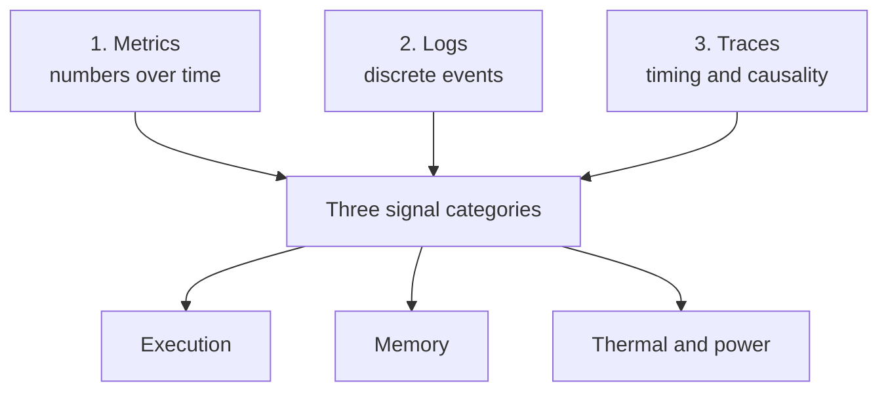
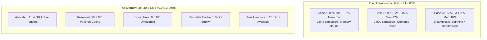
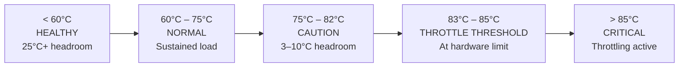
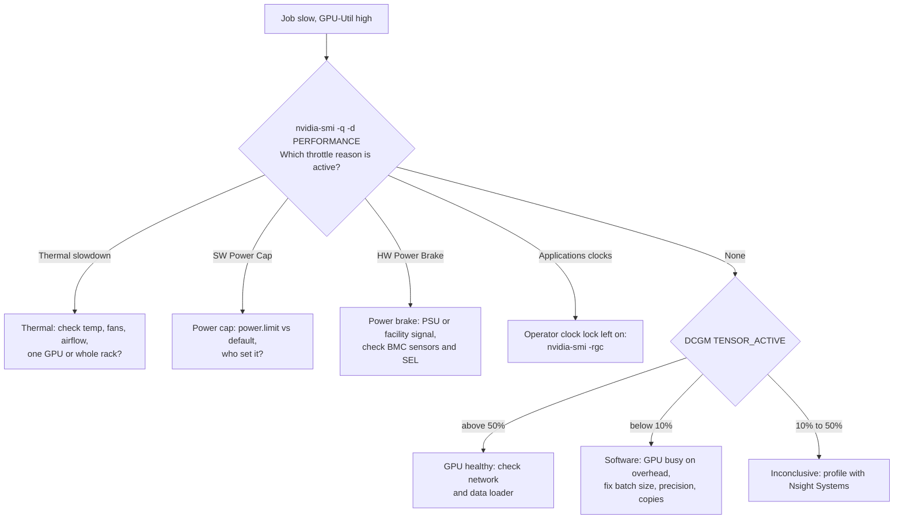

# 10.8 Operating GPU nodes: nvidia-smi, topology, clocks and throttling

| | |
|---|---|
| Level | Intermediate |
| Priority tier | 1 |
| Lab venue | Nebius GPU |
| Part | Part 10: The GPU and CUDA |
| Coverage file | `planning/coverage/chapters/10-08.md` |
| Claim ledger | `planning/ledgers/10-08.md` |

## Why this matters for AI infrastructure

A training engineer writes to the on-call channel: the job has been running at 100 percent GPU utilization for six hours, and the loss has not moved. On the host, `top` shows a calm CPU, the disks are quiet and the network links are idle. Every Linux metric says the server is healthy. The GPUs say something else, and you only hear it if you know where to listen.

To the host kernel, an NVIDIA GPU is a device on the PCIe bus. Linux does not schedule its warps, track its memory or read its die temperature. Those facts live inside the GPU and its driver, and you reach them through `nvidia-smi` and the NVIDIA Data Center GPU Manager, called DCGM from here on.

Three dashboard numbers mislead people more than any others. The utilization percentage can read 100 while no useful math happens. The memory figure can read 95 percent on a healthy job. The clock speed can fall by a fifth while utilization stays the same. This chapter explains each of the three, then shows how to read the throttle reasons, the topology and the Xid error codes that tell you what the hardware is really doing.

:::tip In one minute
- GPU utilization means a kernel was running during the sample window. It does not say how many SMs were busy or whether they did useful work. For an honest figure use `DCGM_FI_PROF_SM_ACTIVE` and `DCGM_FI_PROF_PIPE_TENSOR_ACTIVE`.
- `nvidia-smi` memory used includes everything the framework has reserved, such as the PyTorch caching pool. High reserved memory is normal. Compare allocated with reserved before you worry.
- The throttle bitmask in `clocks_throttle_reasons.active` records why clocks dropped. Read it first when a job is slow and the GPU looks busy.
- Enable persistence mode with `nvidia-persistenced`, so the driver keeps the GPU initialized between jobs and the first CUDA call is not slow.
- An NCCL hang often shows every rank near 100 percent utilization, because the NCCL kernels spin while they wait for a peer that never arrives.
:::

---

## Prerequisites and outcomes

**Prerequisites:** the earlier chapters in Part 10 on GPU architecture, the memory hierarchy, PCIe and NVLink, and the GPU product line.

**Outcomes:** after this chapter you can do the following.
1. Sort GPU telemetry into metrics, logs and traces, and into execution, memory and thermal or power signals.
2. Explain why utilization, memory used and clock speed each mislead, and name the counters that do not.
3. Compare PyTorch allocated memory, reserved memory and free driver memory.
4. Decode the throttle reason bitmask into thermal, power and hardware causes.
5. Set a node baseline: persistence mode, power limit, clock lock and `dmon` streaming.
6. Triage Xid codes by tier and walk an ordered checklist for a slow GPU job.

---

## 1. The GPU observability architecture

If you plot only one-minute averages, a half-second thermal spike vanishes into the average and nobody can say why latency jumped. Observability means collecting the specific signals that let you tell one failure from another. The standard split is three kinds of evidence, collected for three kinds of hardware signal.



| Pillar | Sampling cadence | Primary tools | Question answered and limitation |
|---|---|---|---|
| Metrics | 1 to 10 Hz up to 15 to 30 s intervals | `nvidia-smi`, DCGM, Prometheus, Grafana | What is happening on average? A 60-second average can read a healthy 72°C while the die spiked to 85°C for 500 ms and throttled. |
| Logs | Event-driven on state changes | `dmesg`, `journalctl`, Xid events | What broke and why? Silent while filters clog or memory bandwidth saturates, until a hard fault fires. |
| Traces | Per kernel launch and memory copy | Nsight Systems, Nsight Compute, PyTorch Profiler | Where did the time go? Produces gigabytes per second per GPU, so it cannot run cluster-wide all the time. |

| Signal category | Examples |
|---|---|
| Execution | SM activity, active warps, Tensor Core pipeline activity, instruction issue rate, SM clock |
| Memory | Allocated tensor memory, the framework cache, HBM bandwidth activity, L2 hit rate, PCIe and NVLink throughput |
| Thermal and power | Die temperature, power draw against the limit, throttle reason bitmask |

### 1.1 Why host queue models fail on a GPU

Brendan Gregg's USE method checks three things for every resource: utilization, saturation and errors. On a CPU, saturation is easy to see because `/proc/loadavg` and `vmstat` show the run queue.

A GPU hides its queues. Thousands of threads are scheduled inside each SM by hardware warp schedulers, and CUDA streams feed hardware rings that the GPU firmware manages. If the host submits work faster than the GPU finishes it, the host thread simply blocks inside a call such as `cudaStreamSynchronize()` and shows up as sleeping. If the host submits tiny kernels one at a time, the GPU drains its ring between launches and drops its clocks. Neither state appears in the host run queue, so you have to read counters from the GPU itself.

---

## 2. The three misleading metrics

An on-call engineer who reads GPU percentages like CPU percentages gets every diagnosis wrong. A deadlocked job can show 100 percent utilization, a healthy job can show 95 percent memory from the first batch, and a throttled card can look fully busy while running slowly.



### 2.1 The utilization lie

In `nvidia-smi`, the `GPU-Util` column and the metric `DCGM_FI_DEV_GPU_UTIL` have a narrow definition. They report the share of the sample window in which at least one kernel was executing on the GPU.

That definition ignores how many SMs the kernel used and what its warps were doing. Picture an H100 SXM5 with 132 SMs. A kernel launched as one block occupies one SM and spins in a `while (flag == 0)` loop. The other 131 SMs are idle, and `nvidia-smi` still reports 100 percent. A memory-bound kernel whose math units wait on HBM reads also reports high utilization, because the kernel is running.

> **dcgm-exporter 4.9.0 version note.** dcgm-exporter 4.9.0 (2026-11-06) renamed many default metrics and changed some units. For example `DCGM_FI_DEV_GPU_UTIL` (percent) became `DCGM_FI_DEV_GPU_UTIL_RATIO` (0 to 1), and `DCGM_FI_DEV_FB_USED` (MiB) became `DCGM_FI_DEV_FB_USED_BYTES`. The metric names in this chapter are the 4.8.x names. On a 4.9.0 exporter use the [full mapping in 17.4](../part-17-operations/04-dcgm-exporter-and-interpreting-gpu-metrics.md#14-what-dcgm-exporter-490-renamed), and change thresholds together with the unit.

The table shows two A100-PCIE-40GB nodes with the same 85 percent utilization and very different outcomes. The function `evaluate_utilization_regime()` in `code/part10/gpu_node_ops.py` encodes the rule.

| Scenario | SM utilization | Memory used, temperature | Memory bandwidth activity | Throughput | Diagnosis |
|---|---|---|---|---|---|
| Compute-bound run | 85% | 32 GB of 40 GB, 65°C | Low to moderate | 2,000 samples/s | Healthy compute-bound execution. |
| Memory-starved run | 85% | 32 GB of 40 GB, 65°C | Starved | 150 samples/s | More than 13 times slower at identical `GPU-Util`. |
| GPU 0 in a two-GPU job | 85% | 32 GB of 40 GB, 65°C | 82% | 2,048 samples/s | Healthy memory-bound training. |
| GPU 1 in the same job | 85% | 32 GB of 40 GB, 65°C | 12% | 180 samples/s | Stuck in a synchronization wait loop. |

### 2.2 Utilization you can trust

If the headline number lies, which one do you alert on? DCGM exposes profiling counters that measure what the hardware actually did. They need the profiling module of DCGM and cost a small amount of overhead, which is why they are not the default.

| Metric | What it measures | How to read it |
|---|---|---|
| `DCGM_FI_PROF_SM_ACTIVE` | Fraction of time an SM has at least one warp resident, averaged over all SMs | Near 1.0 on a busy job; a single spinning block gives about 1 in 132 |
| `DCGM_FI_PROF_SM_OCCUPANCY` | Resident warps as a fraction of the maximum an SM can hold | Low values with high SM activity point to a launch or kernel shape problem |
| `DCGM_FI_PROF_PIPE_TENSOR_ACTIVE` | Fraction of cycles the Tensor Core pipe is active | The best single indicator that matrix math is happening |
| `DCGM_FI_PROF_DRAM_ACTIVE` | Fraction of cycles the HBM interface is transferring data | High value with low Tensor activity means memory-bound |

A healthy dense training step on a large model shows high Tensor activity. A dataloader stall shows low SM activity and low Tensor activity together, even when `GPU-Util` still looks reasonable because short kernels keep arriving.

### 2.3 The memory lie

When `nvidia-smi` shows 30.2 GB used on a 40 GB GPU, the natural reaction is to fear an out-of-memory crash. Usually that number includes memory the framework is holding for reuse.

Calling `cudaMalloc` is slow because it updates page tables and can synchronize the device. PyTorch avoids paying that cost every step with a caching allocator. It requests memory from the driver on demand, in blocks, and when a tensor is freed it keeps the block in its own pool for the next batch instead of handing it back. The pool therefore grows to match the job's peak needs and stays there. Do not confuse this with a fixed upfront grab. PyTorch does not claim a large share of the card when it starts. JAX does: its default preallocates 75 percent of GPU memory at startup. vLLM also preallocates, by design, up to the fraction set by `gpu_memory_utilization`, and chapter 15.3 explains why.

```text
Example on a 40.0 GB GPU:
  Total GPU memory:                                 40.0 GB
  Allocated (torch.cuda.memory_allocated):          28.4 GB   live tensors
  Reserved  (torch.cuda.memory_reserved):           30.2 GB   shown by nvidia-smi, 75.5% of 40.0 GB
  Active share of the pool (28.4 / 30.2):           94.0%
  Free at driver level (40.0 - 30.2):                9.8 GB
  Reusable inside the PyTorch pool (30.2 - 28.4):    1.8 GB
  Headroom for a new tensor (9.8 + 1.8):            11.6 GB
```

The headroom figure is an upper bound. The 1.8 GB inside the pool can be split into pieces too small for one large tensor, which is the fragmentation case in section 5.4. The function `analyze_pytorch_memory_state()` in `code/part10/gpu_node_ops.py` computes these numbers.

Alerting when `nvidia-smi` memory crosses 80 percent produces constant false alarms. Alert on true headroom, or on a falling trend in free driver memory across a deployment, and use `torch.cuda.memory_summary()` to see fragmentation.

### 2.4 The clock speed lie

A third trap appears when utilization reads 100 percent and step times grow. The cause is often that a fan failed, a filter clogged or the cold aisle warmed up, and the GPU lowered its clocks to protect itself. Each instruction now takes longer, and the GPU is still busy. Always plot `clocks.current.sm` beside utilization.

The table gives A100 examples. Your own device reports its limits through `nvidia-smi -q -d CLOCK`.

| Clock regime | Example on A100 | Meaning |
|---|---|---|
| Peak SM clock | 1410 MHz | Full speed. Compare with `clocks.max.sm` on your device. |
| Idle clock | About 300 MHz at low power | Normal clock gating when no kernels run. A clock alert must not fire on idle nodes. |
| Throttled clock | 1200 MHz at 85°C, about 15 percent lower | A thermal or power limit is active. Read the throttle reason next. |

---

## 3. Clocks, power caps and throttle reasons

When a GPU slows down, guessing between a hot room, a power cap and an idle workload wastes recovery time. The GPU records the cause of every clock reduction in a bitmask register that you can read.

### 3.1 Decoding the throttle bitmask

Read the mask with `nvidia-smi --query-gpu=clocks_throttle_reasons.active --format=csv`, or see the decoded text with `nvidia-smi -q -d PERFORMANCE`. When several reasons apply, NVML ORs the flags together. For example `0x0000000000000024` is `SW_POWER_CAP` (`0x04`) plus `SW_THERMAL_SLOWDOWN` (`0x20`). The bit values below follow the NVML header `nvml.h`.

| Bitmask | Reason | Meaning | Severity and action |
|---|---|---|---|
| `0x0000000000000000` | `NOT_THROTTLED` | Running at the designed frequency. | Healthy. |
| `0x0000000000000001` | `GPU_IDLE` | No kernels are running, so clocks are lowered. | Normal between batches or during data stalls. |
| `0x0000000000000002` | `APPLICATIONS_CLOCKS_SETTING` | Clocks are held by the applications clocks setting, which `nvidia-smi -ac` configures. | Expected during an intentional benchmark setting. |
| `0x0000000000000004` | `SW_POWER_CAP` | Power draw reached the configured limit. | Expected under dense matrix load; check who set the limit. |
| `0x0000000000000008` | `HW_SLOWDOWN` | The hardware slowed itself from a thermal or power signal. | Severe: check cooling and power supplies. |
| `0x0000000000000010` | `SYNC_BOOST` | Clocks were matched across a group of GPUs. | Normal in multi-GPU setups. |
| `0x0000000000000020` | `SW_THERMAL_SLOWDOWN` | The driver lowered clocks because the GPU reached its slowdown temperature. | Severe: clean filters, check fans and cold aisle. |
| `0x0000000000000040` | `HW_THERMAL_SLOWDOWN` | Hardware protection cut clocks after a sensor crossed its limit. | Severe: inspect fans, airflow and heatsinks. |
| `0x0000000000000080` | `HW_POWER_BRAKE_SLOWDOWN` | An external power brake signal is active. | Critical: check the BMC power shelf and PSU logs. |
| `0x0000000000000100` | `DISPLAY_CLOCK_SETTING` | Clocks adjusted for display output. | Rare on headless data center nodes. |

Newer drivers spell the query fields `clocks_event_reasons.*` and keep the older `clocks_throttle_reasons.*` spelling for compatibility. Run `nvidia-smi --help-query-gpu | grep -i reasons` on your driver to see which names it accepts. A clock lock left by `nvidia-smi -lgc` is easiest to catch by noticing clocks that stay low on a cool, lightly loaded GPU, not by waiting for a specific bit.

### 3.2 Temperature headroom

Data center GPUs are built to run hot under load, and the limits differ by model. Ask your own device: `nvidia-smi -q -d TEMPERATURE` prints the slowdown and shutdown temperatures. The function `classify_temperature_headroom()` in `code/part10/gpu_node_ops.py` uses these illustrative bands.



Why does one GPU in a rack run hotter than its neighbour? Think of the die as a heater inside a duct. The die temperature is roughly the temperature of the air or coolant reaching it, plus the power it draws multiplied by the thermal resistance between die and coolant. Thermal resistance is measured in degrees Celsius per watt, and it grows when airflow is blocked or a heatsink is poorly seated. The same 700 W of draw therefore gives a few degrees more on a GPU behind a clogged filter than on its neighbour, even though both have identical workloads.

This model gives two practical rules. Compare a hot GPU with its neighbours at the same power, because a single outlier points to that GPU's airflow or seating. If every GPU in the rack runs warm together, look at inlet temperature and facility cooling instead. Set a temperature alert a few degrees under the slowdown temperature your device reports, sustained for a couple of minutes, so it fires before throttling starts.

### 3.3 Power capping and clock locking

When a rack runs close to its breaker limit, or an engineer needs jitter-free latency numbers, automatic settings cause trouble. Power spikes during dense matrix bursts can trip breakers, and automatic frequency scaling adds noise to P99 inference benchmarks.

Two `nvidia-smi` controls help. A power cap with `-pl` sets a ceiling below the factory default, within the range the device allows. When draw nears the cap, the GPU lowers SM clocks. A clock lock with `-lgc` pins the SM frequency range to remove frequency scaling jitter, and `-rgc` restores automatic scaling.

```bash
# Cap GPU 0 at 500 W
sudo nvidia-smi -i 0 -pl 500

# Lock GPU 0 SM clock at 1410 MHz for reproducible benchmarks
sudo nvidia-smi -i 0 -lgc 1410,1410

# Return GPU 0 to automatic clock scaling
sudo nvidia-smi -i 0 -rgc
```

A power cap that someone set for a benchmark and forgot is a classic slow-node cause. Compare `power.limit` with `power.default_limit` across the fleet.

### 3.4 NVML under nvidia-smi and DCGM

A monitoring script that shells out to `nvidia-smi` in a tight loop wastes CPU and churns driver handles. Both `nvidia-smi` and DCGM sit on the NVIDIA Management Library, NVML, in `libnvidia-ml.so`. Custom agents should call NVML directly, initialise it once at startup, and bind devices by UUID because logical indices can shift across reboots.

| NVML function | Returns | Note |
|---|---|---|
| `nvmlInit_v2()` and `nvmlShutdown()` | Library setup and teardown | Once per daemon, not per poll. |
| `nvmlDeviceGetHandleByUUID()` | Device handle | Prefer UUID over index. |
| `nvmlDeviceGetUtilizationRates()` | GPU and memory percentages | Same coarse definition as section 2.1. |
| `nvmlDeviceGetMemoryInfo()` | Total, free and used bytes | Driver-level, so it includes framework caches. |
| `nvmlDeviceGetTemperature()` | Core temperature in Celsius | Compare with the slowdown temperature. |
| `nvmlDeviceGetPowerUsage()` | Power in milliwatts | Divide by 1,000 for watts. |
| `nvmlDeviceGetCurrentClocksThrottleReasons()` | 64-bit bitmask | AND it with the reason flags. |
| `nvmlDeviceSetGpuLockedClocks()` and `nvmlDeviceResetGpuLockedClocks()` | Lock or reset SM clocks | Same effect as `-lgc` and `-rgc`. |

### 3.5 Prefill and decode on an inference node

On an LLM server such as vLLM or TensorRT-LLM, clocks and power show the two phases of a request. Prefill processes all prompt tokens at once and is compute-bound, so power rises toward the limit and clocks boost. Decode produces one token at a time, reads the model weights for each token, and is memory-bandwidth bound, so power falls and clocks can drift down.

| Phase | Bottleneck | Power on H100 SXM | SM clock behaviour |
|---|---|---|---|
| Prefill | Compute-bound matrix math across the prompt | Near the 700 W ceiling | Boosts toward 1800 to 1980 MHz |
| Decode | HBM bandwidth, a few operations per byte | Roughly 350 to 450 W | Frequency scaling lowers clocks during stalls, then boosts again on prefill |

Without a clock lock, this swing adds jitter to time to first token and inter-token latency. Lock clocks for benchmarks. In production, decide deliberately, because a lock also gives up boost headroom.

---

## 4. Commands and configuration that matter

When a node boots with no baseline tuning, or an operator scrapes the `nvidia-smi` table with a regular expression, automation breaks in production. The workflows below set persistence mode, query structured fields, stream device counters at 1 Hz and verify PCIe negotiation.

### 4.1 Persistence mode

Why does the first CUDA call on an idle node sometimes take seconds? When no process holds a GPU open and persistence is off, the driver deinitialises the GPU's state. The kernel modules stay loaded. The next process to open the device pays for GPU initialisation again, and on an eight-GPU node that delay is noticeable. Container device plugins and health probes that touch the GPU can time out during it.

Persistence mode keeps the GPU initialised even when no client is attached. The cost is a few extra watts of idle power. NVIDIA recommends the `nvidia-persistenced` daemon over the legacy `nvidia-smi -pm 1` setting, which is not preserved across reboots and is being phased out.

```bash
# Check the current state on all GPUs
nvidia-smi --query-gpu=index,name,persistence_mode --format=csv

# Run the persistence daemon now and at every boot
sudo systemctl enable --now nvidia-persistenced

# Legacy per-boot switch, if you cannot run the daemon
sudo nvidia-smi -pm 1
```

### 4.2 Scripted inventory

Query structured CSV fields rather than scraping the default table.

```bash
nvidia-smi --query-gpu=index,uuid,pci.bus_id,driver_version,memory.total,memory.used,memory.free,temperature.gpu,power.draw,power.limit,clocks.current.sm,clocks.max.sm,clocks_throttle_reasons.active \
  --format=csv
```

### 4.3 High-frequency streaming with dmon and pmon

Prometheus usually polls every 15 to 30 seconds, which averages away short bursts of throttling. `nvidia-smi dmon` and `nvidia-smi pmon` stream at 1 to 10 Hz.

```bash
# Device metrics each second: power, SM util, clocks, video, memory util, ECC, temperature
nvidia-smi dmon -s pucvmet -d 1

# Per-process SM and memory utilization each second
nvidia-smi pmon -s um -d 1
```

A healthy dual-GPU training run looks like this.

```text
# gpu   pwr  gpu  mem   enc   dec  mclk  pclk    fb  bar1 sbecc dbecc temp
# Idx     W    %    %     %     %   MHz   MHz    MB    MB  errs  errs    C
    0  185   85   82     0     0  1410  1410 28400     0     0     0   68
    1  195   84   81     0     0  1410  1410 28400     0     0     0   72
```

SM utilization is 85 and 84 percent, memory activity is 82 and 81 percent, processor clocks hold at 1410 MHz, and the double-bit ECC counters read zero. Each of those is a thing you check before you suspect the job.

### 4.4 Topology and PCIe link negotiation

```bash
# Topology matrix and peer-to-peer read and write capability
nvidia-smi topo -m
nvidia-smi topo -p2p r
nvidia-smi topo -p2p w

# PCIe capability (LnkCap, for example 32GT/s Gen5) against the negotiated state (LnkSta)
for bdf in $(lspci -D | grep -Ei 'NVIDIA' | awk '{print $1}'); do
  echo "=== GPU $bdf ==="
  sudo lspci -s "$bdf" -vv | grep -E 'LnkCap:|LnkSta:'
done

# NUMA node of each GPU; -1 means unknown
for bdf in $(lspci -D | grep -Ei 'NVIDIA' | awk '{print $1}'); do
  printf "%-14s NUMA=%s\n" "$bdf" "$(cat /sys/bus/pci/devices/$bdf/numa_node 2>/dev/null || echo unknown)"
done
```

If `LnkSta` shows a lower speed or width than `LnkCap`, the link has trained down, which is a seating, riser or cable fault. That fault halves host-to-GPU bandwidth without any error message.

---

## 5. Field triage: Xid errors and slowdown causes

When a node logs kernel errors at 3 AM, or a job slows without crashing, you must separate harmless warnings from real hardware faults. Guessing wrong either pages the team for nothing or leaves a bad GPU in the cluster. Chapter 10.21 owns the full health and Xid reference. This section gives the triage rule an on-call needs.

### 5.1 Xid errors: three tiers

An Xid is an error code the NVIDIA kernel driver prints to `dmesg` as `NVRM: Xid (PCI:<bus>): <code>, <message>`. Triage by the number, because the message text can change between driver releases. The function `classify_xid()` in `code/part10/gpu_node_ops.py` encodes this table.

| Xid | Meaning | Tier | Action |
|---|---|---|---|
| 45 | Preemptive cleanup after earlier errors | 1 | A symptom, not a cause; read the earlier Xid. |
| 63 | ECC page retirement or row remapping recorded | 1 | The GPU repaired itself and keeps running; track the rate. |
| 92 | High single-bit ECC error rate | 1 | Early warning; schedule maintenance if it climbs. |
| 13 | Graphics engine exception | 2 | Usually an application bug; restart the process. |
| 31 | GPU memory page fault | 2 | Usually an illegal memory access in application code. |
| 32 | Invalid or corrupted push buffer stream | 2 | Escalate if paired with PCIe bus errors. |
| 43 | GPU stopped processing | 2 | Often follows an earlier Xid; check preceding lines. |
| 94 | Contained ECC error | 2 | Restart the affected job; other work on the GPU is unharmed. |
| 48 | Double-bit uncorrectable ECC error | 3 | Drain the GPU; do not restart the job on it. |
| 61, 62 | Internal microcontroller breakpoint or halt | 3 | Treat as a hardware fault and escalate. |
| 64 | Row remapping or page retirement failed | 3 | Self-repair is exhausted; drain and escalate. |
| 79 | GPU fell off the bus | 3 | Drain; try a PCIe remove and rescan, then `dcgmi diag -r 3`. |
| 95 | Uncontained ECC error | 3 | Drain; treat output of the running job as corrupted. |
| 74 | NVLink error | None | Depends on the link fault; follow the NVLink diagnostic path. |

Three rules govern the tiers. For tier 1, do not page anyone for a single event, but trend it weekly. For tier 2, suspect hardware only if the same GPU repeats the same code across unrelated applications, and then treat it as tier 3. For tier 3, stop scheduling on the GPU immediately, because a bad card in service costs more than a drained node.

```text
Illustrative dmesg progression, oldest first:
  1. Xid 92 (high single-bit ECC rate)
  2. 6 seconds later: Xid 45 (preemptive cleanup)
  3. 5 seconds after that: Xid 79 (GPU fell off the PCIe bus)
  Correctable ECC count per 2-hour window: 12, 31, 58, 94 with zero double-bit errors.
  A weekly trend of 94 Xid 92 events against 12 the week before would have shown the fault early.
```

### 5.2 Which kind of slowdown is it?

When a job is slow and `nvidia-smi` reports high utilization, follow this ordered checklist. The functions `triage_slowdown()` and `diagnose_busy_but_slow()` in `code/part10/gpu_node_ops.py` implement it.



| Cause | How to recognise it | First fix |
|---|---|---|
| Thermal throttling | A thermal reason is active and temperature is near the slowdown limit. Fans at 100 percent at that temperature mean cooling is saturated. A slowdown at the same time every afternoon points to facility cooling. | One hot GPU: inspect its airflow. Whole rack or a daily pattern: escalate to facilities. |
| Software power cap | Power draw sits at the power limit, and the limit is below the default limit. | Compare `power.limit` with `power.default_limit`, search `/etc/` for scripts that call `nvidia-smi -pl`, and check BMC capping. |
| Power brake or PSU sag | Several GPUs drop clocks together and the BMC logs PSU events. DCGM does not track voltage sag, so read `ipmitool sensor list` and `ipmitool sel list`. | Lower peak draw with a temporary cap, drain jobs and replace the failing supply. |
| Leftover clock lock | Clocks stay low while the GPU is cool and lightly loaded because someone left `-lgc` active. | Clear it with `nvidia-smi -rgc`, and reset memory clocks with `-rmc`. |
| Bursty workload | No throttle reason, a cool GPU, and clocks that swing between high and low across short batch gaps. Sampling every 0.5 seconds for five minutes and counting distinct values is a quick test: one value or two to three within about 50 MHz is stable, more than five is oscillating. | Remove idle input gaps found with Nsight Systems, or lock clocks. |

The PSU sizing rule of thumb used by `minimum_psu_watts()` is GPU count times watts per GPU times 1.3 for headroom. Four 300 W GPUs need at least 1,560 W.

### 5.3 Fans: many data center GPUs have none

`nvidia-smi --query-gpu=fan.speed` returns a value only on cards with an on-board fan. Passively cooled cards such as the H100 PCIe and the L40S, and SXM modules on HGX baseboards, report N/A. Their cooling comes from chassis fans that the Baseboard Management Controller, BMC, controls. Query the BMC with `ipmitool sdr type Fan` or Redfish. One fan at 0 RPM beside neighbours turning at 8,400 RPM is a failed fan. Do not open a data center GPU to replace thermal paste yourself. Cordon the node, capture logs and open a vendor RMA.

### 5.4 When throttle reasons are clear and utilization still misleads

If no throttle bit is active and Tensor activity is low, the GPU spends its time on overhead instead of matrix math.

| Bottleneck | Signal | Remedy |
|---|---|---|
| PCIe copy stall | `DCGM_FI_PROF_PCIE_RX_BYTES` is saturated while compute waits on host transfers. | Use `pin_memory=True` in DataLoaders and overlap asynchronous copies. |
| Precision stall | High FP32 activity while `DCGM_FI_PROF_PIPE_FP16_ACTIVE` reads zero. | Enable automatic mixed precision so math runs on Tensor Cores. |
| Fragmentation | CUDA out-of-memory error while `nvidia-smi` shows free memory; `torch.cuda.memory_summary()` shows a wide gap between reserved and allocated. | Set `PYTORCH_CUDA_ALLOC_CONF=expandable_segments:True`, reduce shape variety, and use `torch.cuda.empty_cache()` sparingly. |
| Missed spikes | Point-in-time `nvidia-smi` looks normal during sporadic slowdowns. | Stream `DCGM_FI_DEV_CLOCK_THROTTLE_REASONS` and `DCGM_FI_DEV_GPU_TEMP` through dcgm-exporter. |

How large is the clock drop to expect? Examples range from about 7 percent (1980 to 1833 MHz) to 15 percent (1410 to 1200 MHz) to a severe 1500 to 500 MHz. No single number is a law of the hardware. Measure your own baseline with `nvidia-smi dmon` before an incident, so you know what normal looks like on your nodes.

---

## 6. How it fails: six production failure modes

The function `audit_gpu_node_operational_health()` in `code/part10/gpu_node_ops.py` combines these checks into one gate. It is this handbook's own composition, not a vendor tool.

| # | Failure | Symptom | Evidence | Fix |
|---|---|---|---|---|
| 1 | Persistence mode off across the fleet | Each container or training launch pauses at start; probes time out intermittently. | `nvidia-smi -q` shows Persistence Mode Disabled and the first CUDA call is slow after idle. | Run `nvidia-persistenced` on every node. |
| 2 | Silent thermal throttling | Step time rises while `GPU-Util` reads 100 percent; no error appears. | The throttle mask reads `0x20` and SM clocks fall, for example from 1410 to 1200 MHz. | Check chassis fans through the BMC, cold-aisle supply, filters and baffles. |
| 3 | Power brake engaged | All eight GPUs on a baseboard drop clocks together and jobs crawl. | The mask reads `0x80`, `HW_POWER_BRAKE_SLOWDOWN`. | Read the BMC system event log with `ipmitool sel list` and check the rack power shelves. |
| 4 | Spinning kernel or NCCL hang | One or every rank shows 85 to 100 percent `GPU-Util` while the job makes no progress. | With a stuck peer, NCCL kernels spin on every rank, so the whole job reads high while memory bandwidth activity and Tensor activity sit near zero. | Use the Flight Recorder in chapter 12.18 to find the rank that never entered the collective; use Nsight Systems or `cuda-gdb` for a deadlocked kernel. |
| 5 | Fragmentation out-of-memory | The job crashes with CUDA out of memory although free memory showed before the crash. | The reserved pool is split into pieces smaller than the requested tensor. | Export `PYTORCH_CUDA_ALLOC_CONF=expandable_segments:True`. |
| 6 | Uncorrected ECC errors | Training aborts or loss turns to NaN; `dmesg` shows Xid 48, 94 or 95. | `ecc.errors.uncorrected.volatile.total` is above zero. | Cordon the node with `kubectl cordon`, drain workloads and run hardware diagnostics for an RMA. |

Row 4 is the case people meet most often. A stuck collective does not look idle, so a dashboard filtered for low utilization never catches it. Pair utilization with job progress, such as steps per second, to catch it.

---

## Hands-on lab: verify throttle bitmasks, memory regimes and Xid triage

**Venue:** any Linux machine or Nebius GPU VM with Python 3.10 or later. No GPU is needed, because the lab runs the diagnostic model in `code/part10/gpu_node_ops.py` against fixed inputs.

```bash
python3 code/part10/gpu_node_ops_lab.py
```

Expected output, ending in 41 passed.

```text
=== Chapter 10.8 Lab: Operating GPU Nodes (nvidia-smi, Clocks & Throttling) ===
  [PASS] Bitmask 0x0 decodes to ['NOT_THROTTLED']
  [PASS] Bitmask 0x1 decodes to ['GPU_IDLE']
  [PASS] Bitmask 0x20 decodes to ['SW_THERMAL_SLOWDOWN']
  [PASS] Bitmask 0x8 decodes to ['HW_SLOWDOWN']
  [PASS] Bitmask 0x24 decodes to combined SW_POWER_CAP and SW_THERMAL_SLOWDOWN
  [PASS] 85% SM util + 82% mem BW util identifies healthy MEMORY_BOUND execution
  [PASS] 85% SM util + 15% mem BW util with 2000 samples/sec identifies COMPUTE_BOUND execution
  [PASS] 85% SM util + 2% mem BW util with 0 samples/sec detects SPINNING_OR_STALLED kernel bug
  [PASS] Low SM util (<10%) evaluates to IDLE
  [PASS] 28.4 GB allocated of 30.2 GB reserved yields 1.8 GB reusable cache and 9.8 GB free from driver
  [PASS] Reserved fraction is 75.5% and active usage ratio is 94.0%
  [PASS] Flags is_oom_imminent when total free headroom is less than 1.0 GB
  [PASS] 55C is HEALTHY (30C headroom) and 70C is NORMAL (15C headroom)
  [PASS] 80C is CAUTION (5C headroom), 84C is THROTTLE_THRESHOLD, and 89C is CRITICAL_THROTTLING
  [PASS] Healthy node with persistence mode enabled, 68C temp, and 1800 MHz clocks passes audit
  [PASS] Flags disabled Persistence Mode (start-up delay per job launch)
  [PASS] Detects 87C temperature and SW_THERMAL_SLOWDOWN bitmask with reduced clocks
  [PASS] Detects external HW_POWER_BRAKE_SLOWDOWN (e.g. facility power brake or PSU failure)
  [PASS] Detects active SW_POWER_CAP when drawing 698W at 700W ceiling
  [PASS] Detects uncorrected volatile ECC memory errors and recommends node cordoning
  [PASS] Flags clock frequency deviating from configured locked range [1500, 1500] MHz
  [PASS] Rejects negative throttle bitmask
  [PASS] Rejects sm_util_pct > 100
  [PASS] Rejects allocated_gb > reserved_gb
  [PASS] Rejects negative temperature
  [PASS] Xid 79 (fell off the bus) is Tier 3 and says stop scheduling
  [PASS] Xid 92 and 45 are Tier 1 (informational / self-healing)
  [PASS] Xid 13 is Tier 2 but becomes Tier 3 when it recurs on one GPU across unrelated apps
  [PASS] Xid 94 (contained ECC) is Tier 2 and Xid 95 (uncontained ECC) is Tier 3
  [PASS] Xid 74 (NVLink) has no fixed tier and an unknown code is not guessed
  [PASS] SW thermal slowdown reason at 85C triages as thermal
  [PASS] bare HW_SLOWDOWN (0x08) is reported as thermal-or-power, not guessed as one of them
  [PASS] SW power cap with limit 200W below default 300W triages as power_cap and notes who set the limit
  [PASS] HW power brake reason triages as power_brake
  [PASS] applications-clocks setting with a cool GPU triages as a leftover operator clock lock
  [PASS] no throttle reason, 65C and clocks below max triages as workload_or_dvfs
  [PASS] unique-clock test: 1 and 3 values are stable, 4 is borderline, 6 is oscillating
  [PASS] PSU planning rule 4 x 300W x 1.3 == 1,560W
  [PASS] 100% util with TENSOR_ACTIVE 5% and no throttle is a software issue; 60% means check network/dataloader
  [PASS] hardware slowdown reason wins over Tensor activity
  [PASS] Rejects non-positive gpu_count in PSU rule

Summary: 41 passed, 0 failed (total 41)
```

The commands in section 4 need real GPU hardware. The lab does not run them.

---

## Exercises

1. **Decode a throttle mask:** A monitoring alert reads `clocks_throttle_reasons.active` as `0x0000000000000028`. Use the table in section 3.1 to decode it into its flags and say what is physically happening on the GPU.
2. **Same utilization, different outcome:** Both GPUs in a two-GPU server report 85 percent SM utilization. GPU 0 trains at 2,048 samples per second and GPU 1 at 180. Write the command that shows memory bandwidth activity, and explain why GPU 1 is stalling.
3. **PyTorch memory headroom:** A 40.0 GB A100 has 28.4 GB allocated by PyTorch and 30.2 GB reserved. Calculate the reserved fraction, the best-case headroom for new tensors, and whether an 8.0 GB allocation can succeed. Then say what could still make it fail.
4. **Read a combined throttle mask:** The mask reads `0x0000000000000044`. Name the two reasons, say which one you would investigate first, and name one command and one BMC check that confirm it.
5. **Persistence mode:** Explain what the driver does when persistence mode is off and no job is running. State why the next job starts slowly and name the daemon that fixes it across reboots.
6. **Clock locking for inference jitter:** A latency benchmark on an A100 swings between 45 ms and 70 ms at P99. Write the command that locks SM clocks at the 1410 MHz rated maximum and the command that restores automatic scaling.
7. **Triage a dmesg sequence:** The log shows Xid 92, then Xid 45 six seconds later, then Xid 79 five seconds after that. Classify each code by tier, name the cause and the symptoms, and state your first two actions on the node.

```text
Exercise 3: 40.0 GB GPU, 28.4 GB allocated, 30.2 GB reserved, new batch needs 8.0 GB.
Exercise 6: A100 with 1410 MHz rated maximum SM clock.
Exercise 7: dmesg, oldest first: Xid 92, Xid 45 six seconds later, Xid 79 five seconds after that.
```

---

## Checkpoint questions (20)

<details>
<summary>**1. Why is checking `top` or `htop` insufficient for diagnosing performance on an AI server?**</summary>

To the host kernel, a GPU is an opaque PCIe device. Linux does not schedule GPU warps, track HBM allocations or read die temperatures. A host with the CPU at 5 percent can have GPUs that are throttling, hitting ECC faults or spinning at a barrier.
</details>

<details>
<summary>**2. Define the three pillars of GPU observability and name a tool for each.**</summary>

Metrics are numbers over time, such as utilization, clocks and power in DCGM and Prometheus. Logs are discrete events, such as ECC faults and Xid codes in `dmesg`. Traces are fine-grained timelines of kernels and copies in Nsight Systems and PyTorch Profiler.
</details>

<details>
<summary>**3. What does `GPU-Util` in `nvidia-smi` actually measure?**</summary>

It measures the share of the sample window in which at least one kernel was executing on the GPU. It says nothing about how many SMs were busy or whether the kernel did useful work.
</details>

<details>
<summary>**4. Why can a GPU at 100 percent utilization do no useful math?**</summary>

A single-block kernel spinning in a wait loop on one SM counts as a running kernel, so the GPU reports 100 percent while the other SMs and the Tensor Cores sit idle.
</details>

<details>
<summary>**5. Two GPUs both read 85 percent utilization, but one trains 13 times slower. What explains it?**</summary>

The healthy GPU had 82 percent memory bandwidth activity and was doing real memory-bound work. The slow GPU had 12 percent and was stuck in a synchronization wait loop.
</details>

<details>
<summary>**6. What is the difference between `torch.cuda.memory_allocated()` and `torch.cuda.memory_reserved()`?**</summary>

`memory_allocated()` counts bytes held by live tensors. `memory_reserved()` counts the memory the caching allocator has taken from the driver, including freed blocks it keeps for reuse. The reserved figure is what `nvidia-smi` shows.
</details>

<details>
<summary>**7. Does the PyTorch caching allocator reserve most of the GPU at startup? Why is an alert on `memory.used` above 85 percent a poor practice?**</summary>

No. PyTorch grows its pool on demand, and the pool stays at the job's peak because freed blocks are kept. The 75 percent upfront preallocation is the JAX default. A high reserved figure is normal for a healthy long-running job, so alerting on it produces false alarms. Alert on real headroom or on out-of-memory events.
</details>

<details>
<summary>**8. What is the clock speed lie, and how do you detect it?**</summary>

Utilization stays at 100 percent while step times rise because thermal or power limits lowered SM clocks. Plot `clocks.current.sm` beside utilization, and read the throttle reason mask.
</details>

<details>
<summary>**9. What happens when persistence mode is off on an NVIDIA GPU node?**</summary>

The kernel modules stay loaded, but the driver deinitialises the GPU when no client holds it open. The next process pays for GPU initialisation again, so the first CUDA call is slow and probes that touch the GPU can time out. Running `nvidia-persistenced` keeps the GPU initialised.
</details>

<details>
<summary>**10. What are the three Xid tiers and the action for each?**</summary>

Tier 1 (45, 63, 92) is informational or self-healing, so log and trend it. Tier 2 (13, 31, 32, 43, 94) is usually an application problem, so restart the process and suspect hardware only on repeats across unrelated jobs. Tier 3 (48, 61, 62, 64, 79, 95) means stop scheduling on the GPU and drain it.
</details>

<details>
<summary>**11. What does mask `0x0000000000000020` mean and how severe is it?**</summary>

It is `SW_THERMAL_SLOWDOWN`. The driver lowered SM clocks because the GPU reached its slowdown temperature. It is severe and points to cooling.
</details>

<details>
<summary>**12. What does mask `0x0000000000000080` mean?**</summary>

It is `HW_POWER_BRAKE_SLOWDOWN`. An external power brake signal from a PSU fault or a facility signal is active, and clocks are forced down.
</details>

<details>
<summary>**13. What temperature range is normal under sustained load, and where does slowdown begin?**</summary>

Roughly 60 to 75°C is normal under sustained load. The slowdown temperature differs by model, so read it from `nvidia-smi -q -d TEMPERATURE` on your device.
</details>

<details>
<summary>**14. Why does one GPU run hotter than its neighbour at the same power draw?**</summary>

Die temperature is about the coolant temperature plus power times thermal resistance. Blocked airflow or a poorly seated heatsink raises the resistance in degrees Celsius per watt, so the same power gives a higher temperature. If the whole rack runs warm, the inlet temperature is the suspect instead.
</details>

<details>
<summary>**15. Why lock clocks with `nvidia-smi -lgc` during inference benchmarking?**</summary>

Frequency scaling moves clocks between compute-bound prefill and memory-bound decode, which adds jitter to P99 latency. A locked clock makes results reproducible.
</details>

<details>
<summary>**16. What is the difference between `nvidia-smi dmon` and `nvidia-smi pmon`?**</summary>

`dmon` streams device-wide counters such as power, utilization, clocks and temperature. `pmon` streams per-process counters by PID.
</details>

<details>
<summary>**17. What must you do when the uncorrected volatile ECC count is above zero?**</summary>

It means multi-bit memory corruption occurred in HBM. Cordon the node, drain the jobs and run hardware diagnostics for an RMA.
</details>

<details>
<summary>**18. How does `PYTORCH_CUDA_ALLOC_CONF=expandable_segments:True` reduce out-of-memory errors?**</summary>

It lets the allocator grow segments by mapping more virtual memory into them, so a request does not fail just because free physical memory is split into scattered pieces.
</details>

<details>
<summary>**19. A job is slow and shows 100 percent utilization. In what order do you check the cause?**</summary>

Read the throttle reasons first. If none is active, check Tensor activity. Above 50 percent points to network or dataloader stalls, and below 10 percent points to software overhead.
</details>

<details>
<summary>**20. Every rank of a hung training job reads near 100 percent utilization. Why, and what do you do?**</summary>

The NCCL kernels are resident and spin while they wait for a peer that never arrived, so utilization stays high with no progress. Check job progress and Tensor activity, then use the Flight Recorder dumps to find the rank that never entered the collective.
</details>

---

## Sources and review notes

### Sources used

| Source | Used for |
|---|---|
| NVIDIA NVML API reference and `nvml.h` | Throttle reason bit values; the definition of the utilization rate as the share of time a kernel was executing |
| NVIDIA driver documentation on persistence mode and `nvidia-persistenced` | Persistence behaviour: the driver deinitialises the GPU when no client holds it, and the daemon is preferred over legacy `-pm` |
| NVIDIA DCGM documentation, profiling fields | `SM_ACTIVE`, `SM_OCCUPANCY`, `PIPE_TENSOR_ACTIVE`, `DRAM_ACTIVE` |
| PyTorch documentation, CUDA semantics and memory management | The caching allocator grows on demand and keeps freed blocks; `expandable_segments` |
| JAX documentation, GPU memory allocation | The 75 percent default preallocation |
| NVIDIA Xid catalog | Xid meanings for the table in section 5.1 |
| *AI Systems Performance Engineering*, chapter 3 | Clock locking and persistence mode in GPU node tuning |
| *Systems Performance*, second edition, chapters 2 and 4 | The USE method and the split into metrics, logs and traces |
| Field notes in the `nvidia-devops` repository (volumes 2, 16, 19, 20) | The example numbers in section 2, 3 and 5. Their terminal outputs are illustrative, not live captures. |

### Corrections made in this revision

- Persistence mode: earlier text said the kernel unloads the device nodes and reloads driver modules. The modules stay loaded. The driver deinitialises GPU state when no client holds the device.
- PyTorch memory: earlier text said PyTorch reserves 75 to 95 percent of the card upfront. It grows on demand. The 75 percent preallocation default belongs to JAX.
- Thermal model: the Watts-per-degree cooling capacity model was removed. The chapter now uses thermal resistance in degrees Celsius per watt.
- Utilization definition: restated as the share of time a kernel was executing, as NVML defines it, instead of a per-SM warp definition.
- `APPLICATIONS_CLOCKS_SETTING` is described as the applications clocks setting from `-ac`. Whether `-lgc` also sets this bit is not documented in the sources used, so the chapter does not claim it.

### Not verified on live hardware

The commands in section 4 were not run on a GPU node for this revision. The throttle bit values follow `nvml.h`. Exact H100 base clock and per-model slowdown temperatures are not stated, because they vary by model and must be read from the device.
