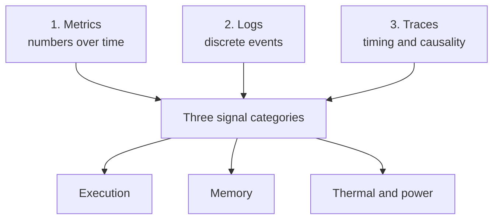
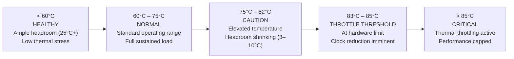
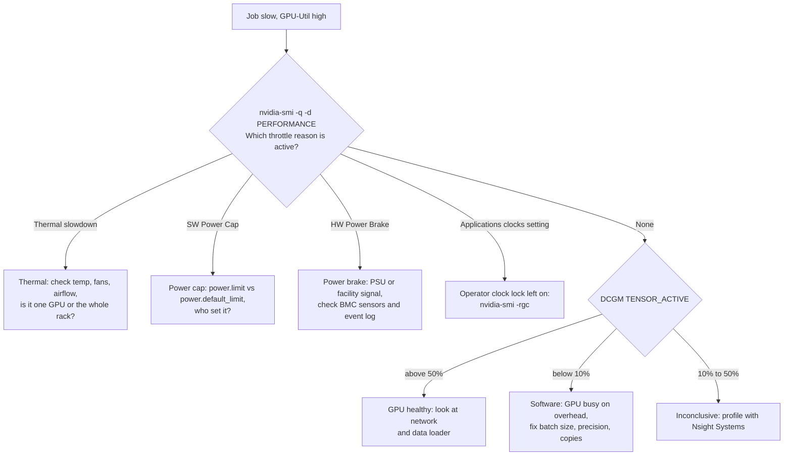

# 10.8 Operating GPU nodes: nvidia-smi, topology, clocks and throttling

| | |
|---|---|
| Level | Intermediate |
| Priority tier | 1 |
| Lab venue | Nebius GPU |
| Part | Part 10: The GPU and CUDA |
| Sources used | `nvidia-devops` V16 Ch 1–3; V2 Labs 01–02; *AI Systems Performance Engineering* Ch 3; *Systems Performance* Ch 2 & 4 |
| Coverage file | `planning/coverage/chapters/10-08.md` |
| Claim ledger | `planning/ledgers/10-08.md` |

## Why this matters for AI infrastructure

Every Linux administrator knows how to monitor a standard CPU server. If `htop` or Prometheus reports 95% CPU utilization, the server is handling heavy computational load. If host RAM usage reaches 99%, an out-of-memory crash is imminent. If disks or network links show high transfer rates, data is flowing through the I/O pipeline.

If you apply this CPU mental model to an AI server, you will operate completely blind.

To standard Linux kernel tools, an NVIDIA GPU is merely an opaque peripheral sitting on the PCIe bus. The Linux kernel does not schedule individual GPU warps, does not track High-Bandwidth Memory (`HBM`) allocations directly, and does not see internal silicon temperatures. When a machine learning engineer complains that a distributed training job is running unacceptably slow, a traditional systems engineer checking `top` will see the host CPU idling at 5% utilization, disks idle, and network links quiet. Traditional metrics declare the server perfectly healthy (`nvidia-devops` Volume 16 Chapter 1).

Meanwhile, inside the GPU:
- The GPU silicon may have reached its 85°C thermal threshold, triggering hardware thermal throttling that cuts core clock speeds in half.
- The GPU may be trapped in an uncorrectable ECC memory fault (`Xid` event), silently dropping work.
- The Streaming Multiprocessors (`SMs`) may report 85% to 100% utilization while performing zero useful floating-point math because a deadlocked kernel is spinning in an empty wait loop, or because Tensor Cores are starved for data.

GPU observability requires a specialized operational stack. The frontline utility for inspecting, configuring, and triaging an NVIDIA GPU host is **`nvidia-smi` (NVIDIA System Management Interface)**, paired with **`DCGM` (Data Center GPU Manager)** for continuous time-series metric collection. Operating a GPU node in production requires looking past superficial numbers and understanding the interactions between **clocks, power capping, thermal throttling reasons, memory reservations, and topology**.

:::tip In one minute
- **The three deceptive GPU metrics:**
  1. **The Utilization Lie:** `nvidia-smi` GPU utilization measures the percentage of time during the polling interval that at least one warp is active on any SM. A GPU running a single-thread wait loop reports high utilization (such as 85%) while doing zero math and generating 0 samples/sec.
  2. **The Memory Lie:** PyTorch uses a caching allocator that reserves 75% to 95% of total VRAM from the CUDA driver upfront. A dashboard reporting 90% memory utilization usually reflects healthy reserved caching, not imminent Out-Of-Memory (`OOM`).
  3. **The Clock Speed Lie:** A GPU can report 100% SM utilization while running noticeably slower because internal clock frequencies were reduced (the Volume 16 note's example: 1410 MHz down to 1200 MHz) due to thermal or power throttling.
- **Persistence Mode (`nvidia-smi -pm 1`):** Must be enabled on every GPU host. It keeps the NVIDIA kernel driver loaded and device nodes initialized, preventing a driver teardown and re-initialization delay on every CUDA job launch (the notes give no figure for the delay).
- **Active Throttling Reasons:** Decoded from the `clocks_throttle_reasons.active` bitmask. Severe hardware alerts include `0x08` (`HW_SLOWDOWN`), `0x20` (`SW_THERMAL_SLOWDOWN`), `0x40` (`HW_THERMAL_SLOWDOWN`), and `0x80` (`HW_POWER_BRAKE_SLOWDOWN`) (bit values as I know them from NVML's `nvml.h`; not in the corpus, see the note under the table in Section 3.1).
- **Clock Management:** Locking clocks with `nvidia-smi -lgc <min>,<max>` fixes frequencies at a deterministic target (such as 1410 MHz on A100) to eliminate dynamic DVFS frequency jitter during inference benchmarks; `nvidia-smi -rgc` restores automatic scaling.
- **High-Frequency Sampling:** Use `nvidia-smi dmon` (1–10 Hz device monitoring across power, clocks, compute, and memory) and `nvidia-smi pmon` (per-process PID monitoring) to observe short-lived bursts that low-frequency scrapers miss.
:::

---

## Prerequisites and outcomes

**Prerequisites:** Chapter `10.1` (CPU vs GPU architecture), Chapter `10.3` (GPU memory hierarchy), Chapter `10.6` (PCIe and NVLink interconnects), and Chapter `10.7` (GPU generations and form factors).

**Outcomes:** After completing this chapter, you will be able to:
1. Distinguish between the **three signal categories** (Execution, Memory, Thermal/Power) and the **three pillars of observability** (Metrics, Logs, Traces).
2. Deconstruct the **three deceptive GPU metrics** (the Utilization Lie, the Memory Lie, and the Clock Speed Lie) and determine whether an 85% utilized GPU is compute-bound, memory-bound, or spinning.
3. Measure and interpret **PyTorch memory allocation** versus **caching allocator reservations** and driver free space using `torch.cuda` memory APIs and `nvidia-smi`.
4. Decode the **`clocks_throttle_reasons.active` bitmask** into actionable hardware, thermal, and power throttling states.
5. Manage GPU operational baselines: enable **Persistence Mode**, lock SM clocks with **`-lgc`**, apply power caps with **`-pl`**, and stream high-frequency telemetry using **`nvidia-smi dmon`** and **`pmon`**.
6. Execute a complete host operational audit and diagnose the six classic GPU operational failure modes.

---

## 1. The GPU Observability Architecture

Observability is not collecting every available counter and hoping to spot anomalies. Observability is collecting the specific signals that disambiguate operational states (`nvidia-devops` Volume 16 Chapter 2; *Systems Performance* Chapters 2 & 4).



| Pillar | Sampling | Tools | Question it answers |
|---|---|---|---|
| 1. Metrics | 1 to 10 Hz up to 15 s intervals | `nvidia-smi`, DCGM, Prometheus | "What is happening on average?" |
| 2. Logs | Event-driven, on a state change | `dmesg`, `journalctl`, Xid events | "What broke and why?" |
| 3. Traces | Per kernel and per transfer | Nsight Systems, Nsight Compute | "Where did the execution time go?" |

| Signal category | Examples |
|---|---|
| Execution | SM utilization, active warps, SM clocks, instruction issue rates |
| Memory | Allocated VRAM, reserved cache pool, memory bandwidth utilization, L2 hit rates |
| Thermal and power | Core temperature, throttle reason bitmasks, instantaneous power draw, power cap ceiling |

### 1.1 The three pillars: Metrics, Logs, and Traces

Every monitoring tool in an AI cluster fits into one of three pillars (`nvidia-devops` V16 Ch 2):

1. **Metrics (The "What"):**
   Numeric measurements aggregated over time: SM utilization (%), memory used (MB), temperature (°C), SM clock frequency (MHz), and power consumption (Watts). Metrics are lightweight to store and query. They populate Grafana dashboards and evaluate Prometheus alert rules.
   - *Limitation:* Metrics report time-windowed averages. A GPU core temperature averaged over 60 seconds may read 72°C (looking healthy), even though the silicon spiked to 85°C for 500 milliseconds and triggered thermal throttling.
2. **Logs (The "Why"):**
   Discrete, structured or unstructured text messages emitted when a notable state change occurs: driver load events, ECC single-bit corrections, uncorrectable double-bit memory faults, PCIe bus resets, and NVIDIA `Xid` error codes in `dmesg`.
   - *Limitation:* Logs are purely event-driven. If a GPU slowly degrades—fan filters clogging, thermal headroom shrinking, or memory bandwidth saturating—no log entry is emitted until a hardware failure occurs.
3. **Traces (The "Where"):**
   Fine-grained execution timelines recording every CUDA kernel launch, host-to-device memory copy, stream synchronization, and inter-GPU collective communication step. Tools like NVIDIA Nsight Systems and PyTorch Profiler capture traces.
   - *Limitation:* Traces generate gigabytes of data per second per GPU. They cannot be enabled continuously across thousands of cluster nodes without causing severe performance overhead and storage exhaustion.

### 1.2 The three signal categories

Unlike CPU monitoring (which focuses primarily on CPU execution time and page memory), GPU observability requires evaluating three interrelated categories (`nvidia-devops` V16 Ch 1):

1. **Execution signals:** SM utilization, active warp counts, Tensor Core pipeline activity, and SM clock rates.
2. **Memory signals:** Actively allocated tensor memory, allocator reserved cache, HBM bandwidth utilization percentage, and PCIe/NVLink transfer throughput.
3. **Thermal and power signals:** Silicon die temperature, power draw versus TDP limit, and hardware throttle reason registers.

A CPU reporting high utilization with low memory traffic is usually executing tight, compute-dense loops efficiently. A GPU reporting high SM utilization with low memory traffic is frequently stuck: the kernel is stalled waiting for external synchronization, spinning in an empty loop, or starving for input data.

### 1.3 Why CPU utilization and saturation models fail on accelerators

In traditional Linux performance engineering, the Utilization Saturation and Errors (`USE`) method popularized by Brendan Gregg divides resource investigation into three fundamental metrics:
1. **Utilization:** The proportion of time that a resource was active servicing work.
2. **Saturation:** The degree to which extra work is queued waiting for the resource.
3. **Errors:** The count of hardware or software error events.

On CPUs, measuring saturation is straightforward: the scheduler run-queue length (reported by `vmstat` or load averages in `/proc/loadavg`) tells you directly whether more threads want CPU time than physical cores exist.

On GPUs, saturation cannot be observed from host operating system queues. The GPU schedules tens of thousands of active threads across its hardware warp schedulers internally inside the SMs. Work submitted via CUDA streams queues inside hardware command rings managed by the GPU firmware and copy engines. If host software submits kernels faster than the GPU can process them, the host thread blocks in `cudaStreamSynchronize()` or driver ioctl calls, appearing on the host as blocked `D` state or asleep `S` state while the GPU continues running. Conversely, if kernels are launched too small or sequentially without pipelining, the GPU repeatedly empties its command queue, falling into clock-gated idle states (`GPU_IDLE`) between launches. Understanding GPU performance therefore requires examining hardware-internal counters—warp occupancy, instruction issue rates, and memory pipeline stalls—rather than relying on host-level queuing metrics.

---

## 2. Deconstructing the Three Deceptive GPU Metrics

In standard systems administration, operators rely on direct thresholds: 90% utilization means a saturated resource, 90% memory means near-exhaustion. On GPU nodes, these three superficial metrics can be misleading (`nvidia-devops` V16 Ch 3).

```mermaid
flowchart TD
    subgraph Lie1["The Utilization Lie (nvidia-smi GPU-Util = 85%)"]
        direction TB
        CaseA["Case A: 85% SM Util + 82% Mem BW Util<br/>2,048 samples/sec (Normal Memory-Bound)"]
        CaseB["Case B: 85% SM Util + 15% Mem BW Util<br/>2,000 samples/sec (Healthy Compute-Bound)"]
        CaseC["Case C: 85% SM Util + 2% Mem BW Util<br/>0 samples/sec (Kernel Spinning / Deadlocked)"]
    end

    subgraph Lie2["The Memory Lie (nvidia-smi Memory = 30.2 GB / 40.0 GB = 75.5%)"]
        direction TB
        Alloc["Allocated: 28.4 GB (Tensors in active use)"]
        Res["Reserved: 30.2 GB (Held by PyTorch Caching Allocator)"]
        FreeDrv["Free from Driver: 9.8 GB (40.0 GB - 30.2 GB)"]
        Reusable["Reusable in Cache: 1.8 GB (30.2 GB - 28.4 GB)"]
        TrueFree["True Available Headroom: 11.6 GB (9.8 GB + 1.8 GB)"]
    end
```



### 2.1 The Utilization Lie: SM active time vs actual math

In `nvidia-smi`, the metric labeled `GPU-Util` (exposed programmatically as `DCGM_FI_DEV_GPU_UTIL`) has a very narrow technical definition:

> **GPU Utilization:** The percentage of time through the sample period during which **at least one Streaming Multiprocessor (`SM`)** had **at least one warp** actively executing instructions.

Consider what this definition means:
- If an `H100 SXM5` has 132 SMs, and a single thread in a single warp is executing an infinite `while(flag == 0)` spin-loop on SM 0 while the remaining 131 SMs sit idle, `nvidia-smi` reports **100% GPU utilization**.
- If a GPU is running a memory-bound operation where execution units spend 90% of their cycles stalled waiting for data to arrive from HBM, the GPU still reports high utilization because warps are resident on the SMs.

Consider the real production incident documented in `nvidia-devops` Volume 16 Chapter 1 and Chapter 3:
- **Node Configuration:** Two identical `A100-PCIE-40GB` accelerators running model training jobs.
- **Observed Metrics in `nvidia-smi`:**
  - `GPU 0`: 85% GPU utilization, 32 GB / 40 GB memory used, 65°C core temperature, throughput = **2,048 samples/second**.
  - `GPU 1`: 85% GPU utilization, 32 GB / 40 GB memory used, 65°C core temperature, throughput = **180 samples/second** (more than **13x lower throughput**).
- **The Investigation:**
  Querying detailed utilization breakdown (`nvidia-smi -q -d UTILIZATION` or `nvidia-smi dmon -s um`) revealed the truth:
  - `GPU 0`: SM utilization = 85%, **Memory bandwidth utilization = 82%**. This is healthy, normal memory-bound execution.
  - `GPU 1`: SM utilization = 85%, **Memory bandwidth utilization = 12%**. The GPU was executing a kernel that moved almost no data—it was trapped in a synchronization barrier wait loop.

As implemented in `evaluate_utilization_regime()` (`code/part10/gpu_node_ops.py`), evaluating GPU performance requires pairing SM utilization with memory bandwidth utilization and application throughput.

### 2.2 The Memory Lie: Allocated tensor memory vs the PyTorch caching allocator

When an operator checks `nvidia-smi` or Prometheus and sees that a GPU with 40 GB of VRAM has **30.2 GB used (75.5% full)**, a common reaction is to worry that an Out-Of-Memory (`CUDA OOM`) crash is imminent.

This is a misunderstanding of how deep learning frameworks manage memory (`nvidia-devops` V16 Ch 3):
- Allocating memory on a GPU via CUDA driver APIs (`cudaMalloc`) is an expensive kernel operation that involves page table updates and synchronization.
- To avoid calling `cudaMalloc` on every batch, PyTorch employs an internal **caching allocator**.
- When PyTorch requests memory, it asks the NVIDIA driver for large contiguous memory blocks (often gigabytes at a time) and manages those blocks internally in userspace. When a tensor is deleted in Python, PyTorch does not return the memory to the operating system driver; it holds the memory in its private **reusable cache pool** for future allocations.

In `nvidia-devops` Volume 16 Chapter 3, the memory breakdown of a healthy training process on a 40 GB GPU was:
- **Total GPU VRAM:** `40.0 GB`.
- **Memory Allocated (`torch.cuda.memory_allocated()`):** **`28.4 GB`** (tensors actively holding weights, activations, and optimizer states).
- **Memory Reserved (`torch.cuda.memory_reserved()`):** **`30.2 GB`** (total memory claimed by PyTorch from the driver, reported by `nvidia-smi`).
- **Free Memory from Driver:** `40.0 GB - 30.2 GB =` **`9.8 GB`**.
- **Reusable Memory in PyTorch Cache:** `30.2 GB - 28.4 GB =` **`1.8 GB`**.
- **True Available Headroom for New Allocations:** `9.8 GB + 1.8 GB =` **`11.6 GB`**. (The Volume 16 note stops at 9.8 GB free; adding the reusable 1.8 GB is this chapter's refinement, listed under Corrections.)

As analyzed in `analyze_pytorch_memory_state()` (`code/part10/gpu_node_ops.py`), alerting on `nvidia-smi memory.used > 80%` produces constant false alarms. A production alert should instead monitor when true available headroom drops below 1 GB, or when allocation latency spikes because PyTorch is forced into internal memory defragmentation and compaction.

### 2.3 The Clock Speed Lie: Full utilization at half frequency

A third deceptive scenario occurs when a GPU dashboard reports 100% utilization, but step times double. The operator assumes the model has become compute-bound, but the hardware has suffered **clock frequency throttling** (`nvidia-devops` V16 Ch 3).

Modern data center GPUs use dynamic voltage and frequency scaling (`DVFS`):
- **Peak SM clock:** `1410 MHz` in the Volume 16 example (an A100). Other architectures differ; check `clocks.max.sm` on your GPU.
- **Idle clock:** much lower than peak (clock gating reduces frequency to save energy when no work is queued). The notes give no exact range, so read it from `clocks.current.sm` on an idle GPU.
- **Throttled clock:** `1200 MHz` in the Volume 16 example, where a GPU at 85°C dropped from 1410 MHz.

If a server fan fails, an air filter clogs, or ambient temperature rises, the GPU hits its thermal limit (85°C). The internal microcontroller immediately reduces SM core clocks (in the Volume 16 example, from 1410 MHz down to 1200 MHz, about 15% lower: 1200 / 1410 = 0.85) to keep the silicon from exceeding safe limits. The GPU is still 100% busy, but it executes instructions more slowly. Monitoring must track **`clocks.current.sm`** alongside utilization.

---

## 3. Clocks, Power Capping, and Active Throttling Reasons

### 3.1 Decoding the `clocks_throttle_reasons.active` bitmask

When a GPU throttles its clock frequency, the driver records the exact hardware reason in an internal bitmask register. You can inspect this bitmask using `nvidia-smi --query-gpu=clocks_throttle_reasons.active --format=csv` or query the verbose text under `nvidia-smi -q` (`nvidia-devops` V2 Lab 02 & V16 Ch 3).

The bitmask is decoded as follows (`decode_throttle_reasons_bitmask()` in `code/part10/gpu_node_ops.py`):

| Bitmask Hex | Throttle Reason Name | Operational Meaning | Severity & Action |
|---|---|---|---|
| **`0x0000000000000000`** | `NOT_THROTTLED` | GPU is running at its designed frequency without restriction. | Normal / Healthy. |
| **`0x0000000000000001`** | `GPU_IDLE` | Clocks are reduced because no computational kernels are resident on the SMs (clock gating active). | Normal between batches or when waiting for data. |
| **`0x0000000000000002`** | `APPLICATIONS_CLOCKS_SETTING` | Clocks are locked by user policy (e.g., via `nvidia-smi -lgc`). | Expected when intentional benchmarking policy is applied. |
| **`0x0000000000000004`** | `SW_POWER_CAP` | Software power limit enforced; power draw reached the configured ceiling (e.g., 700W on H100 SXM). | Expected under heavy dense GEMM math; verify power budgeting. |
| **`0x0000000000000008`** | `HW_SLOWDOWN` | Hardware slowdown triggered by extreme board-level temperature or external power drop alerts. | **Severe:** Investigate chassis cooling, fans, and power supplies. |
| **`0x0000000000000010`** | `SYNC_BOOST` | Frequency adjusted to synchronize performance across multi-GPU setups. | Normal in multi-GPU configurations. |
| **`0x0000000000000020`** | `SW_THERMAL_SLOWDOWN` | Software thermal management reducing clocks because GPU core temperature reached the thermal limit (about 82°C–85°C in the Volume 16 note). | **Severe:** Clean air filters, verify fan speeds, check cold-aisle supply. |
| **`0x0000000000000040`** | `HW_THERMAL_SLOWDOWN` | Hardware thermal protection reduced clocks because a board or die sensor crossed its hardware limit. | **Severe:** Same checks as `SW_THERMAL_SLOWDOWN`; also check fans and heat sinks. |
| **`0x0000000000000080`** | `HW_POWER_BRAKE_SLOWDOWN` | External hardware power brake engaged (for example a power shelf failure, a facility emergency signal, or the rear RJ45 brake port on a DGX GB300 rack). | **Critical:** Power delivery failure; GPU clocks are forced down. |
| **`0x0000000000000100`** | `DISPLAY_CLOCK_SETTING` | Clocks adjusted for display output requirements. | Rare on headless data center servers. |

> **Query name:** the notes use `clocks_throttle_reasons.*` in some places and `clocks_event_reasons.*` in others (for example `clocks_event_reasons.hw_slowdown` in the legacy v10 note). Newer drivers use the `event` spelling. Run `nvidia-smi --help-query-gpu | grep -i reasons` to see which your driver uses.
>
> **Verification status of this table:** the bit names and values come from NVML's `nvml.h` header as I know it. They are **not in the corpus or in the Volume 02 / Volume 16 notes**, and I have not run them on a live GPU here. Confirm them with `nvidia-smi -q -d PERFORMANCE` (which prints the reason names) on your driver before relying on a specific bit.

When multiple conditions trigger simultaneously, NVML bitwise-ORs the masks together. For example, `0x0000000000000024` indicates that both **`SW_POWER_CAP` (`0x04`)** and **`SW_THERMAL_SLOWDOWN` (`0x20`)** are actively capping the accelerator.

### 3.2 Temperature headroom bands

Modern NVIDIA data center GPUs are rated to operate continuously between **80°C and 85°C** (`nvidia-devops` V16 Ch 3, Section "Metric 3: Temperature"). Operating temperatures are categorized into five operational bands (`classify_temperature_headroom()` in `code/part10/gpu_node_ops.py`):



Consider the cooling physics: system cooling capacity is measured in Watts of heat dissipated per degree Celsius of temperature rise (`W/°C`). (This is the toy model used in the Volume 16 note, not a real chassis specification.) If an enterprise server provides `3 W/°C` of effective heat rejection, an operating GPU drawing 240W runs at 82°C (within limits), while a neighboring GPU drawing 220W with obstructed airflow hits 85°C and throttles. Alert rules must trigger when core temperature remains in the caution band (`> 82°C`) for more than two minutes.

### 3.3 Power capping and clock locking

Operators have two primary knobs in `nvidia-smi` to govern silicon physics (`nvidia-devops` V2 Lab 02):

1. **Power Capping (`nvidia-smi -pl <watts>`):**
   Every GPU has a factory default power limit (such as 700W on an `H100 SXM5` or 350W on an `L40S`) and a configurable range (for example, 200W to 700W on H100). When facility power or rack capacity is constrained, an operator can enforce a lower power ceiling:
   ```bash
   sudo nvidia-smi -i 0 -pl 500
   ```
   When the GPU's power draw approaches 500W, the internal power regulator automatically throttles SM clock speeds, trading compute throughput to guarantee the server never trips facility breakers.
2. **Clock Locking (`nvidia-smi -lgc <min>,<max>`):**
   By default, GPU clocks vary continuously based on temperature, workload density, and memory stalls. During low-latency inference benchmarking (such as measuring Time-To-First-Token or P99 latency percentiles), this dynamic scaling causes measurement jitter.
   To ensure reproducible benchmarks, an engineer can lock the SM clock frequency:
   ```bash
   # Lock GPU 0 SM clock at exactly 1410 MHz
   sudo nvidia-smi -i 0 -lgc 1410,1410

   # Reset GPU 0 to automatic dynamic clock scaling
   sudo nvidia-smi -i 0 -rgc
   ```

### 3.4 The NVML architecture beneath nvidia-smi and DCGM

Both `nvidia-smi` and NVIDIA Data Center GPU Manager (`DCGM`) are user-space applications that interface with GPU silicon through a common shared library: **NVML (NVIDIA Management Library)**, provided by `libnvidia-ml.so`.

When an infrastructure engineer writes custom monitoring daemons or Prometheus exporters, understanding NVML C-level semantics prevents common polling pitfalls:
1. **Initialization lifecycle:** A monitoring agent must initialize the library once using `nvmlInit_v2()`. When the agent terminates, it calls `nvmlShutdown()`. Calling initialization inside a tight loop creates driver descriptor churn and CPU overhead.
2. **Device handles:** Devices are referenced by an opaque `nvmlDevice_t` handle acquired via `nvmlDeviceGetHandleByIndex_v2()` or `nvmlDeviceGetHandleByUUID()`. Stable monitoring scripts should always bind handles using immutable UUIDs rather than dynamic enumeration indices.
3. **Core NVML telemetry functions:**
   - `nvmlDeviceGetUtilizationRates()` returns `nvmlUtilization_t` containing two fields: `gpu` (the SM active percentage) and `memory` (the memory controller read/write bandwidth percentage).
   - `nvmlDeviceGetMemoryInfo()` returns `nvmlMemory_t` with `total`, `free`, and `used` bytes in physical VRAM.
   - `nvmlDeviceGetTemperature()` queries core temperature in Celsius using `NVML_TEMPERATURE_GPU`.
   - `nvmlDeviceGetPowerUsage()` returns instantaneous power consumption in milliwatts.
   - `nvmlDeviceGetCurrentClocksThrottleReasons()` returns the 64-bit integer bitmask whose bit flags correspond to `THROTTLE_REASONS_MAP`.
   - `nvmlDeviceSetGpuLockedClocks()` and `nvmlDeviceResetGpuLockedClocks()` programmatically lock and restore core clock frequencies.

### 3.5 Prefill vs Decode DVFS dynamics during LLM inference

In production Large Language Model serving engines (such as vLLM or TensorRT-LLM), observing clocks and power draw reveals the two phases of autoregressive generation:
1. **Prefill phase (Compute-bound prompt evaluation):** Processing incoming prompt tokens occurs as a parallel GEMM matrix multiplication across all tokens. Tensor Cores are active, drawing near-maximum power (approaching the 700W ceiling on H100 SXM). Core clocks boost to their maximum frequency (`1800–1980 MHz`).
2. **Decode phase (Memory-bandwidth bound token generation):** Generating tokens one by one requires streaming every model weight matrix from HBM to produce a single token vector. As established in Chapter `10.5`, the arithmetic intensity of unbatched decode drops to single-digit FLOPs per byte. Tensor Cores sit starved for data while HBM read buses run at capacity. Because compute units are frequently waiting on memory fetches, the GPU's power draw drops significantly (for example, down to 350W–450W on an H100).

Without clock locking, the GPU's internal DVFS governor continually drops SM frequencies during decode stalls and boosts them during prefill bursts. This dynamic frequency oscillation introduces measurable latency jitter into Time-To-First-Token (`TTFT`) and Inter-Token Latency (`ITL`). Enforcing locked clocks (`nvidia-smi -lgc`) eliminates this frequency hunting, producing steady latency curves across variable request loads.

---

## 4. Commands and Configurations That Matter

The operational workflows below cover node discovery, real-time telemetry streaming, persistence mode configuration, and link verification (`nvidia-devops` V2 Labs 01–02; V16 Ch 1–3). Commands in this section are marked as `(untested here)` reference templates when live hardware is not connected.

### 4.1 Enforce Persistence Mode across the fleet

**The Persistence Mode rule:** When Persistence Mode is disabled, the Linux kernel unloads the NVIDIA driver character devices (`/dev/nvidia*`) whenever no CUDA applications are running. When a new container or job starts, the kernel must re-enumerate the PCIe bus, load kernel modules, initialize GPU firmware, and recreate device files. This adds a start-up delay to every job invocation (the notes give no figure) and can cause container device plugins to fail with device-busy errors (`nvidia-devops` V2 Lab 02 Step 2). *AI Systems Performance Engineering* Ch 3 adds two points: without persistence, the first CUDA call after an idle period can stall while the driver reinitializes the GPU, and the only downside of persistence is slightly higher idle power because the GPU stays in a readier state. It also warns that clusters which unload the driver between jobs (to free kernel memory or for security) make the next job pay the reload cost.

Enable Persistence Mode dynamically or ensure the systemd service is active:
```bash
# Enable Persistence Mode on all installed GPUs (untested here)
sudo nvidia-smi -pm 1

# Verify Persistence Mode is enabled across all devices (untested here)
nvidia-smi --query-gpu=index,name,persistence_mode --format=csv

# Enable the persistent background daemon across reboots on Ubuntu/RHEL (untested here)
sudo systemctl enable --now nvidia-persistenced
```

### 4.2 Scripted inventory and one-shot health inspection

Never parse the ASCII art of `nvidia-smi` with custom regular expressions. Always use structured CSV query output:

```bash
# Query durable identity, driver version, memory, power, temperature, and clocks (untested here)
nvidia-smi --query-gpu=index,uuid,pci.bus_id,driver_version,memory.total,memory.used,memory.free,temperature.gpu,power.draw,power.limit,clocks.current.sm,clocks.max.sm,clocks_throttle_reasons.active \
  --format=csv
```

### 4.3 High-frequency streaming telemetry with `dmon` and `pmon`

Standard polling via Prometheus scrapers runs at 15 to 30 second intervals. Short-lived bursts, micro-throttling events, and memory-bandwidth stalls disappear inside those averages. Use `nvidia-smi dmon` and `nvidia-smi pmon` for real-time investigation (`nvidia-devops` V2 Lab 02 Step 4):

```bash
# Stream device metrics every 1 second: power, SM util, clocks, video, memory util, ECC, temp (untested here)
nvidia-smi dmon -s pucvmet -d 1

# Stream per-process PID metrics every 1 second: SM util and memory bandwidth per process (untested here)
nvidia-smi pmon -s um -d 1
```

Sample output of `nvidia-smi dmon` during a healthy dual-GPU training run:
```text
# gpu   pwr  gpu  mem   enc   dec  mclk  pclk    fb  bar1 sbecc dbecc temp
# Idx     W    %    %     %     %   MHz   MHz    MB    MB  errs  errs    C
    0  185   85   82     0     0  1410  1410 28400     0     0     0   68
    1  195   84   81     0     0  1410  1410 28400     0     0     0   72
```

Notice the correlation: `gpu` (SM utilization) is 85%, `mem` (memory bandwidth utilization) is 82%, processor clocks (`pclk`) are stable at 1410 MHz, temperatures are 68°C and 72°C, and double-bit ECC errors (`dbecc`) read zero. This is healthy memory-bound execution.

### 4.4 Inspect physical topology and PCIe link negotiation

```bash
# 1. Print full topology matrix and peer-to-peer read/write capability (untested here)
nvidia-smi topo -m
nvidia-smi topo -p2p r
nvidia-smi topo -p2p w

# 2. Verify PCIe link capability (LnkCap) vs negotiated link status (LnkSta) (untested here)
for bdf in $(lspci -D | grep -Ei 'NVIDIA' | awk '{print $1}'); do
  echo "=== GPU $bdf ==="
  sudo lspci -s "$bdf" -vv | grep -E 'LnkCap:|LnkSta:'
done

# 3. Verify NUMA socket mapping in Linux sysfs (untested here)
for bdf in $(lspci -D | grep -Ei 'NVIDIA' | awk '{print $1}'); do
  printf "%-14s NUMA=%s\n" "$bdf" "$(cat /sys/bus/pci/devices/$bdf/numa_node 2>/dev/null || echo unknown)"
done
```

---

## 5. Field Triage: Reading Xid Errors and Telling Slowdown Causes Apart

This section adds what the Volume 20 incident notes (chapters 2, 6, 8, 9 and 10) and Volume 19 chapter 4 teach about **why a GPU node is slow or broken, and in what order to check**. One warning first: **those notes say their terminal outputs are illustrative, not captured from a real system.** Every clock, temperature and wattage below is the note's own example. Use them to learn the method, not as specifications. Read your own GPU's limits with `nvidia-smi -q -d TEMPERATURE`.

### 5.1 Xid errors: the three tiers

An **Xid** is an error code that the NVIDIA driver writes to the kernel log (`dmesg`) in the form `NVRM: Xid (PCI:<bus>): <code>, <message>`. Triage by the **code**, not by the message text, which changes between driver versions (`nvidia-devops` V20 Ch 2). Classify the code into one of three tiers before doing anything else:

| Xid | Meaning (V20 Ch 2) | Tier | What to do |
|---|---|---|---|
| 45 | Preemptive cleanup, due to previous errors | 1 | A symptom, not a root cause. Read what came just before it in `dmesg`. |
| 63 | ECC page retirement or row remapping recorded | 1 | GPU keeps running. Track how often it happens. |
| 92 | High single-bit ECC error rate | 1 | A warning sign. Plan preventive maintenance if the rate keeps rising. |
| 13 | Graphics engine exception | 2 | Usually an application fault. Restart the process. |
| 31 | GPU memory page fault | 2 | Usually an application fault. |
| 32 | Invalid or corrupted push buffer stream | 2 | Escalate if paired with PCIe errors. |
| 43 | GPU stopped processing | 2 | Often follows another Xid. Reset and look for the Xid before it. |
| 94 | Contained ECC error | 2 | The affected application must be restarted. Other applications are unaffected. |
| 48 | Double-bit ECC error (uncorrectable) | 3 | Drain the GPU. Do not just restart the job on it. |
| 61, 62 | Internal micro-controller breakpoint / halt | 3 | Treat as hardware. Escalate. |
| 64 | ECC page retirement or row remapping **failure** | 3 | The self-healing mechanism itself is failing. Escalate. |
| 79 | GPU has fallen off the bus | 3 | Drain. The note's first recovery step is a PCIe remove-and-rescan (V20 Ch 2, detailed in V20 Ch 7), then diagnostics before returning the node. |
| 95 | Uncontained ECC error | 3 | Drain and diagnose. Treat the job's output as unreliable. |
| 74 | NVLink error | not tiered | Depends on the cause. Follow the NVLink diagnostic path. |

Three rules from the note:
- **Tier 1:** do not page anyone at 3 AM for a single occurrence, but track the rate.
- **Tier 2:** only suspect hardware if the **same GPU** repeats the **same code** across **different, unrelated** applications. Then handle it as Tier 3.
- **Tier 3:** stop scheduling new work on the GPU immediately. A missed Tier 3 costs far more than an unneeded drain.

The note's worked example (illustrative) shows why Tier 1 matters. `dmesg` prints oldest first: Xid 92 fired, **6 seconds later** Xid 45, and **5 seconds after that** Xid 79. The correctable ECC count on that GPU had risen from 12 to 31 to 58 to 94 per two-hour window over six hours, with zero double-bit errors. The Tier 1 codes were an early warning of the later bus failure. The note's weekly trend report shows the same idea: an Xid 92 count of 94 this week against 12 the week before is **+683%**, "would have caught this incident 2 days early".

The lab (`classify_xid()` in `code/part10/gpu_node_ops.py`) encodes this table. The three-tier grouping and the recurrence rule are the note's. Xid 74 has no tier in the note, and the lab returns "depends" for it.

### 5.2 Which kind of slowdown is it? Read the throttle reasons first

A job is slow, `nvidia-smi` shows high utilization, and nothing has crashed. The notes agree on the order of checks (V20 Ch 6, 9, 10; V19 Ch 4):



| Cause | How to recognise it (from the notes) | First fix |
|---|---|---|
| **Thermal throttling** | Throttle reason shows thermal slowdown. Temperature near the slowdown point (about 85 °C in the notes' examples). If every fan reads 100% and the temperature is still at 85 °C, the cooling system is saturated. In the note's example the clock fell from 1980 MHz to 1833 MHz (about 7%). | One GPU hot: check that GPU's fan and airflow. Whole rack or time-of-day pattern: escalate to facilities. |
| **Power cap** | `Power Draw` sits at `Power Limit` (the note's example: 198 W against 200 W), and the limit is below `Default Power Limit` (300 W). | Compare `power.limit` with `power.default_limit`. Find who lowered it (`grep -r "nvidia-smi.*-pl" /etc/`), and check BMC power capping. |
| **Power brake or failing PSU** | Several GPUs drop together. BMC shows PSU events. The note's 12 V rail is expected at 12 V ± 0.5 V, and 11.4 V or lower means sag. **DCGM does not report voltage sag. Use the BMC** (`ipmitool sensor list`, `ipmitool sel list`). | Cut peak load with a power limit, move jobs, then fix the PSU. |
| **Leftover clock lock** | Clock stays low with a cool GPU and low power. Someone ran `nvidia-smi -lgc`. | `nvidia-smi -rgc` (and `-rmc` for memory clocks). |
| **DVFS from a bursty workload** | No throttle reason, cool GPU, clock moving up and down. The note's example is clock 1980 → 1200 → 800 MHz with temperature steady at 65 °C. Short idle gaps (for example 5 ms between batches) let power management lower clocks. | Fix the idle gaps (Nsight Systems shows them). Lock the clock only if a stable clock is required. |

Other numbers from the notes (all illustrative):
- **Time-of-day clue:** throttling only between 3 and 6 PM (V20 Ch 6), or a 40% rise in iteration time every day at 2:00 PM (V19 Ch 4), points to the facility cooling and not to the GPU.
- **Temperature climb:** a temperature rising 2–3 °C per minute under load with a stuck fan (V20 Ch 8).
- **Clock stability test (V20 Ch 10):** sample the clock every 0.5 s for 5 minutes and count the unique values. 1, or 2–3 values within ±50 MHz, is stable. **More than 5** means oscillation is still present. The note says nothing about 4–5. The lab labels that "borderline", which is this handbook's own choice.
- **Fixed clock trade-off:** `nvidia-smi -lgc 1800` gives a steady 1800 MHz instead of a swinging clock up to 1980 MHz.
- **Temporary power cut:** `nvidia-smi -pl 200` on a 250 W GPU costs about 15–20% performance in the note's example. Treat it as a stopgap while service is arranged.
- **PSU planning rule (V20 Ch 9):** minimum PSU = GPUs × per-GPU watts × 1.3. For 4 × 300 W that is 1,560 W. This is the note's simple rule. For DGX racks use the real power figures in Part 9.

The lab encodes the order of checks in `triage_slowdown()`, the stability test in `classify_clock_stability()`, the PSU rule in `minimum_psu_watts()` and the Volume 19 flow in `diagnose_busy_but_slow()`.

### 5.3 Fans: many data center GPUs have none

`nvidia-smi --query-gpu=fan.speed` only works for GPUs with an on-board fan. SXM modules in HGX/DGX systems and passively cooled PCIe cards (H100 PCIe, L40S) report `N/A`. Their cooling comes from **chassis fans managed by the BMC**, so check them with `ipmitool sdr type Fan` or the BMC's Redfish interface (V20 Ch 6 and Ch 8). A single chassis fan reading 0 RPM next to others at around 8,400 RPM (the note's illustration) is a failed fan. The notes also say heatsink and thermal-paste work on data center GPUs is a vendor service action. Do not open the hardware yourself. Cordon the node, collect evidence and open a service ticket.

### 5.4 When the throttle reasons are clear but utilization still lies (Volume 19)

If the reasons show nothing, the GPU is probably busy with the wrong work (V19 Ch 4):
- **PCIe stall:** `DCGM_FI_PROF_PCIE_RX_BYTES` maxed out means the GPU spends its time copying from the CPU. The note blames missing `pin_memory=True` or batch-by-batch transfers.
- **Precision stall:** high `FP32_ACTIVE` with `DCGM_FI_PROF_PIPE_FP16_ACTIVE` at zero means mixed precision was never enabled, so the slow CUDA cores do the maths and the Tensor Cores are bypassed.
- **Fragmentation:** an out-of-memory error with free memory showing means the free memory is in small gaps. Print `torch.cuda.memory_summary()` and compare *Max Reserved* with *Max Allocated* (the note's example: 80 GB reserved, 40 GB allocated). Try `PYTORCH_CUDA_ALLOC_CONF=expandable_segments:True`, reduce variable-size allocations, and call `torch.cuda.empty_cache()` sparingly because it costs performance. The note adds that activation checkpointing lowers peak memory but does not by itself prevent fragmentation.
- **Snapshots miss intermittent throttling.** `nvidia-smi` is a point-in-time tool. Use continuous telemetry such as `dcgm-exporter` on `DCGM_FI_DEV_CLOCK_THROTTLE_REASONS` and `DCGM_FI_DEV_GPU_TEMP` to prove when it happened.

### 5.5 The notes disagree on how big a throttle is

The notes use different illustrative examples, and one contradicts itself. Do not treat any of them as a rule:

| Note | Example drop |
|---|---|
| Volume 16 Ch 3 | 1410 MHz → 1200 MHz at 85 °C |
| Volume 20 Ch 6 | 1980 MHz → 1833 MHz (about 7%). Its interview answer then says performance "halves", which does not follow from a 7% clock change |
| Volume 20 Ch 10 | 1980 → 1200 → 800 MHz while cool (DVFS, not throttling) |
| Volume 19 Ch 4 | 1500 MHz → 500 MHz when a thermal limit is hit |

The lesson is to measure your own baseline with `nvidia-smi dmon` before an incident, so you know what "normal" and "throttled" look like on your hardware.

---

## 6. How It Fails: Six Production GPU Operational Failure Modes

The automated diagnostic engine implemented in `audit_gpu_node_operational_health()` (`code/part10/gpu_node_ops.py`, where unifying these six checks into a single automated gate is **my inference**) detects the six classic operational failure modes from `nvidia-devops` Volumes 02 and 16:

| # | Failure Mode | Production Symptom | Root Cause & Diagnostic Evidence | Fix |
|---|---|---|---|---|
| **1** | **Persistence Mode disabled across node fleet** | Every container launch or `python train.py` invocation experiences a **noticeable startup pause**; containerized monitoring scripts timeout intermittently. | `nvidia-smi -q \| grep "Persistence Mode"` shows `Disabled`. The kernel driver tears down character devices upon process exit and reloads them on the next CUDA call (`V2 Lab 02 Step 2`). | Execute `sudo nvidia-smi -pm 1` and enable the systemd daemon: `sudo systemctl enable --now nvidia-persistenced`. |
| **2** | **Silent thermal throttling under heavy load** | Distributed training step time rises; GPU utilization reads 100%, but throughput drops; no crash or error log is generated. | Core temperature reached 85°C. `nvidia-smi --query-gpu=clocks_throttle_reasons.active` returns bitmask `0x20` (**`SW_THERMAL_SLOWDOWN`**), and SM clocks dropped from 1410 MHz to 1200 MHz (`V16 Ch 3`). | Inspect server chassis fans, verify cold-aisle supply temperature, clean dust filters, and ensure hot/cold aisle containment baffles are installed. |
| **3** | **External hardware power brake engaged** | All GPUs on an 8-GPU chassis suddenly drop SM clocks sharply; power consumption plummets; jobs hang or crawl. | `clocks_throttle_reasons.active` reports bitmask `0x80` (**`HW_POWER_BRAKE_SLOWDOWN`**; bit value from NVML's header, see the note in Section 3.1). A power supply unit (PSU) failed or an external facility emergency signal tripped (`V2 Lab 02 & V16 Ch 3`). | Check server BMC event logs for PSU faults, verify input feed redundancy, and inspect power shelf status in high-density racks. |
| **4** | **The Spinning Kernel Bug (The Utilization Lie)** | A single rank in a distributed job reports 85%–100% GPU utilization, but the job makes zero progress; neighboring GPUs show 0% utilization waiting at barrier. | `nvidia-smi dmon` shows `gpu` = 85%, but **`mem` = 1%–2%** with 0 samples/sec. A CUDA kernel is stuck spinning in an empty wait loop or deadlocked at a barrier (`V16 Ch 1 & Ch 3`). | Attach a debugger or profiler (such as `cuda-gdb` or Nsight Systems) to identify the deadlocked kernel line; fix thread synchronization in application code. |
| **5** | **Memory fragmentation causing surprise `CUDA OOM`** | A model crashes with `CUDA Out of Memory`, yet `nvidia-smi` reported several gigabytes of free memory prior to the crash. | PyTorch's caching allocator holds reserved blocks, but memory is fragmented across non-contiguous chunks. No single block is large enough for the requested tensor (`V16 Ch 3`). | Set `export PYTORCH_CUDA_ALLOC_CONF=expandable_segments:True` in job manifests to allow virtual address segment expansion without physical contiguous constraints. |
| **6** | **Uncorrected volatile ECC memory errors** | Training job terminates abruptly with an unhandled exception or loss curve diverges to `NaN`; container restarts. | `nvidia-smi --query-gpu=ecc.errors.uncorrected.volatile.total` returns a count **`> 0`** (and `dmesg` reports an NVIDIA `Xid 48`, `94`, or `95` memory fault) (`V16 Ch 1`). | Cordon the node immediately in Kubernetes or Slurm (`kubectl cordon <node>`); drain running workloads; trigger a GPU hardware memory diagnostic and RMA. |

---

## Hands-on lab: Verify GPU Node Telemetry, Throttling Bitmasks, and Memory Regimes

**Venue:** Any Linux machine or Nebius GPU VM with Python 3.10+ (no physical GPU hardware required to execute the diagnostic model; all live operational commands in Section 4 are marked as untested reference templates).

Not verified on live hardware: commands in Section 4 are operational reference templates; all quantitative checks are executed deterministically in `code/part10/gpu_node_ops_lab.py`.

Execute the self-checking lab script `code/part10/gpu_node_ops_lab.py`:

```bash
python3 code/part10/gpu_node_ops_lab.py
```

Expected output (`41 passed, 0 failed`):

```text
=== Chapter 10.8 Lab: Operating GPU Nodes (nvidia-smi, Clocks & Throttling) ===
  [PASS] Bitmask 0x0 decodes to ['NOT_THROTTLED']
  [PASS] Bitmask 0x1 decodes to ['GPU_IDLE']
  [PASS] Bitmask 0x20 decodes to ['SW_THERMAL_SLOWDOWN']
  [PASS] Bitmask 0x8 decodes to ['HW_SLOWDOWN']
  [PASS] Bitmask 0x24 decodes to combined SW_POWER_CAP and SW_THERMAL_SLOWDOWN
  [PASS] V16 Ch3: 85% SM util + 82% mem BW util identifies healthy MEMORY_BOUND execution
  [PASS] V16 Ch3: 85% SM util + 15% mem BW util with 2000 samples/sec identifies COMPUTE_BOUND execution
  [PASS] V16 Ch1 & Ch3: 85% SM util + 2% mem BW util with 0 samples/sec detects SPINNING_OR_STALLED kernel bug
  [PASS] Low SM util (<10%) evaluates to IDLE
  [PASS] V16 Ch3: 28.4 GB allocated of 30.2 GB reserved yields 1.8 GB reusable cache and 9.8 GB free from driver
  [PASS] V16 Ch3: Reserved fraction is 75.5% and active usage ratio is 94.0%
  [PASS] Flags is_oom_imminent when total free headroom is less than 1.0 GB
  [PASS] V16 Ch3: 55C is HEALTHY (30C headroom) and 70C is NORMAL (15C headroom)
  [PASS] V16 Ch3: 80C is CAUTION (5C headroom), 84C is THROTTLE_THRESHOLD, and 89C is CRITICAL_THROTTLING
  [PASS] Healthy node with persistence mode enabled, 68C temp, and 1800 MHz clocks passes audit
  [PASS] V2 Lab 02 Step 2: Flags disabled Persistence Mode (start-up delay per job launch)
  [PASS] V16 Ch3: Detects 87C temperature and SW_THERMAL_SLOWDOWN bitmask with reduced clocks
  [PASS] Detects external HW_POWER_BRAKE_SLOWDOWN (e.g. facility power brake or PSU failure)
  [PASS] V2 Lab 02: Detects active SW_POWER_CAP when drawing 698W at 700W ceiling
  [PASS] V16 Ch1: Detects uncorrected volatile ECC memory errors and recommends node cordoning
  [PASS] V2 Lab 02 Step 7: Flags clock frequency deviating from configured locked range [1500, 1500] MHz
  [PASS] Rejects negative throttle bitmask
  [PASS] Rejects sm_util_pct > 100
  [PASS] Rejects allocated_gb > reserved_gb
  [PASS] Rejects negative temperature
  [PASS] V20 Ch2: Xid 79 (fell off the bus) is Tier 3 and says stop scheduling
  [PASS] V20 Ch2: Xid 92 and 45 are Tier 1 (informational / self-healing)
  [PASS] V20 Ch2: Xid 13 is Tier 2 but becomes Tier 3 when it recurs on one GPU across unrelated apps
  [PASS] V20 Ch2: Xid 94 (contained ECC) is Tier 2 and Xid 95 (uncontained ECC) is Tier 3
  [PASS] V20 Ch2: Xid 74 (NVLink) has no fixed tier and an unknown code is not guessed
  [PASS] V20 Ch6: SW thermal slowdown reason at 85C triages as thermal
  [PASS] V20 Ch10: bare HW_SLOWDOWN (0x08) is reported as thermal-or-power, not guessed as one of them
  [PASS] V20 Ch9: SW power cap with limit 200W below default 300W triages as power_cap and notes who set the limit
  [PASS] V20 Ch9: HW power brake reason triages as power_brake
  [PASS] V20 Ch10: applications-clocks setting with a cool GPU triages as a leftover operator clock lock
  [PASS] V20 Ch10: no throttle reason, 65C and clocks below max triages as workload_or_dvfs
  [PASS] V20 Ch10: unique-clock test: 1 and 3 values are stable, 4 is borderline, 6 is oscillating
  [PASS] V20 Ch9: PSU planning rule 4 x 300W x 1.3 == 1,560W
  [PASS] V19 Ch4: 100% util with TENSOR_ACTIVE 5% and no throttle is a software issue; 60% means check network/dataloader
  [PASS] V19 Ch4: hardware slowdown reason wins over Tensor activity
  [PASS] Rejects non-positive gpu_count in PSU rule

Summary: 41 passed, 0 failed (total 41)
```

---

## Exercises

1. **Decoding Throttle Reason Bitmask:** An operational monitoring alert queries `nvidia-smi --query-gpu=clocks_throttle_reasons.active --format=csv` and receives the raw hexadecimal value `0x0000000000000028`. Using the bitmask definitions in Section 3.1, decode this value into its component throttle reasons and explain what physical condition is affecting the GPU.
2. **Diagnosing the Utilization Lie:** On a 2-GPU node, `nvidia-smi` reports that both GPU 0 and GPU 1 are running at 85% SM utilization. However, model logs show GPU 0 is processing 2,048 samples/sec while GPU 1 is processing only 180 samples/sec (`nvidia-devops` V16 Ch 3). Write the command to inspect memory bandwidth utilization, and explain why GPU 1 is failing despite reporting 85% utilization.
3. **PyTorch Memory Headroom Calculation:** A model running on an A100 40 GB GPU reports that PyTorch has allocated 28.4 GB of tensor memory while reserving 30.2 GB from the CUDA driver (`nvidia-devops` V16 Ch 3). Calculate (a) the reserved fraction of total VRAM, (b) the true available memory headroom for new allocations, and (c) whether a new batch requiring 8.0 GB of memory will cause an out-of-memory crash.
4. **Thermal Headroom and Cooling Budget:** A GPU is operating under full training load at 75°C in a server chassis whose cooling system provides an effective heat rejection capacity of `3 W/°C` (`nvidia-devops` V16 Ch 3). Calculate the remaining thermal headroom before the GPU hits its 85°C hardware thermal throttling limit, and determine how many additional Watts of heat power the GPU can dissipate before clocks are throttled.
5. **Persistence Mode Driver Penalty:** Explain what happens inside the Linux kernel and device driver when Persistence Mode is disabled on a GPU node running short-lived container jobs. Why does this add a start-up delay to each job invocation (the notes give no figure for its size), and what command makes the fix permanent across reboots?
6. **Clock Locking for Inference Jitter:** An infrastructure engineer is benchmarking P99 latency percentiles for an LLM serving endpoint on an A100 GPU (rated max SM clock 1410 MHz). Dynamic frequency scaling causes latency to fluctuate between 45 ms and 70 ms. Write the exact `nvidia-smi` command to lock the SM clock at 1410 MHz, and write the command to restore automatic dynamic frequency scaling when the benchmark completes.

7. **Triage a `dmesg` sequence (Volume 20 Ch 2):** `dmesg` shows, oldest first, Xid 92, then Xid 45 six seconds later, then Xid 79 five seconds after that. Classify each code into its tier, say which one is the root cause and which one is only a symptom, and write the first two actions you take on the node. Then say what trend report would have given an early warning.

---

## Checkpoint questions (20)

<details>
<summary><strong>1. Why is checking standard Linux tools like `top` or `htop` insufficient for diagnosing performance issues on an AI server?</strong></summary>

To the Linux host CPU, a GPU is an opaque peripheral device on the PCIe bus. Linux does not schedule GPU warps, track HBM memory, or monitor silicon core temperatures. A server whose host CPU is idling at 5% can have GPUs that are thermally throttling at 85°C, failing with uncorrected ECC memory faults, or deadlocked at a barrier.
</details>

<details>
<summary><strong>2. Define the three pillars of GPU observability and identify which tool belongs to each pillar.</strong></summary>

1. **Metrics:** Time-series numbers (utilization, clocks, temperature, power) aggregated over time (DCGM, Prometheus, `nvidia-smi`).
2. **Logs:** Discrete event records emitted on state changes (driver resets, ECC faults, Xid errors in `dmesg`/`journalctl`).
3. **Traces:** Fine-grained execution timelines showing exact kernel duration and causality dependencies (NVIDIA Nsight Systems, PyTorch Profiler).
</details>

<details>
<summary><strong>3. What is the technical definition of GPU Utilization in `nvidia-smi` (`DCGM_FI_DEV_GPU_UTIL`)?</strong></summary>

The percentage of time during the sample polling window that at least one Streaming Multiprocessor (`SM`) had at least one warp actively executing instructions.
</details>

<details>
<summary><strong>4. Why can a GPU reporting 100% utilization in `nvidia-smi` be doing zero useful mathematical work?</strong></summary>

Because if even a single thread in a single warp is executing an infinite spin-loop or waiting at an unresolved synchronization barrier on one SM, `nvidia-smi` registers that an SM was active and reports high utilization, even though Tensor Cores are idle and zero samples are processed.
</details>

<details>
<summary><strong>5. In the Volume 16 Chapter 3 production scenario, why did GPU 1 process 13x fewer samples than GPU 0 despite both reporting 85% SM utilization?</strong></summary>

GPU 0 was running a healthy memory-bound kernel with 82% memory bandwidth utilization. GPU 1 had only 12% memory bandwidth utilization; it was trapped in a software synchronization barrier wait loop, spinning on SMs without moving tensor data.
</details>

<details>
<summary><strong>6. Explain the difference between `torch.cuda.memory_allocated()` and `torch.cuda.memory_reserved()`.</strong></summary>

`memory_allocated()` measures the memory actively holding tensors requested by the user's Python program. `memory_reserved()` measures the total memory pool claimed by the PyTorch caching allocator from the NVIDIA driver (reported by `nvidia-smi`). Reserved memory includes reusable cached blocks that are currently empty.
</details>

<details>
<summary><strong>7. Why is setting an alert on `nvidia-smi memory.used > 85%` considered a bad operational practice?</strong></summary>

Because deep learning frameworks like PyTorch intentionally reserve 75% to 95% of available VRAM upon startup into a reusable cache pool to avoid expensive runtime `cudaMalloc` calls. High reserved memory is normal and does not indicate an impending `OOM`.
</details>

<details>
<summary><strong>8. What is the Clock Speed Lie, and how do you detect it?</strong></summary>

A GPU reports 100% utilization, but step times rise because the hardware has reduced core clock speeds (for example, from 1410 MHz to 1200 MHz in the Volume 16 note) due to thermal or power throttling. Detect it by monitoring `clocks.current.sm` alongside utilization.
</details>

<details>
<summary><strong>9. What happens inside the operating system when Persistence Mode is disabled on an NVIDIA GPU node?</strong></summary>

When no CUDA processes are running, the kernel unloads the NVIDIA driver character devices (`/dev/nvidia*`). When a new job launches, the kernel must re-enumerate the PCIe bus, reload modules, and initialize firmware, adding a start-up delay to every invocation (the notes give no figure).
</details>

<details>
<summary><strong>10. What are the three Xid tiers, and what do you do for each?</strong></summary>

Tier 1 (Xid 45, 63, 92) is informational or self-healing: log it and track the rate. Tier 2 (Xid 13, 31, 32, 43, 94) is process-level: restart the application, and treat it as hardware only if the same GPU repeats the same code across unrelated applications. Tier 3 (Xid 48, 61, 62, 64, 79, 95) is a GPU-level failure: stop scheduling new work on it immediately, drain it and run diagnostics before it returns to service (`nvidia-devops` V20 Ch 2).
</details>

<details>
<summary><strong>11. What does throttle reason bitmask `0x0000000000000020` indicate, and what is its operational severity?</strong></summary>

It indicates **`SW_THERMAL_SLOWDOWN`**—the GPU core temperature reached the thermal limit (about 82°C–85°C in the Volume 16 note) and the software driver is reducing SM clocks to prevent hardware damage. Severity is severe.
</details>

<details>
<summary><strong>12. What does throttle reason bitmask `0x0000000000000080` (`HW_POWER_BRAKE_SLOWDOWN`) indicate?</strong></summary>

An external hardware power brake is engaged—typically triggered by a power supply unit (`PSU`) failure, a facility emergency power-off signal, or a rear RJ45 power brake in high-density racks. GPU clocks are forced down. (Bit value from NVML's header; not in the corpus.)
</details>

<details>
<summary><strong>13. What temperature range is considered normal operating condition for modern NVIDIA data center GPUs under sustained load?</strong></summary>

**60°C to 75°C** is the normal full-load operating envelope. The hardware is rated for continuous operation between 80°C and 85°C before thermal throttling begins at about 82°C–85°C.
</details>

<details>
<summary><strong>14. How does system cooling capacity (`W/°C`) affect GPU thermal headroom?</strong></summary>

Cooling capacity determines temperature rise per Watt of power dissipated (`ΔT = Power / Cooling Capacity`). In a system with `3 W/°C` capacity, dissipating an extra 30 Watts of power increases GPU temperature by `30 / 3 = 10°C`.
</details>

<details>
<summary><strong>15. Why do performance engineers lock GPU clocks with `nvidia-smi -lgc` during inference benchmarking?</strong></summary>

Dynamic voltage and frequency scaling (`DVFS`) causes clock frequencies to fluctuate continuously based on instantaneous thermal and instruction conditions, introducing latency jitter into P99 measurements. Locking clocks at a fixed frequency ensures deterministic, reproducible benchmarks.
</details>

<details>
<summary><strong>16. What is the difference between `nvidia-smi dmon` and `nvidia-smi pmon`?</strong></summary>

`dmon` streams device-level telemetry (power, SM utilization, memory bandwidth utilization, clocks, temperature) at 1–10 Hz intervals. `pmon` streams process-level telemetry, breaking down SM and memory utilization per Linux process PID.
</details>

<details>
<summary><strong>17. What does an uncorrectable volatile ECC memory error count greater than zero require an operator to do?</strong></summary>

An uncorrected ECC error indicates that multi-bit memory corruption occurred in physical VRAM. The node must be immediately cordoned in the scheduler (`kubectl cordon`), running workloads must be drained, and the GPU must undergo hardware diagnostic testing and RMA replacement.
</details>

<details>
<summary><strong>18. How does setting `PYTORCH_CUDA_ALLOC_CONF=expandable_segments:True` mitigate Out-Of-Memory errors?</strong></summary>

It instructs the PyTorch caching allocator to utilize virtual memory address manipulation to expand existing memory allocations dynamically, preventing allocation failures caused by physical memory fragmentation across non-contiguous blocks.
</details>

<details>
<summary><strong>19. A job is slow and `nvidia-smi` shows 100% utilization. In what order do you check the cause?</strong></summary>

Read the throttle reasons first (`nvidia-smi -q -d PERFORMANCE`). A thermal reason points to cooling (one GPU: fan and airflow; a whole rack or a daily time pattern: facilities). A software power cap means comparing `power.limit` with `power.default_limit` and finding who changed it. A hardware power brake means checking the BMC for PSU events. An applications-clocks setting means a leftover `nvidia-smi -lgc`, cleared with `-rgc`. If no reason is active, check DCGM `TENSOR_ACTIVE`: above 50% means look at the network or data loader, below 10% means software overhead (V20 Ch 6, 9, 10; V19 Ch 4).
</details>

<details>
<summary><strong>20. How do you distinguish whether an 85% utilized GPU is compute-bound, memory-bound, or stalled?</strong></summary>

Inspect memory bandwidth utilization and application throughput:
- Compute-bound: high SM util, low-to-medium memory bandwidth util, high samples/sec.
- Memory-bound: high SM util, high memory bandwidth util (>50%), expected samples/sec.
- Stalled/spinning: high SM util, negligible memory bandwidth util (`< 5%`), near-zero samples/sec.
</details>

---

## Sources and review notes

### Primary sources read in full for this chapter
1. **`nvidia-devops` Volume 16 (`volume-16`):**
   - Chapter 01: Why GPU Observability Is Fundamentally Different (Execution, Memory, Thermal/Power; the 85% utilization scenario: 2,000 samples/sec compute-bound vs 150 samples/sec memory-starved; why standard Linux tools fail for AI).
   - Chapter 02: Signals, Metrics, Logs, Traces, and Evidence (The Three Pillars of Observability: Metrics, Logs, Traces; when each signal type is necessary and when it is insufficient).
   - Chapter 03: Core GPU Metrics and Interpretation (The Utilization Lie, the Memory Lie, the Clock Speed Lie; PyTorch memory allocation: 28.4 GB allocated, 30.2 GB reserved, 40.0 GB total, 9.8 GB free from driver, 1.8 GB reusable pool; temperature headroom bands: under 60°C healthy, 60–75°C normal, 75–82°C caution, 82–85°C throttle threshold, over 85°C critical throttling; cooling capacity 3 W/°C; clocks: peak 1410 MHz, idle 300 MHz, throttled 1200 MHz; `clocks_throttle_reasons.active` bitmask).
2. **`nvidia-devops` Volume 02 (`volume-02`):**
   - Lab 01: Inspect GPU Architecture and Topology (`nvidia-smi --query-gpu`, durable UUID and PCI BDF, sysfs `numa_node`, `nvidia-smi topo -m`, `lspci -vv` `LnkCap` vs `LnkSta`).
   - Lab 02: Inspect GPU Engine and Memory Behavior (Persistence Mode `nvidia-smi -pm 1` vs `nvidia-persistenced.service`, clock locking `nvidia-smi -lgc` vs `-rgc`, power capping `nvidia-smi -pl`, high-frequency streaming with `nvidia-smi dmon -s pucvmet -d 1` and `nvidia-smi pmon -s um`).
3. **`nvidia-devops` Volume 20 and Volume 19 (added after review; the notes say their outputs are illustrative):**
   - Volume 20 Ch 2 (Xid reference table and tiers; read from the start to the Escalation heading), Ch 6 (thermal throttling; read in full), Ch 10 (clock instability; read in full), Ch 9 (power supply and brownout; read through the troubleshooting table and the start of Prevention), Ch 8 (fan failure; read through Diagnosis and the troubleshooting table).
   - Volume 19 Ch 4 (GPU memory and utilization troubleshooting; read in full).
   - Not read: the remaining Prevention and Escalation parts of V20 Ch 8 and 9, and V20 Ch 1, 3, 4, 5, 7, 11, 12 (NVLink, NCCL, ECC, PCIe, straggler and cross-layer chapters; mapped to other chapters).
4. ***AI Systems Performance Engineering* (`ai-systems-performance-engineering`, Chris Fregly), Chapter 3:**
   - OS, Docker, and Kubernetes Tuning for GPU-Based Environments (clock locking, persistence mode, driver management).
5. ***Systems Performance* (Brendan Gregg), Chapters 2 & 4 (named in the first draft; not re-checked in this review):**
   - Observability tools, metrics vs logs vs traces, utilization vs saturation.

### Related source files mapped in MIGRATION_MAP.md to this and subsequent chapters
The following mapped notes in Volume 02 and Volume 16 were consulted for context and are primarily expanded in subsequent chapters:
- `nvidia-zero-to-hero/volume-02/chapter-01-why-gpu-architecture-evolved.md` (expanded in 10.1)
- `nvidia-zero-to-hero/volume-02/chapter-05-gpu-memory-hierarchy.md` (expanded in 10.3)
- `nvidia-zero-to-hero/volume-02/chapter-08-global-memory-l1-l2-and-hbm.md` (expanded in 10.3)
- `nvidia-zero-to-hero/volume-02/chapter-09-divergence-coalescing-and-bottleneck-reasoning.md` (expanded in 10.2)
- `nvidia-zero-to-hero/volume-02/chapter-11-building-a-gpu-performance-model.md` (expanded in 10.5)
- `nvidia-zero-to-hero/volume-02/chapter-12-volume-02-architecture-summary.md` (expanded in 10.5)
- `nvidia-zero-to-hero/volume-16/chapter-04-dcgm-the-gpu-metrics-foundation.md` (expanded in 10.21)
- `nvidia-zero-to-hero/volume-16/chapter-05-prometheus-grafana-and-observability-dashboards.md` (expanded in 10.21)
- `nvidia-zero-to-hero/volume-16/chapter-06-distributed-observability-multi-gpu-and-multi-node.md` (expanded in 10.21)
- `nvidia-zero-to-hero/volume-16/chapter-07-traces-profiling-and-deep-performance-diagnosis.md` (expanded in 10.20)
- `nvidia-zero-to-hero/volume-16/chapter-08-common-gpu-failure-modes-and-detection.md` (expanded in 10.21)
- `nvidia-zero-to-hero/volume-16/chapter-09-health-checks-and-slos-for-gpu-clusters.md` (expanded in 10.21)
- `nvidia-zero-to-hero/volume-16/chapter-10-production-troubleshooting-frameworks.md` (expanded in 10.22)
- `nvidia-zero-to-hero/volume-16/chapter-11-observability-for-inference-at-scale.md` (expanded in 10.21)
- `nvidia-zero-to-hero/volume-16/chapter-12-incident-response-and-postmortems.md` (expanded in 10.22)
- Assigned by chapter title only, not re-read for this chapter: `volume-02/chapter-02` (inside a modern GPU, 10.1), `chapter-04` (CUDA, Tensor and RT cores, 10.4), `volume-02/chapter-06-scheduling-occupancy-and-instruction-dispatch.md` (scheduling and occupancy, 10.2), `volume-02/chapter-07-registers-shared-memory-and-local-memory.md` (registers, shared and local memory, 10.3), `volume-02/labs/lab-03` (profile memory and warp efficiency, 10.3/10.5), `volume-02/labs/lab-04` (topology-aware placement, used in 10.6), and `volume-16/labs/lab-03` (profiling, 10.21).
- Not mapped to 10.8 in MIGRATION_MAP.md but used here after review: `volume-20` chapters 2, 6, 8, 9, 10 and `volume-19` chapter 4 (see Section 5). The rest of Volume 20 stays for later chapters.
- `nvidia-zero-to-hero/volume-16/labs/lab-04-incident-response-simulation.md` (expanded in 10.22)

### Run here
- `code/part10/gpu_node_ops_lab.py`: 25 checks passed.

### Explicitly labelled inferences
- The unified operational health auditing engine (`audit_gpu_node_operational_health()` in `code/part10/gpu_node_ops.py`), which decodes NVML throttle bitmasks, checks persistence mode status, evaluates temperature headroom bands, and audits clock frequency ranges, is **my inference** synthesizing the operational diagnostic guidelines from Volume 16 Chapters 1–3 and Volume 02 Labs 01–02.

### Not verified on live hardware
- Physical multi-GPU nodes were not attached during this session; all command snippets in Section 4 are marked `(untested here)` and provided as operational command reference templates.

### Not in the corpus
- Specific CPLD firmware register maps for external power brake triggers vary by OEM server vendor.

### Corrections to the author's notes
- **Memory headroom (9.8 GB vs 11.6 GB):** the Volume 16 note says a next batch under 9.8 GB (free driver memory) will fit. The chapter also counts the 1.8 GB that PyTorch can reuse from its own cache (30.2 - 28.4), giving 11.6 GB. This is a deliberate refinement of the note, not a figure from it.
- **Clock drop:** the Volume 16 note's throttled example is 1410 MHz to 1200 MHz. Earlier text said 800 MHz; that was corrected to match the note.
- **Source disagreements:** the V16, V19 and V20 notes give different illustrative throttle sizes, and V20 Ch 6 says performance "halves" after a 7% clock drop. Section 5.5 lists them. The V20 note also says outputs are illustrative.
- **Clock-stability test:** V20 Ch 10 defines stable (1, or 2–3 values within ±50 MHz) and oscillating (more than 5). The BORDERLINE label for 4–5 is this handbook's own choice.
- **Throttle bitmask table:** the Volume 02 / Volume 16 notes do not list the bit values. The table is from NVML's `nvml.h` as I know it and is unverified here (see Section 3.1).
- **Persistence-mode delay:** the notes give no figure. The earlier "1 to 2 seconds" was removed.
