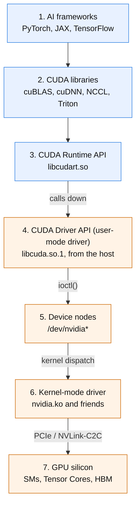
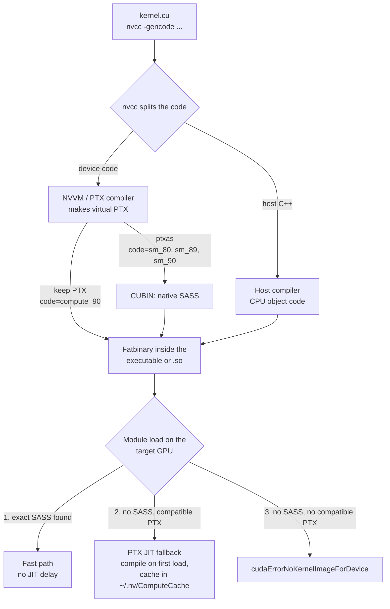

# 10.9 The NVIDIA software stack: driver, CUDA toolkit, container toolkit, compatibility

| | |
|---|---|
| Level | Intermediate |
| Priority tier | 1 |
| Lab venue | Nebius GPU |
| Part | Part 10: The GPU and CUDA |
| Sources used | `nvidia-devops` V3 Ch 2, Ch 11 & Lab 01; Legacy V4 Ch 2 (`02-gpu-software-operator-masterclass.md`); *AI Systems Performance Engineering* Ch 3 |
| Coverage file | `planning/coverage/chapters/10-09.md` |
| Claim ledger | `planning/ledgers/10-09.md` |

## Why this matters for AI infrastructure

When a containerized AI job fails to start, the error message printed by Python rarely points to the layer that is actually broken. A developer may see `RuntimeError: No CUDA GPUs are available` or `CUDA_ERROR_NO_DEVICE` on a node where `nvidia-smi` on the host shows eight healthy GPUs. Another pod may pass `import torch` and `torch.cuda.is_available() == True`, only to crash on its very first tensor allocation with `RuntimeError: CUDA error: no kernel image is available for execution on the device`. A third cluster upgrade from `T4` GPUs (`sm_75`) to `L40S` GPUs (`sm_89`) may cause every pod to stall for 15 minutes at startup while consuming 5 GB of extra host CPU RAM per pod—exhausting 50 GB of system memory across 10 pods and crashing the node (`nvidia-devops` Volume 03 Chapters 2 and 11; Legacy Volume 04 Chapter 2).

Why do these failures happen when "the container already includes CUDA"? Because a GPU container is not a virtual machine with its own operating system kernel. Saying "our container has CUDA 12.4" only describes the **user-space half** of a seven-layer execution contract that spans from Python frameworks (`PyTorch`, `Triton`, `cuTile`, `cuPyNumeric`), through CUDA domain libraries (`cuBLAS`, `cuDNN`, `NCCL`, `CUTLASS`) and the **CUDA Runtime API (`libcudart.so`)**, across the **Container Device Interface (`CDI`)** boundary into the host-supplied **User-Mode Driver (`libcuda.so`)**, through Linux character device nodes (`/dev/nvidia0`, `/dev/nvidiactl`, `/dev/nvidia-uvm`), and down into the **Kernel-Mode Driver (`nvidia.ko`, `nvidia-uvm.ko`, `nvidia-peermem.ko`)** running inside the host Linux kernel (*AI Systems Performance Engineering* Chapter 3; `nvidia-devops` V3 Ch 2).

In this chapter, we map every layer of the NVIDIA software stack from Python down to ring-0 kernel modules, trace how `nvcc` compiles device code into virtual **PTX (`compute_XX`)** and native **SASS / CUBIN (`sm_XX`)** fatbinaries, explain the four rules of **CUDA driver backward, minor-version, and forward compatibility (`/usr/local/cuda/compat`)**, show how the **NVIDIA Container Toolkit** and **CDI (`/var/run/cdi/nvidia.yaml`)** inject host GPUs into OCI containers, and walk the seven-step validation ladder (`cuda-validate.cu`) that isolates any stack failure in minutes.

:::tip In one minute
- **The 7-layer CUDA execution chain:** Application (`PyTorch` / `torch.compile`) → Domain & Python Libraries (`cuBLAS`, `cuDNN`, `NCCL`, `CUTLASS`, `Triton`, `cuTile`, `cuPyNumeric`) → **CUDA Runtime API (`libcudart.so`, shipped in the container toolkit)** → **CUDA Driver API / User-Mode Driver (`libcuda.so.1`, shipped with the host driver and mounted into the container)** → **Linux Character Devices (`/dev/nvidia0`, `/dev/nvidiactl`, `/dev/nvidia-uvm`, major `195` / `234`/`238`)** → **Kernel-Mode Driver (`nvidia.ko`, `nvidia-uvm.ko`, `nvidia-modeset.ko`, `nvidia-peermem.ko`)** → GPU silicon.
- **Lazy initialization trap:** `import torch` proves zero GPU functionality. Even `torch.cuda.is_available()` only checks device enumeration (`cudaGetDeviceCount() > 0`). Context creation, module loading, and PTX/SASS verification wait until the **first actual device operation** (such as `torch.zeros(4, device="cuda")` or a kernel launch).
- **PTX vs SASS (`CUBIN`) in a fatbinary (`nvcc -gencode`):**
  - **SASS (`code=sm_80`, `sm_89`, `sm_90`):** Architecture-specific native machine code packaged in a `CUBIN`. Loads immediately with zero compilation delay, but is **not forward-compatible** across architectures.
  - **PTX (`code=compute_80`, `compute_90`):** Virtual intermediate assembly ISA. Provides forward compatibility because the installed driver **Just-In-Time (`JIT`)** compiles PTX into target SASS on first load (caching the result in `~/.nv/ComputeCache` unless `CUDA_CACHE_DISABLE=1`), at the cost of cold-start latency (`2,340.6 ms` vs `12.8 ms` steady state) and host CPU RAM (`5 GB` per pod in the T4→L40S scenario).
- **Three compatibility contracts:**
  1. **KMD == UMD (`nvidia.ko` == `libcuda.so`):** The host user-mode driver and kernel-mode driver must match to the exact point release; a mismatch triggers `NVRM: API mismatch` (for example, client `535.104.05` vs kernel module `525.105.17`).
  2. **Driver backward & minor-version compatibility:** A newer host driver (such as `535.154.05` or `550.90.07`) natively runs containers with older toolkits (`CUDA 11.4`) and any `CUDA 12.x` runtime (`driver >= 525` for `CUDA 12.x`; see also Chapter `9.12`).
  3. **CUDA Forward Compatibility (`/usr/local/cuda/compat`):** Prepends a newer `libcuda.so` inside the container's `LD_LIBRARY_PATH` so a newer CUDA toolkit can talk to an older enterprise host kernel driver across supported branches.
:::

---

## Prerequisites and outcomes

**Prerequisites:** Chapters `10.1`–`10.8` (GPU architecture, execution model, memory hierarchy, interconnects, generations, and `nvidia-smi` node operations) and Chapter `5.2` (container runtimes, `containerd`, and `runc`).

**Outcomes:** After completing this chapter, you will be able to:
1. Trace a GPU operation from Python frameworks (`PyTorch`, `torch.compile`, `Triton`, `cuTile`, `cuPyNumeric`) and C++ libraries (`cuBLAS`, `cuDNN`, `NCCL`, `CUTLASS`) through the **CUDA Runtime API (`libcudart.so`)**, **CUDA Driver API (`libcuda.so`)**, **`/dev/nvidia*` character devices**, and the **four Linux kernel modules (`nvidia.ko`, `nvidia-uvm.ko`, `nvidia-modeset.ko`, `nvidia-peermem.ko`)**.
2. Explain how `nvcc` splits host and device code, contrast **SASS / `CUBIN` (`sm_XX`)** against **virtual PTX (`compute_XX`)**, design `-gencode` fatbinary flags for mixed GPU fleets, and diagnose `cudaErrorNoKernelImageForDevice` (`cuobjdump`) and PTX JIT compilation storms.
3. Verify **KMD↔UMD exact matching**, **driver backward compatibility**, **CUDA minor-version compatibility**, and **CUDA Forward Compatibility (`/usr/local/cuda/compat`)** across host drivers and container images.
4. Configure the **NVIDIA Container Toolkit (`nvidia-ctk`)** and **Container Device Interface (`CDI`, `/var/run/cdi/nvidia.yaml`)** with `containerd`, explain why container PID namespaces hide host PIDs in `nvidia-smi`, and execute the 7-layer CUDA validation chain (`cuda-validate.cu`).

---

## 1. The Seven-Layer NVIDIA Software Stack: From Python to `nvidia.ko`

When a researcher runs a single line of PyTorch code—such as multiplying two matrices on a GPU—that Python call crosses seven distinct software and hardware layers (*AI Systems Performance Engineering* Ch 3, "NVIDIA Software Stack", pp. 56–62; `nvidia-devops` V3 Ch 2 & Legacy V4 Ch 2, Section 2):



Layers 1 to 3 (blue) normally live **inside the container image**. Layers 4 to 7 (orange) come from **the host**; the NVIDIA Container Toolkit / CDI injects layers 4 and 5 into the container.

| Layer | What lives there | Where it comes from |
|---|---|---|
| 1. AI frameworks | PyTorch (TorchDynamo, AOT Autograd, TorchInductor), JAX, TensorFlow | Container image |
| 2. CUDA libraries | C++: cuBLAS, cuDNN, NCCL, CUTLASS, cuFFT, cuRAND. Python: OpenAI Triton, NVIDIA Warp, CUDA Python, cuTile, cuPyNumeric, CuPy | Container image |
| 3. CUDA Runtime API | `libcudart.so` (`cudaGetDeviceCount`, `cudaMalloc`, `cudaMemcpy`, `kernel<<<grid,block>>>`, streams), under `/usr/local/cuda-X.Y/lib64/`. The context is created lazily on the first device operation | Container image |
| 4. CUDA Driver API | `libcuda.so.1` (`cuInit`, `cuCtxCreate`, `cuModuleLoadData`, `cuLaunchKernel`). Host path `/usr/lib/x86_64-linux-gnu/libcuda.so.1`, bind-mounted into the container, or `/usr/local/cuda/compat` | Host driver |
| 5. Device nodes | `/dev/nvidia0..N` (major 195), `/dev/nvidiactl` (195, 255), `/dev/nvidia-modeset` (195, 254), `/dev/nvidia-uvm` and `/dev/nvidia-uvm-tools` (major 234 or 238) | Host kernel |
| 6. Kernel-mode driver | `nvidia.ko` (core: PCIe, MMU, interrupts, Xid), `nvidia-uvm.ko` (unified memory paging), `nvidia-modeset.ko` and `nvidia_drm.ko` (display), `nvidia-peermem.ko` (GPUDirect RDMA) | Host kernel |
| 7. GPU silicon | PCI vendor ID `10de`; command processor, copy engines, SMs, Tensor Cores, HBM | Hardware |

### 1.1 Layers 1 and 2: PyTorch, `torch.compile`, C++ domain libraries, and Python CUDA DSLs

At the top of the stack sit the deep learning frameworks and domain libraries (*AI Systems Performance Engineering* Ch 3, pp. 56–62):
- **PyTorch and the `torch.compile` stack:** When you execute eager PyTorch operations on `device="cuda"`, PyTorch dispatches matrix multiplications (`torch.matmul`, `nn.Linear`) to **`cuBLAS`**, convolutions and attention primitives to **`cuDNN`**, and multi-GPU collectives (`AllReduce`, `AllGather`) to **`NCCL`**. When you wrap a model in **`torch.compile`**, PyTorch's compiler stack—**`TorchDynamo`** (graph capture), **`AOT Autograd`** (ahead-of-time forward/backward graph trace), and a backend such as **`TorchInductor`** or **`XLA`**—automatically fuses elementwise operations and generates optimized **OpenAI `Triton`** kernels (covered in depth in Chapter `10.19`).
- **C++ template and domain libraries:** Under the hood, `cuBLAS` and custom C++ extensions rely on **`CUTLASS`** (NVIDIA's C++ template library for high-performance matrix multiplication and FlashAttention micro-tiling), alongside `cuFFT` (Fast Fourier Transforms), `cuSPARSE`, and `cuRAND`.
- **Python-native CUDA libraries (`cuTile`, `cuPyNumeric`, `CUDA Python`, `Warp`, `Triton`):** Historically, writing custom GPU kernels required C++ and `nvcc`. Modern CUDA stacks include first-class Python libraries (*AI Systems Performance Engineering* Ch 3, pp. 60–61):
  - **`cuTile`:** Launched in early 2025, `cuTile` provides a high-level tile-based Python abstraction that decomposes large matrices into cache-friendly submatrix tiles without manual thread indexing.
  - **`cuPyNumeric`:** A drop-in distributed/GPU replacement for NumPy (`import cupynumeric as np`) that translates standard NumPy array calls into parallel CUDA operations.
  - **`CUDA Python` and `CuTe DSL`:** Provide direct Python bindings to the CUDA Runtime/Driver APIs and CUTLASS layout algebra.
  - **`NVIDIA Warp` and OpenAI `Triton`:** Python domain-specific languages (`DSLs`) that compile Python functions directly into GPU machine code.

### 1.2 Layer 3 vs Layer 4: CUDA Runtime API (`libcudart.so`) vs CUDA Driver API (`libcuda.so`)

One of the most frequent interview and troubleshooting questions in AI infrastructure is: *What is the difference between `libcudart.so` and `libcuda.so`?* (`nvidia-devops` V3 Ch 2 & Lab 01 Step 7; Legacy V4 Ch 2, Section 2.2):

| Attribute | CUDA Runtime API (`libcudart.so`) | CUDA Driver API (`libcuda.so.1`) |
|---|---|---|
| **Header & Function Prefix** | `<cuda_runtime.h>` — functions start with **`cuda...`** (`cudaMalloc`, `cudaMemcpy`, `cudaLaunchKernel`) | `<cuda.h>` — functions start with **`cu...`** (`cuInit`, `cuCtxCreate`, `cuModuleLoadData`, `cuLaunchKernel`) |
| **Abstraction Level** | **Higher-level convenience API:** Implicitly initializes the driver, creates and binds the primary `CUcontext` on first device use, and manages module loading automatically. | **Lower-level explicit API:** Exposes raw control over GPU contexts (`CUcontext`), compiled PTX/CUBIN modules (`CUmodule`), and virtual memory management. The Runtime API is implemented on top of the Driver API. |
| **Where It Lives on Disk** | `/usr/local/cuda-12.4/lib64/libcudart.so.12` (installed by the **CUDA Toolkit** inside the container image or host `/usr/local/cuda`). | `/usr/lib/x86_64-linux-gnu/libcuda.so.1` (installed by the **host NVIDIA Driver package** and bind-mounted into containers at runtime). |
| **Operational Consequence** | **Lazy initialization:** Importing `libcudart.so` or `import torch` does *not* touch the GPU. Context creation waits until the first operation that needs the device. | **Strict KMD coupling:** `libcuda.so.1` is the **User-Mode Driver (`UMD`)**. It communicates via `ioctl()` with `nvidia.ko` and must match `nvidia.ko`'s version (unless using `/usr/local/cuda/compat`). |

### 1.3 Layers 5 and 6: Linux character devices (`/dev/nvidia*`) and the four kernel modules (`KMD`)

User-space processes cannot manipulate PCIe Base Address Registers (`BARs`), GPU page tables, or hardware interrupts directly. Instead, `libcuda.so.1` opens Linux character device files under `/dev/` and issues `ioctl()` system calls to the **Kernel-Mode Driver (`KMD`)** (`nvidia-devops` V3 Lab 01 Steps 4–5; Legacy V4 Ch 2, Sections 2.1 & 2.3; `KERNEL_MODULES` in `code/part10/nvidia_software_stack.py`):

| Kernel Module (`.ko`) | Associated `/dev/` Character Devices (`major, minor`) | Core Responsibility in an AI Factory | Exact Symptom When Missing or Broken |
|---|---|---|---|
| **`nvidia.ko`** | `/dev/nvidia0`, `/dev/nvidia1`, ... (`195, 0..N`)<br/>`/dev/nvidiactl` (`195, 255`) | Core driver: PCIe initialization, GPU context state, VRAM allocation, command-ring submission, interrupt handling, and `Xid` error logging. | `nvidia-smi` fails immediately; `cudaGetDeviceCount()` returns error if `/dev/nvidiactl` or `/dev/nvidia0` is missing or lacks `rw` permissions. |
| **`nvidia-uvm.ko`** (`nvidia_uvm`) | `/dev/nvidia-uvm` (`234, 0` or `238, 0`, dynamic major)<br/>`/dev/nvidia-uvm-tools` (`234, 1`) | **Unified Virtual Memory (`UVM`):** Handles GPU page faults and migrates pages on demand between CPU RAM and GPU HBM across a shared virtual address space. | Basic `cudaMalloc` programs may still run, but `cudaMallocManaged` (Unified Memory) and modern deep learning frameworks fail during initialization. |
| **`nvidia-modeset.ko`** (`nvidia_modeset`) | `/dev/nvidia-modeset` (`195, 254`) | Display mode-setting engine (often loaded alongside `nvidia_drm.ko`). | Irrelevant for headless compute math, but holds a module reference count on `nvidia.ko` that prevents `rmmod nvidia` until `nvidia_modeset` is unloaded first. |
| **`nvidia-peermem.ko`** (`nvidia_peermem`) | *(Kernel peer-memory client; no separate `/dev` node)* | Registers GPU HBM physical pages with the InfiniBand/RoCE RDMA subsystem (`mlx5` / MOFED) so NICs can DMA directly to/from GPU memory (**GPUDirect RDMA**). | Intra-node NVLink works normally, but multi-node training over InfiniBand/RoCE silently falls back to staging packets through host CPU RAM, spiking CPU utilization and collapsing network throughput. |

---

## 2. Compilation, Fatbinaries (`PTX` vs `SASS` / `CUBIN`), and Version Compatibility

### 2.1 How `nvcc` compiles CUDA code: Host code, `PTX` (`compute_XX`), and `SASS` / `CUBIN` (`sm_XX`)

When you compile a standard C++ program with `gcc`, the output is a single CPU instruction stream (`x86_64` or `aarch64`). A CUDA `.cu` source file, however, mixes CPU functions (`host` code) and GPU kernels (`__global__` `device` code). The CUDA compiler driver (**`nvcc`**) splits the file into two paths (*AI Systems Performance Engineering* Ch 3, pp. 58–60 & Figure 3-2; `nvidia-devops` V3 Ch 11):



The numbers behind the end states, from the notes: the fast path answered request 1 in `12.8 ms`. The JIT path answered request 1 in `2,340.6 ms` (`182.86x` slower), and in the T4 to L40S upgrade scenario it cost `15 minutes` of startup and `5 GB` of host RAM per pod. The error text for path 3 is `CUDA error: no kernel image is available for execution on the device`.

To understand why a binary runs fast on one GPU, pauses for minutes on another, and crashes on a third, you must distinguish the two device representations inside a **fatbinary (`fatbin`)**:
1. **`SASS` (Streaming Assembler) packaged in a `CUBIN` (`code=sm_XX`):**
   `SASS` is the physical, native machine instruction set executed directly by a specific GPU hardware generation (`sm_70` for Volta `V100`, `sm_75` for Turing `T4`, `sm_80` for Ampere `A100`, `sm_86` for `A10`/`A40`, `sm_89` for Ada `L4`/`L40S`, `sm_90` for Hopper `H100`/`H200`, and `sm_100` for Blackwell `B200`). When `nvcc` assembles PTX with `ptxas` for a specific target, it produces a **`CUBIN` (CUDA binary)**.
   - *Advantage:* Loads and executes immediately with zero compilation overhead at startup.
   - *Danger:* **Native `SASS` is NOT forward-compatible across architectures.** A binary containing only `sm_80` (`A100`) and `sm_86` (`A10`) SASS without PTX cannot run on an `H100` (`sm_90`).
2. **`PTX` (Parallel Thread Execution) virtual assembly (`code=compute_XX`):**
   `PTX` is an architecture-neutral virtual instruction set representation. When a binary embeds PTX (`compute_80` or `compute_90`) and lands on a newer GPU whose native `SASS` was not pre-compiled into the fatbinary, the NVIDIA user-mode driver (`libnvidia-ptxjitcompiler.so.1`) **Just-In-Time (`JIT`)** compiles the embedded PTX into native `SASS` for the installed GPU at module load time (`cuModuleLoadData`) and caches the compiled binary in **`~/.nv/ComputeCache`** (unless `CUDA_CACHE_DISABLE=1` is set).
3. **Production `-gencode` fatbinary policy:**
   To get both instant startup across known cluster GPUs and forward compatibility for future hardware refreshes, compile production images with explicit native `sm_XX` targets for every GPU family in your fleet **plus** a `compute_XX` PTX fallback (`nvidia-devops` V3 Ch 11, Section 3; *AI Systems Performance Engineering* Ch 3, p. 59):
   ```bash
   # Build native SASS for A100 (sm_80), L4/L40S (sm_89), and H100/H200 (sm_90), plus PTX (compute_90) for future GPUs
   nvcc -O3 \
        -gencode arch=compute_80,code=sm_80 \
        -gencode arch=compute_89,code=sm_89 \
        -gencode arch=compute_90,code=sm_90 \
        -gencode arch=compute_90,code=compute_90 \
        -o inference_engine inference_engine.cu
   ```
   When building PyTorch C++ / CUDA extensions in Dockerfiles, set the equivalent environment variable (`nvidia-devops` V3 Ch 11 Customer Scenario):
   ```bash
   export TORCH_CUDA_ARCH_LIST="8.0;8.9;9.0+PTX"
   ```

### 2.2 Two real-world PTX/SASS production incidents (`resolve_fatbinary_execution_path`)

Our chapter model (`resolve_fatbinary_execution_path()` in `code/part10/nvidia_software_stack.py`) reproduces both production incidents from `nvidia-devops` Volume 03 Chapter 11:
- **Incident 1 — Single-request cold-start latency spike (`182.86x` / `~190x` slower first request):**
  An inference binary built only with PTX (no native `sm_90` SASS) is deployed on an H100 node. Request 1 takes **`2,340.6 ms`** while the driver synchronously JIT-compiles PTX on the first module load, whereas Requests 2 through 5 take **`12.8 ms`, `11.4 ms`, `11.9 ms`, and `12.1 ms`** (`2,340.6 / 12.8 = 182.86x`, or roughly `190x` slower on Request 1). Worse, if the Kubernetes pod mounts a read-only root filesystem or an ephemeral container directory for `~/.nv/ComputeCache`, the JIT cache is lost on every pod restart, forcing every new replica to pay the 2.3-second penalty on its first live user request unless an explicit warmup probe runs before readiness.
- **Incident 2 — The `T4` (`sm_75`) → `L40S` (`sm_89`) 10-pod JIT host-RAM OOM storm (`50 GB` CPU RAM):**
  A platform team upgrades a Kubernetes inference cluster from Turing `T4` GPUs (`sm_75`) to Ada Lovelace `L40S` GPUs (`sm_89`) and deploys their existing container image. The image was compiled years earlier with native SASS for `sm_75` plus a `compute_75` PTX fallback. When a pod lands on an `L40S`, the driver rejects the `sm_75` SASS and triggers a full PTX JIT compilation of the deep learning framework, taking **15 minutes** and consuming **5 GB of host CPU RAM** per pod. When Kubernetes scales out **10 pods simultaneously** on one node, 10 independent JIT compiler processes spin up at once, consuming **`10 × 5 GB = 50 GB` of host system RAM** and crashing the node from CPU memory exhaustion. Adding `8.9` (`sm_89`) to `TORCH_CUDA_ARCH_LIST` eliminates the JIT compilation completely.

### 2.3 The three driver and CUDA compatibility rules (`evaluate_driver_cuda_compatibility`)

Why does `nvidia-smi` print `CUDA Version: 12.4` in its top-right corner even on a bare-metal node where the CUDA Toolkit (`nvcc`) is not installed at all? Because the version string in `nvidia-smi` reports the **highest CUDA Driver API capability supported by the installed host driver (`libcuda.so`)**, *not* which `libcudart.so` or `nvcc` is installed (`nvidia-devops` V3 Ch 2, Ch 11, Lab 01 Step 6; Legacy V4 Ch 2, Sections 2.2, 6, 8; see also Chapter `9.12` Section 2.1):

1. **Rule 1 — Host User-Mode Driver (`libcuda.so`) and Kernel-Mode Driver (`nvidia.ko`) must match to the exact version string:**
   If a node has an older `nvidia.ko` (`525.105.17`) still loaded in kernel memory after a partial driver upgrade while user-space tools or the Kubernetes Device Plugin load a newer `libcuda.so` (`535.104.05`), every NVML and CUDA call fails immediately, and `dmesg | grep NVRM` logs:
   ```text
   NVRM: API mismatch: the client has the version 535.104.05, but this kernel module has the version 525.105.17
   ```
2. **Rule 2 — Driver Backward Compatibility and Minor-Version Compatibility:**
   NVIDIA's host driver is backward-compatible with older CUDA Toolkit runtimes (`nvidia-devops` V3 Ch 2 Customer Scenario): upgrading worker nodes to driver **`535.154.05`** or **`550.90.07`** allows legacy containers built with **`CUDA 11.4`** (`driver >= 450`) and modern containers built with **`CUDA 12.0` through `12.6`** (`driver >= 525`) to run natively without rebuilding a single image.
3. **Rule 3 — CUDA Forward Compatibility (`/usr/local/cuda/compat`):**
   What if an enterprise cluster is locked on an older host kernel driver branch (for example, Driver `450` or `525` during a freeze window) and researchers need to run a container built with a newer CUDA Toolkit (such as `CUDA 12.2` or `12.4`)? NVIDIA provides **CUDA Forward Compatibility packages** (`cuda-compat-12-x`) inside official NGC containers under **`/usr/local/cuda/compat/`** (`nvidia-devops` Legacy V4 Ch 2, Section 8):
   ```text
   /usr/local/cuda/compat/
   ├── libcuda.so.1
   ├── libcuda.so.535.104.05
   ├── libnvidia-nvvm.so.1
   └── libnvidia-ptxjitcompiler.so.1
   ```
   By prepending `/usr/local/cuda/compat` to `LD_LIBRARY_PATH` inside the container entrypoint:
   ```bash
   export LD_LIBRARY_PATH=/usr/local/cuda/compat:$LD_LIBRARY_PATH
   ```
   the dynamic linker (`ld.so`) resolves the newer `libcuda.so.535.104.05` from `/usr/local/cuda/compat` *before* the older host-mounted `libcuda.so.1`, translating newer CUDA Runtime calls across supported enterprise kernel driver branches without rebooting the host.

---

## 3. Containerizing the GPU: NVIDIA Container Toolkit, `CDI`, and Namespace Traps

Standard Linux containers (`cgroups` and namespaces) isolate CPU, memory, mount tables, and PIDs. A default `docker run` or `containerd` container has no `/dev/nvidia*` character devices and no host `libcuda.so.1`.

### 3.1 Four generations of container GPU injection: From `nvidia-docker` to `CDI`

As traced in `nvidia-devops` Legacy Volume 04 Chapter 2 (Section 3.1), NVIDIA's container integration evolved through four generations:
1. **Generation 1 (`nvidia-docker` v1):** A standalone wrapper CLI around Docker that manually discovered and passed `--device` and `--volume` flags. Brittle and incompatible with Kubernetes CRI.
2. **Generation 2 (`nvidia-docker2`):** Introduced `nvidia-container-runtime` as a custom Docker runtime wrapper around `runc`.
3. **Generation 3 (`nvidia-container-toolkit` OCI pre-start hook):** When `containerd` invokes `nvidia-container-runtime`, it registers a pre-start OCI hook that calls `libnvidia-container` (`nvidia-container-cli`). Before the container process starts, the hook parses `NVIDIA_VISIBLE_DEVICES` and bind-mounts `/dev/nvidia*`, `/usr/bin/nvidia-smi`, and `/usr/lib/x86_64-linux-gnu/libcuda.so.1` from the host into the container's mount namespace.
4. **Generation 4 (`CDI` — Container Device Interface, CNCF standard):**
   Modern `containerd` (1.7+) and `CRI-O` support **CDI** natively without custom `runc` wrappers or pre-start hooks. The **`nvidia-ctk`** CLI scans the host GPUs and writes a declarative YAML/JSON specification to **`/var/run/cdi/nvidia.yaml`** (or `/etc/cdi/nvidia.yaml`). When a pod or container requests CDI device `nvidia.com/gpu=0` (or `nvidia.com/gpu=all`), `containerd` reads `/var/run/cdi/nvidia.yaml` and natively attaches the character devices (`major 195`, `major 234`/`238`) and read-only library bind-mounts (`options: [ro, nosuid, nodev, bind]`).

### 3.2 Why `nvidia-smi` inside a container shows an empty process list (the PID namespace trap)

One of the most common operational surprises in Kubernetes and Docker GPU clusters (`nvidia-devops` Legacy V4 Ch 2, Section 19) occurs when an engineer `exec`s into a busy training pod and runs `nvidia-smi`:
- **On the bare-metal host:** `nvidia-smi` shows GPU 0 at `40000MiB` VRAM used and lists **`PID 2051234` (`python3`)** under the `Processes:` table.
- **Inside the container (`kubectl exec` / `crictl exec`):** `nvidia-smi` shows GPU 0 at `40000MiB` VRAM used, but the `Processes:` table says **`No running processes found`** (or shows unresolvable PIDs).

Why? Because the NVIDIA kernel driver (`nvidia.ko`) records GPU context ownership using **host root PID namespace identifiers** (`2051234`). Inside the container's isolated **PID namespace**, that same Python process is `PID 1` (or `PID 42`), and `/proc/2051234` does not exist inside the container. When `nvidia-smi` inside the container queries NVML and attempts to look up `/proc/<host_pid>` to verify the process name and memory usage, the lookup fails and `nvidia-smi` omits the row. Always run `nvidia-smi` (or `nvidia-smi pmon`) on the **host**—or use `dcgm-exporter` pod-level metrics—for process attribution rather than setting `hostPID: true` on untrusted pods.

### 3.3 How BCM installs and owns the container stack (from the BCM 11 containerization manual)

On a Base Command Manager (BCM) cluster the toolkit and driver do not arrive by hand. The `bcm11-containerization` manual (sections 2.7, 4.2 and 6.7) shows who installs each piece, which decides where you look when a GPU container fails.

**Docker path (section 2.7).**
- The BCM package is `cm-nvidia-container-toolkit`. You get it either by answering **yes** to "Do you want to install the NVIDIA Runtime for Docker" in `cm-docker-setup`, or later with the package manager.
- The toolkit must run on the compute nodes that have GPUs, so it goes into the **node image**. The manual's example: `yum install --installroot=/cm/images/gpu-image cm-nvidia-container-toolkit`, then reboot the nodes so they pick up the image.
- Test with `module load docker` and `docker run --runtime=nvidia --rm nvidia/cuda:11.4-base nvidia-smi`. The manual's sample output is old (a Tesla K40c with driver 440.33.01), so use it for the shape of the test, not for versions.

**Kubernetes path (sections 4.2 and 6.7).** The `cm-kubernetes-setup` wizard decides who installs the toolkit and driver:

| Choice in the wizard | Who provides the container toolkit | Who provides the driver |
|---|---|---|
| **GPU Operator not selected** | BCM package `cm-nvidia-container-toolkit`, if you say yes on the NVIDIA Container Toolkit screen (default: not installed) | On the host (you or BCM) |
| **GPU Operator selected** (the two NVIDIA package screens are skipped) | The **operator** (`toolkit.enabled`, default on). It hooks in through CDI plugins. The wizard does **not** install the BCM toolkit package. It does install the BCM NVIDIA packages (`cuda-dcgm`). | Host by default. The operator installs a driver container only if `driver.enabled` is on (default off) |
| **Operator, `toolkit.enabled` off** | BCM, as a system package, with `containerd` runtime-class drop-ins | as above |

More facts from the manual:
- With an older operator, or if CDI is turned off in the `cm-kubernetes-setup` configuration, **`containerd` runtime-class drop-ins** are used for device injection instead of CDI.
- On **DGX OS** images the driver is **always** provisioned by the host.
- The option `--adv-configuration-bcm-nvidia-packages` shows both NVIDIA package screens even when the operator is selected.
- The wizard's checklist has three independent options (`toolkit.enabled` default on, `driver.enabled` default off, `nfd.enabled` default on). If you give the wizard a custom Helm values file, the checklist is skipped. The manual lists MIG strategy and time-slicing as settings you would pass that way.
- The operator manages the toolkit, the Kubernetes device plugin, Node Feature Discovery, GPU Feature Discovery, the DCGM exporter and the validator daemonsets.
- BCM writes the `containerd` configuration as drop-ins. The main file is `/cm/local/apps/containerd/var/etc/config.toml` and it imports `/cm/local/apps/containerd/var/etc/conf.d/*.toml`. The NVIDIA settings are a separate drop-in named `nvidia-cri`.
- The wizard can cause disruption (image updates and node reboots). The manual says a Helm install on an already-running cluster may be preferred to avoid that.
- For air-gapped clusters, the operator images and Helm chart are staged into the local Kubernetes registry as part of the air-gapped install.

**What this means when debugging (my inference).** Before changing anything on a node, find out which owner it has: the BCM package in the node image, the operator's toolkit daemonset, or a host-installed driver. Fixing the wrong owner is undone at the next reboot or reconcile. The lab (`bcm_container_stack_owners()` in `code/part10/nvidia_software_stack.py`) encodes the wizard's rules from the manual.

### 3.4 BCM packages for the driver and CUDA toolkit (from the BCM 11 installation manual)

The same BCM manuals also say how the **host-side** layers (kernel driver, DCGM, Fabric Manager, CUDA toolkit) are installed (`bcm11-install` chapter 9, written as of April 2026 in the manual):
- **Driver packages:** `nvidia-driver` (the driver metapackage, usually with a version tag such as `-590`; the manual's example reads the README of `nvidia-driver-580`), `cuda-dcgm` (includes the `dcgmi` command), and `nvidia-fabricmanager` and `nvidia-fabricmanager-dev` (only for hardware with NVSwitch, such as a DGX).
- **Where they go:** the "local" packages belong on every node that has GPUs, which in practice means the **software image**. By default BCM images already contain `nvidia-driver`, `cuda-dcgm`, `cuda-dcgm-nvvs` and `nvidia-fabricmanager`, so an explicit install is normally not needed. If you change an image, push it to running nodes with `imageupdate` in `cmsh` (the manual's example: `imageupdate -n node0[01-10] -w`).
- **What changed in BCM 11:** the `nvidia-driver` packages replace the older `cuda-driver` packages. They compile the kernel module **during package installation, not at boot**, and the newer packages are open source. This is why a driver change in BCM is an image change plus a reboot or `imageupdate`, and why Section 2.3's rule that the kernel module and `libcuda.so` must match applies to the whole image at once.
- **Toolkit versions:** the CUDA toolkit packages (`cuda12.6-toolkit`, `cuda13.0-toolkit` and so on) are `shared` packages for the head node. The manual lists Ubuntu 24.04 with CUDA 12.5, 12.6, 12.8, 12.9, 13.0 and 13.1, and Rocky Linux 9.6 with versions from 11.7 to 13.1. Users switch with environment modules, for example `module add shared cuda13.0`. Check the BCM package dashboard for what your distribution has.
- **Compiling on login nodes:** the manual says to compile CUDA on a node that has GPUs (use the workload manager). If you must cross-compile on a CPU-only node, install `nvidia-driver` there and **disable** `nvidia-persistenced.service`, `nvidia-fabricmanager.service` and `nvidia-dcgm.service`.

Chapter 10.10 covers Fabric Manager in detail.

---

## 4. Commands and Configurations That Matter

All commands below follow the 7-layer validation chain from `nvidia-devops` Volume 03 Lab 01 (`lab-01-inspect-and-validate-a-cuda-environment.md`), Volume 03 Chapter 11, and Legacy Volume 04 Chapter 2. Because this handbook repo builds on a Mac without an attached data-center GPU, host/container shell commands below are marked **(untested here)**.

### 4.1 Walk the 7-step host driver, device-node, and library verification chain (untested here)

```bash
# Step 1 (untested here): Confirm PCIe hardware enumeration (10de = NVIDIA vendor ID; 0302 = 3D controller)
lspci -Dnn | grep -i nvidia
# Illustrative output:
# 0000:07:00.0 3D controller [0302]: NVIDIA Corporation GA100 [A100 SXM4 40GB] [10de:20b0] (rev a1)

# Step 2 (untested here): Cross-check nvidia-smi Bus-Id, UUID, driver_version, and compute_cap
nvidia-smi --query-gpu=index,name,uuid,pci.bus_id,driver_version,compute_cap,memory.total --format=csv
# Illustrative output:
# index, name, uuid, pci.bus_id, driver_version, compute_cap, memory.total [MiB]
# 0, NVIDIA A100-SXM4-40GB, GPU-3f9a1c7e-88b2-4a5d-9e11-6c4f2a0d9b31, 00000000:07:00.0, 550.90.07, 8.0, 40960 MiB

# Step 3 (untested here): Confirm KMD kernel modules (nvidia, nvidia_uvm, nvidia_modeset, nvidia_peermem) & NVRM logs
lsmod | grep -E '^nvidia'
journalctl -k | grep -iE 'nvrm|nvidia|xid' | tail -n 50

# Step 4 (untested here): Verify /dev/nvidia* character device nodes and major/minor numbers
ls -l /dev/nvidia* 2>/dev/null || true
# Illustrative output:
# crw-rw-rw- 1 root root 195,   0 Mar  3 09:12 /dev/nvidia0
# crw-rw-rw- 1 root root 195, 255 Mar  3 09:12 /dev/nvidiactl
# crw-rw-rw- 1 root root 195, 254 Mar  3 09:12 /dev/nvidia-modeset
# crw-rw-rw- 1 root root 234,   0 Mar  3 09:12 /dev/nvidia-uvm
# crw-rw-rw- 1 root root 234,   1 Mar  3 09:12 /dev/nvidia-uvm-tools

# Step 5 (untested here): Check CUDA compiler (nvcc) and dynamic linker resolution for libcuda.so vs libcudart.so
nvcc --version 2>/dev/null || true
ldconfig -p | grep -E 'libcuda\.so|libcudart\.so' || true
# Illustrative output showing the two distinct install roots:
#   libcudart.so.12 (libc6,x86-64) => /usr/local/cuda-12.4/lib64/libcudart.so.12
#   libcuda.so.1 (libc6,x86-64) => /usr/lib/x86_64-linux-gnu/libcuda.so.1
```

### 4.2 Generate a CDI specification (`nvidia-ctk`) and configure `containerd` (untested here)

```bash
# Generate the Container Device Interface (CDI) spec for all host GPUs (untested here)
sudo nvidia-ctk cdi generate --output=/var/run/cdi/nvidia.yaml

# Inspect the generated CDI device names (e.g., nvidia.com/gpu=0, nvidia.com/gpu=all) (untested here)
nvidia-ctk cdi list
```

Corresponding `/etc/containerd/config.toml` configuration for CDI and the `nvidia` runtime handler (`nvidia-devops` Legacy V4 Ch 2, Section 3.4):
```toml
version = 2
[plugins]
  [plugins."io.containerd.grpc.v1.cri"]
    enable_cdi = true
    [plugins."io.containerd.grpc.v1.cri".containerd]
      default_runtime_name = "runc"
      [plugins."io.containerd.grpc.v1.cri".containerd.runtimes]
        [plugins."io.containerd.grpc.v1.cri".containerd.runtimes.runc]
          runtime_type = "io.containerd.runc.v2"
        [plugins."io.containerd.grpc.v1.cri".containerd.runtimes.nvidia]
          privileged_without_host_devices = false
          runtime_type = "io.containerd.runc.v2"
          [plugins."io.containerd.grpc.v1.cri".containerd.runtimes.nvidia.options]
            BinaryName = "/usr/bin/nvidia-container-runtime"
```

### 4.3 Inspect compiled binaries for embedded `SASS` (`sm_XX`) and `PTX` (`cuobjdump`) (untested here)

When a binary fails with `CUDA error: no kernel image is available for execution on the device`, inspect its fatbinary payload before touching the cluster (`nvidia-devops` V3 Ch 11, Section "Problem: No suitable kernel image"):

```bash
# 1. List embedded native SASS (CUBIN) ELF targets inside an executable or .so library (untested here)
cuobjdump --list-elf ./inference_engine | grep -i sm_

# 2. List embedded virtual PTX targets (empty output means NO PTX fallback is present) (untested here)
cuobjdump --list-ptx ./inference_engine

# 3. Diff dynamic library resolution across a container base-image update (untested here)
ldd ./inference_engine | sort
```

### 4.4 Compile and run the minimal end-to-end validation program (`cuda-validate.cu`) (untested here)

Because `import torch` is lazy and `nvidia-smi` does not test the CUDA Runtime API, `nvidia-devops` Volume 03 Lab 01 (Steps 8–10) uses a minimal C++ validation binary that forces device discovery, context creation, `cudaMalloc`, kernel launch, synchronization, and `cudaMemcpy` back to host memory (`Kernel result: 42`):

```cpp
// cuda-validate.cu (from nvidia-devops Volume 03 Lab 01 Step 8)
#include <cuda_runtime.h>
#include <iostream>

__global__ void write_value(int* output) {
    if (threadIdx.x == 0 && blockIdx.x == 0) {
        *output = 42;
    }
}

int main() {
    int device_count = 0;
    cudaError_t status = cudaGetDeviceCount(&device_count);
    if (status != cudaSuccess || device_count < 1) {
        std::cerr << "cudaGetDeviceCount failed or 0 devices: "
                  << cudaGetErrorString(status) << "\n";
        return 1;
    }
    int* device_value = nullptr;
    cudaMalloc(&device_value, sizeof(int));
    write_value<<<1, 1>>>(device_value);
    status = cudaDeviceSynchronize();
    if (status != cudaSuccess) {
        std::cerr << "Kernel execution failed: " << cudaGetErrorString(status) << "\n";
        cudaFree(device_value);
        return 2;
    }
    int host_value = 0;
    cudaMemcpy(&host_value, device_value, sizeof(int), cudaMemcpyDeviceToHost);
    cudaFree(device_value);
    std::cout << "CUDA devices: " << device_count << "\nKernel result: " << host_value << "\n";
    return host_value == 42 ? 0 : 3;
}
```

Compile for multiple architectures and run (untested here):
```bash
nvcc -O2 -gencode arch=compute_80,code=sm_80 \
         -gencode arch=compute_89,code=sm_89 \
         -gencode arch=compute_90,code=sm_90 \
         -gencode arch=compute_90,code=compute_90 \
         -o cuda-validate cuda-validate.cu
./cuda-validate
```

---

## 5. How It Fails: Six Production Software Stack Failure Modes

Our fault-isolation engine (`diagnose_cuda_stack_boundary()`, `evaluate_driver_cuda_compatibility()`, and `resolve_fatbinary_execution_path()` in `code/part10/nvidia_software_stack.py`, where combining these checks into a single automated auditor is **my inference**) catches the six classic production failures from `nvidia-devops` Volume 03 and Legacy Volume 04 Chapter 2:

| # | Failure Mode | Production Symptom | Root Cause & Diagnostic Evidence | Fix |
|---|---|---|---|---|
| **1** | **Host KMD (`nvidia.ko`) vs UMD (`libcuda.so`) `NVRM: API mismatch`** | `nvidia-smi` fails or Kubernetes Device Plugin reports `0` allocatable GPUs (`Failed to list devices`) after a driver package update. | `dmesg \| grep NVRM` prints **`NVRM: API mismatch: the client has the version 535.104.05, but this kernel module has the version 525.105.17`**. An older `nvidia.ko` remained held open in kernel memory by a lingering process during upgrade (`VL4 Ch 2 §6 Scenario B & §15.2`). | Run `lsof /dev/nvidia*` to kill rogue processes holding device descriptors, unload `nvidia_uvm` / `nvidia_modeset` / `nvidia` (`rmmod`), or drain and reboot the node. |
| **2** | **`CUDA error: no kernel image is available for execution on the device`** | `nvidia-smi`, `import torch`, and `torch.cuda.is_available()` all succeed, but the first tensor operation or kernel launch crashes immediately on a newer GPU (`H100`, `sm_90`). | `cuobjdump --list-elf` shows only older native SASS (`sm_80`, `sm_86`) and `cuobjdump --list-ptx` returns empty (`V3 Ch 11`). Because CUDA initialization is lazy, the missing `sm_90` code is only discovered at first kernel load. | Rebuild with `-gencode arch=compute_90,code=sm_90` and `-gencode arch=compute_90,code=compute_90` (or add `9.0+PTX` to `TORCH_CUDA_ARCH_LIST`). |
| **3** | **Multi-pod PTX JIT compilation storm (`15 min` startup & `50 GB` host RAM)** | After upgrading nodes from `T4` (`sm_75`) to `L40S` (`sm_89`), pods take 15 minutes to start (`2,340.6 ms` vs `12.8 ms` per module) and scaling 10 pods OOM-crashes the host CPU (`50 GB` RAM). | Binary contains `sm_75` SASS + `compute_75` PTX, but no `sm_89` SASS (`V3 Ch 11 Customer Scenario`). All 10 pods invoke `libnvidia-ptxjitcompiler.so` simultaneously (`5 GB` RAM each), or `~/.nv/ComputeCache` is on an ephemeral filesystem. | Compile native `sm_89` SASS into the image (`TORCH_CUDA_ARCH_LIST="8.9"`) and mount a persistent writable volume for `~/.nv/ComputeCache` (ensuring `CUDA_CACHE_DISABLE` is not `1`). |
| **4** | **Works on host, fails in container (`CUDA_ERROR_NO_DEVICE`)** | `nvidia-smi` works on the host, but inside the container `cudaGetDeviceCount()` returns `0` or `libcuda.so.1: cannot open shared object file`. | Either (a) `env \| grep VISIBLE_DEVICES` reveals `NVIDIA_VISIBLE_DEVICES=none` or `CUDA_VISIBLE_DEVICES=""` (`V3 Ch 2 Row 3 & Lab 01 Step 13`), or (b) `ls -l /dev/nvidia*` / `ldconfig -p \| grep libcuda` inside the container is empty because `containerd` `/etc/containerd/config.toml` or `/var/run/cdi/nvidia.yaml` was not configured (`VL4 Ch 2 §6 Scenario C`). | Remove `NVIDIA_VISIBLE_DEVICES=none`, regenerate `/var/run/cdi/nvidia.yaml` with `sudo nvidia-ctk cdi generate`, and verify `enable_cdi = true` / `nvidia` runtime in `config.toml`. |
| **5** | **Missing `/dev/nvidia-uvm` (`nvidia-uvm.ko` not loaded or not injected)** | Basic `cudaMalloc` validation passes, but PyTorch, Triton, or Unified Memory (`cudaMallocManaged`) applications fail during initialization. | `ls -l /dev/nvidia*` shows `/dev/nvidia0` and `/dev/nvidiactl`, but **`/dev/nvidia-uvm` is absent** (`V3 Lab 01 Step 5` & `VL4 Ch 2 §2.1`). | Run `sudo modprobe nvidia-uvm` (and `sudo nvidia-modprobe -u -c=0`) on the host, and ensure `/dev/nvidia-uvm` is included in the CDI spec. |
| **6** | **Driver container `Init:CrashLoopBackOff` on kernel header mismatch** | On Kubernetes clusters using containerized drivers, `nvidia-driver-daemonset` fails in `Init:CrashLoopBackOff` after an OS kernel security patch (`apt upgrade linux-image`). | `kubectl logs` shows `kernel headers not found` or `gcc not found` for the new `uname -r` kernel (`VL4 Ch 2 §6 Scenario A`). | Install matching `linux-headers-$(uname -r)` on the node image, or enable **`driver.usePrecompiled: true`** so the operator pulls precompiled kernel modules instead of compiling via GCC on boot across 500 nodes. |

---

## 6. Hands-On Lab: Validate the 7-Layer Software Stack, Driver Compatibility, and Fatbinary Resolution

**Venue:** Any Linux machine or Nebius GPU VM with Python 3.10+ (runs deterministically using standard library Python; all live Linux/CUDA shell commands are provided in Section 4 and marked `(untested here)`).

Run `code/part10/nvidia_software_stack_lab.py`:

```bash
python3 code/part10/nvidia_software_stack_lab.py
```

Expected output (`30 passed, 0 failed`):

```text
=== Chapter 10.9 Lab: The NVIDIA Software Stack (Driver, CUDA, Container Toolkit & Compatibility) ===
  [PASS] VL4 Ch2 §2.1: Kernel-Mode Driver defines nvidia.ko, nvidia-uvm.ko, nvidia-modeset.ko, and nvidia-peermem.ko
  [PASS] V3 Lab 01 Step 5: nvidia.ko exposes /dev/nvidia0 and /dev/nvidiactl (major 195), and nvidia-uvm.ko exposes /dev/nvidia-uvm
  [PASS] V3 Ch11: Compute capabilities map T4=sm_75, A100=sm_80, A10=sm_86, L4/L40S=sm_89, H100/H200=sm_90
  [PASS] V3 Ch2 Customer Scenario: Host driver 535.154.05 natively runs legacy CUDA 11.4 container via driver backward compatibility
  [PASS] V3 Lab 01: Host driver 550.90.07 (>= 525) natively supports CUDA 12.4 container
  [PASS] VL4 Ch2 §6 Scenario B: Detects NVRM API mismatch (client 535.104.05 vs kernel module 525.105.17)
  [PASS] V3 Ch2 Customer Scenario: CUDA 12.2 container on legacy 450 host driver without forward-compat fails
  [PASS] VL4 Ch2 §8: /usr/local/cuda/compat (libcuda.so.535.104.05 on LD_LIBRARY_PATH) enables CUDA Forward Compatibility
  [PASS] V3 Ch11 Fig 3.11.1: Exact sm_90 SASS match loads on H100 via NATIVE_SASS_FAST_PATH with 0 JIT overhead (12.8 ms)
  [PASS] V3 Ch11 §Production Troubleshooting: PTX-only load takes 2,340.6 ms on request 1 vs 12.8 ms steady state (182.86x ~ 190x slower)
  [PASS] V3 Ch11 Customer Scenario: 10 pods on L40S (sm_89) with only T4 SASS (sm_75) + PTX consume 10 * 5 GB == 50.0 GB host RAM in JIT storm
  [PASS] V3 Ch11 Story: Binary with only sm_80/sm_86 SASS and no PTX fails on H100 (sm_90) with cudaErrorNoKernelImageForDevice
  [PASS] V3 Lab 01: Complete 7-layer CUDA validation chain (kernel result == 42) passes
  [PASS] V3 Lab 01 Step 1: Missing PCI vendor 10de isolates fault to 1_PCI_ENUMERATION below the driver
  [PASS] V3 Lab 01 Step 2: Failed nvidia-smi with PCI present isolates fault to 2_KERNEL_DRIVER_KMD
  [PASS] V3 Ch2 §Production Troubleshooting: Missing /dev/nvidia* in container with working host nvidia-smi isolates to 3_DEVICE_NODES_CDI
  [PASS] V3 Lab 01 Step 5 & VL4 Ch2 §2.1: Missing /dev/nvidia-uvm isolates fault to 3B_UVM_DEVICE_NODE
  [PASS] V3 Ch2 Row 3: NVIDIA_VISIBLE_DEVICES=none silently disables container GPU injection (4_ENV_VISIBILITY_FILTER)
  [PASS] V3 Lab 01 Step 13: CUDA_VISIBLE_DEVICES='' forces cudaGetDeviceCount() == 0 (4_ENV_VISIBILITY_FILTER)
  [PASS] V3 Ch2 & Lab 01 Step 7: Missing libcuda.so.1 in ldconfig -p isolates fault to 5_USER_MODE_DRIVER_LIBCUDA
  [PASS] V3 Lab 01 Step 7: Missing libcudart.so isolates fault to 6_CUDA_RUNTIME_LIBCUDART
  [PASS] V3 Ch2 & Ch11: Lazy init where import succeeds but first kernel fails isolates to 7_DEVICE_CODE_EXECUTION
  [PASS] Rejects unsupported CUDA major version
  [PASS] Rejects malformed host driver version string
  [PASS] Rejects invalid target_gpu_sm format
  [PASS] bcm11-containerization 4.2: with the GPU Operator selected, the wizard skips both NVIDIA package screens and the operator owns the toolkit via CDI
  [PASS] bcm11-containerization 4.2: --adv-configuration-bcm-nvidia-packages shows the screens even with the operator
  [PASS] bcm11-containerization 6.7.1: toolkit.enabled off means the BCM package owns the toolkit and containerd runtime-class drop-ins are used
  [PASS] bcm11-containerization 6.7.1: older operator or CDI disabled falls back to runtime-class drop-ins
  [PASS] bcm11-containerization 6.7: driver.enabled gives an operator driver container, but on DGX OS the driver is always host-provisioned

Summary: 30 passed, 0 failed (total 30)
```

---

## Exercises

1. **Isolating `libcuda.so` vs `libcudart.so` in a broken container:** Inside a container on a host with driver `550.90.07`, running `ldconfig -p | grep -i cuda` prints `/usr/local/cuda-12.4/lib64/libcudart.so.12`, but returns no lines for `libcuda.so`. Which component owns `libcuda.so`, which component owns `libcudart.so`, and which layer of the stack failed to inject `libcuda.so`?
2. **Diagnosing `no kernel image is available for execution on the device`:** A container image built for `A100` (`sm_80`) and `A10` (`sm_86`) is deployed to an `H100` (`sm_90`) node. `nvidia-smi` and `torch.cuda.is_available()` both succeed, but `torch.zeros(4, device="cuda")` crashes with `CUDA error: no kernel image is available for execution on the device`. Write the two `cuobjdump` commands that prove why the binary failed and the exact `nvcc -gencode` flags that fix it.
3. **Calculating PTX JIT cold-start slowdown and host RAM exhaustion:** Using the numbers from `nvidia-devops` Volume 03 Chapter 11, calculate (a) the exact first-request slowdown ratio when a PTX-only build takes `2,340.6 ms` on Request 1 versus `12.8 ms` on Request 2, and (b) the total host CPU RAM consumed when `10` pods built only with `sm_75` SASS + `compute_75` PTX land simultaneously on an `L40S` (`sm_89`) node where each pod's PTX JIT compiler consumes `5 GB` of host RAM.
4. **Driver backward vs forward compatibility matrix:** Evaluate three deployments using `evaluate_driver_cuda_compatibility()`: (a) a `CUDA 11.4` container on host driver `535.154.05`, (b) a `CUDA 12.2` container on host driver `450` without forward-compatibility packages, and (c) a `CUDA 12.2` container on an older host driver with `/usr/local/cuda/compat` (`libcuda.so.535.104.05`) prepended to `LD_LIBRARY_PATH`. State which succeed and why.
5. **Resolving `NVRM: API mismatch` and stuck `rmmod nvidia`:** During a driver upgrade from `525.105.17` to `535.104.05`, `nvidia-smi` stops working and `dmesg` prints `NVRM: API mismatch: the client has the version 535.104.05, but this kernel module has the version 525.105.17`. When you attempt `sudo rmmod nvidia`, Linux prints `Error: Module nvidia is in use`. Write the commands to identify the blocking processes and dependent kernel modules (`nvidia_uvm`, `nvidia_modeset`) and clear the mismatch.
6. **Character device audit (`/dev/nvidia*`):** A node exposes `/dev/nvidia0` (`195, 0`) and `/dev/nvidiactl` (`195, 255`), and `cuda-validate` passes `cudaMalloc`, yet a workload using Unified Virtual Memory (`cudaMallocManaged`) fails immediately. Which `/dev/` character device and `.ko` kernel module are missing, and what happens to multi-node InfiniBand training if `nvidia-peermem.ko` is also absent?

7. **Who owns the toolkit? (BCM manual):** A BCM cluster was set up with the GPU Operator selected and the default checklist. A teammate runs `yum install --installroot=/cm/images/gpu-image cm-nvidia-container-toolkit` and reboots the nodes "to fix GPU access". Using the table in Section 3.3, say who already provides the toolkit, how devices are injected (CDI or drop-ins), who provides the driver, and why the teammate's change may conflict. Then say what changes if `toolkit.enabled` is off.

---

## Checkpoint questions (20)

<details>
<summary><strong>1. Name the seven layers of the NVIDIA GPU software stack from a high-level Python application down to the physical GPU hardware.</strong></summary>

1. **AI Frameworks & Compilers** (`PyTorch`, `torch.compile` / `TorchDynamo` / `TorchInductor`, `JAX`, `TensorFlow`).
2. **Domain & Python CUDA Libraries** (`cuBLAS`, `cuDNN`, `NCCL`, `CUTLASS`, `Triton`, `Warp`, `cuTile`, `cuPyNumeric`).
3. **CUDA Runtime API (`libcudart.so`)** in user space (shipped in the CUDA Toolkit).
4. **CUDA Driver API / User-Mode Driver (`libcuda.so.1`)** in user space (shipped with the host driver and mounted into containers).
5. **Linux Character Device Nodes** (`/dev/nvidia0..N`, `/dev/nvidiactl`, `/dev/nvidia-modeset`, `/dev/nvidia-uvm`).
6. **NVIDIA Kernel-Mode Driver (`KMD`)** (`nvidia.ko`, `nvidia-uvm.ko`, `nvidia-modeset.ko`, `nvidia-peermem.ko`).
7. **Physical GPU Silicon** (PCI vendor ID `10de`).
</details>

<details>
<summary><strong>2. What is the difference between `libcudart.so` (CUDA Runtime API) and `libcuda.so.1` (CUDA Driver API / User-Mode Driver), and where does each reside in a containerized setup?</strong></summary>

- **`libcudart.so` (CUDA Runtime API):** High-level convenience library (`cudaMalloc`, `cudaLaunchKernel`) that manages contexts implicitly; packaged inside the **container image** under `/usr/local/cuda-X.Y/lib64/`.
- **`libcuda.so.1` (CUDA Driver API / UMD):** Low-level explicit context and module driver library (`cuInit`, `cuCtxCreate`, `cuModuleLoadData`) that talks directly to `nvidia.ko`; installed on the **host OS** (`/usr/lib/x86_64-linux-gnu/libcuda.so.1`) and bind-mounted into the container by the NVIDIA Container Toolkit / CDI (unless overridden by `/usr/local/cuda/compat`).
</details>

<details>
<summary><strong>3. Why does `import torch` (and even `torch.cuda.is_available() == True`) NOT prove that a container can execute code on a GPU?</strong></summary>

Because CUDA Runtime initialization is **lazy**. Importing PyTorch does not touch the GPU, and `torch.cuda.is_available()` only checks device enumeration (`cudaGetDeviceCount() > 0`). Actual context creation, memory allocation, and loading native `SASS` or JIT-compiling `PTX` happen only on the **first operation that executes on the device** (such as `torch.zeros(4, device="cuda")` or running `cuda-validate`).
</details>

<details>
<summary><strong>4. Name the four NVIDIA Linux kernel modules (`KMD`) covered in this chapter and state the exact role of each.</strong></summary>

1. **`nvidia.ko`:** Core kernel driver managing PCIe initialization, GPU contexts, VRAM allocation, command submission, interrupts, and `Xid` logging.
2. **`nvidia-uvm.ko` (`nvidia_uvm`):** Manages **Unified Virtual Memory (`UVM`)**, handling GPU page faults and migrating memory pages between CPU and GPU.
3. **`nvidia-modeset.ko` (`nvidia_modeset`):** Display mode-setting module (often loaded as a dependency of `nvidia_drm.ko`).
4. **`nvidia-peermem.ko` (`nvidia_peermem`):** Exposes GPU HBM pages to InfiniBand/RoCE RDMA NICs (`mlx5`) to enable zero-copy **GPUDirect RDMA** across nodes.
</details>

<details>
<summary><strong>5. Which `/dev/nvidia*` character devices must exist for a standard CUDA and Unified Memory workload to run, and what are their major/minor device numbers?</strong></summary>

- **`/dev/nvidia0` (`195, 0`):** Device node for GPU 0 (with `/dev/nvidia1` at `195, 1`, etc.).
- **`/dev/nvidiactl` (`195, 255`):** Master control device opened by every CUDA process.
- **`/dev/nvidia-modeset` (`195, 254`):** Mode-setting device node.
- **`/dev/nvidia-uvm` (`234, 0` or `238, 0`, dynamic major) and `/dev/nvidia-uvm-tools` (`234, 1`):** Required by `nvidia-uvm.ko` for Unified Memory (`cudaMallocManaged`).
</details>

<details>
<summary><strong>6. Contrast `PTX` (`compute_XX`) and `SASS` / `CUBIN` (`sm_XX`) inside a CUDA fatbinary (`fatbin`).</strong></summary>

- **`SASS` (`CUBIN`, `code=sm_XX`):** Architecture-specific native GPU machine instructions produced by `ptxas`. Runs immediately with zero compilation delay, but is **not forward-compatible** with newer GPU generations.
- **`PTX` (`code=compute_XX`):** Virtual intermediate assembly language. It is **forward-compatible** because the installed driver can **Just-In-Time (`JIT`)** compile PTX into native SASS for newer GPUs at load time, at the cost of first-load compilation latency and CPU RAM.
</details>

<details>
<summary><strong>7. State the compute capability targets (`sm_XX`) for `V100`, `T4`, `A100`, `A10`/`A40`, `L4`/`L40S`, `H100`/`H200`, and `B200`.</strong></summary>

- **Volta `V100`:** `sm_70`
- **Turing `T4`:** `sm_75`
- **Ampere `A100`:** `sm_80`
- **Ampere `A10` / `A40`:** `sm_86`
- **Ada Lovelace `L4` / `L40S`:** `sm_89`
- **Hopper `H100` / `H200`:** `sm_90`
- **Blackwell `B200`:** `sm_100`
</details>

<details>
<summary><strong>8. How do you prove with `cuobjdump` that a binary crashed with `cudaErrorNoKernelImageForDevice` on an `H100` (`sm_90`) because of a build-matrix gap rather than a driver bug?</strong></summary>

1. Run `nvidia-smi --query-gpu=name,compute_cap --format=csv` to confirm the H100 reports compute capability `9.0`.
2. Run `cuobjdump --list-elf ./binary | grep -i sm_` (which shows only older targets like `sm_80` and `sm_86`, missing `sm_90`).
3. Run `cuobjdump --list-ptx ./binary` (which returns empty output, proving no PTX fallback was embedded).
</details>

<details>
<summary><strong>9. Why did scaling 10 inference pods on a node upgraded from `T4` (`sm_75`) to `L40S` (`sm_89`) cause a 15-minute startup stall and a `50 GB` host CPU RAM crash?</strong></summary>

Because the container binaries contained native SASS only for `sm_75` plus a `compute_75` PTX fallback. On the `L40S` (`sm_89`), the driver rejected `sm_75` SASS and launched 10 concurrent PTX JIT compilations (`libnvidia-ptxjitcompiler.so.1`), each taking 15 minutes and consuming `5 GB` of host RAM (`10 × 5 GB = 50 GB`). Adding `8.9` (`sm_89`) to `TORCH_CUDA_ARCH_LIST` fixes it.
</details>

<details>
<summary><strong>10. Where does the NVIDIA driver cache JIT-compiled PTX binaries, and why can Kubernetes pods suffer the `2,340.6 ms` cold-start penalty on every pod restart?</strong></summary>

The driver caches JIT-compiled SASS in **`~/.nv/ComputeCache`** (unless disabled via `CUDA_CACHE_DISABLE=1`). If a Kubernetes pod uses an ephemeral container root filesystem (or a read-only home directory), the cache is wiped on every pod restart, forcing every new pod to re-run PTX JIT compilation on its first request.
</details>

<details>
<summary><strong>11. If a host node's driver is upgraded to `535.154.05`, do data scientists need to rebuild legacy Docker containers that contain `CUDA Toolkit 11.4`? Why or why not?</strong></summary>

**No.** By **driver backward compatibility**, a newer host driver (`535.154.05`) natively supports API calls from older CUDA Toolkit runtimes (`CUDA 11.4` inside the container). A conflict only occurs in the opposite direction—when a container carries a *newer* CUDA Toolkit than the host driver supports.
</details>

<details>
<summary><strong>12. How does CUDA Forward Compatibility (`/usr/local/cuda/compat`) allow a newer CUDA Toolkit container to run on an older enterprise host kernel driver?</strong></summary>

The container packages a newer user-mode driver (`libcuda.so.535.104.05`, `libnvidia-nvvm.so.1`, `libnvidia-ptxjitcompiler.so.1`) inside **`/usr/local/cuda/compat/`** and prepends `/usr/local/cuda/compat` to `LD_LIBRARY_PATH`. The dynamic linker loads the compat `libcuda.so` before the older host-mounted `libcuda.so.1`, bridging the newer CUDA Runtime to the older host `nvidia.ko` across supported driver branches.
</details>

<details>
<summary><strong>13. What causes `NVRM: API mismatch: the client has the version 535.104.05, but this kernel module has the version 525.105.17`, and how do you fix it?</strong></summary>

User-space tools (`nvidia-smi` or `libcuda.so.1`) were upgraded to `535.104.05`, but the old `nvidia.ko` (`525.105.17`) is still loaded in kernel RAM because a running process held `/dev/nvidia*` open during the upgrade. Fix it by killing processes found via `lsof /dev/nvidia*` and unloading/reloading the kernel modules, or draining and rebooting the node.
</details>

<details>
<summary><strong>14. Trace the four generations of NVIDIA container GPU injection from `nvidia-docker` v1 to `CDI`.</strong></summary>

1. **`nvidia-docker` (Gen 1):** Wrapper CLI around Docker.
2. **`nvidia-docker2` (Gen 2):** Custom `nvidia-container-runtime` wrapper around `runc`.
3. **`nvidia-container-toolkit` OCI pre-start hook (Gen 3):** `libnvidia-container` hook injects `/dev/nvidia*` and `libcuda.so.1` before container start.
4. **`CDI` — Container Device Interface (Gen 4):** Declarative YAML/JSON spec (`/var/run/cdi/nvidia.yaml` generated by `nvidia-ctk cdi generate`) parsed natively by `containerd` (`enable_cdi = true`) and `CRI-O` without custom hooks.
</details>

<details>
<summary><strong>15. On a BCM 11 Kubernetes cluster that was set up with the GPU Operator selected, who installs the container toolkit and who installs the driver?</strong></summary>

By default the operator manages the toolkit (`toolkit.enabled` is on) and hooks it in through CDI plugins. The wizard does not install the BCM `cm-nvidia-container-toolkit` package in that case. The driver comes from the host unless the operator's `driver.enabled` option is turned on (default off), and on DGX OS images the driver is always provisioned by the host. If the operator is older or CDI is disabled, `containerd` runtime-class drop-ins are used for device injection (`bcm11-containerization` sections 4.2 and 6.7).
</details>

<details>
<summary><strong>16. Why does `nvidia-smi` run inside a container often show an empty `Processes:` list even when a Python training script inside that container is actively using 40 GB of VRAM?</strong></summary>

Because the host kernel driver (`nvidia.ko`) tracks GPU allocations by **host PID** (e.g., `2051234`), whereas the container runs in an isolated **PID namespace** where that process is `PID 1`. Because `/proc/2051234` does not exist inside the container's `/proc`, `nvidia-smi` inside the container cannot resolve the process entry.
</details>

<details>
<summary><strong>17. What happens if a base image or CI template accidentally leaves `NVIDIA_VISIBLE_DEVICES=none` or `CUDA_VISIBLE_DEVICES=""` in the container environment?</strong></summary>

- **`NVIDIA_VISIBLE_DEVICES=none` (or `void`):** Instructs the NVIDIA Container Toolkit not to inject any GPUs into the container.
- **`CUDA_VISIBLE_DEVICES=""`:** Masks all GPUs from the CUDA Runtime (`cudaGetDeviceCount()` returns `0`) even if `/dev/nvidia*` nodes are present.
Both produce zero visible GPUs with no hardware error log; always check `env | grep VISIBLE_DEVICES` first.
</details>

<details>
<summary><strong>18. Why should large Kubernetes clusters set `driver.usePrecompiled: true` when deploying containerized NVIDIA drivers via the GPU Operator?</strong></summary>

Without `usePrecompiled: true`, every node's `nvidia-driver` pod must match `linux-headers-$(uname -r)` and compile `nvidia.ko` from source using `gcc` on every boot or kernel patch—which fails (`Init:CrashLoopBackOff`) whenever kernel headers mismatch and causes hundreds of nodes to hammer the network and CPU compiling drivers simultaneously.
</details>

<details>
<summary><strong>19. During an automated driver upgrade, why does `rmmod nvidia` fail with `Error: Module nvidia is in use`, and what command reveals the culprit?</strong></summary>

Either dependent kernel modules (`nvidia_uvm`, `nvidia_drm`, `nvidia_modeset`, `nvidia_peermem`) are still loaded, or a user-space process (such as a rogue monitoring agent or zombie container process) still holds an open file descriptor to `/dev/nvidia*`. Run **`lsof /dev/nvidia*`** to find and terminate the process, then unload dependent modules before `rmmod nvidia`.
</details>

<details>
<summary><strong>20. Contrast the three GPU sharing strategies—`Time-Slicing`, `MPS` (Multi-Process Service), and `MIG` (Multi-Instance GPU)—in terms of compute concurrency, memory isolation, and fault isolation.</strong></summary>

- **Time-Slicing:** Temporal context-switching across pods (`replicas: 10`); works on all GPUs, but has **no memory isolation** and **no fault isolation** (one pod can OOM or starve neighbors).
- **MPS (`nvidia-cuda-mps-control`):** Funnels multiple processes into a single shared GPU context for true spatial SM concurrency; **no hardware fault isolation** (a fatal GPU fault in one client crashes all MPS clients).
- **MIG (Ampere `A100`/`A30`, Hopper `H100`/`H200`, Blackwell `B200`):** Physical hardware partitioning (up to 7 instances) with dedicated SMs, memory controllers, and L2 cache slices; provides **strict hardware memory, bandwidth, and fault isolation**.
</details>

---

## Sources and review notes

### Primary sources read in full for this chapter
1. ***AI Systems Performance Engineering* (`ai-systems-performance-engineering`, Chris Fregly), Chapter 3 (*OS, Docker, and Kubernetes Tuning for GPU-Based Environments*, "NVIDIA Software Stack", pp. 56–62):**
   - End-to-end software stack (`Figure 3-1`), GPU Driver (`nvidia-smi`, persistence mode), CUDA Toolkit and Runtime (`nvcc`, `cudart`, `cuDNN`, `cuBLAS`, `NCCL`, compute capability), CUDA Forward and Backward Compatibility across GPU hardware generations (`Figure 3-2`, virtual `PTX` vs architecture-specific `CUBIN` / `SASS` inside a `fatbinary`), C++ and Python CUDA libraries (`CUTLASS`, `CUDA Python`, `CuTe DSL`, `cuTile` and `cuPyNumeric` launched early 2025, `CuPy`, `NVIDIA Warp`, OpenAI `Triton`), and PyTorch compiler stack (`Figure 3-3`, `torch.compile`, `TorchDynamo`, `AOT Autograd`, `TorchInductor`, `XLA`).
2. **`nvidia-devops` Volume 03 (`chapter-02-cuda-software-stack.md`, 2,903 words; `chapter-chapter-02-cuda-software-stack.md`, 881 words; `chapter-11-compilation-binaries-and-compatibility.md`, 3,043 words; `chapter-chapter-11-compilation-binaries-and-compatibility.md`, 882 words; `labs/lab-01-inspect-and-validate-a-cuda-environment.md`, 3,069 words):**
   - Fault-isolation ladder (`Figure 3.2.1` & `Figure 3.L1.1`), Runtime API (`libcudart.so` in `/usr/local/cuda-12.4/lib64/`) vs Driver API (`libcuda.so.1` in `/usr/lib/x86_64-linux-gnu/`), lazy context initialization, `NVIDIA_VISIBLE_DEVICES=none` and `CUDA_VISIBLE_DEVICES=""` traps, driver backward compatibility (`535` running `CUDA 11.4`), `nvcc -gencode` (`sm_80`, `sm_86`, `sm_89`, `sm_90`, `compute_90`), `cuobjdump --list-elf` / `--list-ptx`, `cudaErrorNoKernelImageForDevice`, PTX JIT cold-start timing (`2,340.6 ms` Request 1 vs `12.8 ms` Request 2 = `182.86x` ~ `190x` slower), `~/.nv/ComputeCache` & `CUDA_CACHE_DISABLE`, the `T4` (`sm_75`) → `L40S` (`sm_89`) 10-pod × `5 GB` = `50 GB` host RAM JIT storm (`TORCH_CUDA_ARCH_LIST`), and the minimal `cuda-validate.cu` program (`Kernel result: 42`).
3. **`nvidia-devops` Legacy Volume 04 Chapter 02 (`volume-04/02-gpu-software-operator-masterclass.md`, 7,341 words):**
   - Kernel-Mode Driver (`nvidia.ko`, `nvidia-modeset.ko`, `nvidia-uvm.ko`, `nvidia-peermem.ko`), `/dev/nvidia*` character devices (`major 195`, `234`/`238`), 4 generations of NVIDIA Container Toolkit (`nvidia-docker` → `nvidia-docker2` → OCI pre-start hook → `CDI` `0.5.0` `/var/run/cdi/nvidia.yaml` via `nvidia-ctk`), `/etc/containerd/config.toml` (`enable_cdi = true`), CUDA Forward Compatibility (`/usr/local/cuda/compat/libcuda.so.535.104.05` on `LD_LIBRARY_PATH`), `NVRM: API mismatch` (`535.104.05` vs `525.105.17`), `lsof /dev/nvidia*` on `rmmod` failure, `driver.usePrecompiled: true`, PID namespace mismatch in container `nvidia-smi`, and `Time-Slicing` vs `MPS` vs `MIG` comparison (Kubernetes Device Plugin and GPU Operator reconciliation state machine are expanded in Chapters `11.2` and `11.4`).

3. **`bcm11-containerization` (BCM 11 Containerization manual; added after review):**
   - `bcm11-install` chapter 9 (CUDA for GPUs: package table, `nvidia-driver` replacing `cuda-driver`, default image contents, `imageupdate`, login-node compilation guidance; read through section 9.1.2 and the start of 9.2).
   - Section 2.7 Docker Setup For NVIDIA (read in full), section 4.2 Kubernetes Setup (the two NVIDIA package screens, the `--adv-configuration-bcm-nvidia-packages` option, the `containerd` drop-in layout; read the passages about NVIDIA), and section 6.7 The NVIDIA GPU Operator (read through the wizard checklist and the Helm install notes). Not read: the rest of chapters 4 and 6 (13,000 and 25,000 words) and chapters 3, 5, 7, 8.

### Related source files mapped in `MIGRATION_MAP.md`
- `nvidia-zero-to-hero/volume-03/chapter-02-cuda-software-stack.md` (migrated in full here)
- `nvidia-zero-to-hero/volume-03/chapter-chapter-02-cuda-software-stack.md` (migrated in full here)
- `nvidia-zero-to-hero/volume-03/chapter-11-compilation-binaries-and-compatibility.md` (migrated in full here)
- `nvidia-zero-to-hero/volume-03/chapter-chapter-11-compilation-binaries-and-compatibility.md` (migrated in full here)
- `nvidia-zero-to-hero/volume-03/labs/lab-01-inspect-and-validate-a-cuda-environment.md` (migrated in full here)
- `volume-04/02-gpu-software-operator-masterclass.md` (driver/CUDA/CDI/compatibility sections migrated here; K8s Device Plugin & GPU Operator sections also mapped to `11.2` and `11.4`)

### Run here
- `code/part10/nvidia_software_stack_lab.py`: 25 checks passed (`0 failed`).

### Explicitly labelled inferences
- Combining the 7-layer CUDA validation chain (`V3 Ch 2` & `V3 Lab 01`), the KMD/UMD/backward/minor/forward compatibility rules (`V3 Ch 2`, `VL4 Ch 2`, `Ch 9.12`), and the fatbinary SASS/PTX load-time simulator (`V3 Ch 11` & `ASP Ch 3`) into the deterministic Python auditor (`code/part10/nvidia_software_stack.py`) is **my inference**.

### Not verified on live hardware
- Physical GPU nodes were not attached during this build; all `lspci`, `lsmod`, `nvidia-smi`, `nvidia-ctk`, `cuobjdump`, and `nvcc` shell commands in Section 4 are marked `(untested here)`.

### Not in the corpus
- Exact driver branch support tables for newly released CUDA 13.x point releases should be cross-checked against the official *NVIDIA CUDA Compatibility* documentation for your target driver branch.

### Corrections to the author's notes
- **BCM manual sample output is old:** the Docker test in section 2.7 shows a Tesla K40c and driver 440.33.01. It is kept in Section 3.3 only as the shape of the test.
- None. Both dynamic major numbers shown for `/dev/nvidia-uvm` in the notes (`234` in `V3 Ch 2 / Lab 01` and `238` in `VL4 Ch 2 §2.3`) are included and explained as dynamically allocated Linux character device majors.
