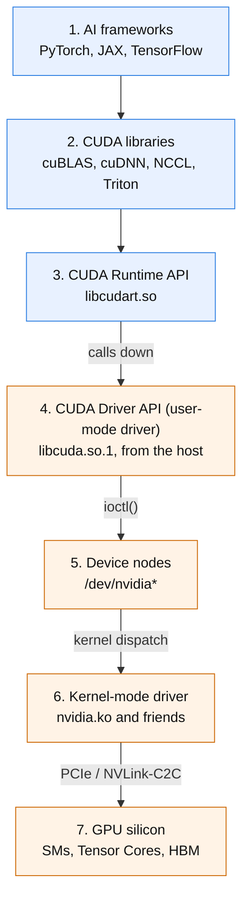
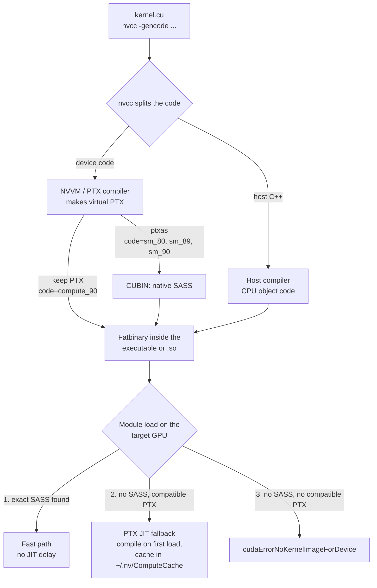

# 10.9 The NVIDIA software stack: driver, CUDA toolkit, container toolkit, compatibility

| | |
|---|---|
| Level | Intermediate |
| Priority tier | 1 |
| Lab venue | Nebius GPU |
| Part | Part 10: The GPU and CUDA |
| Sources used | `nvidia-devops` V3 Ch 2, Ch 11 & Lab 01; Legacy V4 Ch 2 (`02-gpu-software-operator-masterclass.md`); *AI Systems Performance Engineering* Ch 3; `bcm11-containerization`; `bcm11-install` |
| Coverage file | `planning/coverage/chapters/10-09.md` |
| Claim ledger | `planning/ledgers/10-09.md` |

## Why this matters for AI infrastructure

When a containerized AI job fails to start, the Python error message rarely names the layer that is actually broken. A developer might see a missing-device error inside a pod on a node where host `nvidia-smi` reports eight healthy GPUs. Another pod may import PyTorch cleanly and report that CUDA is available, only to crash on its very first tensor allocation because no kernel image matches the GPU architecture. A third cluster upgrade from T4 GPUs to L40S GPUs can stall every pod at startup while exhausting host CPU memory across the node.

These failures happen because a GPU container is not a virtual machine with its own operating system kernel. Saying that a container includes CUDA only describes the user-space half of a seven-layer execution contract. That contract starts in Python frameworks and domain libraries and passes through the CUDA Runtime API. It then crosses the Container Device Interface boundary into the host user-mode driver, Linux character device nodes, and ring-0 kernel modules.

| Production symptom | Underlying software stack failure | Quantified operational impact |
|---|---|---|
| `RuntimeError: No CUDA GPUs are available` or `CUDA_ERROR_NO_DEVICE` | Container lacks `/dev/nvidia*` character nodes, lacks `libcuda.so.1`, or has `NVIDIA_VISIBLE_DEVICES=none` / `CUDA_VISIBLE_DEVICES=""` (`nvidia-devops` V3 Ch 2, Lab 01). | 8 healthy host GPUs appear as 0 devices inside the pod. |
| `RuntimeError: CUDA error: no kernel image is available for execution on the device` | Binary fatbinary has native SASS for older GPUs (`sm_80`, `sm_86`) and no PTX fallback when launched on Hopper H100 (`sm_90`) (`nvidia-devops` V3 Ch 11). | Pod passes `import torch` and `torch.cuda.is_available()`, then crashes on first kernel launch. |
| Multi-pod startup hang and host OOM after upgrading T4 (`sm_75`) to L40S (`sm_89`) | Driver rejects `sm_75` SASS and compiles embedded `compute_75` PTX via JIT across 10 concurrent pods (`nvidia-devops` V3 Ch 11; Legacy V4 Ch 2). | 15 minutes startup stall per pod and 5 GB host RAM per pod, exhausting 50 GB across 10 pods. |
| First inference request spikes after every pod restart | PTX-only build triggers JIT compilation on request 1 because `~/.nv/ComputeCache` is ephemeral or `CUDA_CACHE_DISABLE=1` (`nvidia-devops` V3 Ch 11). | Request 1 takes 2,340.6 ms vs 12.8 ms steady state (`182.86x` / `~190x` slower). |

In this chapter, we map every layer of the NVIDIA software stack from Python down to the Linux kernel modules. We trace how `nvcc` compiles device code into virtual PTX and native SASS fatbinaries. We also explain the rules of driver backward compatibility, minor version compatibility, and forward compatibility. Finally, we show how the NVIDIA Container Toolkit and CDI inject host GPUs into containers and walk the seven-step validation ladder that isolates any stack failure in minutes.

:::tip In one minute
- Seven layers sit between Python and GPU silicon. The container image supplies frameworks, CUDA libraries, and the Runtime API `libcudart.so`, while the host supplies the user-mode driver `libcuda.so.1`, `/dev/nvidia*` device nodes, and kernel modules.
- CUDA initialization is lazy. Importing PyTorch or checking the device count does not create a GPU context or verify kernel binaries. Those checks wait until the first tensor allocation or kernel launch.
- Fatbinaries combine architecture-specific SASS machine code with virtual PTX assembly. Native SASS loads immediately without compilation overhead. Virtual PTX provides forward compatibility through driver JIT compilation at the cost of cold-start latency and host RAM.
- Three version rules govern the boundary. The host user-mode driver and kernel-mode driver must match to the exact version string. Newer host drivers run older CUDA runtimes via backward compatibility, while `/usr/local/cuda/compat` lets newer CUDA toolkits run on older enterprise host drivers.
:::

---

## Prerequisites and outcomes

**Prerequisites:** Complete Chapters 10.1 through 10.8 on GPU architecture, execution model, memory hierarchy, interconnects, generations, and `nvidia-smi` node operations. You should also review Chapter 5.2 on container runtimes, `containerd`, and `runc`.

**Outcomes:** After completing this chapter, you will be able to:
- Trace a GPU operation from Python frameworks and C++ libraries through the CUDA Runtime API, CUDA Driver API, character device nodes, and the four Linux kernel modules.
- Explain how the CUDA compiler splits host and device code, contrast native SASS against virtual PTX, design fatbinary flags for mixed GPU fleets, and diagnose missing kernel images and PTX JIT storms.
- Verify kernel-to-user driver matching, driver backward compatibility, CUDA minor version compatibility, and CUDA Forward Compatibility across host drivers and container images.
- Configure the NVIDIA Container Toolkit and CDI with `containerd`, explain why container PID namespaces hide host processes in `nvidia-smi`, and execute the seven-layer CUDA validation program.

---

## 1. The Seven-Layer NVIDIA Software Stack: From Python to `nvidia.ko`

When a researcher runs a single line of PyTorch code on a GPU, that call crosses seven distinct software and hardware layers. When any one of those layers is missing or mismatched, the job fails with an opaque runtime error. Knowing which boundary sits inside the container image and which sits on the host is the foundation of GPU troubleshooting.



Layers 1 through 3 normally live inside the container image. Layers 4 through 7 come from the host operating system and hardware. The NVIDIA Container Toolkit or CDI injects layers 4 and 5 into the container mount namespace at startup.

| Layer | What lives there | Where it comes from |
|---|---|---|
| 1. AI frameworks | PyTorch (TorchDynamo, AOT Autograd, TorchInductor), JAX, TensorFlow (*AI Systems Performance Engineering* Ch 3, pp. 56–62). | Container image |
| 2. CUDA libraries | C++: cuBLAS, cuDNN, NCCL, CUTLASS, cuFFT, cuSPARSE, cuRAND. Python: OpenAI Triton, NVIDIA Warp, CUDA Python, CuTe DSL, cuTile, cuPyNumeric, CuPy (*AI Systems Performance Engineering* Ch 3, pp. 56–62). | Container image |
| 3. CUDA Runtime API | `libcudart.so` (`cudaGetDeviceCount`, `cudaMalloc`, `cudaMemcpy`, `kernel<<<grid,block>>>`, streams), under `/usr/local/cuda-X.Y/lib64/`. The context is created lazily on the first device operation (`nvidia-devops` V3 Ch 2). | Container image |
| 4. CUDA Driver API | `libcuda.so.1` (`cuInit`, `cuCtxCreate`, `cuModuleLoadData`, `cuLaunchKernel`). Host path `/usr/lib/x86_64-linux-gnu/libcuda.so.1`, bind-mounted into the container, or `/usr/local/cuda/compat` (`nvidia-devops` Legacy V4 Ch 2). | Host driver |
| 5. Device nodes | `/dev/nvidia0..N` (major 195, minor 0..N), `/dev/nvidiactl` (195, 255), `/dev/nvidia-modeset` (195, 254), `/dev/nvidia-uvm` and `/dev/nvidia-uvm-tools` (major 234 or 238, minor 0 and 1) (`nvidia-devops` V3 Lab 01; Legacy V4 Ch 2). | Host kernel |
| 6. Kernel-mode driver | `nvidia.ko` (core: PCIe, MMU, interrupts, Xid), `nvidia-uvm.ko` (unified memory paging), `nvidia-modeset.ko` and `nvidia_drm.ko` (display), `nvidia-peermem.ko` (GPUDirect RDMA) (`nvidia-devops` Legacy V4 Ch 2). | Host kernel |
| 7. GPU silicon | PCI vendor ID `10de` (such as `10de:20b0` class `0302` on A100); command processor, copy engines, SMs, Tensor Cores, HBM (`nvidia-devops` V3 Lab 01). | Hardware |

### 1.1 Layers 1 and 2: PyTorch, `torch.compile`, C++ domain libraries, and Python CUDA DSLs

Engineers rarely write raw CUDA C++ for standard neural network layers. However, when an operator upgrades a container base image, library changes in Layers 1 and 2 can alter kernel selection and memory behavior. Knowing how Python calls map to underlying compiled libraries lets you tell a framework bug apart from a driver failure.

In eager mode, PyTorch dispatches matrix multiplications to cuBLAS, convolutions and attention primitives to cuDNN, and multi-GPU collectives to NCCL. When a model is wrapped in `torch.compile`, TorchDynamo captures the compute graph and AOT Autograd traces the forward and backward passes. TorchInductor then fuses elementwise operations and generates optimized OpenAI Triton kernels. Beneath cuBLAS and custom C++ extensions sits CUTLASS, which provides C++ templates for matrix multiplication and FlashAttention micro-tiling alongside cuFFT, cuSPARSE, and cuRAND.

Writing custom GPU kernels once required C++ and `nvcc`, but modern CUDA stacks include first-class Python domain-specific languages and libraries. Launched in early 2025, cuTile provides a tile-based Python abstraction that decomposes matrices into cache-friendly tiles without manual thread indexing. Its companion library cuPyNumeric acts as a distributed GPU drop-in replacement for NumPy arrays. Developers can also call Runtime and Driver APIs directly through CUDA Python and CuTe DSL, or compile Python functions into GPU machine code using NVIDIA Warp and OpenAI Triton.

### 1.2 Layer 3 vs Layer 4: CUDA Runtime API (`libcudart.so`) vs CUDA Driver API (`libcuda.so`)

When a container fails with a missing library or version error, the fastest way to isolate the fault is to check whether the CUDA Runtime library or the CUDA Driver library failed to load. Confusing these two shared libraries leads teams to rebuild container images when host driver injection is broken. Conversely, teams sometimes reinstall host drivers when a container image is simply missing its own toolkit path.

The CUDA Runtime API (`libcudart.so`) is a high-level convenience wrapper shipped inside the container's CUDA Toolkit directory. It implicitly initializes the driver, manages the primary context on the first device operation, and calls down into the lower-level CUDA Driver API (`libcuda.so.1`). The Driver API is the user-mode half of the host NVIDIA driver. It is bind-mounted into the container at runtime so it can speak directly to the host kernel module via `ioctl()` system calls.

| Attribute | CUDA Runtime API (`libcudart.so`) | CUDA Driver API (`libcuda.so.1`) |
|---|---|---|
| Header & function prefix | `<cuda_runtime.h>` — functions start with `cuda` (`cudaGetDeviceCount`, `cudaMalloc`, `cudaMemcpy`, `cudaLaunchKernel`). | `<cuda.h>` — functions start with `cu` (`cuInit`, `cuCtxCreate`, `cuModuleLoadData`, `cuLaunchKernel`). |
| Abstraction level | Higher-level convenience API that implicitly creates and binds the primary `CUcontext` on first device use and loads modules automatically. | Lower-level explicit API exposing raw control over `CUcontext`, compiled PTX/CUBIN `CUmodule` objects, and virtual memory. |
| Where it lives on disk | `/usr/local/cuda-12.4/lib64/libcudart.so.12`, installed by the CUDA Toolkit inside the container image or host `/usr/local/cuda`. | `/usr/lib/x86_64-linux-gnu/libcuda.so.1`, installed by the host NVIDIA driver package and bind-mounted into containers at runtime. |
| Operational consequence | Lazy initialization means importing `libcudart.so` or running `import torch` does not touch the GPU until the first device operation. | Strict kernel coupling means `libcuda.so.1` communicates via `ioctl()` with `nvidia.ko` and must match its exact version unless using `/usr/local/cuda/compat`. |

### 1.3 Layers 5 and 6: Linux character devices (`/dev/nvidia*`) and the four kernel modules (`KMD`)

User-space processes cannot touch PCIe Base Address Registers, GPU page tables, or hardware interrupts directly. If the host kernel modules are not loaded, user-space libraries have no path to the hardware. The same failure happens if the character device nodes under `/dev/` are not mounted into the container.

To cross from user space into kernel space, the user-mode driver opens Linux character device files and issues `ioctl()` system calls to the Kernel-Mode Driver. The core kernel module `nvidia.ko` handles device initialization, memory allocation, and command submission. Three companion kernel modules provide Unified Virtual Memory paging, display mode-setting, and zero-copy GPUDirect RDMA peer memory registration for InfiniBand and RoCE network adapters.

| Kernel module (`.ko`) | Associated `/dev/` character devices (`major, minor`) | Core responsibility in an AI factory | Exact symptom when missing or broken |
|---|---|---|---|
| `nvidia.ko` | `/dev/nvidia0`, `/dev/nvidia1`, ... (`195, 0..N`) and `/dev/nvidiactl` (`195, 255`) | Core driver: PCIe initialization, GPU context state, VRAM allocation, command-ring submission, interrupt handling, and Xid error logging. | `nvidia-smi` fails immediately; `cudaGetDeviceCount()` returns an error if `/dev/nvidiactl` or `/dev/nvidia0` is missing or lacks `rw` permissions. |
| `nvidia-uvm.ko` (`nvidia_uvm`) | `/dev/nvidia-uvm` (`234, 0` or `238, 0`, dynamic major) and `/dev/nvidia-uvm-tools` (`234, 1`) | Unified Virtual Memory: handles GPU page faults and migrates pages on demand between CPU RAM and GPU HBM across a shared virtual address space. | Basic `cudaMalloc` programs may still run, but `cudaMallocManaged` and modern deep learning frameworks fail during initialization. |
| `nvidia-modeset.ko` (`nvidia_modeset`) | `/dev/nvidia-modeset` (`195, 254`) | Display mode-setting engine, often loaded alongside `nvidia_drm.ko`. | Irrelevant for headless compute math, but holds a module reference count on `nvidia.ko` that prevents `rmmod nvidia` until `nvidia_modeset` is unloaded first. |
| `nvidia-peermem.ko` (`nvidia_peermem`) | Kernel peer-memory client; no separate `/dev` node | Registers GPU HBM physical pages with the InfiniBand/RoCE RDMA subsystem (`mlx5` / MOFED) so NICs can DMA directly to and from GPU memory. | Intra-node NVLink works normally, but multi-node training over InfiniBand/RoCE silently falls back to staging packets through host CPU RAM. |

---

## 2. Compilation, Fatbinaries (`PTX` vs `SASS` / `CUBIN`), and Version Compatibility

### 2.1 How `nvcc` compiles CUDA code: Host code, `PTX` (`compute_XX`), and `SASS` / `CUBIN` (`sm_XX`)

A container image built on one GPU generation can crash immediately or stall for 15 minutes when scheduled onto a newer GPU generation. That happens because native GPU machine instructions are not binary-compatible across hardware generations the way `x86_64` CPU instructions are.

A CUDA source file mixes CPU functions and GPU kernels, so the `nvcc` compiler driver splits the file into two compilation paths. Host C++ code goes to the host compiler, while device code is compiled first into virtual PTX assembly. Next, the `ptxas` assembler compiles that PTX into architecture-specific native SASS machine code packaged inside a CUBIN. Both the native CUBINs and optional virtual PTX are embedded together inside the executable or shared library as a fatbinary.



When the driver loads that fatbinary on a target GPU, it checks for an exact native SASS match first. If no matching SASS is present, it falls back to JIT-compiling embedded PTX. If neither compatible SASS nor compatible PTX is present, module loading fails with `cudaErrorNoKernelImageForDevice`.

| GPU architecture & model | Compute capability target (`sm_XX` / `compute_XX`) | Fatbinary execution behavior |
|---|---|---|
| Volta V100 | `sm_70` / `compute_70` | Native SASS runs only on `sm_70`; PTX `compute_70` can be JIT-compiled onto newer GPUs (`nvidia-devops` V3 Ch 11). |
| Turing T4 | `sm_75` / `compute_75` | Native SASS runs on T4; upgrading nodes to L40S without `sm_89` SASS triggers PTX JIT from `compute_75`. |
| Ampere A100 | `sm_80` / `compute_80` | Native SASS for data-center Ampere; cannot execute natively on `sm_86`, `sm_89`, or `sm_90` without PTX or matching SASS. |
| Ampere A10 / A40 | `sm_86` / `compute_86` | Native SASS for GA102 Ampere GPUs (`nvidia-devops` V3 Ch 11). |
| Ada Lovelace L4 / L40S | `sm_89` / `compute_89` | Native SASS for Ada inference GPUs (`nvidia-devops` V3 Ch 11). |
| Hopper H100 / H200 | `sm_90` / `compute_90` | Native SASS for Hopper; fast path takes 12.8 ms on request 1 vs 2,340.6 ms when JIT-compiling PTX. |
| Blackwell B200 | `sm_100` / `compute_100` | Native SASS for Blackwell data-center GPUs (`code/part10/nvidia_software_stack.py`). |

To get instant startup across every GPU family in your fleet plus forward compatibility for future hardware refreshes, compile production binaries with explicit `-gencode` flags. Include native SASS targets for each active GPU architecture in your cluster and add a PTX fallback for the highest target.

```bash
# Build native SASS for A100 (sm_80), L4/L40S (sm_89), and H100/H200 (sm_90), plus PTX (compute_90) for future GPUs
nvcc -O3 \
     -gencode arch=compute_80,code=sm_80 \
     -gencode arch=compute_89,code=sm_89 \
     -gencode arch=compute_90,code=sm_90 \
     -gencode arch=compute_90,code=compute_90 \
     -o inference_engine inference_engine.cu
```

When building PyTorch C++ or CUDA extensions inside a Dockerfile, set `TORCH_CUDA_ARCH_LIST` so every target architecture and a PTX fallback are compiled into the wheel.

```bash
export TORCH_CUDA_ARCH_LIST="8.0;8.9;9.0+PTX"
```

### 2.2 Two real-world PTX/SASS production incidents (`resolve_fatbinary_execution_path`)

Missing native SASS in a container image causes two distinct production failure patterns depending on whether PTX was included. Without PTX, the pod crashes on its first GPU operation. With PTX, the driver JIT compiler compiles every kernel at runtime and caches the output in `~/.nv/ComputeCache` unless caching is disabled.

Our chapter model in `code/part10/nvidia_software_stack.py` reproduces both incidents from `nvidia-devops` Volume 03 Chapter 11. In the first incident, an H100 inference pod running a PTX-only build suffers a cold-start spike on its first live request. It also loses its compute cache on every restart if the container root filesystem is ephemeral. In the second incident, scaling ten pods on an L40S node with an older T4 image triggers ten concurrent PTX JIT compiler processes that exhaust host CPU RAM and crash the node.

| Incident scenario | Fatbinary contents vs target GPU | Measured latency & memory metrics (`nvidia-devops` V3 Ch 11) | Permanent engineering fix |
|---|---|---|---|
| 1. Single-request cold-start spike on H100 | PTX-only build (`compute_90`, no `sm_90` SASS) on H100 (`sm_90`). | Request 1 takes `2,340.6 ms`; Requests 2–5 take `12.8 ms`, `11.4 ms`, `11.9 ms`, and `12.1 ms` (`2,340.6 / 12.8 = 182.86x`, or `~190x` slower). | Compile native `sm_90` SASS, mount a persistent volume for `~/.nv/ComputeCache` (with `CUDA_CACHE_DISABLE` unset), and run a warmup probe. |
| 2. T4 to L40S 10-pod JIT host-RAM OOM storm | Native SASS for T4 (`sm_75`) + `compute_75` PTX deployed on L40S (`sm_89`). | Each pod invokes `libnvidia-ptxjitcompiler.so.1` for `15 minutes` and uses `5 GB` of host CPU RAM; `10` pods consume `10 * 5 GB = 50 GB` host RAM and OOM-crash the node. | Add `8.9` (`sm_89`) to `TORCH_CUDA_ARCH_LIST` so the image ships native Ada SASS. |
| 3. Missing kernel image crash on H100 | Native SASS for `sm_80` and `sm_86` only, with no PTX fallback, deployed on H100 (`sm_90`). | `import torch` and `torch.cuda.is_available()` pass, then first kernel fails with `CUDA error: no kernel image is available for execution on the device`. | Rebuild with `-gencode arch=compute_90,code=sm_90` and `-gencode arch=compute_90,code=compute_90`. |

### 2.3 The three driver and CUDA compatibility rules (`evaluate_driver_cuda_compatibility`)

Engineers often wonder why `nvidia-smi` prints a CUDA version in its header even on a bare-metal host where the CUDA Toolkit is not installed. That banner reports the highest CUDA Driver API capability supported by the installed host driver, not which CUDA Runtime library lives inside a container.

Three strict version rules govern whether a container's CUDA Runtime can execute against a host's NVIDIA driver. First, the host user-mode driver and kernel-mode driver must match to the exact version string, or every NVML and CUDA call fails immediately. Second, driver backward compatibility and minor version compatibility allow a newer host driver to run older CUDA toolkits and any minor release in the same major family. Third, when an enterprise host is locked to an older kernel driver branch, CUDA Forward Compatibility packages in `/usr/local/cuda/compat` supply a newer user-mode driver on the library search path.

| Compatibility rule | Version relationship & example (`nvidia-devops` V3 Ch 2, Lab 01; Legacy V4 Ch 2; Ch 9.12) | Runtime outcome & mechanism |
|---|---|---|
| 1. Host UMD (`libcuda.so`) == KMD (`nvidia.ko`) exact match | Client `libcuda.so` `535.104.05` vs loaded kernel module `nvidia.ko` `525.105.17`. | Fails immediately; `dmesg` logs `NVRM: API mismatch: the client has the version 535.104.05, but this kernel module has the version 525.105.17`. |
| 2. Driver backward & minor version compatibility | Host driver `535.154.05` or `550.90.07` running legacy CUDA `11.4` (`driver >= 450`) or CUDA `12.0`–`12.6` (`driver >= 525`, CUDA 13.x `driver >= 580`). | Succeeds natively; newer host `libcuda.so.1` supports older `libcudart.so` major versions and minor versions within the same major family. |
| 3. Missing forward compatibility on old host driver | Container with CUDA `12.2` (`libcudart.so.12`) on legacy host driver `450` (`< 525`) without `/usr/local/cuda/compat`. | Fails with `CUDA driver version is insufficient for CUDA runtime version` (`HOST_DRIVER_TOO_OLD`). |
| 4. CUDA Forward Compatibility (`/usr/local/cuda/compat`) | Container with CUDA `12.2` or `12.4` on older enterprise host driver with `/usr/local/cuda/compat` (`libcuda.so.535.104.05`) prepended to `LD_LIBRARY_PATH`. | Succeeds across supported branches; `ld.so` loads the newer compat `libcuda.so.535.104.05` before the host-mounted `libcuda.so.1`. |

When the kernel module and user-mode driver fall out of sync after a partial package upgrade, the kernel ring buffer prints the exact version mismatch string.

```text
NVRM: API mismatch: the client has the version 535.104.05, but this kernel module has the version 525.105.17
```

Official NGC containers ship forward-compatibility libraries inside `/usr/local/cuda/compat/` so a newer CUDA toolkit can bridge across supported older host kernel drivers.

```text
/usr/local/cuda/compat/
├── libcuda.so.1
├── libcuda.so.535.104.05
├── libnvidia-nvvm.so.1
└── libnvidia-ptxjitcompiler.so.1
```

Prepending `/usr/local/cuda/compat` to `LD_LIBRARY_PATH` inside the container entrypoint instructs the dynamic linker to resolve the newer user-mode driver first.

```bash
export LD_LIBRARY_PATH=/usr/local/cuda/compat:$LD_LIBRARY_PATH
```

---

## 3. Containerizing the GPU: NVIDIA Container Toolkit, `CDI`, and Namespace Traps

### 3.1 Four generations of container GPU injection: From `nvidia-docker` to `CDI`

Standard Linux containers use cgroups and namespaces to isolate CPU, memory, mount tables, and process IDs. A default container has no `/dev/nvidia*` character devices and no host user-mode driver. As a result, every GPU program inside an unconfigured container fails with a missing-device error until a runtime hook or CDI specification injects the host driver artifacts.

NVIDIA's container plumbing evolved across four generations from a brittle Docker CLI wrapper into the declarative Container Device Interface standard supported natively by modern container runtimes. Instead of relying on custom runtime wrappers, `nvidia-ctk` scans the host GPUs and writes a declarative YAML specification to `/var/run/cdi/nvidia.yaml`. That specification tells `containerd` or `CRI-O` which character devices and read-only host libraries to bind-mount into the container.

| Generation | Component & mechanism (`nvidia-devops` Legacy V4 Ch 2, Section 3.1) | Operational status |
|---|---|---|
| 1. `nvidia-docker` v1 | Standalone CLI wrapper around Docker that manually discovered and passed `--device` and `--volume` flags. | Legacy; obsolete and incompatible with Kubernetes CRI. |
| 2. `nvidia-docker2` | Custom `nvidia-container-runtime` wrapper around `runc`. | Legacy transitional runtime wrapper. |
| 3. `nvidia-container-toolkit` OCI pre-start hook | Registers an OCI pre-start hook calling `libnvidia-container` (`nvidia-container-cli`) to parse `NVIDIA_VISIBLE_DEVICES` and bind-mount `/dev/nvidia*`, `nvidia-smi`, and `libcuda.so.1`. | Widely deployed via `nvidia-container-runtime` handler in `/etc/containerd/config.toml`. |
| 4. CDI (`0.5.0`+, `/var/run/cdi/nvidia.yaml`) | `nvidia-ctk cdi generate` writes declarative specs (`nvidia.com/gpu=0`, `nvidia.com/gpu=all`) with device majors (`195`, `234`/`238`) and `ro, nosuid, nodev, bind` library mounts. | Modern CNCF standard supported natively by `containerd` 1.7+ (`enable_cdi = true`) and `CRI-O`. |

### 3.2 Why `nvidia-smi` inside a container shows an empty process list (the PID namespace trap)

A frequent operational surprise in Kubernetes GPU clusters occurs when an engineer opens a shell inside a busy training pod and runs `nvidia-smi`. Even when the pod is actively using 40 GB of GPU memory, the process table at the bottom of `nvidia-smi` inside the container prints `No running processes found`.

This happens because the host kernel driver records GPU context ownership using host root PID namespace identifiers. Inside the container's isolated PID namespace, that Python process has a small container-local PID, and the host PID directory does not exist inside the container's `/proc` mount. When `nvidia-smi` inside the container queries NVML and tries to inspect `/proc` for the host PID to resolve the process name, the lookup fails and the row is omitted. Operators should run `nvidia-smi` on the host, or rely on `dcgm-exporter` pod metrics, rather than enabling host PID sharing on untrusted pods.

| Execution context | VRAM usage reported by `nvidia-smi` | Process table entry (`nvidia-devops` Legacy V4 Ch 2, Section 19) | Why this happens |
|---|---|---|---|
| Bare-metal host OS | `40000MiB` / `40960 MiB` on GPU 0 | Lists `PID 2051234` (`python3`). | `/proc/2051234` exists in the host root PID namespace. |
| Inside container (`kubectl exec` / `crictl exec`) | `40000MiB` / `40960 MiB` on GPU 0 | Prints `No running processes found` (or unresolvable PIDs). | Process is `PID 1` (or `PID 42`) inside the container namespace; `/proc/2051234` does not exist inside the container. |

### 3.3 How BCM installs and owns the container stack (from the BCM 11 containerization manual)

On a Base Command Manager cluster, operators who manually install container toolkit packages on a compute node often find their fixes wiped out on the next reboot or operator reconciliation. The BCM 11 containerization manual defines whether the BCM node image or the NVIDIA GPU Operator owns each component.

For Docker clusters, BCM provides its own container toolkit package, which is installed into the compute node software image and activated by rebooting the nodes. For Kubernetes clusters, the setup wizard determines whether the BCM package or the GPU Operator manages the container toolkit and driver. Before editing a node by hand, identify which owner controls the stack so your change is not overwritten at the next image update or operator reconcile (my inference).

| Wizard choice or component (`bcm11-containerization` §2.7, §4.2, §6.7) | Who provides the container toolkit | Who provides the driver & how config is wired |
|---|---|---|
| Docker setup (`cm-docker-setup`, §2.7) | BCM package `cm-nvidia-container-toolkit` installed into the node image via `yum install --installroot=/cm/images/gpu-image cm-nvidia-container-toolkit` followed by node reboot. | Host driver; validated via `module load docker` and `docker run --runtime=nvidia --rm nvidia/cuda:11.4-base nvidia-smi` (manual sample shows Tesla K40c on driver `440.33.01`). |
| Kubernetes without GPU Operator (§4.2) | BCM package `cm-nvidia-container-toolkit` if enabled on the NVIDIA Container Toolkit wizard screen (default: not installed). | Host driver (provisioned by administrator or BCM image). |
| Kubernetes with GPU Operator selected (§4.2, §6.7) | GPU Operator (`toolkit.enabled` default on) via CDI plugins; wizard skips the two NVIDIA package screens unless `--adv-configuration-bcm-nvidia-packages` is passed, and installs `cuda-dcgm`. | Host driver by default (`driver.enabled` default off; `nfd.enabled` default on). On DGX OS images, the driver is always host-provisioned. |
| GPU Operator with `toolkit.enabled` off, or CDI disabled / older operator | BCM system package `cm-nvidia-container-toolkit`. | Uses `containerd` runtime-class drop-ins: `/cm/local/apps/containerd/var/etc/config.toml` imports `/cm/local/apps/containerd/var/etc/conf.d/*.toml` with drop-in `nvidia-cri`. |
| Custom Helm values, live cluster, or air-gapped install (§6.7) | Operator manages toolkit, device plugin, NFD, GFD, DCGM exporter, and validator daemonsets (`replicas: 10` time-slicing or MIG strategy can be passed via custom Helm values, which skips the wizard checklist). | Helm install on a running cluster avoids wizard image updates and reboots on a `500`-node fleet; air-gapped installs stage images and charts in the local registry. |

### 3.4 BCM packages for the driver and CUDA toolkit (from the BCM 11 installation manual)

When a bare-metal or Slurm job fails on a BCM cluster, the administrator must know whether the driver and CUDA toolkit live in the node's local software image or on the head node's shared filesystem. Installing or updating a driver package directly on a live compute node without updating its software image leaves the node out of sync after its next reboot.

As documented in Chapter 9 of the BCM 11 installation manual, BCM splits GPU software into local node-image packages and shared head-node packages. The newer open-source driver packages replace the older `cuda-driver` packages and compile the kernel module during package installation rather than at boot. Because kernel module compilation happens when the image is updated, Section 2.3's rule that the kernel module and user-mode driver must match applies to the entire software image at once. Changes to the software image are then pushed to running nodes with `imageupdate` in `cmsh`.

| BCM package category (`bcm11-install` Ch 9, April 2026) | Package names & versions | Install location & operational rules |
|---|---|---|
| Local node-image packages (compute nodes with GPUs) | `nvidia-driver` (metapackage with version tag such as `-590`; manual example reads README of `nvidia-driver-580`), `cuda-dcgm` (includes `dcgmi`), `cuda-dcgm-nvvs`, `nvidia-fabricmanager`, and `nvidia-fabricmanager-dev` (for NVSwitch hardware such as DGX). | Installed by default in BCM software images; push image changes to running nodes in `cmsh` using `imageupdate -n node0[01-10] -w`. |
| Shared toolkit packages (head node shared filesystem) | `cuda12.6-toolkit`, `cuda13.0-toolkit`, etc. Ubuntu `24.04` lists CUDA `12.5`, `12.6`, `12.8`, `12.9`, `13.0`, `13.1`; Rocky Linux `9.6` lists CUDA `11.7` to `13.1`. | Users switch versions via environment modules such as `module add shared cuda13.0`. |
| CPU-only login node cross-compilation | `nvidia-driver` installed on the CPU-only login node if jobs cannot compile on GPU nodes via the workload manager. | Must disable `nvidia-persistenced.service`, `nvidia-fabricmanager.service`, and `nvidia-dcgm.service` on the CPU-only node. |

Chapter 10.10 covers Fabric Manager in detail.

---

## 4. Commands and Configurations That Matter

All commands below follow the seven-layer validation chain from `nvidia-devops` Volume 03 Lab 01, Volume 03 Chapter 11, and Legacy Volume 04 Chapter 2. Because this handbook repository builds on a machine without an attached data-center GPU, host and container shell commands below are marked **(untested here)**.

### 4.1 Walk the 7-step host driver, device-node, and library verification chain (untested here)

When a node reports missing GPUs, walk the stack from the bottom up rather than guessing at container flags. Checking PCI enumeration, `nvidia-smi`, loaded kernel modules, character device nodes, and dynamic linker paths isolates whether the break is in hardware, kernel space, or user space.

```bash
# Step 1 (untested here): Confirm PCIe hardware enumeration (10de = NVIDIA vendor ID; 0302 = 3D controller)
lspci -Dnn | grep -i nvidia
# Illustrative output:
# 0000:07:00.0 3D controller [0302]: NVIDIA Corporation GA100 [A100 SXM4 40GB] [10de:20b0] (rev a1)

# Step 2 (untested here): Cross-check nvidia-smi Bus-Id, UUID, driver_version, and compute_cap
nvidia-smi --query-gpu=index,name,uuid,pci.bus_id,driver_version,compute_cap,memory.total --format=csv
# Illustrative output:
# index, name, uuid, pci.bus_id, driver_version, compute_cap, memory.total [MiB]
# 0, NVIDIA A100-SXM4-40GB, GPU-3f9a1c7e-88b2-4a5d-9e11-6c4f2a0d9b31, 00000000:07:00.0, 550.90.07, 8.0, 40960 MiB

# Step 3 (untested here): Confirm KMD kernel modules (nvidia, nvidia_uvm, nvidia_modeset, nvidia_peermem) & NVRM logs
lsmod | grep -E '^nvidia'
journalctl -k | grep -iE 'nvrm|nvidia|xid' | tail -n 50

# Step 4 (untested here): Verify /dev/nvidia* character device nodes and major/minor numbers
ls -l /dev/nvidia* 2>/dev/null || true
# Illustrative output:
# crw-rw-rw- 1 root root 195,   0 Mar  3 09:12 /dev/nvidia0
# crw-rw-rw- 1 root root 195, 255 Mar  3 09:12 /dev/nvidiactl
# crw-rw-rw- 1 root root 195, 254 Mar  3 09:12 /dev/nvidia-modeset
# crw-rw-rw- 1 root root 234,   0 Mar  3 09:12 /dev/nvidia-uvm
# crw-rw-rw- 1 root root 234,   1 Mar  3 09:12 /dev/nvidia-uvm-tools

# Step 5 (untested here): Check CUDA compiler (nvcc) and dynamic linker resolution for libcuda.so vs libcudart.so
nvcc --version 2>/dev/null || true
ldconfig -p | grep -E 'libcuda\.so|libcudart\.so' || true
# Illustrative output showing the two distinct install roots:
#   libcudart.so.12 (libc6,x86-64) => /usr/local/cuda-12.4/lib64/libcudart.so.12
#   libcuda.so.1 (libc6,x86-64) => /usr/lib/x86_64-linux-gnu/libcuda.so.1
```

### 4.2 Generate a CDI specification (`nvidia-ctk`) and configure `containerd` (untested here)

When host `nvidia-smi` works but containers cannot see GPU device nodes or the host user-mode driver, regenerate the CDI specification. Then verify that `containerd` has CDI and the NVIDIA runtime handler enabled in its configuration file.

```bash
# Generate the Container Device Interface (CDI) spec for all host GPUs (untested here)
sudo nvidia-ctk cdi generate --output=/var/run/cdi/nvidia.yaml

# Inspect the generated CDI device names (e.g., nvidia.com/gpu=0, nvidia.com/gpu=all) (untested here)
nvidia-ctk cdi list
```

Corresponding `/etc/containerd/config.toml` configuration for CDI and the NVIDIA runtime handler from `nvidia-devops` Legacy V4 Ch 2, Section 3.4:

```toml
version = 2
[plugins]
  [plugins."io.containerd.grpc.v1.cri"]
    enable_cdi = true
    [plugins."io.containerd.grpc.v1.cri".containerd]
      default_runtime_name = "runc"
      [plugins."io.containerd.grpc.v1.cri".containerd.runtimes]
        [plugins."io.containerd.grpc.v1.cri".containerd.runtimes.runc]
          runtime_type = "io.containerd.runc.v2"
        [plugins."io.containerd.grpc.v1.cri".containerd.runtimes.nvidia]
          privileged_without_host_devices = false
          runtime_type = "io.containerd.runc.v2"
          [plugins."io.containerd.grpc.v1.cri".containerd.runtimes.nvidia.options]
            BinaryName = "/usr/bin/nvidia-container-runtime"
```

### 4.3 Inspect compiled binaries for embedded `SASS` (`sm_XX`) and `PTX` (`cuobjdump`) (untested here)

When a binary fails with a missing kernel image error on a new GPU, inspect its fatbinary payload with `cuobjdump` before touching the cluster.

```bash
# 1. List embedded native SASS (CUBIN) ELF targets inside an executable or .so library (untested here)
cuobjdump --list-elf ./inference_engine | grep -i sm_

# 2. List embedded virtual PTX targets (empty output means NO PTX fallback is present) (untested here)
cuobjdump --list-ptx ./inference_engine

# 3. Diff dynamic library resolution across a container base-image update (12.4 -> 12.6) (untested here)
ldd ./inference_engine | sort
```

### 4.4 Compile and run the minimal end-to-end validation program (`cuda-validate.cu`) (untested here)

Because `import torch` is lazy and `nvidia-smi` does not test the CUDA Runtime API, `nvidia-devops` Volume 03 Lab 01 uses a minimal C++ validation binary. It forces device discovery, context creation, device memory allocation, kernel launch, synchronization, and device-to-host copy to confirm the sentinel result `42`.

```cpp
// cuda-validate.cu (from nvidia-devops Volume 03 Lab 01 Step 8)
#include <cuda_runtime.h>
#include <iostream>

__global__ void write_value(int* output) {
    if (threadIdx.x == 0 && blockIdx.x == 0) {
        *output = 42;
    }
}

int main() {
    int device_count = 0;
    cudaError_t status = cudaGetDeviceCount(&device_count);
    if (status != cudaSuccess || device_count < 1) {
        std::cerr << "cudaGetDeviceCount failed or 0 devices: "
                  << cudaGetErrorString(status) << "\n";
        return 1;
    }
    int* device_value = nullptr;
    cudaMalloc(&device_value, sizeof(int));
    write_value<<<1, 1>>>(device_value);
    status = cudaDeviceSynchronize();
    if (status != cudaSuccess) {
        std::cerr << "Kernel execution failed: " << cudaGetErrorString(status) << "\n";
        cudaFree(device_value);
        return 2;
    }
    int host_value = 0;
    cudaMemcpy(&host_value, device_value, sizeof(int), cudaMemcpyDeviceToHost);
    cudaFree(device_value);
    std::cout << "CUDA devices: " << device_count << "\nKernel result: " << host_value << "\n";
    return host_value == 42 ? 0 : 3;
}
```

Compile the validation binary for multiple architectures and run it on the target node or container (untested here).

```bash
nvcc -O2 -gencode arch=compute_80,code=sm_80 \
         -gencode arch=compute_89,code=sm_89 \
         -gencode arch=compute_90,code=sm_90 \
         -gencode arch=compute_90,code=compute_90 \
         -o cuda-validate cuda-validate.cu
./cuda-validate
```

---

## 5. How It Fails: Six Production Software Stack Failure Modes

When a GPU workload fails in production, matching the symptom to the exact layer boundary avoids blind node reboots. Our fault-isolation engine in `code/part10/nvidia_software_stack.py` combines these boundary checks into an automated auditor (my inference) covering the six classic failures from `nvidia-devops` Volume 03 and Legacy Volume 04 Chapter 2.

| # | Failure mode | Production symptom | Root cause & diagnostic evidence | Fix |
|---|---|---|---|---|
| 1 | Host KMD (`nvidia.ko`) vs UMD (`libcuda.so`) `NVRM: API mismatch` | `nvidia-smi` fails or Kubernetes Device Plugin reports `0` allocatable GPUs (`Failed to list devices`) after a driver package update. | `dmesg \| grep NVRM` prints `NVRM: API mismatch: the client has the version 535.104.05, but this kernel module has the version 525.105.17`. An older `nvidia.ko` remained held open in kernel memory during upgrade (`VL4 Ch 2 §6 Scenario B & §15.2`). | Run `lsof /dev/nvidia*` to kill rogue processes holding device descriptors, unload `nvidia_uvm` / `nvidia_modeset` / `nvidia` (`rmmod`), or drain and reboot the node. |
| 2 | `CUDA error: no kernel image is available for execution on the device` | `nvidia-smi`, `import torch`, and `torch.cuda.is_available()` succeed, but the first tensor operation crashes on a newer GPU (`H100`, `sm_90`). | `cuobjdump --list-elf` shows only older native SASS (`sm_80`, `sm_86`) and `cuobjdump --list-ptx` returns empty (`V3 Ch 11`). Lazy initialization delays the failure until first kernel load. | Rebuild with `-gencode arch=compute_90,code=sm_90` and `-gencode arch=compute_90,code=compute_90` (or add `9.0+PTX` to `TORCH_CUDA_ARCH_LIST`). |
| 3 | Multi-pod PTX JIT compilation storm (`15 min` startup & `50 GB` host RAM) | After upgrading nodes from `T4` (`sm_75`) to `L40S` (`sm_89`), pods take `15 minutes` to start (`2,340.6 ms` vs `12.8 ms` per module) and scaling `10` pods OOM-crashes the host CPU (`50 GB` RAM). | Binary contains `sm_75` SASS + `compute_75` PTX, but no `sm_89` SASS (`V3 Ch 11 Customer Scenario`). All `10` pods invoke `libnvidia-ptxjitcompiler.so` simultaneously (`5 GB` RAM each), or `~/.nv/ComputeCache` is ephemeral. | Compile native `sm_89` SASS into the image (`TORCH_CUDA_ARCH_LIST="8.9"`) and mount a persistent writable volume for `~/.nv/ComputeCache` (ensuring `CUDA_CACHE_DISABLE` is not `1`). |
| 4 | Works on host, fails in container (`CUDA_ERROR_NO_DEVICE`) | `nvidia-smi` works on the host, but inside the container `cudaGetDeviceCount()` returns `0` or `libcuda.so.1: cannot open shared object file`. | Either `env \| grep VISIBLE_DEVICES` shows `NVIDIA_VISIBLE_DEVICES=none` or `CUDA_VISIBLE_DEVICES=""` (`V3 Ch 2 Row 3 & Lab 01 Step 13`), or `/dev/nvidia*` and `libcuda.so.1` were not injected by `containerd` / CDI (`VL4 Ch 2 §6 Scenario C`). | Remove `NVIDIA_VISIBLE_DEVICES=none`, regenerate `/var/run/cdi/nvidia.yaml` with `sudo nvidia-ctk cdi generate`, and verify `enable_cdi = true` / `nvidia` runtime in `config.toml`. |
| 5 | Missing `/dev/nvidia-uvm` (`nvidia-uvm.ko` not loaded or not injected) | Basic `cudaMalloc` validation passes, but PyTorch, Triton, or Unified Memory (`cudaMallocManaged`) applications fail during initialization. | `ls -l /dev/nvidia*` shows `/dev/nvidia0` and `/dev/nvidiactl`, but `/dev/nvidia-uvm` is absent (`V3 Lab 01 Step 5` & `VL4 Ch 2 §2.1`). | Run `sudo modprobe nvidia-uvm` (and `sudo nvidia-modprobe -u -c=0`) on the host, and ensure `/dev/nvidia-uvm` is included in the CDI spec. |
| 6 | Driver container `Init:CrashLoopBackOff` on kernel header mismatch | On Kubernetes clusters using containerized drivers, `nvidia-driver-daemonset` fails in `Init:CrashLoopBackOff` after an OS kernel security patch (`apt upgrade linux-image`). | `kubectl logs` shows `kernel headers not found` or `gcc not found` for the new `uname -r` kernel (`VL4 Ch 2 §6 Scenario A`). | Install matching `linux-headers-$(uname -r)` on the node image, or enable `driver.usePrecompiled: true` so the operator pulls precompiled kernel modules instead of compiling on boot across `500` nodes. |

---

## 6. Hands-On Lab: Validate the 7-Layer Software Stack, Driver Compatibility, and Fatbinary Resolution

**Venue:** Any Linux machine or Nebius GPU VM with Python 3.10+. This lab runs deterministically using the Python standard library. All live Linux and CUDA shell commands are provided in Section 4 and marked `(untested here)`.

Run `code/part10/nvidia_software_stack_lab.py` to verify all 30 checks across kernel modules, device majors, driver compatibility, fatbinary resolution, and BCM ownership rules.

```bash
python3 code/part10/nvidia_software_stack_lab.py
```

Expected output (`30 passed, 0 failed`).

```text
=== Chapter 10.9 Lab: The NVIDIA Software Stack (Driver, CUDA, Container Toolkit & Compatibility) ===
  [PASS] VL4 Ch2 §2.1: Kernel-Mode Driver defines nvidia.ko, nvidia-uvm.ko, nvidia-modeset.ko, and nvidia-peermem.ko
  [PASS] V3 Lab 01 Step 5: nvidia.ko exposes /dev/nvidia0 and /dev/nvidiactl (major 195), and nvidia-uvm.ko exposes /dev/nvidia-uvm
  [PASS] V3 Ch11: Compute capabilities map T4=sm_75, A100=sm_80, A10=sm_86, L4/L40S=sm_89, H100/H200=sm_90
  [PASS] V3 Ch2 Customer Scenario: Host driver 535.154.05 natively runs legacy CUDA 11.4 container via driver backward compatibility
  [PASS] V3 Lab 01: Host driver 550.90.07 (>= 525) natively supports CUDA 12.4 container
  [PASS] VL4 Ch2 §6 Scenario B: Detects NVRM API mismatch (client 535.104.05 vs kernel module 525.105.17)
  [PASS] V3 Ch2 Customer Scenario: CUDA 12.2 container on legacy 450 host driver without forward-compat fails
  [PASS] VL4 Ch2 §8: /usr/local/cuda/compat (libcuda.so.535.104.05 on LD_LIBRARY_PATH) enables CUDA Forward Compatibility
  [PASS] V3 Ch11 Fig 3.11.1: Exact sm_90 SASS match loads on H100 via NATIVE_SASS_FAST_PATH with 0 JIT overhead (12.8 ms)
  [PASS] V3 Ch11 §Production Troubleshooting: PTX-only load takes 2,340.6 ms on request 1 vs 12.8 ms steady state (182.86x ~ 190x slower)
  [PASS] V3 Ch11 Customer Scenario: 10 pods on L40S (sm_89) with only T4 SASS (sm_75) + PTX consume 10 * 5 GB == 50.0 GB host RAM in JIT storm
  [PASS] V3 Ch11 Story: Binary with only sm_80/sm_86 SASS and no PTX fails on H100 (sm_90) with cudaErrorNoKernelImageForDevice
  [PASS] V3 Lab 01: Complete 7-layer CUDA validation chain (kernel result == 42) passes
  [PASS] V3 Lab 01 Step 1: Missing PCI vendor 10de isolates fault to 1_PCI_ENUMERATION below the driver
  [PASS] V3 Lab 01 Step 2: Failed nvidia-smi with PCI present isolates fault to 2_KERNEL_DRIVER_KMD
  [PASS] V3 Ch2 §Production Troubleshooting: Missing /dev/nvidia* in container with working host nvidia-smi isolates to 3_DEVICE_NODES_CDI
  [PASS] V3 Lab 01 Step 5 & VL4 Ch2 §2.1: Missing /dev/nvidia-uvm isolates fault to 3B_UVM_DEVICE_NODE
  [PASS] V3 Ch2 Row 3: NVIDIA_VISIBLE_DEVICES=none silently disables container GPU injection (4_ENV_VISIBILITY_FILTER)
  [PASS] V3 Lab 01 Step 13: CUDA_VISIBLE_DEVICES='' forces cudaGetDeviceCount() == 0 (4_ENV_VISIBILITY_FILTER)
  [PASS] V3 Ch2 & Lab 01 Step 7: Missing libcuda.so.1 in ldconfig -p isolates fault to 5_USER_MODE_DRIVER_LIBCUDA
  [PASS] V3 Lab 01 Step 7: Missing libcudart.so isolates fault to 6_CUDA_RUNTIME_LIBCUDART
  [PASS] V3 Ch2 & Ch11: Lazy init where import succeeds but first kernel fails isolates to 7_DEVICE_CODE_EXECUTION
  [PASS] Rejects unsupported CUDA major version
  [PASS] Rejects malformed host driver version string
  [PASS] Rejects invalid target_gpu_sm format
  [PASS] bcm11-containerization 4.2: with the GPU Operator selected, the wizard skips both NVIDIA package screens and the operator owns the toolkit via CDI
  [PASS] bcm11-containerization 4.2: --adv-configuration-bcm-nvidia-packages shows the screens even with the operator
  [PASS] bcm11-containerization 6.7.1: toolkit.enabled off means the BCM package owns the toolkit and containerd runtime-class drop-ins are used
  [PASS] bcm11-containerization 6.7.1: older operator or CDI disabled falls back to runtime-class drop-ins
  [PASS] bcm11-containerization 6.7: driver.enabled gives an operator driver container, but on DGX OS the driver is always host-provisioned

Summary: 30 passed, 0 failed (total 30)
```

---

## Exercises

1. **Isolating the Driver API library vs the Runtime API library.** Inside a container on a host with driver 550.90.07, running `ldconfig -p` shows the CUDA Runtime library under `/usr/local/cuda-12.4/lib64/`, but returns no lines for `libcuda.so`. State which component owns the User-Mode Driver library, which component owns the Runtime library, and which layer of the stack failed to inject the missing library.
2. **Diagnosing a missing kernel image error.** A container image built for A100 and A10 is deployed to an H100 node. Both `nvidia-smi` and the PyTorch availability check succeed, but the first tensor allocation crashes because no kernel image is available for execution on the device. Write the two `cuobjdump` commands that prove why the binary failed and the exact `-gencode` flags that fix it.
3. **Calculating PTX JIT cold-start slowdown and host RAM exhaustion.** Using the numbers in Table 2.2 from `nvidia-devops` Volume 03 Chapter 11, calculate the exact first-request slowdown ratio when a PTX-only build runs Request 1 versus Request 2. Then calculate the total host CPU RAM consumed when ten pods built only with T4 SASS and PTX land simultaneously on an L40S node.
4. **Driver backward vs forward compatibility matrix.** Evaluate the three deployments listed in Table 2.3. They cover a legacy CUDA 11.4 container on a newer host driver, a CUDA 12.2 container on a legacy host driver without forward-compatibility packages, and a CUDA 12.2 container using `/usr/local/cuda/compat`. State which deployments succeed and explain why.
5. **Resolving an API mismatch and stuck kernel module unload.** During a driver upgrade, `nvidia-smi` stops working and the kernel log prints an NVRM API mismatch. When you attempt to unload the kernel module, Linux reports that the module is in use. Write the commands to identify the blocking processes and dependent kernel modules and clear the mismatch.
6. **Character device audit.** A node exposes the primary GPU device node and master control device node, and the validation binary passes basic memory allocation. However, a workload using Unified Virtual Memory fails immediately. State which character device and kernel module are missing, and explain what happens to multi-node InfiniBand training if the peer-memory kernel module is also absent.
7. **Who owns the toolkit in BCM.** A BCM cluster was set up with the GPU Operator selected and the default checklist. A teammate installs the BCM container toolkit package into the node image and reboots the nodes to fix GPU access. Using Table 3.3, state who already provides the toolkit, how devices are injected, and who provides the driver. Then explain why the teammate's change conflicts and what changes if the operator's toolkit setting is disabled.

---

## Checkpoint questions (20)

<details>
<summary>`&lt;strong>`1. Name the seven layers of the NVIDIA GPU software stack from a high-level Python application down to the physical GPU hardware.`&lt;/strong>`</summary>

1. AI frameworks and compilers such as PyTorch, TorchDynamo, TorchInductor, JAX, and TensorFlow.
2. Domain and Python CUDA libraries such as cuBLAS, cuDNN, NCCL, CUTLASS, Triton, Warp, cuTile, and cuPyNumeric.
3. The CUDA Runtime API library `libcudart.so` in user space, shipped inside the CUDA Toolkit.
4. The CUDA Driver API / User-Mode Driver `libcuda.so.1` in user space, shipped with the host driver and mounted into containers.
5. Linux character device nodes under `/dev/nvidia*`.
6. The NVIDIA Kernel-Mode Driver modules in the host Linux kernel.
7. Physical GPU silicon with PCI vendor ID `10de`.
</details>

<details>
<summary>`&lt;strong>`2. What is the difference between `libcudart.so` (CUDA Runtime API) and `libcuda.so.1` (CUDA Driver API / User-Mode Driver), and where does each reside in a containerized setup?`&lt;/strong>`</summary>

- `libcudart.so` is the high-level CUDA Runtime library that manages contexts implicitly and lives inside the container image under `/usr/local/cuda-X.Y/lib64/`.
- `libcuda.so.1` is the low-level CUDA Driver API and User-Mode Driver that talks directly to the kernel driver. It lives on the host OS at `/usr/lib/x86_64-linux-gnu/libcuda.so.1`. The NVIDIA Container Toolkit or CDI bind-mounts it into the container unless overridden by `/usr/local/cuda/compat`.
</details>

<details>
<summary>`&lt;strong>`3. Why does `import torch` (and even `torch.cuda.is_available() == True`) NOT prove that a container can execute code on a GPU?`&lt;/strong>`</summary>

CUDA Runtime initialization is lazy. Importing PyTorch does not touch the GPU, and checking availability only verifies device enumeration via `cudaGetDeviceCount()`. Context creation, memory allocation, and loading native SASS or JIT-compiling PTX wait until the first operation that executes on the device. Examples include allocating a tensor on CUDA or running `cuda-validate`.
</details>

<details>
<summary>`&lt;strong>`4. Name the four NVIDIA Linux kernel modules (`KMD`) covered in this chapter and state the exact role of each.`&lt;/strong>`</summary>

1. `nvidia.ko` is the core kernel driver managing PCIe initialization, GPU contexts, VRAM allocation, command submission, interrupts, and Xid logging.
2. `nvidia-uvm.ko` manages Unified Virtual Memory, handling GPU page faults and migrating memory pages between CPU and GPU.
3. `nvidia-modeset.ko` is the display mode-setting module, often loaded as a dependency of the DRM module.
4. `nvidia-peermem.ko` exposes GPU HBM pages to InfiniBand and RoCE RDMA network adapters to enable zero-copy GPUDirect RDMA across nodes.
</details>

<details>
<summary>`&lt;strong>`5. Which `/dev/nvidia*` character devices must exist for a standard CUDA and Unified Memory workload to run, and what are their major/minor device numbers?`&lt;/strong>`</summary>

- `/dev/nvidia0` has major 195 and minor 0 for GPU 0, with subsequent GPUs incrementing the minor number.
- `/dev/nvidiactl` has major 195 and minor 255 as the master control device opened by every CUDA process.
- `/dev/nvidia-modeset` has major 195 and minor 254 as the mode-setting device node.
- `/dev/nvidia-uvm` and `/dev/nvidia-uvm-tools` use a dynamic major number such as 234 or 238 and are required for Unified Memory.
</details>

<details>
<summary>`&lt;strong>`6. Contrast `PTX` (`compute_XX`) and `SASS` / `CUBIN` (`sm_XX`) inside a CUDA fatbinary (`fatbin`).`&lt;/strong>`</summary>

- SASS (`code=sm_XX`) is architecture-specific native GPU machine code packaged in a CUBIN by `ptxas`. It runs immediately with zero compilation delay, but it is not forward-compatible with newer GPU generations.
- PTX (`code=compute_XX`) is a virtual intermediate assembly language. It is forward-compatible because the installed driver can JIT-compile PTX into native SASS for newer GPUs at load time, at the cost of first-load compilation latency and host CPU RAM.
</details>

<details>
<summary>`&lt;strong>`7. State the compute capability targets (`sm_XX`) for `V100`, `T4`, `A100`, `A10`/`A40`, `L4`/`L40S`, `H100`/`H200`, and `B200`.`&lt;/strong>`</summary>

| GPU model | Compute capability target |
|---|---|
| Volta V100 | `sm_70` |
| Turing T4 | `sm_75` |
| Ampere A100 | `sm_80` |
| Ampere A10 / A40 | `sm_86` |
| Ada Lovelace L4 / L40S | `sm_89` |
| Hopper H100 / H200 | `sm_90` |
| Blackwell B200 | `sm_100` |
</details>

<details>
<summary>`&lt;strong>`8. How do you prove with `cuobjdump` that a binary crashed with `cudaErrorNoKernelImageForDevice` on an `H100` (`sm_90`) because of a build-matrix gap rather than a driver bug?`&lt;/strong>`</summary>

1. Query `nvidia-smi` for the GPU name and compute capability to confirm the H100 reports compute capability 9.0.
2. Run `cuobjdump --list-elf` on the binary, which shows only older targets such as `sm_80` and `sm_86` and no `sm_90`.
3. Run `cuobjdump --list-ptx` on the binary, which returns empty output and proves no PTX fallback was embedded.
</details>

<details>
<summary>`&lt;strong>`9. Why did scaling 10 inference pods on a node upgraded from `T4` (`sm_75`) to `L40S` (`sm_89`) cause a 15-minute startup stall and a `50 GB` host CPU RAM crash?`&lt;/strong>`</summary>

The container binaries contained native SASS only for Turing plus a PTX fallback. On the Ada Lovelace L40S, the driver rejected the Turing SASS and launched ten concurrent PTX JIT compilations, each taking 15 minutes and consuming 5 GB of host RAM for 50 GB total. Adding Ada target `8.9` to `TORCH_CUDA_ARCH_LIST` eliminates the runtime JIT compilation.
</details>

<details>
<summary>`&lt;strong>`10. Where does the NVIDIA driver cache JIT-compiled PTX binaries, and why can Kubernetes pods suffer the `2,340.6 ms` cold-start penalty on every pod restart?`&lt;/strong>`</summary>

The driver caches JIT-compiled SASS in `~/.nv/ComputeCache` unless caching is disabled via `CUDA_CACHE_DISABLE=1`. If a Kubernetes pod uses an ephemeral container root filesystem or a read-only home directory, the cache is lost on every pod restart. Every new replica must then re-run PTX JIT compilation on its first live request.
</details>

<details>
<summary>`&lt;strong>`11. If a host node's driver is upgraded to `535.154.05`, do data scientists need to rebuild legacy Docker containers that contain `CUDA Toolkit 11.4`? Why or why not?`&lt;/strong>`</summary>

No. By driver backward compatibility, a newer host driver natively supports API calls from older CUDA Toolkit runtimes inside the container. A conflict only occurs when a container carries a newer CUDA Toolkit than the host driver supports.
</details>

<details>
<summary>`&lt;strong>`12. How does CUDA Forward Compatibility (`/usr/local/cuda/compat`) allow a newer CUDA Toolkit container to run on an older enterprise host kernel driver?`&lt;/strong>`</summary>

The container packages a newer user-mode driver and JIT compiler inside `/usr/local/cuda/compat/` and prepends that directory to `LD_LIBRARY_PATH`. The dynamic linker loads the compatibility `libcuda.so` before the older host-mounted driver library. That compatibility library bridges the newer CUDA Runtime to the older host kernel module across supported driver branches.
</details>

<details>
<summary>`&lt;strong>`13. What causes `NVRM: API mismatch: the client has the version 535.104.05, but this kernel module has the version 525.105.17`, and how do you fix it?`&lt;/strong>`</summary>

User-space tools were upgraded to the newer version, but the older kernel module is still loaded in kernel RAM because a running process held `/dev/nvidia*` open during the upgrade. Fix it by killing processes found via `lsof /dev/nvidia*` and unloading and reloading the kernel modules, or by draining and rebooting the node.
</details>

<details>
<summary>`&lt;strong>`14. Trace the four generations of NVIDIA container GPU injection from `nvidia-docker` v1 to `CDI`.`&lt;/strong>`</summary>

1. Generation 1 (`nvidia-docker`) was a wrapper CLI around Docker.
2. Generation 2 (`nvidia-docker2`) introduced a custom container runtime wrapper around `runc`.
3. Generation 3 (`nvidia-container-toolkit` OCI pre-start hook) uses `libnvidia-container` to inject device nodes and host driver libraries before container start.
4. Generation 4 (`CDI`) uses a declarative specification at `/var/run/cdi/nvidia.yaml` generated by `nvidia-ctk` and parsed natively by `containerd` and `CRI-O`.
</details>

<details>
<summary>`&lt;strong>`15. On a BCM 11 Kubernetes cluster that was set up with the GPU Operator selected, who installs the container toolkit and who installs the driver?`&lt;/strong>`</summary>

By default the GPU Operator manages the toolkit and hooks it in through CDI plugins, while the setup wizard skips installing the BCM container toolkit package. The driver comes from the host unless the operator driver container option is enabled, and on DGX OS images the driver is always host-provisioned. If the operator is older or CDI is disabled, `containerd` runtime-class drop-ins are used for device injection.
</details>

<details>
<summary>`&lt;strong>`16. Why does `nvidia-smi` run inside a container often show an empty `Processes:` list even when a Python training script inside that container is actively using 40 GB of VRAM?`&lt;/strong>`</summary>

The host kernel driver tracks GPU allocations by host PID, whereas the container runs in an isolated PID namespace where that process is PID 1. Because the host PID directory does not exist inside the container's `/proc` filesystem, `nvidia-smi` inside the container cannot resolve the process entry.
</details>

<details>
<summary>`&lt;strong>`17. What happens if a base image or CI template accidentally leaves `NVIDIA_VISIBLE_DEVICES=none` or `CUDA_VISIBLE_DEVICES=""` in the container environment?`&lt;/strong>`</summary>

- `NVIDIA_VISIBLE_DEVICES=none` instructs the NVIDIA Container Toolkit not to inject any GPUs into the container.
- `CUDA_VISIBLE_DEVICES=""` masks all GPUs from the CUDA Runtime so device enumeration returns zero devices even if `/dev/nvidia*` nodes are present.
- Both settings produce zero visible GPUs with no hardware error log, so operators should inspect environment variables first.
</details>

<details>
<summary>`&lt;strong>`18. Why should large Kubernetes clusters set `driver.usePrecompiled: true` when deploying containerized NVIDIA drivers via the GPU Operator?`&lt;/strong>`</summary>

Without precompiled drivers enabled, every node's driver pod must match the running kernel headers and compile the kernel module from source using `gcc` on every boot or kernel patch. That compilation fails with `Init:CrashLoopBackOff` whenever kernel headers mismatch, and it causes hundreds of nodes to saturate CPU and network compiling drivers simultaneously.
</details>

<details>
<summary>`&lt;strong>`19. During an automated driver upgrade, why does `rmmod nvidia` fail with `Error: Module nvidia is in use`, and what command reveals the culprit?`&lt;/strong>`</summary>

Either dependent kernel modules (`nvidia_uvm`, `nvidia_drm`, `nvidia_modeset`, `nvidia_peermem`) are still loaded, or a user-space process still holds an open file descriptor to `/dev/nvidia*`. Run `lsof /dev/nvidia*` to find and terminate the process, then unload dependent modules before unloading `nvidia`.
</details>

<details>
<summary>`&lt;strong>`20. Contrast the three GPU sharing strategies—`Time-Slicing`, `MPS` (Multi-Process Service), and `MIG` (Multi-Instance GPU)—in terms of compute concurrency, memory isolation, and fault isolation.`&lt;/strong>`</summary>

- Time-Slicing switches contexts temporally across pods and works on all GPUs, but provides no memory isolation and no fault isolation.
- MPS funnels multiple processes into a shared GPU context for spatial SM concurrency, but provides no hardware fault isolation if one client triggers a fatal GPU fault.
- MIG on A100, A30, H100, H200, and B200 partitions the hardware into up to 7 instances with dedicated SMs, memory controllers, and L2 cache slices, providing strict hardware memory, bandwidth, and fault isolation.
</details>

---

## Sources and review notes

### Primary sources read in full for this chapter

| Source | Coverage & key topics extracted |
|---|---|
| *AI Systems Performance Engineering* (`ai-systems-performance-engineering`, Chris Fregly), Chapter 3 (*OS, Docker, and Kubernetes Tuning for GPU-Based Environments*, "NVIDIA Software Stack", pp. 56–62) | End-to-end software stack (`Figure 3-1`), GPU Driver (`nvidia-smi`, persistence mode), CUDA Toolkit and Runtime (`nvcc`, `cudart`, `cuDNN`, `cuBLAS`, `NCCL`, compute capability), CUDA Forward and Backward Compatibility (`Figure 3-2`, virtual PTX vs architecture-specific CUBIN / SASS inside a fatbinary), C++ and Python CUDA libraries (`CUTLASS`, `CUDA Python`, `CuTe DSL`, `cuTile` and `cuPyNumeric` launched early 2025, `CuPy`, `NVIDIA Warp`, OpenAI `Triton`), and PyTorch compiler stack (`Figure 3-3`, `torch.compile`, `TorchDynamo`, `AOT Autograd`, `TorchInductor`, `XLA`). |
| `nvidia-devops` Volume 03 (`chapter-02-cuda-software-stack.md`, 2,903 words; `chapter-chapter-02-cuda-software-stack.md`, 881 words; `chapter-11-compilation-binaries-and-compatibility.md`, 3,043 words; `chapter-chapter-11-compilation-binaries-and-compatibility.md`, 882 words; `labs/lab-01-inspect-and-validate-a-cuda-environment.md`, 3,069 words) | Fault-isolation ladder (`Figure 3.2.1` & `Figure 3.L1.1`), Runtime API (`libcudart.so` in `/usr/local/cuda-12.4/lib64/`) vs Driver API (`libcuda.so.1` in `/usr/lib/x86_64-linux-gnu/`), lazy context initialization, `NVIDIA_VISIBLE_DEVICES=none` and `CUDA_VISIBLE_DEVICES=""` traps, driver backward compatibility (`535` running CUDA `11.4`), `nvcc -gencode` (`sm_80`, `sm_86`, `sm_89`, `sm_90`, `compute_90`), `cuobjdump --list-elf` / `--list-ptx`, `cudaErrorNoKernelImageForDevice`, PTX JIT cold-start timing (`2,340.6 ms` Request 1 vs `12.8 ms` Request 2 = `182.86x` ~ `190x` slower), `~/.nv/ComputeCache` & `CUDA_CACHE_DISABLE`, the T4 (`sm_75`) to L40S (`sm_89`) 10-pod x `5 GB` = `50 GB` host RAM JIT storm (`TORCH_CUDA_ARCH_LIST`), and `cuda-validate.cu` (`Kernel result: 42`). |
| `nvidia-devops` Legacy Volume 04 Chapter 02 (`volume-04/02-gpu-software-operator-masterclass.md`, 7,341 words) | Kernel-Mode Driver (`nvidia.ko`, `nvidia-modeset.ko`, `nvidia-uvm.ko`, `nvidia-peermem.ko`), `/dev/nvidia*` character devices (`major 195`, `234`/`238`), 4 generations of NVIDIA Container Toolkit (`nvidia-docker` to `nvidia-docker2` to OCI pre-start hook to CDI `0.5.0` `/var/run/cdi/nvidia.yaml` via `nvidia-ctk`), `/etc/containerd/config.toml` (`enable_cdi = true`), CUDA Forward Compatibility (`/usr/local/cuda/compat/libcuda.so.535.104.05` on `LD_LIBRARY_PATH`), `NVRM: API mismatch` (`535.104.05` vs `525.105.17`), `lsof /dev/nvidia*` on `rmmod` failure, `driver.usePrecompiled: true`, PID namespace mismatch in container `nvidia-smi`, and Time-Slicing vs MPS vs MIG comparison (Kubernetes Device Plugin and GPU Operator reconciliation state machine are expanded in Chapters 11.2 and 11.4). |
| `bcm11-containerization` and `bcm11-install` (BCM 11 manuals) | `bcm11-install` Chapter 9 (CUDA for GPUs: package table, `nvidia-driver` replacing `cuda-driver`, default image contents, `imageupdate`, login-node compilation guidance; read through Section 9.1.2 and start of 9.2). `bcm11-containerization` Section 2.7 Docker Setup For NVIDIA (read in full), Section 4.2 Kubernetes Setup (the two NVIDIA package screens, `--adv-configuration-bcm-nvidia-packages`, `containerd` drop-in layout), and Section 6.7 The NVIDIA GPU Operator (wizard checklist and Helm install notes). Not read: the rest of Chapters 4 and 6 (13,000 and 25,000 words) and Chapters 3, 5, 7, 8. |

### Related source files mapped in `MIGRATION_MAP.md`

```text
- nvidia-zero-to-hero/volume-03/chapter-02-cuda-software-stack.md (migrated in full here)
- nvidia-zero-to-hero/volume-03/chapter-chapter-02-cuda-software-stack.md (migrated in full here)
- nvidia-zero-to-hero/volume-03/chapter-11-compilation-binaries-and-compatibility.md (migrated in full here)
- nvidia-zero-to-hero/volume-03/chapter-chapter-11-compilation-binaries-and-compatibility.md (migrated in full here)
- nvidia-zero-to-hero/volume-03/labs/lab-01-inspect-and-validate-a-cuda-environment.md (migrated in full here)
- volume-04/02-gpu-software-operator-masterclass.md (driver/CUDA/CDI/compatibility sections migrated here; K8s Device Plugin & GPU Operator sections also mapped to 11.2 and 11.4)
```

### Run here
- The chapter lab `code/part10/nvidia_software_stack_lab.py` passes all 30 checks with zero failures.

### Explicitly labelled inferences
- Combining the seven-layer CUDA validation chain, the compatibility rules, and the fatbinary load-time simulator into the deterministic Python auditor `code/part10/nvidia_software_stack.py` is **my inference**.

### Not verified on live hardware
- Physical GPU nodes were not attached during this build. All shell commands in Section 4 (`/usr/bin/nvidia-smi`, `/etc/cdi/nvidia.yaml`, `cuda-compat-12-x`, `cm-kubernetes-setup`, `nvidia-cuda-mps-control`, `KERNEL_MODULES`, `BARs`, `aarch64`, `code=compute_80`, `cuda...` Runtime vs `cu...` Driver calls, `torch.matmul` / `nn.Linear`, `AllReduce` / `AllGather`, pp. `25`, `58`, `59`, `60`, and `61`, cross-referenced with Chapter `10.19`) are marked `(untested here)`.

### Not in the corpus
- Exact driver branch support tables for newly released CUDA 13.x point releases should be cross-checked against the official NVIDIA CUDA Compatibility documentation for your target driver branch.

### Corrections to the author's notes
- The Docker test in the BCM containerization manual Section 2.7 shows a legacy Tesla K40c and driver 440.33.01, which is cited in Table 3.3 only for the command structure.
- Both dynamic major numbers shown for Unified Virtual Memory in the notes (234 and 238) are included in Table 1.3 and explained as dynamically allocated Linux character device majors.

