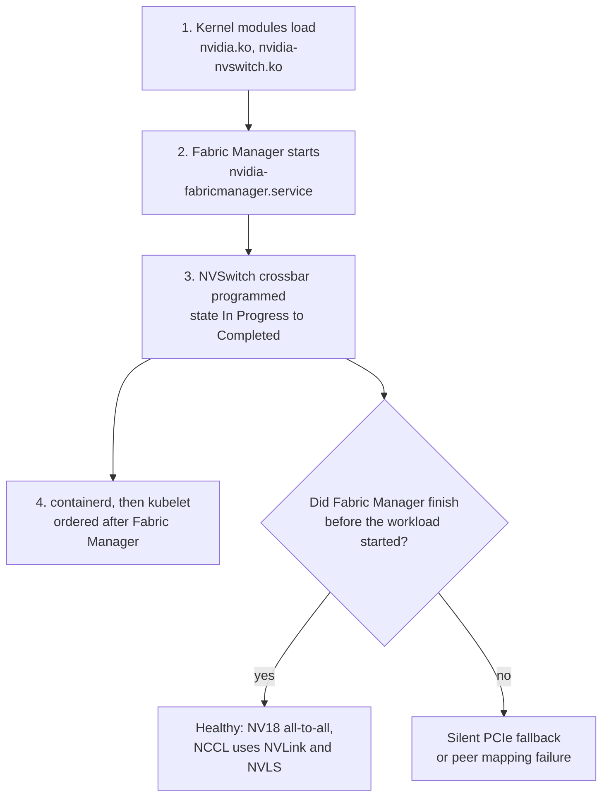
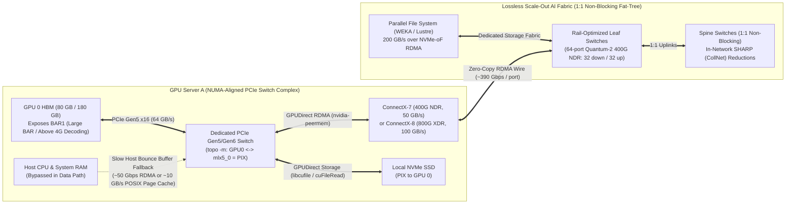
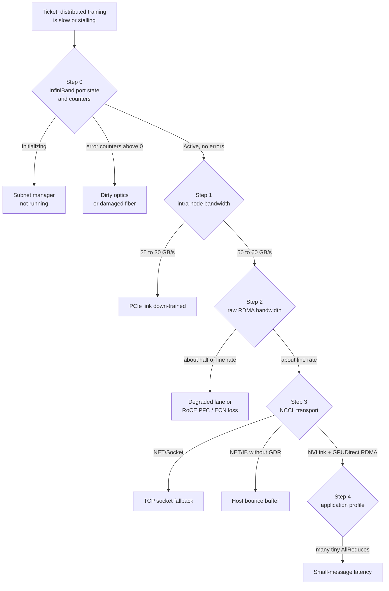

# 10.10 Fabric Manager, NVSM and NVLink domains

| | |
|---|---|
| Level | Advanced |
| Priority tier | 1 |
| Lab venue | Nebius GPU |
| Part | Part 10: The GPU and CUDA |
| Sources used | `bcm11-admin` §10.4.4, §10.13 & §10.14; `nvidia-devops` V7 Ch 1–12 & Labs 01–04; V5 Ch 3; V6 Ch 2 & 7; Legacy V1 Ch 4, V4 Ch 1 & 3, V10 Ch 4 & 9, V13 Ch 8; *AI Systems Performance Engineering* Ch 2 |
| Coverage file | `planning/coverage/chapters/10-10.md` |
| Claim ledger | `planning/ledgers/10-10.md` |

## Why this matters for AI infrastructure

In Chapter `10.6`, we traced the physical wires of **NVLink** and **NVSwitch**—from 2-way PCIe bridge clips (`600 GB/s`), to 8-GPU HGX baseboards with four on-board NVSwitch ASICs (`900 GB/s` per GPU on `H100`, `1,800 GB/s` on `B200`), up to 72-GPU `GB200` and `GB300 NVL72` racks with 18 NVSwitch ASICs across nine switch trays (`129.6 TB/s` / `~130 TB/s` bisection).

Yet physical NVSwitch silicon does not forward a single packet by itself. Unlike a simple 2-GPU NVLink bridge (which is initialized directly by the GPU kernel driver), an **NVSwitch crossbar** is a switched fabric that requires an active control-plane daemon to discover switch ASICs, train NVLink ports, program routing tables across all 8 or 72 GPUs, configure **`NVLink SHARP` (`NVLS`)** multicast groups, and fence faulted links. On an 8-GPU HGX or DGX server, that control plane is the **NVIDIA Fabric Manager (`nvidia-fabricmanager.service`)**. On a multi-node `NVL72` rack, it expands into **`NVOS`** on the switch trays coordinated by **`NMX-M` (Network Manager eXperience)**.

Consider three real-world production incidents from the `nvidia-devops` notes and the *NVIDIA Base Command Manager 11 Administrator Manual* (`bcm11-admin`):
- **The Post-Reboot `800 GB/s → 90 GB/s` Drop (`nvidia-devops` V13 Ch 8 & Legacy V1 Ch 4):** After a scheduled maintenance reboot of an 8-GPU HGX node, `nvidia-smi` reports all eight GPUs online and healthy. A distributed training job starts, but `nccl-tests` bus bandwidth drops from **`~800 GB/s` down to `~90 GB/s`**, and `nvidia-smi topo -m` prints `SYS` / `NODE` instead of `NV18` between GPU pairs. Why? Because `nvidia-fabricmanager.service` was either disabled in reboot automation, mismatched against the upgraded driver version, or started *after* `containerd` and `kubelet` had already admitted the pod (`15.234s` startup time in `systemd-analyze blame`). Without Fabric Manager programming the NVSwitches, `NCCL` silently downgraded intra-node collectives onto the host PCIe bus.
- **The `TopologyAffinityError` 5th-Pod Mystery (`nvidia-devops` V7 Ch 8 Customer Scenario):** A cloud engineering team enables kubelet `--topology-manager-policy=single-numa-node` on dual-socket, 128-core, 8-GPU HGX servers (`64` cores and `4` GPUs per NUMA node) and deploys Triton Inference Server pods requesting `1` GPU and `16` integer CPU cores each. Four pods start on `NUMA 0` (`4 × 16 = 64` cores), and three start on `NUMA 1`, but the 8th pod (or 5th pod when daemonsets reserve `2` cores on `NUMA 1`, leaving `14` free cores out of `16` needed) hangs permanently in **`TopologyAffinityError`** while empty GPUs sit idle.
- **The 40% Application Slowdown on a Healthy 400G Fabric (`nvidia-devops` V7 Ch 5 & Ch 10):** A team running across 8 nodes connected by 400G InfiniBand complains that training is 40% slower than calculated (or capped at `~50 Gbps` on a 400G switch). Running the three-step hardware benchmark hierarchy—**`nvbandwidth`** (`50–60 GB/s` on PCIe Gen5 x16 vs `25–30 GB/s` on a downtrained x8 slot), **`ib_write_bw`** (`~390 Gbps` on 400G NDR), and **`nccl-tests` (`all_reduce_perf`)**—isolates whether the culprit is a downtrained PCIe riser, an uninitialized InfiniBand Subnet Manager (`Physical state: LinkUp` + `State: Initializing`), missing `nvidia-peermem` / BIOS Large BAR (`Host Bounce Buffer`), or an application issuing thousands of tiny `256 KB` `AllReduce` calls that require increasing PyTorch DDP **`bucket_cap_mb`** from the `25 MB` default to `50 MB`.

This chapter covers **NVIDIA Fabric Manager (`nv-fabricmanager`)**, **NVLink domain architectures**, in-band hardware health management and support bundle collection with **NVIDIA System Management (`NVSM`, `nvsm`)** and **`NVDebug` (`nvdebug`)**, and the end-to-end **GPU-to-NIC-to-Fabric data path** (`GPUDirect RDMA`, `GPUDirect Storage`, `ConnectX-6/7/8`, Kubernetes `Topology Manager`, and the 3-step `nvbandwidth` → `ib_write_bw` → `nccl-tests` isolation hierarchy).

:::tip In one minute
- **Three NVLink domain scales and their control planes:**
  1. **2-GPU PCIe NVLink Bridge (`600 GB/s`):** Direct point-to-point GPU driver initialization; **no NVSwitch and no Fabric Manager required**.
  2. **8-GPU HGX / DGX Baseboard (`4` NVSwitches, `7.2 TB/s` on H100 / `14.4 TB/s` on B200):** Requires the host **`nvidia-fabricmanager.service`** (`/usr/bin/nv-fabricmanager -c /usr/share/nvidia/nvswitch/fabricmanager.cfg`) locked to the **exact driver version** (for example, `nvidia-driver 570.59` with `datacenter-gpu-manager-fabricmanager 570.59-1`).
  3. **72-GPU `GB200` / `GB300 NVL72` Rack (`18` NVSwitches across `9` switch trays, `129.6 TB/s`):** Managed by **`NVOS`** on the switch trays and **`NMX-M` (Network Manager eXperience)** across the multi-node NVLink (`MN-NVL`) domain.
- **Systemd boot-ordering rule:** Always add a systemd drop-in (`systemctl edit containerd.service` / `kubelet.service`) with **`After=nvidia-fabricmanager.service`** and **`Wants=nvidia-fabricmanager.service`** so workloads cannot start before NVSwitch routing is programmed.
- **`NVSM` (`nvsm`) & `NVDebug` (`nvdebug`):** In-band DGX/HGX health daemons and BCM `cmsh` wrappers (`nvsm show health`, `nvsm dump health`, `cmsh` `device -> nvsm alerts / health / info / status / stop / versions` writing `/cm/shared/nvsm/node001_YYYY-MM-DD-HH-MM-SS.tar.xz` in `~15 min`, and `nvdebug start/stop/status/history` writing `/cm/shared/nvdebug/<hostname>`).
- **The 3-Step Benchmark Hierarchy:** Never debug a slow multi-node job inside PyTorch. Test in strict order: (1) **`nvbandwidth`** (`50–60 GB/s` PCIe Gen5 x16 vs `25–30 GB/s` downtrained x8) → (2) **`ib_write_bw`** (`~390 Gbps` on 400G NDR; check `ibstat` `State: Active` + `Physical state: LinkUp` and `/sys/class/infiniband/*/ports/*/counters`) → (3) **`nccl-tests` (`all_reduce_perf`)** with `NCCL_DEBUG=INFO` (`NET/IB` + `GPU Direct RDMA` vs `NET/Socket` or Host Bounce Buffer).
:::

---

## Prerequisites and outcomes

**Prerequisites:** Chapters `10.6`–`10.9` (GPU interconnects, PCIe vs SXM form factors, `nvidia-smi` operations, and the NVIDIA driver/container software stack) and Chapters `9.2`–`9.5` (DGX/HGX node and `NVL72` rack architectures).

**Outcomes:** After completing this chapter, you will be able to:
1. Contrast **2-GPU PCIe bridge domains**, **8-GPU HGX baseboard domains (`4` NVSwitches)**, and **72-GPU `NVL72` rack domains (`18` NVSwitches)**, configure **`nvidia-fabricmanager.service`** (`fabricmanager.cfg`), and enforce systemd boot ordering (`After=` + `Wants=`) before `containerd` and `kubelet`.
2. Operate **NVIDIA System Management (`NVSM`)** and **`NVDebug`** both directly on a DGX/HGX host (`nvsm show health`, `nvsm dump health`) and across a cluster via Base Command Manager (`cmsh` `device -> nvsm` and `nvdebug`, `NVSMHealthDump` action).
3. Trace the zero-copy scale-out data path across **DMA**, **RDMA**, **GPUDirect RDMA** (`BAR1` Large BAR, `nvidia-peermem`, PCIe `PIX` switch locality), **GPUDirect Storage (`GDS`, `libcufile` / `cuFileRead` / `NVMe-oF` / `DALI`)**, and **`ConnectX-6/7/8`** adapters.
4. Configure the Kubernetes **Topology Manager (`single-numa-node`)** without triggering `TopologyAffinityError` CPU starvation, and execute the **3-step benchmark hierarchy (`nvbandwidth` → `ib_write_bw` → `nccl-tests`)** to isolate PCIe, optics, Subnet Manager, GPUDirect, and PyTorch DDP `bucket_cap_mb` bottlenecks.

---

## 1. NVLink Domains and the NVIDIA Fabric Manager (`nvidia-fabricmanager`)

### 1.1 What is an NVLink domain, and why does NVSwitch require a Fabric Manager?

An **NVLink domain** is the set of GPUs that can address one another's High-Bandwidth Memory (`HBM`) directly over NVLink using peer-to-peer (`P2P`) memory semantics (`Load`/`Store`, `cudaMemcpyPeerAsync`, `NCCL`, and `NVSHMEM` Partitioned Global Address Space `PGAS`). As modeled in `NVLINK_DOMAINS` (`code/part10/fabric_manager_nvlink.py`), NVIDIA platforms form three distinct NVLink domain geometries (`nvidia-devops` V7 Ch 3, V6 Ch 2 & 7; *AI Systems Performance Engineering* Ch 2, pp. 26–31; see also Chapters `9.2`, `9.5`, and `10.6`):

| NVLink Domain Type | Max GPUs in Domain | NVSwitch ASICs | Per-GPU Bidirectional NVLink BW | Aggregate Domain BW | Control Plane That Programs the Fabric | Supports `NVLink SHARP` (`NVLS`)? |
|---|---:|---:|---:|---:|---|---|
| **1. PCIe 2-Way Bridge Pair** (e.g., `H100 NVL`) | `2` | `0` | `600 GB/s` | `1.2 TB/s` | Direct P2P link training in `nvidia.ko` GPU driver (**no Fabric Manager needed**) | No |
| **2. 8-GPU HGX / DGX Baseboard** (`H100`/`H200` or `B200`) | `8` | `4` (soldered on HGX PCB) | `900 GB/s` (`H100`)<br/>`1,800 GB/s` (`B200`) | `7.2 TB/s` (`H100`)<br/>`14.4 TB/s` (`B200`) | Host daemon: **`nvidia-fabricmanager.service`** (`/usr/bin/nv-fabricmanager`) | **Yes** (3rd/4th-gen NVSwitch) |
| **3. 72-GPU `GB200` / `GB300 NVL72` Rack** (`18` compute trays) | `72` | `18` (`9` switch trays × `2` ASICs) | `1,800 GB/s` (`1.8 TB/s`) | `129.6 TB/s` (`~130 TB/s`) | **`NVOS`** on switch trays + **`NMX-M`** (`Network Manager eXperience`) & cluster Fabric Manager | **Yes** (`NVLS` in-switch reduction engines) |

Why does an 8-GPU HGX baseboard or 72-GPU `NVL72` rack require a separate Fabric Manager daemon when a 2-GPU PCIe bridge does not?
- On a **2-GPU PCIe NVLink bridge**, the NVLink lanes connect `GPU 0` silicon directly to `GPU 1` silicon with no intermediate switch chip.
- On an **8-GPU HGX baseboard** (or **72-GPU `NVL72` rack**), GPU NVLink ports do *not* wire directly to other GPUs; all `18` NVLink lanes from each GPU terminate on **`NVSwitch` crossbar ASICs** (`4` ASICs on an 8-GPU baseboard; `18` ASICs across `9` 1U switch trays in an `NVL72` rack). As noted in *AI Data Center Network Design and Technologies* (`ai-data-center-network-design-and-technologies`, Chapter 13, *Scale-Up Systems*), scale-up switch fabrics achieve **`100–300 ns` GPU-to-GPU latency** (`~200 ns` at the switch device level, compared to `500 ns–1 μs` on `PCIe Gen5`), and have inspired emerging open scale-up standards such as **`UALink` (Ultra Accelerator Link)** (`8` stations × `4` lanes of `200 Gbps` = `32` lanes / `6.4 Tbps` per xPU with `640-byte` DL flits) and **`SUE-T` (Scale-Up Ethernet Transport)** (`AFH` AI Fabric Header with `LLR` Link Layer Retry and `CBFC` Credit-Based Flow Control; covered in Part 12).
- When the server powers on, the NVSwitch ASICs have no forwarding entries. The **NVIDIA Fabric Manager (`nv-fabricmanager`)** opens the NVSwitch kernel device nodes (`/dev/nvidia-nvswitch*`), discovers every GPU and NVSwitch port, verifies that all `18` sub-links per GPU trained at full rate, programs the unicast and **`NVLink SHARP` (`NVLS`)** multicast routing tables inside each NVSwitch ASIC, and only then marks the GPU fabric state as `Completed` so CUDA and `NCCL` can open P2P handles across the mesh.



| Step | What happens | Detail |
|---|---|---|
| 1. Kernel modules | `nvidia.ko` and `nvidia-nvswitch.ko` load | Exposes `/dev/nvidia0..7` and `/dev/nvidia-nvswitch0..3` |
| 2. Fabric Manager | `nvidia-fabricmanager.service` (15.234 s boot init in the example) | `ExecStart=/usr/bin/nv-fabricmanager -c /usr/share/nvidia/nvswitch/fabricmanager.cfg`. Locked to the exact driver version (for example 570.59 equals 570.59-1) |
| 3. Crossbar programming | 4 NVSwitch ASICs on an 8-GPU HGX node | Trains 8 GPUs x 18 links, programs unicast and NVLS SHARP routing tables, moves Fabric State from In Progress to Completed |
| 4. Runtime ordering | `containerd.service` then `kubelet.service` | Systemd drop-in: `After=nvidia-fabricmanager.service` and `Wants=nvidia-fabricmanager.service` |
| Healthy outcome | Fabric Manager completed first | `nvidia-smi topo -m` shows NV18 all-to-all; NCCL uses NVLink and NVLS (about 800+ GB/s bus bandwidth on H100) |
| Failed outcome | Fabric Manager stopped, mismatched or lost a boot race | `topo -m` or NCCL drops to SYS or PIX (about 800 GB/s down to about 90 GB/s) or Xid 74 |

### 1.2 `nvidia-fabricmanager.service` lifecycle, version locking, and the `kubelet` boot race

As documented in `nvidia-devops` Legacy Volume 01 Chapter 4 (Sections 2.1–2.3), Volume 10 Chapter 4 (Section 7.2), Volume 16 Chapter 4, and `bcm11-admin` Section 10.13 (p. 671), operating `nvidia-fabricmanager` in production requires three strict rules (`audit_fabric_manager_and_nvlink_domain()` in `code/part10/fabric_manager_nvlink.py`):

1. **Strict driver version lock (`nvidia-driver` == `nvidia-fabricmanager`):**
   The `nvidia-fabricmanager` (or `datacenter-gpu-manager-fabricmanager`) package communicates with the kernel NVSwitch driver over a private internal ABI. Its version **must match the installed NVIDIA kernel driver version**. For example, in the `bcm11-admin` Section 10.13 `nvsm versions` output (p. 671), `nvidia-driver` is **`570.59`** and `datacenter-gpu-manager-fabricmanager` is **`570.59-1`**. If `apt upgrade` updates the GPU driver without updating `nvidia-fabricmanager` (or vice versa), Fabric Manager exits on startup and leaves the NVSwitch fabric uninitialized.
2. **Preventing the `15.234s` boot race with `containerd` and `kubelet` (`After=` + `Wants=`):**
   On an 8-GPU HGX server, `nvidia-fabricmanager.service` takes roughly **`15.234 seconds`** during boot (`systemd-analyze blame` in `nvidia-devops` Legacy V1 Ch 4, line 150) to train 144 NVLink sub-links and program four NVSwitch ASICs, whereas `containerd.service` (`10.123s`) and `kubelet.service` (`5.234s`) can start faster.
   If `kubelet` starts admitting GPU pods before `nvidia-fabricmanager` finishes programming the NVSwitches, pods launch while the NVLink fabric is still uninitialized—causing `NCCL` to either fail P2P mapping or silently fall back to PCIe (`~800 GB/s → ~90 GB/s`, `nvidia-devops` V13 Ch 8, line 200).
   In `systemd`, `Wants=` or `Requires=` alone defines a *dependency* but **does not define startup ordering**. You must pair `Wants=` (or `Requires=`) with **`After=nvidia-fabricmanager.service`** via a systemd drop-in (`systemctl edit containerd.service` and `systemctl edit kubelet.service`).
3. **Responding to `Xid 74` (NVLink Error) and NVSwitch hardware faults:**
   When a physical NVLink lane or NVSwitch port suffers signal corruption or link drop, the kernel driver logs **`Xid 74` (`NVLink Error`)** in `dmesg` (`nvidia-devops` Legacy V4 Ch 3, line 220; V6 Ch 2, line 108). Remember the OEM hardware boundary from Chapter `9.3`: while a single faulted SXM GPU is a bolted Field-Replaceable Unit (`FRU`), the **four NVSwitch ASICs are soldered directly to the HGX baseboard**. If Fabric Manager logs and `dcgmi diag -r 2` prove an NVSwitch ASIC failure rather than a GPU failure, swapping the SXM GPU will fix nothing—the entire HGX baseboard must be RMA'd.

---

## 2. In-Band Hardware Health & Telemetry Bundles: `NVSM` (`nvsm`) and `NVDebug` (`nvdebug`)

How do you inspect NVSwitch,NVLink-C2C, PCIe, PSU, thermal, and storage health from *inside* the Linux OS on a DGX or HGX node—and package a complete diagnostic bundle for NVIDIA Enterprise Support? NVIDIA provides two tools integrated both on the host and inside **NVIDIA Base Command Manager (`BCM 11`, `cmsh`)** (`bcm11-admin` Sections 10.4.4, 10.13, and 10.14, pp. 596, 606, 668–674; `nvidia-devops` V5 Ch 3, Section 3):

### 2.1 NVIDIA System Management (`NVSM`): Host CLI vs BCM `cmsh` wrapper

As introduced in Chapter `9.1` and `nvidia-devops` Volume 05 Chapter 3, whereas the Out-of-Band (`OOB`) Baseboard Management Controller (`BMC` / Redfish) monitors the server from *outside* the OS over a dedicated 1 GbE management network, **NVIDIA System Management (`NVSM`)** is an in-band daemon and CLI (`nvsm`) running inside Linux that monitors GPUs, NVSwitches, NVLink-C2C, DIMMs, NVMe drives, fans, and PSUs.

In `bcm11-admin` Section 10.13 (*Monitoring With nvsm*, pp. 668–672), BCM also provides a cluster-wide `nvsm` wrapper inside `cmsh` `device` mode (`[basecm11->device]% nvsm`) as well as an automated **`NVSMHealthDump`** monitoring action (`Run on: Active head node`, p. 596 & p. 606):

| `cmsh` `device -> nvsm` Subcommand | Options | Operational Purpose & Output (`bcm11-admin` pp. 668–672) |
|---|---|---|
| **`nvsm alerts`** | `--start <idx>`, `--limit <N>`, `-n <nodes>` | Lists active hardware/fabric alerts across nodes (for example, `NVLink-C2C is reporting... System entered degraded... Unexpected Link Count`, `GPU0 is reporting NVLink link 0...`, or `PCI sub-system... Device is missing`). |
| **`nvsm health`** | `--quick`, `--tags <tags>`, `-n <nodes>` | Executes a full health dump on the target node(s) and writes a compressed archive **`/cm/shared/nvsm/<node>_YYYY-MM-DD-HH-MM-SS.tar.xz`** (`417MiB` in the manual's example). A full dump takes **about 15 minutes**; `--quick` finishes faster (`5.9MiB`) at the cost of higher transient CPU and memory usage. |
| **`nvsm info`** | `--history` | Displays the filename and size of the most recent health dump (or all historical dumps with `--history`) under `/cm/shared/nvsm/`. |
| **`nvsm status`** | `-n <nodes>` | Shows whether a health dump is currently running (`duration`, `log`, `status: active`, `success: yes`, `Result: good`). |
| **`nvsm stop`** | `-n <nodes>` | Aborts an in-progress health dump; partial data collected so far is left as an uncompressed directory rather than a `.tar.xz` archive. |
| **`nvsm versions`** | `--details`, `-c <category>` | Queries component software and firmware versions across nodes (`cuda-driver 12.8`, `datacenter-gpu-manager 1:4.0.0~10338`, `datacenter-gpu-manager-fabricmanager 570.59-1`, `dgx-release 7.0.0`, `kernel 6.8.0-31-generic-64k`, `nvidia-driver 570.59`, `nvsm 24.09.05`, `platform PG548`, `sbios 02.03.13`, `vBIOS 0..3 97.00.6c.00.03`). |

When you extract an `nvsm health` archive (`tar xvJf node001_2025-01-24-04-51-31.tar.xz`), it contains a structured two-level tree (`boot/`, `etc/`, `nvsmhealth_commands/`, `proc/`, `usr/`, `var/`, plus `nvsm_resources.json`, `nvsm_show_health.json`, and `result.json`, `bcm11-admin` pp. 671–672) capturing hundreds of system commands and `/proc` states for offline root-cause analysis.

### 2.2 `NVDebug` (`nvdebug`): Multi-platform host, BMC, Redfish, and NVSwitch log collection

Alongside `nvsm`, `bcm11-admin` Section 10.14 (*Monitoring With nvdebug*, pp. 672–674) documents the **`nvdebug`** tool. While `nvsm` targets DGX in-band health, **`nvdebug`** collects diagnostic logs across **five platform types** (`-t, --platform`: **`DGX`**, **`arm64`**, **`x86_64`**, **`NVSwitch`**, and **`HGX-HMC`**) and **five log collector groups** (`-g, --loggroup`: **`HealthCheck`**, **`Host`**, **`IPMI`**, **`Redfish`**, and **`SSH`**):
- Running `nvdebug start -n node001` in `cmsh` `device` mode launches the transient systemd unit **`cm-nvdebug@node001.service`** and writes `.zip`/`.tar` log bundles to **`/cm/shared/nvdebug/node001`**.
- Running `nvdebug status -n node001 --json` reports live collection telemetry (`cpu: 0.076`, `duration: 16`, `memory: 8261632`, `pid: 205704`, `status: "active"`), and `nvdebug history -v` lists all archived bundles.

---

## 3. From the NVLink Domain to the Scale-Out Fabric: GPUDirect RDMA, GDS, ConnectX, and NCCL

Once intra-node NVLink and Fabric Manager are healthy, data must leave the NVLink domain to synchronize gradients or read training datasets across the cluster. Here we consolidate the complete Volume 07 GPU data-path architecture (`nvidia-devops` Volume 07 Chapters 1–12 & Labs 01–04; deep scale-out InfiniBand and RoCEv2 switch internals are expanded in Part 12):



### 3.1 Why GPU networking exists: 3D Parallelism, TCP/IP overhead, and switch-buffer jitter

As explained in `nvidia-devops` Volume 07 Chapters 1 and 4:
- **Synchronous 3D Parallelism (`Data`, `Pipeline`, and `Tensor Parallelism`):** If 10,000 GPUs finish a forward/backward calculation in `2 ms`, but waiting for gradients to synchronize across the network (`AllReduce` / `AllGather`) takes `50 ms`, the cluster runs at **`2 / 52 ≈ 4%` efficiency**.
- **The 7-step TCP/IP kernel penalty (`V7 Ch 4 Customer Scenario`):** Standard Linux `send()` socket networking forces a user→kernel context switch, copies buffers from user space to kernel socket buffers, computes TCP checksums and MTU segmentation in software, and processes millions of interrupts per second on the receiving CPU. In the Volume 07 Chapter 4 customer scenario, a 100-node Ray reinforcement-learning cluster with `100GbE` `ConnectX-5` NICs using TCP sockets pinned `node_cpu_seconds_total` (`system` kernel threads) at **100% CPU utilization** while capping network throughput at **30 Gbps**—fixed by switching to kernel-bypass **RDMA (`RoCEv2` / Verbs)**.
- **Why enterprise Ethernet VLANs fail on synchronous collectives (`V7 Ch 1 Customer Scenario`):** An architect who proposes saving `$2 Million` on a 500-server H100 cluster by putting AI traffic on a dedicated VLAN with QoS inside existing deep-buffer enterprise core switches overlooks **microburst jitter** and **lossless RDMA**. In synchronous training, if 9,999 GPUs receive their gradients immediately while GPU 10,000's packet sits for `10 ms` inside a shared deep switch buffer (or drops during an `AllReduce` microburst because `PFC`/`ECN` are not tuned for `RoCEv2`), all 10,000 GPUs stall waiting for the slowest rank.

### 3.2 `GPUDirect RDMA` (`BAR1` + `nvidia-peermem`) vs `GPUDirect Storage` (`GDS`, `libcufile`, `DALI`)

Even with RDMA enabled, standard RDMA only moves packets from the wire into **host CPU System RAM**, forcing the GPU to do a second PCIe copy from System RAM into HBM—the **Host Bounce Buffer** (`nvidia-devops` V7 Ch 5 & Ch 6):

1. **`GPUDirect RDMA` (GPU↔NIC↔Network↔NIC↔GPU, `V7 Ch 5`):**
   The GPU exposes a large region of its HBM onto the PCIe address space via **`BAR1` (Large BAR)**, requiring **Above 4G Decoding / Large BAR** enabled in the server BIOS, **PCIe ACS disabled** (see Chapter `9.1`), **`nvidia-peermem.ko`** loaded in the kernel, and the GPU and NIC sharing a local **PCIe Switch (`PIX`)**.
   - *Production symptom when broken (`V7 Ch 5 Customer Scenario`):* Four DGX H100 servers on a 400G InfiniBand switch achieve only **`~50 Gbps`** (`6.25 GB/s`) in PyTorch/NCCL because `nvidia-peermem` is missing or ACS/BIOS blocks P2P, forcing every packet through the host CPU's DDR5 bounce buffer.
2. **`GPUDirect Storage` (`GDS`, Storage↔NIC/NVMe↔GPU, `V7 Ch 6`):**
   Applies the same zero-copy DMA path to local NVMe drives and remote **NVMe over Fabrics (`NVMe-oF`)** parallel file systems (`WEKA`, `Lustre`, `IBM Storage Scale`). Applications use **`libcufile` (`cuFileRead` / `cuFileWrite`)** and `nvidia-fs.ko` instead of Linux POSIX `open()`/`read()`, bypassing the Linux kernel **Page Cache**.
   - *Production symptom when broken (`V7 Ch 6 Customer Scenario`):* An autonomous-vehicle team connects a **`200 GB/s` WEKA** array over 400G InfiniBand to their DGX cluster to train on 10 million dashcam videos, but standard Python POSIX `open()`/`read()` `DataLoaders` stage everything through the Linux Page Cache, capping throughput at **`10 GB/s`** and leaving GPUs at **15% utilization**—solved by refactoring the pipeline to **NVIDIA DALI** with **GDS (`cuFile`)** and validating with `gdscheck -p` and `gds_stats`.

### 3.3 `ConnectX-6`, `ConnectX-7`, and `ConnectX-8` PCIe physics & the dual-200G OEM trap

Matching the Network Interface Card generation to the GPU generation is governed by PCIe slot bandwidth (`nvidia-devops` V7 Ch 7; `CONNECTX_GENERATIONS` in `code/part10/fabric_manager_nvlink.py`):

| SmartNIC Generation | Line Rate per Port | Line Rate in Bytes/sec | Host PCIe Bus Interface | Unidirectional PCIe x16 Ceiling | Optical Transceiver Form Factor | Matched GPU Generation |
|---|---:|---:|---|---:|---|---|
| **`ConnectX-6`** | `200 Gbps` (`HDR` / `200GbE`) | **`25 GB/s`** | `PCIe Gen4 x16` | `32 GB/s` | `QSFP56` | Ampere `A100` |
| **`ConnectX-7`** | `400 Gbps` (`NDR` / `400GbE`) | **`50 GB/s`** | `PCIe Gen5 x16` | `64 GB/s` | `OSFP` (larger heatsink for 400G lasers) | Hopper `H100` / `H200` |
| **`ConnectX-8`** | `800 Gbps` (`XDR` / `800GbE`) | **`100 GB/s`** | `PCIe Gen6 x16` | `128 GB/s` | `OSFP` / Co-Packaged Optics (`CPO`) | Blackwell `B200` / `GB300` |

**The Discount OEM Dual-200G `ConnectX-6` Trap (`V7 Ch 7 Customer Scenario`):** A discount OEM sells an 8-GPU H100 server advertising *"400 Gbps per GPU via dual 200 Gbps ConnectX-6 NICs."* Even though `200 + 200 = 400`, each `ConnectX-6` is a `PCIe Gen4` card capped at `200 Gbps`, and driving two separate NICs per GPU requires complex multi-rail NCCL routing where the GPU often lacks a direct `PIX` PCIe switch path to the second NIC. Always enforce a **1:1 generationally matched GPU-to-NIC pairing** (`1x ConnectX-7 400G OSFP` per H100/B200; `4x ConnectX-8 800G` per 4-GPU GB300 tray).

### 3.4 Scale-out fat-tree sizing (`1,024 GPUs`), `1:1` non-blocking vs `2:1` oversubscription, and storage plane isolation

Recall from Chapters `9.6`–`9.9` and `nvidia-devops` Volume 07 Chapter 11 the three non-negotiable cluster fabric design rules:
1. **Sizing a 128-node (`1,024-GPU`) DGX H100 cluster on 64-port Quantum-2 NDR switches (`V7 Ch 11 Scenario 1`):**
   Each 64-port Leaf switch dedicates **32 ports down** to servers and **32 ports up** to Spine switches (`1:1` non-blocking). In a rail-optimized design (`NIC i → Leaf i`), one **Leaf Group of 8 Leaf switches** serves **32 DGX servers (`256 GPUs`)**. Scaling to **128 servers (`1,024 GPUs`)** requires **4 Leaf Groups (`32` Leaf switches)** cabled symmetrically up to **16 Spine switches**.
2. **Why `2:1` spine oversubscription fails even in multi-tenant clusters (`V7 Ch 11 Scenario 2`):**
   If a Leaf switch connects 32 server ports down (`32 × 400G`) but only 16 uplinks to the Spine (`2:1` oversubscription), a single 512-GPU training job executing a synchronous `AllReduce` drives `400 Gbps` on all 32 downlinks at the exact same microsecond, saturating the 16 uplinks and triggering InfiniBand credit backpressure across the job.
3. **Why storage (`100 GB` checkpoints) must never share the Compute InfiniBand switches (`V7 Ch 11 Scenario 3`):**
   Bursting a `100 GB` checkpoint write over the compute fabric fills switch buffers; even without packet loss, latency-sensitive `AllReduce` packets queue behind bulk storage frames (head-of-line queueing jitter), stalling every GPU in the collective. Storage traffic belongs on a physically separate storage fabric attached to the `BlueField-3` DPUs.

---

## 4. Topology-Aware Placement & the 3-Step Benchmark Hierarchy (`nvbandwidth` → `ib_write_bw` → `nccl-tests`)

### 4.1 Kubernetes Topology Manager (`single-numa-node`) and the `16-Core → 12-Core` fix

In Chapters `10.6` and `10.9`, we saw that the kubelet **Topology Manager** aligns CPUs, host memory, GPUs, and SR-IOV NICs (`sriov-network-device-plugin` + Multus) on a single NUMA socket for pods in the **`Guaranteed` QoS class** with **integer CPU requests**.

Let us examine all four Topology Manager policies and solve the production incident from `nvidia-devops` Volume 07 Chapter 8 (`simulate_k8s_single_numa_pod_admission()` in `code/part10/fabric_manager_nvlink.py`):
- **`none` (default):** Kubelet allocates CPUs, memory, and GPUs independently without NUMA awareness.
- **`best-effort`:** Kubelet prefers NUMA-aligned placement, but admits the pod across split NUMA sockets if aligned resources are unavailable (causing non-deterministic latency).
- **`restricted`:** Rejects the pod (`TopologyAffinityError`) if devices cannot align within the minimum number of NUMA nodes required by the request size.
- **`single-numa-node`:** Rejects the pod (`TopologyAffinityError`) unless all requested CPUs, memory, GPUs, and topology-aware NICs fit on **one single NUMA node**.

**Worked math of the 5th-Pod `TopologyAffinityError` (`V7 Ch 8 Customer Scenario`):**
- **Hardware:** Dual-socket HGX server with **`128` CPU cores** (`64` on `NUMA 0`, `64` on `NUMA 1`) and **`8` GPUs** (`4` on `NUMA 0`, `4` on `NUMA 1`).
- **Workload:** 8 Triton Inference Server pods, each requesting **`16` integer CPU cores and `1` GPU**.
- **What happens:**
  - Pods 1–4 land on `NUMA 0`, consuming `4 × 16 = 64` CPU cores and `4` GPUs (`0` cores and `0` GPUs left on `NUMA 0`).
  - On `NUMA 1`, Linux OS threads or monitoring DaemonSets consume just **`2` CPU cores**, leaving **`62` free CPU cores** and **`4` free GPUs**.
  - At `16` cores per pod, `NUMA 1` can only supply `3 × 16 = 48` cores (`3` pods), leaving **`62 - 48 = 14` free CPU cores** and **`1` unused GPU**. When the remaining pod requests `16` cores on a single NUMA node, `14 < 16`, so the kubelet rejects it with **`TopologyAffinityError`**.
- **The Fix:** Profile actual CPU usage and right-size the pod request from `16` cores down to **`12` cores** (`4 × 12 = 48 <= 62` free cores on `NUMA 1`), allowing all **8 pods** to run with strict `single-numa-node` alignment.

### 4.2 The 3-Step Hardware-to-Application Benchmark Hierarchy (`diagnose_three_step_data_path_benchmarks`)

When a distributed training job runs slowly, never start by tweaking PyTorch flags. Follow the sequential 3-step C++ benchmark ladder from `nvidia-devops` Volume 07 Chapter 10 and Labs 03–04 (`diagnose_three_step_data_path_benchmarks()` in `code/part10/fabric_manager_nvlink.py`):



| Step | Check | Finding | Cause and fix |
|---|---|---|---|
| 0 | `ibstat`, `rdma link show`, `/sys/class/infiniband/*/counters` | Physical LinkUp but State Initializing | Subnet manager (OpenSM / UFM) not running or unreachable |
| 0 | Same | `symbol_error`, `port_rcv_errors` or `link_error_recovery` above 0 | Dirty optical transceiver or damaged fiber: clean or replace optics, verify with `mlxlink` |
| 1 | `nvbandwidth -t device_to_host_memcpy_ce` | 25 to 30 GB/s instead of 50 to 60 GB/s on Gen5 x16 | PCIe link down-trained (x16 to x8): inspect `lspci -vv` LnkSta, reseat the riser or GPU |
| 2 | `ib_write_bw --report_gbits --duration 30` | About 195 Gbps, half of about 390 Gbps on 400G NDR | Degraded optical lane or RoCE PFC/ECN loss: inspect `ibstat` and `mlxlink` width and speed |
| 3 | `nccl-tests` (`all_reduce_perf`) with `NCCL_DEBUG=INFO` | Log shows `NET/Socket` | TCP/IP socket fallback: expose `/dev/infiniband` in the container and set `NCCL_IB_HCA` |
| 3 | Same | `NET/IB` without GDR (about 50 Gbps, 6.25 GB/s) | Host CPU bounce buffer: load `nvidia-peermem`, disable PCIe ACS, enable BIOS Large BAR |
| 4 | Nsight Systems, PyTorch DDP AllReduce message sizes | Thousands of tiny 256 KB AllReduces (job about 40% slow) | Latency-dominated small messages: raise DDP `bucket_cap_mb` (default 25 MB to 50 MB) |

---

## 5. Commands and Configurations That Matter

All commands below are drawn from `bcm11-admin` Sections 10.13–10.14 and `nvidia-devops` Volume 01 Chapter 4, Volume 05 Chapter 3, Volume 07 Labs 01–04, and Volume 13 Chapter 8. Shell commands are marked **(untested here)**.

### 5.1 Verify `nvidia-fabricmanager.service` and enforce systemd ordering before `containerd`/`kubelet` (untested here)

```bash
# 1. Verify that nvidia-fabricmanager package matches the installed driver branch (untested here)
dpkg -l | grep -E 'nvidia-driver|nvidia-fabricmanager|datacenter-gpu-manager'
systemctl status nvidia-fabricmanager.service

# 2. Inspect Fabric Manager startup duration in the boot chain (~15.234s on 8-GPU HGX) (untested here)
systemd-analyze
systemd-analyze blame | head -n 10
systemd-analyze critical-chain kubelet.service
```

Create `/etc/systemd/system/containerd.service.d/wait-for-fabricmanager.conf` (and the identical drop-in for `kubelet.service`) (`nvidia-devops` Legacy V1 Ch 4, Section 2.2):
```ini
[Unit]
After=nvidia-fabricmanager.service
Wants=nvidia-fabricmanager.service
```

### 5.2 Run `nvsm` and `nvdebug` on a DGX host and inside BCM `cmsh` (untested here)

```bash
# 1. Directly on a DGX host (in-band Linux CLI) (untested here)
sudo nvsm show health
sudo nvsm dump health

# 2. Out-of-Band Redfish thermal check against the BMC (untested here)
curl -u admin:password -k https://<BMC_IP>/redfish/v1/Chassis/1/Thermal
```

Inside Base Command Manager (`cmsh`, `bcm11-admin` Sections 10.13 & 10.14, pp. 668–674) (untested here):
```text
[basecm11]% device
[basecm11->device]% nvsm versions -n node001
[basecm11->device]% nvsm alerts -n node001
[basecm11->device]% nvsm health -n dgx-[001-002]
[basecm11->device]% nvsm status -n dgx-[001-002]
[basecm11->device]% nvsm info --history
[basecm11->device]% nvdebug start -n node001 -t DGX -g HealthCheck
[basecm11->device]% nvdebug status -n node001 --json
[basecm11->device]% nvdebug history -v
```

### 5.3 Execute the 3-step data-path benchmark sequence (`nvbandwidth` → `ib_write_bw` → `nccl-tests`) (untested here)

```bash
# Step 0 (untested here): Verify InfiniBand port state (Active + LinkUp, Rate: 400) and zero error counters
ibstat mlx5_0
ibv_devices
rdma link show
grep -H . /sys/class/infiniband/mlx5_0/ports/1/counters/*

# Step 1 (untested here): Validate intra-node PCIe Gen5 x16 (~50-60 GB/s) and NVLink mesh
nvbandwidth -l
nvbandwidth -t device_to_host_memcpy_ce

# Step 2 (untested here): Validate raw node-to-node RDMA wire speed (~390 Gbps on 400G NDR)
# On node-a (server):
ib_write_bw --report_gbits --duration 30
# On node-b (client):
ib_write_bw <node-a-rdma-ip> --report_gbits --duration 30

# Step 3 (untested here): Validate multi-node GPUDirect RDMA & NVLink collectives with NCCL debug logging
export NCCL_DEBUG=INFO
export NCCL_DEBUG_SUBSYS=INIT,NET,GRAPH
mpirun -np 2 -H node-a:1,node-b:1 \
  -x NCCL_DEBUG -x NCCL_DEBUG_SUBSYS \
  ./build/all_reduce_perf -b 8M -e 1G -f 2 -g 1

# Step 4 (untested here): Verify GPUDirect Storage (GDS) readiness
gdscheck -p
```

---

## 6. How It Fails: Six Production Fabric Manager, NVLink Domain, and Data-Path Failure Modes

| # | Failure Mode | Production Symptom | Root Cause & Diagnostic Evidence | Fix |
|---|---|---|---|---|
| **1** | **`nvidia-fabricmanager` stopped, mismatched, or started after `kubelet`** | After a node reboot or driver update, `nvidia-smi` shows 8 healthy GPUs, but `nccl-tests` bus bandwidth drops from **`~800 GB/s` to `~90 GB/s`** (or jobs fail P2P init). | `systemctl status nvidia-fabricmanager` is inactive/failed, or `nvidia-smi topo -m` shows `SYS`/`NODE` instead of `NV18` (`V4 Ch 1 §5.3`, `V13 Ch 8`). On boot races, `kubelet` (`5.234s`) started before `nvidia-fabricmanager` (`15.234s`). | Lock `nvidia-fabricmanager-<branch>` to the exact driver version (`570.59 == 570.59-1`), enable `nvidia-fabricmanager.service`, and add `After=` + `Wants=nvidia-fabricmanager.service` drop-ins to `containerd` and `kubelet`. |
| **2** | **`Xid 74` (NVLink Error) or failed NVSwitch ASIC on HGX baseboard** | Multi-GPU training hangs at collective barriers or drops to `312 GB/s` on one pair; `dmesg` logs `NVRM: Xid ...: 74`. | `nvidia-smi nvlink --errorcounters`, `cmsh` `nvsm alerts`, and `dcgmi diag -r 2` show CRC/replay errors or dead NVSwitch ports (`VL4 Ch 3 §220`, `V6 Ch 2`). | Cordon the node and collect `/cm/shared/nvsm/<node>_*.tar.xz` (`nvsm health`). If a single SXM GPU failed, RMA the SXM FRU; if an on-board NVSwitch ASIC failed, RMA the full **HGX baseboard** via the OEM. |
| **3** | **InfiniBand port stuck at `Physical state: LinkUp` + `State: Initializing`** | `rdma link show` and `nccl-tests` fail across the cluster even though optical transceivers show green link LEDs. | `ibstat mlx5_0` shows **`Physical state: LinkUp`** (fiber and optics are good) but logical **`State: Initializing`** (`V7 Lab 03 Step 1`). The InfiniBand Subnet Manager (`OpenSM` / `UFM`) is down or unreachable. | Start or fail over the InfiniBand Subnet Manager (`UFM` appliance / `opensm`) and verify `State: Active` and `SM lid` in `ibstat`. |
| **4** | **GPUDirect RDMA disabled (`~50 Gbps` Host Bounce Buffer on 400G IB)** | `ib_write_bw` hits `~390 Gbps`, yet multi-node `nccl-tests` / PyTorch crawls at **`~50 Gbps`** with high host CPU memory bus traffic. | `lsmod \| grep nvidia_peermem` is empty, PCIe ACS is enabled (`SrcValid+`), GPU and NIC sit across `SYS` NUMA sockets, or BIOS lacks **Above 4G Decoding / Large BAR** (`V7 Ch 5 Customer Scenario`). | Load and persist `nvidia-peermem`, disable PCIe ACS, enable Above 4G Decoding / Large BAR in BIOS, and verify `GPU Direct RDMA` enabled on `NET/IB` lines in `NCCL_DEBUG=INFO`. |
| **5** | **Kubelet `TopologyAffinityError` stranding GPUs under `single-numa-node`** | On a 128-core, 8-GPU dual-socket node (`64` cores + `4` GPUs per NUMA socket), 4 pods requesting `16` CPUs + `1` GPU start, but the 5th/8th pod hangs in **`TopologyAffinityError`**. | System/DaemonSet processes consume `2` CPU cores on `NUMA 1`, leaving `62` free cores. After 3 pods take `48` cores on `NUMA 1`, only `14` cores remain (`< 16` requested), so `single-numa-node` rejects admission (`V7 Ch 8 Customer Scenario`). | Right-size the pod integer CPU request from `16` cores to **`12` cores** (`4 × 12 = 48 <= 62`) so all 8 pods fit within their local NUMA socket. |
| **6** | **Healthy `nvbandwidth`, `ib_write_bw`, and `nccl-tests`, but PyTorch DDP is 40% slow** | All three C++ hardware benchmarks pass at line rate (`56 GB/s` PCIe, `392 Gbps` IB, full `nccl-tests` bus BW), yet distributed PyTorch training runs 40% below expectation. | Nsight Systems profiling shows the model issuing thousands of tiny **`256 KB` `AllReduce` calls** dominated by per-message handshake latency rather than bandwidth (`V7 Ch 10 Customer Scenario`). | Increase PyTorch `DistributedDataParallel` **`bucket_cap_mb`** from the `25 MB` default to **`50 MB`** (or higher, measured with Nsight Systems) to coalesce gradients into bandwidth-efficient transfers. |

---

## 7. Hands-On Lab: Verify NVLink Domains, Fabric Manager Rules, Topology Manager Admission, and 3-Step Benchmark Triage

**Venue:** Any Linux machine or Nebius GPU VM with Python 3.10+ (runs deterministically using standard library Python; all live `systemctl`, `nvsm`, `nvdebug`, `nvbandwidth`, `ib_write_bw`, and `all_reduce_perf` commands are in Section 5 and marked `(untested here)`).

Run `code/part10/fabric_manager_nvlink_lab.py`:

```bash
python3 code/part10/fabric_manager_nvlink_lab.py
```

Expected output (`25 passed, 0 failed`):

```text
=== Chapter 10.10 Lab: Fabric Manager, NVSM, NVLink Domains & Data-Path Triage ===
  [PASS] V4 Ch4 & V7 Ch3: 2-way PCIe NVLink bridge domain has 0 NVSwitches, 600 GB/s per GPU, and does not use Fabric Manager
  [PASS] V7 Ch3 & V1 Ch4: 8-GPU HGX H100 (4 NVSwitches, 7.2 TB/s) and B200 (14.4 TB/s) require host nvidia-fabricmanager
  [PASS] ASP Ch2 & SuperPOD GB300 RA: 72-GPU NVL72 domain uses 18 NVSwitches across 9 switch trays (129.6 TB/s) managed by NVOS + NMX-M
  [PASS] V7 Ch7: ConnectX-6 (200G HDR = 25 GB/s on PCIe Gen4 QSFP56), ConnectX-7 (400G NDR = 50 GB/s on PCIe Gen5 64 GB/s OSFP), ConnectX-8 (800G XDR = 100 GB/s on PCIe Gen6)
  [PASS] BCM 11 p.670 & V1 Ch4: Matching driver 570.59 + fabricmanager 570.59-1 + active service + systemd ordering passes
  [PASS] V10 Ch4 & V16 Ch4: Flags driver (570.59) vs nvidia-fabricmanager (550.90.07-1) version mismatch
  [PASS] V4 Ch1 §5.3 & V13 Ch8: Stopped nvidia-fabricmanager with SYS fallback (~800 GB/s -> ~90 GB/s) is flagged
  [PASS] V1 Ch4 §2.2: Flags missing After=nvidia-fabricmanager.service / Wants= drop-in on containerd/kubelet
  [PASS] VL4 Ch3 §220 & V10 Ch9: Flags Xid 74 (NVLink Error) and recommends nvlink --errorcounters, nvsm alerts, and dcgmi diag -r 2
  [PASS] V7 Ch8 Customer Scenario: Requesting 16 CPUs + 1 GPU on 128-core (64/NUMA) node with 2 OS cores on NUMA 1 leaves 14 free cores and fails with TopologyAffinityError
  [PASS] V7 Ch8 Customer Scenario: Reducing pod CPU request from 16 to 12 cores admits all 8 pods cleanly under single-numa-node
  [PASS] V7 Ch10: Healthy nvbandwidth (56 GB/s), ib_write_bw (392 Gbps), and nccl-tests (NET/IB + GDR) passes
  [PASS] V7 Lab 03 Step 1: Physical state LinkUp + State Initializing isolates to InfiniBand Subnet Manager (OpenSM/UFM)
  [PASS] V7 Lab 03 Step 2: Rising symbol_error / port_rcv_errors isolates to dirty fiber optic connector or cable
  [PASS] V7 Ch10 §1: nvbandwidth dropping from 50-60 GB/s to 28 GB/s isolates to PCIe lane downtraining (x16 -> x8)
  [PASS] V7 Ch10 §2: Healthy nvbandwidth + half-rate ib_write_bw (195 Gbps vs 390 Gbps) isolates to physical RDMA link
  [PASS] V7 Ch10 §3: Healthy ib_write_bw + NCCL_DEBUG=INFO 'NET/Socket' isolates to TCP socket fallback
  [PASS] V7 Ch5 Customer Scenario: Healthy ib_write_bw + disabled GPUDirect RDMA (~50 Gbps / 6.25 GB/s) isolates to Host Bounce Buffer (nvidia-peermem / ACS / Large BAR)
  [PASS] V7 Ch10 Customer Scenario: Healthy nccl-tests + slow PyTorch job with 256 KB messages isolates to DDP bucket_cap_mb (25 MB -> 50 MB)
  [PASS] Rejects empty driver_version in Fabric Manager auditor
  [PASS] Rejects non-positive numa_nodes in Topology Manager simulator
  [PASS] Rejects total_cpus/total_gpus not divisible by numa_nodes
  [PASS] Rejects non-positive nvbandwidth_d2h_gbps
  [PASS] Rejects negative app_allreduce_msg_kb
  [PASS] ConnectX-7 400 Gbps line rate (50.0 GB/s) is <= PCIe Gen5 x16 unidirectional payload (64.0 GB/s)

Summary: 25 passed, 0 failed (total 25)
```

---

## Exercises

1. **Systemd ordering for `nvidia-fabricmanager.service`:** On an 8-GPU HGX H100 server, `systemd-analyze blame` shows `nvidia-fabricmanager.service` takes `15.234s` while `containerd.service` takes `10.123s` and `kubelet.service` takes `5.234s`. Explain what happens to the first training pod scheduled after a reboot if `kubelet` starts before `nvidia-fabricmanager` completes, and write the exact systemd drop-in file for `containerd.service` and `kubelet.service` that prevents the race.
2. **BCM `nvsm` and `nvdebug` incident workflow:** A DGX node (`node001`) logs an NVLink error (`Xid 74`). Write the BCM `cmsh` `device` mode commands to (a) inspect active NVSM alerts, (b) verify that `nvidia-driver` (`570.59`) and `datacenter-gpu-manager-fabricmanager` (`570.59-1`) match in `nvsm versions`, (c) trigger a full `nvsm health` dump (`~15 minutes`, stored under `/cm/shared/nvsm/`), and (d) collect an `nvdebug` bundle for the `HealthCheck` log group.
3. **Kubernetes `single-numa-node` `TopologyAffinityError` math:** A dual-socket HGX server has `128` CPU cores (`64` per NUMA node) and `8` GPUs (`4` per NUMA node). System daemons reserve `0` cores on `NUMA 0` and `2` cores on `NUMA 1`. Calculate how many pods requesting `16` integer CPUs and `1` GPU are admitted under `topologyManagerPolicy: single-numa-node`, how many free CPU cores and GPUs remain stranded on `NUMA 1`, and verify that reducing the pod request to `12` CPUs admits all `8` pods.
4. **Isolating a slow cluster with the 3-step benchmark hierarchy:** Walk through four separate tickets using `nvbandwidth`, `ib_write_bw`, and `nccl-tests`: (a) `nvbandwidth` reports `28 GB/s` instead of `56 GB/s`; (b) `nvbandwidth` reports `56 GB/s`, `ibstat` shows `Physical state: LinkUp` and `State: Initializing`; (c) `ib_write_bw` reports `392 Gbps`, but `nccl-tests` with `NCCL_DEBUG=INFO` prints `NET/IB` with GPUDirect RDMA disabled and achieves only `~50 Gbps`; (d) all three C++ benchmarks pass at full speed, but a PyTorch DDP model with thousands of `256 KB` layers runs 40% slower than expected. State the exact root cause and fix for each.
5. **Why `ConnectX-7` (400G) requires `PCIe Gen5 x16`:** Convert a `400 Gbps` `ConnectX-7` port and an `800 Gbps` `ConnectX-8` port into Gigabytes per second (`GB/s`), compare them against the unidirectional bandwidth of `PCIe Gen4 x16` (`32 GB/s`), `PCIe Gen5 x16` (`64 GB/s`), and `PCIe Gen6 x16` (`128 GB/s`), and explain why a discount OEM server pairing each H100 with two `200 Gbps` `ConnectX-6` (`PCIe Gen4`) cards fails to match a single `400 Gbps` `ConnectX-7` (`PCIe Gen5`) card.
6. **Designing a 128-node (`1,024-GPU`) non-blocking fat-tree:** Given 128 DGX H100 servers (`8` compute NICs per server = `1,024` NIC ports) and 64-port Quantum-2 NDR (`400G`) switches, calculate (a) how many servers fit in one rail-optimized Leaf Group (`32` downlinks / `32` uplinks per leaf switch), (b) how many Leaf Groups and total Leaf switches are required for 128 servers, and (c) how many 64-port Spine switches are required for a `1:1` non-blocking fabric.

---

## Checkpoint questions (20)

<details>
<summary><strong>1. Why does an 8-GPU HGX baseboard require `nvidia-fabricmanager.service` to use NVLink, whereas a 2-GPU PCIe NVLink bridge pair does not?</strong></summary>

A 2-GPU PCIe bridge wires two GPUs directly together point-to-point and is initialized by the GPU kernel driver (`nvidia.ko`). An 8-GPU HGX baseboard routes all `18` NVLink lanes from each GPU into **four on-board `NVSwitch` crossbar ASICs**, which require `nvidia-fabricmanager` (`/usr/bin/nv-fabricmanager`) to discover switches, train ports, and program unicast and `NVLS` SHARP routing tables before any GPU-to-GPU P2P transfer can cross the switch fabric.
</details>

<details>
<summary><strong>2. Contrast the NVLink domain size, NVSwitch ASIC count, aggregate bandwidth, and fabric control plane across an 8-GPU `HGX H100`, an 8-GPU `HGX B200`, and a 72-GPU `GB200`/`GB300 NVL72` rack.</strong></summary>

- **8-GPU `HGX H100` / `H200`:** `8` GPUs, `4` on-board NVSwitch ASICs, `900 GB/s`/GPU (`7.2 TB/s` aggregate), managed by host **`nvidia-fabricmanager.service`**.
- **8-GPU `HGX B200`:** `8` GPUs, `4` on-board NVSwitch ASICs, `1,800 GB/s`/GPU (`14.4 TB/s` aggregate), managed by host **`nvidia-fabricmanager.service`**.
- **72-GPU `GB200` / `GB300 NVL72` rack:** `72` GPUs across `18` compute trays, `18` NVSwitch ASICs across `9` 1U switch trays, `1,800 GB/s`/GPU (`129.6 TB/s` / `~130 TB/s` aggregate), managed by **`NVOS`** on the switch trays and **`NMX-M` (`Network Manager eXperience`)**.
</details>

<details>
<summary><strong>3. What happens to `nvidia-smi topo -m` and `nccl-tests` on an 8-GPU HGX node if `nvidia-fabricmanager.service` fails to start after a reboot?</strong></summary>

`nvidia-smi` still shows all 8 GPUs healthy, but the NVSwitch fabric remains uninitialized: `nvidia-smi topo -m` reports `SYS` / `NODE` / `PIX` instead of `NV18` (or CUDA P2P mapping fails), and `NCCL` silently falls back to PCIe, dropping collective bus bandwidth from **`~800 GB/s` down to `~90 GB/s`**.
</details>

<details>
<summary><strong>4. Why must `systemctl edit containerd.service` and `kubelet.service` include both `After=nvidia-fabricmanager.service` and `Wants=nvidia-fabricmanager.service`?</strong></summary>

In `systemd`, `Wants=` or `Requires=` declares a dependency but **does not enforce startup ordering**. Because `nvidia-fabricmanager.service` takes roughly `15.234s` to initialize NVSwitches while `containerd` (`10.123s`) and `kubelet` (`5.234s`) start faster, omitting `After=nvidia-fabricmanager.service` allows `kubelet` to schedule GPU pods before the NVLink mesh is ready.
</details>

<details>
<summary><strong>5. What does `Xid 74` mean in `dmesg`, and why does distinguishing a GPU fault from an NVSwitch fault change the RMA procedure on an HGX server?</strong></summary>

`Xid 74` is an **NVLink Error** on the high-speed fabric. On an HGX baseboard, each SXM GPU is an individually bolted Field-Replaceable Unit (`FRU`), whereas the **four NVSwitch ASICs are soldered directly onto the HGX PCB**. If `nvidia-smi nvlink --errorcounters`, `nvsm alerts`, and `dcgmi diag -r 2` show a failed NVSwitch ASIC, replacing the SXM GPU will not fix the node—the entire HGX baseboard must be replaced via the OEM.
</details>

<details>
<summary><strong>6. Contrast Out-of-Band (`BMC` / `Redfish`) management against In-Band (`NVSM`, `nvsm`) management on a DGX system, and explain why you should never flash VBIOS across 100 nodes over an in-band SSH loop.</strong></summary>

- **In-Band (`SSH` / `nvsm`):** Runs inside the host Linux OS over standard network interfaces; if the kernel panics or the in-band network blips during an SSH firmware flash, the session severs mid-write and can brick the hardware.
- **Out-of-Band (`BMC` / `Redfish` HTTPS JSON API):** Runs on an independent, always-on `ASPEED` microcontroller wired to an isolated 1 GbE OOB management network, completing firmware flashes and power resets safely even if the host OS crashes.
</details>

<details>
<summary><strong>7. Name the six subcommands of the `nvsm` wrapper in BCM `cmsh` (`device` mode), state where `nvsm health` stores its archive, and state how long a standard dump takes.</strong></summary>

The six subcommands are **`alerts`**, **`health`** (`--quick`, `--tags`), **`info`** (`--history`), **`status`**, **`stop`**, and **`versions`** (`--details`). By default, `nvsm health` writes **`/cm/shared/nvsm/<node>_YYYY-MM-DD-HH-MM-SS.tar.xz`** (`417MiB` in the manual example) and takes **about 15 minutes** (`--quick` finishes faster using more CPU and RAM).
</details>

<details>
<summary><strong>8. What five platform types (`-t`) and five log collector groups (`-g`) does the BCM `nvdebug` tool support, and where does it store collected archives?</strong></summary>

- **Platform types (`-t, --platform`):** `DGX`, `arm64`, `x86_64`, `NVSwitch`, and `HGX-HMC`.
- **Log groups (`-g, --loggroup`):** `HealthCheck`, `Host`, `IPMI`, `Redfish`, and `SSH`.
- **Storage path & service:** Runs via `cm-nvdebug@<node>.service` and stores archives under **`/cm/shared/nvdebug/<hostname>`**.
</details>

<details>
<summary><strong>9. Why is `iperf3` useless for validating a 400G InfiniBand or RoCEv2 AI network, and what tool should you run instead?</strong></summary>

`iperf3` sends traffic through the Linux kernel TCP/IP stack, which saturates host CPU cores with context switches, buffer copies, and software interrupts well below 400 Gbps (for example, capping a 100GbE ConnectX-5 cluster at `30 Gbps`). Always use RDMA-native **`perftest` (`ib_write_bw` and `ib_write_lat`)**, which bypasses the kernel and tests raw RDMA Verbs at `~390 Gbps` on 400G NDR.
</details>

<details>
<summary><strong>10. In `ibstat mlx5_0`, what does it mean when `Physical state: LinkUp` is paired with `State: Initializing` instead of `State: Active`?</strong></summary>

`Physical state: LinkUp` proves the fiber optic cable and transceivers have electrical/optical link lock, while `State: Initializing` means the **InfiniBand Subnet Manager (`OpenSM` or `UFM`)** has not yet assigned an LID and activated the logical port—pointing to a Subnet Manager outage rather than a bad cable.
</details>

<details>
<summary><strong>11. What is the "Host Bounce Buffer," and what four platform conditions are required for `GPUDirect RDMA` to eliminate it?</strong></summary>

Without GPUDirect RDMA, incoming RDMA packets land in host CPU System RAM and must be copied a second time over PCIe into GPU HBM. Eliminating the Host Bounce Buffer requires:
1. **`nvidia-peermem.ko`** loaded in the host kernel.
2. **Above 4G Decoding / Large BAR** enabled in the server BIOS so the GPU can expose HBM via **`BAR1`**.
3. **PCIe Access Control Services (`ACS`) disabled** on the PCIe switches.
4. The GPU and RDMA NIC connected to the **same local PCIe Switch (`PIX`)** rather than across `SYS` NUMA sockets.
</details>

<details>
<summary><strong>12. How does `GPUDirect Storage` (`GDS`) differ from `GPUDirect RDMA`, and why did the Volume 07 Chapter 6 customer see only `10 GB/s` from a `200 GB/s` WEKA array?</strong></summary>

`GPUDirect RDMA` moves data directly between GPU HBM and remote GPU HBM over the network, whereas **`GPUDirect Storage` (`GDS`)** uses **`libcufile` (`cuFileRead` / `cuFileWrite`)** and `nvidia-fs.ko` to DMA data directly between local NVMe or remote **NVMe-oF** storage (`WEKA`, `Lustre`) and GPU HBM. The customer saw only `10 GB/s` because standard Python `open()`/`read()` calls invoke the Linux POSIX VFS and stage all frames through the host CPU **Page Cache**; switching to **NVIDIA DALI with GDS (`cuFile`)** unlocks the direct DMA path.
</details>

<details>
<summary><strong>13. Compare `ConnectX-6`, `ConnectX-7`, and `ConnectX-8` in terms of port speed, byte throughput, PCIe generation, and optical transceiver form factor.</strong></summary>

- **`ConnectX-6`:** `200 Gbps` (`HDR` / `200GbE` = **`25 GB/s`**), `PCIe Gen4 x16` (`32 GB/s`), `QSFP56` optics (Ampere `A100` era).
- **`ConnectX-7`:** `400 Gbps` (`NDR` / `400GbE` = **`50 GB/s`**), `PCIe Gen5 x16` (`64 GB/s`), `OSFP` optics with integrated heatsink (Hopper `H100`/`H200` era).
- **`ConnectX-8`:** `800 Gbps` (`XDR` / `800GbE` = **`100 GB/s`**), `PCIe Gen6 x16` (`128 GB/s`), `OSFP` / `CPO` (Blackwell `B200`/`GB300` era).
</details>

<details>
<summary><strong>14. Compare the four Kubernetes Topology Manager policies (`none`, `best-effort`, `restricted`, `single-numa-node`) and state the pod QoS prerequisites for Topology Manager to act.</strong></summary>

Topology Manager requires pods in the **`Guaranteed` QoS class** with **integer CPU requests**:
- **`none`:** Default; ignores NUMA locality.
- **`best-effort`:** Tries to align resources, but admits split-NUMA pods if alignment fails.
- **`restricted`:** Rejects pods (`TopologyAffinityError`) if resources cannot fit in the minimum theoretical number of NUMA nodes.
- **`single-numa-node`:** Strict AI standard; admits the pod only if all requested CPUs, memory, GPUs, and topology-aware NICs reside on a **single NUMA node**.
</details>

<details>
<summary><strong>15. Why did the 5th/8th Triton pod requesting `16` CPUs and `1` GPU fail with `TopologyAffinityError` on a 128-core, 8-GPU dual-socket server, and how did reducing the request to `12` CPUs fix it?</strong></summary>

Each NUMA node has `64` CPU cores and `4` GPUs. Four pods filled `NUMA 0` (`4 × 16 = 64` cores). On `NUMA 1`, OS/daemonset processes used `2` cores (`62` free); after 3 pods took `48` cores, only `14` free cores remained for the last GPU (`14 < 16`), triggering `TopologyAffinityError`. Lowering the pod request to **`12` cores** (`4 × 12 = 48 <= 62`) allowed all 8 pods to schedule within single-NUMA boundaries.
</details>

<details>
<summary><strong>16. Contrast `AllReduce` vs `AllGather` and `Ring` vs `Tree` topologies in `NCCL`.</strong></summary>

- **`AllGather` vs `AllReduce`:** `AllGather` gathers shards from all ranks so every GPU receives a copy of the un-modified concatenated tensor; `AllReduce` mathematically reduces the tensors (`SUM` / `AVG`) and distributes the final reduced result to every GPU.
- **`Ring` vs `Tree`:** `Ring` passes chunks around a single logical loop (bandwidth-optimal for large messages on small-to-medium rank counts, but hop count grows linearly as `O(N)`), whereas `Tree` aggregates hierarchically with `O(log N)` hop depth for large cluster scale.
</details>

<details>
<summary><strong>17. What does `NCCL_DEBUG=INFO` print when `NCCL` successfully uses InfiniBand RDMA versus when it falls back to host TCP sockets, and what does `NCCL_TOPO_FILE` do?</strong></summary>

- **`NET/IB` (with `GPU Direct RDMA` enabled):** Confirms `NCCL` is using InfiniBand/RoCE RDMA directly to GPU HBM.
- **`NET/Socket`:** Indicates `NCCL` failed to initialize RDMA and fell back to slow Linux kernel TCP/IP sockets.
- **`NCCL_TOPO_FILE`:** Supplies an explicit XML hardware topology description so `NCCL` constructs optimal rings/trees on complex multi-rail OEM servers without misrouting across `UPI` or spine switches.
</details>

<details>
<summary><strong>18. Walk through the 3-step benchmark hierarchy (`nvbandwidth` → `ib_write_bw` → `nccl-tests`) and state what each step proves.</strong></summary>

1. **`nvbandwidth -t device_to_host_memcpy_ce`:** Proves intra-node PCIe Gen5 x16 (`50–60 GB/s` vs `25–30 GB/s` downtrained x8) and NVLink health inside a single server.
2. **`ib_write_bw`:** Proves physical cables, optical transceivers, and switch ports deliver line-rate host RDMA (`~390 Gbps` on 400G NDR) with zero rising error counters (`symbol_error`, `port_rcv_errors`).
3. **`nccl-tests` (`all_reduce_perf`):** Proves `GPUDirect RDMA` (`nvidia-peermem`), NUMA GPU-to-NIC affinity (`PIX`), and `NCCL` ring/tree construction work end-to-end across GPU HBM buffers.
</details>

<details>
<summary><strong>19. If `nvbandwidth`, `ib_write_bw`, and `nccl-tests` all pass at full line rate, why can a distributed PyTorch training job still run 40% slower than expected on the network, and what parameter fixes it?</strong></summary>

`nccl-tests` benchmarks large multi-megabyte/gigabyte buffers, whereas a neural network with many small layers can trigger thousands of tiny (e.g., `256 KB`) latency-bound `AllReduce` calls during backpropagation. Increasing PyTorch `DistributedDataParallel` **`bucket_cap_mb`** from the `25 MB` default to **`50 MB`** coalesces small gradients into large, bandwidth-efficient buckets before calling `NCCL`.
</details>

<details>
<summary><strong>20. Why must a dedicated AI training cluster reject both `2:1` spine oversubscription and sharing compute InfiniBand switches with parallel file system storage traffic?</strong></summary>

- **No `2:1` oversubscription:** Unlike random web traffic, all GPUs in a synchronous training job hit `AllReduce` at the exact same microsecond at `400 Gbps` per port, immediately saturating a `2:1` oversubscribed leaf-to-spine uplink.
- **No shared storage/compute switches:** Bulk storage bursts (such as `100 GB` checkpoint writes) fill switch buffers and introduce head-of-line queuing jitter to small `AllReduce` packets; because collectives are synchronous, jitter on a single GPU stalls the entire cluster.
</details>

---

## Sources and review notes

### Primary sources read in full for this chapter
1. ***NVIDIA Base Command Manager 11 Administrator Manual* (`bcm11-admin`), Sections 10.4.4, 10.13 (*Monitoring With nvsm*, pp. 668–672), and 10.14 (*Monitoring With nvdebug*, pp. 672–674):**
   - `NVSMHealthDump` monitoring action (`Run on: Active head node`), `cmsh` `device -> nvsm` (`alerts`, `health` `--quick` `--tags`, `info` `--history`, `status`, `stop`, `versions` `--details`), `/cm/shared/nvsm/node001_2025-01-24-04-51-31.tar.xz` (`417MiB` full dump in `~15 minutes` vs `5.9MiB` `--quick`), `nvsm versions` component matrix (`cuda-driver 12.8`, `datacenter-gpu-manager 1:4.0.0~10338`, `datacenter-gpu-manager-fabricmanager 570.59-1`, `nvidia-driver 570.59`, `nvsm 24.09.05`, `platform PG548`, `sbios 02.03.13`), and `nvdebug` (`start`, `stop`, `status --json`, `history -v`, `/cm/shared/nvdebug/node001`, `cm-nvdebug@node001.service`, `-t DGX/arm64/x86_64/NVSwitch/HGX-HMC`, `-g HealthCheck/Host/IPMI/Redfish/SSH`).
2. **`nvidia-devops` Volume 07 (`chapter-01` through `chapter-12` and `labs/lab-01` through `lab-04`):**
   - Chapter 1: 3D Parallelism (`2 ms` compute vs `50 ms` sync = `4%` efficiency), TCP/IP latency, deep-buffer jitter, and the `$2 Million` enterprise VLAN/QoS switch scenario.
   - Chapters 2 & 3: PCIe, NUMA, NVLink, and NVSwitch (also covered in `10.6`).
   - Chapter 4: TCP/IP 7-step kernel penalty vs DMA vs RDMA kernel bypass, and the 100-node Ray `100GbE` `ConnectX-5` `30 Gbps` cap scenario.
   - Chapter 5: `GPUDirect RDMA` (`BAR1` Large BAR, `nvidia-peermem`, Above 4G Decoding, PCIe ACS, `PIX` switch locality, and the 4x DGX H100 `~50 Gbps` Host Bounce Buffer scenario).
   - Chapter 6: `GPUDirect Storage` (`GDS`, `libcufile`, `cuFileRead`, `NVMe-oF`, and the `200 GB/s` WEKA vs `10 GB/s` POSIX Page Cache `15%` GPU util autonomous-driving scenario fixed with NVIDIA `DALI` + `gdscheck -p`).
   - Chapter 7: `ConnectX-6` (`200G` HDR, PCIe Gen4, `QSFP56`), `ConnectX-7` (`400G` NDR = `50 GB/s`, PCIe Gen5 `64 GB/s`, `OSFP`), `ConnectX-8` (`800G` XDR, PCIe Gen6), and the discount OEM dual-200G `ConnectX-6` H100 scenario.
   - Chapter 8: Kubernetes `Topology Manager` (`none`, `best-effort`, `restricted`, `single-numa-node`) and the 128-core, 8-GPU, `16`-core/pod 5th-pod `TopologyAffinityError` scenario fixed by right-sizing to `12` cores/pod.
   - Chapter 9: `NCCL` `AllReduce` vs `AllGather`, `Ring` vs `Tree`, `SHARP`, `ProcessGroupNCCL` watchdog timeout, `NCCL_TOPO_FILE`, and `NCCL_DEBUG=INFO` (`NET/IB` vs `NET/Socket`).
   - Chapter 10: The 3-step benchmark hierarchy (`nvbandwidth` `50–60 GB/s` vs `25–30 GB/s` x8 downtrain → `ib_write_bw` `~390 Gbps` → `nccl-tests` `all_reduce_perf`) and the `256 KB` message-size fragmentation scenario fixed via PyTorch DDP `bucket_cap_mb` (`25 MB` → `50 MB`).
   - Chapters 11 & 12: 128-node (`1,024-GPU`) non-blocking fat-tree design on 64-port Quantum-2 switches (`4` Leaf Groups × `8` Leaves = `32` Leaves + `16` Spines), `2:1` oversubscription failure, and `100 GB` checkpoint storage collision on compute IB.
   - Labs 01–04: `ibstat mlx5_0` (`CA type: MT4129`, `Firmware version: 28.39.2048`, `State: Active` + `Physical state: LinkUp` vs `State: Initializing`), `/sys/class/infiniband/mlx5_0/ports/1/counters` (`symbol_error`, `link_error_recovery`, `port_rcv_errors`, `VL15_dropped`), and the 7-layer data-path troubleshooting workflow.
3. **`nvidia-devops` Legacy Volume 01 Chapter 4 (`04-linux-systemd-containers-masterclass.md`, lines 38–157), Legacy Volume 04 Chapters 1 & 3, Volume 05 Chapter 3, Volume 06 Chapters 2 & 7, Volume 10 Chapters 4 & 9, Volume 13 Chapter 8, and *AI Systems Performance Engineering* Chapter 2:**
   - `nvidia-fabricmanager.service` (`/usr/bin/nv-fabricmanager -c /usr/share/nvidia/nvswitch/fabricmanager.cfg`, `15.234s` boot time vs `10.123s` `containerd` and `5.234s` `kubelet`), `After=nvidia-fabricmanager.service` + `Wants=nvidia-fabricmanager.service` drop-in, `800 GB/s → 90 GB/s` PCIe fallback when Fabric Manager is down, `Xid 74`, `dcgmi diag -r 1/2/3`, `nvsm show health` / `nvsm dump health`, and `NVL72` `NVOS` + `NMX-M` fabric management.
4. ***AI Data Center Network Design and Technologies* (`ai-data-center-network-design-and-technologies`), Chapter 13 (*Scale-Up Systems*):**
   - Scale-up vs scale-out comparison (`100–300 ns` NVLink latency and `~200 ns` switch device latency vs `500 ns–1 μs` PCIe 5.0 latency), `NVL72` 18-switch crossbar, and open scale-up alternatives (`UALink` `6.4 Tbps` / `640-byte` flits and `SUE-T` `AFH` / `LLR` / `CBFC`, expanded in Part 12).

### Related source files mapped in `MIGRATION_MAP.md`
- `nvidia-zero-to-hero/volume-07/chapter-01-why-gpu-networking-exists.md` (migrated here; scale-out fabrics also in `12.1`)
- `nvidia-zero-to-hero/volume-07/chapter-02-pcie-numa-and-host-data-paths.md` (migrated in `10.6` and `10.10`)
- `nvidia-zero-to-hero/volume-07/chapter-03-nvlink-and-nvswitch.md` (migrated in `10.6` and `10.10`)
- `nvidia-zero-to-hero/volume-07/chapter-04-dma-rdma-and-peer-to-peer.md` (migrated here)
- `nvidia-zero-to-hero/volume-07/chapter-05-gpudirect-rdma.md` (migrated here)
- `nvidia-zero-to-hero/volume-07/chapter-06-gpudirect-storage.md` (migrated here)
- `nvidia-zero-to-hero/volume-07/chapter-07-connectx-and-gpu-network-adapters.md` (migrated here)
- `nvidia-zero-to-hero/volume-07/chapter-08-topology-aware-placement.md` (migrated here)
- `nvidia-zero-to-hero/volume-07/chapter-09-multi-node-collectives-and-nccl-paths.md` (migrated here)
- `nvidia-zero-to-hero/volume-07/chapter-10-performance-bottlenecks-and-benchmarking.md` (migrated here)
- `nvidia-zero-to-hero/volume-07/chapter-11-production-design-scenarios.md` (migrated here)
- `nvidia-zero-to-hero/volume-07/chapter-12-volume-07-summary.md` (migrated here)
- `nvidia-zero-to-hero/volume-07/labs/lab-01-inspect-pcie-numa-and-gpu-topology.md` (migrated in `10.6` and `10.10`)
- `nvidia-zero-to-hero/volume-07/labs/lab-02-validate-peer-access-and-nvlink.md` (migrated in `10.6` and `10.10`)
- `nvidia-zero-to-hero/volume-07/labs/lab-03-benchmark-rdma-and-gpudirect-paths.md` (migrated here)
- `nvidia-zero-to-hero/volume-07/labs/lab-04-troubleshoot-a-multi-gpu-data-path.md` (migrated here)

### Run here
- `code/part10/fabric_manager_nvlink_lab.py`: 25 checks passed (`0 failed`).

### Explicitly labelled inferences
- Unifying the NVLink domain table, `nvidia-fabricmanager` version/ordering auditor, Kubernetes `single-numa-node` pod admission simulator (`16` cores vs `12` cores), and the 4-stage `ibstat`/`nvbandwidth`/`ib_write_bw`/`nccl-tests`/DDP-bucket diagnostic decision tree into `code/part10/fabric_manager_nvlink.py` is **my inference** synthesizing `bcm11-admin` §10.13–10.14 and `nvidia-devops` Volumes 01, 04, 05, 06, 07, and 13.

### Not verified on live hardware
- Multi-node HGX / InfiniBand hardware was not attached during this build; all `systemctl`, `nvsm`, `nvdebug`, `ibstat`, `nvbandwidth`, `ib_write_bw`, and `all_reduce_perf` commands in Section 5 are marked `(untested here)`.

### Not in the corpus
- Standalone *NVIDIA Fabric Manager User Guide* and *NVIDIA NVSM User Guide* PDFs are external public references (`PUB` in `planning/STRUCTURE.md`); all Fabric Manager and NVSM commands, paths, and outputs in this chapter are verified against `bcm11-admin` Sections 10.13–10.14 and the `nvidia-devops` masterclasses.

### Corrections to the author's notes
- In `nvidia-devops` Volume 07 Chapter 8 Customer Scenario (lines 102–111), the note says Pods 1–4 take `4 × 16 = 64` cores on `NUMA 0` and *"when Pod 5 tries to schedule... only 14 are left"* on `NUMA 1` (if OS/daemonsets consumed 50 cores, or if 2 OS cores were reserved on `NUMA 1` and Pods 5–7 took `3 × 16 = 48` cores leaving `62 - 48 = 14` cores for the final pod). Both ways, `2` reserved OS cores on a `64`-core NUMA socket leaves `62` cores (`3 × 16 = 48` admitted, `14` cores stranded `< 16`), which is fixed by reducing the pod request to `12` cores (`4 × 12 = 48 <= 62`).
