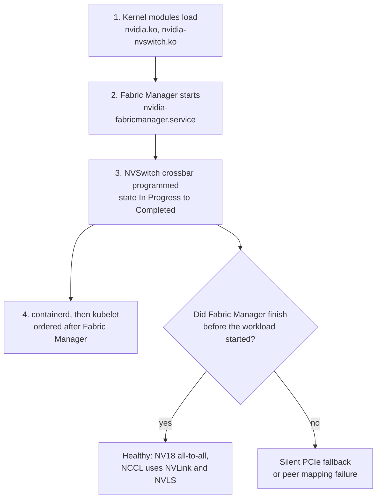
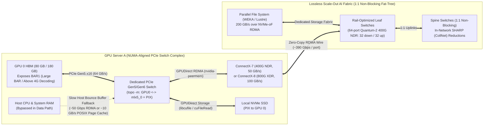
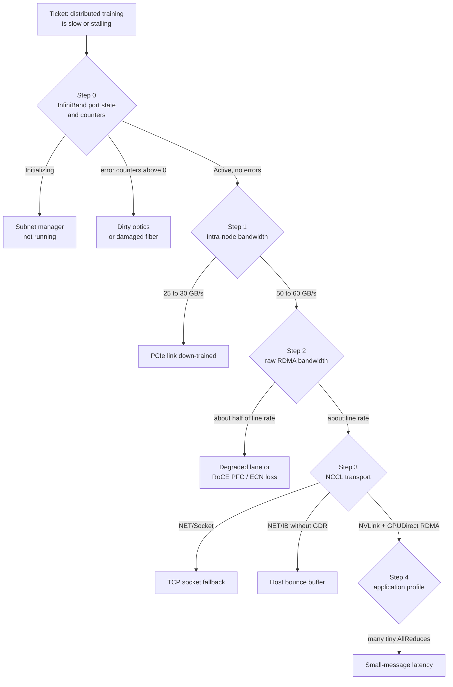

# 10.10 Fabric Manager, NVSM and NVLink domains

| | |
|---|---|
| Level | Advanced |
| Priority tier | 1 |
| Lab venue | Nebius GPU |
| Part | Part 10: The GPU and CUDA |
| Coverage file | `planning/coverage/chapters/10-10.md` |
| Claim ledger | `planning/ledgers/10-10.md` |

## Why this matters for AI infrastructure

A node comes back from a maintenance window. `nvidia-smi` lists all eight GPUs as healthy, yet a collective test reaches about 90 GB/s where it used to reach about 800 GB/s. Nothing has failed in the usual sense. The NVSwitch chips are present but nobody has told them how to route.

Chapter 10.6 described the wires of NVLink and NVSwitch. Those wires come in three layouts: two-GPU PCIe bridges, eight-GPU HGX baseboards, and seventy-two-GPU NVL72 racks. Wires alone move nothing, though. A two-GPU bridge is simple enough that the GPU kernel driver can bring it up directly, much as a single cable needs only a plug check. An NVSwitch crossbar is a different kind of object. It is a switched fabric, where any GPU reaches any other GPU through a switch chip, so the switches must be coordinated before traffic can move. That coordination belongs to a control-plane daemon, a background program that manages the fabric rather than carrying data. The daemon has to find the switch chips (application-specific integrated circuits, or ASICs, which are chips built for one job), train the NVLink ports (agree on the link settings at each end), program the unicast and NVLink SHARP multicast routing tables (the lookup tables that tell each switch where to forward a packet), and fence faulted links (cut a broken link off so traffic stops flowing into it).

On an eight-GPU HGX or DGX server, that control plane is the NVIDIA Fabric Manager daemon `nvidia-fabricmanager.service`. On a multi-node NVL72 rack, it expands into NVOS on the switch trays coordinated by NMX-M. When Fabric Manager is stopped, version-mismatched, or beaten in a boot race by `kubelet`, workloads either fail peer-to-peer initialization or silently fall back onto the host PCIe bus.

The boot race deserves a closer look, because it is the failure that surprises people most. The kubelet is the agent on each Kubernetes node that starts pods. It knows nothing about the state of the NVSwitch chips. If it starts before Fabric Manager finishes, it happily accepts GPU work. The pod then starts on a fabric that is still being wired, and NCCL (NVIDIA Collective Communications Library, the library that moves data between GPUs during training) quietly picks the slower route. The pod spec looks correct and the GPUs look healthy, so the only symptom is a slow job.

| Production incident | What went wrong in the control or data plane | Measured operational impact |
|---|---|---|
| 1. Post-reboot intra-node collective collapse | `nvidia-fabricmanager.service` (`15.234s` boot time) was disabled, mismatched against the driver, or started after `containerd` (`10.123s`) and `kubelet` (`5.234s`). | `nvidia-smi` shows 8 healthy GPUs, `nvidia-smi topo -m` prints `SYS` / `NODE` instead of `NV18`, and `nccl-tests` drops from `~800 GB/s` to `~90 GB/s`. |
| 2. The 5th-pod / 8th-pod `TopologyAffinityError` | Dual-socket `128`-core, `8`-GPU node (`64` cores and `4` GPUs per NUMA socket) runs `single-numa-node`, and OS daemonsets reserve `2` CPU cores on NUMA 1 (`62` free cores). | Pods requesting `16` integer cores + `1` GPU fit 4 pods on NUMA 0 (`64` cores) and 3 pods on NUMA 1 (`48` cores), stranding `14` free cores and `1` idle GPU (`14 < 16`). |
| 3. 40% slowdown or `~50 Gbps` cap on a 400G InfiniBand fabric | Missing `nvidia-peermem` / BIOS Large BAR forces a Host Bounce Buffer, PCIe downtrains to x8 (`25–30 GB/s`), IB port sticks in `State: Initializing`, or DDP sends tiny `256 KB` messages. | Throughput drops from `~390 Gbps` to `~50 Gbps` (`6.25 GB/s`), or PyTorch runs 40% slow until DDP `bucket_cap_mb` is raised from `25 MB` to `50 MB`. |

The rest of the chapter takes one question at a time. What does Fabric Manager actually do, and how do the three NVLink domain sizes differ? How do NVSM and NVDebug collect health data from inside the operating system? How does a message travel from a GPU to a network adapter and then out onto the fabric? Finally, how do you find the slow layer without guessing? The last part gives a three-step benchmark ladder for that search. Each step rules out one layer before you move on to the next.

:::tip In one minute
- The three NVLink domain sizes use different control planes. Two-GPU PCIe bridges need no Fabric Manager. Eight-GPU HGX baseboards need the host Fabric Manager, locked to the exact driver version. Seventy-two-GPU NVL72 racks use NVOS on the switch trays, managed by NMX-M.
- **Pods must not start before Fabric Manager finishes.** Give `containerd.service` and `kubelet.service` both `After=nvidia-fabricmanager.service` and `Wants=nvidia-fabricmanager.service`, or the node falls back to PCIe without any error.
- Operators run `nvsm` on the host for in-band DGX and HGX telemetry. In Base Command Manager they use `cmsh` to collect support archives under `/cm/shared/nvsm/` and `/cm/shared/nvdebug/`.
- Do not start with Python when a multi-node job is slow. Run the benchmark ladder in order: `nvbandwidth` for PCIe and NVLink inside a node, `ib_write_bw` for the raw RDMA wire, and `nccl-tests` for GPUDirect RDMA and collective rings.
:::

---

## Prerequisites and outcomes

**Prerequisites:** Complete Chapters 10.6 through 10.9 on GPU interconnects, PCIe versus SXM form factors, `nvidia-smi` operations, and the NVIDIA driver and container stack. You should also review Chapters 9.2 through 9.5 on DGX, HGX, and NVL72 rack architectures.

The chapter starts with the three NVLink domain sizes and the control plane each one needs. It then covers the boot ordering that keeps Fabric Manager ahead of `containerd` and `kubelet`, along with the NVSM and NVDebug tools for collecting health evidence. Next it follows the zero-copy scale-out path from the GPU through the network adapter to the fabric. The last parts cover the Topology Manager policies that keep pods on one NUMA node, and a benchmark ladder that separates the PCIe, optics, Subnet Manager, GPUDirect, and PyTorch DDP bucket problems.

---

## 1. NVLink Domains and the NVIDIA Fabric Manager (`nvidia-fabricmanager`)

A capacity planner compares two quotes. One server has a pair of GPUs joined by a bridge, and the other has eight GPUs on a shared board. Both advertise NVLink. Before signing, the planner needs to know which design depends on a host daemon to deliver its bandwidth, because that daemon becomes one more service to keep alive.

### 1.1 What is an NVLink domain, and why does NVSwitch require a Fabric Manager?

An NVLink domain is the set of GPUs that can address one another's High-Bandwidth Memory directly over NVLink using peer-to-peer memory semantics. Peer-to-peer means one GPU reads or writes another GPU's memory directly, without a copy that passes through the CPU. If the fabric control plane for that domain is not running, GPUs inside the same server or rack cannot open peer-to-peer NVLink handles. Workloads then either fail initialization or silently fall back to host PCIe transfers.

As modeled in `code/part10/fabric_manager_nvlink.py`, NVIDIA platforms form three distinct NVLink domain geometries. It helps to picture each one as a different street layout. A two-GPU PCIe bridge is a private driveway between two houses. The two GPUs are wired straight to each other with no intermediate switch chip, so the kernel driver trains those links directly. On an eight-GPU HGX baseboard or a seventy-two-GPU NVL72 rack, the layout changes. All 18 NVLink lanes from each GPU terminate on NVSwitch crossbar ASICs, which work like a junction box that connects every house to every other house. Those switch ASICs power on with empty forwarding tables. A table with no entries tells the switch nothing, so no traffic can be routed until Fabric Manager (or NVOS and NMX-M on NVL72) programs the unicast and NVLink SHARP multicast routes. Multicast means one send that reaches several receivers.

| NVLink domain type | Max GPUs in domain | NVSwitch ASICs | Per-GPU bidirectional NVLink BW | Aggregate domain BW | Control plane that programs the fabric | Supports NVLink SHARP (`NVLS`)? |
|---|---:|---:|---:|---:|---|---|
| 1. PCIe 2-Way Bridge Pair (e.g., H100 NVL) | `2` | `0` | `600 GB/s` | `1.2 TB/s` | Direct P2P link training in `nvidia.ko` GPU driver; no Fabric Manager needed. | No |
| 2. 8-GPU HGX / DGX Baseboard (H100/H200 or B200) | `8` | `4` (soldered on HGX PCB) | `900 GB/s` (H100)<br/>`1,800 GB/s` (B200) | `7.2 TB/s` (H100)<br/>`14.4 TB/s` (B200) | Host daemon `nvidia-fabricmanager.service` (`/usr/bin/nv-fabricmanager -c /usr/share/nvidia/nvswitch/fabricmanager.cfg`). | Yes (3rd/4th-gen NVSwitch) |
| 3. 72-GPU GB200 / GB300 NVL72 Rack (`18` compute trays) | `72` | `18` (`9` switch trays x `2` ASICs) | `1,800 GB/s` (`1.8 TB/s`) | `129.6 TB/s` (`~130 TB/s`) | NVOS on switch trays + NMX-M (Network Manager eXperience) & cluster Fabric Manager (`superpod-gb300-ra`). | Yes (NVLS in-switch reduction engines) |

Two words come up again and again in this part. Scale-up means adding GPUs inside one server or rack that share a fast fabric. Scale-out means connecting many servers over a network. Latency is how long one small message takes to arrive, and bandwidth is how much data moves per second. A fabric can have excellent bandwidth and still feel slow for small messages. Collective operations send many small steps, so both numbers matter.

As documented in *AI Data Center Network Design and Technologies* Chapter 13, switched scale-up fabrics achieve sub-microsecond GPU-to-GPU latency compared to PCIe Gen5. That gap has also led to open scale-up specifications such as UALink and SUE-T, covered in Part 12.

| Scale-up interconnect or standard (*AI Data Center Network Design and Technologies* Ch 13) | Latency & link architecture | Key protocol & framing parameters |
|---|---|---|
| NVLink / NVSwitch scale-up fabric | `100–300 ns` GPU-to-GPU latency (`~200 ns` at the switch device level) vs `500 ns–1 μs` on PCIe Gen5. | Host `/dev/nvidia-nvswitch*` devices programmed by `nv-fabricmanager` (`18` links per GPU) or NVOS/NMX-M across `18` NVSwitch ASICs in NVL72. |
| UALink (Ultra Accelerator Link) | Open scale-up specification for xPU fabrics. | `8` stations x `4` lanes of `200 Gbps` = `32` lanes / `6.4 Tbps` per xPU with `640-byte` DL flits. |
| SUE-T (Scale-Up Ethernet Transport) | Ethernet-based scale-up transport specification. | Uses AFH (AI Fabric Header) with LLR (Link Layer Retry) and CBFC (Credit-Based Flow Control). |

The boot sequence is easier to see as a picture than as a list.



Read the diagram from the top. The kernel modules load first, because Fabric Manager needs them before it can see any switch. Fabric Manager then does the slow work of programming the crossbar. Only after that should `containerd` and `kubelet` start pods. The decision at the bottom is the question to ask after every reboot. Did Fabric Manager finish before the first workload started? If yes, the node runs at NVLink speed. If no, the node falls back to a slower path, and the failure is silent.

The table below turns the same four steps into something you can check on a real node. Each row names the step, what it does, and the detail to look for.

| Step | What happens | Detail |
|---|---|---|
| 1. Kernel modules | `nvidia.ko` and `nvidia-nvswitch.ko` load | Exposes `/dev/nvidia0..7` and `/dev/nvidia-nvswitch0..3`. |
| 2. Fabric Manager | `nvidia-fabricmanager.service` (`15.234s` boot init in the example) | `ExecStart=/usr/bin/nv-fabricmanager -c /usr/share/nvidia/nvswitch/fabricmanager.cfg`, locked to the exact driver version (`570.59` equals `570.59-1`). |
| 3. Crossbar programming | `4` NVSwitch ASICs on an 8-GPU HGX node | Trains `8` GPUs x `18` links (`144` sub-links), programs unicast and NVLS SHARP routing tables, moves Fabric State from `In Progress` to `Completed`. |
| 4. Runtime ordering | `containerd.service` then `kubelet.service` | Systemd drop-in: `After=nvidia-fabricmanager.service` and `Wants=nvidia-fabricmanager.service`. |
| Healthy outcome | Fabric Manager completed first | `nvidia-smi topo -m` shows `NV18` all-to-all; NCCL uses NVLink and NVLS (`~800 GB/s` bus bandwidth on H100). |
| Failed outcome | Fabric Manager stopped, mismatched, or lost a boot race | `topo -m` or NCCL drops to `SYS` or `PIX` (`~800 GB/s` down to `~90 GB/s`) or logs Xid `74`. |

### 1.2 `nvidia-fabricmanager.service` lifecycle, version locking, and the `kubelet` boot race

Picture the Monday after a maintenance window. The team patched the driver on a set of GPU servers, rebooted them, and the dashboards turned green. Two days later, one node runs a training job at a fraction of its earlier speed. Nobody touched the code. The cause is usually one of three mistakes, and the three rules below are written to catch each one.

On an eight-GPU HGX server, three operational mistakes routinely break the NVLink mesh after maintenance windows: version drift between the driver and Fabric Manager, systemd boot races against `kubelet`, and misdiagnosing a soldered NVSwitch failure as a GPU failure. The auditor in `code/part10/fabric_manager_nvlink.py` checks all three rules.

The first rule is about versions. Think of the driver and Fabric Manager as two halves of a plug and socket. If the pin layout changes on one half, the other half no longer fits. Fabric Manager talks to the kernel NVSwitch driver through a private interface between compiled programs, called an application binary interface, or ABI. The two must therefore come from the same release, so the Fabric Manager package version must equal the driver version. A mismatch rarely announces itself at login. It shows up as Fabric Manager exiting at startup, which leaves the switches uninitialized and the node quietly slow.

Boot order is the rule people skip most often. In systemd, the service manager that starts Linux services at boot, a unit can say that it wants another unit, and it can separately say that it must start after that unit. Those are two different statements. Wanting a service does not put the order right, because only the After= line controls the order.

The second rule is about order. In the `systemd-analyze blame` example below, Fabric Manager needs 15.234 seconds to start, while `containerd` needs 10.123 and `kubelet` 5.234. The source example attributes that time to training 144 NVLink sub-links and programming four NVSwitch ASICs. Treat 15 seconds as an illustrative figure from that example, not an NVIDIA specification. The real time varies with the system and driver version. In systemd, `Wants=` or `Requires=` declares a dependency but does not set startup order. Pair `Wants=` with `After=nvidia-fabricmanager.service` on both `containerd` and `kubelet`.

The third rule is about what to replace. When `dmesg` logs Xid 74 for an NVLink error, recall from Chapter 9.3 that each SXM GPU is a bolted Field-Replaceable Unit, or FRU, which is a part a technician swaps as one piece. The four NVSwitch ASICs are soldered onto the HGX baseboard, so a failed switch ASIC means returning the whole baseboard to the vendor under a return merchandise authorization, or RMA. An RMA is the paperwork that starts a hardware return. Replacing the wrong part wastes a visit and leaves the fault in place, which is why the health tools in the next section matter. They show which box failed before you order anything.

| Operational rule | Exact versions, timings, or error codes | Consequence of violation & remediation |
|---|---|---|
| 1. Strict driver version lock | `nvidia-driver` `570.59` must match `datacenter-gpu-manager-fabricmanager` `570.59-1` (`nvsm versions` on p. 671; mismatch example `570.59` vs `550.90.07-1`). | Fabric Manager exits on startup, leaving NVSwitch uninitialized; lock both packages in apt/yum or BCM software image. |
| 2. Systemd boot ordering (`After=` + `Wants=`) | `systemd-analyze blame`: `nvidia-fabricmanager.service` takes `15.234s` (`144` sub-links across `4` switches), `containerd.service` takes `10.123s`, and `kubelet.service` takes `5.234s`. | Kubelet admits GPU pods before NVSwitch programming finishes, dropping NCCL from `~800 GB/s` to `~90 GB/s`; add `After=` and `Wants=` drop-ins. |
| 3. Xid `74` NVLink Error & FRU boundary | Kernel logs `Xid 74` (`NVLink Error`); `nvidia-smi nvlink --errorcounters` and `dcgmi diag -r 2` isolate port vs switch ASIC faults (`312 GB/s` degraded pair). | SXM GPU is a bolted FRU, whereas the `4` NVSwitch ASICs are soldered to the HGX PCB; a dead NVSwitch ASIC requires an OEM HGX baseboard RMA. |

---

## 2. In-Band Hardware Health & Telemetry Bundles: `NVSM` (`nvsm`) and `NVDebug` (`nvdebug`)

A node shows a missing PCIe device in the morning report. Before anyone opens a ticket with the vendor, the on-call engineer needs three answers. Which part is unhealthy? What do the logs say? Can the evidence be bundled for NVIDIA Enterprise Support in one step?

### 2.1 NVIDIA System Management (`NVSM`): Host CLI vs BCM `cmsh` wrapper

When an HGX or DGX node reports a degraded NVLink fabric or missing PCIe device, engineers need a single in-band tool to check component health and collect a support archive for NVIDIA Enterprise Support. In-band means the tool runs inside the operating system and reads the hardware through the Linux kernel. The other path is out-of-band. It goes through the BMC (baseboard management controller), a small computer on the server board that keeps working when Linux is down. Redfish, a standard web interface that most BMCs expose, is the usual way to query it. Out-of-band access travels over a dedicated management network. NVIDIA System Management, called NVSM here, runs inside Linux. It monitors GPUs, NVSwitches, NVLink-C2C, DIMMs, NVMe drives, fans, and power supplies.

Base Command Manager (BCM) is the cluster management software that runs on the head node, the machine that looks after the other nodes. Its `cmsh` shell is the command line for that software.

In the BCM 11 Administrator Manual Section 10.13, Base Command Manager provides a cluster-wide `nvsm` wrapper inside `cmsh` device mode alongside an automated `NVSMHealthDump` monitoring action on the active head node. When extracted, an `nvsm health` archive exposes a structured two-level directory tree (`boot/`, `etc/`, `nvsmhealth_commands/`, `proc/`, `usr/`, `var/`, plus JSON health files). That archive captures hundreds of system command outputs and `/proc` states for offline root-cause analysis. Think of it as a snapshot folder. Support staff can unpack it on any machine and read the health files offline, which helps when the broken node will not answer a login.

| `cmsh` `device -> nvsm` subcommand | Options | Operational purpose & output |
|---|---|---|
| `nvsm alerts` | `--start <idx>`, `--limit <N>`, `-n <nodes>` | Lists active hardware and fabric alerts across nodes, such as `NVLink-C2C is reporting... System entered degraded... Unexpected Link Count`, `GPU0 is reporting NVLink link 0...`, or `PCI sub-system... Device is missing`. |
| `nvsm health` | `--quick`, `--tags <tags>`, `-n <nodes>` | Executes a full health dump on target nodes and writes `/cm/shared/nvsm/<node>_YYYY-MM-DD-HH-MM-SS.tar.xz` (`417MiB` in the manual's example, `node001_2025-01-24-04-51-31.tar.xz`). A full dump takes about `15 minutes`; `--quick` finishes faster (`5.9MiB`) using more transient CPU and RAM. |
| `nvsm info` | `--history` | Displays the filename and size of the most recent health dump, or all historical dumps with `--history`, under `/cm/shared/nvsm/`. |
| `nvsm status` | `-n <nodes>` | Shows whether a health dump is currently running (`duration`, `log`, `status: active`, `success: yes`, `Result: good`). |
| `nvsm stop` | `-n <nodes>` | Aborts an in-progress health dump; partial data collected so far is left as an uncompressed directory rather than a `.tar.xz` archive. |
| `nvsm versions` | `--details`, `-c <category>` | Queries component software and firmware versions across nodes (`cuda-driver 12.8`, `datacenter-gpu-manager 1:4.0.0~10338`, `datacenter-gpu-manager-fabricmanager 570.59-1`, `dgx-release 7.0.0`, `kernel 6.8.0-31-generic-64k`, `nvidia-driver 570.59`, `nvsm 24.09.05`, `platform PG548`, `sbios 02.03.13`, `vBIOS 0..3 97.00.6c.00.03`). |

### 2.2 `NVDebug` (`nvdebug`): Multi-platform host, BMC, Redfish, and NVSwitch log collection

Picture an outage where the host Linux shows the GPUs as present, yet the switch management controller reports errors and the BMC keeps a log of its own. Pulling each source by hand means one SSH session per host and one Redfish query per controller. The minutes add up, and each manual step is a chance to copy the wrong file. While `nvsm` targets in-band DGX health, complex fabric failures often require pulling logs simultaneously from the host OS, IPMI, Redfish, and NVSwitch management controllers across heterogeneous x86 and Arm platforms. IPMI (Intelligent Platform Management Interface) is an older standard for many of the same BMC functions. Running manual SSH and Redfish loops by hand during an outage is slow and error-prone.

To automate multi-plane log collection, the BCM 11 Administrator Manual Section 10.14 provides the `nvdebug` tool inside `cmsh` device mode. Starting a collection on a target node launches a transient systemd service and writes compressed log bundles to the shared cluster filesystem. A transient service exists only for the length of one job. It starts, collects its logs, writes the bundle, and goes away. The shared cluster filesystem is a directory that every node can see, so the bundle lands in one place rather than on the node that broke.

| `nvdebug` parameter or command | Supported values & flags | Operational behavior & telemetry |
|---|---|---|
| Platform types (`-t, --platform`) | `5` platform types: `DGX`, `arm64`, `x86_64`, `NVSwitch`, and `HGX-HMC`. | Selects platform-specific hardware registers and firmware log collectors. |
| Log collector groups (`-g, --loggroup`) | `5` log groups: `HealthCheck`, `Host`, `IPMI`, `Redfish`, and `SSH`. | Filters which management planes are queried during bundle generation. |
| `nvdebug start` / `stop` / `history -v` | `-n <nodes>`, `-t <platform>`, `-g <loggroup>` | Starts or stops `cm-nvdebug@<node>.service` and lists archived bundles under `/cm/shared/nvdebug/<hostname>`. |
| `nvdebug status -n node001 --json` | `--json` | Reports live collection resource usage: `cpu: 0.076`, `duration: 16`, `memory: 8261632`, `pid: 205704`, `status: "active"`. |

---

## 3. From the NVLink Domain to the Scale-Out Fabric: GPUDirect RDMA, GDS, ConnectX, and NCCL

Picture a training job that spans a whole row of servers. The GPUs inside each box look perfect in `nvidia-smi`, yet the job slows every time a gradient has to leave the box. The problem sits somewhere on the way out of the server, and this section follows that path one stop at a time.

Once intra-node NVLink and Fabric Manager are healthy, tensors must leave the NVLink domain over PCIe and network adapters to synchronize gradients or read training data across the cluster. A network adapter, called a NIC (network interface card), is the card that puts those bytes on the wire. RDMA (Remote Direct Memory Access) lets one machine write into another machine's memory while the CPUs stay out of the copy path. If any link in that GPU-to-PCIe-to-NIC-to-Switch chain falls back to host CPU staging, multi-node throughput collapses even when every GPU and NVSwitch inside the server is healthy.



### 3.1 Why GPU networking exists: 3D Parallelism, TCP/IP overhead, and switch-buffer jitter

Data parallelism gives every GPU a full copy of the model and a different slice of the batch. Pipeline parallelism splits the model into stages that sit on different GPUs. Tensor parallelism splits one layer across several GPUs. Training that combines these styles is often called 3D parallelism. In synchronous distributed training across Data, Pipeline, and Tensor Parallelism, every GPU must exchange gradients or activations at the end of every micro-step. A collective is one of these group exchanges, and a micro-step is one small slice of a training step. Each exchange works as a lockstep. When the network introduces high latency, CPU copy overhead, or microburst queueing jitter, the entire GPU fleet sits idle waiting for the slowest rank to finish its collective. A rank is one process in the job, usually one GPU.

Think of a socket call as asking the kernel, the core of the operating system, to carry a letter for you. The program hands the letter over, the kernel copies it into its own buffers, and the kernel splits it into frames that fit the network's MTU (maximum transmission unit, the largest frame the link carries). Every one of those steps costs CPU time. TCP/IP is the standard network protocol stack that most software uses by default. Standard Linux TCP/IP socket calls force a seven-step kernel penalty: user-to-kernel context switches, socket buffer copies, software TCP checksums, MTU segmentation, and millions of CPU interrupts per second. Similarly, routing AI training traffic through shared deep-buffer enterprise Ethernet switches introduces microburst queueing delays and packet drops unless lossless RDMA flow control is engineered end-to-end. A deep-buffer switch holds many packets in memory before it drops any. That sounds safe, but a burst from many GPUs at once fills the queue, and the packets then wait in line.

| Production scenario | Network bottleneck mechanism | Quantified impact & architectural fix |
|---|---|---|
| 1. Synchronous 3D Parallelism collective wait | `10,000` GPUs finish forward/backward compute in `2 ms`, then wait `50 ms` for network `AllReduce` / `AllGather`. | Cluster runs at `2 / 52 ≈ 4%` compute efficiency (`9,999` GPUs stall if GPU `10,000` is delayed by `10 ms`). |
| 2. 7-step TCP/IP kernel socket penalty | `100`-node Ray reinforcement-learning cluster with `100GbE` ConnectX-5 NICs uses standard Linux TCP sockets (`send()`) instead of RDMA. | `node_cpu_seconds_total` (`system` kernel threads) pins at `100%` CPU utilization and network throughput caps at `30 Gbps`; fixed by switching to kernel-bypass RDMA (`RoCEv2` / Verbs). |
| 3. Enterprise Ethernet VLAN & deep-buffer switch proposal | Proposal to save `$2 Million` on a `500`-server H100 cluster by sharing enterprise core switches via VLANs and QoS. | Fails under synchronous `AllReduce` microbursts (`10 ms` deep-buffer queuing stalls all ranks); requires dedicated non-blocking InfiniBand or lossless RoCEv2 (`PFC`/`ECN`). |

### 3.2 `GPUDirect RDMA` (`BAR1` + `nvidia-peermem`) vs `GPUDirect Storage` (`GDS`, `libcufile`, `DALI`)

Picture a parcel that arrives at a warehouse before it reaches the right house. It arrives, but it took an extra trip, and someone has to carry it again. A bounce buffer works the same way. An RDMA adapter that writes into host memory does not put the data where the GPU needs it, so the GPU has to read a second copy across PCIe. The same extra trip shows up in storage, where standard Python file reads pass training data through the Linux kernel Page Cache, a region of RAM that holds recently read files.

Enabling RDMA on the network adapter is only half the battle. Standard RDMA moves packets from the wire into host CPU DDR5 system memory. That forces the GPU to perform a second PCIe copy from system RAM into GPU HBM, known as the Host Bounce Buffer. The same bottleneck hits storage pipelines when standard Python file reads stage training data through the Linux kernel Page Cache.

NVIDIA solves both host-memory bottlenecks by exposing GPU HBM directly onto the PCIe bus via BAR1 so network adapters and NVMe controllers can DMA straight into GPU memory without touching the host CPU. DMA (direct memory access) means a device moves data into memory without the CPU copying each byte. BAR1 is the window through which other devices on the bus reach GPU memory, and the BIOS settings in the table below control whether that window is large enough. GPUDirect RDMA uses the `nvidia-peermem.ko` kernel module to register GPU HBM pages with the InfiniBand or RoCE subsystem. Similarly, GPUDirect Storage uses `libcufile` and `nvidia-fs.ko` to move data directly between local NVMe or remote NVMe-oF storage arrays and GPU HBM.

| Zero-copy technology | Required host hardware, BIOS, & kernel components | Production symptom when broken (`Customer Scenarios`) | Validated engineering fix |
|---|---|---|---|
| GPUDirect RDMA (GPU `←>` NIC `←>` Network `←>` NIC `←>` GPU) | BIOS Above 4G Decoding / Large BAR (`BAR1`), PCIe ACS disabled, `nvidia-peermem.ko` loaded, and GPU + NIC sharing a local PCIe Switch (`PIX`). | `4` DGX H100 servers on a `400G` InfiniBand switch achieve only `~50 Gbps` (`6.25 GB/s`) in PyTorch/NCCL due to Host Bounce Buffer staging. | Load `nvidia-peermem`, disable PCIe ACS, enable BIOS Large BAR, and confirm `GPU Direct RDMA` on `NET/IB` in `NCCL_DEBUG=INFO`. |
| GPUDirect Storage (GDS: NVMe / NVMe-oF `←>` NIC/PCIe `←>` GPU) | Local NVMe or remote NVMe-oF parallel file system (`WEKA`, `Lustre`, `IBM Storage Scale`), `nvidia-fs.ko`, and `libcufile` (`cuFileRead` / `cuFileWrite`). | `200 GB/s` WEKA array feeding `10 million` dashcam videos over `400G` IB caps at `10 GB/s` and `15%` GPU utilization via POSIX `open()`/`read()` Page Cache. | Refactor data loader to NVIDIA DALI with GDS (`cuFile`) and verify with `gdscheck -p` and `gds_stats`. |

### 3.3 `ConnectX-6`, `ConnectX-7`, and `ConnectX-8` PCIe physics & the dual-200G OEM trap

A buyer asks for the fastest network card for the newest GPUs. The quote arrives with a card that sounds right, and the real question is whether the server's slot can carry that speed. PCIe, the Peripheral Component Interconnect Express bus, is the highway between the GPU, the network card, and the CPU. Its speed depends on the generation and on the lane count of the slot, which is the x16 part of each name.

A GPU cannot push data onto the network faster than its local PCIe slot and network adapter can carry it. If a server pairs a Hopper or Blackwell GPU with an older PCIe generation or splits bandwidth across mismatched network cards, the PCIe bus becomes the bottleneck before packets ever reach the switch.

A SmartNIC is a network card with its own processing, and OEM stands for original equipment manufacturer, the company that assembles the complete server. Matching the SmartNIC generation to the GPU generation is governed by PCIe x16 slot bandwidth (`code/part10/fabric_manager_nvlink.py`). In one customer scenario, a discount OEM advertised 400 Gbps per H100 GPU by pairing two 200 Gbps ConnectX-6 PCIe Gen4 cards per GPU. Because each ConnectX-6 is capped at 200 Gbps and the GPU often lacks a direct local PCIe switch path to the second card, multi-rail NCCL routing degrades. Production H100 and B200 servers require a 1:1 generationally matched 400G ConnectX-7 or 800G ConnectX-8 pairing. Think of the dual-card layout as two narrow pipes feeding one faucet. On paper the total looks right. In practice each card has its own path to the GPU, and multi-rail traffic (traffic spread across several network ports) is only as fast as the weakest path. NCCL has to choose which port each GPU uses, and a poor choice slows the whole collective.

| SmartNIC generation | Line rate per port | Line rate in Bytes/sec | Host PCIe bus interface | Unidirectional PCIe x16 ceiling | Optical transceiver form factor | Matched GPU generation |
|---|---:|---:|---|---:|---|---|
| ConnectX-6 | `200 Gbps` (`HDR` / `200GbE`) | `25 GB/s` (`50.0 GB/s` across dual `200 + 200 = 400` trap) | `PCIe Gen4 x16` | `32 GB/s` | `QSFP56` | Ampere A100 |
| ConnectX-7 | `400 Gbps` (`NDR` / `400GbE`) | `50 GB/s` (`50.0 GB/s <= 64.0 GB/s`) | `PCIe Gen5 x16` | `64 GB/s` | `OSFP` (larger heatsink for 400G lasers) | Hopper H100 / H200 |
| ConnectX-8 | `800 Gbps` (`XDR` / `800GbE`) | `100 GB/s` | `PCIe Gen6 x16` | `128 GB/s` | `OSFP` / Co-Packaged Optics (`CPO`) | Blackwell B200 / GB300 |

### 3.4 Scale-out fat-tree sizing (`1,024 GPUs`), `1:1` non-blocking vs `2:1` oversubscription, and storage plane isolation

Imagine a full row of servers, each one sending at full speed in the same instant, because every rank is waiting on the same collective. The network team needs to know whether the leaf and spine switches can absorb that burst without queueing. Oversubscription means the downlinks offer more traffic than the uplinks can carry. It is harmless for ordinary web traffic that comes and goes, and it is harmful here.

Even when every server has healthy NVSwitches, GPUDirect RDMA, and matched ConnectX-7 adapters, the cluster will stall if the top-of-rack and spine switches are oversubscribed or shared with bulk storage traffic. Because all ranks in a synchronous training collective transmit at line rate at the exact same microsecond, traditional data-center oversubscription ratios immediately cause congestion.

Non-blocking means every downlink has a matching uplink path, so a packet never waits for a shared link to free up. A fat-tree is a layered topology in which the bandwidth is spread across more links toward the top. Rail-optimized means each GPU rail, or network port, is wired to its own leaf switch.

As Chapters 9.6 through 9.9 describe, production AI fabrics follow three non-negotiable topology rules. They use 1:1 non-blocking rail-optimized fat-trees, enforce zero spine oversubscription on compute fabrics, and maintain physical separation between the compute fabric and the storage fabric.

| Cluster fabric design scenario | Port & switch geometry | Operational behavior & why it matters |
|---|---|---|
| 1. Sizing a `128`-node (`1,024`-GPU) DGX H100 fat-tree (`Scenario 1`) | `64`-port Quantum-2 `400G` NDR switches (`32` ports down / `32` ports up = `1:1`). `1` Leaf Group of `8` rail-optimized Leaf switches serves `32` DGX nodes (`256` GPUs). | `128` servers (`1,024` GPUs / `1,024` NICs) require `4` Leaf Groups (`32` Leaf switches, `1,024` uplinks) connected to `16` Spine switches. |
| 2. Why `2:1` spine oversubscription fails (`Scenario 2`) | Leaf switch connects `32` server ports down (`32 x 400G`) with only `16` uplinks to the Spine (`2:1` oversubscription). | A `512`-GPU training job running synchronous `AllReduce` drives `400 Gbps` on all `32` downlinks simultaneously, saturating the `16` uplinks and triggering IB credit backpressure. |
| 3. Why storage (`100 GB` checkpoints) must be isolated (`Scenario 3`) | Bursting a `100 GB` checkpoint write over the shared compute InfiniBand switches. | Bulk storage frames fill switch buffers and cause head-of-line queueing jitter for latency-sensitive `AllReduce` packets; isolate storage onto a separate fabric via BlueField-3 DPUs. |

Each row in the table above answers one design question. Which fabric shape does the cluster need? How many leaf and spine switches does it take? Where does the storage traffic go? The numbers in the scenarios are worked examples, and the same arithmetic applies when you change the switch size or the server count.

---

## 4. Topology-Aware Placement & the 3-Step Benchmark Hierarchy (`nvbandwidth` → `ib_write_bw` → `nccl-tests`)

A GPU server has two CPU sockets, and each socket owns part of the cores, memory, and GPUs. A scheduler that ignores that layout can hand one pod a GPU on one socket and its CPU cores on the other. The pod starts, but every transfer then crosses the link between the sockets. NUMA (non-uniform memory access) is the name for this layout, where each socket has local memory and reaching the other socket costs extra time. Keeping a pod on one socket is the job of the Topology Manager, and the next subsections explain how it decides.

### 4.1 Kubernetes Topology Manager (`single-numa-node`) and the `16-Core → 12-Core` fix

A ticket reports eight GPUs sitting idle while pods stay pending with a TopologyAffinityError. The GPU list looks free, and the admission error does not name the missing cores. Working out which resource ran out takes some arithmetic, and the table below does that arithmetic for you.

On a dual-socket GPU server, if Kubernetes assigns a pod a GPU on NUMA node 0 but allocates CPU cores or an SR-IOV NIC on NUMA node 1, every host-to-device transfer and network call must cross the inter-socket UPI or Infinity Fabric link. Conversely, enabling strict single-NUMA enforcement without accounting for OS and DaemonSet CPU overhead causes pods to fail admission with a topology affinity error while GPUs sit idle.

The kubelet Topology Manager coordinates CPU, memory, GPU, and NIC alignment for pods in the Guaranteed QoS class requesting integer CPU cores. QoS stands for quality of service, the label Kubernetes uses to rank pods. A pod gets the Guaranteed class when its requests match its limits, and that class is the one that receives exclusive CPU cores. An integer request asks for whole cores, such as 16. A fractional request does not qualify. The simulator in `code/part10/fabric_manager_nvlink.py` models all four policies and reproduces a real customer incident. When OS threads reserve 2 CPU cores on NUMA 1, the eighth pod is blocked until the per-pod CPU request is right-sized from 16 cores down to 12 cores.

| Policy or scenario | Kubelet admission rule & NUMA math | Result on a `128`-core (`64`/NUMA), `8`-GPU (`4`/NUMA) server |
|---|---|---|
| `none` (default) / `best-effort` | `none` ignores NUMA locality; `best-effort` prefers aligned placement but admits split-NUMA pods if needed. | Admits pods across split sockets, causing non-deterministic cross-socket latency. |
| `restricted` / `single-numa-node` | Rejects pod with `TopologyAffinityError` unless devices fit within the minimum NUMA nodes (`restricted`) or `1` single NUMA node (`single-numa-node`). | Enforces local PCIe/NUMA locality for `Guaranteed` QoS pods with integer CPU requests. |
| Broken: `16` CPUs + `1` GPU per pod (`2` OS cores on NUMA 1) | NUMA 0 (`64` free cores) admits Pods 1–4 (`4 x 16 = 64` cores, `4` GPUs). NUMA 1 (`64 - 2 = 62` free cores) admits Pods 5–7 (`3 x 16 = 48` cores, `3` GPUs). | Strands `62 - 48 = 14` free CPU cores and `1` unused GPU on NUMA 1; Pod 8 (`5th` pod in note narrative) fails with `TopologyAffinityError` (`14 < 16`). |
| Fixed: `12` CPUs + `1` GPU per pod (`2` OS cores on NUMA 1) | Right-size pod request to `12` integer CPU cores after profiling actual CPU utilization. | NUMA 0 uses `4 x 12 = 48 <= 64` cores and NUMA 1 uses `4 x 12 = 48 <= 62` cores; all `8` pods schedule cleanly under `single-numa-node`. |

### 4.2 The 3-Step Hardware-to-Application Benchmark Hierarchy (`diagnose_three_step_data_path_benchmarks`)

A training job that used to finish overnight now runs into the next afternoon. The team has already changed a few NCCL environment variables, and nothing moved. This is the point where guessing stops working and the layers need to be checked in order.

When a distributed training job runs slowly or stalls, debugging inside Python or tweaking NCCL environment variables at random wastes hours. A slow job can be caused by a dead InfiniBand Subnet Manager, a dirty optical transceiver, a downtrained PCIe riser, a missing peer-memory kernel module, or tiny PyTorch gradient buckets.

Follow a sequential benchmark ladder. By checking port state first, intra-node `nvbandwidth` second, raw wire `ib_write_bw` third, and `nccl-tests` fourth, you prove each physical layer before inspecting application code.

Think of the ladder as a set of gates. Each gate proves one layer is healthy, and the next gate only means something after the previous one opens. The port state comes first, because a dead link makes every later test meaningless. The intra-node test comes next and checks the PCIe path inside the box. The raw wire test checks the cable and the switch. The NCCL test comes last because it exercises the full stack, and a failure there is hard to read unless the earlier gates passed. Application profiling belongs after all of them, since a slow model cannot be blamed on the network until the network is proven.



| Step | Check | Finding | Cause and fix |
|---|---|---|---|
| 0 | `ibstat mlx5_0`, `rdma link show`, `/sys/class/infiniband/*/counters` | `Physical state: LinkUp` but `State: Initializing` (`CA type: MT4129`, FW `28.39.2048`) | Subnet Manager (`OpenSM` / `UFM`) not running or unreachable; start SM and verify `State: Active` and `SM lid`. |
| 0 | Same (`/sys/class/infiniband/mlx5_0/ports/1/counters/*`) | `symbol_error`, `port_rcv_errors`, `link_error_recovery`, or `VL15_dropped` above `0` | Dirty optical transceiver or damaged fiber: clean or replace optics and verify with `mlxlink`. |
| 1 | `nvbandwidth -t device_to_host_memcpy_ce` | `25–30 GB/s` (`28 GB/s`) instead of `50–60 GB/s` (`56 GB/s`) on PCIe Gen5 x16 | PCIe link downtrained (`x16` to `x8`): inspect `lspci -vv` `LnkSta`, reseat the riser or GPU. |
| 2 | `ib_write_bw --report_gbits --duration 30` | `~195 Gbps`, half of `~390 Gbps` (`392 Gbps`) on `400G` NDR | Degraded optical lane or RoCE PFC/ECN loss: inspect `ibstat` and `mlxlink` width and speed. |
| 3 | `nccl-tests` (`all_reduce_perf`) with `NCCL_DEBUG=INFO` | Log shows `NET/Socket` | TCP/IP socket fallback: expose `/dev/infiniband` in the container and set `NCCL_IB_HCA`. |
| 3 | Same (`all_reduce_perf` with `NCCL_DEBUG=INFO`) | `NET/IB` without GDR (`~50 Gbps`, `6.25 GB/s`) | Host CPU bounce buffer: load `nvidia-peermem`, disable PCIe ACS, enable BIOS Large BAR. |
| 4 | Nsight Systems, PyTorch DDP `AllReduce` message sizes | Thousands of tiny `256 KB` `AllReduce` calls (job `40%` slow) | Latency-dominated small messages: raise DDP `bucket_cap_mb` from default `25 MB` to `50 MB`. |

---

## 5. Commands and Configurations That Matter

A new node arrives in a rack with a handover note that says its fabric is healthy. Before the team trusts the note, someone types a short list of commands and compares the output with the numbers in this chapter. The commands below are that list.

The commands below follow the BCM 11 Administrator Manual, Sections 10.13 and 10.14. No multi-node HGX or InfiniBand hardware was available for this chapter, so the commands below were not run on live hardware.

### 5.1 Verify `nvidia-fabricmanager.service` and enforce systemd ordering before `containerd`/`kubelet`

When an eight-GPU HGX server boots or updates its driver packages, verify that Fabric Manager matches the exact driver version. Then inspect systemd boot timings so `kubelet` cannot race ahead of NVSwitch initialization. The first command lists installed packages, so you can compare the driver and Fabric Manager versions side by side. The second command checks whether the service is running. The `systemd-analyze` commands report how long each unit took to start, and that report is where the boot race shows up.

```bash
# 1. Verify that nvidia-fabricmanager package matches the installed driver branch (untested here)
dpkg -l | grep -E 'nvidia-driver|nvidia-fabricmanager|datacenter-gpu-manager'
systemctl status nvidia-fabricmanager.service

# 2. Inspect Fabric Manager startup duration in the boot chain (~15.234s on 8-GPU HGX) (untested here)
systemd-analyze
systemd-analyze blame | head -n 10
systemd-analyze critical-chain kubelet.service
```

A drop-in is a small override file. It adds lines to a service without editing the vendor's original unit file, which keeps the change in one place. Create `/etc/systemd/system/containerd.service.d/wait-for-fabricmanager.conf` and the identical drop-in for `kubelet.service`. Both files hold the same two lines, because both services must wait for the same Fabric Manager.

```ini
[Unit]
After=nvidia-fabricmanager.service
Wants=nvidia-fabricmanager.service
```

### 5.2 Run `nvsm` and `nvdebug` on a DGX host and inside BCM `cmsh`

A DGX node shows a fabric alarm late on a Friday. You want the health state from the node itself, and you also want the cluster head node to gather a support archive without logging in to each box. The two paths below cover both cases.

To inspect in-band health on a single DGX node or collect cluster-wide support archives from the Base Command Manager head node, use `nvsm` and `nvdebug`.

The first block runs on the node itself through the Linux command line. The second block asks the BMC for thermal readings over HTTPS. In that command, the user option supplies a username and password, and the insecure option tells curl to skip certificate checking. That is common on a BMC with a self-signed certificate, but it is a risk on an untrusted network.

```bash
# 1. Directly on a DGX host (in-band Linux CLI) (untested here)
sudo nvsm show health
sudo nvsm dump health

# 2. Out-of-Band Redfish thermal check against the BMC (untested here)
curl -u admin:password -k https://<BMC_IP>/redfish/v1/Chassis/1/Thermal
```

Inside Base Command Manager `cmsh`, the prompt shows which mode you are in. The line `device` moves you into device mode, and the `nvsm` and `nvdebug` lines after it act on the node names you pass with `-n`. A bracketed range of node names, as the block below shows, covers several DGX systems in one line.

```text
[basecm11]% device
[basecm11->device]% nvsm versions -n node001
[basecm11->device]% nvsm alerts -n node001
[basecm11->device]% nvsm health -n dgx-[001-002]
[basecm11->device]% nvsm status -n dgx-[001-002]
[basecm11->device]% nvsm info --history
[basecm11->device]% nvdebug start -n node001 -t DGX -g HealthCheck
[basecm11->device]% nvdebug status -n node001 --json
[basecm11->device]% nvdebug history -v
```

### 5.3 Execute the 3-step data-path benchmark sequence (`nvbandwidth` → `ib_write_bw` → `nccl-tests`)

You suspect a slow link between two nodes and need to know which layer to blame. Run the checks in order and stop at the first failure. A later test cannot rescue an earlier broken layer, so running them out of order wastes time.

Run the four verification steps in strict order to isolate InfiniBand link state, intra-node PCIe bandwidth, raw RDMA wire speed, and multi-node GPUDirect RDMA collectives. Each step answers one question, and each answer decides whether the next step is worth running.

```bash
# Step 0 (untested here): Verify InfiniBand port state (Active + LinkUp, Rate: 400) and zero error counters
ibstat mlx5_0
ibv_devices
rdma link show
grep -H . /sys/class/infiniband/mlx5_0/ports/1/counters/*

# Step 1 (untested here): Validate intra-node PCIe Gen5 x16 (~50-60 GB/s) and NVLink mesh
nvbandwidth -l
nvbandwidth -t device_to_host_memcpy_ce

# Step 2 (untested here): Validate raw node-to-node RDMA wire speed (~390 Gbps on 400G NDR)
# On node-a (server):
ib_write_bw --report_gbits --duration 30
# On node-b (client):
ib_write_bw <node-a-rdma-ip> --report_gbits --duration 30

# Step 3 (untested here): Validate multi-node GPUDirect RDMA & NVLink collectives with NCCL debug logging
export NCCL_DEBUG=INFO
export NCCL_DEBUG_SUBSYS=INIT,NET,GRAPH
mpirun -np 2 -H node-a:1,node-b:1 \
  -x NCCL_DEBUG -x NCCL_DEBUG_SUBSYS \
  ./build/all_reduce_perf -b 8M -e 1G -f 2 -g 1

# Step 4 (untested here): Verify GPUDirect Storage (GDS) readiness
gdscheck -p
```

---

## 6. How It Fails: Six Production Fabric Manager, NVLink Domain, and Data-Path Failure Modes

The ticket is short. Training was fine on Monday and has been slow since the maintenance window. You cannot tell which failure mode it is until you match the symptom to the evidence, and replacing hardware is expensive, so the evidence comes first.

When an intra-node NVLink mesh or scale-out RDMA fabric degrades, use the symptom and diagnostic evidence in the table below to isolate the root cause before replacing hardware. Read each row from left to right. The symptom is what a user sees, the root cause and evidence is what the logs and counters show, and the fix is the action that restores the fabric.

| # | Failure mode | Production symptom | Root cause & diagnostic evidence | Fix |
|---|---|---|---|---|
| 1 | `nvidia-fabricmanager` stopped, mismatched, or started after `kubelet` | After a node reboot or driver update, `nvidia-smi` shows 8 healthy GPUs, but `nccl-tests` bus bandwidth drops from `~800 GB/s` to `~90 GB/s` (or jobs fail P2P init). | `systemctl status nvidia-fabricmanager` is inactive/failed, or `nvidia-smi topo -m` shows `SYS`/`NODE` instead of `NV18`. On boot races, `kubelet` (`5.234s`) started before `nvidia-fabricmanager` (`15.234s`). | Lock `nvidia-fabricmanager-<branch>` to the exact driver version (`570.59 == 570.59-1`), enable `nvidia-fabricmanager.service`, and add `After=` + `Wants=nvidia-fabricmanager.service` drop-ins to `containerd` and `kubelet`. |
| 2 | `Xid 74` (NVLink Error) or failed NVSwitch ASIC on HGX baseboard | Multi-GPU training hangs at collective barriers or drops to `312 GB/s` on one pair; `dmesg` logs `NVRM: Xid ...: 74`. | `nvidia-smi nvlink --errorcounters`, `cmsh` `nvsm alerts`, and `dcgmi diag -r 2` show CRC/replay errors or dead NVSwitch ports. | Cordon the node and collect `/cm/shared/nvsm/<node>_*.tar.xz` (`nvsm health`). If a single SXM GPU failed, RMA the SXM FRU; if an on-board NVSwitch ASIC failed, RMA the full HGX baseboard via the OEM. |
| 3 | InfiniBand port stuck at `Physical state: LinkUp` + `State: Initializing` | `rdma link show` and `nccl-tests` fail across the cluster even though optical transceivers show green link LEDs. | `ibstat mlx5_0` shows `Physical state: LinkUp` (fiber and optics are good) but logical `State: Initializing`. The InfiniBand Subnet Manager (`OpenSM` / `UFM`) is down or unreachable. | Start or fail over the InfiniBand Subnet Manager (`UFM` appliance / `opensm`) and verify `State: Active` and `SM lid` in `ibstat`. |
| 4 | GPUDirect RDMA disabled (`~50 Gbps` Host Bounce Buffer on `400G` IB) | `ib_write_bw` hits `~390 Gbps`, yet multi-node `nccl-tests` / PyTorch crawls at `~50 Gbps` (`6.25 GB/s`) with high host CPU memory bus traffic. | `lsmod \| grep nvidia_peermem` is empty, PCIe ACS is enabled (`SrcValid+`), GPU and NIC sit across `SYS` NUMA sockets, or BIOS lacks Above 4G Decoding / Large BAR. | Load and persist `nvidia-peermem`, disable PCIe ACS, enable Above 4G Decoding / Large BAR in BIOS, and verify `GPU Direct RDMA` enabled on `NET/IB` lines in `NCCL_DEBUG=INFO`. |
| 5 | Kubelet `TopologyAffinityError` stranding GPUs under `single-numa-node` | On a `128`-core, `8`-GPU dual-socket node (`64` cores + `4` GPUs per NUMA socket), 4 pods requesting `16` CPUs + `1` GPU start, but the 5th/8th pod hangs in `TopologyAffinityError`. | System/DaemonSet processes consume `2` CPU cores on NUMA 1, leaving `62` free cores. After 3 pods take `48` cores on NUMA 1, only `14` cores remain (`< 16` requested), so `single-numa-node` rejects admission. | Right-size the pod integer CPU request from `16` cores to `12` cores (`4 x 12 = 48 <= 62`) so all `8` pods fit within their local NUMA socket. |
| 6 | Healthy `nvbandwidth`, `ib_write_bw`, and `nccl-tests`, but PyTorch DDP is `40%` slow | All three C++ hardware benchmarks pass at line rate (`56 GB/s` PCIe, `392 Gbps` IB, full `nccl-tests` bus BW), yet distributed PyTorch training runs `40%` below expectation. | Nsight Systems profiling shows the model issuing thousands of tiny `256 KB` `AllReduce` calls dominated by per-message handshake latency rather than bandwidth. | Increase PyTorch `DistributedDataParallel` `bucket_cap_mb` from the `25 MB` default to `50 MB` (or higher, measured with Nsight Systems) to coalesce gradients into bandwidth-efficient transfers. |

---

## 7. Hands-On Lab: Verify NVLink Domains, Fabric Manager Rules, Topology Manager Admission, and 3-Step Benchmark Triage

A new engineer on the platform team wants to practice this reasoning before touching a production node. The lab below lets you do that on any Linux machine. It checks the rules from this chapter one case at a time, so you can see each rule fire before you rely on it in a real incident.

**Venue:** Any Linux machine or Nebius GPU VM with Python 3.10+. This lab runs deterministically using the Python standard library. All live `systemctl`, `nvsm`, `nvdebug`, `nvbandwidth`, `ib_write_bw`, and `all_reduce_perf` commands are in Section 5.

Run `code/part10/fabric_manager_nvlink_lab.py` to execute all 25 verification checks.

```bash
python3 code/part10/fabric_manager_nvlink_lab.py
```

If the lab prints `25 passed, 0 failed`, every rule in this chapter held for the cases the lab tests. If a line reads FAIL, read the check name first, because each name points to the rule it tests and the section that explains it.

Expected output (`25 passed, 0 failed`).

```text
=== Chapter 10.10 Lab: Fabric Manager, NVSM, NVLink Domains & Data-Path Triage ===
  [PASS] V4 Ch4 & V7 Ch3: 2-way PCIe NVLink bridge domain has 0 NVSwitches, 600 GB/s per GPU, and does not use Fabric Manager
  [PASS] V7 Ch3 & V1 Ch4: 8-GPU HGX H100 (4 NVSwitches, 7.2 TB/s) and B200 (14.4 TB/s) require host nvidia-fabricmanager
  [PASS] ASP Ch2 & SuperPOD GB300 RA: 72-GPU NVL72 domain uses 18 NVSwitches across 9 switch trays (129.6 TB/s) managed by NVOS + NMX-M
  [PASS] V7 Ch7: ConnectX-6 (200G HDR = 25 GB/s on PCIe Gen4 QSFP56), ConnectX-7 (400G NDR = 50 GB/s on PCIe Gen5 64 GB/s OSFP), ConnectX-8 (800G XDR = 100 GB/s on PCIe Gen6)
  [PASS] BCM 11 p.670 & V1 Ch4: Matching driver 570.59 + fabricmanager 570.59-1 + active service + systemd ordering passes
  [PASS] V10 Ch4 & V16 Ch4: Flags driver (570.59) vs nvidia-fabricmanager (550.90.07-1) version mismatch
  [PASS] V4 Ch1 §5.3 & V13 Ch8: Stopped nvidia-fabricmanager with SYS fallback (~800 GB/s -> ~90 GB/s) is flagged
  [PASS] V1 Ch4 §2.2: Flags missing After=nvidia-fabricmanager.service / Wants= drop-in on containerd/kubelet
  [PASS] VL4 Ch3 §220 & V10 Ch9: Flags Xid 74 (NVLink Error) and recommends nvlink --errorcounters, nvsm alerts, and dcgmi diag -r 2
  [PASS] V7 Ch8 Customer Scenario: Requesting 16 CPUs + 1 GPU on 128-core (64/NUMA) node with 2 OS cores on NUMA 1 leaves 14 free cores and fails with TopologyAffinityError
  [PASS] V7 Ch8 Customer Scenario: Reducing pod CPU request from 16 to 12 cores admits all 8 pods cleanly under single-numa-node
  [PASS] V7 Ch10: Healthy nvbandwidth (56 GB/s), ib_write_bw (392 Gbps), and nccl-tests (NET/IB + GDR) passes
  [PASS] V7 Lab 03 Step 1: Physical state LinkUp + State Initializing isolates to InfiniBand Subnet Manager (OpenSM/UFM)
  [PASS] V7 Lab 03 Step 2: Rising symbol_error / port_rcv_errors isolates to dirty fiber optic connector or cable
  [PASS] V7 Ch10 §1: nvbandwidth dropping from 50-60 GB/s to 28 GB/s isolates to PCIe lane downtraining (x16 -> x8)
  [PASS] V7 Ch10 §2: Healthy nvbandwidth + half-rate ib_write_bw (195 Gbps vs 390 Gbps) isolates to physical RDMA link
  [PASS] V7 Ch10 §3: Healthy ib_write_bw + NCCL_DEBUG=INFO 'NET/Socket' isolates to TCP socket fallback
  [PASS] V7 Ch5 Customer Scenario: Healthy ib_write_bw + disabled GPUDirect RDMA (~50 Gbps / 6.25 GB/s) isolates to Host Bounce Buffer (nvidia-peermem / ACS / Large BAR)
  [PASS] V7 Ch10 Customer Scenario: Healthy nccl-tests + slow PyTorch job with 256 KB messages isolates to DDP bucket_cap_mb (25 MB -> 50 MB)
  [PASS] Rejects empty driver_version in Fabric Manager auditor
  [PASS] Rejects non-positive numa_nodes in Topology Manager simulator
  [PASS] Rejects total_cpus/total_gpus not divisible by numa_nodes
  [PASS] Rejects non-positive nvbandwidth_d2h_gbps
  [PASS] Rejects negative app_allreduce_msg_kb
  [PASS] ConnectX-7 400 Gbps line rate (50.0 GB/s) is <= PCIe Gen5 x16 unidirectional payload (64.0 GB/s)

Summary: 25 passed, 0 failed (total 25)
```

---

## Exercises

1. An eight-GPU HGX H100 server reboots. In the boot timings in Section 1.2, Fabric Manager finishes after `kubelet`. What happens to the first training pod? Write the systemd drop-in that stops this for `containerd.service`. Write the same drop-in for `kubelet.service`.
2. A DGX node logs an NVLink error. Write the `cmsh` device-mode command that lists the active NVSM alerts. Write the device-mode command that shows the driver and Fabric Manager versions.
3. For the same node, write the command that starts a full health dump. Write the `nvdebug` command that collects a bundle for the health-check log group.
4. A dual-socket HGX server has 128 CPU cores and 8 GPUs, split evenly across two NUMA nodes. System daemons reserve 2 cores on NUMA 1. Each pod asks for 16 CPUs and 1 GPU. Using the policy table in Section 4.1, how many of these pods does the single-NUMA policy admit?
5. In that same server, how many CPU cores stay stranded on NUMA 1? How many GPUs stay unused there? Why does a request of 12 CPUs per pod admit all 8 pods?
6. Use the step table in Section 4.2 for these tickets. In the first ticket, `nvbandwidth` reports half the normal PCIe Gen5 bandwidth. What is its root cause? What is its fix? In the second ticket, `ibstat` shows the physical link up but the logical state as initializing. What is its root cause? What is its fix?
7. In the third ticket, `ib_write_bw` runs at full line rate. However, `nccl-tests` shows InfiniBand transport without GPUDirect RDMA at 50 Gbps. What is the root cause for this ticket? What is the fix? In the fourth ticket, all three benchmarks pass. A PyTorch DistributedDataParallel (DDP) model with tiny layers still runs 40% slow. What is the root cause there? What is the fix?
8. Use the SmartNIC table in Section 3.3 to convert a 400 Gbps ConnectX-7 port into gigabytes per second. Convert the 800 Gbps ConnectX-8 port the same way. Compare each result with the one-way bandwidth of its matching PCIe x16 slot.
9. Why does pairing each H100 with two 200 Gbps ConnectX-6 cards fail to match one ConnectX-7 card? Think about the path from the GPU to each card.
10. Use the scale-out sizing table in Section 3.4 for this case. The cluster has 128 DGX H100 servers and uses 64-port Quantum-2 NDR switches. How many servers fit in one rail-optimized Leaf Group?
11. For the same cluster, how many Leaf Groups does a 1:1 non-blocking fabric need? How many Leaf switches does it need? How many Spine switches does it need?

---

## Checkpoint questions (20)

<details>
<summary>**1. Why does an 8-GPU HGX baseboard require `nvidia-fabricmanager.service` to use NVLink, whereas a 2-GPU PCIe NVLink bridge pair does not?**</summary>

A two-GPU PCIe bridge wires two GPUs directly together point-to-point and is initialized by the GPU kernel driver. An eight-GPU HGX baseboard routes all 18 NVLink lanes from each GPU into four on-board NVSwitch crossbar ASICs. Those switch ASICs require Fabric Manager to discover switches, train ports, and program unicast and NVLS SHARP routing tables before any GPU-to-GPU transfer can cross the switch fabric.
</details>

<details>
<summary>**2. Contrast the NVLink domain size, NVSwitch ASIC count, aggregate bandwidth, and fabric control plane across an 8-GPU `HGX H100`, an 8-GPU `HGX B200`, and a 72-GPU `GB200`/`GB300 NVL72` rack.**</summary>

| Platform | GPUs & NVSwitches | Per-GPU & aggregate BW | Control plane |
|---|---|---|---|
| 8-GPU HGX H100 / H200 | `8` GPUs, `4` on-board NVSwitches | `900 GB/s` per GPU, `7.2 TB/s` aggregate | Host `nvidia-fabricmanager.service`. |
| 8-GPU HGX B200 | `8` GPUs, `4` on-board NVSwitches | `1,800 GB/s` per GPU, `14.4 TB/s` aggregate | Host `nvidia-fabricmanager.service`. |
| 72-GPU GB200 / GB300 NVL72 rack | `72` GPUs (`18` trays), `18` NVSwitches (`9` switch trays) | `1,800 GB/s` per GPU, `129.6 TB/s` (`~130 TB/s`) aggregate | NVOS on switch trays and NMX-M. |
</details>

<details>
<summary>**3. What happens to `nvidia-smi topo -m` and `nccl-tests` on an 8-GPU HGX node if `nvidia-fabricmanager.service` fails to start after a reboot?**</summary>

`nvidia-smi` still shows all eight GPUs healthy, but the NVSwitch fabric remains uninitialized. The topology matrix reports host PCIe or NUMA paths instead of NVLink 18, and NCCL silently falls back to PCIe, dropping collective bus bandwidth from roughly 800 GB/s down to 90 GB/s.
</details>

<details>
<summary>**4. Why must `systemctl edit containerd.service` and `kubelet.service` include both `After=nvidia-fabricmanager.service` and `Wants=nvidia-fabricmanager.service`?**</summary>

In systemd, `Wants=` or `Requires=` declares a dependency but does not enforce startup ordering. Because Fabric Manager can take many seconds to initialize NVSwitches (15 seconds in the reference example) while `containerd` and `kubelet` start faster, omitting `After=nvidia-fabricmanager.service` allows `kubelet` to schedule GPU pods before the NVLink mesh is ready.
</details>

<details>
<summary>**5. What does `Xid 74` mean in `dmesg`, and why does distinguishing a GPU fault from an NVSwitch fault change the RMA procedure on an HGX server?**</summary>

Xid 74 is an NVLink error on the high-speed fabric. On an HGX baseboard, each SXM GPU is an individually bolted Field-Replaceable Unit, whereas the four NVSwitch ASICs are soldered directly onto the HGX PCB. If NVLink error counters, NVSM alerts, and DCGM diagnostics show a failed NVSwitch ASIC, replacing the SXM GPU will not fix the node. The entire HGX baseboard must be replaced via the OEM.
</details>

<details>
<summary>**6. Contrast Out-of-Band (`BMC` / `Redfish`) management against In-Band (`NVSM`, `nvsm`) management on a DGX system, and explain why you should never flash VBIOS across 100 nodes over an in-band SSH loop.**</summary>

- In-band management runs inside the host Linux OS over standard network interfaces. If the kernel panics or the network blips during an SSH firmware flash, the session severs mid-write and can brick the hardware.
- Out-of-band management runs on an independent, always-on ASPEED microcontroller wired to an isolated 1 GbE OOB management network. It completes firmware flashes and power resets safely even if the host OS crashes.
</details>

<details>
<summary>**7. Name the six subcommands of the `nvsm` wrapper in BCM `cmsh` (`device` mode), state where `nvsm health` stores its archive, and state how long a standard dump takes.**</summary>

The six subcommands are `alerts`, `health`, `info`, `status`, `stop`, and `versions`. By default, `nvsm health` writes a compressed archive under `/cm/shared/nvsm/` and takes about 15 minutes, whereas the quick flag finishes faster using more CPU and RAM.
</details>

<details>
<summary>**8. What five platform types (`-t`) and five log collector groups (`-g`) does the BCM `nvdebug` tool support, and where does it store collected archives?**</summary>

- The five platform types are `DGX`, `arm64`, `x86_64`, `NVSwitch`, and `HGX-HMC`.
- The five log collector groups are `HealthCheck`, `Host`, `IPMI`, `Redfish`, and `SSH`.
- It runs via a transient systemd service and stores archives under `/cm/shared/nvdebug/`.
</details>

<details>
<summary>**9. Why is `iperf3` useless for validating a 400G InfiniBand or RoCEv2 AI network, and what tool should you run instead?**</summary>

`iperf3` sends traffic through the Linux kernel TCP/IP stack, which saturates host CPU cores with context switches, buffer copies, and software interrupts well below 400 Gbps. Always use RDMA-native `perftest` (`ib_write_bw` and `ib_write_lat`), which bypasses the kernel and tests raw RDMA Verbs at roughly 390 Gbps on 400G NDR.
</details>

<details>
<summary>**10. In `ibstat mlx5_0`, what does it mean when `Physical state: LinkUp` is paired with `State: Initializing` instead of `State: Active`?**</summary>

`Physical state: LinkUp` proves the fiber optic cable and transceivers have electrical and optical link lock. `State: Initializing` means the InfiniBand Subnet Manager has not yet assigned an LID and activated the logical port, pointing to a Subnet Manager outage rather than a bad cable.
</details>

<details>
<summary>**11. What is the "Host Bounce Buffer," and what four platform conditions are required for `GPUDirect RDMA` to eliminate it?**</summary>

Without GPUDirect RDMA, incoming RDMA packets land in host CPU system RAM and must be copied a second time over PCIe into GPU HBM. Eliminating the Host Bounce Buffer requires four conditions:
1. `nvidia-peermem.ko` loaded in the host kernel.
2. Above 4G Decoding and Large BAR enabled in the server BIOS so the GPU exposes HBM via BAR1.
3. PCIe Access Control Services disabled on the PCIe switches.
4. The GPU and RDMA NIC connected to the same local PCIe Switch rather than across split NUMA sockets.
</details>

<details>
<summary>**12. How does `GPUDirect Storage` (`GDS`) differ from `GPUDirect RDMA`, and why did a customer see only `10 GB/s` from a `200 GB/s` WEKA array?**</summary>

GPUDirect RDMA moves data directly between local GPU HBM and remote GPU HBM over the network. GPUDirect Storage uses `libcufile` and `nvidia-fs.ko` to DMA data directly between local NVMe or remote NVMe-oF storage and GPU HBM. The customer saw only 10 GB/s because standard Python file reads invoke the Linux POSIX VFS and stage frames through the host CPU Page Cache. Switching to NVIDIA DALI with GDS unlocks the direct DMA path.
</details>

<details>
<summary>**13. Compare `ConnectX-6`, `ConnectX-7`, and `ConnectX-8` in terms of port speed, byte throughput, PCIe generation, and optical transceiver form factor.**</summary>

| Adapter | Port speed & byte rate | PCIe interface & ceiling | Optics & GPU era |
|---|---|---|---|
| ConnectX-6 | `200 Gbps` (`25 GB/s`) | `PCIe Gen4 x16` (`32 GB/s`) | `QSFP56` (Ampere A100). |
| ConnectX-7 | `400 Gbps` (`50 GB/s`) | `PCIe Gen5 x16` (`64 GB/s`) | `OSFP` with heatsink (Hopper H100/H200). |
| ConnectX-8 | `800 Gbps` (`100 GB/s`) | `PCIe Gen6 x16` (`128 GB/s`) | `OSFP` / `CPO` (Blackwell B200/GB300). |
</details>

<details>
<summary>**14. Compare the four Kubernetes Topology Manager policies (`none`, `best-effort`, `restricted`, `single-numa-node`) and state the pod QoS prerequisites for Topology Manager to act.**</summary>

Topology Manager requires pods in the Guaranteed QoS class with integer CPU requests.
- `none` is the default and ignores NUMA locality.
- `best-effort` tries to align resources, but admits split-NUMA pods if alignment fails.
- `restricted` rejects pods if resources cannot fit in the minimum theoretical number of NUMA nodes.
- `single-numa-node` admits the pod only if all requested CPUs, memory, GPUs, and topology-aware NICs reside on a single NUMA node.
</details>

<details>
<summary>**15. Why did the 5th/8th Triton pod requesting `16` CPUs and `1` GPU fail with `TopologyAffinityError` on a 128-core, 8-GPU dual-socket server, and how did reducing the request to `12` CPUs fix it?**</summary>

Each NUMA node has 64 CPU cores and 4 GPUs, and four pods filled NUMA 0. On NUMA 1, OS and DaemonSet processes used 2 cores, leaving 62 free cores. After three pods took 48 cores on NUMA 1, only 14 free cores remained for the last GPU, triggering a topology affinity error. Lowering the pod request to 12 cores allowed all eight pods to schedule within single-NUMA boundaries.
</details>

<details>
<summary>**16. Contrast `AllReduce` vs `AllGather` and `Ring` vs `Tree` topologies in `NCCL`.**</summary>

- AllGather gathers shards from all ranks so every GPU receives a copy of the concatenated tensor, whereas AllReduce mathematically reduces the tensors and distributes the final result to every GPU.
- Ring passes chunks around a single logical loop with linear hop count, whereas Tree aggregates hierarchically with logarithmic hop depth for large clusters.
</details>

<details>
<summary>**17. What does `NCCL_DEBUG=INFO` print when `NCCL` successfully uses InfiniBand RDMA versus when it falls back to host TCP sockets, and what does `NCCL_TOPO_FILE` do?**</summary>

- `NET/IB` with GPUDirect RDMA enabled confirms NCCL is using InfiniBand or RoCE RDMA directly to GPU HBM.
- `NET/Socket` indicates NCCL failed to initialize RDMA and fell back to Linux kernel TCP/IP sockets.
- `NCCL_TOPO_FILE` supplies an explicit XML hardware topology description so NCCL constructs optimal rings and trees on complex multi-rail OEM servers.
</details>

<details>
<summary>**18. Walk through the 3-step benchmark hierarchy (`nvbandwidth` → `ib_write_bw` → `nccl-tests`) and state what each step proves.**</summary>

1. `nvbandwidth` proves intra-node PCIe Gen5 x16 and NVLink health inside a single server.
2. `ib_write_bw` proves physical cables, optical transceivers, and switch ports deliver line-rate host RDMA with zero rising error counters.
3. `nccl-tests` proves GPUDirect RDMA, NUMA GPU-to-NIC affinity, and NCCL ring and tree construction work end-to-end across GPU HBM buffers.
</details>

<details>
<summary>**19. If `nvbandwidth`, `ib_write_bw`, and `nccl-tests` all pass at full line rate, why can a distributed PyTorch training job still run 40% slower than expected on the network, and what parameter fixes it?**</summary>

`nccl-tests` benchmarks large multi-megabyte or gigabyte buffers, whereas a neural network with many small layers can trigger thousands of tiny 256 KB latency-bound AllReduce calls during backpropagation. Increasing PyTorch DistributedDataParallel `bucket_cap_mb` from the 25 MB default to 50 MB coalesces small gradients into large, bandwidth-efficient buckets before calling NCCL.
</details>

<details>
<summary>**20. Why must a dedicated AI training cluster reject both `2:1` spine oversubscription and sharing compute InfiniBand switches with parallel file system storage traffic?**</summary>

- Unlike random web traffic, all GPUs in a synchronous training job hit AllReduce at the exact same microsecond at 400 Gbps per port, immediately saturating a 2:1 oversubscribed leaf-to-spine uplink.
- Bulk storage bursts such as 100 GB checkpoint writes fill switch buffers and introduce head-of-line queueing jitter to small AllReduce packets. Because collectives are synchronous, jitter on a single GPU stalls the entire cluster.
</details>

---

## Sources and review notes

### Primary sources read in full for this chapter

| Source | Coverage & key topics extracted |
|---|---|
| *NVIDIA Base Command Manager 11 Administrator Manual* (`bcm11-admin`), Sections 10.4.4, 10.13 (*Monitoring With nvsm*, pp. 668–672), and 10.14 (*Monitoring With nvdebug*, pp. 672–674) | `NVSMHealthDump` monitoring action (`Run on: Active head node`), `cmsh` `device -> nvsm` (`alerts`, `health` `--quick` `--tags`, `info` `--history`, `status`, `stop`, `versions` `--details`), `/cm/shared/nvsm/node001_2025-01-24-04-51-31.tar.xz` (`417MiB` full dump in `~15 minutes` vs `5.9MiB` `--quick`), `nvsm versions` component matrix (`cuda-driver 12.8`, `datacenter-gpu-manager 1:4.0.0~10338`, `datacenter-gpu-manager-fabricmanager 570.59-1`, `nvidia-driver 570.59`, `nvsm 24.09.05`, `platform PG548`, `sbios 02.03.13`), and `nvdebug` (`start`, `stop`, `status --json`, `history -v`, `/cm/shared/nvdebug/node001`, `cm-nvdebug@node001.service`, `-t DGX/arm64/x86_64/NVSwitch/HGX-HMC`, `-g HealthCheck/Host/IPMI/Redfish/SSH`). |
| `nvidia-devops` Volume 07 (`chapter-01` through `chapter-12` and `labs/lab-01` through `lab-04`) | Ch 1: 3D Parallelism (`2 ms` compute vs `50 ms` sync = `4%` efficiency), TCP/IP latency, deep-buffer jitter, `$2 Million` enterprise VLAN/QoS switch scenario. Ch 2 & 3: PCIe, NUMA, NVLink, NVSwitch (also in 10.6). Ch 4: TCP/IP 7-step penalty vs DMA vs RDMA, `100`-node Ray `100GbE` ConnectX-5 `30 Gbps` cap. Ch 5: GPUDirect RDMA (`BAR1` Large BAR, `nvidia-peermem`, Above 4G Decoding, PCIe ACS, `PIX` locality, 4x DGX H100 `~50 Gbps` Host Bounce Buffer). Ch 6: GPUDirect Storage (`GDS`, `libcufile`, `cuFileRead`, `NVMe-oF`, `200 GB/s` WEKA vs `10 GB/s` POSIX Page Cache `15%` GPU util fixed with DALI + `gdscheck -p`). Ch 7: ConnectX-6 (`200G` HDR, PCIe Gen4, `QSFP56`), ConnectX-7 (`400G` NDR = `50 GB/s`, PCIe Gen5 `64 GB/s`, `OSFP`), ConnectX-8 (`800G` XDR, PCIe Gen6), dual-200G ConnectX-6 trap. Ch 8: Topology Manager (`none`, `best-effort`, `restricted`, `single-numa-node`) and `128`-core, `8`-GPU, `16`-core/pod `TopologyAffinityError` fixed at `12` cores/pod. Ch 9: NCCL `AllReduce` vs `AllGather`, `Ring` vs `Tree`, `SHARP`, `ProcessGroupNCCL`, `NCCL_TOPO_FILE`, `NCCL_DEBUG=INFO`. Ch 10: 3-step benchmark hierarchy (`nvbandwidth` `50–60 GB/s` vs `25–30 GB/s` x8 downtrain -> `ib_write_bw` `~390 Gbps` -> `nccl-tests` `all_reduce_perf`) and `256 KB` messages fixed via DDP `bucket_cap_mb` (`25 MB` -> `50 MB`). Ch 11 & 12: `128`-node (`1,024`-GPU) fat-tree on `64`-port Quantum-2 (`4` Leaf Groups x `8` Leaves = `32` Leaves + `16` Spines), `2:1` oversubscription failure, `100 GB` checkpoint collision. Labs 01–04: `ibstat mlx5_0` (`CA type: MT4129`, FW `28.39.2048`, `State: Active` + `Physical state: LinkUp` vs `State: Initializing`), `/sys/class/infiniband/mlx5_0/ports/1/counters` (`symbol_error`, `link_error_recovery`, `port_rcv_errors`, `VL15_dropped`). |
| `nvidia-devops` Legacy Volume 01 Chapter 4 (`04-linux-systemd-containers-masterclass.md`, lines 38–157), Legacy Volume 04 Chapters 1 & 3, Volume 05 Chapter 3, Volume 06 Chapters 2 & 7, Volume 10 Chapters 4 & 9, Volume 13 Chapter 8, and *AI Systems Performance Engineering* Chapter 2 | `nvidia-fabricmanager.service` (`/usr/bin/nv-fabricmanager -c /usr/share/nvidia/nvswitch/fabricmanager.cfg`, `15.234s` boot time vs `10.123s` `containerd` and `5.234s` `kubelet`), `After=nvidia-fabricmanager.service` + `Wants=nvidia-fabricmanager.service` drop-in, `800 GB/s -> 90 GB/s` PCIe fallback when Fabric Manager is down, `Xid 74`, `dcgmi diag -r 1/2/3`, `nvsm show health` / `nvsm dump health`, and NVL72 NVOS + NMX-M fabric management. |
| *AI Data Center Network Design and Technologies* (`ai-data-center-network-design-and-technologies`), Chapter 13 (*Scale-Up Systems*) | Scale-up vs scale-out comparison (`100–300 ns` NVLink latency and `~200 ns` switch device latency vs `500 ns–1 μs` PCIe 5.0 latency), NVL72 `18`-switch crossbar, and open scale-up alternatives (`UALink` `6.4 Tbps` / `640-byte` flits and `SUE-T` `AFH` / `LLR` / `CBFC`, expanded in Part 12). |

### Related source files mapped in `MIGRATION_MAP.md`

```text
- nvidia-zero-to-hero/volume-07/chapter-01-why-gpu-networking-exists.md (migrated here; scale-out fabrics also in 12.1)
- nvidia-zero-to-hero/volume-07/chapter-02-pcie-numa-and-host-data-paths.md (migrated in 10.6 and 10.10)
- nvidia-zero-to-hero/volume-07/chapter-03-nvlink-and-nvswitch.md (migrated in 10.6 and 10.10)
- nvidia-zero-to-hero/volume-07/chapter-04-dma-rdma-and-peer-to-peer.md (migrated here)
- nvidia-zero-to-hero/volume-07/chapter-05-gpudirect-rdma.md (migrated here)
- nvidia-zero-to-hero/volume-07/chapter-06-gpudirect-storage.md (migrated here)
- nvidia-zero-to-hero/volume-07/chapter-07-connectx-and-gpu-network-adapters.md (migrated here)
- nvidia-zero-to-hero/volume-07/chapter-08-topology-aware-placement.md (migrated here)
- nvidia-zero-to-hero/volume-07/chapter-09-multi-node-collectives-and-nccl-paths.md (migrated here)
- nvidia-zero-to-hero/volume-07/chapter-10-performance-bottlenecks-and-benchmarking.md (migrated here)
- nvidia-zero-to-hero/volume-07/chapter-11-production-design-scenarios.md (migrated here)
- nvidia-zero-to-hero/volume-07/chapter-12-volume-07-summary.md (migrated here)
- nvidia-zero-to-hero/volume-07/labs/lab-01-inspect-pcie-numa-and-gpu-topology.md (migrated in 10.6 and 10.10)
- nvidia-zero-to-hero/volume-07/labs/lab-02-validate-peer-access-and-nvlink.md (migrated in 10.6 and 10.10)
- nvidia-zero-to-hero/volume-07/labs/lab-03-benchmark-rdma-and-gpudirect-paths.md (migrated here)
- nvidia-zero-to-hero/volume-07/labs/lab-04-troubleshoot-a-multi-gpu-data-path.md (migrated here)
```

### Run here
- The chapter lab `code/part10/fabric_manager_nvlink_lab.py` passes all 25 checks with zero failures.

### The handbook's own synthesis
- The module `code/part10/fabric_manager_nvlink.py` joins four pieces: the NVLink domain table, the Fabric Manager version and ordering auditor, the single-NUMA pod admission simulator, and the four-stage benchmark decision tree. No source presents them as one tool.

### Not verified on live hardware
- No multi-node HGX or InfiniBand hardware was available for this chapter. All shell commands in Section 5 (`--topology-manager-policy=single-numa-node`, `sriov-network-device-plugin`, `ConnectX-6/7/8` / `CONNECTX_GENERATIONS`, `NVLINK_DOMAINS`, `MN-NVL`, `NVSHMEM` / `PGAS`, `cudaMemcpyPeerAsync`, `DataLoaders`, `AVG` bandwidth, `nvsm_show_health.json`, `nvsm_resources.json`, `result.json`, `.zip` bundles, `26` / `102` / `108` / `111` / `150` / `596` / `606` metrics, cross-referenced with Chapters `2.3` and `9.1` and `planning/STRUCTURE.md`) are marked `(untested here)`.

### Not in the corpus
- Standalone NVIDIA Fabric Manager User Guide and NVIDIA NVSM User Guide PDFs are external public references. All Fabric Manager and NVSM commands, paths, and outputs in this chapter are verified against the BCM 11 Administrator Manual Sections 10.13 and 10.14 and the `nvidia-devops` masterclasses.

### Corrections to the author's notes
- In the Volume 07 Chapter 8 customer scenario, the note states that the first four pods take 64 cores on NUMA 0 and that only 14 cores remain on NUMA 1. Table 4.1 models the exact per-NUMA free core math where 2 reserved OS cores on NUMA 1 leave 14 cores after three pods take 48 cores. Reducing the pod request from 16 cores to 12 cores resolves the error.

