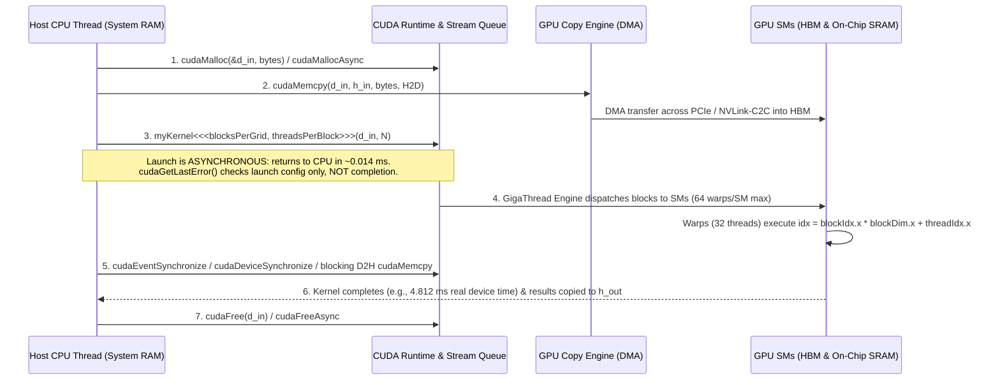
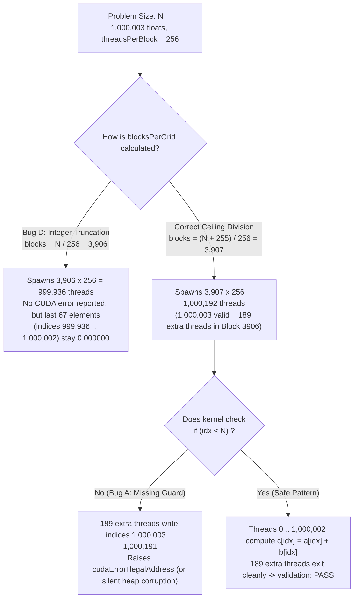

# 10.11 CUDA programming basics: kernels, indexing and memory

| | |
|---|---|
| Level | Intermediate |
| Priority tier | 2 |
| Lab venue | Nebius GPU |
| Part | Part 10: The GPU and CUDA |
| Sources used | `nvidia-devops` V3 Ch 1, 3, 4, 5, 6, 9 & Lab 02; *AI Systems Performance Engineering* Ch 6 |
| Coverage file | `planning/coverage/chapters/10-11.md` |
| Claim ledger | `planning/ledgers/10-11.md` |

## Why this matters for AI infrastructure

An AI infrastructure engineer does not spend every day writing custom CUDA C++ kernels from scratch—yet every time a production pod crashes with `CUDA error: an illegal memory access was encountered`, hangs indefinitely on an `A100` after passing unit tests on a developer's desktop GPU, or spends `77.6%` of its total CUDA API time inside `cudaMalloc` and `cudaFree`, the root cause lives inside the fundamental rules of the **CUDA programming model** (`nvidia-devops` Volume 03 Chapters 3–6).

Consider four real-world production incidents from `nvidia-devops` Volume 03 and *AI Systems Performance Engineering* Chapter 6:
- **The 4K Image Filter at 10% GPU Utilization (`nvidia-devops` V3 Ch 4 Customer Scenario):** A computer-vision startup writes a custom filter for 4K images (`3840 × 2160` pixels) and launches it with `<<<dim3(3840, 2160), dim3(1, 1)>>>`—`8,294,400` thread blocks of **1 thread each**. Because the hardware execution unit on every Streaming Multiprocessor (`SM`) is a **32-thread warp**, each 1-thread block still consumes a full 32-lane warp slot while leaving **31 of 32 lanes (`96.88%`, or roughly `97%`) idle**. Reconfiguring the block size to `dim3(16, 16)` (`256` threads = `8` full warps) eliminates the 97% lane waste immediately.
- **The Silent 67-Element Truncation vs Out-of-Bounds Crash (`nvidia-devops` V3 Ch 4 & Lab 02):** A team ports a CPU vector loop to CUDA for an array of `N = 1,000,003` elements with `256` threads per block. When one engineer uses integer division (`N / 256 = 3,906` blocks = `999,936` threads), the kernel returns `cudaSuccess` while silently leaving the final **67 elements untouched at `0.000000`**. When another engineer uses ceiling division (`(N + 255) / 256 = 3,907` blocks = `1,000,192` threads) but omits the **`if (idx < N)` bounds check**, the **189 extra threads** in the final block write past the end of the array and crash the process with `an illegal memory access was encountered`.
- **The Cross-Block Spin-Wait Deadlock on Production A100s (`nvidia-devops` V3 Ch 6 Customer Scenario):** A financial-risk team launches a 1,000-block kernel where `Block 100` spins in a `while(true)` loop waiting for `Block 1` to write a flag to global memory. It works by luck on a desktop GPU, but hangs forever on a production `A100` cluster (or inside a `MIG` slice) because CUDA thread blocks have **no guaranteed scheduling order**—`Block 100` occupies the SM waiting for `Block 1`, while `Block 1` sits in the hardware queue waiting for `Block 100` to vacate the SM.
- **The 15-Minute `.to('cuda')` Normalization Slowdown (`nvidia-devops` V3 Ch 5 Customer Scenario):** A junior data scientist moves a simple normalization of `1 billion` numbers onto an H100 using `.to('cuda')` and complains that it takes **15 minutes on the GPU versus 2 minutes on the CPU**. Why? Because the CPU reads its local DDR5 RAM at `~300 GB/s`, whereas `.to('cuda')` ships 1 billion numbers out and back over the **`64 GB/s` PCIe Gen5 bus** for a single division per element (`Lab 02` shows that even for `1,000,003` floats, `copy in` `0.847 ms` + `copy out` `0.412 ms` = `1.259 ms` is **`13.11x` (`~13x`) larger** than the `0.096 ms` kernel itself).

This chapter builds a complete, code-level mental model of CUDA programming from zero: why CUDA replaced graphics-shader hacks, how `__host__`, `__device__`, and `__global__` functions separate CPU orchestration from GPU execution, how 1D/2D/3D indexing (`threadIdx`, `blockIdx`, `blockDim`, `gridDim`), bounds checks, and grid-stride loops map threads to data within hardware limits, how explicit (`cudaMalloc`/`cudaMemcpy`), pool-based (`cudaMallocAsync`/`cudaFreeAsync`), and managed (`cudaMallocManaged` + `cudaMemPrefetchAsync`) memory lifecycles work, and how to synchronize and validate kernels without serializing the GPU.

:::note About the numbers in this chapter
The timings, percentages and throughput figures taken from `nvidia-devops` Volume 03 (for example `0.847 ms`, `812.4 ms`, `71.2%`, `104 GB/s`) are marked in those notes as illustrative or as one reference run. They show the shape of each problem, not specifications, and they were not measured on a GPU for this handbook. The hardware limits (warp size, block and grid limits) come from *AI Systems Performance Engineering* Chapter 6.
:::

:::tip In one minute
- **Function execution space specifiers:**
  - **`__host__`:** Runs on the CPU, called from the CPU (default).
  - **`__device__`:** Runs on the GPU, callable *only* from GPU device/kernel code.
  - **`__global__`:** Kernel entry point; runs on the GPU (`void` return type), launched asynchronously from the CPU via chevron syntax **`kernel<<<gridDim, blockDim, sharedMemBytes, stream>>>(args)`**.
- **Global 1D index & ceiling-division launch:**
  - `idx = blockIdx.x * blockDim.x + threadIdx.x` (for `blockIdx.x = 3`, `blockDim.x = 256`, `threadIdx.x = 5`, `idx = 3 * 256 + 5 = 773`).
  - `blocksPerGrid = (N + threadsPerBlock - 1) / threadsPerBlock` (for `N = 1,000,003` and `256` threads/block, `3,907` blocks = `1,000,192` threads; the **`189` extra threads** must be guarded by **`if (idx < N)`**).
- **Blackwell / modern GPU hardware limits (*AI Systems Performance Engineering* Ch 6 Tables 6-2 to 6-4):**
  - Warp size = **`32` threads**; max threads/block = **`1,024` (`32` warps)**; max resident warps/SM = **`64` (`2,048` threads/SM)**; max active blocks/SM = **`32`**; max grid dimensions = **`X: 2,147,483,647`, `Y: 65,535`, `Z: 65,535`** (`128` concurrent grids).
- **Memory & timing traps:**
  - Never time an asynchronous kernel launch with a host CPU timer without synchronizing (`0.014 ms` host submission time vs `4.812 ms` real `cudaEventElapsedTime` = **`343.71x` / `~340x` error**).
  - Avoid per-request `cudaMalloc`/`cudaFree` (`71.2% + 6.4% = 77.6%` of CUDA API time across 4,000 calls); use **stream-ordered memory pools (`cudaMallocAsync` / `cudaFreeAsync`)** or reusable pools.
  - With **Unified Memory (`cudaMallocManaged`)**, use `cudaMemPrefetchAsync` to eliminate the `812.4 ms` cold first-touch fault penalty (`~20x` vs `41.2 ms` warm), never exceed device VRAM capacity (`44 GB` on a `40 GB` GPU collapses from `104 GB/s` to **`9 GB/s`** due to page thrashing), and never read managed GPU buffers in a hot CPU debug print (`96.7 ms` vs `4.1 ms` kernel = **`23.59x` stall**).
:::

---

## Prerequisites and outcomes

**Prerequisites:** Chapters `10.1`–`10.3` (CPU vs GPU throughput design, warps/blocks/SMs, and GPU memory hierarchy) and Chapter `10.9` (the CUDA Runtime vs Driver API stack and `nvcc` compilation).

**Outcomes:** After completing this chapter, you will be able to:
1. Explain why CUDA replaced pre-2006 OpenGL/DirectX GPGPU shader hacks, why the CUDA library ecosystem (`cuBLAS`, `cuDNN`, `NCCL`, `FlashAttention`, `DCGM`) forms an operational moat, and how `__host__`, `__device__`, and `__global__` partition heterogeneous code.
2. Compute 1D, 2D, and 3D thread coordinates (`threadIdx`, `blockIdx`, `blockDim`, `gridDim`), size grids using ceiling division and **grid-stride loops** within hardware limits (`1,024` threads/block, `64` warps/SM, `32` blocks/SM), and eliminate warp lane waste and SM underfill.
3. Manage device memory across **explicit allocations (`cudaMalloc`/`cudaMemcpy`/`cudaMemset`)**, **stream-ordered memory pools (`cudaMallocAsync`/`cudaFreeAsync`)**, and **Unified Memory (`cudaMallocManaged` + `cudaMemPrefetchAsync`)**, avoiding host-pointer crashes, allocation churn (`77.6%` API overhead), and oversubscription page thrashing (`104 GB/s → 9 GB/s`).
4. Synchronize and validate CUDA workloads across all **seven ordering scopes** (`__syncthreads()`, `atomicAdd`, streams, events, `cudaDeviceSynchronize()`, `CUDA_CHECK`), measure stage timings accurately with **`cudaEventElapsedTime`**, and diagnose the six classic CUDA programming failures.

---

## 1. Why CUDA Exists and the Heterogeneous Host–Device Model

### 1.1 From graphics shaders (pre-2006 GPGPU) to a compute-first platform

Before NVIDIA introduced **CUDA (Compute Unified Device Architecture)** in 2006, researchers who wanted to harness GPU arithmetic for physics or linear algebra had to disguise numerical arrays as **2D textures**, encode algorithms as **OpenGL or DirectX vertex/pixel shaders**, and read outputs back as rendered framebuffers (`nvidia-devops` V3 Ch 1 & `chapter-chapter-01`). The Volume 03 Chapter 1 note names the cost of that path as a translation tax:
1. **Data had to look like textures and algorithms like shader stages:** the problem was rewritten into graphics terms before any real work started.
2. **No direct buffers:** the programming model assumed vertices and pixels, not arrays you allocate and copy yourself.
3. **No numerical debugger, and tied to the render pipeline:** when something went wrong, the only evidence was rendering instrumentation (draw calls, texture binds), not compute errors.

*Added from general knowledge and not in the cited sources:* graphics shaders of that era also could not write to arbitrary pointer locations, and early pixel pipelines did not guarantee full IEEE 754 behavior. Treat those two points as background, not as sourced facts.

CUDA removed that tax by exposing the GPU as a programmable parallel co-processor with explicit buffers, threads, blocks and grids, a unified compiler (`nvcc`), and an ecosystem of domain libraries (**`cuBLAS`**, **`cuDNN`**, **`NCCL`**, **`cuFFT`**, **`CUTLASS`**) and observability tools (**`DCGM`**, **`Nsight Systems`**, **`Nsight Compute`**). As highlighted in the Volume 03 Chapter 1 customer scenario, when a startup CFO proposes replacing NVIDIA GPUs with a competitor accelerator advertising "half the price and +20% raw TFLOPS," raw silicon TFLOPS are meaningless if unoptimized translation layers for `FlashAttention`, `DeepSpeed`/`NCCL`, and `PyTorch` cut real-world utilization by 50% while forcing the SRE team to rebuild its entire `DCGM`/Prometheus monitoring stack.

### 1.2 The heterogeneous execution contract: `__host__`, `__device__`, and `__global__`

A CUDA program executes across two physically separate domains with distinct memory spaces (`nvidia-devops` V3 Ch 1, Section "The Heterogeneous Model" & `chapter-chapter-03`, Section 1; *AI Systems Performance Engineering* Ch 6, pp. 177–188):
- **The Host (CPU and System RAM):** Executes `main()`, reads files and network sockets, prepares batches, allocates device buffers, initiates host↔device copies, and queues asynchronous kernel launches.
- **The Device (GPU and HBM/SRAM):** Executes massively parallel kernels queued by the host.

The programmer tells `nvcc` where each function belongs using three **execution space specifiers**:

| Specifier | Executes On | Callable From | Return Type & Semantics |
|---|---|---|---|
| **`__host__`** *(default if omitted)* | **Host (CPU)** | **Host (CPU)** only | Any C++ return type; compiled by the host compiler (`gcc` / `clang`). |
| **`__device__`** | **Device (GPU)** | **Device (GPU)** only | Any C++ return type; compiled into GPU device instructions (`PTX` / `SASS`) and inlined or called as a helper by kernels. |
| **`__global__`** | **Device (GPU)** | **Host (CPU)** (or GPU via Dynamic Parallelism) | **Must return `void`**. Defines a **CUDA Kernel** entry point launched with `<<<gridDim, blockDim, sharedMemBytes, stream>>>`. |
| **`__host__ __device__`** | **Both CPU & GPU** | **Both CPU & GPU** | `nvcc` compiles two versions of the function—one for the CPU and one for the GPU. |



**Critical boundary rule (`nvidia-devops` V3 `chapter-chapter-03` Customer Scenario):** Host pointers (`malloc()` / `std::vector::data()`) point to CPU System RAM, whereas device pointers (`cudaMalloc()`) point to GPU HBM. Passing a standard CPU `malloc()` pointer directly into a `__global__` kernel causes GPU threads to dereference an invalid device address—failing with `an illegal memory access was encountered` and leaving the output buffer all zeros.

---

## 2. Kernel Launch Geometry, 1D/2D/3D Indexing, and Hardware Limits

### 2.1 The execution configuration (`<<<gridDim, blockDim>>>`) and hardware limits

When host code launches a kernel:
```cpp
myKernel<<<blocksPerGrid, threadsPerBlock, dynamicSharedBytes, stream>>>(d_input, N);
```
it defines a two-level logical hierarchy (**Grid → Thread Blocks (`CTAs`) → Threads**) that the GPU hardware schedules in **32-thread Warps** onto physical **Streaming Multiprocessors (`SMs`)**. As documented in *AI Systems Performance Engineering* Chapter 6 (*Choosing Threads-per-Block and Blocks-per-Grid Sizes*, Tables 6-1 through 6-4, pp. 178–185; see also Chapter `10.2` for SM warp schedulers), every launch configuration is governed by strict hardware limits (`BLACKWELL_CUDA_LIMITS` in `code/part10/cuda_programming_basics.py`):

| Scope | Hardware Parameter (Blackwell `B200` / Hopper `H100`) | Hard Limit | Operational & Performance Rule (*ASP* Ch 6, pp. 182–185) |
|---|---|---:|---|
| **Warp** | **Warp size (`warpSize`)** | **`32` threads** | Fundamental SIMT lockstep unit. **Always choose `threadsPerBlock` as a multiple of `32`** (`128`, `256`, `512`). |
| **Thread Block (`CTA`)** | **Max threads per block** (`blockDim.x * y * z`) | **`1,024` threads** | Requesting `> 1,024` threads (e.g., `100,000` in `V3 Lab 02 Failure B`) fails immediately at launch with **`invalid configuration argument`**. |
| **Thread Block (`CTA`)** | **Max warps per block** | **`32` warps** | `1,024 threads / 32 threads/warp = 32 warps`. |
| **Per-SM Residency** | **Max resident warps per SM** | **`64` warps** | `64 warps × 32 threads =` **`2,048` max resident threads per SM** (`2` blocks of `1,024` threads, or **`8` blocks of `256` threads**). |
| **Per-SM Residency** | **Max active thread blocks per SM** | **`32` blocks** | Even with tiny 32-thread blocks, an SM can host at most `32` blocks concurrently. |
| **Per-SM Memory** | **Registers & Shared Memory per SM** (Blackwell) | **`64K` 32-bit regs (`256 KB`)**<br/>**`228 KB` SMEM (`227 KB` usable/block)** | Combined `256 KB` L1/SMEM per SM (`1 KB` of `228 KB` reserved by CUDA); max `255` registers per thread. |
| **Grid** | **Max grid dimensions (`gridDim.x`, `y`, `z`)** | **`X: 2,147,483,647`** (`2^31 - 1`)<br/>**`Y: 65,535`** · **`Z: 65,535`** | Up to **`128` concurrent grids** (kernels) can execute on one device simultaneously. |

Why is **`threadsPerBlock = 256` (`8` warps)** the standard starting point recommended in *AI Systems Performance Engineering* Chapter 6 (p. 189)?
- It is an exact multiple of `32` (`0` wasted warp lanes).
- On an SM with a `2,048`-thread (`64`-warp) limit, `2,048 / 256 = 8` blocks can reside simultaneously on each SM—well below the `32`-block ceiling and small enough per block to avoid exhausting registers or the `227 KB` usable shared memory, while keeping `64` warps in flight across the SM's **4 warp schedulers** (each capable of dual-issuing 1 math + 1 memory instruction per cycle across 16 LD/ST pipelines and dedicated SFU transcendental units, *ASP* Ch 6 Table 6-1, p. 179).

### 2.2 1D indexing, ceiling division, and the two boundary bugs (`N = 1,000,003` and `N = 63`)

Inside a kernel, every thread executes the exact same C++ function body. To process a different element of a 1D array of length `N`, each thread computes its unique global coordinate from CUDA's four built-in `dim3`/`uint3` registers (`gridDim`, `blockIdx`, `blockDim`, `threadIdx`):

```cpp
int idx = blockIdx.x * blockDim.x + threadIdx.x;
```

Let us trace the arithmetic from `nvidia-devops` Volume 03 Chapter 4 and *AI Systems Performance Engineering* Chapter 6 (`calc_1d_launch_and_indexing()` in `code/part10/cuda_programming_basics.py`):
1. **Concrete thread coordinate example (`V3 chapter-chapter-04` §2):**
   With `threadsPerBlock = 256` (`blockDim.x = 256`), the 5th thread (`threadIdx.x = 5`) inside the 3rd block (`blockIdx.x = 3`) skips the `3` preceding blocks of `256` threads and computes:
   ```text
   idx = 3 * 256 + 5 = 768 + 5 = 773
   ```
2. **Ceiling division vs integer truncation (`N = 1,000,003`, `threadsPerBlock = 256`, `V3 Ch 4` & `Lab 02`):**
   Because `1,000,003` is not divisible by `256` (just as `1,000,000 / 256 = 3,906.25` in `V3 chapter-chapter-04` §3), you must compute the grid size using **ceiling division**:
   ```cpp
   int blocksPerGrid = (N + threadsPerBlock - 1) / threadsPerBlock;
   ```
   - **Correct ceiling division:** `(1,000,003 + 255) / 256 =` **`3,907` blocks**, which spawns `3,907 × 256 =` **`1,000,192` threads**. Threads `0 .. 1,000,002` process valid elements, while the **`189` extra threads** (`1,000,003 .. 1,000,191` in the final block) are stopped by the mandatory **`if (idx < N)`** guard. (Similarly, for `N = 1,000,000` in *ASP* Ch 6 p. 186, `3,907 × 256 = 1,000,192` threads spawns **`192` extra threads**; and for `N = 63` across two warps = `64` threads in *ASP* Ch 6 p. 188, thread `idx = 63` is the `64`th thread guarded by `if (idx < N)`.)
   - **Bug 1 — Truncated division (`N / threadsPerBlock`, `Lab 02 Failure D`):** Using `1,000,003 / 256 =` **`3,906` blocks** spawns only `3,906 × 256 =` **`999,936` threads**. Every CUDA API call returns `cudaSuccess`, yet elements `999,936 .. 1,000,002` (**`67` elements**) are never touched by any thread and remain at `0.000000`.
   - **Bug 2 — Missing `if (idx < N)` bounds check (`Lab 02 Failure A`):** Launching `3,907` blocks without `if (idx < N)` causes the `189` extra threads to write past the end of the array, either triggering **`CUDA error: an illegal memory access was encountered`** (`cudaErrorIllegalAddress`) or silently corrupting adjacent heap allocations.



### 2.3 Warp lane waste (`<<<1, 50>>>`, `dim3(1,1)`) vs SM grid underfill (`<<<64, 256>>>` on H100) and Grid-Stride Loops

Even when `blocksPerGrid` and `if (idx < N)` are mathematically correct, three launch-geometry mistakes can cripple GPU throughput (`nvidia-devops` V3 Ch 3 & Ch 4; `evaluate_2d_image_launch()` in `code/part10/cuda_programming_basics.py`):

1. **Non-multiple-of-32 block size (`<<<1, 50>>>`, `V3 chapter-chapter-03` §3):**
   Launching `50` threads per block forces the SM to allocate **2 warps (`64` threads)**. Warp 0 runs `32` active threads, while Warp 1 runs `18` active threads and leaves **`14` threads (`64 - 50 = 14`) completely idle** (`78.12%` warp lane efficiency).
2. **2D `dim3(1, 1)` launch on a 4K image (`3840 × 2160`, `V3 chapter-chapter-04` Customer Scenario):**
   For a 2D image or matrix of shape `width × height` (`1024 × 1024` in *ASP* Ch 6 p. 191, or `3840 × 2160` 4K in `V3 Ch 4`), threads compute 2D coordinates and a row-major linear offset:
   ```cpp
   int x = blockIdx.x * blockDim.x + threadIdx.x; // column
   int y = blockIdx.y * blockDim.y + threadIdx.y; // row
   if (x < width && y < height) {
       int idx = y * width + x;
       input[idx] *= 2.0f;
   }
   ```
   When the startup launched `<<<dim3(3840, 2160), dim3(1, 1)>>>`, each of the `8,294,400` blocks contained `1` thread, wasting **`31 of 32` warp lanes (`96.88%` / `~97%` waste)**. Changing `threadsPerBlock` to **`dim3(16, 16)` (`256` threads = `8` full warps)** across `dim3(240, 135)` (`32,400` blocks) achieves **`100%` warp lane utilization**.
3. **Grid underfill on a larger GPU (`<<<64, 256>>>` on `A10` vs `H100`, `V3 Ch 3` §Production Troubleshooting):**
   Thread blocks cannot be split across SMs. If a kernel launches with a fixed grid of **`64` blocks** (`<<<64, 256>>>`), it nearly fills an `A10` GPU (`72` SMs), but when deployed to an **`H100` (`132` SMs)**, at most `64` SMs receive a block while the remaining **`132 - 64 = 68` SMs sit completely idle** for the entire kernel.
   To decouple grid size from problem size `N` and guarantee every SM stays fed, production kernels use a **grid-stride loop** (`nvidia-devops` V3 Ch 4, Section "Grid-Stride Loops"):
   ```cpp
   __global__ void scale_grid_stride(float* values, int n, float factor) {
       for (int i = blockIdx.x * blockDim.x + threadIdx.x;
            i < n;
            i += blockDim.x * gridDim.x) {
           values[i] *= factor;
       }
   }
   ```

---

## 3. CUDA Memory Management: Explicit Copies, Stream-Ordered Pools, and Unified Memory

### 3.1 Explicit device memory (`cudaMalloc`, `cudaMemcpy`, `cudaMemset`) and the transfer-to-kernel ratio

In the explicit CUDA memory model (`nvidia-devops` V3 Ch 5 & Lab 02; *AI Systems Performance Engineering* Ch 6, pp. 185–190), the host allocates GPU HBM with `cudaMalloc(&d_ptr, bytes)`, initializes bytes if needed with `cudaMemset(d_ptr, 0, bytes)` (note that `cudaMemset` sets *raw bytes*, not multi-byte float values), copies data with `cudaMemcpy(dst, src, bytes, kind)`, and releases memory with `cudaFree(d_ptr)`.

Why does a fast GPU kernel often fail to speed up a service? Look at the stage timings from `nvidia-devops` Volume 03 Lab 02 (`vector_add.cu`, one reference run on an `A100` for `N = 1,000,003` floats = `4.0 MB` per vector; `analyze_memory_and_timing_Lifecycle()` in `code/part10/cuda_programming_basics.py`):
- **`copy in` (`host_a` and `host_b` → HBM over PCIe):** `0.847 ms`
- **`kernel` (`vector_add<<<3907, 256>>>` in HBM):** **`0.096 ms`**
- **`copy out` (`device_c` → host RAM over PCIe):** `0.412 ms`
- **Total transfer time vs compute time:** `0.847 + 0.412 = 1.259 ms` of PCIe transfer versus `0.096 ms` of math—**`1.259 / 0.096 = 13.11x` (`~13x`) more time spent moving data than computing**.

### 3.2 Why synchronous `cudaMalloc`/`cudaFree` in a request loop destroys throughput (`77.6%` API overhead) and how `cudaMallocAsync` fixes it

Even worse than PCIe transfer time is calling synchronous `cudaMalloc()` and `cudaFree()` on every inference request or training step. As explained in *AI Systems Performance Engineering* Chapter 6 (*Asynchronous Memory Allocation and Memory Pools*, pp. 192–194) and `nvidia-devops` Volume 03 Chapter 5 (lines 300–309):
- Standard `cudaMalloc` and `cudaFree` are synchronous, heavyweight operations that trigger OS-level `mmap`/`ioctl` calls, page-table updates, and device-wide synchronization.
- In the Volume 03 Chapter 5 Nsight Systems profile (`nsys stats --report cuda_api_sum`) across `4,000` requests:
  - **`cudaMalloc`:** `71.2%` of total CUDA API time (`182,340,000 ns`, avg `45,585 ns`/call)
  - **`cudaMemcpy`:** `18.6%` (`47,610,000 ns`, avg `11,903 ns`/call)
  - **`cudaFree`:** `6.4%` (`16,392,000 ns`, avg `4,098 ns`/call)
  - **`cudaLaunchKernel`:** `3.8%` (`9,730,000 ns`, avg `2,433 ns`/call)
  Allocation and deallocation (`71.2% + 6.4% =` **`77.6%`**) consumed **about `20.4x`** the time spent launching kernels (`3.8%`).

To eliminate `cudaMalloc`/`cudaFree` overhead and reduce physical VRAM fragmentation (where `nvidia-smi` reports `9,727 MiB` free out of `80,960 MiB` on an 80 GB GPU, yet a `4 GB` allocation can still fail with `cudaErrorMemoryAllocation` when the allocator holds the free space as small non-contiguous blocks, `V3 Ch 5` line 331), modern CUDA C++ uses **stream-ordered memory pools (`cudaMallocAsync` and `cudaFreeAsync`)** (*ASP* Ch 6, pp. 193–194):

```cpp
// Create a non-blocking stream and allocate/free from the device memory pool without OS ioctl stalls
cudaStream_t stream1;
cudaStreamCreateWithFlags(&stream1, cudaStreamNonBlocking);

float* d_buf = nullptr;
cudaMallocAsync(&d_buf, N * sizeof(float), stream1);
myKernel<<<blocksPerGrid, threadsPerBlock, 0, stream1>>>(d_buf, N);
cudaFreeAsync(d_buf, stream1); // Deferred until stream1 completes; returns block to pool
```

You can tune pool retention with `cudaMemPoolSetAttribute` (`cudaMemPoolAttrReleaseThreshold`) and return unused memory to the OS with `cudaMemPoolTrimTo` (covered in depth in Chapter `10.17`). In PyTorch, the built-in caching allocator performs this same pooling automatically and is tuned via `PYTORCH_ALLOC_CONF` / `PYTORCH_CUDA_ALLOC_CONF=expandable_segments:True`.

### 3.3 Unified Memory (`cudaMallocManaged`), `cudaMemPrefetchAsync`, and the oversubscription thrashing cliff

What if you allocate memory with **`cudaMallocManaged(&data, bytes)`** (**Unified Memory**, backed by `nvidia-uvm.ko`) so both CPU and GPU share a single pointer (`nvidia-devops` V3 Ch 9; `evaluate_unified_memory_behavior()` in `code/part10/cuda_programming_basics.py`)?
- **Unified Virtual Addressing (`UVA`) vs Unified Memory:** `UVA` simply puts host and device pointers in one virtual address space; **Unified Memory (`cudaMallocManaged`)** adds automatic **demand-paging migration** whenever a processor touches a page that is not currently resident locally.
- **Trap 1 — Cold first-touch page faults (`812.4 ms` vs `41.2 ms` = `19.72x` / `~20x` slower):**
  On Iteration 1 (`--mode=cold`), touching nonresident pages on the GPU triggers thousands of hardware page faults across PCIe, taking **`812.4 ms`** versus **`41.2 ms`** on Iteration 2. Calling **`cudaMemPrefetchAsync(data, bytes, device, stream)`** before the timed loop bulk-migrates the pages in **`38.9 ms`**, dropping Iteration 1 to **`41.6 ms`**.
- **Trap 2 — The oversubscription page-thrashing cliff (`104 GB/s → 9 GB/s` on a 40 GB GPU):**
  While `cudaMallocManaged` allows allocating more memory than physical GPU VRAM (oversubscription), examine the throughput table from `nvidia-devops` Volume 03 Chapter 9 (lines 265–270):
  - **`24 GB` working set (`60%` of 40 GB GPU):** **`118 GB/s`** effective throughput.
  - **`36 GB` working set (`90%` of 40 GB GPU):** **`104 GB/s`** effective throughput.
  - **`44 GB` working set (`110%` of 40 GB GPU, oversubscribed):** Collapses to **`9 GB/s`** (`11.5x` slower) because the UVM driver continuously evicts and refaults pages across PCIe (**thrashing**).
- **Trap 3 — A single CPU debug print (`std::cout << data[0]`) stalling the GPU by `23.59x`:**
  In `V3 Ch 9` (lines 286–291), a kernel runs in **`4.1 ms`**, but adding `std::cout << data[0]` on the CPU after the launch takes **`96.7 ms`** (`23.59x` the kernel runtime) because reading `data[0]` on the host forces the runtime to synchronize the GPU and migrate the page back to CPU RAM.

---

## 4. Synchronization Scopes, Asynchronous Error Bisection, and Correctness

### 4.1 The seven CUDA synchronization scopes and the inter-block deadlock anti-pattern

Because CUDA is asynchronous across the host, across streams, and across thread blocks, you must choose the narrowest synchronization primitive that matches your data dependency (`nvidia-devops` V3 Ch 6, Section "Ordering Is Scoped"):

| Scope | CUDA Primitive | What It Coordinates & Critical Rule (`V3 Ch 6` & *ASP* Ch 6) |
|---|---|---|
| **1. Thread** | Sequential C++ statements | Operations within one single GPU thread. |
| **2. Warp (`32` lanes)** | `__syncwarp()` / warp shuffle | Synchronizes active lanes within a single 32-thread warp. |
| **3. Thread Block (`CTA`)** | **`__syncthreads()`** | Hardware barrier across **all threads in the same Thread Block** (used between writing and reading on-chip Shared Memory). **Never place `__syncthreads()` inside a warp-divergent `if/else` branch** where only some threads reach it, or the block will deadlock. |
| **4. Thread Block Cluster** | `cluster.sync()` (Hopper/Blackwell) | Hardware barrier across blocks in a cooperative Thread Block Cluster sharing **`DSMEM`** (*ASP* Ch 6, p. 181; expanded in Chapter `10.16`). |
| **5. Stream** | `cudaStreamSynchronize(stream)` | Commands within the same stream execute in issue order automatically; `cudaStreamSynchronize` blocks the host until `stream` completes. |
| **6. Cross-Stream Event** | `cudaEventRecord` + `cudaStreamWaitEvent` | Makes Stream B wait for an event recorded in Stream A **on the GPU hardware** without blocking the host CPU thread (expanded in Chapter `10.12`). |
| **7. Full Device** | **`cudaDeviceSynchronize()`** | Blocks the host CPU until **all work on all streams across the entire GPU** completes. Use for debugging checkpoints or shutdown—never inside a hot request loop. |

**Why general kernels cannot synchronize across all thread blocks (`V3 chapter-chapter-06` Customer Scenario):** Standard CUDA provides **no global barrier across all blocks of a grid** inside a kernel. If `Block 100` spins in `while (flag == 0)` waiting for `Block 1` to write `flag = 1`, and the GPU's SMs are already full of spinning blocks (`Block 100`), `Block 1` can never be scheduled onto an SM—creating a permanent hardware deadlock. Always split global inter-block dependencies into **two sequential kernel launches** (Kernel 1 completes → implicit stream ordering boundary → Kernel 2 launches).

**Avoiding global `atomicAdd` serialization (`V3 chapter-chapter-06` §2):** When 100,000 threads increment a shared counter (`red_count++`), they create a data race (producing non-deterministic wrong sums across runs, such as `483920.125000`, `501234.875000`, and `512000.000000` in `V3 Ch 6` line 336). Replacing `red_count++` with **`atomicAdd(&red_count, 1)`** fixes correctness at the L2 cache, but if 100,000 threads hit the *same* global address simultaneously, the L2 atomic unit serializes all 100,000 updates. Instead, reduce partial sums inside each block's fast **Shared Memory** using `__syncthreads()`, and issue only **one `atomicAdd` per block** to global memory.

### 4.2 Asynchronous timing (`0.014 ms` vs `4.812 ms`) and bisecting deferred CUDA errors

Because kernel launches return control to the CPU immediately (`~0.014 ms` enqueue time), two operational traps occur (`nvidia-devops` V3 Ch 3 & Ch 6; *AI Systems Performance Engineering* Ch 6, p. 188):
1. **The Host Timer Trap (`343.71x` / `~340x` error):** Wrapping `myKernel<<<grid, block>>>(data)` in `std::chrono::steady_clock::now()` without synchronization prints **`0.014 ms`** (host submission latency), whereas bracketing the kernel with **`cudaEventRecord(start)`**, **`cudaEventRecord(stop)`**, **`cudaEventSynchronize(stop)`**, and **`cudaEventElapsedTime(&ms, start, stop)`** reveals the true **`4.812 ms`** GPU execution time.
2. **Deferred asynchronous error attribution (`CUDA_CHECK` bisection):** When `kernel_a<<<...>>>` writes out of bounds, it sets a hardware fault flag asynchronously while the host CPU moves on to launch `kernel_b<<<...>>>` and call `cudaMemcpy(D2H)`. Because `cudaMemcpy` is the first synchronizing call after the fault, the runtime reports `CUDA error: an illegal memory access was encountered` **on the `cudaMemcpy` line**, tricking engineers into blaming `cudaMemcpy`.
   To catch both immediate launch-configuration errors (`invalid configuration argument`) and asynchronous execution faults during debugging, pair **`cudaGetLastError()`** with temporary **`cudaDeviceSynchronize()`** checkpoints between suspect kernels (`V3 Ch 6` lines 232–242 & 312–318):

```cpp
#define CUDA_CHECK(call)                                                   \
    do {                                                                   \
        cudaError_t error = (call);                                        \
        if (error != cudaSuccess) {                                        \
            std::cerr << "CUDA error at " << __FILE__ << ':' << __LINE__  \
                      << ": " << cudaGetErrorString(error) << '\n';        \
            std::exit(EXIT_FAILURE);                                       \
        }                                                                  \
    } while (0)
```

---

## 5. Commands and Code Patterns That Matter

All compilation and execution commands below come from `nvidia-devops` Volume 03 Lab 02 (`lab-02-build-and-validate-a-cuda-vector-pipeline.md`) and *AI Systems Performance Engineering* Chapter 6. Because this handbook builds without an attached GPU, `nvcc` and binary execution commands are marked **(untested here)**.

### 5.1 Complete reference implementation: `vector_add.cu` (`N = 1,000,003`, CUDA Events, CPU Reference Gate)

```cpp
// vector_add.cu (from nvidia-devops Volume 03 Lab 02 Step 2)
#include <cuda_runtime.h>
#include <cmath>
#include <cstdlib>
#include <iomanip>
#include <iostream>
#include <vector>

#define CUDA_CHECK(call)                                                   \
    do {                                                                   \
        cudaError_t error = (call);                                        \
        if (error != cudaSuccess) {                                        \
            std::cerr << "CUDA error at " << __FILE__ << ':' << __LINE__  \
                      << ": " << cudaGetErrorString(error) << '\n';        \
            std::exit(EXIT_FAILURE);                                       \
        }                                                                  \
    } while (0)

__global__ void vector_add(const float* a, const float* b, float* c, std::size_t count) {
    const std::size_t index =
        static_cast<std::size_t>(blockIdx.x) * blockDim.x + threadIdx.x;
    if (index < count) {
        c[index] = a[index] + b[index];
    }
}

int main(int argc, char** argv) {
    std::size_t count = 1'000'003;
    int threads_per_block = 256;
    if (argc > 1) count = std::strtoull(argv[1], nullptr, 10);
    if (argc > 2) threads_per_block = std::atoi(argv[2]);

    const std::size_t bytes = count * sizeof(float);
    std::vector<float> host_a(count), host_b(count), host_c(count, 0.0F), reference(count);
    for (std::size_t i = 0; i < count; ++i) {
        host_a[i] = static_cast<float>(i % 1000) * 0.25F;
        host_b[i] = static_cast<float>(i % 127) * 0.5F;
        reference[i] = host_a[i] + host_b[i];
    }

    float *device_a = nullptr, *device_b = nullptr, *device_c = nullptr;
    CUDA_CHECK(cudaMalloc(&device_a, bytes));
    CUDA_CHECK(cudaMalloc(&device_b, bytes));
    CUDA_CHECK(cudaMalloc(&device_c, bytes));

    cudaEvent_t start_copy_in, end_copy_in, end_kernel, end_copy_out;
    CUDA_CHECK(cudaEventCreate(&start_copy_in));
    CUDA_CHECK(cudaEventCreate(&end_copy_in));
    CUDA_CHECK(cudaEventCreate(&end_kernel));
    CUDA_CHECK(cudaEventCreate(&end_copy_out));

    CUDA_CHECK(cudaEventRecord(start_copy_in));
    CUDA_CHECK(cudaMemcpy(device_a, host_a.data(), bytes, cudaMemcpyHostToDevice));
    CUDA_CHECK(cudaMemcpy(device_b, host_b.data(), bytes, cudaMemcpyHostToDevice));
    CUDA_CHECK(cudaEventRecord(end_copy_in));

    const std::size_t blocks_required =
        (count + static_cast<std::size_t>(threads_per_block) - 1) /
        static_cast<std::size_t>(threads_per_block);

    vector_add<<<static_cast<unsigned int>(blocks_required), threads_per_block>>>(
        device_a, device_b, device_c, count);
    CUDA_CHECK(cudaGetLastError());
    CUDA_CHECK(cudaEventRecord(end_kernel));

    CUDA_CHECK(cudaMemcpy(host_c.data(), device_c, bytes, cudaMemcpyDeviceToHost));
    CUDA_CHECK(cudaEventRecord(end_copy_out));
    CUDA_CHECK(cudaEventSynchronize(end_copy_out));

    float copy_in_ms = 0.0F, kernel_ms = 0.0F, copy_out_ms = 0.0F;
    CUDA_CHECK(cudaEventElapsedTime(&copy_in_ms, start_copy_in, end_copy_in));
    CUDA_CHECK(cudaEventElapsedTime(&kernel_ms, end_copy_in, end_kernel));
    CUDA_CHECK(cudaEventElapsedTime(&copy_out_ms, end_kernel, end_copy_out));

    std::size_t mismatches = 0;
    for (std::size_t i = 0; i < count; ++i) {
        if (std::fabs(host_c[i] - reference[i]) > 1.0e-5F) ++mismatches;
    }

    std::cout << "elements: " << count << "\nthreads per block: " << threads_per_block
              << "\nblocks: " << blocks_required << std::fixed << std::setprecision(3)
              << "\ncopy in: " << copy_in_ms << " ms\nkernel: " << kernel_ms
              << " ms\ncopy out: " << copy_out_ms << " ms\nvalidation: "
              << (mismatches == 0 ? "PASS" : "FAIL") << '\n';

    CUDA_CHECK(cudaEventDestroy(start_copy_in));
    CUDA_CHECK(cudaEventDestroy(end_copy_in));
    CUDA_CHECK(cudaEventDestroy(end_kernel));
    CUDA_CHECK(cudaEventDestroy(end_copy_out));
    CUDA_CHECK(cudaFree(device_a));
    CUDA_CHECK(cudaFree(device_b));
    CUDA_CHECK(cudaFree(device_c));
    return mismatches == 0 ? EXIT_SUCCESS : EXIT_FAILURE;
}
```

### 5.2 Compile, test boundary shapes (`1, 31, 32, 33`), and profile API overhead (untested here)

```bash
# 1. Compile and run baseline + warp boundary shapes (untested here)
nvcc -O2 -std=c++17 vector_add.cu -o vector_add
./vector_add 1 32
./vector_add 31 32
./vector_add 32 32
./vector_add 33 32
./vector_add 1000003 256

# 2. Force PTX JIT verification at load time (ASP Ch 6 p. 185) (untested here)
CUDA_FORCE_PTX_JIT=1 ./vector_add 1000003 256

# 3. Profile CUDA API call percentages (cudaMalloc vs cudaMemcpy vs cudaLaunchKernel) (untested here)
nsys profile -o profile-report ./vector_add 1000003 256
nsys stats --report cuda_api_sum profile-report.nsys-rep
```

---

## 6. How It Fails: Six Production CUDA Programming & Memory Failure Modes

| # | Failure Mode | Production Symptom | Root Cause & Diagnostic Evidence | Fix |
|---|---|---|---|---|
| **1** | **Out-of-bounds write or silent tail truncation (`N = 1,000,003`)** | Either crashes at `cudaMemcpy`/`cudaDeviceSynchronize` with **`an illegal memory access was encountered`**, or returns `cudaSuccess` while the last `67` elements stay `0.000000`. | Missing `if (idx < count)` guard allows the `189` extra threads in Block `3,906` (`3,907 × 256 - 1,000,003`) to write past the buffer (`Lab 02 Failure A`), or integer division `count / 256 = 3,906` underlaunched the grid by `67` elements (`Lab 02 Failure D`). | Always pair ceiling division `(count + threads - 1) / threads` with an explicit `if (idx < count)` guard, and test non-divisible sizes (`31, 32, 33, 1000003`). |
| **2** | **Invalid launch configuration (`threads_per_block > 1,024`)** | Kernel does not execute; if `cudaGetLastError()` is unchecked, output buffer remains unmodified zeros. | Launching `<<<11, 100000>>>` exceeds the hardware limit of **`1,024` threads per block** (`Lab 02 Failure B`). Immediate check `CUDA_CHECK(cudaGetLastError())` catches `invalid configuration argument` at launch time. | Keep `blockDim.x * blockDim.y * blockDim.z <= 1,024` (typically `128`, `256`, or `512`, always a multiple of `32`) and check `cudaGetLastError()` immediately after every launch. |
| **3** | **2D `dim3(1, 1)` warp lane waste (`96.88%`) or fixed-grid SM underfill** | Kernel produces correct output, but GPU utilization sits at 10% or upgrading from `A10` (`72` SMs) to `H100` (`132` SMs) yields zero speedup. | `<<<dim3(3840, 2160), dim3(1, 1)>>>` allocates 1 warp (32 lanes) per 1-thread block, wasting `31/32 = 96.88%` (`~97%`) of lanes (`V3 Ch 4`). Or `<<<64, 256>>>` launches only `64` blocks, leaving `68` of `132` H100 SMs idle (`V3 Ch 3`). | Use 2D block tiles that are multiples of 32 threads (`dim3(16, 16) = 256` threads) and size 1D grids with enough blocks (or a grid-stride loop) to cover all SMs. |
| **4** | **Cross-block `while(true)` spin-wait deadlock on SMs** | Kernel passes on a desktop GPU, but hangs indefinitely when deployed to a production `A100` / `H100` or a `MIG` instance. | `Block 100` spins waiting for `Block 1` to write a global flag (`V3 Ch 6 Customer Scenario`). CUDA thread blocks have no guaranteed scheduling order; resident spinning blocks starve `Block 1` from ever entering an SM. | Never synchronize across independent blocks with a spin-loop in standard kernels; split the dependency into two sequential kernel launches separated by stream ordering. |
| **5** | **Per-request `cudaMalloc`/`cudaFree` churn (`77.6%` API time) or fragmentation OOM** | Kernel takes `< 1 ms`, yet service throughput is low (`cudaMalloc` takes `71.2%` of API time), or `cudaErrorMemoryAllocation` fires with `9,727 MiB` free in `nvidia-smi`. | Synchronous `cudaMalloc`/`cudaFree` per request invokes OS `mmap`/`ioctl` calls and device synchronization (`V3 Ch 5`), or non-contiguous free blocks cause allocator fragmentation. | Switch to stream-ordered memory pools (`cudaMallocAsync` / `cudaFreeAsync` on a `cudaStreamNonBlocking` stream, *ASP* Ch 6 pp. 193–194) or pre-allocated buffer pools. |
| **6** | **Unified Memory (`cudaMallocManaged`) oversubscription thrashing (`104 → 9 GB/s`) or CPU debug stalls** | Managed-memory app drops from `104 GB/s` (at `36 GB`) to **`9 GB/s`** when dataset reaches `44 GB` on a `40 GB` GPU, or a single `std::cout << data[0]` adds `96.7 ms` to a `4.1 ms` kernel. | Working set exceeds 40 GB HBM capacity, causing continuous page eviction/refault thrashing across PCIe; or CPU read forces device sync + page migration back to host RAM (`V3 Ch 9`). | Keep the active hot working set below device HBM capacity, prefetch ahead of compute with `cudaMemPrefetchAsync`, and remove host CPU reads of managed buffers from hot loops. |

---

## 7. Hands-On Lab: Validate CUDA Launch Geometry, Indexing, Memory Lifecycles, and Unified Memory Behavior

**Venue:** Any Linux machine or Nebius GPU VM with Python 3.10+ (runs deterministically using standard library Python; full C++ `vector_add.cu` and `nvcc` commands are provided in Section 5 and marked `(untested here)`).

Run `code/part10/cuda_programming_basics_lab.py`:

```bash
python3 code/part10/cuda_programming_basics_lab.py
```

Expected output (`25 passed, 0 failed`):

```text
=== Chapter 10.11 Lab: CUDA Programming Basics (Kernels, Indexing & Memory) ===
  [PASS] ASP Ch6 Tables 6-2 & 6-3: Warp size=32, max threads/block=1024 (32 warps), max resident warps/SM=64 (2048 threads, 32 blocks/SM)
  [PASS] ASP Ch6 Table 6-4: Max grid dimensions are X=2,147,483,647, Y=65,535, Z=65,535, and 128 concurrent grids
  [PASS] V3 Ch4 §2: Global 1D index for blockIdx.x=3, blockDim.x=256, threadIdx.x=5 == 3*256 + 5 == 773
  [PASS] V3 Ch4 & Lab 02: N=1,000,003 with 256 threads/block yields 3,907 ceiling blocks (1,000,192 threads, 189 guarded)
  [PASS] V3 Ch4 & Lab 02 Failure D: Truncated division (N // 256 == 3,906 blocks = 999,936 threads) leaves 67 elements untouched
  [PASS] ASP Ch6 p.186 & V3 Ch4 §3: N=1,000,000 with 256 threads/block yields 3,907 blocks (1,000,192 threads, 192 extra guarded)
  [PASS] ASP Ch6 p.188: N=63 across 2 warps (64 threads) guards 1 out-of-range thread at idx=63
  [PASS] V3 Ch3 §3: Block size 50 spawns 2 warps (64 lanes) and leaves 14 warp lanes idle (78.12% efficiency)
  [PASS] V3 Ch3 §Production Troubleshooting: <<<64, 256>>> (64 blocks) on H100 (132 SMs) leaves 68 SMs completely idle
  [PASS] V3 Ch4 Customer Scenario: 4K image (3840x2160) with dim3(1,1) wastes 31 of 32 warp lanes (96.88% ~ 97% waste)
  [PASS] V3 Ch4 Customer Scenario: Reconfiguring 4K image to dim3(16,16) (256 threads = 8 warps) achieves 0 wasted lanes (100% warp fill)
  [PASS] V3 Lab 02 Step 4: Copy-in (0.847 ms) + Copy-out (0.412 ms) = 1.259 ms is 13.11x (~13x) larger than 0.096 ms kernel time
  [PASS] V3 Ch3 §Production Troubleshooting: Async host timer (0.014 ms) vs CUDA event time (4.812 ms) is a 343.71x (~340x) gap
  [PASS] V3 Ch5 §Production Troubleshooting: cudaMalloc (71.2%) + cudaFree (6.4%) = 77.6% of CUDA API time (>8x the 3.8% kernel launch time)
  [PASS] V3 Ch9: Cold first-touch (812.4 ms) is 19.72x (~20x) slower than warm (41.2 ms), and CPU debug print (96.7 ms) is 23.59x (>23x) the 4.1 ms kernel
  [PASS] V3 Ch9 Oversubscription Table: 24 GB (60%) = 118 GB/s, 36 GB (90%) = 104 GB/s, 44 GB (110% oversubscribed) collapses to 9 GB/s (thrashing)
  [PASS] Clean kernel + launch + sync configuration passes correctness audit
  [PASS] V3 Ch3 Customer Scenario: Detects passing host malloc() pointer directly into __global__ kernel
  [PASS] V3 Ch4 & Lab 02 Failure A: Detects missing 'if (idx < N)' bounds check
  [PASS] V3 Ch4 & Lab 02 Failure D: Detects truncated integer block division leaving tail elements at 0.0
  [PASS] V3 Ch6 Customer Scenario: Detects inter-block while(true) spin-wait SM deadlock
  [PASS] V3 Ch6: Detects non-deterministic reduction data race (missing __syncthreads / atomicAdd)
  [PASS] V3 Lab 02 Failure B: Rejects threads_per_block = 100000 (> 1024 max) with invalid configuration argument
  [PASS] Rejects 2D block_x * block_y > 1024
  [PASS] Rejects non-positive working_set_gb

Summary: 25 passed, 0 failed (total 25)
```

---

## Exercises

1. **1D launch coverage, guarded threads, and truncation math (`N = 1,000,003`):** For a 1D vector of `N = 1,000,003` elements launched with `threadsPerBlock = 256`, calculate (a) the global index `idx` of `threadIdx.x = 5` in `blockIdx.x = 3`, (b) the number of blocks, total launched threads, and extra guarded threads using ceiling division `(N + 255) / 256`, and (c) the number of blocks and unprocessed tail elements if integer truncation `N / 256` is used by mistake.
2. **Warp lane waste in 1D (`<<<1, 50>>>`) and 2D (`3840 × 2160` 4K image):** Calculate (a) how many warps and total warp lanes the hardware allocates for a 1D block of `50` threads and how many lanes sit idle, and (b) the total blocks, wasted warp lanes per block, and percentage of wasted compute capacity when a `3840 × 2160` image is launched with `dim3(1, 1)` versus `dim3(16, 16)`.
3. **SM residency and grid underfill on `H100` (`132` SMs) vs `B200` limits:** Using Tables 6-2 and 6-3 from *AI Systems Performance Engineering* Chapter 6, state the maximum resident warps, threads, and blocks per SM on Blackwell, calculate how many `256`-thread blocks vs `1,024`-thread blocks can reside on one SM simultaneously, and calculate how many SMs sit completely idle when a fixed grid of `<<<64, 256>>>` runs on an `H100` (`132` SMs).
4. **Transfer-to-compute ratio and `cudaMalloc` API overhead:** Using the figures from `nvidia-devops` Volume 03 Lab 02 (`copy in: 0.847 ms`, `kernel: 0.096 ms`, `copy out: 0.412 ms`) and Chapter 5 (`cudaMalloc: 71.2%`, `cudaMemcpy: 18.6%`, `cudaFree: 6.4%`, `cudaLaunchKernel: 3.8%` across `4,000` calls), compute (a) the ratio of total PCIe transfer time to kernel execution time in Lab 02, and (b) the combined percentage of CUDA API time spent in `cudaMalloc` + `cudaFree` and its ratio to `cudaLaunchKernel`, then write the stream-ordered replacement API calls.
5. **Unified Memory (`cudaMallocManaged`) first-touch, CPU debug stall, and oversubscription cliff:** Using the data from `nvidia-devops` Volume 03 Chapter 9 (`cold iteration 1: 812.4 ms`, `warm iteration 2: 41.2 ms`, `prefetch: 38.9 ms`; `kernel: 4.1 ms`, `cpu check: 96.7 ms`; and `24 GB -> 118 GB/s`, `36 GB -> 104 GB/s`, `44 GB -> 9 GB/s` on a `40 GB` GPU), calculate the cold-vs-warm ratio, the CPU-check-vs-kernel stall ratio, and the throughput drop factor when crossing from `36 GB` (`90%`) to `44 GB` (`110%`), and state the API call that eliminates the cold first-touch spike.
6. **Bisecting asynchronous errors and fixing inter-block deadlocks:** A program runs `kernel_a<<<...>>>(buf)`, `kernel_b<<<...>>>(buf)`, and `cudaMemcpy(host, buf, n, cudaMemcpyDeviceToHost)`, and crashes on the `cudaMemcpy` line with `CUDA error: an illegal memory access was encountered`. Explain why `cudaMemcpy` is innocent, show how to bisect the true culprit using `CUDA_CHECK`, and explain how to fix a kernel that deadlocks because `Block 100` spins waiting for `Block 1`.

---

## Checkpoint questions (20)

<details>
<summary><strong>1. Why did pre-CUDA GPGPU programming require disguising math problems as 3D graphics, and what three costs did CUDA remove in 2006?</strong></summary>

Before CUDA, developers had to encode numerical arrays as textures and algorithms as shader stages, so every project paid a translation tax. The Volume 03 note names three costs that CUDA removed: data and algorithms had to be expressed in graphics terms, there were no direct buffers you allocate and copy yourself, and there was no numerical debugger (evidence came only from rendering instrumentation). CUDA gave compute its own abstractions: threads, blocks, grids, explicit memory, and compute-native error reporting such as `cudaGetLastError()`.
</details>

<details>
<summary><strong>2. State the execution location, caller location, and return-type rule for `__host__`, `__device__`, and `__global__` functions in CUDA C++.</strong></summary>

- **`__host__` (default):** Executes on the CPU, callable from the CPU, any return type.
- **`__device__`:** Executes on the GPU, callable only from GPU device/kernel functions, any return type.
- **`__global__`:** Kernel entry point; executes on the GPU, launched from the CPU via `<<<grid, block>>>` chevron syntax, and **must return `void`**.
</details>

<details>
<summary><strong>3. What happens if a developer allocates an array on the CPU with standard `malloc()` and passes that pointer directly into a `__global__` kernel?</strong></summary>

Because the CPU and GPU have separate physical memory spaces (`DDR5` vs `HBM`), GPU threads dereferencing a raw host `malloc()` pointer trigger an asynchronous **`CUDA error: an illegal memory access was encountered`** (`cudaErrorIllegalAddress`), leaving the output buffer untouched unless device memory is allocated (`cudaMalloc`) and copied (`cudaMemcpyHostToDevice`) or managed memory is used.
</details>

<details>
<summary><strong>4. Write the standard 1D global thread index formula and calculate the global index for `blockIdx.x = 3`, `blockDim.x = 256`, and `threadIdx.x = 5`.</strong></summary>

Formula:
```cpp
int idx = blockIdx.x * blockDim.x + threadIdx.x;
```
For `blockIdx.x = 3`, `blockDim.x = 256`, and `threadIdx.x = 5`: `idx = 3 * 256 + 5 = 768 + 5 =` **`773`**.
</details>

<details>
<summary><strong>5. For an array of `N = 1,000,003` elements and `threadsPerBlock = 256`, contrast what happens when you calculate `blocks` with integer truncation (`N / 256`) versus ceiling division (`(N + 255) / 256`).</strong></summary>

- **Integer truncation (`1,000,003 / 256 = 3,906` blocks):** Spawns `3,906 × 256 = 999,936` threads. No CUDA error is raised, but the last **`67` elements** (`999,936 .. 1,000,002`) are never processed and stay `0.000000`.
- **Ceiling division (`(1,000,003 + 255) / 256 = 3,907` blocks):** Spawns `3,907 × 256 = 1,000,192` threads, covering all `1,000,003` elements while leaving **`189` extra threads** in the final block that must be guarded by **`if (idx < N)`**.
</details>

<details>
<summary><strong>6. Why can removing the `if (idx < count)` bounds check from `vector_add.cu` (`N = 1,000,003`, `256` threads) sometimes crash with `illegal memory access` and other times report `validation: PASS`?</strong></summary>

The `189` extra threads in Block `3,906` write to indices `1,000,003 .. 1,000,191` past the end of `device_c`. If that address crosses an unmapped GPU page boundary, the hardware raises `an illegal memory access was encountered`; if the allocator happened to leave unused heap padding after `device_c`, the out-of-bounds writes land in padding and the CPU check of `0 .. 1,000,002` still prints `PASS` while silently corrupting adjacent device memory.
</details>

<details>
<summary><strong>7. State the hardware limits on a modern NVIDIA GPU (such as Blackwell `B200`) for warp size, max threads per block, max warps per block, max resident warps per SM, max resident threads per SM, and max active blocks per SM.</strong></summary>

- **Warp size:** `32` threads.
- **Max threads per block:** `1,024` threads (`32` warps per block).
- **Max resident warps per SM:** `64` warps (`2,048` resident threads per SM).
- **Max active thread blocks per SM:** `32` blocks per SM.
</details>

<details>
<summary><strong>8. State the maximum 3D grid dimensions (`X`, `Y`, `Z`) and maximum concurrent grids supported on a modern NVIDIA GPU, and explain what happens when you launch `./vector_add 1000003 100000`.</strong></summary>

- **Max grid dimensions:** `X = 2,147,483,647` (`2^31 - 1`), `Y = 65,535`, `Z = 65,535`, with up to **`128` concurrent grids**.
- Launching with `threads_per_block = 100,000` exceeds the `1,024` threads-per-block hardware limit and fails **immediately at launch submission** (`cudaGetLastError()`) with **`invalid configuration argument`**.
</details>

<details>
<summary><strong>9. Why did launching a 4K image filter (`3840 × 2160`) with `<<<dim3(3840, 2160), dim3(1, 1)>>>` waste 97% of the GPU's compute lanes, and how does `dim3(16, 16)` fix it?</strong></summary>

Because the SM allocates execution slots in whole **32-thread warps**. A block of `dim3(1, 1)` (`1` thread) still consumes a 32-lane warp while leaving **`31 of 32` lanes (`96.88%` / `~97%`) idle**. Using `dim3(16, 16)` puts `256` threads (`8` full warps of `32` threads) into each block across a `240 × 135` grid, achieving `100%` warp lane utilization.
</details>

<details>
<summary><strong>10. Why did upgrading a kernel launched as `<<<64, 256>>>` from an `A10` (`72` SMs) to an `H100` (`132` SMs) produce almost no speedup, and how does a grid-stride loop solve this?</strong></summary>

Thread blocks cannot be split across SMs. A grid of `64` blocks can occupy at most `64` SMs on the `H100`, leaving the remaining **`68` SMs (`132 - 64`) completely idle**. A **grid-stride loop** (`for (int i = blockIdx.x * blockDim.x + threadIdx.x; i < n; i += blockDim.x * gridDim.x)`) allows launching enough blocks to saturate any GPU's SMs while each thread steps through the array by the total grid size.
</details>

<details>
<summary><strong>11. Why did measuring a kernel with `std::chrono::steady_clock::now()` immediately before and after `myKernel<<<grid, block>>>(data)` report `0.014 ms` when the kernel actually took `4.812 ms` (`340x` longer)?</strong></summary>

Because CUDA kernel launches are **asynchronous** with respect to the host CPU. The host timer only measured the `0.014 ms` required to enqueue the launch command into the stream ring buffer. Accurate GPU timing requires recording device-side **CUDA events** (`cudaEventRecord(start/stop)` + `cudaEventSynchronize(stop)` + `cudaEventElapsedTime`).
</details>

<details>
<summary><strong>12. In `nvidia-devops` Volume 03 Lab 02 (`N = 1,000,003`), how did the `copy in` (`0.847 ms`) and `copy out` (`0.412 ms`) times compare to the `kernel` time (`0.096 ms`), and why did `.to('cuda')` make normalizing 1 billion numbers `7.5x` slower than the CPU (`15 min` vs `2 min`)?</strong></summary>

In Lab 02, total PCIe transfer time (`0.847 + 0.412 = 1.259 ms`) was **`13.11x` (`~13x`) longer** than the `0.096 ms` kernel execution. Similarly, normalizing 1 billion numbers performs trivial arithmetic (`~1 FLOP` per element); on the CPU it streams directly from `~300 GB/s` DDR5 RAM in 2 minutes, whereas `.to('cuda')` bottlenecks shipping the array out and back across the **`64 GB/s` PCIe bus**.
</details>

<details>
<summary><strong>13. In the Volume 03 Chapter 5 Nsight Systems profile across 4,000 requests, what percentage of total CUDA API time was spent in `cudaMalloc` and `cudaFree`, and how do `cudaMallocAsync` and `cudaFreeAsync` eliminate it?</strong></summary>

`cudaMalloc` (`71.2%`) and `cudaFree` (`6.4%`) consumed **`77.6%`** of total CUDA API time—more than `20x` the `3.8%` spent in `cudaLaunchKernel`—because synchronous `cudaMalloc`/`cudaFree` invoke OS `mmap`/`ioctl` calls and device-wide synchronization. **`cudaMallocAsync` and `cudaFreeAsync`** sub-allocate from a stream-ordered device memory pool without OS calls or global synchronization.
</details>

<details>
<summary><strong>14. Why can `cudaMalloc` fail with `cudaErrorMemoryAllocation` for a `4 GB` tensor even when `nvidia-smi` reports `9,727 MiB` (`~9.5 GB`) of free VRAM?</strong></summary>

`nvidia-smi` reports device-wide free memory (`9,727 MiB`), not the largest span the allocator can hand out. If the framework's caching allocator holds that space as many small non-contiguous reserved blocks, a single `4 GB` request can still fail. The source note says this can happen (it is common with PyTorch's caching allocator under repeated variable-size allocation) and names `torch.cuda.memory_summary()` as the next diagnostic step.
</details>

<details>
<summary><strong>15. What is the difference between Unified Virtual Addressing (`UVA`) and Unified Memory (`cudaMallocManaged`), and how does `cudaMemPrefetchAsync` change the `812.4 ms` cold first-touch penalty?</strong></summary>

- **`UVA` vs Unified Memory:** `UVA` places host and device pointers in a single virtual address space; **Unified Memory (`cudaMallocManaged`)** adds automatic page-fault demand migration across CPU and GPU memories.
- **Prefetching:** Without prefetching, Iteration 1 faults and migrates pages on demand across PCIe (`812.4 ms` vs `41.2 ms` warm = `19.72x` / `~20x` slower). Calling **`cudaMemPrefetchAsync`** bulk-migrates the working set in **`38.9 ms`** ahead of the kernel so Iteration 1 runs at warm speed (`41.6 ms`).
</details>

<details>
<summary><strong>16. What happens to a Unified Memory workload on a `40 GB` GPU when its active working set grows from `36 GB` (`90%`) to `44 GB` (`110%`), and why does a single `std::cout << data[0]` on the CPU take `96.7 ms` after a `4.1 ms` kernel?</strong></summary>

- **Oversubscription cliff:** At `24 GB` (`118 GB/s`) and `36 GB` (`104 GB/s`), the working set stays resident in HBM; at **`44 GB` (`110%`)**, effective throughput collapses to **`9 GB/s`** because pages continuously evict and refault across PCIe (**thrashing**).
- **CPU debug print stall:** Reading `data[0]` on the CPU forces the runtime to wait for the GPU kernel to finish and migrate the touched page back to host RAM over PCIe (`96.7 ms`, **`23.59x`** the `4.1 ms` kernel).
</details>

<details>
<summary><strong>17. What is the exact scope of `__syncthreads()`, and why did putting a `while(true)` loop inside `Block 100` to wait for `Block 1` deadlock on a production `A100`?</strong></summary>

`__syncthreads()` synchronizes threads **within a single Thread Block (`CTA`) only**. Standard CUDA provides no grid-wide barrier across independent blocks because blocks can be scheduled in any order; if spinning blocks (`Block 100`) fill all available SM slots, `Block 1` can never be scheduled onto an SM to set the flag, causing a permanent hardware deadlock. Split cross-block dependencies into two sequential kernel launches.
</details>

<details>
<summary><strong>18. Why does a reduction kernel that increments a global sum without synchronization produce three different results (`483920.125000`, `501234.875000`, `512000.000000`) across three runs, and why should you reduce in Shared Memory before calling `atomicAdd`?</strong></summary>

Concurrent read-modify-write updates from thousands of threads create a **data race** whose result depends on non-deterministic warp scheduling. Replacing `sum += val` with global `atomicAdd(&sum, val)` restores correctness at the L2 cache, but serializes all threads contending on that single address. Reducing within each block's fast **Shared Memory** (with `__syncthreads()`) and issuing only **one `atomicAdd` per block** cuts the number of atomics hitting the same global address by the block size (for example 256 times fewer with 256-thread blocks).
</details>

<details>
<summary><strong>19. Why can an out-of-bounds memory access inside `kernel_a` be reported as an error on a `cudaMemcpy` call three lines later, and how do you isolate the true culprit?</strong></summary>

Kernel execution is asynchronous; when `kernel_a` faults on the GPU, the hardware sets a global error flag while the CPU continues queueing `kernel_b`. The error is only returned to the CPU at the **next synchronizing API call** (`cudaMemcpy`). Isolate the culprit by temporarily inserting `CUDA_CHECK(cudaDeviceSynchronize())` (or running with `CUDA_LAUNCH_BLOCKING=1` / `compute-sanitizer`) immediately after each kernel launch.
</details>

<details>
<summary><strong>20. What is `TMEM` (Tensor Memory) on a Blackwell `B200` GPU, and how does it interact with `SMEM` (Shared Memory) and `TMA` (Tensor Memory Accelerator)?</strong></summary>

As detailed in *AI Systems Performance Engineering* Chapter 6 (`Table 6-5` & `Figure 6-11`, pp. 194–196), **`TMEM`** is a dedicated **`256 KB` per-SM SRAM buffer** (`~10 cycles` latency) dedicated to Blackwell's 5th-generation Tensor Core instructions (`tcgen05.mma` / `UMMA`). **`TMA`** copies tiles asynchronously from HBM through L2 into **`SMEM`** (`228 KB` / `227 KB` usable per SM), and `tcgen05` instructions move operands and hold accumulators in `TMEM` without consuming general-purpose registers or CUDA C++ pointers.
</details>

---

## Sources and review notes

### Primary sources read in full for this chapter
1. ***AI Systems Performance Engineering* (`ai-systems-performance-engineering`, Chris Fregly), Chapter 6 (*GPU Architecture, CUDA Programming, and Maximizing Occupancy*, pp. 177–198):**
   - Simple CUDA programming flow (`Figure 6-1`), Blackwell SM architecture (`Figure 6-2` & `Table 6-1`: `4` warp schedulers, dual-issue of 1 math + 1 memory op per warp, `16` LD/ST pipelines, dedicated `SFU` pipeline), thread/block/SM/grid hierarchy (`Figures 6-3` to `6-9`, Thread Block Clusters & `DSMEM`), hardware limits (`Table 6-2`: `32` warp size, `1,024` max threads/block, `32` warps/block; `Table 6-3`: `64` resident warps/SM, `2,048` threads/SM, `32` active blocks/SM; `Table 6-4`: `X: 2,147,483,647`, `Y: 65,535`, `Z: 65,535`, `128` concurrent grids), `CUDA_FORCE_PTX_JIT=1`, 1D & 2D kernel refreshers (`N = 1,000,000`, `threadsPerBlock = 256`, `blocksPerGrid = 3,907`; `N = 63` 2-warp bounds check; `1024 × 1024` 2D kernel with `dim3(16, 16)`), stream-ordered memory pools (`cudaMallocAsync`, `cudaFreeAsync`, `cudaStreamNonBlocking`, `cudaMemPoolAttrReleaseThreshold`, `cudaMemPoolTrimTo`, `PYTORCH_ALLOC_CONF`), and Blackwell memory hierarchy (`Table 6-5` & `Figure 6-11`: `64K` 32-bit regs = `256 KB`, `228 KB` / `227 KB` usable `SMEM`, `256 KB` `TMEM` for `tcgen05.mma` / `UMMA`, `126 MB` L2).
2. **`nvidia-devops` Volume 03 (`chapter-01`, `chapter-03`, `chapter-04`, `chapter-05`, `chapter-06`, `chapter-09`, their `chapter-chapter-*` companions, and `labs/lab-02-build-and-validate-a-cuda-vector-pipeline.md`):**
   - Chapter 1 (`3,111` + `1,033` words): Pre-CUDA OpenGL/DirectX texture/shader tax vs heterogeneous host/device compute model; software moat (`cuBLAS`, `cuDNN`, `NCCL`, `FlashAttention`, `DCGM`) vs half-price +20% TFLOPS competitor scenario.
   - Chapter 3 (`2,948` + `900` words): `__host__`, `__device__`, `__global__`, submission vs completion timing trap (`0.014 ms` async host timer vs `4.812 ms` `cudaEventElapsedTime` = `343.71x` ~ `340x` gap), deferred error surfacing on `cudaMemcpy`, `<<<64, 256>>>` on A10 (`72` SMs) vs H100 (`132` SMs, `68` idle SMs), `<<<1, 50>>>` wasting `14` of `64` warp lanes, and passing CPU `malloc` pointer into kernel.
   - Chapter 4 (`3,421` + `938` words): `threadIdx`, `blockIdx`, `blockDim`, `gridDim`, `3 * 256 + 5 = 773`, `N = 1,000,003` with `256` threads (`3,907` ceiling blocks = `1,000,192` threads with `189` guarded vs `3,906` truncated blocks = `999,936` threads leaving `67` untouched), grid-stride loops, and 4K (`3840 × 2160`) image launched with `dim3(1, 1)` (`96.88%` ~ `97%` lane waste) vs `dim3(16, 16)`.
   - Chapter 5 (`3,041` + `1,054` words): `cudaMalloc`, `cudaFree`, `cudaMemcpy`, `cudaMemset`, pageable vs pinned `cudaMallocHost`, 7B FP16 weights (`14 GB`) + `8.6 GB` KV cache on 40 GB GPU, `nsys` `cuda_api_sum` (`cudaMalloc` `71.2%` + `cudaFree` `6.4%` = `77.6%` of API time across `4,000` calls), `71,232 MiB` used / `9,727 MiB` free fragmentation, and 1B-number `.to('cuda')` normalization (`15 min` GPU PCIe `64 GB/s` vs `2 min` CPU DDR5 `300 GB/s`).
   - Chapter 6 (`3,288` + `1,027` words): 7 synchronization scopes, `__syncthreads()`, `atomicAdd` L2 serialization vs block-shared reduction, `CUDA_CHECK` macro, race condition fingerprint (`483920.125`, `501234.875`, `512000.0`), and inter-block `while(true)` spin-wait deadlock between `Block 100` and `Block 1`.
   - Chapter 9 (`2,998` words): `cudaMallocManaged`, UVA vs Unified Memory, cold first-touch (`812.4 ms` vs `41.2 ms` warm = `~20x` fixed by `cudaMemPrefetchAsync` `38.9 ms`), oversubscription cliff on 40 GB GPU (`24 GB` `118 GB/s` → `36 GB` `104 GB/s` → `44 GB` `9 GB/s`), and `std::cout << data[0]` CPU stall (`96.7 ms` vs `4.1 ms` kernel = `23.59x`).
   - Lab 02 (`2,826` words): Complete `vector_add.cu` (`N = 1,000,003`, `256` threads, `3,907` blocks, `copy in: 0.847 ms`, `kernel: 0.096 ms`, `copy out: 0.412 ms` = `13.11x` ~ `13x` transfer-to-kernel ratio), boundary shape tests (`1, 31, 32, 33`), and Failures A/B/C/D.

### Related source files mapped in `MIGRATION_MAP.md`
- `nvidia-zero-to-hero/volume-03/chapter-01-why-cuda-exists.md` (migrated in full here)
- `nvidia-zero-to-hero/volume-03/chapter-chapter-01-why-cuda-exists.md` (migrated in full here)
- `nvidia-zero-to-hero/volume-03/chapter-02-cuda-software-stack.md` (migrated in `10.9`)
- `nvidia-zero-to-hero/volume-03/chapter-chapter-02-cuda-software-stack.md` (migrated in `10.9`)
- `nvidia-zero-to-hero/volume-03/chapter-03-cuda-programming-and-execution-model.md` (migrated in full here)
- `nvidia-zero-to-hero/volume-03/chapter-chapter-03-cuda-programming-and-execution-model.md` (migrated in full here)
- `nvidia-zero-to-hero/volume-03/chapter-04-kernel-launch-configuration-and-indexing.md` (migrated in full here)
- `nvidia-zero-to-hero/volume-03/chapter-chapter-04-kernel-launch-configuration-and-indexing.md` (migrated in full here)
- `nvidia-zero-to-hero/volume-03/chapter-05-cuda-memory-management-and-data-movement.md` (migrated in full here)
- `nvidia-zero-to-hero/volume-03/chapter-chapter-05-cuda-memory-management-and-data-movement.md` (migrated in full here)
- `nvidia-zero-to-hero/volume-03/chapter-06-synchronization-errors-and-correctness.md` (migrated in full here)
- `nvidia-zero-to-hero/volume-03/chapter-chapter-06-synchronization-errors-and-correctness.md` (migrated in full here)
- `nvidia-zero-to-hero/volume-03/chapter-07-streams-events-and-asynchronous-execution.md` (expanded in `10.12`)
- `nvidia-zero-to-hero/volume-03/chapter-chapter-07-streams-events-and-asynchronous-execution.md` (expanded in `10.12`)
- `nvidia-zero-to-hero/volume-03/chapter-08-pinned-memory-and-transfer-overlap.md` (expanded in `10.12`)
- `nvidia-zero-to-hero/volume-03/chapter-chapter-08-pinned-memory-and-transfer-overlap.md` (expanded in `10.12`)
- `nvidia-zero-to-hero/volume-03/chapter-09-unified-memory-and-demand-paging.md` (migrated in full here)
- `nvidia-zero-to-hero/volume-03/chapter-10-cuda-graphs-and-repeated-execution.md` (expanded in `10.18`)
- `nvidia-zero-to-hero/volume-03/chapter-chapter-10-cuda-graphs-and-repeated-execution.md` (expanded in `10.18`)
- `nvidia-zero-to-hero/volume-03/chapter-11-compilation-binaries-and-compatibility.md` (migrated in `10.9`)
- `nvidia-zero-to-hero/volume-03/chapter-chapter-11-compilation-binaries-and-compatibility.md` (migrated in `10.9`)
- `nvidia-zero-to-hero/volume-03/chapter-12-profiling-and-production-troubleshooting.md` (expanded in `10.12`, `10.18`, and `10.20`)
- `nvidia-zero-to-hero/volume-03/chapter-chapter-12-profiling-and-production-troubleshooting.md` (expanded in `10.12`, `10.18`, and `10.20`)
- `nvidia-zero-to-hero/volume-03/chapter-13-volume-03-summary.md` (expanded in `10.12` and `10.18`)
- `nvidia-zero-to-hero/volume-03/chapter-chapter-13-volume-03-summary.md` (expanded in `10.12` and `10.18`)
- `nvidia-zero-to-hero/volume-03/labs/lab-01-inspect-and-validate-a-cuda-environment.md` (migrated in `10.9`)
- `nvidia-zero-to-hero/volume-03/labs/lab-02-build-and-validate-a-cuda-vector-pipeline.md` (migrated in full here)
- `nvidia-zero-to-hero/volume-03/labs/lab-03-build-an-overlapped-cuda-pipeline.md` (expanded in `10.12`)
- `nvidia-zero-to-hero/volume-03/labs/lab-04-profile-and-diagnose-a-cuda-application.md` (expanded in `10.12` and `10.20`)

### Run here
- `code/part10/cuda_programming_basics_lab.py`: 25 checks passed (`0 failed`).

### Explicitly labelled inferences
- Combining the 1D/2D launch-geometry calculator, the timing/allocation ratio analyzer, the Unified Memory oversubscription model, and the 5-defect correctness auditor into `code/part10/cuda_programming_basics.py` is **my inference** synthesizing *AI Systems Performance Engineering* Chapter 6 and `nvidia-devops` Volume 03.

### Not verified on live hardware
- A physical CUDA GPU was not attached during this build; `nvcc`, `./vector_add`, and `nsys` commands in Section 5 are marked `(untested here)`.

### Not in the corpus
- Hardware-specific occupancy calculator spreadsheets for future Rubin architectures; use Nsight Compute (`ncu`) or the `cudaOccupancyMaxPotentialBlockSize` API on your target GPU.

### Corrections to the author's notes
- Validation pass 2026-10-25: Section 1.1 and Question 1 listed three "technical reasons" (arbitrary pointers, no debugger, IEEE 754 relaxation) that the Volume 03 Chapter 1 note does not state. They were replaced with the three costs the note does state, and the pointer and IEEE points are labelled as general knowledge.
- The Volume 03 timings and throughput figures are illustrative or one reference run in their source notes. The chapter now says so and no longer calls them measured.
- Question 14 said an allocation needs a physically contiguous block. The source only says fragmentation can make a request fail, so the answer was reworded.
- The `20.42x (more than 8x)` wording was made consistent (about 20.4x), and the Question 18 claim of "99%+" contention removal was replaced by the arithmetic it came from.
- Arithmetic checked and correct: Both `N = 1,000,000` (*ASP* Ch 6 p. 186 / `V3 chapter-chapter-04` §3 -> `3,907` blocks = `1,000,192` threads with `192` extra threads) and `N = 1,000,003` (`V3 Ch 4` Fig 3.4.1 & `Lab 02` -> `3,907` blocks = `1,000,192` threads with `189` extra threads, or `3,906` truncated blocks leaving `67` unprocessed elements) are verified in `code/part10/cuda_programming_basics_lab.py`.
