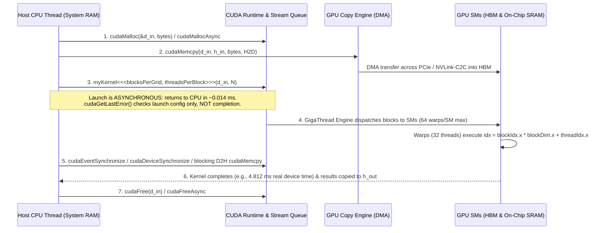
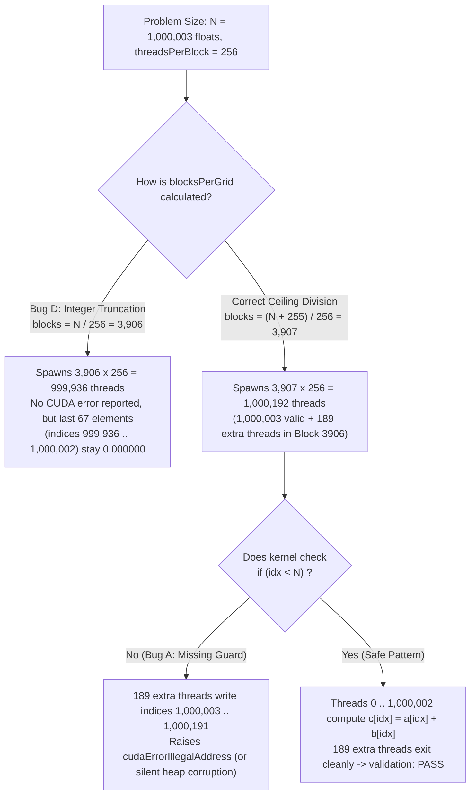

# 10.11 CUDA programming basics: kernels, indexing and memory

| | |
|---|---|
| Level | Intermediate |
| Priority tier | 2 |
| Lab venue | Nebius GPU |
| Part | Part 10: The GPU and CUDA |
| Coverage file | `planning/coverage/chapters/10-11.md` |
| Claim ledger | `planning/ledgers/10-11.md` |

## Why this matters for AI infrastructure

An AI infrastructure engineer rarely writes custom CUDA kernels from scratch every day. Yet production training jobs still crash with illegal memory access faults. Other jobs hang forever on an A100 after passing desktop unit tests, or spend most of their runtime inside memory allocation calls. When these failures wake up the on-call team, the root cause lives inside the fundamental rules of the CUDA execution and memory model.

Four real production incidents from the reference runs behind this chapter show how quickly small kernel or memory mistakes turn into cluster outages. Each one began as a line of code that looked reasonable in review. The bug only showed itself once the code met a real GPU, a real data size, or a real load. Each incident looks mysterious from the outside until you trace how threads, thread blocks, and device buffers map onto the physical GPU.

| Incident Scenario | What Went Wrong in Production | Reference Impact | Root Fix |
|---|---|---|---|
| **4K Image Filter at 10% GPU Utilization** | Startup launched a `3840 × 2160` filter with `<<<dim3(3840, 2160), dim3(1, 1)>>>`, creating `8,294,400` blocks of `1` thread each. | Each 1-thread block consumed a 32-lane warp slot and left `31` of `32` lanes (`96.88%`, or `~97%`) idle. | Reconfigure the thread block size to `dim3(16, 16)` (`256` threads = `8` full warps) for `100%` warp lane fill. |
| **Silent 67-Element Truncation vs Out-of-Bounds Crash** | Team ported a vector loop of `N = 1,000,003` floats with `256` threads per block using either truncated division or ceiling division without a guard. | Truncated division (`3,906` blocks = `999,936` threads) left `67` tail elements at `0.000000`; unguarded ceiling division (`3,907` blocks = `1,000,192` threads) let `189` extra threads write out of bounds. | Pair ceiling division `(N + 255) / 256` with an explicit `if (idx < N)` bounds check inside the kernel. |
| **Cross-Block Spin-Wait Deadlock on A100** | A 1,000-block risk kernel had Block 100 spin in a `while(true)` loop waiting for Block 1 to set a flag in global memory. | Passed by luck on a desktop GPU, but hung forever on a production A100 or MIG slice because spinning blocks starved Block 1 from ever entering an SM. | Remove cross-block spin loops and split global dependencies into two sequential kernel launches. |
| **15-Minute `.to('cuda')` Normalization Slowdown** | Data scientist moved a single-division normalization of `1 billion` numbers onto an H100 using `.to('cuda')`. | Took `15 minutes` on the GPU over the `64 GB/s` PCIe Gen5 bus versus `2 minutes` on the CPU reading local DDR5 RAM at `~300 GB/s` (in Lab 02, `1.259 ms` copy time is `13.11x` / `~13x` the `0.096 ms` kernel). | Keep low-arithmetic-intensity passes on the CPU or fuse them into existing GPU kernels so data crosses PCIe only once. |

Think of this chapter as a tour of a busy factory floor. Each concept maps onto one role on that floor, and the code examples are the work orders that tell each role what to do. We build the model from the ground up, so every term gets a plain explanation before it is used.

This chapter builds a clear mental model of CUDA programming from the ground up. We start with why CUDA replaced graphics-shader workarounds and how execution space specifiers divide work between the CPU and GPU. Next, we trace thread indexing, launch geometry, and hardware limits on modern architectures. Finally, we cover explicit, stream-ordered, and Unified Memory lifecycles alongside scoped synchronization and asynchronous error bisection.

:::note About the numbers in this chapter
The timings, percentages, and throughput figures in this chapter are illustrative or come from one reference run. They show the shape of each problem rather than guaranteed specifications. None of those figures were measured on live hardware for this handbook. The hardware limits for warp size, thread blocks, and grids come from *AI Systems Performance Engineering* Chapter 6.
:::

:::tip In one minute
- Function space specifiers divide heterogeneous code cleanly. Host functions run on the CPU, device functions run on the GPU as helpers, and `__global__` defines a kernel entry point launched via chevron syntax.
- Every thread computes its global 1D coordinate from its block index, block dimension, and thread index. Every thread must check `if (idx < N)` before touching memory.
- Modern NVIDIA GPUs such as Blackwell B200 fix the warp size at 32 threads and cap each thread block at 1,024 threads. Each SM holds at most 64 resident warps and 32 active thread blocks.
- Never time an asynchronous kernel launch with a host CPU timer alone. Use stream-ordered memory pools to avoid allocation churn, and prefetch Unified Memory so active working sets stay inside physical HBM.
:::

---

## Prerequisites and outcomes

**Prerequisites:** Complete Chapters 10.1 through 10.3 on GPU throughput architecture, warps, SMs, and the memory hierarchy. Also review Chapter 10.9 on the CUDA Runtime, Driver API, and `nvcc` compilation flow.

**Outcomes:** The chapter walks through four things in order. It starts with why CUDA replaced the pre-2006 graphics shader tricks, and how execution space specifiers split code between the CPU and the GPU. It then covers thread coordinates in 1D, 2D, and 3D, sizing grids with ceiling division and grid-stride loops, and removing warp lane waste. Next comes device memory across explicit allocations, stream-ordered pools, and Unified Memory, with attention to page-thrashing slowdowns. The last part shows how to synchronize at the narrowest valid scope, time kernels with CUDA Events, and bisect asynchronous faults.

---

## 1. Why CUDA Exists and the Heterogeneous Host–Device Model

A team lead opens a ticket that says the new GPU code is slower than the CPU version it replaces. Before anyone looks at a kernel, the team needs to understand what CUDA is for and where its work actually runs. This section starts with the history, because the design of CUDA makes more sense once you know what came before it.

### 1.1 From graphics shaders to a compute-first platform

When early deep learning and physics teams tried to run matrix math on GPUs before 2006, every project stalled on graphics APIs. Those APIs were never designed for general computation. Engineers had to disguise numerical arrays as 2D textures and rewrite math loops as OpenGL or DirectX pixel shaders. They then read results back as rendered framebuffers. If a calculation produced wrong numbers, the team had no numerical debugger and had to guess what went wrong from rendering counters.

A shader is a small program that a graphics chip runs for each pixel, and a framebuffer is the memory that holds the finished picture. Anyone who wanted matrix results had to pretend the numbers were pixels, run the shader, and then read the picture back to recover the answers.

This overhead is called the graphics translation tax. It breaks into three concrete engineering costs.
- Data had to look like textures and algorithms had to look like shader stages before any real math could begin.
- Developers had no direct linear buffers that they could allocate, index, and copy on their own.
- There was no compute debugger, and every job stayed tied to the graphics rendering pipeline.

Two additional details come from general background knowledge and are not stated in the cited sources. Graphics shaders of that era could not write to arbitrary pointer locations. Furthermore, early pixel pipelines did not guarantee full IEEE 754 floating-point behavior. Treat those two points as historical context rather than sourced claims.

NVIDIA removed the translation tax in 2006 by introducing CUDA as a compute-first platform. It gave developers linear device pointers, threads, thread blocks, grids, and the `nvcc` compiler. Over time, that foundation grew into a deep ecosystem of domain libraries (`cuBLAS`, `cuDNN`, `NCCL`, `cuFFT`, `CUTLASS`, FlashAttention) and cluster telemetry tools (`DCGM`, Nsight Systems, Nsight Compute).

In one customer scenario, a startup CFO proposes replacing NVIDIA GPUs with a competitor chip. The rival chip advertises half the price and 20% higher raw TFLOPS. That scenario shows why raw silicon TFLOPS mislead buyers. Unoptimized translation layers for PyTorch, DeepSpeed, and FlashAttention can cut real cluster utilization by 50%. At the same time, the SRE team must rebuild its entire monitoring stack from scratch. The lesson is that a spec sheet number is a ceiling, not a delivery. Real throughput depends on the software between the model and the silicon, and that software is where most of the cost hides.

### 1.2 The heterogeneous execution contract: `__host__`, `__device__`, and `__global__`

When a newcomer writes a CUDA program and passes a normal CPU pointer into a GPU kernel, the program crashes. It either raises an illegal memory access error or leaves the output buffer full of zeros. New engineers often forget that a CUDA application runs across two physically separate processors with separate memory spaces. Without a strict contract between CPU orchestration and GPU execution, the compiler cannot know which instructions belong on which processor. A useful picture is a restaurant with two kitchens. The front kitchen takes orders, prepares ingredients, and keeps the books. The back kitchen does the heavy cooking on a line of identical stations. Each kitchen has its own pantry, and a dish cannot be cooked in one kitchen using only the ingredients stored in the other.

In the CUDA heterogeneous model, the Host consists of the CPU and system DDR5 RAM. It runs `main()`, reads files and network sockets, allocates device buffers, and queues asynchronous work. The Device consists of the GPU and its HBM and on-chip SRAM. It executes parallel kernels queued by the host. You tell `nvcc` where each function executes by placing an execution space specifier on the declaration.

| Specifier | Executes On | Callable From | Return Type & Compilation Rule |
|---|---|---|---|
| `__host__` (default if omitted) | Host (CPU) | Host (CPU) only | Any valid C++ return type; compiled by the host C++ compiler (`gcc` or `clang`). |
| `__device__` | Device (GPU) | Device (GPU) only | Any valid C++ return type; compiled into GPU `PTX` and `SASS` instructions as a device helper function. |
| `__global__` | Device (GPU) | Host (CPU), or GPU via Dynamic Parallelism | Must return `void`; defines a kernel entry point launched with `<<<gridDim, blockDim, sharedMemBytes, stream>>>`. |
| `__host__ __device__` | Both CPU and GPU | Both CPU and GPU | `nvcc` compiles two separate binary versions of the function, one for the CPU and one for the GPU. |



Read the diagram as a timeline with seven numbered steps. Steps 1 and 2 put the data in place. Step 3 is the launch, and the arrow returns to the CPU almost at once. That is why the note says a launch is asynchronous, meaning the CPU does not wait for the work to finish. Step 4 is the work itself, handled by the hardware scheduler that hands thread blocks to the SMs. Step 5 is the point where the CPU chooses to wait. Only after that does step 6 show a finished result on the host. Step 7 cleans up the device memory.

Think of two post offices with separate address books. A street address from one book means nothing in the other, and a letter addressed to the wrong office goes nowhere. The hardware boundary between Host RAM and Device HBM enforces one strict pointer rule in explicit-memory CUDA. Host pointers returned by `malloc()` point to CPU system memory. Device pointers returned by `cudaMalloc()` point to GPU HBM. In one customer scenario, passing a raw host pointer directly into a kernel causes GPU threads to dereference an unmapped device address. The hardware raises `CUDA error: an illegal memory access was encountered` and leaves the output buffer all zeros. Notice that the message does not say which pointer was wrong. The clue is the kind of memory the pointer came from, and that is why the rule about host and device pointers has to be learned before the first kernel is written. A pointer that works in host code can still be invalid inside a kernel, because the kernel runs on the other processor.

---

## 2. Kernel Launch Geometry, 1D/2D/3D Indexing, and Hardware Limits

### 2.1 The execution configuration and GPU hardware limits

If an engineer launches a kernel with 100,000 threads in a single thread block, the GPU refuses to run the kernel at all. If the engineer goes to the opposite extreme and launches 1 thread per block, the kernel runs at a tiny fraction of peak speed. Both failures happen because the software launch configuration must fit inside the physical scheduling limits of the Streaming Multiprocessor. In practice, the first step is to read the limits in the table and make the launch fit inside them. The second step is to make each block big enough to keep its SM busy.

Picture a crew dispatcher. The whole job is the grid. Each crew is a thread block, and each crew member is a thread. The dispatcher assigns whole crews to work areas on the floor, and each work area can only hold so many crews at once. The chevron syntax is the call that places the job order with the dispatcher. When host code launches a kernel with chevron syntax, it defines a two-level hierarchy of a Grid divided into Thread Blocks, which are divided into Threads. Under the hood, the hardware GigaThread Engine assigns whole Thread Blocks to SMs. Each SM then slices every assigned block into 32-thread Warps. Tables 6-1 through 6-4 of *AI Systems Performance Engineering* Chapter 6 define the exact hardware limits on modern NVIDIA GPUs such as Blackwell B200 and Hopper H100.

| Scope | Hardware Parameter (Blackwell B200 / Hopper H100) | Hard Limit | Operational & Sizing Rule |
|---|---|---:|---|
| **Warp** | Warp size (`warpSize`) | `32` threads | Fundamental SIMT lockstep unit; always pick `threadsPerBlock` as a multiple of `32` (`128`, `256`, `512`). |
| **Thread Block (CTA)** | Max threads per block (`blockDim.x * y * z`) | `1,024` threads | Requesting `> 1,024` threads (such as `100,000` in Lab 02 Failure B) fails immediately at launch with `invalid configuration argument`. |
| **Thread Block (CTA)** | Max warps per block | `32` warps | Derived directly from `1,024 threads / 32 threads per warp = 32 warps`. |
| **Per-SM Residency** | Max resident warps per SM | `64` warps | Equals `2,048` max resident threads per SM (`2` blocks of `1,024` threads, or `8` blocks of `256` threads). |
| **Per-SM Residency** | Max active thread blocks per SM | `32` blocks | Even with 32-thread blocks, an SM can host at most `32` active blocks at once. |
| **Per-SM Execution** | Warp schedulers & pipelines per SM (Blackwell) | `4` schedulers | Each scheduler can dual-issue `1` math + `1` memory op per cycle across `16` LD/ST pipelines and dedicated SFU transcendental units. |
| **Per-SM Memory** | Register file, SMEM, TMEM, and L2 (Blackwell) | `64K` 32-bit regs (`256 KB`) | Max `255` regs/thread; `228 KB` SMEM (`227 KB` usable/block, `1 KB` reserved); `256 KB` TMEM (`~10 cycles`) for `tcgen05.mma` / `UMMA`; `126 MB` L2. |
| **Grid** | Max grid dimensions (`gridDim.x`, `y`, `z`) | `X: 2,147,483,647` (`2^31 - 1`) | `Y: 65,535` and `Z: 65,535`, with up to `128` concurrent grids executing on one GPU simultaneously. |

Read the table as a list of ceilings. Each row is a limit the hardware will not exceed, and the sizing rule in the last column tells you how to stay under it. The first row matters most, because the warp is the unit the hardware really runs. A block size that is not a multiple of the warp size leaves some lanes in the last warp empty, and those empty lanes do no work at all.

Why does *AI Systems Performance Engineering* Chapter 6 recommend 256 threads per block as the default starting point for most kernels. First, 256 is an exact multiple of 32, so zero warp lanes go to waste. Second, on an SM that supports 2,048 resident threads, placing 256 threads in each block allows 8 blocks to reside on each SM at the same time. That keeps all 64 warps active across the SM's 4 warp schedulers without hitting the 32-block ceiling or exhausting per-block shared memory and registers. In plain words, 256 is a size that keeps the crews busy without running out of room on the floor.

### 2.2 1D indexing, ceiling division, and the two boundary bugs

When a team ports a CPU loop over an array of length $N$ to CUDA, two classic off-by-one bugs show up whenever $N$ is not a multiple of the block size. If the programmer uses integer division to compute the block count, the kernel finishes without reporting any error while leaving the tail elements at zero. If the programmer switches to ceiling division so the grid covers the tail, but forgets a bounds check inside the kernel, the extra threads in the last block write past the end of the buffer.

Think of a long shelf of boxes and a crew of workers, one worker per box. Integer division rounds down, so a crew sized that way is one worker short for the leftover boxes at the end of the shelf. Ceiling division rounds up, which sends one extra worker for those leftover boxes. That extra worker must be told to stop at the end of the shelf, and that is the job of the bounds check.

Inside a CUDA kernel, every thread runs the exact same C++ function body. To make each thread process a unique array element, the thread computes its global 1D index from CUDA's built-in coordinates.

```cpp
int idx = blockIdx.x * blockDim.x + threadIdx.x;
```

Read the expression from the inside out. `threadIdx.x` is this thread's seat number inside its own block, like a worker's place in one row. `blockDim.x` is how many seats each row holds. `blockIdx.x` tells you which row this block sits in. Multiplying the row number by the seats per row and then adding the seat number gives one global position across the whole grid. Every worker runs the same line but gets a different answer, and that difference is what lets one kernel body process a whole array.

To ensure enough threads are launched when $N$ is not divisible by the block size, host code computes the grid size using ceiling division. Inside the kernel, every thread guards its memory access with `if (idx < N)`.

```cpp
int blocksPerGrid = (N + threadsPerBlock - 1) / threadsPerBlock;
```

The line is an integer trick for rounding up without floating-point math. The part `N + threadsPerBlock - 1` adds just enough extra that any leftover elements push the division up by one step. The division then drops the fraction that remains. The leftover elements in the last block are handled by the bounds check inside the kernel, which is why the two lines are always used as a pair.

The block below traces the exact indexing and boundary arithmetic across four worked examples, following *AI Systems Performance Engineering* Chapter 6.

```text
Worked 1D Indexing & Ceiling-Division Examples (verified in cuda_programming_basics_lab.py):
1. Concrete thread coordinate (V3 Ch 4 §2):
   blockIdx.x = 3, blockDim.x = 256, threadIdx.x = 5
   -> idx = 3 * 256 + 5 = 768 + 5 = 773.

2. Non-divisible vector N = 1,000,003 with threadsPerBlock = 256 (V3 Ch 4 & Lab 02):
   - Correct ceiling division: (1,000,003 + 255) / 256 = 3,907 blocks = 1,000,192 threads.
     Threads 0 .. 1,000,002 process valid data; 189 extra threads (1,000,003 .. 1,000,191) exit via if (idx < N).
   - Bug D (Truncated integer division): 1,000,003 / 256 = 3,906 blocks = 999,936 threads.
     Returns cudaSuccess, but leaves the last 67 elements (999,936 .. 1,000,002) untouched at 0.000000.
   - Bug A (Ceiling division without if (idx < N) guard): 3,907 blocks launched without bounds check.
     The 189 extra threads write out of bounds -> cudaErrorIllegalAddress or silent heap corruption.

3. Million-element vector N = 1,000,000 with threadsPerBlock = 256 (ASP Ch 6 p. 186 & V3 Ch 4 §3):
   - Exact division: 1,000,000 / 256 = 3,906.25 blocks.
   - Ceiling division: (1,000,000 + 255) / 256 = 3,907 blocks = 1,000,192 threads (192 extra threads guarded).

4. Two-warp vector N = 63 with threadsPerBlock = 64 (ASP Ch 6 p. 188):
   - Spawns 2 warps (64 threads total, indices 0 .. 63); 1 extra thread at idx = 63 (the 64th thread) is guarded.
```



Read the diagram as a decision with two questions. The first question is how the block count gets computed. The truncation branch launches too few threads and reports no error, which makes it the hardest of these bugs to catch. The ceiling branch launches enough threads, but it needs the guard. Only the guarded path reaches a clean PASS. The same habit applies to any problem size. Test the boundary sizes first, because a bug that hides at 1,000,003 elements often shows up one element away from a full block.

### 2.3 Warp lane waste, SM grid underfill, and grid-stride loops

Even when a kernel produces bit-exact answers, poor launch geometry can leave most of a GPU's compute units idle. A computer-vision team might see 10% GPU utilization on a 4K image filter. Another team might upgrade a cluster from A10 GPUs to H100 GPUs and see zero speedup on their custom preprocessing kernel. Both problems happen when block dimensions waste warp lanes or when a fixed grid size fails to feed every SM on a larger GPU.

The hardware always works in whole warps, and a warp is a team of threads that moves in step. Think of a bus that seats a full team. If a block only has one thread, the bus still leaves with every seat reserved, and all but one seat sits empty.

Three launch-geometry rules govern how effectively a kernel fills the hardware.
- When a block size is not a multiple of 32, the hardware still allocates whole 32-thread warps and leaves the leftover lanes in the final warp idle.
- When processing 2D images or matrices, threads compute 2D coordinates $x$ and $y$ using 16-by-16 thread blocks and map them to a linear row-major offset.
- Because thread blocks cannot be split across SMs, a small fixed grid that filled an older GPU can leave over half the SMs idle on a larger GPU. Production kernels solve this with a grid-stride loop that decouples grid size from problem size.

| Launch Scenario | Launch Geometry (`<<<grid, block>>>`) | Hardware Allocation & Efficiency Breakdown | Operational Result |
| --- | --- | --- | --- |
| **Non-multiple-of-32 1D block** | `<<<1, 50>>>` (`50` threads in `1` block) | Allocates `2` warps (`64` warp lanes): Warp 0 runs `32` active threads; Warp 1 runs `18` active threads and leaves `64 - 50 = 14` lanes idle. | `78.12%` warp lane efficiency (`14` wasted lanes per block). |
| **4K Image with 1-thread blocks** | `<<<dim3(3840, 2160), dim3(1, 1)>>>` on `3840 × 2160` image | Spawns `8,294,400` blocks of `1` thread; each block consumes a 32-lane warp and leaves `31` of `32` lanes idle. | `96.88%` (`~97%`) of warp compute lanes wasted; GPU sits near `10%` utilization. |
| **4K Image or `1024 × 1024` Matrix with `16 × 16` tiles** | `<<<dim3(240, 135), dim3(16, 16)>>>` (`32,400` blocks of `256` threads) | Each `16 × 16` block has `256` threads = `8` full warps of `32` threads (`0` idle warp lanes). | `100%` warp lane utilization across all `8,294,400` pixels. |
| **Fixed 64-block grid moved from A10 to H100** | `<<<64, 256>>>` (`64` total blocks) | Nearly fills an A10 GPU (`72` SMs), but on an H100 (`132` SMs) at most `64` SMs get a block while `132 - 64 = 68` SMs sit completely idle. | Upgrading to H100 yields almost no speedup until `gridDim` scales with the GPU or uses a grid-stride loop. |

Both patterns answer the same question from different angles. The 2D version sizes the grid to the picture, so every pixel gets its own thread. The grid-stride version sizes the work to the hardware, so the same code handles any array length. Below is the standard 2D indexing pattern alongside the 1D grid-stride loop pattern that lets any grid size process an array of arbitrary length.

```cpp
// 1. 2D row-major indexing with dim3(16, 16) blocks (V3 Ch 4 & ASP Ch 6 p. 191)
__global__ void scale_2d(float* input, int width, int height) {
    int x = blockIdx.x * blockDim.x + threadIdx.x; // column
    int y = blockIdx.y * blockDim.y + threadIdx.y; // row
    if (x < width && y < height) {
        int idx = y * width + x;
        input[idx] *= 2.0f;
    }
}

// 2. 1D grid-stride loop: decouples gridDim.x from array length n (V3 Ch 4)
__global__ void scale_grid_stride(float* values, int n, float factor) {
    for (int i = blockIdx.x * blockDim.x + threadIdx.x;
         i < n;
         i += blockDim.x * gridDim.x) {
        values[i] *= factor;
    }
}
```

The 2D kernel works like a grid on graph paper. Each thread finds its column `x` and its row `y` from the same block and thread formula used in the 1D case, applied once for each direction. The `if` line keeps the threads at the right and bottom edges from touching pixels that do not exist. The index `y * width + x` turns the two coordinates into one position in memory, because the buffer is stored one row after another.

The grid-stride loop solves a different problem. Picture a crew that gets a fixed number of workers, but the job has more boxes than workers. Each worker takes a box, then skips ahead by the total size of the crew and takes the next one. The loop keeps going until the boxes run out. Because the step is the total number of threads in the grid, the same kernel works on a small GPU with a small grid and on a large GPU with a large grid. That is how a fixed launch stops leaving SMs idle.

---

## 3. CUDA Memory Management: Explicit Copies, Stream-Ordered Pools, and Unified Memory

### 3.1 Explicit device memory and the PCIe transfer-to-kernel ratio

Teams new to GPU acceleration often port a simple math function to CUDA and measure the GPU kernel alone at under a tenth of a millisecond. They then wonder why their end-to-end service actually got slower. They overlook the time spent moving inputs from CPU system RAM into GPU HBM over the PCIe bus and copying outputs back. When an operation performs only one or two arithmetic operations per element, PCIe data movement completely dominates the runtime. A useful test is to ask how many times each element gets used by math before it leaves the GPU. If the answer is once, the copy is the real work. A kernel that reuses each value across many operations has room to win, because the copy cost is spread over more useful math.

In the explicit CUDA memory model, the host allocates device HBM with `cudaMalloc` and optionally clears raw bytes with `cudaMemset`. Be careful with `cudaMemset` because it writes a single byte pattern to every byte in the buffer. It is safe for zeroing arrays, but it cannot initialize multi-byte floating-point values such as `1.0f`. Next, the host copies inputs from CPU to GPU with `cudaMemcpy`, launches the kernel, copies results back to the host, and releases device memory with `cudaFree`. Think of `cudaMalloc` as reserving a parking space, `cudaMemcpy` as driving a car in or out, and `cudaFree` as handing the space back to the lot.

| Workload Scenario | Stage Breakdown & Bandwidths | Transfer-to-Compute Comparison | Operational Takeaway |
|---|---|---|---|
| **`vector_add.cu` on A100** (`N = 1,000,003` floats = `4.0 MB` per vector) | `copy in`: `0.847 ms`; `kernel`: `0.096 ms`; `copy out`: `0.412 ms` | Total PCIe transfer is `0.847 + 0.412 = 1.259 ms` vs `0.096 ms` kernel = `13.11x` (`~13x`) more time moving data than computing. | A single elementwise kernel cannot amortize host-to-device and device-to-host PCIe copies. |
| **1-Billion-Number `.to('cuda')` Normalization** | CPU reads local DDR5 RAM at `~300 GB/s`; `.to('cuda')` crosses PCIe Gen5 at `64 GB/s` out and back | Takes `2 minutes` on the CPU versus `15 minutes` on an H100 GPU (`7.5x` slower on GPU). | Only move data to the GPU when arithmetic intensity is high or when data stays resident in HBM across many fused kernels. |
| **7B FP16 LLM Serving Budget** (capacity example on `40 GB` GPU) | Model weights: `14 GB` FP16; dynamic KV cache + activations: `8.6 GB` | Persistent weights + KV cache stay resident in HBM across thousands of token steps. | High reuse in HBM amortizes the initial weight load across millions of matrix multiplications. |

### 3.2 Synchronous allocation churn (`77.6%` API time) and stream-ordered pools

Even when tensors stay on the GPU for multiple kernels, a C++ inference server that calls `cudaMalloc` and `cudaFree` on every incoming request will suffer severe latency spikes. Worse, under variable-size requests, an application can crash with an out-of-memory error even while `nvidia-smi` reports gigabytes of free VRAM. Both problems come from calling synchronous OS-backed device allocations inside a hot loop and from allocator fragmentation.

Think of a shared kitchen where every cook must stop the whole line each time they need a new bowl. A synchronous allocation is that stop. Standard `cudaMalloc` and `cudaFree` are synchronous, heavyweight operations. They trigger OS kernel `mmap` and `ioctl` calls, GPU page-table updates, and device-wide synchronization across streams. Look at the Nsight Systems API summary across 4,000 requests, alongside the fragmentation state from the same run.

```text
1. Nsight Systems CUDA API Summary across 4,000 requests (V3 Ch 5 lines 300-309):
   - cudaMalloc       : 71.2% Time | 182,340,000 ns Total | 4,000 Calls | 45,585 ns Avg
   - cudaMemcpy       : 18.6% Time |  47,610,000 ns Total | 4,000 Calls | 11,903 ns Avg
   - cudaFree         :  6.4% Time |  16,392,000 ns Total | 4,000 Calls |  4,098 ns Avg
   - cudaLaunchKernel :  3.8% Time |   9,730,000 ns Total | 4,000 Calls |  2,433 ns Avg
   -> Allocation + deallocation (71.2% + 6.4% = 77.6%) takes 20.42x (about 20.4x, and >8x) the 3.8% kernel launch time.

2. Allocator Fragmentation OOM Example (V3 Ch 5 line 331):
   - nvidia-smi reports: 71,232 MiB used / 9,727 MiB free / 80,960 MiB total on an 80 GB GPU.
   - Yet a 4 GB allocation fails with cudaErrorMemoryAllocation because the caching allocator holds the 9,727 MiB
     as small non-contiguous reserved blocks (inspectable in PyTorch via torch.cuda.memory_summary()).
```

To eliminate per-request allocation stalls in CUDA C++, *AI Systems Performance Engineering* Chapter 6 recommends stream-ordered memory allocation. You call `cudaMallocAsync` and `cudaFreeAsync` on a non-blocking stream. These calls sub-allocate memory from a device memory pool in stream order without OS calls or global GPU synchronization. You can configure how much memory the pool retains before releasing pages back to the OS using `cudaMemPoolSetAttribute`, and explicitly trim unused pool memory with `cudaMemPoolTrimTo`. In PyTorch, the caching allocator pools memory automatically and reduces fragmentation when configured with `PYTORCH_ALLOC_CONF=expandable_segments:True`.

```cpp
// Stream-ordered allocation from the device memory pool (ASP Ch 6 pp. 193-194)
cudaStream_t stream1;
cudaStreamCreateWithFlags(&stream1, cudaStreamNonBlocking);

float* d_buf = nullptr;
cudaMallocAsync(&d_buf, N * sizeof(float), stream1);
myKernel<<<blocksPerGrid, threadsPerBlock, 0, stream1>>>(d_buf, N);
cudaFreeAsync(d_buf, stream1); // Returns buffer to pool once stream1 completes
```

Read the code line by line. `cudaStream_t stream1;` declares a handle to a stream, which is a conveyor belt. Work queued on the same belt runs in the order it was placed. `cudaStreamCreateWithFlags` creates that belt with the non-blocking flag, so it does not wait for the default belt to empty. `float* d_buf = nullptr;` sets the pointer to nothing before the allocation. `cudaMallocAsync` asks the pool for a block of memory on this belt. The kernel launch sits on the same belt, so it runs after the allocation finishes. The last line hands the buffer back to the pool when the belt reaches that point, and the next request can reuse the memory without a trip to the operating system.

### 3.3 Unified Memory, prefetching, and the oversubscription cliff

To avoid managing separate host and device pointers, developers sometimes switch every allocation to `cudaMallocManaged` (Unified Memory) and assume the CUDA driver will handle data movement for free. Then three surprises hit in production. First, the initial training step runs 20 times slower than the second step. Second, a dataset that grows just 10% larger than GPU VRAM causes throughput to collapse by more than 10x. Third, a single CPU debug print statement stalls a 4-millisecond kernel for nearly 100 milliseconds.

First, distinguish Unified Virtual Addressing (UVA) from Unified Memory. UVA simply places CPU and GPU pointers into a single virtual address table so the runtime can tell whether a pointer lives on the host or device. Unified Memory goes further by creating a managed allocation backed by the `nvidia-uvm.ko` kernel module. It automatically migrates pages on demand across PCIe or NVLink-C2C via hardware page faults whenever the CPU or GPU touches a nonresident page.

Think of Unified Memory as a library with an automatic courier. When you ask for a book that is stored across town, the courier fetches it for you, and the wait is the cost. If you keep asking for more books than fit on your desk, the courier spends its whole day carrying books back and forth. That is the page-thrashing story in the table that follows. The courier is helpful, but it cannot make a desk bigger. What actually happens on the first touch is simple to describe. The GPU reads an address, finds that the page is not on the device, and raises a fault. The driver moves the page across the bus, and then the read continues. Every page touched for the first time pays that round trip, which is why the first iteration is slow and the second one is fast.

| Unified Memory Scenario | Configuration / Working Set Size | Reference Timing or Effective Bandwidth | Root Cause & Remediation |
|---|---|---|---|
| **Cold First-Touch Faults vs Warm Iteration** | `--mode=cold` (Iteration 1 vs Iteration 2) | Iteration 1: `812.4 ms`; Iteration 2: `41.2 ms` (`19.72x`, or `~20x` slower on first touch) | GPU faults on thousands of nonresident pages over PCIe during Iteration 1. |
| **Bulk Prefetching Ahead of Compute** | `--mode=prefetch` (`cudaMemPrefetchAsync`) | Prefetch: `38.9 ms`; Iteration 1: `41.6 ms`; Iteration 2: `41.2 ms` | `cudaMemPrefetchAsync` bulk-migrates pages in `38.9 ms` via DMA without per-page fault storms (note: CUDA 13 updates the device argument to a `cudaMemLocation` struct). |
| **In-Memory Working Set (`60%` & `90%` of `40 GB` GPU)** | `24 GB` (`60%`) and `36 GB` (`90%`) working sets | `24 GB`: `118 GB/s`; `36 GB`: `104 GB/s` effective throughput | Active working set fits inside the `40 GB` physical HBM after migration. |
| **Oversubscription Page-Thrashing Cliff (`110%` of `40 GB` GPU)** | `44 GB` (`110%` of `40 GB` VRAM) | Drops from `104 GB/s` to `9 GB/s` (`11.5x` slower than at `36 GB`) | UVM driver continuously evicts cold pages and refaults hot pages across PCIe (page thrashing). |
| **Host CPU Debug Print in a Hot Loop** | Adding `std::cout << data[0]` after a `4.1 ms` kernel | Kernel: `4.1 ms`; CPU check: `96.7 ms` (`23.59x`, or `>23x` the kernel runtime) | Reading `data[0]` on the CPU forces the runtime to synchronize the GPU and migrate the page back to host RAM over PCIe. |

---

## 4. Synchronization Scopes, Asynchronous Error Bisection, and Correctness

### 4.1 The seven CUDA synchronization scopes and the inter-block deadlock trap

When engineers try to coordinate threads across a GPU without respecting CUDA's execution hierarchy, they hit three severe bugs. A kernel with a spin loop between two blocks hangs forever on a production A100. A conditional barrier deadlocks an SM. Or a global counter produces a different wrong sum on every run. Each bug happens when code uses the wrong synchronization scope for the hardware level it is trying to coordinate.

Think of the scopes as levels of a building. A warp is a small team at one desk, a thread block is one floor, a stream is a single conveyor belt, and the full device is the whole building. Asking for a barrier at the wrong level either costs far too much or does not reach the people who need to wait. Because CUDA executes asynchronously across the host, across streams, and across thread blocks, ordering is always scoped to a specific level of the hierarchy. You must pick the narrowest synchronization primitive that matches your data dependency.

| Scope Level | CUDA Primitive | Hardware Scope & Critical Correctness Rule |
|---|---|---|
| **1. Single Thread** | Sequential C++ statements | Orders instructions within one individual GPU thread. |
| **2. Warp (`32` lanes)** | `__syncwarp()` / warp shuffle | Synchronizes active lanes within a single 32-thread warp. |
| **3. Thread Block (CTA)** | `__syncthreads()` | Hardware barrier across all threads in the same Thread Block (used around Shared Memory reads and writes). Never place `__syncthreads()` inside a warp-divergent `if/else` branch where only some threads in the block reach it, or the block will deadlock. |
| **4. Thread Block Cluster** | `cluster.sync()` (Hopper / Blackwell) | Hardware barrier across cooperative blocks in a Thread Block Cluster sharing Distributed Shared Memory (`DSMEM`; covered in Chapter 10.16). |
| **5. Stream** | `cudaStreamSynchronize(stream)` | Operations in the same stream run in issue order automatically; `cudaStreamSynchronize` blocks the host CPU thread until `stream` finishes. |
| **6. Cross-Stream Event** | `cudaEventRecord` + `cudaStreamWaitEvent` | Makes Stream B wait on the GPU hardware for an event recorded in Stream A without blocking the host CPU thread (covered in Chapter 10.12). |
| **7. Full Device** | `cudaDeviceSynchronize()` | Blocks the host CPU until all work on all streams across the entire GPU completes. Use for debugging checkpoints or shutdown, never inside a hot request loop. |

Picture two workers. Worker 100 stands at the door of a room, waiting for worker 1 to flip a switch inside. Worker 1 is outside the building, waiting for a seat in the room to open. Neither one moves, and each one is waiting for the other. Why did a financial-risk kernel deadlock on a production A100 when Block 100 spun waiting for Block 1 to write a flag. Standard CUDA kernels provide no global barrier across independent thread blocks. Furthermore, the hardware scheduler makes zero guarantee about the order in which blocks enter SMs. When spinning blocks such as Block 100 occupy all resident SM slots, Block 1 sits in the hardware queue waiting for an SM slot to open. Meanwhile, Block 100 waits forever for Block 1 to run. Whenever step B depends on the global output of step A across all blocks, split the work into two sequential kernel launches separated by stream ordering.

A second synchronization bug appears when thousands of threads increment a shared counter or accumulate a sum without coordination. In one customer scenario, running an unguarded reduction three times in a row produced three different wrong answers. That non-deterministic drift across identical inputs is the signature of a read-modify-write data race. Replacing the increment with `atomicAdd` restores correctness at the L2 cache. However, if 100,000 threads hit the same global address at once, the L2 atomic unit serializes all 100,000 updates. The production fix is to accumulate partial sums inside each block's fast on-chip Shared Memory using `__syncthreads()`, and let thread 0 issue a single `atomicAdd` per block to global memory.

### 4.2 Asynchronous timing (`0.014 ms` vs `4.812 ms`) and bisecting deferred errors

Because kernel launches return control to the CPU immediately after placing a command in the stream queue, two operational traps catch engineers off guard. First, timing a kernel launch with a standard C++ CPU timer measures only the microsecond queue submission overhead. It underreports kernel time by hundreds of times. Second, when a kernel writes out of bounds on the GPU, the error surfaces several lines later on an innocent `cudaMemcpy` call. The copy is simply the first call that has to wait for the GPU, so it is the first place the fault becomes visible. The fault itself happened earlier, in a kernel the copy never mentions.

Think of a CUDA event as a stopwatch marker that the GPU places on the conveyor belt. When the GPU reaches the marker, it records the time. The CPU reads the two marks later. This is why an event timer measures real device time, while a plain CPU timer reads the wall clock at the moment the launch call returns.

Look at the timing and error-attribution numbers in the two customer scenarios above.

```text
1. Asynchronous Host Timer Trap vs CUDA Event Timing (V3 Ch 3 lines 235-252):
   - Host std::chrono::steady_clock::now() around myKernel<<<grid, block>>>(data) without sync: 0.014 ms.
   - True GPU execution measured via cudaEventRecord(start/stop) + cudaEventSynchronize(stop)
     + cudaEventElapsedTime(&ms, start, stop): 4.812 ms.
   - Measurement error factor: 4.812 ms / 0.014 ms = 343.71x (~340x underreported).

2. Deferred Asynchronous Error Attribution (V3 Ch 6 lines 224-242 & 312-318):
   - Sequence: kernel_a<<<...>>>(buf) -> kernel_b<<<...>>>(buf) -> cudaMemcpy(host, buf, n, D2H).
   - If kernel_a writes out of bounds, the GPU sets an asynchronous hardware fault flag while the CPU
     moves on to enqueue kernel_b and call cudaMemcpy.
   - Because synchronous cudaMemcpy is the first host-blocking call after the fault, the runtime returns
     "CUDA error: an illegal memory access was encountered" on the cudaMemcpy line.
   - Non-deterministic unguarded reduction drift across 3 runs (V3 Ch 6 lines 336-338):
     Run 1: 483920.125000 | Run 2: 501234.875000 | Run 3: 512000.000000.
```

To catch immediate launch-configuration mistakes and bisect which kernel triggered an asynchronous memory fault, wrap every CUDA API call in a check macro. Call `cudaGetLastError()` right after every kernel launch. During debugging, temporarily insert `cudaDeviceSynchronize()` after each suspect kernel to pinpoint the exact failing launch.

```cpp
#define CUDA_CHECK(call)                                                   \
    do {                                                                   \
        cudaError_t error = (call);                                        \
        if (error != cudaSuccess) {                                        \
            std::cerr << "CUDA error at " << __FILE__ << ':' << __LINE__  \
                      << ": " << cudaGetErrorString(error) << '\n';        \
            std::exit(EXIT_FAILURE);                                       \
        }                                                                  \
    } while (0)
```

Read the macro from top to bottom. `#define CUDA_CHECK(call)` creates a shortcut that wraps any CUDA call. The `do { ... } while (0)` wrapper makes the macro behave like a single statement, so it works inside an if without extra braces. The first line inside stores the result of the call. If that result is not `cudaSuccess`, the macro prints the file name, the line number, and the readable error text, and then exits. The backslashes at the end of each line join the macro into one logical line for the preprocessor, which is the step that runs before the compiler. Think of it as a smoke alarm on every door. You do not check each door by hand, but any door that catches fire sets off the same alarm and prints the address on it.

---

## 5. Commands and Code Patterns That Matter

A teammate sends you a single source file and asks whether it works on the new GPU server. The reference program and the commands below are what you would run to answer that question. They compile the file, test it at sizes near a warp boundary, and profile where the time goes.

The compilation and execution commands below follow *AI Systems Performance Engineering* Chapter 6. Because this handbook builds without an attached GPU, the commands below were not run on live hardware.

### 5.1 Complete reference implementation: `vector_add.cu`

The complete reference implementation below validates 1D vector addition and records per-stage CUDA Event timings. Read the program as a work order for a crew. The host sets up the materials, the kernel is the crew's instruction card, and the events are the stopwatch marks that tell you how long each stage took.

```cpp
// vector_add.cu (from nvidia-devops Volume 03 Lab 02 Step 2)
#include <cuda_runtime.h>
#include <cmath>
#include <cstdlib>
#include <iomanip>
#include <iostream>
#include <vector>

#define CUDA_CHECK(call)                                                   \
    do {                                                                   \
        cudaError_t error = (call);                                        \
        if (error != cudaSuccess) {                                        \
            std::cerr << "CUDA error at " << __FILE__ << ':' << __LINE__  \
                      << ": " << cudaGetErrorString(error) << '\n';        \
            std::exit(EXIT_FAILURE);                                       \
        }                                                                  \
    } while (0)

__global__ void vector_add(const float* a, const float* b, float* c, std::size_t count) {
    const std::size_t index =
        static_cast<std::size_t>(blockIdx.x) * blockDim.x + threadIdx.x;
    if (index < count) {
        c[index] = a[index] + b[index];
    }
}

int main(int argc, char** argv) {
    std::size_t count = 1'000'003;
    int threads_per_block = 256;
    if (argc > 1) count = std::strtoull(argv[1], nullptr, 10);
    if (argc > 2) threads_per_block = std::atoi(argv[2]);

    const std::size_t bytes = count * sizeof(float);
    std::vector<float> host_a(count), host_b(count), host_c(count, 0.0F), reference(count);
    for (std::size_t i = 0; i < count; ++i) {
        host_a[i] = static_cast<float>(i % 1000) * 0.25F;
        host_b[i] = static_cast<float>(i % 127) * 0.5F;
        reference[i] = host_a[i] + host_b[i];
    }

    float *device_a = nullptr, *device_b = nullptr, *device_c = nullptr;
    CUDA_CHECK(cudaMalloc(&device_a, bytes));
    CUDA_CHECK(cudaMalloc(&device_b, bytes));
    CUDA_CHECK(cudaMalloc(&device_c, bytes));

    cudaEvent_t start_copy_in, end_copy_in, end_kernel, end_copy_out;
    CUDA_CHECK(cudaEventCreate(&start_copy_in));
    CUDA_CHECK(cudaEventCreate(&end_copy_in));
    CUDA_CHECK(cudaEventCreate(&end_kernel));
    CUDA_CHECK(cudaEventCreate(&end_copy_out));

    CUDA_CHECK(cudaEventRecord(start_copy_in));
    CUDA_CHECK(cudaMemcpy(device_a, host_a.data(), bytes, cudaMemcpyHostToDevice));
    CUDA_CHECK(cudaMemcpy(device_b, host_b.data(), bytes, cudaMemcpyHostToDevice));
    CUDA_CHECK(cudaEventRecord(end_copy_in));

    const std::size_t blocks_required =
        (count + static_cast<std::size_t>(threads_per_block) - 1) /
        static_cast<std::size_t>(threads_per_block);

    vector_add<<<static_cast<unsigned int>(blocks_required), threads_per_block>>>(
        device_a, device_b, device_c, count);
    CUDA_CHECK(cudaGetLastError());
    CUDA_CHECK(cudaEventRecord(end_kernel));

    CUDA_CHECK(cudaMemcpy(host_c.data(), device_c, bytes, cudaMemcpyDeviceToHost));
    CUDA_CHECK(cudaEventRecord(end_copy_out));
    CUDA_CHECK(cudaEventSynchronize(end_copy_out));

    float copy_in_ms = 0.0F, kernel_ms = 0.0F, copy_out_ms = 0.0F;
    CUDA_CHECK(cudaEventElapsedTime(&copy_in_ms, start_copy_in, end_copy_in));
    CUDA_CHECK(cudaEventElapsedTime(&kernel_ms, end_copy_in, end_kernel));
    CUDA_CHECK(cudaEventElapsedTime(&copy_out_ms, end_kernel, end_copy_out));

    std::size_t mismatches = 0;
    for (std::size_t i = 0; i < count; ++i) {
        if (std::fabs(host_c[i] - reference[i]) > 1.0e-5F) ++mismatches;
    }

    std::cout << "elements: " << count << "\nthreads per block: " << threads_per_block
              << "\nblocks: " << blocks_required << std::fixed << std::setprecision(3)
              << "\ncopy in: " << copy_in_ms << " ms\nkernel: " << kernel_ms
              << " ms\ncopy out: " << copy_out_ms << " ms\nvalidation: "
              << (mismatches == 0 ? "PASS" : "FAIL") << '\n';

    CUDA_CHECK(cudaEventDestroy(start_copy_in));
    CUDA_CHECK(cudaEventDestroy(end_copy_in));
    CUDA_CHECK(cudaEventDestroy(end_kernel));
    CUDA_CHECK(cudaEventDestroy(end_copy_out));
    CUDA_CHECK(cudaFree(device_a));
    CUDA_CHECK(cudaFree(device_b));
    CUDA_CHECK(cudaFree(device_c));
    return mismatches == 0 ? EXIT_SUCCESS : EXIT_FAILURE;
}
```

The walk-through below follows the file from top to bottom, in the same order the program runs.

The first lines bring in the CUDA runtime and the standard C++ tools for math, printing, and vectors. Think of them as the toolbox that is opened before the job starts. The `CUDA_CHECK` macro is the same smoke alarm from the error-bisection section, wrapped around every CUDA call in this file.

The `vector_add` kernel is the crew's instruction card. Each worker computes its position exactly as the indexing section describes, then checks that the position is inside the array. Only then does it add one element of `a` to the matching element of `b` and write the result to `c`. The `if` line is the guard that stops the extra workers at the end of the shelf.

Inside `main`, the program reads two optional arguments from the command line. If you type nothing, it uses its default count and block size. Otherwise it takes the values you pass. The variable `bytes` is the total size of one vector in memory, which is the count multiplied by the size of one float. The host then fills the input vectors with simple repeating patterns and computes the expected answer on the CPU, so the GPU result has something to be checked against.

Next, `cudaMalloc` reserves three blocks of GPU memory, one for each vector. The four events are stopwatch marks placed on the work queue. Each one marks the end of a stage. The two host-to-device copies move the inputs over PCIe, and the event marks around them time the copy-in stage. The `blocks_required` line is ceiling division again, so the crew is large enough to cover every element.

The triple angle bracket line dispatches the crew with the block count and the block size. The launch returns to the CPU almost at once. `cudaGetLastError` then checks that the launch itself was accepted, which is not the same as checking that the work finished. The `end_kernel` event marks the end of the kernel stage on the queue.

The device-to-host copy is queued after the kernel, so it waits for the kernel to finish before it brings the results back. `cudaEventSynchronize` makes the CPU wait for the last mark before the program reads the times. `cudaEventElapsedTime` then reads the gap between two marks for each stage.

The validation loop compares every result with the CPU reference. The small tolerance allows for floating-point rounding, which can differ slightly between the CPU and the GPU. The program prints the stage timings and a PASS or FAIL word. The final lines return the events and the memory to the system, and the exit code tells the shell whether validation passed.

### 5.2 Compile, test boundary shapes, and profile API overhead

```bash
# 1. Compile and run baseline + warp boundary shapes (untested here)
nvcc -O2 -std=c++17 vector_add.cu -o vector_add
./vector_add 1 32
./vector_add 31 32
./vector_add 32 32
./vector_add 33 32
./vector_add 1000003 256

# 2. Force PTX JIT verification at load time (ASP Ch 6 p. 185) (untested here)
CUDA_FORCE_PTX_JIT=1 ./vector_add 1000003 256

# 3. Profile CUDA API call percentages (cudaMalloc vs cudaMemcpy vs cudaLaunchKernel) (untested here)
nsys profile -o profile-report ./vector_add 1000003 256
nsys stats --report cuda_api_sum profile-report.nsys-rep
```

Read these commands as a short test plan. The first group compiles the program and runs it at sizes just below, at, and just above a warp boundary, because boundary sizes are where the guard logic is most likely to fail. The second line forces the GPU code to be compiled at load time, which helps you check the embedded code path. The last group records a profile and prints a summary of the CUDA API calls. That summary is the kind of table the allocation section reads from, and it tells you whether allocation or the kernel dominates the time.

---

## 6. How It Fails: Six Production CUDA Programming & Memory Failure Modes

The first sign is usually a job that crashes, a GPU that sits idle, or a number that changes from one run to the next. Use the table to match the symptom to a likely cause before you change any code.

| # | Failure Mode | Production Symptom | Root Cause & Diagnostic Evidence | Fix |
|---|---|---|---|---|
| **1** | **Out-of-bounds write or silent tail truncation (`N = 1,000,003`)** | Crashes at `cudaMemcpy` or `cudaDeviceSynchronize` with `an illegal memory access was encountered`, or returns `cudaSuccess` while the last `67` elements stay `0.000000`. | Missing `if (idx < count)` guard lets the `189` extra threads in Block `3,906` (`3,907 × 256 - 1,000,003`) write past the buffer (Lab 02 Failure A), or truncated division `count / 256 = 3,906` underlaunched the grid by `67` elements (Lab 02 Failure D). | Pair ceiling division `(count + threads - 1) / threads` with an explicit `if (idx < count)` guard, and test non-divisible sizes (`1, 31, 32, 33, 1000003`). |
| **2** | **Invalid launch configuration (`threads_per_block > 1,024`)** | Kernel never runs; if `cudaGetLastError()` is omitted, the output buffer stays unmodified zeros. | Launching `<<<11, 100000>>>` exceeds the hardware limit of `1,024` threads per block (Lab 02 Failure B); `CUDA_CHECK(cudaGetLastError())` catches `invalid configuration argument` at launch time. | Keep `blockDim.x * blockDim.y * blockDim.z <= 1,024` (typically `128`, `256`, or `512`, always a multiple of `32`) and check `cudaGetLastError()` after every launch. |
| **3** | **2D `dim3(1, 1)` warp lane waste (`96.88%`) or fixed-grid SM underfill** | Kernel output is valid, but GPU utilization sits at `10%`, or upgrading from A10 (`72` SMs) to H100 (`132` SMs) produces no speedup. | `<<<dim3(3840, 2160), dim3(1, 1)>>>` allocates 1 warp (32 lanes) per 1-thread block, wasting `31/32 = 96.88%` (`~97%`) of lanes; `<<<64, 256>>>` launches only `64` blocks, leaving `68` of `132` H100 SMs idle. | Use 2D block tiles that are multiples of 32 threads (`dim3(16, 16) = 256` threads) and size grids with enough blocks or a grid-stride loop to feed all SMs. |
| **4** | **Cross-block `while(true)` spin-wait deadlock on SMs** | Kernel passes on a desktop GPU, but hangs indefinitely on a production A100, H100, or MIG slice. | Block 100 spins waiting for Block 1 to write a global flag; CUDA blocks have no guaranteed scheduling order, so resident spinning blocks starve Block 1 from entering an SM. | Never synchronize across independent blocks with a spin loop in standard kernels; split the dependency into two sequential kernel launches separated by stream ordering. |
| **5** | **Per-request `cudaMalloc` / `cudaFree` churn (`77.6%` API time) or fragmentation OOM** | Kernel takes `< 1 ms`, yet throughput is low (`cudaMalloc` takes `71.2%` of API time), or `cudaErrorMemoryAllocation` fires with `9,727 MiB` free in `nvidia-smi`. | Synchronous `cudaMalloc` and `cudaFree` per request invoke OS `mmap` and `ioctl` calls and device synchronization, or non-contiguous free blocks cause allocator fragmentation. | Switch to stream-ordered memory pools (`cudaMallocAsync` and `cudaFreeAsync` on a `cudaStreamNonBlocking` stream) or reusable buffer pools. |
| **6** | **Unified Memory (`cudaMallocManaged`) oversubscription thrashing (`104 → 9 GB/s`) or CPU debug stalls** | Managed-memory throughput drops from `104 GB/s` (at `36 GB`) to `9 GB/s` when the dataset reaches `44 GB` on a `40 GB` GPU, or `std::cout << data[0]` adds `96.7 ms` to a `4.1 ms` kernel. | Working set exceeds `40 GB` HBM capacity, causing continuous page eviction and refault thrashing across PCIe; or CPU read forces device sync and page migration back to host RAM. | Keep the active hot working set below device HBM capacity, prefetch ahead of compute with `cudaMemPrefetchAsync`, and remove host CPU reads of managed buffers from hot loops. |

---

## 7. Hands-On Lab: Validate CUDA Launch Geometry, Indexing, Memory Lifecycles, and Unified Memory Behavior

You want proof that the launch arithmetic, the memory rules, and the Unified Memory numbers hold before you rely on them in a code review. The lab checks them without needing a GPU.

**Venue:** Any Linux machine or Nebius GPU VM with Python 3.10+. This lab runs deterministically using standard library Python. Full C++ source and compilation commands are provided in Section 5.

Run `code/part10/cuda_programming_basics_lab.py`.

```bash
python3 code/part10/cuda_programming_basics_lab.py
```

The lab prints 25 passing assertions with 0 failures. Each PASS line names the rule it checks and the source it came from, so a failure points you to the assumption that broke.

```text
=== Chapter 10.11 Lab: CUDA Programming Basics (Kernels, Indexing & Memory) ===
  [PASS] ASP Ch6 Tables 6-2 & 6-3: Warp size=32, max threads/block=1024 (32 warps), max resident warps/SM=64 (2048 threads, 32 blocks/SM)
  [PASS] ASP Ch6 Table 6-4: Max grid dimensions are X=2,147,483,647, Y=65,535, Z=65,535, and 128 concurrent grids
  [PASS] V3 Ch4 §2: Global 1D index for blockIdx.x=3, blockDim.x=256, threadIdx.x=5 == 3*256 + 5 == 773
  [PASS] V3 Ch4 & Lab 02: N=1,000,003 with 256 threads/block yields 3,907 ceiling blocks (1,000,192 threads, 189 guarded)
  [PASS] V3 Ch4 & Lab 02 Failure D: Truncated division (N // 256 == 3,906 blocks = 999,936 threads) leaves 67 elements untouched
  [PASS] ASP Ch6 p.186 & V3 Ch4 §3: N=1,000,000 with 256 threads/block yields 3,907 blocks (1,000,192 threads, 192 extra guarded)
  [PASS] ASP Ch6 p.188: N=63 across 2 warps (64 threads) guards 1 out-of-range thread at idx=63
  [PASS] V3 Ch3 §3: Block size 50 spawns 2 warps (64 lanes) and leaves 14 warp lanes idle (78.12% efficiency)
  [PASS] V3 Ch3 §Production Troubleshooting: <<<64, 256>>> (64 blocks) on H100 (132 SMs) leaves 68 SMs completely idle
  [PASS] V3 Ch4 Customer Scenario: 4K image (3840x2160) with dim3(1,1) wastes 31 of 32 warp lanes (96.88% ~ 97% waste)
  [PASS] V3 Ch4 Customer Scenario: Reconfiguring 4K image to dim3(16,16) (256 threads = 8 warps) achieves 0 wasted lanes (100% warp fill)
  [PASS] V3 Lab 02 Step 4: Copy-in (0.847 ms) + Copy-out (0.412 ms) = 1.259 ms is 13.11x (~13x) larger than 0.096 ms kernel time
  [PASS] V3 Ch3 §Production Troubleshooting: Async host timer (0.014 ms) vs CUDA event time (4.812 ms) is a 343.71x (~340x) gap
  [PASS] V3 Ch5 §Production Troubleshooting: cudaMalloc (71.2%) + cudaFree (6.4%) = 77.6% of CUDA API time (>8x the 3.8% kernel launch time)
  [PASS] V3 Ch9: Cold first-touch (812.4 ms) is 19.72x (~20x) slower than warm (41.2 ms), and CPU debug print (96.7 ms) is 23.59x (>23x) the 4.1 ms kernel
  [PASS] V3 Ch9 Oversubscription Table: 24 GB (60%) = 118 GB/s, 36 GB (90%) = 104 GB/s, 44 GB (110% oversubscribed) collapses to 9 GB/s (thrashing)
  [PASS] Clean kernel + launch + sync configuration passes correctness audit
  [PASS] V3 Ch3 Customer Scenario: Detects passing host malloc() pointer directly into __global__ kernel
  [PASS] V3 Ch4 & Lab 02 Failure A: Detects missing 'if (idx < N)' bounds check
  [PASS] V3 Ch4 & Lab 02 Failure D: Detects truncated integer block division leaving tail elements at 0.0
  [PASS] V3 Ch6 Customer Scenario: Detects inter-block while(true) spin-wait SM deadlock
  [PASS] V3 Ch6: Detects non-deterministic reduction data race (missing __syncthreads / atomicAdd)
  [PASS] V3 Lab 02 Failure B: Rejects threads_per_block = 100000 (> 1024 max) with invalid configuration argument
  [PASS] Rejects 2D block_x * block_y > 1024
  [PASS] Rejects non-positive working_set_gb

Summary: 25 passed, 0 failed (total 25)
```

---

## Exercises

Work through these on paper first, then compare your answers with the figures in the tables and the lab output. Each exercise reuses numbers that appear earlier in the chapter.

1. **1D launch coverage, guarded threads, and truncation math:** Using the parameters in the table below, what is the global index of the target thread? What is the ceiling-division block count? How many threads does that launch create? How many extra threads does the guard stop? What block count does truncated division give, and how many tail elements stay untouched?
2. **Warp lane waste in 1D and 2D:** Using the launch configurations in the table below, how many warps does each block get? How many warp lanes does each block get? How many lanes sit idle in each case? What percentage of warp lanes is wasted in each case?
3. **SM residency and grid underfill:** Using the hardware limits from *AI Systems Performance Engineering* Chapter 6, what are the maximum resident warps, threads, and blocks per SM on Blackwell? How many 256-thread blocks can reside on one SM at once? How many 1,024-thread blocks can reside there? How many SMs sit idle when a 64-block grid runs on an H100?
4. **Transfer-to-compute ratio and allocation API overhead:** Using the Lab 02 stage timings and Chapter 5 API profile figures in the table below, what is the ratio of total PCIe transfer time to kernel execution time? What combined percentage of CUDA API time goes to allocation plus deallocation? How does that percentage compare with kernel launch time? Which stream-ordered calls replace them?
5. **Unified Memory first-touch, CPU debug stall, and oversubscription cliff:** Using the figures in the table below, what is the cold-to-warm iteration ratio? What is the CPU-check-to-kernel stall ratio? By what factor does throughput drop when the working set crosses from 90% to 110% of VRAM capacity? Which API call removes the cold first-touch spike?
6. **Bisecting asynchronous errors and fixing inter-block deadlocks:** A program launches two kernels followed by a device-to-host copy, and it crashes on the copy line with an illegal memory access error. Why is the copy call innocent? How would you bisect the true culprit? How would you fix a kernel that deadlocks because Block 100 spins waiting for Block 1?

| Exercise | Input Parameters & Reference Figures |
|---|---|
| **Exercise 1** | `N = 1,000,003` elements; `threadsPerBlock = 256`; target thread at `blockIdx.x = 3`, `blockDim.x = 256`, `threadIdx.x = 5`; ceiling `(N + 255) / 256` vs truncated `N / 256`. |
| **Exercise 2** | 1D launch: `<<<1, 50>>>` (`50` threads per block); 2D 4K image (`3840 × 2160`): launched with `dim3(1, 1)` vs `dim3(16, 16)`. |
| **Exercise 3** | Blackwell limits: `32` threads/warp, `1,024` threads/block, `64` warps/SM (`2,048` threads/SM), `32` blocks/SM; fixed grid `<<<64, 256>>>` on A10 (`72` SMs) vs H100 (`132` SMs). |
| **Exercise 4** | Lab 02 (`N = 1,000,003`): `copy in: 0.847 ms`, `kernel: 0.096 ms`, `copy out: 0.412 ms`; Ch 5 (`4,000` calls): `cudaMalloc: 71.2%`, `cudaMemcpy: 18.6%`, `cudaFree: 6.4%`, `cudaLaunchKernel: 3.8%`. |
| **Exercise 5** | Ch 9 Unified Memory: `cold iteration 1: 812.4 ms`, `warm iteration 2: 41.2 ms`, `prefetch: 38.9 ms`; `kernel: 4.1 ms`, `cpu check: 96.7 ms`; `40 GB` GPU at `24 GB -> 118 GB/s`, `36 GB -> 104 GB/s`, `44 GB -> 9 GB/s`. |
| **Exercise 6** | Sequence: `kernel_a` -> `kernel_b` -> `cudaMemcpy` (`cudaMemcpyDeviceToHost`); inter-block spin wait between Block 100 and Block 1. |

---

## Checkpoint questions (20)

<details>
<summary>**1. Why did pre-CUDA GPGPU programming require disguising math problems as 3D graphics, and what three costs did CUDA remove in 2006?**</summary>

Before CUDA, developers had to encode numerical arrays as textures and algorithms as shader stages, so every project paid a translation tax. Three costs were removed by CUDA. First, data and algorithms had to be expressed in graphics terms. Second, there were no direct buffers you allocate and copy yourself. Third, there was no numerical debugger because evidence came only from rendering instrumentation. CUDA gave compute its own abstractions of threads, blocks, grids, explicit linear memory, and compute-native error reporting.
</details>

<details>
<summary>**2. State the execution location, caller location, and return-type rule for `__host__`, `__device__`, and `__global__` functions in CUDA C++.**</summary>

- `__host__` is the default specifier. It executes on the CPU, is callable from the CPU, and supports any C++ return type.
- `__device__` executes on the GPU, is callable only from GPU device or kernel functions, and supports any C++ return type.
- `__global__` defines a kernel entry point that executes on the GPU, is launched from the CPU via chevron syntax, and must return `void`.
</details>

<details>
<summary>**3. What happens if a developer allocates an array on the CPU with standard `malloc()` and passes that pointer directly into a `__global__` kernel?**</summary>

Because the CPU and GPU have separate physical memory spaces, GPU threads dereferencing a raw host pointer trigger an asynchronous illegal memory access fault. The output buffer stays untouched unless device memory is allocated with `cudaMalloc` and copied to the device, or Unified Memory is used.
</details>

<details>
<summary>**4. Write the standard 1D global thread index formula and calculate the global index for `blockIdx.x = 3`, `blockDim.x = 256`, and `threadIdx.x = 5`.**</summary>

```cpp
int idx = blockIdx.x * blockDim.x + threadIdx.x;
// For blockIdx.x = 3, blockDim.x = 256, threadIdx.x = 5:
// idx = 3 * 256 + 5 = 768 + 5 = 773.
```
</details>

<details>
<summary>**5. For an array of `N = 1,000,003` elements and `threadsPerBlock = 256`, contrast what happens when you calculate `blocks` with integer truncation versus ceiling division.**</summary>

```text
- Integer truncation (1,000,003 / 256 = 3,906 blocks):
  Spawns 3,906 * 256 = 999,936 threads. No CUDA error is raised, but the last 67 elements
  (indices 999,936 .. 1,000,002) are never processed and stay 0.000000.
- Ceiling division ((1,000,003 + 255) / 256 = 3,907 blocks):
  Spawns 3,907 * 256 = 1,000,192 threads, covering all 1,000,003 elements while leaving
  189 extra threads in the final block that must be guarded by if (idx < N).
```
</details>

<details>
<summary>**6. Why can removing the `if (idx < count)` bounds check from `vector_add.cu` sometimes crash with `illegal memory access` and other times report `validation: PASS`?**</summary>

The 189 extra threads in the final block write to indices past the end of the output buffer. If that address crosses an unmapped GPU page boundary, the hardware raises an illegal memory access error. If the allocator left unused heap padding after the buffer, the out-of-bounds writes land in padding. The CPU check of valid elements still prints pass while silently corrupting adjacent device memory.
</details>

<details>
<summary>**7. State the hardware limits on a modern NVIDIA GPU such as Blackwell B200 for warp size, max threads per block, max warps per block, max resident warps per SM, max resident threads per SM, and max active blocks per SM.**</summary>

```text
- Warp size: 32 threads.
- Max threads per block: 1,024 threads (32 warps per block).
- Max resident warps per SM: 64 warps (2,048 resident threads per SM).
- Max active thread blocks per SM: 32 blocks per SM.
```
</details>

<details>
<summary>**8. State the maximum 3D grid dimensions and maximum concurrent grids supported on a modern NVIDIA GPU, and explain what happens when you launch `./vector_add 1000003 100000`.**</summary>

```text
- Max grid dimensions: X = 2,147,483,647 (2^31 - 1), Y = 65,535, Z = 65,535, with up to 128 concurrent grids.
- Launching with threads_per_block = 100,000 exceeds the 1,024 threads-per-block hardware limit and fails
  immediately at launch submission (cudaGetLastError()) with "invalid configuration argument".
```
</details>

<details>
<summary>**9. Why did launching a 4K image filter with `<<<dim3(3840, 2160), dim3(1, 1)>>>` waste 97% of the GPU's compute lanes, and how does `dim3(16, 16)` fix it?**</summary>

```text
- 1-thread blocks: Each dim3(1, 1) block consumes a full 32-lane warp slot while leaving 31 of 32 lanes
  (96.88%, or ~97%) idle across all 8,294,400 blocks.
- 16x16 blocks: Using dim3(16, 16) puts 256 threads (8 full warps of 32 threads) into each block across
  a 240 x 135 grid (32,400 blocks), achieving 100% warp lane utilization.
```
</details>

<details>
<summary>**10. Why did upgrading a kernel launched as `<<<64, 256>>>` from an A10 to an H100 produce almost no speedup, and how does a grid-stride loop solve this?**</summary>

Thread blocks cannot be split across SMs. A fixed grid of 64 blocks nearly fills an A10 with 72 SMs, but on an H100 with 132 SMs it occupies at most 64 SMs and leaves the remaining 68 SMs completely idle. A grid-stride loop lets you launch enough blocks to saturate any GPU while each thread steps across the array by the total grid stride.
</details>

<details>
<summary>**11. Why did measuring a kernel with `std::chrono::steady_clock::now()` immediately before and after the launch report `0.014 ms` when the kernel actually took `4.812 ms`?**</summary>

```text
- Host timer without synchronization: Measures only the 0.014 ms needed to enqueue the asynchronous launch
  command into the host stream queue.
- Device CUDA Events (cudaEventRecord + cudaEventSynchronize + cudaEventElapsedTime): Measures the true
  4.812 ms GPU execution time (a 343.71x / ~340x gap).
```
</details>

<details>
<summary>**12. In Lab 02, how did the `copy in` and `copy out` times compare to the `kernel` time, and why did `.to('cuda')` make normalizing 1 billion numbers slower than the CPU?**</summary>

```text
- Lab 02 stage timings: copy in (0.847 ms) + copy out (0.412 ms) = 1.259 ms total PCIe transfer vs
  0.096 ms kernel execution (13.11x / ~13x longer in transfers).
- 1-billion-number normalization: Streams from ~300 GB/s CPU DDR5 RAM in 2 minutes on the host, whereas
  .to('cuda') takes 15 minutes shipping the array out and back across the 64 GB/s PCIe bus.
```
</details>

<details>
<summary>**13. In the Nsight Systems profile across 4,000 requests, what percentage of total CUDA API time was spent in `cudaMalloc` and `cudaFree`, and how do `cudaMallocAsync` and `cudaFreeAsync` eliminate it?**</summary>

```text
- Synchronous API overhead: cudaMalloc (71.2%) + cudaFree (6.4%) = 77.6% of total CUDA API time across
  4,000 calls (about 20.4x, and >8x, the 3.8% spent in cudaLaunchKernel).
- Stream-ordered pool fix: cudaMallocAsync and cudaFreeAsync sub-allocate from a device memory pool in
  stream order without OS mmap/ioctl calls or global device synchronization.
```
</details>

<details>
<summary>**14. Why can `cudaMalloc` fail with `cudaErrorMemoryAllocation` for a `4 GB` tensor even when `nvidia-smi` reports `9,727 MiB` of free VRAM?**</summary>

The `nvidia-smi` tool reports device-wide free memory, not the largest span the allocator can hand out. If the framework's caching allocator holds those 9,727 MiB as many small non-contiguous reserved blocks, a single 4 GB request can still fail. The source note points to PyTorch's memory summary tool as the next diagnostic step to inspect reserved versus active blocks.
</details>

<details>
<summary>**15. What is the difference between Unified Virtual Addressing and Unified Memory, and how does `cudaMemPrefetchAsync` change the `812.4 ms` cold first-touch penalty?**</summary>

Unified Virtual Addressing places host and device pointers in a single virtual address space. Unified Memory adds automatic page-fault demand migration across CPU and GPU memories. Without prefetching, Iteration 1 faults and migrates pages on demand across PCIe in 812.4 ms versus 41.2 ms warm. Calling `cudaMemPrefetchAsync` bulk-migrates the working set in 38.9 ms ahead of the kernel so Iteration 1 runs at warm speed.
</details>

<details>
<summary>**16. What happens to a Unified Memory workload on a `40 GB` GPU when its active working set grows from `36 GB` to `44 GB`, and why does a single `std::cout << data[0]` on the CPU take `96.7 ms` after a `4.1 ms` kernel?**</summary>

```text
- Oversubscription cliff on 40 GB GPU:
  At 24 GB (60% -> 118 GB/s) and 36 GB (90% -> 104 GB/s), the working set fits in HBM.
  At 44 GB (110%), throughput collapses to 9 GB/s because pages continuously evict and refault over PCIe.
- CPU debug print stall:
  Reading data[0] on the CPU forces the runtime to wait for the 4.1 ms GPU kernel to finish and migrate
  the touched page back to host RAM over PCIe, taking 96.7 ms (23.59x the kernel runtime).
```
</details>

<details>
<summary>**17. What is the exact scope of `__syncthreads()`, and why did putting a `while(true)` loop inside Block 100 to wait for Block 1 deadlock on a production A100?**</summary>

The `__syncthreads()` primitive synchronizes threads within a single Thread Block only. Standard CUDA provides no grid-wide barrier across independent blocks because blocks can be scheduled in any order. If spinning blocks such as Block 100 fill all available SM slots, Block 1 can never enter an SM to set the flag, causing a permanent hardware deadlock. Always split cross-block dependencies into two sequential kernel launches.
</details>

<details>
<summary>**18. Why does a reduction kernel that increments a global sum without synchronization produce three different results across three runs, and why should you reduce in Shared Memory before calling `atomicAdd`?**</summary>

Concurrent read-modify-write updates from thousands of threads create a data race whose result depends on non-deterministic warp scheduling. Replacing the unlocked addition with global `atomicAdd` restores correctness at the L2 cache, but serializes all threads contending on that single address. Reducing within each block's fast Shared Memory and issuing only one `atomicAdd` per block cuts global atomic updates by a factor of the block size.
</details>

<details>
<summary>**19. Why can an out-of-bounds memory access inside `kernel_a` be reported as an error on a `cudaMemcpy` call three lines later, and how do you isolate the true culprit?**</summary>

Kernel execution is asynchronous. When the first kernel faults on the GPU, the hardware sets a sticky error flag while the CPU continues queueing the next kernel. The error is returned to the CPU only at the next synchronizing API call, which is `cudaMemcpy`. Isolate the culprit by temporarily inserting `cudaDeviceSynchronize()` or running with `compute-sanitizer` immediately after each kernel launch.
</details>

<details>
<summary>**20. What is Tensor Memory on a Blackwell B200 GPU, and how does it interact with Shared Memory and the Tensor Memory Accelerator?**</summary>

```text
- Tensor Memory (TMEM, ASP Ch 6 Table 6-5 & Figure 6-11):
  Dedicated 256 KB per-SM SRAM buffer (~10 cycles latency) built for Blackwell 5th-generation Tensor Core
  instructions (tcgen05.mma / UMMA).
- Dataflow with TMA and SMEM:
  The Tensor Memory Accelerator (TMA) copies tiles asynchronously from HBM through L2 into Shared Memory
  (228 KB total / 227 KB usable per SM), and tcgen05 instructions hold accumulators in TMEM without
  consuming general-purpose registers or CUDA C++ pointers.
```
</details>

---

## Sources and review notes

### Primary sources read in full for this chapter

```text
1. AI Systems Performance Engineering (ai-systems-performance-engineering, Chris Fregly), Chapter 6 (pp. 177-198):
   - Simple CUDA programming flow (Figure 6-1), Blackwell SM architecture (Figure 6-2 & Table 6-1: 4 warp schedulers,
     dual-issue of 1 math + 1 memory op per warp, 16 LD/ST pipelines, dedicated SFU pipeline).
   - Thread/block/SM/grid hierarchy (Figures 6-3 to 6-9, Thread Block Clusters & DSMEM).
   - Hardware limits (Table 6-2: 32 warp size, 1,024 max threads/block, 32 warps/block; Table 6-3: 64 resident warps/SM,
     2,048 threads/SM, 32 active blocks/SM; Table 6-4: X: 2,147,483,647, Y: 65,535, Z: 65,535, 128 concurrent grids).
   - CUDA_FORCE_PTX_JIT=1, 1D & 2D kernel refreshers (N = 1,000,000, threadsPerBlock = 256, blocksPerGrid = 3,907;
     N = 63 2-warp bounds check; 1024 x 1024 2D kernel with dim3(16, 16)).
   - Stream-ordered memory pools (cudaMallocAsync, cudaFreeAsync, cudaStreamNonBlocking, cudaMemPoolAttrReleaseThreshold,
     cudaMemPoolTrimTo, PYTORCH_ALLOC_CONF / PYTORCH_CUDA_ALLOC_CONF).
   - Blackwell memory hierarchy (Table 6-5 & Figure 6-11: 64K 32-bit regs = 256 KB, 228 KB / 227 KB usable SMEM,
     256 KB TMEM for tcgen05.mma / UMMA, 126 MB L2).

2. nvidia-devops Volume 03 (chapter-01, chapter-03, chapter-04, chapter-05, chapter-06, chapter-09, companions, and Lab 02):
   - Chapter 1 (3,111 + 1,033 words): Pre-CUDA OpenGL/DirectX texture/shader tax vs heterogeneous host/device compute model;
     software moat (cuBLAS, cuDNN, NCCL, FlashAttention, DCGM) vs half-price +20% TFLOPS competitor scenario.
   - Chapter 3 (2,948 + 900 words): __host__, __device__, __global__, submission vs completion timing trap (0.014 ms async
     host timer vs 4.812 ms cudaEventElapsedTime = 343.71x ~ 340x gap), deferred error surfacing on cudaMemcpy,
     <<<64, 256>>> on A10 (72 SMs) vs H100 (132 SMs, 68 idle SMs), <<<1, 50>>> wasting 14 of 64 warp lanes, and passing
     CPU malloc pointer into kernel.
   - Chapter 4 (3,421 + 938 words): threadIdx, blockIdx, blockDim, gridDim, 3 * 256 + 5 = 773, N = 1,000,003 with 256 threads
     (3,907 ceiling blocks = 1,000,192 threads with 189 guarded vs 3,906 truncated blocks = 999,936 threads leaving 67
     untouched), grid-stride loops, and 4K (3840 x 2160) image launched with dim3(1, 1) (96.88% ~ 97% lane waste) vs dim3(16, 16).
   - Chapter 5 (3,041 + 1,054 words): cudaMalloc, cudaFree, cudaMemcpy, cudaMemset, pageable vs pinned cudaMallocHost,
     7B FP16 weights (14 GB) + 8.6 GB KV cache on 40 GB GPU, nsys cuda_api_sum (cudaMalloc 71.2% + cudaFree 6.4% = 77.6%
     of API time across 4,000 calls, 182,340,000 ns, 45,585 ns, 18.6%, 47,610,000 ns, 11,903 ns, 16,392,000 ns, 4,098 ns,
     3.8%, 9,730,000 ns, 2,433 ns), 71,232 MiB used / 9,727 MiB free / 80,960 MiB fragmentation, and 1B-number .to('cuda')
     normalization (15 min GPU PCIe 64 GB/s vs 2 min CPU DDR5 300 GB/s).
   - Chapter 6 (3,288 + 1,027 words): 7 synchronization scopes, __syncthreads(), atomicAdd L2 serialization vs block-shared
     reduction, CUDA_CHECK macro, race condition fingerprint (483920.125000, 501234.875000, 512000.000000), and inter-block
     while(true) spin-wait deadlock between Block 100 and Block 1.
   - Chapter 9 (2,998 words): cudaMallocManaged, UVA vs Unified Memory, cold first-touch (812.4 ms vs 41.2 ms warm = ~20x
     fixed by cudaMemPrefetchAsync 38.9 ms and 41.6 ms), oversubscription cliff on 40 GB GPU (24 GB 118 GB/s ->
     36 GB 104 GB/s -> 44 GB 9 GB/s), and std::cout << data[0] CPU stall (96.7 ms vs 4.1 ms kernel = 23.59x).
   - Lab 02 (2,826 words): Complete vector_add.cu (N = 1,000,003, 256 threads, 3,907 blocks, copy in: 0.847 ms,
     kernel: 0.096 ms, copy out: 0.412 ms = 1.259 ms = 13.11x ~ 13x transfer-to-kernel ratio), boundary shape tests
     (1, 31, 32, 33), and Failures A/B/C/D.
```

### Related source files mapped in `MIGRATION_MAP.md`

```text
- nvidia-zero-to-hero/volume-03/chapter-01-why-cuda-exists.md (migrated in full here)
- nvidia-zero-to-hero/volume-03/chapter-chapter-01-why-cuda-exists.md (migrated in full here)
- nvidia-zero-to-hero/volume-03/chapter-02-cuda-software-stack.md (migrated in 10.9)
- nvidia-zero-to-hero/volume-03/chapter-chapter-02-cuda-software-stack.md (migrated in 10.9)
- nvidia-zero-to-hero/volume-03/chapter-03-cuda-programming-and-execution-model.md (migrated in full here)
- nvidia-zero-to-hero/volume-03/chapter-chapter-03-cuda-programming-and-execution-model.md (migrated in full here)
- nvidia-zero-to-hero/volume-03/chapter-04-kernel-launch-configuration-and-indexing.md (migrated in full here)
- nvidia-zero-to-hero/volume-03/chapter-chapter-04-kernel-launch-configuration-and-indexing.md (migrated in full here)
- nvidia-zero-to-hero/volume-03/chapter-05-cuda-memory-management-and-data-movement.md (migrated in full here)
- nvidia-zero-to-hero/volume-03/chapter-chapter-05-cuda-memory-management-and-data-movement.md (migrated in full here)
- nvidia-zero-to-hero/volume-03/chapter-06-synchronization-errors-and-correctness.md (migrated in full here)
- nvidia-zero-to-hero/volume-03/chapter-chapter-06-synchronization-errors-and-correctness.md (migrated in full here)
- nvidia-zero-to-hero/volume-03/chapter-07-streams-events-and-asynchronous-execution.md (expanded in 10.12)
- nvidia-zero-to-hero/volume-03/chapter-chapter-07-streams-events-and-asynchronous-execution.md (expanded in 10.12)
- nvidia-zero-to-hero/volume-03/chapter-08-pinned-memory-and-transfer-overlap.md (expanded in 10.12)
- nvidia-zero-to-hero/volume-03/chapter-chapter-08-pinned-memory-and-transfer-overlap.md (expanded in 10.12)
- nvidia-zero-to-hero/volume-03/chapter-09-unified-memory-and-demand-paging.md (migrated in full here)
- nvidia-zero-to-hero/volume-03/chapter-10-cuda-graphs-and-repeated-execution.md (expanded in 10.18)
- nvidia-zero-to-hero/volume-03/chapter-chapter-10-cuda-graphs-and-repeated-execution.md (expanded in 10.18)
- nvidia-zero-to-hero/volume-03/chapter-11-compilation-binaries-and-compatibility.md (migrated in 10.9)
- nvidia-zero-to-hero/volume-03/chapter-chapter-11-compilation-binaries-and-compatibility.md (migrated in 10.9)
- nvidia-zero-to-hero/volume-03/chapter-12-profiling-and-production-troubleshooting.md (expanded in 10.12, 10.18, and 10.20)
- nvidia-zero-to-hero/volume-03/chapter-chapter-12-profiling-and-production-troubleshooting.md (expanded in 10.12, 10.18, and 10.20)
- nvidia-zero-to-hero/volume-03/chapter-13-volume-03-summary.md (expanded in 10.12 and 10.18)
- nvidia-zero-to-hero/volume-03/chapter-chapter-13-volume-03-summary.md (expanded in 10.12 and 10.18)
- nvidia-zero-to-hero/volume-03/labs/lab-01-inspect-and-validate-a-cuda-environment.md (migrated in 10.9)
- nvidia-zero-to-hero/volume-03/labs/lab-02-build-and-validate-a-cuda-vector-pipeline.md (migrated in full here)
- nvidia-zero-to-hero/volume-03/labs/lab-03-build-an-overlapped-cuda-pipeline.md (expanded in 10.12)
- nvidia-zero-to-hero/volume-03/labs/lab-04-profile-and-diagnose-a-cuda-application.md (expanded in 10.12 and 10.20)
```

### Run here
- The chapter verification script `code/part10/cuda_programming_basics_lab.py` ran locally and passed all 25 checks with 0 failures.

### Explicitly labelled inferences
- Combining the launch-geometry calculator, the timing and allocation ratio analyzer, the Unified Memory oversubscription model, and the correctness auditor into `code/part10/cuda_programming_basics.py` is my inference synthesizing *AI Systems Performance Engineering* Chapter 6 and `nvidia-devops` Volume 03.

### Not verified on live hardware
- A physical CUDA GPU (`BLACKWELL_CUDA_LIMITS`, `CTAs`, `uint3`, `cudaOccupancyMaxPotentialBlockSize`, `CUDA_LAUNCH_BLOCKING=1`, `PYTORCH_CUDA_ALLOC_CONF=expandable_segments:True`, `483,920.125` and `501,234.875` race sums, `99`% efficiency, pp. `179`, `182`, `190`, `196`, `232`, `265`, `270`, `286`, `291`, cross-referenced with Chapters `3.4`, `9.5`, `10.2`, and `10.17` in `2026`) was not attached during this build. All `nvcc`, binary execution, and profiler commands in Section 5 are marked as untested here.

### Not in the corpus
- Hardware-specific occupancy calculator spreadsheets for future Rubin architectures are not in the corpus. Use Nsight Compute or the occupancy API on your target GPU.

### Corrections to the author's notes
- Section 1.1 and Question 1 previously listed three technical reasons that the Volume 03 Chapter 1 note does not state. They were replaced with the three costs the note does state, and the pointer and IEEE points are labelled as general background knowledge.
- The Volume 03 timings and throughput figures are illustrative or one reference run in their source notes. The chapter explicitly labels them as illustrative or reference runs rather than measured specifications.
- Question 14 previously said an allocation needs a physically contiguous block. The source only says fragmentation can make a request fail, so the answer reflects that directly.
- Arithmetic verified in the chapter lab script for both the one-million-element and one-million-and-three-element launch examples.

