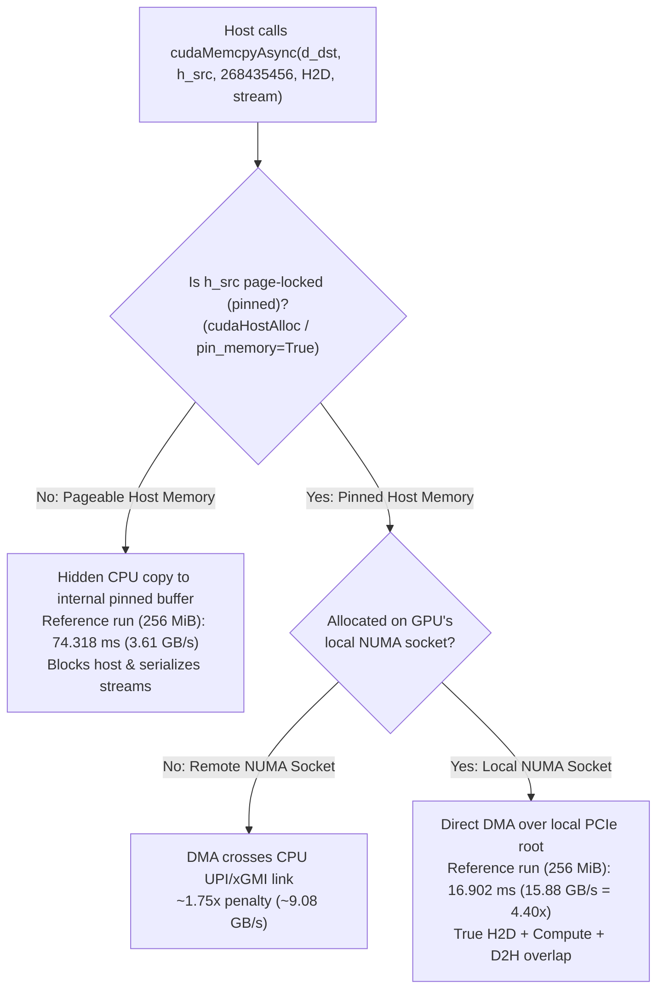

# 10.12 Streams, events, asynchronous copies and pinned memory

| | |
|---|---|
| Level | Intermediate |
| Priority tier | 2 |
| Lab venue | Nebius GPU |
| Part | Part 10: The GPU and CUDA |
| Sources used | `nvidia-devops` V3 Ch 7, Ch 8 & Lab 03; *AI Systems Performance Engineering* Ch 11 |
| Coverage file | `planning/coverage/chapters/10-12.md` |
| Claim ledger | `planning/ledgers/10-12.md` |

## Why this matters for AI infrastructure

In Chapter 10.11, we saw that moving data across the PCIe bus took roughly 13 times longer than executing the vector-add kernel itself. If a production inference server or training loop runs sequentially, it copies Batch 1 to the GPU, computes Batch 1, and copies Result 1 back to the CPU before touching Batch 2. Under that serial pattern, the hardware sits idle half the time. The GPU Streaming Multiprocessors wait while the PCIe bus transfers bytes, and the PCIe bus waits while the SMs run math.

Modern NVIDIA data-center GPUs such as A100, H100, and B200 include independent hardware DMA Copy Engines alongside the SM compute engines. One DMA engine handles Host-to-Device transfers and a second DMA engine handles Device-to-Host transfers. When properly configured, the GPU executes three-way overlap simultaneously. Stream 0 computes Batch $t$ on the SMs, Stream 1 copies Batch $t+1$ from host to device, and Stream 2 copies the finished output of Batch $t-1$ from device to host.

Yet in production, engineering teams routinely add CUDA Streams and `cudaMemcpyAsync` to their service, open an NVIDIA Nsight Systems timeline, and discover zero overlap. Four production incidents from our reference sources illustrate what breaks multi-stream concurrency in the real world.

| Incident Scenario | What Went Wrong in Production | Reference Trace or Timing Impact | Root Fix |
|---|---|---|---|
| **Fake-Overlap Pageable Memory Trap** (`nvidia-devops` V3 Ch 7 & Ch 8) | Team created multiple streams and called `cudaMemcpyAsync`, but allocated host buffers with standard pageable `malloc()` or `std::vector`. | In `nsys stats --report cuda_gpu_trace`, Stream 14 ran H2D (`1,200,000 ns`), kernel (`1,680,412 ns`), and D2H (`2,292,900 ns`, ending at `2,764,100 ns`), and Stream 15 started H2D at `2,764,300 ns` (`200 ns` gap, zero overlap). | Allocate transfer buffers in page-locked (pinned) host memory via `cudaHostAlloc`, `cudaMallocHost`, or PyTorch `pin_memory=True`. |
| **`256 MiB` Pageable vs Pinned + NUMA Penalty + `500 GB` OOM** (`nvidia-devops` V3 Ch 8) | Service either transferred `256 MiB` (`268,435,456` bytes) from pageable RAM, allocated pinned RAM on a remote NUMA socket, or pinned `500 GB` on a `512 GB` host. | Pageable H2D took `74.318 ms` (`3.61 GB/s`) vs local-NUMA pinned `16.902 ms` (`15.88 GB/s` = `4.40x` / `~4.4x` speedup); remote NUMA dropped by `~1.75x` to `9.08 GB/s`; pinning `500 GB` left `12 GB` for the OS and triggered the Linux OOM Killer. | Use a bounded ring pool of pinned buffers allocated on the GPU's local NUMA node (`numactl --cpunodebind` / `--membind`). |
| **`812.4 ms -> 1,934.7 ms` Sync Stall & Index `4,194,304` Corruption** (`nvidia-devops` V3 Lab 03) | In `overlap_pipeline.cu` (`67,108,864` floats = `1 << 26` across `16` chunks of `4,194,304` floats = `16 MiB` each, `512 MiB` total transfer), an engineer added `cudaDeviceSynchronize()` or reordered slot collection after refill. | Baseline 2-stream overlap took `812.4 ms` (`~630.2 MiB/s`); hot-loop `cudaDeviceSynchronize()` bloated runtime by `2.38x` (`~2.4x`) to `1,934.7 ms`; collecting after refilling corrupted output at index `4,194,304` (or intermittently at index `4,194,305` when event sync was omitted). | Enforce per-slot `cudaEventSynchronize(complete[slot])` -> Collect -> Refill -> H2D -> Kernel -> D2H -> `cudaEventRecord`. |
| **Recommendation Engine Cold-Start Spike** (`nvidia-devops` V3 Ch 8 Customer Scenario) | A recommendation microservice using Unified Memory saw its first request take `5 seconds` before settling to `100 ms` by request `10`. | Cold demand-paging faults migrated embeddings across PCIe on the first request. | Prefetch managed buffers with `cudaMemPrefetchAsync` during warmup or use explicit pinned-memory stream pipelines. |

This chapter explains how to build and verify genuinely overlapped CUDA pipelines. We cover CUDA Stream types and the legacy default stream barrier, and we show why DMA engines require pinned host memory and local NUMA placement. Next, we explain how CUDA Events and host callbacks coordinate multi-stream pipelines without stalling the CPU. Finally, we cover how stream-ordered memory allocation prevents multi-stream LLM scratch buffer stalls, and we walk through the complete double-buffered pipeline.

:::note About the numbers in this chapter
The trace values, bandwidths, runtimes, and failure indexes quoted from `nvidia-devops` Volume 03 Chapters 7 and 8 and Lab 03 are marked as illustrative in those source notes. They demonstrate the exact diagnostic shape of each failure mode and were not captured on live hardware for this handbook. The architectural rules for stream 0 barriers, pinned DMA transfers, stream-ordered allocators, and host callbacks come from *AI Systems Performance Engineering* Chapter 11.
:::

:::tip In one minute
- Distinguish the three stream modes carefully. The Legacy Default Stream acts as a global barrier across blocking streams. The Per-Thread Default Stream gives each host thread its own private default stream when enabled at compile time. Explicit non-blocking streams created with `cudaStreamNonBlocking` never synchronize implicitly with stream 0.
- Hardware DMA Copy Engines require fixed physical RAM addresses. Calling `cudaMemcpyAsync` on pageable memory forces a synchronous CPU copy into a hidden driver staging buffer and serializes streams.
- Three-way overlap requires at least two asynchronous copy engines, local-NUMA pinned host buffers, explicit non-blocking streams, stream-ordered allocations, and cross-stream CUDA Events.
- When reusing a double-buffered slot, always wait on the slot completion event first. Collect the prior output before refilling the slot with new input.
:::

---

## Prerequisites and outcomes

**Prerequisites:** Complete Chapter 10.11 on CUDA kernels, launch geometry, and explicit memory APIs. Also review Chapter 10.6 on PCIe DMA transfers and NUMA topology.

**Outcomes:** After completing this chapter, you will be able to accomplish four goals.
1. Contrast host asynchrony against device concurrency, explain why the legacy default stream serializes multi-stream pipelines, and configure explicit non-blocking streams.
2. Explain why hardware DMA Copy Engines require pinned host memory, quantify the throughput gap across pageable and remote-NUMA buffers, and size bounded pinned pools safely.
3. Coordinate multi-stream producer-consumer pipelines and LLM layerwise overlap using CUDA Events, host callbacks, and stream-ordered memory allocation.
4. Build, profile with Nsight Systems, and troubleshoot a double-buffered overlapped CUDA pipeline, diagnosing fake overlap, device synchronization stalls, and premature slot reuse.

---

## 1. CUDA Streams, Copy-Compute Overlap, and the Default-Stream Barrier

### 1.1 Host asynchrony vs device concurrency and 3-way hardware engine overlap

When an engineer sees `cudaMemcpyAsync` and a kernel launch return control to the CPU in a few microseconds, it is tempting to assume the transfer and kernel are running together on the GPU. Often they are not. A function returning quickly to the CPU only proves host asynchrony. Real pipeline speedup requires device concurrency across separate physical engines on the GPU die.

A CUDA Stream is a FIFO hardware-backed work queue. Commands enqueued into the same stream execute in strict issue order. Commands enqueued into different independent streams have no ordering constraint and can run concurrently on the hardware. Make sure you separate two distinct concepts from `nvidia-devops` Volume 03 Chapter 7 and *AI Systems Performance Engineering* Chapter 11.
- Host asynchrony means the C++ call returns control to the calling CPU thread before the GPU finishes the work.
- Device concurrency means two or more operations make simultaneous physical progress on the GPU's hardware engines during the same microsecond window.

How can a single GPU copy inputs, run a compute kernel, and copy outputs back at the exact same microsecond. Modern data-center GPUs provide separate physical hardware engines.
- The Compute Engine (Streaming Multiprocessors) can execute up to 128 concurrent kernel grids if their combined registers, shared memory, and warps fit within per-SM limits. If a single kernel already saturates 100% of SM compute or HBM bandwidth, running two kernels concurrently simply shares the saturated hardware at roughly 50% speed each.
- The DMA Copy Engines move data across PCIe or NVLink-C2C independently of the SMs. When a GPU has two or more asynchronous copy engines (`deviceProp.asyncEngineCount`), one engine handles Host-to-Device transfers and a second handles Device-to-Host transfers. That hardware separation enables three-way overlap across consecutive batches.

```mermaid
gantt
    title Sequential Execution (Stream 0) vs 3-Way Overlapped Pipeline (Non-Blocking Streams + Pinned RAM)
    dateFormat X
    axisFormat %s

    section 1. Sequential (Default Stream 0)
    H2D Batch 0       :a1, 0, 2
    Kernel Batch 0    :a2, 2, 5
    D2H Batch 0       :a3, 5, 7
    H2D Batch 1       :a4, 7, 9
    Kernel Batch 1    :a5, 9, 12
    D2H Batch 1       :a6, 12, 14

    section 2. Stream 0 (Batch 0)
    H2D Batch 0 (DMA H2D)    :b1, 0, 2
    Kernel Batch 0 (SMs)     :b2, 2, 5
    D2H Batch 0 (DMA D2H)    :b3, 5, 7

    section 3. Stream 1 (Batch 1)
    H2D Batch 1 (Overlaps Kernel 0) :c1, 2, 4
    Kernel Batch 1 (Overlaps D2H 0) :c2, 5, 8
    D2H Batch 1                     :c3, 8, 10

    section 4. Stream 2 (Batch 2)
    H2D Batch 2 (3-Way Overlap: H2D 2 + Kernel 1 + D2H 0) :d1, 5, 7
    Kernel Batch 2                                        :d2, 8, 11
    D2H Batch 2                                           :d3, 11, 13
```



Look at time window 5 to 7 in the Gantt chart above. All three physical engines work simultaneously. Stream 0 copies Batch 0 outputs back to the host on Copy Engine 1, Stream 1 executes Kernel Batch 1 on the SMs, and Stream 2 copies Batch 2 inputs to the device on Copy Engine 0.

### 1.2 Legacy Default Stream vs Per-Thread Default Stream vs Non-Blocking Streams

Even when a developer creates multiple streams, a single stray logging call, helper kernel, or library call launched without an explicit stream argument can serialize the entire GPU. That surprise happens because CUDA's legacy default stream was originally designed to make single-stream programs safe. It acts as a global barrier across all regular blocking streams.

In *AI Systems Performance Engineering* Chapter 11, Chris Fregly contrasts the three stream modes and explains how to prevent accidental stream serialization. Note that `CUDA_API_PER_THREAD_DEFAULT_STREAM` is a compile-time C preprocessor macro defined before including the CUDA runtime header, not a runtime environment variable.

| Stream Mode | Creation or Activation Syntax | Synchronization Behavior Across Streams | Production Guidance (*ASP* Ch 11, pp. 365–369) |
|---|---|---|---|
| **1. Legacy Default Stream (`0`, `cudaStreamLegacy`)** | Used whenever the stream argument is omitted (`kernel<<<grid, block>>>()`, `cudaMemcpy(...)`, or stream `0` / `NULL`). | Global barrier: any operation issued to legacy stream `0` waits for all prior work in every blocking stream to finish, and blocks all subsequent work in blocking streams until stream `0` finishes. | Never use in hot paths. Even one stray helper call or `cudaStreamSynchronize(0)` stalls every blocking stream on the GPU. |
| **2. Per-Thread Default Stream (`PTDS`, `cudaStreamPerThread`)** | Compile with `nvcc --default-stream per-thread` or place `#define CUDA_API_PER_THREAD_DEFAULT_STREAM 1` before `#include <cuda_runtime.h>`. | Gives each host CPU thread its own independent default stream (`Figure 11-4`) that does not block other host threads' default streams or explicit streams (unless mixed with `cudaStreamLegacy`). | Enable for multi-threaded C++ hosts where each CPU worker thread submits independent GPU work. |
| **3. Explicit Non-Blocking Stream (`cudaStreamNonBlocking`)** | `cudaStreamCreateWithFlags(&s, cudaStreamNonBlocking)` | Completely independent queue; never synchronizes implicitly with legacy stream `0`. Only waits when explicitly instructed via `cudaStreamWaitEvent()`. | Standard choice for AI pipelines. Pass explicit `cudaStreamNonBlocking` streams to all kernels, copies, `cuBLAS`, `cuDNN`, and high-priority `NCCL` streams. |

---

## 2. Pinned Host Memory, NUMA Locality, and Stream-Ordered LLM Scratch Pools

### 2.1 Why DMA requires Pinned Memory and the 256 MiB benchmark

If you create two non-blocking streams and call `cudaMemcpyAsync` on standard C++ vector or `malloc()` host buffers, Nsight Systems shows zero overlap. The second stream waits until the first stream's transfers and kernel completely finish. Worse, your Host-to-Device transfer bandwidth sits at less than a quarter of PCIe capacity. The culprit is standard OS pageable memory, which a GPU DMA engine cannot read directly.

When you allocate host memory with `malloc()`, `new`, or a default CPU tensor, the Linux kernel returns pageable virtual memory. The OS kernel can swap those 4 KB pages to NVMe disk or relocate their physical page frames at any instant. Therefore, the GPU's DMA Copy Engine cannot safely read from those physical addresses over PCIe. Whenever you pass a pageable host pointer to `cudaMemcpyAsync`, the CUDA driver must first perform a synchronous CPU copy into a hidden internal page-locked staging buffer before DMA can start. That hidden copy blocks the host CPU thread and serializes your streams.



The table below summarizes the 256 MiB benchmark and the Nsight Systems serialized trace from `nvidia-devops` Volume 03 Chapters 7 and 8.

| Benchmark / Trace Case | Host Buffer & NUMA Configuration | Reference Duration & Effective Bandwidth | Concurrency & Host Behavior |
| --- | --- | --- | --- |
| **Pageable H2D Transfer** (`V3 Ch 8`, `268,435,456` bytes = `256 MiB`) | Standard pageable `malloc()` / `std::vector` (`--mode=pageable`) | `74.318 ms` -> `3.61 GB/s` effective bandwidth | Host CPU blocks during hidden staging copy; streams serialize. |
| **Local-NUMA Pinned H2D Transfer** (`V3 Ch 8`, `256 MiB`) | `cudaHostAlloc` / `cudaMallocHost` bound to GPU's local NUMA node (`--mode=pinned`) | `16.902 ms` -> `15.88 GB/s` (`4.40x`, or `~4.4x` speedup over pageable) | DMA engine reads host RAM directly; `cudaMemcpyAsync` returns immediately and overlaps compute. |
| **Remote-NUMA Pinned H2D Transfer** (`V3 Ch 8`, `256 MiB`) | Pinned buffer allocated on NUMA 0 feeding a GPU wired to NUMA 1 | `~1.75x` penalty -> drops from `15.88 GB/s` to `9.08 GB/s` | DMA traffic traverses the inter-socket UPI or xGMI link before reaching the GPU's PCIe root complex. |
| **Serialized Nsight Systems Trace** (`V3 Ch 7`, `nsys stats --report cuda_gpu_trace`) | Stream 14 (`H2D` `1,200,000 ns` dur `480,000 ns`, `transform` `1,680,412 ns` dur `612,304 ns`, `D2H` `2,292,900 ns` dur `471,200 ns`) vs Stream 15 | Stream 14 D2H ends at `2,764,100 ns`; Stream 15 H2D starts at `2,764,300 ns` (`dur 478,900 ns`, `transform` at `3,243,600 ns` `dur 609,100 ns`) | `200 ns` idle gap between Stream 14 end and Stream 15 start proves `FAKE_SERIALIZED_OVERLAP` (true overlap starts Stream 15 H2D at e.g. `1,700,000 ns` during Stream 14's `[1,680,412 .. 2,292,716 ns]` kernel window). |

### 2.2 Four host-memory modes and the Linux OOM Killer rule

Once engineers see a 4.40x transfer speedup from pinned memory, someone inevitably tries to pin the entire training dataset in host RAM. On a 512 GB GPU server, pinning 500 GB of host RAM leaves only 12 GB of swappable memory for the Linux kernel, page cache, `kubelet`, and container daemons. Because the OS kernel is forbidden from swapping page-locked memory to disk, memory pressure immediately wakes the Linux OOM Killer and crashes the node.

CUDA offers four host-memory mechanisms in `nvidia-devops` Volume 03 Chapter 8, and production systems must pair them with a bounded pool lifecycle.
- Dedicated pinned allocation via `cudaHostAlloc` or `cudaMallocHost` allocates fresh page-locked host RAM that must be freed with `cudaFreeHost`. In PyTorch, setting `pin_memory=True` on a data loader uses this path automatically for batch loading.
- Host memory registration via `cudaHostRegister` page-locks an existing `malloc()` or memory-mapped buffer in place and releases the lock with `cudaHostUnregister`.
- Mapped pinned zero-copy memory via `cudaHostAllocMapped` maps pinned host RAM into the GPU address space so a kernel can read or write host memory directly over PCIe without calling `cudaMemcpy`. Only use mapped memory for tiny, read-once status flags, because repeated kernel reads pay PCIe latency on every access.
- Bounded pinned ring pools prevent the 500 GB on 512 GB OOM trap by pre-allocating a small fixed number of slot buffers bound to the GPU's local NUMA node. Each slot cycles through a strict state machine from Free to Filling, Submitted, InFlight, Complete, and back to Free.

### 2.3 Stream-ordered allocations for LLM scratch buffers

In a multi-stream LLM training or inference server, two streams can have pinned host memory and non-blocking stream flags. Yet they can still stall each other whenever sequence lengths change from batch to batch. When Stream 1 calls legacy `cudaMalloc` or `cudaFree` to resize a temporary workspace while Stream 0 is running an attention kernel, the synchronous allocation forces a device-wide barrier across every stream on the GPU.

In *AI Systems Performance Engineering* Chapter 11, Chris Fregly details the four LLM scenarios where dynamic allocations occur inside active streams.
- Per-batch attention scratch buffers allocate a 16 MB workspace for raw attention scores before softmax and free it immediately after the layer completes.
- Variable-length input sequences occur when Batch $N$ has 512 tokens and Batch $N+1$ jumps to 1,024 tokens, requiring larger intermediate activation buffers on the fly.
- Autoregressive decoding causes KV-cache and activation buffers to grow as new tokens are generated.
- Layerwise model pipelining runs Transformer layers 0 through 5 for Batch $t+1$ on Stream 0 while Stream 1 executes layers 6 through 11 for Batch $t$.

Replacing blocking allocations with stream-ordered `cudaMallocAsync` and `cudaFreeAsync` keeps allocations local to the requesting stream so other streams never stall. Those calls are backed by the device memory pool configured via `cudaMemPoolSetAttribute`. In PyTorch, you can switch the caching allocator to CUDA's native stream-ordered allocator with a single environment variable.

```bash
export PYTORCH_ALLOC_CONF=backend:cudaMallocAsync
```

---

## 3. CUDA Events, Host Callbacks, and Double-Buffered Ownership

### 3.1 Cross-stream dependencies with CUDA Events and host callbacks

Suppose Stream B needs data produced by Stream A, or an `NCCL` communication stream must wait until the backward-pass compute stream finishes calculating a layer's gradients. Calling `cudaDeviceSynchronize()` or `cudaStreamSynchronize()` on the host is the wrong tool for that handoff. Host-side synchronization blocks the CPU thread from queueing future work and can stall unrelated streams. Instead, the dependency should be enforced directly on the GPU hardware scheduler.

You coordinate two streams without blocking the host CPU by recording a CUDA Event marker in the producer stream with `cudaEventRecord`. You then instruct the consumer stream to wait on that event via `cudaStreamWaitEvent`.

```cpp
// 1. Producer stream records an event marker when its work finishes
CUDA_CHECK(cudaEventRecord(dataReadyEvent, producerStream));

// 2. Consumer stream waits on the GPU hardware for dataReadyEvent (Host CPU does NOT block)
CUDA_CHECK(cudaStreamWaitEvent(consumerStream, dataReadyEvent, 0));
consumerKernel<<<grid, block, 0, consumerStream>>>(d_buf);
```

Three operational rules from *AI Systems Performance Engineering* Chapter 11 and `nvidia-devops` Volume 03 Lab 03 govern events, callbacks, and two-level pipelining.
- Disable timing overhead on pure dependency events. When an event is used only for cross-stream waits or completion barriers and never passed to `cudaEventElapsedTime`, create it with `cudaEventDisableTiming` so the driver skips recording hardware timestamp counters.
- Never call CUDA device APIs inside `cudaLaunchHostFunc`. When you enqueue a CPU callback into a stream, the callback runs on an internal CUDA runtime thread while the stream waits for the callback to return. Calling any CUDA device API such as `cudaMemcpy` or `cudaMalloc` inside that callback can trigger a permanent circular deadlock.
- Combine intra-kernel and inter-kernel pipelining. High-performance kernels combine intra-kernel warp specialization across loader, compute, and storer warps in double-buffered Shared Memory with inter-kernel CUDA Stream pipelining across consecutive batches.

### 3.2 Double-buffered pipeline ownership in `overlap_pipeline.cu`

When a team builds a double-buffered pipeline with two streams sharing two pinned slot buffers, two bugs show up in code reviews. First, an engineer nervous about race conditions drops a `cudaDeviceSynchronize()` call inside the chunk loop, destroying all overlap and more than doubling the runtime. Second, an engineer reorders the host buffer copy lines or forgets to synchronize on the slot completion event before reusing a slot. That mistake causes validation to fail deterministically at the start of the second chunk or intermittently on subsequent elements.

Let us trace the exact architecture and numbers of `overlap_pipeline.cu` from `nvidia-devops` Volume 03 Lab 03.

```text
Double-Buffered Pipeline Geometry & Reference Runs (nvidia-devops V3 Ch 7 & Lab 03):
1. Workload & Slot Geometry:
   - totalElements = 1 << 26 = 67,108,864 floats (256 MiB input + 256 MiB output = 512 MiB total H2D + D2H transfer).
   - chunkElements = 1 << 22 = 4,194,304 floats (16 MiB per chunk across 16 chunks; streamCount = 2 slots).
   - Non-power-of-two boundary verification test: 10,000,003 elements with 1,048,576 chunkElements (10 chunks).
   - Intra-kernel + inter-kernel SMEM sizing (ASP Ch 11 p. 372):
     2 stages * 3 buffers * 1,024 floats * 4 B = 24,576 B (24 KB << 227 KB usable SMEM per block on Blackwell).

2. Mandatory 7-Step Per-Slot Ownership Order (for slot = chunk % streamCount):
   Step 1 (Wait)    : cudaEventSynchronize(complete[slot]) ensures chunk (chunk - 2) finished its D2H copy.
   Step 2 (Collect) : Copy completed output from hostOutput[slot] into fullOutput BEFORE reusing the slot.
   Step 3 (Refill)  : Copy new input for chunk from fullInput into hostInput[slot].
   Step 4 (H2D)     : cudaMemcpyAsync(deviceInput[slot], hostInput[slot], bytes, H2D, streams[slot]).
   Step 5 (Kernel)  : transform<<<blocks, threads, 0, streams[slot]>>>(deviceInput[slot], deviceOutput[slot], count).
   Step 6 (D2H)     : cudaMemcpyAsync(hostOutput[slot], deviceOutput[slot], bytes, D2H, streams[slot]).
   Step 7 (Record)  : cudaEventRecord(complete[slot], streams[slot]), plus final drain of in-flight slots after loop.

3. Reference Timing & Corruption Signatures:
   - Baseline 2-stream overlapped run: 812.4 ms (~630.2 MiB/s, or ~630 MiB/s useful end-to-end throughput).
   - Lab 03 Failure A (hot-loop cudaDeviceSynchronize() after kernel): 1,934.7 ms (2.38x / ~2.4x slowdown).
   - Lab 03 Failure B (moving Collect after Refill): deterministic validation failure at index 4,194,304 (chunkElements).
   - V3 Ch 7 Race (omitting cudaEventSynchronize before slot reuse across 3 runs):
     Run 1: 812.4 ms (PASS); Run 2: FAIL at index 4,194,305 (chunkElements + 1); Run 3: 809.1 ms (PASS).
```

---

## 4. Commands and Code Patterns That Matter

All code and profiling commands below are drawn from `nvidia-devops` Volume 03 Lab 03 and *AI Systems Performance Engineering* Chapter 11. Because no GPU is attached during this build, compilation and profiling commands are marked as untested here.

### 4.1 Double-buffered multi-stream pipeline loop (`overlap_pipeline.cu` core pattern)

The core double-buffered slot loop below enforces the seven-step ownership sequence across chunks.

```cpp
// Core double-buffered slot loop from nvidia-devops Volume 03 Lab 03 (Step 1)
for (std::size_t chunk = 0; chunk < chunks; ++chunk) {
    const int slot = static_cast<int>(chunk % streamCount);

    // 1. Wait for previous chunk (chunk - streamCount) on this slot & collect its output FIRST
    if (chunk >= static_cast<std::size_t>(streamCount)) {
        const std::size_t completedChunk = chunk - streamCount;
        const std::size_t completedOffset = completedChunk * chunkElements;
        const std::size_t completedCount =
            std::min(chunkElements, totalElements - completedOffset);

        CUDA_CHECK(cudaEventSynchronize(complete[slot]));
        std::copy_n(hostOutput[slot], completedCount, fullOutput.data() + completedOffset);
    } else {
        CUDA_CHECK(cudaEventSynchronize(complete[slot]));
    }

    // 2. Refill slot input buffer and enqueue H2D -> Kernel -> D2H -> Event on streams[slot]
    const std::size_t offset = chunk * chunkElements;
    const std::size_t count = std::min(chunkElements, totalElements - offset);
    const std::size_t bytes = count * sizeof(float);

    std::copy_n(fullInput.data() + offset, count, hostInput[slot]);
    CUDA_CHECK(cudaMemcpyAsync(deviceInput[slot], hostInput[slot], bytes,
                               cudaMemcpyHostToDevice, streams[slot]));

    const int threads = 256;
    const int blocks = static_cast<int>((count + threads - 1) / threads);
    transform<<<blocks, threads, 0, streams[slot]>>>(
        deviceInput[slot], deviceOutput[slot], count);
    CUDA_CHECK(cudaGetLastError());

    CUDA_CHECK(cudaMemcpyAsync(hostOutput[slot], deviceOutput[slot], bytes,
                               cudaMemcpyDeviceToHost, streams[slot]));
    CUDA_CHECK(cudaEventRecord(complete[slot], streams[slot]));
}
```

### 4.2 Compile with Per-Thread Default Stream, enable `cudaMallocAsync`, and verify overlap with `nsys` (untested here)

```bash
# 1. Compile overlap_pipeline.cu (optionally enabling Per-Thread Default Stream) (untested here)
nvcc -O3 -std=c++17 --default-stream per-thread overlap_pipeline.cu -o overlap_pipeline

# 2. Run power-of-two (67,108,864 / 4,194,304) and non-power-of-two (10,000,003 / 1,048,576) shapes (untested here)
./overlap_pipeline $((1<<26)) $((1<<22))
./overlap_pipeline 10000003 1048576

# 3. Profile stream timeline in Nsight Systems and inspect Start (ns) + Duration (ns) per stream (untested here)
nsys profile --trace=cuda,nvtx,osrt --sample=none --output=overlap-report ./overlap_pipeline
nsys stats --report cuda_gpu_trace overlap-report.nsys-rep | head -n 15

# 4. Enable CUDA's stream-ordered allocator backend in PyTorch (ASP Ch 11 p. 361) (untested here)
export PYTORCH_ALLOC_CONF=backend:cudaMallocAsync
```

---

## 5. How It Fails: Six Production Stream, Event, and Pinned-Memory Failure Modes

| # | Failure Mode | Production Symptom | Root Cause & Diagnostic Evidence | Fix |
|---|---|---|---|---|
| **1** | **`cudaMemcpyAsync` on pageable host memory (Fake Overlap)** | Multiple streams call `cudaMemcpyAsync`, yet `nsys stats --report cuda_gpu_trace` shows Stream 15 starting at `2,764,300 ns` (`200 ns` after Stream 14 finishes at `2,764,100 ns`), and `256 MiB` H2D runs at `3.61 GB/s` (`74.318 ms`). | Host buffers were allocated with pageable `malloc()` or `std::vector` (`V3 Ch 7` & `Ch 8`); the driver stages pageable data through a hidden pinned buffer on the CPU, blocking the host and serializing transfers. | Allocate transfer buffers with `cudaHostAlloc` or `cudaMallocHost` (`16.902 ms` = `15.88 GB/s`, `4.40x` faster) or set `pin_memory=True` in PyTorch `DataLoader`. |
| **2** | **Accidental work or sync on Legacy Default Stream `0`** | Multi-stream pipeline suddenly serializes whenever a logging helper, third-party library, or `cudaMemcpy` runs without an explicit stream argument. | Under `cudaStreamLegacy`, any command enqueued into Stream 0 acts as a global barrier that waits for all blocking streams and blocks them until Stream 0 finishes (*ASP* Ch 11, pp. 365–369). | Create worker streams with `cudaStreamCreateWithFlags(&s, cudaStreamNonBlocking)`, enable Per-Thread Default Streams (`--default-stream per-thread`), and pass explicit streams everywhere. |
| **3** | **Hot-loop `cudaDeviceSynchronize()` or synchronous `cudaMalloc`** | Double-buffered pipeline runtime jumps by `2.38x` (`~2.4x`) from `812.4 ms` to `1,934.7 ms`, or multi-stream LLM attention scratch allocations stall active kernels on other streams. | `cudaDeviceSynchronize()` (Lab 03 Failure A) or synchronous `cudaMalloc` and `cudaFree` (*ASP* Ch 11, pp. 361–365) inside the batch loop forces a global device-wide wait across all streams. | Replace hot-loop `cudaDeviceSynchronize()` with per-slot `cudaEventSynchronize(complete[slot])` or `cudaStreamWaitEvent()`, and replace `cudaMalloc` with `cudaMallocAsync` (`backend:cudaMallocAsync`). |
| **4** | **Premature buffer slot reuse (index `4,194,304` or `4,194,305` corruption)** | Multi-stream pipeline fails validation deterministically at index `4,194,304` (`chunkElements`) or intermittently (such as 1 of 3 runs) at index `4,194,305`. | Either `Collect` was placed after `Refill` (Lab 03 Failure B), or the host overwrote the slot buffer before `cudaEventSynchronize(complete[slot])` confirmed the prior chunk's D2H copy completed (`V3 Ch 7` line 336). | Enforce the strict per-slot order: `cudaEventSynchronize(complete[slot])` -> Collect prior output -> Refill new input -> H2D -> Kernel -> D2H -> `cudaEventRecord(complete[slot])`. |
| **5** | **Pinned memory on remote NUMA node (`1.75x` penalty) or unbounded pinning (`500 GB` OOM)** | Identical GPUs show `1.75x` slower H2D bandwidth (`9.08 GB/s` vs `15.88 GB/s`) depending on which worker thread serves them, or the Linux OOM Killer terminates host daemons under load. | Worker threads allocated pinned pools on NUMA 0 for a GPU on NUMA 1 (`V3 Ch 8` line 332); or unbounded pinned allocations locked `500 GB` of a `512 GB` host, leaving `12 GB` for the OS (`V3 Ch 8` §1). | Bind worker threads to the GPU's local NUMA node (`numactl --cpunodebind` / `--membind`) before allocating a bounded pinned ring pool. |
| **6** | **Calling CUDA device APIs inside a `cudaLaunchHostFunc` callback** | Application deadlocks permanently inside the CUDA runtime while waiting for a stream to finish. | A host callback registered via `cudaLaunchHostFunc` called a CUDA device API such as `cudaMemcpy` or `cudaMalloc` (*ASP* Ch 11, p. 370), creating a circular wait on the runtime callback thread. | Restrict `cudaLaunchHostFunc` callbacks strictly to host-side CPU logic such as marking a host pool slot free or signalling a CPU condition variable. |

---

## 6. Hands-On Lab: Verify Pageable vs Pinned DMA, Nsight Trace Overlap, and the Double-Buffered Pipeline

**Venue:** Any Linux machine or Nebius GPU VM with Python 3.10+. This lab runs deterministically using standard library Python. Full C++ source and profiler commands are provided in Section 4 and marked as untested here.

Run `code/part10/streams_events_pinned_lab.py`.

```bash
python3 code/part10/streams_events_pinned_lab.py
```

The lab prints 25 passing assertions with 0 failures.

```text
=== Chapter 10.12 Lab: Streams, Events, Asynchronous Copies & Pinned Memory ===
  [PASS] V3 Ch8: 268,435,456 B (256 MiB) pageable H2D takes 74.318 ms (3.61 GB/s) vs pinned 16.902 ms (15.88 GB/s = 4.40x speedup)
  [PASS] V3 Ch8: Remote NUMA pinned transfer incurs ~1.75x penalty (drops from 15.88 GB/s to 9.08 GB/s)
  [PASS] V3 Ch8 §1: Pinning 500 GB on a 512 GB host leaves only 12 GB pageable RAM and triggers Linux OOM Killer risk
  [PASS] V3 Ch7 §Production Troubleshooting: Stream 14 ends at 2,764,100 ns before Stream 15 starts at 2,764,300 ns (200 ns gap -> FAKE_SERIALIZED_OVERLAP)
  [PASS] V3 Ch7: Stream 15 H2D starting at 1,700,000 ns during Stream 14 kernel [1,680,412..2,292,716 ns] is REAL_OVERLAP
  [PASS] V3 Lab 03 Step 1 & 3: 67,108,864 elements (1<<26) in 4,194,304-element (16 MiB) chunks = 16 chunks, 512 MiB total transfer
  [PASS] V3 Lab 03 Step 3 & Failure A: 812.4 ms baseline (~630.2 MiB/s) vs 1,934.7 ms with hot-loop cudaDeviceSynchronize (2.38x ~ 2.4x slowdown)
  [PASS] V3 Lab 03 Failure B: Moving Collect after Refill corrupts slot output at index 4,194,304 (chunkElements)
  [PASS] V3 Ch7 line 336: Omitting cudaEventSynchronize before slot reuse corrupts output at index 4,194,305
  [PASS] V3 Lab 03 §9: Non-power-of-two 10,000,003 elements with 1,048,576 chunk size requires 10 chunks and passes validation
  [PASS] ASP Ch11 Fig 11-2: Pinned host memory + cudaStreamNonBlocking + 2 async copy engines achieves 3-way overlap (H2D + Compute + D2H)
  [PASS] Single async copy engine supports 2-way overlap
  [PASS] ASP Ch11 & V3 Ch7 Customer Scenario: Flags pageable host memory breaking cudaMemcpyAsync overlap
  [PASS] ASP Ch11 pp.366-369: Flags legacy default stream 0 acting as a global barrier across streams
  [PASS] ASP Ch11: Flags streams created without cudaStreamNonBlocking / PTDS
  [PASS] ASP Ch11 pp.361-365: Flags synchronous cudaMalloc in multi-stream loop (use cudaMallocAsync / backend:cudaMallocAsync)
  [PASS] V3 Lab 03 Failure A: Flags cudaDeviceSynchronize() inside hot loop
  [PASS] ASP Ch11 p.370: Flags calling CUDA device APIs inside a cudaLaunchHostFunc host callback (deadlock risk)
  [PASS] Rejects non-positive transfer_bytes
  [PASS] Rejects pinned_pool_gb > host_total_ram_gb
  [PASS] Rejects negative timestamps in Nsight trace verifier
  [PASS] Rejects non-positive total_elements in pipeline simulator
  [PASS] Rejects negative async_engine_count
  [PASS] 1<<26 elements == 67,108,864 and 1<<22 chunkElements == 4,194,304
  [PASS] ASP Ch11 p.372: 2 stages * 3 buffers * 1024 floats * 4 B == 24,576 B (24 KB << 227 KB usable SMEM)

Summary: 25 passed, 0 failed (total 25)
```

---

## Exercises

1. **Pageable vs Pinned vs Remote-NUMA transfer math:** Using the Volume 03 Chapter 8 parameters in the table below, calculate the effective bandwidth in GB/s for pageable and local-NUMA pinned transfers. Then find the speedup factor of pinned over pageable, and the effective bandwidth when the pinned buffer sits on a remote NUMA socket.
2. **Proving fake vs real stream overlap from an Nsight Systems trace:** Using the trace timestamps in the table below, calculate the exact timestamp when Stream 14's Device-to-Host copy finishes. Then find the nanosecond gap before Stream 15 starts, and list the three code bugs that cause this serialization.
3. **Double-buffered pipeline sizing and synchronization slowdown:** Using the `overlap_pipeline.cu` parameters in the table below, calculate the number of chunks, the MiB per slot buffer, and the total MiB transferred across both directions. Then compute the effective MiB/s throughput of the baseline run and the slowdown ratio caused by inserting `cudaDeviceSynchronize()` in the loop.
4. **Diagnosing slot corruption at index `4,194,304` and `4,194,305`:** Explain why moving collection after refill in `overlap_pipeline.cu` causes validation to fail deterministically at the start of the second chunk. Contrast that with why omitting event synchronization causes intermittent failures on the next element.
5. **Legacy Stream 0 vs Non-Blocking Streams and LLM scratch pools:** An LLM serving pipeline runs early layers on one stream and later layers on a second stream, allocating a 16 MB attention scratch buffer whenever sequence length doubles. Explain why calling `cudaMalloc` or issuing work on legacy stream 0 stalls both streams. Write the stream creation, stream-ordered allocation, cross-stream event wait, and PyTorch environment variable that prevent global stalls.
6. **Bounded pinned pool sizing vs the Linux OOM Killer:** Using the server RAM parameters in the table below, calculate how much pageable RAM remains if a developer pins 500 GB on a 512 GB host. Explain what the OS does under memory pressure, and calculate the total host RAM locked by a bounded 2-slot double-buffered pool across 8 GPUs.

| Exercise | Input Parameters & Reference Figures |
|---|---|
| **Exercise 1** | Transfer size: `268,435,456` bytes (`256 MiB`); pageable H2D: `74.318 ms` (`3.61 GB/s`); local-NUMA pinned H2D: `16.902 ms` (`15.88 GB/s`); remote-NUMA penalty: `1.75x` (`9.08 GB/s`). |
| **Exercise 2** | `Stream 14`: H2D start `1,200,000 ns` dur `480,000 ns`, `transform` start `1,680,412 ns` dur `612,304 ns`, D2H start `2,292,900 ns` dur `471,200 ns`; `Stream 15`: H2D start `2,764,300 ns`. |
| **Exercise 3** | `totalElements = 1 << 26 = 67,108,864` floats; `chunkElements = 1 << 22 = 4,194,304` floats; `streamCount = 2`; baseline: `812.4 ms`; with `cudaDeviceSynchronize()`: `1,934.7 ms`. |
| **Exercise 4** | Deterministic corruption at index `4,194,304` (`chunkElements`) under `Collect`-after-`Refill` vs intermittent corruption at index `4,194,305` (`chunkElements + 1`) across runs (`812.4 ms`, fail, `809.1 ms`). |
| **Exercise 5** | Layerwise pipeline: layers `0–5` (`stream0`) and `6–11` (`stream1`); `16 MB` scratch buffer on `512 -> 1,024` token jump; `PYTORCH_ALLOC_CONF=backend:cudaMallocAsync`. |
| **Exercise 6** | Host RAM: `512 GB` total, `500 GB` pinned (`12 GB` pageable left); bounded alternative: `2` slots per GPU (`16 MiB` input + `16 MiB` output per slot) across `8` GPUs (`256 MiB` or `512 MiB` total). |

---

## Checkpoint questions (20)

<details>
<summary>`&lt;strong>`1. What is the difference between host asynchrony and device concurrency in CUDA?`&lt;/strong>`</summary>

- Host asynchrony means a CUDA API call returns control to the calling CPU thread before the GPU finishes executing the operation.
- Device concurrency means two or more operations physically execute at the same time on the GPU's independent DMA Copy Engines and SM Compute Engines. Host asynchrony alone does not guarantee device concurrency.
</details>

<details>
<summary>`&lt;strong>`2. What hardware engines allow a GPU to execute 3-way overlap, and how do you query how many asynchronous copy engines a GPU has?`&lt;/strong>`</summary>

The GPU uses its Streaming Multiprocessors for kernel computation alongside two independent hardware DMA Copy Engines, one for Host-to-Device and one for Device-to-Host. You query the copy engine count in C++ via `cudaDeviceProp::asyncEngineCount`.
</details>

<details>
<summary>`&lt;strong>`3. Contrast the synchronization rules of the Legacy Default Stream, Per-Thread Default Streams, and explicit `cudaStreamNonBlocking` streams.`&lt;/strong>`</summary>

- The Legacy Default Stream acts as a global barrier. Any operation issued to stream 0 waits for all prior work in all blocking streams and blocks them until stream 0 completes.
- The Per-Thread Default Stream is enabled via `nvcc --default-stream per-thread` or the compile-time macro `CUDA_API_PER_THREAD_DEFAULT_STREAM`. It gives each host CPU thread an independent default stream that does not block other threads' streams.
- An explicit non-blocking stream created with `cudaStreamNonBlocking` never synchronizes implicitly with legacy stream 0 and only waits when directed by `cudaStreamWaitEvent`.
</details>

<details>
<summary>`&lt;strong>`4. Why does calling `cudaMemcpyAsync` on standard `malloc()` or `std::vector` host memory fail to overlap with compute kernels in other streams?`&lt;/strong>`</summary>

Standard host memory is pageable, meaning the Linux kernel can swap or remap its physical page frames at any time. Because a GPU DMA engine requires fixed physical addresses, the CUDA driver must first copy the pageable buffer on the CPU into a hidden internal pinned staging buffer before DMA can start. That CPU copy blocks the host thread and serializes the streams.
</details>

<details>
<summary>`&lt;strong>`5. In the Volume 03 Chapter 8 benchmark (`268,435,456` bytes), how fast was pageable H2D versus local-NUMA pinned H2D, and what happened when the pinned buffer was allocated on the remote NUMA node?`&lt;/strong>`</summary>

```text
- Pageable H2D (256 MiB = 268,435,456 bytes): 74.318 ms (3.61 GB/s effective).
- Local-NUMA Pinned H2D: 16.902 ms (15.88 GB/s effective, a 4.40x / ~4.4x speedup).
- Remote-NUMA Pinned H2D: Crossing the CPU inter-socket link (UPI/xGMI) before reaching the GPU's PCIe root
  incurred a ~1.75x throughput penalty (dropping from 15.88 GB/s to ~9.08 GB/s).
```
</details>

<details>
<summary>`&lt;strong>`6. Compare `cudaHostAlloc` / `cudaMallocHost`, `cudaHostRegister`, and mapped zero-copy host memory (`cudaHostAllocMapped`).`&lt;/strong>`</summary>

- `cudaHostAlloc` and `cudaMallocHost` allocate a new page-locked host buffer directly and release it with `cudaFreeHost`.
- `cudaHostRegister` page-locks an existing host buffer in place and releases the lock with `cudaHostUnregister`.
- Mapped zero-copy memory (`cudaHostAllocMapped`) maps pinned host memory into device address space so a kernel can read or write it over PCIe without an explicit copy. It is useful only for small read-once flags because repeated accesses pay PCIe latency every time.
</details>

<details>
<summary>`&lt;strong>`7. Why is pinning `500 GB` of RAM on a `512 GB` Linux GPU server dangerous, and how should production services manage pinned memory instead?`&lt;/strong>`</summary>

Pinned memory is locked in physical RAM and cannot be swapped to disk by the Linux kernel. Locking 500 GB on a 512 GB host leaves only 12 GB of pageable RAM for the OS kernel, page cache, `kubelet`, and system daemons, triggering the Linux OOM Killer. Production services allocate a bounded pool of reusable pinned slot buffers aligned with their stream count.
</details>

<details>
<summary>`&lt;strong>`8. How do you verify from `nsys stats --report cuda_gpu_trace` whether two streams actually overlapped on the GPU?`&lt;/strong>`</summary>

```text
- Serialized trace (V3 Ch 7):
  Stream 14 D2H starts at 2,292,900 ns with duration 471,200 ns (ending at 2,764,100 ns).
  Stream 15 H2D starts at 2,764,300 ns (a 200 ns gap -> FAKE_SERIALIZED_OVERLAP).
- True overlap:
  Stream 15 H2D starts at e.g. 1,700,000 ns during Stream 14's kernel window [1,680,412 .. 2,292,716 ns].
```
</details>

<details>
<summary>`&lt;strong>`9. Why should you use `cudaEventRecord` + `cudaStreamWaitEvent` instead of `cudaStreamSynchronize` or `cudaDeviceSynchronize` when Stream B depends on data produced by Stream A?`&lt;/strong>`</summary>

Calling `cudaDeviceSynchronize` blocks the host CPU and stalls all streams on the GPU. Calling `cudaStreamSynchronize` blocks the host CPU thread until the target stream drains. Recording an event with `cudaEventRecord` and calling `cudaStreamWaitEvent` enforces the dependency on the GPU hardware scheduler without blocking the host CPU thread or stalling unrelated streams.
</details>

<details>
<summary>`&lt;strong>`10. Why does `overlap_pipeline.cu` pass `cudaEventDisableTiming` when creating its per-slot completion events?`&lt;/strong>`</summary>

When a CUDA Event is used purely as a completion or dependency barrier and never passed to `cudaEventElapsedTime`, passing `cudaEventDisableTiming` instructs the driver not to record hardware timestamp counters. That flag lowers event-recording overhead inside hot loops.
</details>

<details>
<summary>`&lt;strong>`11. What is `cudaLaunchHostFunc`, and why must a callback registered with `cudaLaunchHostFunc` never call `cudaMemcpy` or any other CUDA device API?`&lt;/strong>`</summary>

The `cudaLaunchHostFunc` API enqueues a CPU callback function into a CUDA Stream. That function executes on a runtime-managed host thread as soon as all preceding work in that stream completes. Calling any CUDA device API inside that callback can cause a circular deadlock. The stream is blocked waiting for the callback to finish while the callback waits on the CUDA runtime.
</details>

<details>
<summary>`&lt;strong>`12. Why do variable-length LLM batches and growing KV caches require `cudaMallocAsync` and `cudaFreeAsync` (`PYTORCH_ALLOC_CONF=backend:cudaMallocAsync`) in multi-stream pipelines?`&lt;/strong>`</summary>

When sequence length jumps from 512 to 1,024 tokens, the attention layer must allocate a larger temporary scratch buffer. Calling legacy synchronous `cudaMalloc` or `cudaFree` forces a device-wide synchronization that stalls all other active compute and DMA streams. The stream-ordered calls `cudaMallocAsync` and `cudaFreeAsync` enqueue the allocation inside the requesting stream only. The driver services the request from the per-device memory pool without stalling other streams.
</details>

<details>
<summary>`&lt;strong>`13. In `overlap_pipeline.cu`, state the exact problem size, chunk size, chunk count, per-slot buffer size, and total bytes transferred across H2D + D2H.`&lt;/strong>`</summary>

```text
- totalElements : 1 << 26 = 67,108,864 floats (256 MiB).
- chunkElements : 1 << 22 = 4,194,304 floats (16 MiB per slot buffer).
- Chunks        : 67,108,864 / 4,194,304 = 16 chunks.
- Total transfer: 256 MiB H2D + 256 MiB D2H = 512 MiB.
```
</details>

<details>
<summary>`&lt;strong>`14. In Lab 03, what was the baseline runtime of `overlap_pipeline` across 2 streams, and what happened when `cudaDeviceSynchronize()` was added after the kernel launch?`&lt;/strong>`</summary>

```text
- Baseline 2-stream overlapped runtime: 812.4 ms (~630.2 MiB/s, or ~630 MiB/s useful end-to-end throughput).
- Failure A (hot-loop cudaDeviceSynchronize() after kernel launch): 1,934.7 ms (a 2.38x / ~2.4x slowdown).
```
</details>

<details>
<summary>`&lt;strong>`15. Walk through the exact 7-step per-slot ownership sequence inside `overlap_pipeline.cu` when reusing `slot = chunk % streamCount`.`&lt;/strong>`</summary>

```text
1. Wait    : cudaEventSynchronize(complete[slot]) to ensure chunk (chunk - 2) finished its D2H copy.
2. Collect : Copy hostOutput[slot] into fullOutput at chunk (chunk - 2)'s offset.
3. Refill  : Copy chunk's input from fullInput into hostInput[slot].
4. H2D     : cudaMemcpyAsync(deviceInput[slot], hostInput[slot], ..., streams[slot]).
5. Kernel  : transform<<<blocks, threads, 0, streams[slot]>>>(...).
6. D2H     : cudaMemcpyAsync(hostOutput[slot], deviceOutput[slot], ..., streams[slot]).
7. Record  : cudaEventRecord(complete[slot], streams[slot]).
```
</details>

<details>
<summary>`&lt;strong>`16. Why did moving `Collect` after `Refill` in `overlap_pipeline.cu` cause validation to fail specifically at index `4,194,304`?`&lt;/strong>`</summary>

Index 4,194,304 is the first element of the second chunk. The Volume 03 note explains the failure as the host overwriting the slot buffer with new data before the previous chunk's output was read out, leaving corrupted data at that offset. Note that in the C++ code shown, the input and output slot buffers are separate arrays, so the source note's exact failure index is illustrative of breaking the Wait-Collect-Refill ownership rule.
</details>

<details>
<summary>`&lt;strong>`17. Why did a multi-stream run in Volume 03 Chapter 7 pass validation on Run 1 (`812.4 ms`) and Run 3 (`809.1 ms`), but fail on Run 2 at index `4,194,305`?`&lt;/strong>`</summary>

In the note's illustrative example, passing on two runs and failing on one run at index 4,194,305 is the signature of an asynchronous buffer-ownership race. The host began refilling or reading a slot's pinned buffer for the next chunk a few microseconds before the GPU's DMA engine finished the previous chunk's transfer on that slot. That race occurred because event synchronization was omitted or recorded before the Device-to-Host copy.
</details>

<details>
<summary>`&lt;strong>`18. What happens if two concurrent streams launch kernels that together exceed an SM's registers, shared memory, or 64-warp residency limit, or if both saturate 100% of HBM bandwidth?`&lt;/strong>`</summary>

The hardware only co-schedules kernels from different streams onto the same SM if their combined register, shared-memory, and warp requirements fit within per-SM limits. Otherwise, the second kernel queues until blocks from the first kernel finish. If one kernel already saturates 100% of SM compute or HBM bandwidth, overlapping a second kernel simply shares the saturated resource at roughly 50% each. Total wall-clock time does not drop.
</details>

<details>
<summary>`&lt;strong>`19. How does PyTorch overlap `NCCL` gradient `AllReduce` communication with backward-pass computation under the hood?`&lt;/strong>`</summary>

PyTorch distributed training launches backward-pass math kernels on a compute stream, records a CUDA Event when a gradient bucket is ready, and calls `cudaStreamWaitEvent` on a separate high-priority `NCCL` communication stream. That event handshake lets the collective communication run concurrently with the backward-pass math of earlier layers.
</details>

<details>
<summary>`&lt;strong>`20. When combining intra-kernel warp specialization with inter-kernel CUDA streams, what does each level of pipelining hide?`&lt;/strong>`</summary>

```text
- Intra-kernel pipelining (<cuda::pipeline>, double-buffered 24,576 B = 24 KB SMEM for 2 stages * 3 buffers *
  1,024 floats * 4 B << 227 KB usable SMEM): hides HBM-to-SMEM tile latency inside a single kernel across
  loader, compute, and storer warps.
- Inter-kernel stream pipelining (cudaStreamNonBlocking + pinned RAM + cudaMallocAsync): hides host-to-device
  PCIe DMA latency and per-batch scratch allocation across consecutive batches (Batch t-1 D2H, Batch t compute,
  Batch t+1 H2D).
```
</details>

---

## Sources and review notes

### Primary sources read in full for this chapter

```text
1. AI Systems Performance Engineering (ai-systems-performance-engineering, Chris Fregly), Chapter 11 (pp. 355-378):
   - Overlapping kernel execution across streams (Figure 11-1, ker_1..3 and ker_A..B on stream1/stream2 with
     cudaStreamNonBlocking), 3-way H2D + Compute + D2H overlap (Figure 11-2, deviceProp.asyncEngineCount,
     50% contention when compute/memory saturated, pin_memory=True in PyTorch DataLoader).
   - Stream-Ordered Memory Allocator (cudaMallocAsync, cudaFreeAsync, PYTORCH_ALLOC_CONF=backend:cudaMallocAsync,
     cudaDeviceGetDefaultMemPool, cudaMemPoolSetAttribute, cudaMemPoolAttrReleaseThreshold, 128 max concurrent grids).
   - Using CUDA Streams and Stream-Ordered Allocator with LLMs (Figure 11-3, 16 MB attention scratch buffers,
     512 -> 1,024 token variable-length sequences, growing decode KV cache, layerwise pipelining layers 0-5 on
     stream 0 and 6-11 on stream 1).
   - Legacy Default Stream (cudaStreamLegacy, stream 0 global barrier) vs Modern Per-Thread Default Stream
     (PTDS, cudaStreamPerThread, nvcc --default-stream per-thread, CUDA_API_PER_THREAD_DEFAULT_STREAM=1, Figure 11-4)
     vs Explicit Non-Blocking Streams (cudaStreamNonBlocking, high-priority NCCL stream).
   - Fine-Grained Synchronization with Events and Callbacks (Figures 11-5 to 11-7, cudaEventRecord,
     cudaStreamWaitEvent, cudaLaunchHostFunc host callback deadlock rule).
   - Two-level intra-kernel (2 * 3 * 1024 * 4 = 24,576 B = 24 KB SMEM << 227 KB usable SMEM) + inter-kernel
     stream pipelining.

2. nvidia-devops Volume 03 (chapter-07, chapter-08, their chapter-chapter-* companions, and Lab 03):
   - Chapter 7 (3,230 + 966 words): Host asynchrony vs device concurrency, Figure 3.7.1 real vs fake overlap,
     nsys stats --report cuda_gpu_trace serialized trace (Stream 14: 1,200,000 ns H2D 480,000 ns, 1,680,412 ns
     transform 612,304 ns ending at 2,292,716 ns, 2,292,900 ns D2H 471,200 ns ending at 2,764,100 ns; Stream 15:
     2,764,300 ns H2D 478,900 ns, 3,243,600 ns transform 609,100 ns, 200 ns gap; real overlap H2D at 1,700,000 ns),
     and intermittent corruption at index 4,194,305 across 3 runs (812.4 ms, fail at 4194305, 809.1 ms).
   - Chapter 8 (3,107 + 1,056 words): Pageable vs pinned (cudaHostAlloc / cudaMallocHost) vs registered
     (cudaHostRegister) vs mapped zero-copy host memory, 256 MiB (268,435,456 bytes = 0.268435456 GB) benchmark
     (pageable H2D: 74.318 ms = 3.61 GB/s vs pinned H2D: 16.902 ms = 15.88 GB/s, 4.40x ~ 4.4x speedup), remote
     NUMA pinned penalty (~1.75x -> 9.08 GB/s), bounded pinned pool state machine (Free -> Filling -> Submitted ->
     InFlight -> Complete -> Free), pinning 500 GB on a 512 GB server (12 GB left) triggering the Linux OOM Killer,
     and the UVM demand-paging recommendation engine scenario (5 seconds on Request 1 vs 100 ms by Request 10,
     fixed with cudaMemPrefetchAsync).
   - Lab 03 (2,023 words): Complete overlap_pipeline.cu (streamCount = 2, totalElements = 1 << 26 = 67,108,864,
     chunkElements = 1 << 22 = 4,194,304 = 16 MiB/chunk across 16 chunks, 512 MiB total transfer, 812.4 ms baseline
     = ~630.2 MiB/s / ~630 MiB/s useful throughput, Failure A cudaDeviceSynchronize() 1,934.7 ms = 2.38x ~ 2.4x
     slowdown, Failure B Collect after Refill failing at index 4,194,304, and non-power-of-two test 10,000,003 /
     1,048,576 = 10 chunks).
```

### Related source files mapped in `MIGRATION_MAP.md`

```text
- nvidia-zero-to-hero/volume-03/chapter-01-why-cuda-exists.md (migrated in 10.11)
- nvidia-zero-to-hero/volume-03/chapter-chapter-01-why-cuda-exists.md (migrated in 10.11)
- nvidia-zero-to-hero/volume-03/chapter-02-cuda-software-stack.md (migrated in 10.9)
- nvidia-zero-to-hero/volume-03/chapter-chapter-02-cuda-software-stack.md (migrated in 10.9)
- nvidia-zero-to-hero/volume-03/chapter-03-cuda-programming-and-execution-model.md (migrated in 10.11)
- nvidia-zero-to-hero/volume-03/chapter-chapter-03-cuda-programming-and-execution-model.md (migrated in 10.11)
- nvidia-zero-to-hero/volume-03/chapter-04-kernel-launch-configuration-and-indexing.md (migrated in 10.11)
- nvidia-zero-to-hero/volume-03/chapter-chapter-04-kernel-launch-configuration-and-indexing.md (migrated in 10.11)
- nvidia-zero-to-hero/volume-03/chapter-05-cuda-memory-management-and-data-movement.md (migrated in 10.11)
- nvidia-zero-to-hero/volume-03/chapter-chapter-05-cuda-memory-management-and-data-movement.md (migrated in 10.11)
- nvidia-zero-to-hero/volume-03/chapter-06-synchronization-errors-and-correctness.md (migrated in 10.11)
- nvidia-zero-to-hero/volume-03/chapter-chapter-06-synchronization-errors-and-correctness.md (migrated in 10.11)
- nvidia-zero-to-hero/volume-03/chapter-07-streams-events-and-asynchronous-execution.md (migrated in full here)
- nvidia-zero-to-hero/volume-03/chapter-chapter-07-streams-events-and-asynchronous-execution.md (migrated in full here)
- nvidia-zero-to-hero/volume-03/chapter-08-pinned-memory-and-transfer-overlap.md (migrated in full here)
- nvidia-zero-to-hero/volume-03/chapter-chapter-08-pinned-memory-and-transfer-overlap.md (migrated in full here)
- nvidia-zero-to-hero/volume-03/chapter-09-unified-memory-and-demand-paging.md (migrated in 10.11 and 10.12)
- nvidia-zero-to-hero/volume-03/chapter-10-cuda-graphs-and-repeated-execution.md (expanded in 10.18)
- nvidia-zero-to-hero/volume-03/chapter-chapter-10-cuda-graphs-and-repeated-execution.md (expanded in 10.18)
- nvidia-zero-to-hero/volume-03/chapter-11-compilation-binaries-and-compatibility.md (migrated in 10.9)
- nvidia-zero-to-hero/volume-03/chapter-chapter-11-compilation-binaries-and-compatibility.md (migrated in 10.9)
- nvidia-zero-to-hero/volume-03/chapter-12-profiling-and-production-troubleshooting.md (expanded in 10.18 and 10.20)
- nvidia-zero-to-hero/volume-03/chapter-chapter-12-profiling-and-production-troubleshooting.md (expanded in 10.18 and 10.20)
- nvidia-zero-to-hero/volume-03/chapter-13-volume-03-summary.md (expanded in 10.18)
- nvidia-zero-to-hero/volume-03/chapter-chapter-13-volume-03-summary.md (expanded in 10.18)
- nvidia-zero-to-hero/volume-03/labs/lab-01-inspect-and-validate-a-cuda-environment.md (migrated in 10.9)
- nvidia-zero-to-hero/volume-03/labs/lab-02-build-and-validate-a-cuda-vector-pipeline.md (migrated in 10.11)
- nvidia-zero-to-hero/volume-03/labs/lab-03-build-an-overlapped-cuda-pipeline.md (migrated in full here)
- nvidia-zero-to-hero/volume-03/labs/lab-04-profile-and-diagnose-a-cuda-application.md (expanded in 10.20)
```

### Run here
- The chapter verification script `code/part10/streams_events_pinned_lab.py` ran locally and passed all 25 checks with 0 failures.

### Explicitly labelled inferences
- Combining the pageable, pinned, and NUMA transfer calculator, the Nsight Systems trace overlap verifier, the double-buffered slot-ownership simulator, and the stream and callback auditor into `code/part10/streams_events_pinned.py` is my inference synthesizing *AI Systems Performance Engineering* Chapter 11 and `nvidia-devops` Volume 03 Chapters 7 and 8 and Lab 03.

### Not verified on live hardware
- A physical CUDA GPU was not attached during this build. All `nvcc`, binary execution, and profiler commands in Section 4 are marked as untested here.

### Not in the corpus
- Multi-GPU NVLink stream pipelining with peer asynchronous copies and `NCCL` user-buffer registration are not in this chapter's corpus and are covered in Part 12.

### Corrections to the author's notes
- Stated explicitly that `CUDA_API_PER_THREAD_DEFAULT_STREAM` is a compile-time C macro rather than an environment variable, replaced "Measured" with "Reference run" in the diagram, and noted that the Volume 03 trace and benchmark numbers are illustrative.
- The Volume 03 Lab 03 explanation of the index 4,194,304 failure does not match the separate input and output slot buffers in its own code; Question 16 states this nuance explicitly.
- Arithmetic verified in the chapter lab script for all bandwidths, speedups, slowdowns, and corruption indices.

