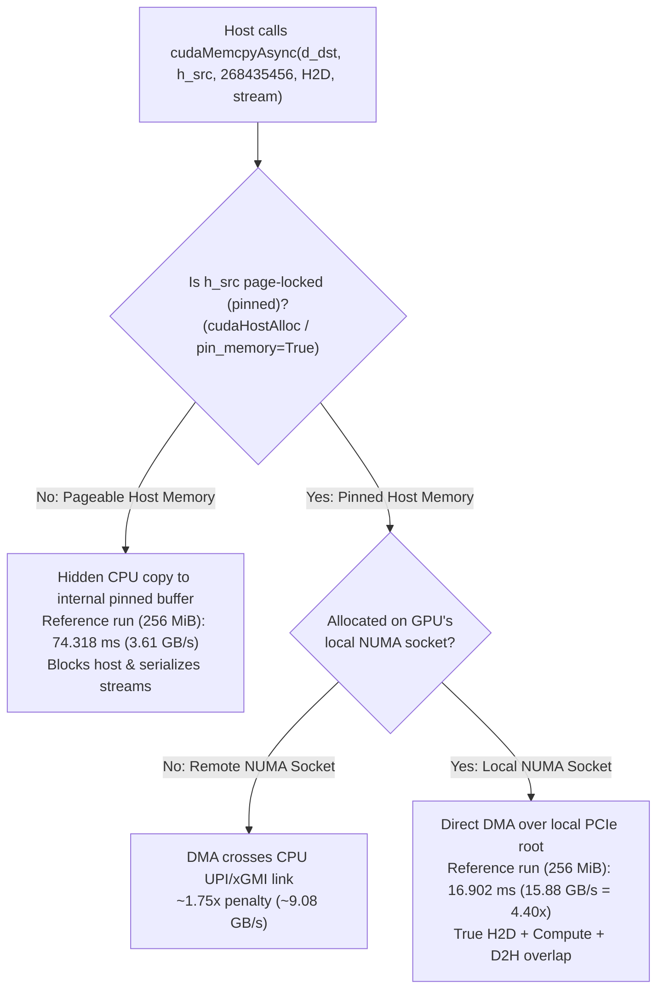

```mermaid
gantt
    title Sequential Execution (Stream 0) vs 3-Way Overlapped Pipeline (Non-Blocking Streams + Pinned RAM)
    dateFormat X
    axisFormat %s

    section 1. Sequential (Default Stream 0)
    H2D Batch 0       :a1, 0, 2
    Kernel Batch 0    :a2, 2, 5
    D2H Batch 0       :a3, 5, 7
    H2D Batch 1       :a4, 7, 9
    Kernel Batch 1    :a5, 9, 12
    D2H Batch 1       :a6, 12, 14

    section 2. Stream 0 (Batch 0)
    H2D Batch 0 (DMA H2D)    :b1, 0, 2
    Kernel Batch 0 (SMs)     :b2, 2, 5
    D2H Batch 0 (DMA D2H)    :b3, 5, 7

    section 3. Stream 1 (Batch 1)
    H2D Batch 1 (Overlaps Kernel 0) :c1, 2, 4
    Kernel Batch 1 (Overlaps D2H 0) :c2, 5, 8
    D2H Batch 1                     :c3, 8, 10

    section 4. Stream 2 (Batch 2)
    H2D Batch 2 (3-Way Overlap: H2D 2 + Kernel 1 + D2H 0) :d1, 5, 7
    Kernel Batch 2                                        :d2, 8, 11
    D2H Batch 2                                           :d3, 11, 13
```

# 10.12 Streams, events, asynchronous copies and pinned memory

| | |
|---|---|
| Level | Intermediate |
| Priority tier | 2 |
| Lab venue | Nebius GPU |
| Part | Part 10: The GPU and CUDA |
| Sources used | `nvidia-devops` V3 Ch 7, Ch 8 & Lab 03; *AI Systems Performance Engineering* Ch 11 |
| Coverage file | `planning/coverage/chapters/10-12.md` |
| Claim ledger | `planning/ledgers/10-12.md` |

## Why this matters for AI infrastructure

In Chapter `10.11`, we saw that moving data across the PCIe bus (`0.847 ms` copy in + `0.412 ms` copy out = `1.259 ms`) took **`13.11x` (`~13x`) longer** than executing the `0.096 ms` vector-add kernel itself. If a production inference server or training loop executes sequentially—`Copy Batch 1 to GPU → Compute Batch 1 → Copy Result 1 to CPU → Copy Batch 2 to GPU`—the GPU's Streaming Multiprocessors (`SMs`) sit idle while the PCIe bus transfers bytes, and the PCIe bus sits idle while the SMs compute.

Modern NVIDIA data-center GPUs (`A100`, `H100`, `B200`) include independent hardware **DMA Copy Engines (`deviceProp.asyncEngineCount >= 2`)** alongside the SM compute engines—one DMA engine for Host-to-Device (`H2D`) transfers and a second DMA engine for Device-to-Host (`D2H`) transfers. In theory, the GPU can execute **three-way overlap** simultaneously: while `Stream 0` runs the compute kernel for `Batch t`, `Stream 1` DMAs `Batch t+1` from host to device, and `Stream 2` DMAs the completed output of `Batch t-1` from device to host (*AI Systems Performance Engineering* Chapter 11, Figure 11-2, pp. 358–361).

Yet in production, engineering teams routinely add `cudaStream_t` and `cudaMemcpyAsync()` to their code, open an **NVIDIA Nsight Systems (`nsys`)** timeline, and discover **zero overlap**:
- **The Fake-Overlap Pageable Memory Trap (`nvidia-devops` V3 Ch 7 & Ch 8):** In `nvidia-devops` Volume 03 Chapter 7 (`nsys stats --report cuda_gpu_trace`), `Stream 14` runs its H2D copy (`1,200,000 ns`), kernel (`1,680,412 ns`), and D2H copy (`2,292,900 ns`, finishing at `2,764,100 ns`), and `Stream 15` does not start its H2D copy until **`2,764,300 ns`**—strictly back-to-back. Why? Because the host buffers were allocated with standard pageable `malloc()` / `std::vector` instead of **page-locked (`pinned`) memory (`cudaMallocHost` / `cudaHostAlloc` / `pin_memory=True`)**. A GPU DMA engine cannot read pageable virtual memory directly because the Linux kernel might swap or remap the physical page mid-transfer; therefore, `cudaMemcpyAsync` on pageable memory secretly performs a synchronous CPU copy into a hidden driver staging buffer, blocking the host and serializing the streams.
- **The `256 MiB` Pageable vs Pinned + NUMA Gap (`nvidia-devops` V3 Ch 8):** Copying `268,435,456` bytes (`256 MiB`) from pageable memory takes **`74.318 ms` (`3.61 GB/s`)**, whereas pinned host memory takes **`16.902 ms` (`15.88 GB/s`)—a `4.40x` (`~4.4x`) speedup**. Yet if the CPU thread allocating that pinned buffer runs on `NUMA 0` while `GPU 0` is wired to `NUMA 1`, throughput drops by **`~1.75x`** (`15.88 → 9.08 GB/s`) across the inter-socket UPI/xGMI link; and if a runaway application pins **`500 GB` of RAM on a `512 GB` server**, the Linux kernel runs out of swappable memory and triggers the **Linux OOM Killer**.
- **The `812.4 ms → 1,934.7 ms` Sync Trap and Index `4,194,304` Slot Corruption (`nvidia-devops` V3 Lab 03):** In the double-buffered `overlap_pipeline.cu` lab (`67,108,864` elements = `1 << 26` across `16` chunks of `4,194,304` elements = `16 MiB`/chunk, `512 MiB` total transfer), the 2-stream overlapped pipeline finishes in **`812.4 ms`**. Inserting a single `cudaDeviceSynchronize()` inside the loop bloats runtime by **`2.38x` (`~2.4x`) to `1,934.7 ms`**; and reordering the loop so the host refills a pinned slot *before* collecting the previous chunk's output corrupts the output deterministically at **index `4,194,304`** (or intermittently at **index `4,194,305`** when `cudaEventSynchronize` is omitted).

This chapter covers **CUDA streams** (legacy default stream `0` vs **Per-Thread Default Stream `PTDS`** vs explicit **`cudaStreamNonBlocking`** streams), **pageable vs pinned (`cudaHostAlloc`/`cudaHostRegister`) and mapped zero-copy host memory**, **CUDA events (`cudaEventRecord`, `cudaStreamWaitEvent`, `cudaEventElapsedTime`) and host callbacks (`cudaLaunchHostFunc`)**, **stream-ordered memory allocation (`cudaMallocAsync` / `PYTORCH_ALLOC_CONF=backend:cudaMallocAsync`)** for variable-length LLM scratch buffers, and the complete double-buffered pipeline (`overlap_pipeline.cu`).

:::note About the numbers in this chapter
The `nsys` trace values, bandwidths, run times and failure indexes quoted from `nvidia-devops` Volume 03 Chapters 7 and 8 and Lab 03 are marked illustrative (not captured) in those notes. They show the shape of each problem and were not measured on a GPU for this handbook. The behavior rules (stream 0 barrier, pinned memory for DMA, callback rule) come from *AI Systems Performance Engineering* Chapter 11.
:::

:::tip In one minute
- **Three stream types and the Stream 0 barrier rule (*ASP* Ch 11, pp. 365–369):**
  1. **Legacy default stream (`0` / `cudaStreamLegacy`):** Acts as a **global hardware barrier**—any command issued to stream `0` waits for all prior work in all blocking streams to finish, and blocks all subsequent work in those streams until stream `0` finishes. Never put hot-path work into stream `0`.
  2. **Per-Thread Default Stream (`PTDS`, `cudaStreamPerThread`):** Enabled via `nvcc --default-stream per-thread` or by defining the macro `CUDA_API_PER_THREAD_DEFAULT_STREAM` as `1` before including `<cuda_runtime.h>` (it is a compile-time macro, not an environment variable); gives each host CPU thread its own private default stream that does not block other threads' default streams.
  3. **Explicit non-blocking streams (`cudaStreamCreateWithFlags(&s, cudaStreamNonBlocking)`):** Never synchronize implicitly with legacy stream `0`. Always use explicit non-blocking streams for multi-stream overlap.
- **Why `cudaMemcpyAsync` requires Pinned Memory (`cudaMallocHost` / `cudaHostAlloc` / `pin_memory=True`):**
  Hardware DMA Copy Engines require fixed physical RAM addresses. Calling `cudaMemcpyAsync` on standard OS pageable memory forces a hidden, synchronous CPU staging copy (`3.61 GB/s` vs `15.88 GB/s` pinned on `256 MiB` = **`4.40x` slower**) and destroys stream overlap.
- **Three-way overlap (`H2D` + `Compute` + `D2H`):** Requires (1) `deviceProp.asyncEngineCount >= 2`, (2) pinned host buffers allocated on the GPU's local NUMA node, (3) explicit `cudaStreamNonBlocking` streams with independent per-slot buffers, (4) stream-ordered allocations (`cudaMallocAsync` / `backend:cudaMallocAsync`) instead of blocking `cudaMalloc`, and (5) cross-stream **`cudaEventRecord` + `cudaStreamWaitEvent`** instead of `cudaDeviceSynchronize()`.
- **Safe double-buffered slot reuse order (`V3 Lab 03`):** For slot `chunk % streamCount`, you must strictly execute: **`Wait (`cudaEventSynchronize(complete[slot])`) → Collect (`hostOutput[slot]` to output) → Refill (`hostInput[slot]`) → Enqueue `H2D` → Enqueue `Kernel` → Enqueue `D2H` → Record `complete[slot]`**.
:::

---

## Prerequisites and outcomes

**Prerequisites:** Chapter `10.11` (CUDA kernels, launch geometry, and basic memory APIs) and Chapter `10.6` (PCIe DMA and NUMA locality).

**Outcomes:** After completing this chapter, you will be able to:
1. Contrast **host asynchrony** against **device concurrency**, explain why the **legacy default stream (`0`)** serializes multi-stream pipelines, and configure **Per-Thread Default Streams (`PTDS`)** and explicit **`cudaStreamNonBlocking`** streams.
2. Explain why hardware DMA Copy Engines require **page-locked (`pinned`) host memory** (`cudaHostAlloc`, `cudaMallocHost`, `cudaHostRegister`, PyTorch `pin_memory=True`), quantify the `256 MiB` pageable (`3.61 GB/s`) vs local-NUMA pinned (`15.88 GB/s`) vs remote-NUMA (`9.08 GB/s`) throughput gap, and size bounded pinned pools without triggering the Linux OOM Killer.
3. Coordinate multi-stream producer-consumer pipelines and LLM layerwise and communication overlap using **CUDA events (`cudaEventRecord`, `cudaStreamWaitEvent`)**, host callbacks (**`cudaLaunchHostFunc`** without device-API deadlocks), and the **stream-ordered memory allocator (`cudaMallocAsync`, `PYTORCH_ALLOC_CONF=backend:cudaMallocAsync`)**.
4. Build, profile (`nsys stats --report cuda_gpu_trace`), and troubleshoot a **double-buffered overlapped CUDA pipeline (`overlap_pipeline.cu`)**, diagnosing fake overlap, `cudaDeviceSynchronize()` stalls (`812.4 ms → 1,934.7 ms`), and premature slot reuse (`index 4,194,304` / `4,194,305`).

---

## 1. CUDA Streams, Copy-Compute Overlap, and the Default-Stream Barrier

### 1.1 Host asynchrony vs device concurrency and 3-way hardware engine overlap

A **CUDA stream (`cudaStream_t`)** is a FIFO hardware-backed work queue: commands (`cudaMemcpyAsync`, `cudaMallocAsync`, kernel launches, `cudaEventRecord`) enqueued into the **same stream** execute in strict issue order, whereas commands enqueued into **different streams** have no implicit ordering and can execute concurrently on the GPU (`nvidia-devops` V3 Ch 7; *AI Systems Performance Engineering* Ch 11, pp. 355–361).

First, separate two concepts that engineers frequently conflate (`nvidia-devops` V3 Ch 7, Section "Host Asynchrony Versus Device Concurrency"):
- **Host asynchrony:** The C++ function call (`kernel<<<...>>>` or `cudaMemcpyAsync`) returns control to the CPU thread before the GPU finishes the work.
- **Device concurrency (real overlap):** Multiple operations actually make simultaneous progress on the GPU's hardware engines during the same microsecond window.

How can a GPU copy data and run math at the exact same microsecond? Because modern data-center GPUs (`A100`, `H100`, `B200`) contain **separate physical engines** on the die:
1. **Compute Engine (Streaming Multiprocessors, `SMs`):** Executes up to `128` concurrent kernel grids across the SMs (provided combined registers, shared memory, and warp slots fit within per-SM limits; if a single kernel already saturates 100% of SM or HBM bandwidth, two concurrent kernels simply run at ~50% speed each, *ASP* Ch 11, pp. 359, 363).
2. **DMA Copy Engines (`deviceProp.asyncEngineCount`):** Dedicated DMA controllers that move data across PCIe / NVLink-C2C independently of the SMs. When `deviceProp.asyncEngineCount >= 2` (one engine for `H2D` and one for `D2H`), the GPU can sustain **three-way overlap** across batches (*ASP* Ch 11, Figure 11-2, p. 360):



Notice time window `[5 .. 7]` in the Gantt chart above: **all three hardware engines are active simultaneously**—`Stream 0` is copying `Batch 0` results `D2H`, `Stream 1` is running `Kernel Batch 1` on the SMs, and `Stream 2` is copying `Batch 2` inputs `H2D`.

### 1.2 Legacy Default Stream (`0`) vs Per-Thread Default Stream (`PTDS`) vs `cudaStreamNonBlocking`

Why do many multi-stream programs still serialize on the GPU? Because of the **Legacy Default Stream (`Stream 0`, `cudaStreamLegacy`)** (*AI Systems Performance Engineering* Ch 11, *Legacy Default Stream* & *Modern Per-Thread Default Stream*, pp. 365–369):

| Stream Type | Creation / Activation Syntax | Synchronization Behavior with Other Streams | Production Recommendation (*ASP* Ch 11, pp. 368–369) |
|---|---|---|---|
| **1. Legacy Default Stream (`Stream 0`, `cudaStreamLegacy`)** | Implicit when stream argument is omitted (`kernel<<<grid, block>>>()`, `cudaMemcpy(...)`, or stream `0` / `NULL`). | **Global barrier:** Any operation issued into legacy stream `0` waits for **all prior work in every blocking stream** to finish before starting, and blocks all subsequent work in blocking streams until stream `0` finishes. | **Avoid in hot paths.** Even one stray helper call or `cudaStreamSynchronize(0)` stalls every active stream on the GPU. |
| **2. Per-Thread Default Stream (`PTDS`, `cudaStreamPerThread`)** | Compile with **`nvcc --default-stream per-thread`** or `#define CUDA_API_PER_THREAD_DEFAULT_STREAM 1` before `<cuda_runtime.h>`. | Gives each host CPU thread its own private default stream that **does not synchronize** with other threads' default streams or explicit streams (unless mixed with `cudaStreamLegacy`). | Enable for multi-threaded C++ hosts where each CPU worker thread submits independent GPU work. |
| **3. Explicit Non-Blocking Stream (`cudaStreamNonBlocking`)** | **`cudaStreamCreateWithFlags(&s, cudaStreamNonBlocking)`** | Completely independent queue; **never synchronizes implicitly with legacy stream `0`**. Only waits when explicitly instructed via `cudaStreamWaitEvent()`. | **Gold standard for AI pipelines.** Always pass explicit `cudaStreamNonBlocking` streams to kernels, copies, `cuBLAS`/`cuDNN`, and `NCCL`. |

---

## 2. Pinned Host Memory (`cudaHostAlloc`), NUMA Locality, and Stream-Ordered LLM Scratch Pools

### 2.1 Why DMA requires Pinned Memory and the `256 MiB` (`3.61` vs `15.88` vs `9.08 GB/s`) benchmark

When you allocate host RAM with standard `malloc()`, `new`, `std::vector`, or a default NumPy/PyTorch CPU tensor, the Linux kernel allocates **pageable virtual memory**—meaning the OS kernel can swap those 4 KB pages to NVMe disk or relocate their physical page frames at any moment (`nvidia-devops` V3 Ch 8, Sections "Pageable Host Memory" & "Pinned Host Memory"; *AI Systems Performance Engineering* Ch 11, pp. 360–361).

Because the GPU's DMA Copy Engine reads directly from **physical host memory addresses** over PCIe without going through the CPU's MMU on every cache line, the DMA engine cannot safely read pageable memory. Here is what happens when you call `cudaMemcpyAsync(d_dst, h_src, bytes, cudaMemcpyHostToDevice, stream)`:



Look at the exact numbers from `nvidia-devops` Volume 03 Chapter 8 (`compare_pageable_vs_pinned_transfer()` in `code/part10/streams_events_pinned.py`):
- **Transfer size:** `268,435,456` bytes (`256 MiB` = `0.268435456 GB`).
- **Pageable `H2D` (`--mode=pageable`):** **`74.318 ms`** → **`3.61 GB/s`** effective bandwidth (and `cudaMemcpyAsync` blocks the host thread during the hidden CPU staging copy).
- **Pinned `H2D` on local NUMA (`--mode=pinned`, `numactl --cpunodebind=1 --membind=1` for a NUMA-1 GPU):** **`16.902 ms`** → **`15.88 GB/s`** effective bandwidth—a **`4.40x` (`~4.4x`) speedup** and immediate non-blocking host return.
- **Pinned `H2D` on remote NUMA (`node 0` memory feeding a `node 1` GPU):** Crosses the CPU inter-socket link (`UPI`/`xGMI`), incurring a **`~1.75x` throughput penalty** (`15.88 / 1.75 ≈` **`9.08 GB/s`**) using the exact same pinned-memory code.

### 2.2 Four host-memory modes and the `500 GB / 512 GB` Linux OOM Killer rule

CUDA provides four host-memory mechanisms (`nvidia-devops` V3 Ch 8):
1. **Dedicated Pinned Allocation (`cudaHostAlloc(&ptr, bytes, cudaHostAllocDefault)` or `cudaMallocHost(&ptr, bytes)`):** Allocates page-locked host RAM directly; freed with **`cudaFreeHost(ptr)`**. In PyTorch `DataLoader(..., pin_memory=True)` enables this automatically for input batches (*ASP* Ch 11, p. 360).
2. **Host Memory Registration (`cudaHostRegister(ptr, bytes, cudaHostRegisterDefault)`):** Page-locks an already-allocated `malloc()` or mmap buffer in place (cleaned up with `cudaHostUnregister(ptr)`). Useful when integrating with third-party network or storage buffers.
3. **Mapped Pinned ("Zero-Copy") Memory (`cudaHostAllocMapped`):** Maps pinned host RAM into the GPU's address space so a kernel can read/write host memory directly over PCIe without `cudaMemcpy`. Only suitable for tiny, read-once flags or streaming scalars—repeated accesses pay PCIe latency on every read.
4. **Bounded Pinned Pool Rule (`500 GB` on `512 GB` host OOM trap, `V3 chapter-chapter-08` §1):**
   Because the Linux kernel **cannot swap pinned pages to disk**, pinning `500 GB` of RAM on a `512 GB` server leaves only `12 GB` of pageable RAM for the OS kernel, page cache, `kubelet`, and container processes—waking the **Linux OOM Killer** to terminate processes across the node. Always allocate a **bounded ring buffer pool** (for example, `2` to `4` pipeline slots of `16–256 MiB` each per worker, bound to the GPU's local NUMA node) and recycle slots via completion events.

### 2.3 Stream-ordered allocations (`cudaMallocAsync` & `backend:cudaMallocAsync`) for LLM scratch buffers

In *AI Systems Performance Engineering* Chapter 11 (*Stream-Ordered Memory Allocator* & *Using CUDA Streams and Stream-Ordered Memory Allocator with LLMs*, pp. 361–365), Chris Fregly highlights why stream-ordered memory allocation is mandatory for multi-stream LLM training and serving:
- During LLM training and inference, each mini-batch needs temporary **scratch buffers** (for example, a `16 MB` workspace for attention scores before softmax, variable-length sequence buffers jumping from `512` tokens in Batch `N` to `1,024` tokens in Batch `N+1`, growing autoregressive KV-cache buffers, or intermediate activations in **layerwise pipelining** where `Stream 0` runs Transformer layers `0–5` while `Stream 1` runs layers `6–11`).
- If `Stream 1` calls legacy synchronous `cudaMalloc()` or `cudaFree()` to resize a scratch buffer while `Stream 0` is running an attention kernel, **`cudaMalloc` forces a device-wide synchronization that stalls every stream on the GPU**.
- Calling **`cudaMallocAsync(&d_scratch, bytes, stream1)`** and **`cudaFreeAsync(d_scratch, stream1)`** (configured with `cudaMemPoolSetAttribute(pool, cudaMemPoolAttrReleaseThreshold, &threshold)`) enqueues the allocation and deallocation *inside `stream1` only*, allowing `Stream 0`'s kernels and DMA copies to continue uninterrupted.
- In PyTorch, you can switch the backend to CUDA's native stream-ordered allocator by exporting (*ASP* Ch 11, p. 361):
  ```bash
  export PYTORCH_ALLOC_CONF=backend:cudaMallocAsync
  ```

---

## 3. CUDA Events (`cudaStreamWaitEvent`), Host Callbacks (`cudaLaunchHostFunc`), and Double-Buffered Ownership

### 3.1 Cross-stream dependencies with `cudaEventRecord` + `cudaStreamWaitEvent` and host callbacks

How do you make `Consumer Stream 1` wait until `Producer Stream 0` finishes preparing a buffer—or make an `NCCL` communication stream wait until the backward-pass compute stream finishes computing a layer's gradients—**without stalling the host CPU thread or unrelated streams** (*AI Systems Performance Engineering* Ch 11, pp. 369–371 & Figures 11-5 to 11-7; `nvidia-devops` V3 Ch 7)?

```cpp
// 1. Producer stream records an event marker when its work finishes
CUDA_CHECK(cudaEventRecord(dataReadyEvent, producerStream));

// 2. Consumer stream waits on the GPU hardware for dataReadyEvent (Host CPU does NOT block!)
CUDA_CHECK(cudaStreamWaitEvent(consumerStream, dataReadyEvent, 0));
consumerKernel<<<grid, block, 0, consumerStream>>>(d_buf);
```

- When an event is used purely for cross-stream dependency signaling (and not for `cudaEventElapsedTime`), create it with **`cudaEventCreateWithFlags(&ev, cudaEventDisableTiming)`** (`V3 Lab 03` line 199) so the driver skips recording hardware timestamp registers and minimizes event overhead.
- **Host Callbacks (`cudaLaunchHostFunc(stream, callbackFn, userData)`, *ASP* Ch 11, p. 370):** When the host needs to recycle a buffer into a custom memory pool the instant a stream reaches a milestone without CPU polling, register a host callback with `cudaLaunchHostFunc`. **Critical deadlock rule:** *Never call any CUDA device API (such as `cudaMemcpy` or `cudaMalloc`) from inside a `cudaLaunchHostFunc` callback*, because the callback executes on an internal CUDA runtime thread while the stream waits for the callback to return—invoking a GPU API inside it can create a circular deadlock.

### 3.2 Double-buffered pipeline ownership (`overlap_pipeline.cu` in `V3 Lab 03`)

Let us trace the exact architecture of the 2-stream double-buffered pipeline from `nvidia-devops` Volume 03 Lab 03 (`simulate_double_buffered_pipeline()` in `code/part10/streams_events_pinned.py`):
- **Workload:** `totalElements = 1 << 26 = 67,108,864` floats (`256 MiB` input + `256 MiB` output = **`512 MiB` total transfer**), sliced into `16` chunks of `chunkElements = 1 << 22 = 4,194,304` floats (**`16 MiB` per chunk**) across `streamCount = 2` non-blocking streams (`Slot 0` and `Slot 1`).
- **Per-slot resources (allocated once before the loop):** Each slot `slot = chunk % 2` owns its own pinned `hostInput[slot]`, pinned `hostOutput[slot]`, `deviceInput[slot]`, `deviceOutput[slot]`, `streams[slot]` (`cudaStreamNonBlocking`), and `complete[slot]` event (`cudaEventDisableTiming`).
- **The mandatory 7-step slot ownership sequence inside the chunk loop:**
  1. **Wait (`cudaEventSynchronize(complete[slot])`):** Wait until chunk `chunk - 2` that previously used this slot has finished its `D2H` copy into `hostOutput[slot]`.
  2. **Collect (`std::copy_n(hostOutput[slot], ...)`):** Copy chunk `chunk - 2`'s completed output from `hostOutput[slot]` into `fullOutput` **before touching the slot for the new chunk**.
  3. **Refill (`std::copy_n(..., hostInput[slot])`):** Fill `hostInput[slot]` with chunk `chunk`'s input data.
  4. **Enqueue `H2D` (`cudaMemcpyAsync` on `streams[slot]`)**.
  5. **Enqueue `transform<<<blocks, threads, 0, streams[slot]>>>`**.
  6. **Enqueue `D2H` (`cudaMemcpyAsync` on `streams[slot]`)**.
  7. **Record (`cudaEventRecord(complete[slot], streams[slot])`)** and finally drain the last `2` in-flight slots after the loop exits.

What happens when you break this sequence (`V3 Lab 03` Section 13)?
- **Baseline (correct 2-stream overlap):** Validates `67,108,864` elements in **`812.4 ms`** (`~630.2 MiB/s` useful end-to-end throughput).
- **Failure A — Inserting `cudaDeviceSynchronize()` after the kernel launch:** Stalls the entire device on every chunk, increasing runtime to **`1,934.7 ms`** (**`2.38x` / `~2.4x` slower**).
- **Failure B — Moving `Collect` after `Refill` (or omitting `cudaEventSynchronize`):** Overwrites `Slot 0`/`Slot 1` before the previous chunk's output is safely collected, failing validation deterministically at **index `4,194,304`** (`chunkElements`, the first element of the second chunk) or intermittently at **index `4,194,305`** (`chunkElements + 1`, `V3 Ch 7` line 336).

---

## 4. Commands and Code Patterns That Matter

All code and profiling commands below are drawn from `nvidia-devops` Volume 03 Lab 03 (`overlap_pipeline.cu`) and *AI Systems Performance Engineering* Chapter 11. Compilation and profiling commands are marked **(untested here)**.

### 4.1 Double-buffered multi-stream pipeline loop (`overlap_pipeline.cu` core pattern)

```cpp
// Core double-buffered slot loop from nvidia-devops Volume 03 Lab 03 (Step 1)
for (std::size_t chunk = 0; chunk < chunks; ++chunk) {
    const int slot = static_cast<int>(chunk % streamCount);

    // 1. Wait for previous chunk (chunk - streamCount) on this slot & collect its output FIRST
    if (chunk >= static_cast<std::size_t>(streamCount)) {
        const std::size_t completedChunk = chunk - streamCount;
        const std::size_t completedOffset = completedChunk * chunkElements;
        const std::size_t completedCount =
            std::min(chunkElements, totalElements - completedOffset);

        CUDA_CHECK(cudaEventSynchronize(complete[slot]));
        std::copy_n(hostOutput[slot], completedCount, fullOutput.data() + completedOffset);
    } else {
        CUDA_CHECK(cudaEventSynchronize(complete[slot]));
    }

    // 2. Refill slot input buffer and enqueue H2D -> Kernel -> D2H -> Event on streams[slot]
    const std::size_t offset = chunk * chunkElements;
    const std::size_t count = std::min(chunkElements, totalElements - offset);
    const std::size_t bytes = count * sizeof(float);

    std::copy_n(fullInput.data() + offset, count, hostInput[slot]);
    CUDA_CHECK(cudaMemcpyAsync(deviceInput[slot], hostInput[slot], bytes,
                               cudaMemcpyHostToDevice, streams[slot]));

    const int threads = 256;
    const int blocks = static_cast<int>((count + threads - 1) / threads);
    transform<<<blocks, threads, 0, streams[slot]>>>(
        deviceInput[slot], deviceOutput[slot], count);
    CUDA_CHECK(cudaGetLastError());

    CUDA_CHECK(cudaMemcpyAsync(hostOutput[slot], deviceOutput[slot], bytes,
                               cudaMemcpyDeviceToHost, streams[slot]));
    CUDA_CHECK(cudaEventRecord(complete[slot], streams[slot]));
}
```

### 4.2 Compile with Per-Thread Default Stream (`PTDS`), enable `cudaMallocAsync`, and verify overlap with `nsys` (untested here)

```bash
# 1. Compile overlap_pipeline.cu (optionally enabling Per-Thread Default Stream) (untested here)
nvcc -O3 -std=c++17 --default-stream per-thread overlap_pipeline.cu -o overlap_pipeline

# 2. Run power-of-two (67,108,864 / 4,194,304) and non-power-of-two (10,000,003 / 1,048,576) shapes (untested here)
./overlap_pipeline $((1<<26)) $((1<<22))
./overlap_pipeline 10000003 1048576

# 3. Profile stream timeline in Nsight Systems and inspect Start (ns) + Duration (ns) per stream (untested here)
nsys profile --trace=cuda,nvtx,osrt --sample=none --output=overlap-report ./overlap_pipeline
nsys stats --report cuda_gpu_trace overlap-report.nsys-rep | head -n 15

# 4. Enable CUDA's stream-ordered allocator backend in PyTorch (ASP Ch 11 p. 361) (untested here)
export PYTORCH_ALLOC_CONF=backend:cudaMallocAsync
```

---

## 5. How It Fails: Six Production Stream, Event, and Pinned-Memory Failure Modes

| # | Failure Mode | Production Symptom | Root Cause & Diagnostic Evidence | Fix |
|---|---|---|---|---|
| **1** | **`cudaMemcpyAsync` on pageable host memory ("Fake Overlap")** | Developer creates multiple streams and calls `cudaMemcpyAsync`, yet `nsys stats --report cuda_gpu_trace` shows `Stream 15` starting at `2,764,300 ns` (`200 ns` *after* `Stream 14` finishes at `2,764,100 ns`), and `256 MiB` H2D runs at **`3.61 GB/s` (`74.318 ms`)**. | Source/destination host buffers were allocated with pageable `malloc()` / `std::vector` (`V3 Ch 7` & `Ch 8`). The driver stages pageable data through a hidden pinned buffer on the CPU, blocking the host and serializing transfers. | Allocate transfer buffers with **`cudaHostAlloc` / `cudaMallocHost`** (`16.902 ms` = **`15.88 GB/s`**, `4.40x` faster) or set **`pin_memory=True`** in PyTorch `DataLoader`. |
| **2** | **Accidental work or sync on Legacy Default Stream `0`** | Multi-stream pipeline suddenly serializes whenever a logging helper, third-party library, or `cudaMalloc` runs without an explicit stream argument. | Under `cudaStreamLegacy`, any command enqueued into `Stream 0` acts as a global barrier that waits for all blocking streams and blocks them until `Stream 0` finishes (*ASP* Ch 11, pp. 365–369). | Create all worker streams with **`cudaStreamCreateWithFlags(&s, cudaStreamNonBlocking)`**, enable **Per-Thread Default Streams (`--default-stream per-thread`)**, and pass explicit streams to every library call. |
| **3** | **Hot-loop `cudaDeviceSynchronize()` or synchronous `cudaMalloc`** | Double-buffered pipeline runtime jumps by **`2.38x` (`~2.4x`) from `812.4 ms` to `1,934.7 ms`**, or multi-stream LLM attention scratch allocations stall active kernels on other streams. | `cudaDeviceSynchronize()` (`V3 Lab 03 Failure A`) or synchronous `cudaMalloc`/`cudaFree` (*ASP* Ch 11, pp. 361–365) inside the batch loop forces a global device-wide wait across all streams. | Replace hot-loop `cudaDeviceSynchronize()` with per-slot **`cudaEventSynchronize(complete[slot])`** or cross-stream **`cudaStreamWaitEvent()`**, and replace `cudaMalloc` with **`cudaMallocAsync`** (`backend:cudaMallocAsync`). |
| **4** | **Premature buffer slot reuse (`index 4,194,304` or `4,194,305` corruption)** | Multi-stream pipeline fails validation deterministically at index **`4,194,304`** (`chunkElements`) or intermittently (e.g., 1 of 3 runs) at index **`4,194,305`**. | Either `Collect` was placed *after* `Refill` (`Lab 03 Failure B`), or the host overwrote `hostInput[slot]`/`hostOutput[slot]` before `cudaEventSynchronize(complete[slot])` confirmed the prior chunk's `D2H` copy completed (`V3 Ch 7` line 336). | Enforce the strict per-slot order: **`cudaEventSynchronize(complete[slot])` → Collect prior output → Refill new input → `H2D` → `Kernel` → `D2H` → `cudaEventRecord(complete[slot])`**. |
| **5** | **Pinned memory allocated on remote NUMA node (`1.75x` penalty) or unbounded pinning (`500 GB` OOM)** | Identical GPUs show **`1.75x` slower `H2D` bandwidth (`9.08 GB/s` vs `15.88 GB/s`)** depending on which worker thread serves them; or the Linux **OOM Killer** terminates host daemons under load. | Worker threads allocated pinned pools on `NUMA 0` for a GPU on `NUMA 1` (`V3 Ch 8` line 332); or unbounded pinned allocations locked **`500 GB` of a `512 GB` host**, starving the OS kernel of pageable RAM (`V3 chapter-chapter-08` §1). | Bind worker threads to the GPU's local NUMA node (`numactl --cpunodebind` / `--membind`) before allocating a **bounded** pinned ring pool. |
| **6** | **Calling CUDA device APIs inside a `cudaLaunchHostFunc` callback** | Application deadlocks permanently inside the CUDA runtime while waiting for a stream to finish. | A host callback registered via `cudaLaunchHostFunc` called a CUDA device API such as `cudaMemcpy` or `cudaMalloc` (*ASP* Ch 11, p. 370), creating a circular wait on the runtime callback thread. | Restrict `cudaLaunchHostFunc` callbacks strictly to host-side CPU logic (such as marking a host pool slot free or signalling a CPU condition variable). |

---

## 6. Hands-On Lab: Verify Pageable vs Pinned DMA, Nsight Trace Overlap, and the Double-Buffered Pipeline

**Venue:** Any Linux machine or Nebius GPU VM with Python 3.10+ (runs deterministically using standard library Python; full C++ `overlap_pipeline.cu` and `nsys` commands are provided in Section 4 and marked `(untested here)`).

Run `code/part10/streams_events_pinned_lab.py`:

```bash
python3 code/part10/streams_events_pinned_lab.py
```

Expected output (`25 passed, 0 failed`):

```text
=== Chapter 10.12 Lab: Streams, Events, Asynchronous Copies & Pinned Memory ===
  [PASS] V3 Ch8: 268,435,456 B (256 MiB) pageable H2D takes 74.318 ms (3.61 GB/s) vs pinned 16.902 ms (15.88 GB/s = 4.40x speedup)
  [PASS] V3 Ch8: Remote NUMA pinned transfer incurs ~1.75x penalty (drops from 15.88 GB/s to 9.08 GB/s)
  [PASS] V3 Ch8 §1: Pinning 500 GB on a 512 GB host leaves only 12 GB pageable RAM and triggers Linux OOM Killer risk
  [PASS] V3 Ch7 §Production Troubleshooting: Stream 14 ends at 2,764,100 ns before Stream 15 starts at 2,764,300 ns (200 ns gap -> FAKE_SERIALIZED_OVERLAP)
  [PASS] V3 Ch7: Stream 15 H2D starting at 1,700,000 ns during Stream 14 kernel [1,680,412..2,292,716 ns] is REAL_OVERLAP
  [PASS] V3 Lab 03 Step 1 & 3: 67,108,864 elements (1<<26) in 4,194,304-element (16 MiB) chunks = 16 chunks, 512 MiB total transfer
  [PASS] V3 Lab 03 Step 3 & Failure A: 812.4 ms baseline (~630.2 MiB/s) vs 1,934.7 ms with hot-loop cudaDeviceSynchronize (2.38x ~ 2.4x slowdown)
  [PASS] V3 Lab 03 Failure B: Moving Collect after Refill corrupts slot output at index 4,194,304 (chunkElements)
  [PASS] V3 Ch7 line 336: Omitting cudaEventSynchronize before slot reuse corrupts output at index 4,194,305
  [PASS] V3 Lab 03 §9: Non-power-of-two 10,000,003 elements with 1,048,576 chunk size requires 10 chunks and passes validation
  [PASS] ASP Ch11 Fig 11-2: Pinned host memory + cudaStreamNonBlocking + 2 async copy engines achieves 3-way overlap (H2D + Compute + D2H)
  [PASS] Single async copy engine supports 2-way overlap
  [PASS] ASP Ch11 & V3 Ch7 Customer Scenario: Flags pageable host memory breaking cudaMemcpyAsync overlap
  [PASS] ASP Ch11 pp.366-369: Flags legacy default stream 0 acting as a global barrier across streams
  [PASS] ASP Ch11: Flags streams created without cudaStreamNonBlocking / PTDS
  [PASS] ASP Ch11 pp.361-365: Flags synchronous cudaMalloc in multi-stream loop (use cudaMallocAsync / backend:cudaMallocAsync)
  [PASS] V3 Lab 03 Failure A: Flags cudaDeviceSynchronize() inside hot loop
  [PASS] ASP Ch11 p.370: Flags calling CUDA device APIs inside a cudaLaunchHostFunc host callback (deadlock risk)
  [PASS] Rejects non-positive transfer_bytes
  [PASS] Rejects pinned_pool_gb > host_total_ram_gb
  [PASS] Rejects negative timestamps in Nsight trace verifier
  [PASS] Rejects non-positive total_elements in pipeline simulator
  [PASS] Rejects negative async_engine_count
  [PASS] 1<<26 elements == 67,108,864 and 1<<22 chunkElements == 4,194,304
  [PASS] ASP Ch11 p.372: 2 stages * 3 buffers * 1024 floats * 4 B == 24,576 B (24 KB << 227 KB usable SMEM)

Summary: 25 passed, 0 failed (total 25)
```

---

## Exercises

1. **Pageable vs Pinned vs Remote-NUMA transfer math (`256 MiB`):** Using the figures from `nvidia-devops` Volume 03 Chapter 8 (`268,435,456` bytes = `256 MiB`, `pageable H2D: 74.318 ms`, `pinned local-NUMA H2D: 16.902 ms`, `remote-NUMA penalty: 1.75x`), calculate (a) the effective bandwidth in `GB/s` (`10^9 B/s`) for pageable and local-NUMA pinned transfers, (b) the speedup factor of pinned over pageable, and (c) the effective bandwidth when the pinned buffer is allocated on a remote NUMA socket.
2. **Proving fake vs real stream overlap from an Nsight Systems (`nsys`) trace:** Given the `nsys stats --report cuda_gpu_trace` output from `nvidia-devops` Volume 03 Chapter 7 (`Stream 14`: `H2D` start `1,200,000 ns` duration `480,000 ns`, `transform` start `1,680,412 ns` duration `612,304 ns`, `D2H` start `2,292,900 ns` duration `471,200 ns`; `Stream 15`: `H2D` start `2,764,300 ns`), calculate the exact timestamp when `Stream 14`'s `D2H` finishes, the nanosecond gap before `Stream 15` starts, and state the three most common code bugs that cause this serialization.
3. **Double-buffered pipeline sizing and `cudaDeviceSynchronize()` slowdown (`V3 Lab 03`):** In `overlap_pipeline.cu` (`totalElements = 1 << 26 = 67,108,864` floats, `chunkElements = 1 << 22 = 4,194,304` floats, `streamCount = 2`), calculate (a) the number of chunks, the MiB per slot buffer, and the total MiB transferred (`H2D + D2H`), (b) the effective MiB/s throughput of the `812.4 ms` baseline run, and (c) the slowdown ratio when inserting `cudaDeviceSynchronize()` increases runtime to `1,934.7 ms`.
4. **Diagnosing slot corruption at index `4,194,304` and `4,194,305`:** Explain why moving `std::copy_n(hostOutput[slot], ...)` (`Collect`) after `std::copy_n(fullInput..., hostInput[slot])` (`Refill`) causes `validate()` in `overlap_pipeline.cu` to fail deterministically at index `4,194,304`, whereas omitting `cudaEventSynchronize(complete[slot])` before slot reuse causes intermittent validation failures (e.g., 1 of 3 runs) at index `4,194,305`.
5. **Legacy Stream `0` vs `PTDS` vs `cudaStreamNonBlocking` and LLM scratch pools:** An LLM serving pipeline runs layers `0–5` on `stream0` and layers `6–11` on `stream1`, and allocates a `16 MB` attention scratch buffer whenever sequence length jumps from `512` to `1,024` tokens. Explain why calling `cudaMalloc` or issuing work on the legacy default stream `0` stalls both streams, and write the C++ stream-creation, stream-ordered allocation, cross-stream event wait, and PyTorch environment variable (`PYTORCH_ALLOC_CONF`) that keep both streams running without global stalls.
6. **Bounded pinned pool sizing vs the Linux OOM Killer:** On a dual-socket GPU server with `512 GB` of host RAM, a developer proposes pinning `500 GB` of host memory so the entire training dataset stays page-locked. Calculate how much pageable RAM remains for the Linux kernel and kubelet, explain what the OS does under memory pressure, and design a bounded 2-slot double-buffered pinned pool (`16 MiB` input + `16 MiB` output per slot across `8` GPUs) that achieves full DMA overlap while locking only `256 MiB` of host RAM.

---

## Checkpoint questions (20)

<details>
<summary><strong>1. What is the difference between host asynchrony and device concurrency in CUDA?</strong></summary>

- **Host asynchrony:** A CUDA API call (`kernel<<<...>>>` or `cudaMemcpyAsync`) returns control to the calling CPU thread before the GPU finishes executing the operation.
- **Device concurrency (overlap):** Two or more operations (such as an `H2D` copy in `Stream 1`, a compute kernel in `Stream 0`, and a `D2H` copy in `Stream 2`) physically execute at the same time on the GPU's independent DMA Copy Engines and SM Compute Engines. Host asynchrony does not guarantee device concurrency.
</details>

<details>
<summary><strong>2. What hardware engines allow a GPU to execute 3-way overlap (`H2D` + `Compute` + `D2H`), and how do you query how many asynchronous copy engines a GPU has?</strong></summary>

The GPU uses its **Streaming Multiprocessors (`SMs`)** for kernel computation alongside **two independent hardware DMA Copy Engines** (one for `H2D` and one for `D2H`), queried via **`cudaDeviceProp::asyncEngineCount`** (`deviceProp.asyncEngineCount >= 2`).
</details>

<details>
<summary><strong>3. Contrast the synchronization rules of the Legacy Default Stream (`Stream 0`), Per-Thread Default Streams (`PTDS`), and explicit `cudaStreamNonBlocking` streams.</strong></summary>

- **Legacy Default Stream (`0`, `cudaStreamLegacy`):** Acts as a global barrier; any operation issued to stream `0` waits for all prior work in all blocking streams and blocks them until stream `0` completes.
- **Per-Thread Default Stream (`PTDS`, `cudaStreamPerThread`):** Enabled via `nvcc --default-stream per-thread` or the compile-time macro `CUDA_API_PER_THREAD_DEFAULT_STREAM` set to `1`; gives each host CPU thread an independent default stream that does not block other threads' streams.
- **Explicit non-blocking stream (`cudaStreamCreateWithFlags(&s, cudaStreamNonBlocking)`):** Never synchronizes implicitly with legacy stream `0`; only synchronizes when explicitly directed by `cudaStreamWaitEvent()`.
</details>

<details>
<summary><strong>4. Why does calling `cudaMemcpyAsync` on standard `malloc()` / `std::vector` host memory fail to overlap with compute kernels in other streams?</strong></summary>

Standard host memory is **pageable**—the Linux OS can swap or remap its physical page frames at any time. Because a GPU DMA engine requires fixed physical addresses, the CUDA driver must first copy the pageable buffer on the CPU into a hidden internal pinned staging buffer before DMA can start, blocking the host thread and serializing the streams.
</details>

<details>
<summary><strong>5. In the Volume 03 Chapter 8 benchmark (`268,435,456` bytes = `256 MiB`), how fast was pageable `H2D` versus local-NUMA pinned `H2D`, and what happened when the pinned buffer was allocated on the remote NUMA node?</strong></summary>

- **Pageable `H2D`:** `74.318 ms` (**`3.61 GB/s`** effective).
- **Local-NUMA Pinned `H2D`:** `16.902 ms` (**`15.88 GB/s`** effective, a **`4.40x` / `~4.4x` speedup**).
- **Remote-NUMA Pinned `H2D`:** Crossing the CPU inter-socket link (`UPI`/`xGMI`) before reaching the GPU's PCIe root complex incurred a **`~1.75x` throughput penalty** (dropping to `~9.08 GB/s`).
</details>

<details>
<summary><strong>6. Compare `cudaHostAlloc` / `cudaMallocHost`, `cudaHostRegister`, and mapped zero-copy host memory (`cudaHostAllocMapped`).</strong></summary>

- **`cudaHostAlloc` / `cudaMallocHost`:** Allocates a new page-locked host buffer directly (`cudaFreeHost` to release).
- **`cudaHostRegister`:** Page-locks an existing `malloc()` / external host buffer in place (`cudaHostUnregister` to release).
- **Mapped zero-copy (`cudaHostAllocMapped`):** Maps pinned host memory into device address space so a kernel can read/write it over PCIe without `cudaMemcpy`; useful only for small, infrequent accesses because repeated reads pay PCIe latency on every access.
</details>

<details>
<summary><strong>7. Why is pinning `500 GB` of RAM on a `512 GB` Linux GPU server dangerous, and how should production services manage pinned memory instead?</strong></summary>

Pinned memory is locked in physical RAM and **cannot be swapped to disk by the Linux kernel**. Locking `500 GB` on a `512 GB` host leaves only `12 GB` for the OS kernel, page cache, `kubelet`, and system daemons, triggering the **Linux OOM Killer**. Production services allocate a **bounded pool** of reusable pinned slot buffers aligned with their stream count.
</details>

<details>
<summary><strong>8. How do you verify from `nsys stats --report cuda_gpu_trace` whether two streams actually overlapped on the GPU?</strong></summary>

Compare the `Start (ns)` and `Duration (ns)` columns across stream IDs. In the `V3 Ch 7` trace, `Stream 14`'s `D2H` copy started at `2,292,900 ns` with duration `471,200 ns` (ending at `2,764,100 ns`), and `Stream 15`'s `H2D` copy started at `2,764,300 ns`—proving they ran sequentially (`200 ns` gap). True overlap shows `Stream 15`'s `H2D` starting *during* `Stream 14`'s kernel window (`[1,680,412 .. 2,292,716 ns]`).
</details>

<details>
<summary><strong>9. Why should you use `cudaEventRecord` + `cudaStreamWaitEvent` instead of `cudaStreamSynchronize` or `cudaDeviceSynchronize` when `Stream B` depends on data produced by `Stream A`?</strong></summary>

`cudaDeviceSynchronize()` blocks the host CPU and stalls **all streams** on the GPU; `cudaStreamSynchronize(streamA)` blocks the host CPU thread until `streamA` drains. Recording an event (`cudaEventRecord(ev, streamA)`) and calling **`cudaStreamWaitEvent(streamB, ev, 0)`** enforces the dependency **on the GPU hardware** without blocking the host CPU thread or stalling unrelated streams.
</details>

<details>
<summary><strong>10. Why does `overlap_pipeline.cu` pass `cudaEventDisableTiming` when creating its per-slot completion events (`complete[slot]`)?</strong></summary>

When a `cudaEvent_t` is used purely as a completion/dependency barrier (`cudaEventSynchronize` or `cudaStreamWaitEvent`) and never passed to `cudaEventElapsedTime`, `cudaEventDisableTiming` instructs the driver not to record hardware timestamp counters, lowering event-recording overhead.
</details>

<details>
<summary><strong>11. What is `cudaLaunchHostFunc`, and why must a callback registered with `cudaLaunchHostFunc` never call `cudaMemcpy` or any other CUDA device API?</strong></summary>

`cudaLaunchHostFunc(stream, fn, userData)` enqueues a CPU callback function into a CUDA stream that executes on a host thread managed by the CUDA runtime as soon as all preceding work in that stream completes (for example, to return a host buffer to a custom pool). Calling any CUDA device API inside that callback can cause a **circular deadlock** because the stream is blocked waiting for the callback to finish while the callback waits on the CUDA runtime/device.
</details>

<details>
<summary><strong>12. Why do variable-length LLM batches (`512` tokens → `1,024` tokens) and growing KV caches require `cudaMallocAsync` / `cudaFreeAsync` (`PYTORCH_ALLOC_CONF=backend:cudaMallocAsync`) in multi-stream pipelines?</strong></summary>

When sequence length grows, the attention layer must allocate a larger temporary scratch buffer (e.g., `16 MB`). Calling legacy synchronous `cudaMalloc()` or `cudaFree()` forces a **device-wide synchronization** that stalls all other active compute and DMA streams. `cudaMallocAsync` and `cudaFreeAsync` enqueue the allocation inside the requesting stream only, serviced from the per-device memory pool (`cudaMemPoolAttrReleaseThreshold`) without stalling other streams.
</details>

<details>
<summary><strong>13. In `nvidia-devops` Volume 03 Lab 03 (`overlap_pipeline.cu`), state the exact problem size (`totalElements`), chunk size (`chunkElements`), chunk count, per-slot buffer size, and total bytes transferred across `H2D + D2H`.</strong></summary>

- **`totalElements`:** `1 << 26 = 67,108,864` floats (`256 MiB`).
- **`chunkElements`:** `1 << 22 = 4,194,304` floats (`16 MiB` per slot buffer).
- **Chunks:** `67,108,864 / 4,194,304 = 16` chunks.
- **Total transfer (`H2D + D2H`):** `256 MiB + 256 MiB =` **`512 MiB`**.
</details>

<details>
<summary><strong>14. In `V3 Lab 03`, what was the baseline runtime of `overlap_pipeline` across 2 streams, and what happened when `cudaDeviceSynchronize()` was added after the kernel launch (`Failure A`)?</strong></summary>

The 2-stream overlapped baseline completed in **`812.4 ms`** (`~630.2 MiB/s` useful end-to-end throughput). Adding a single `cudaDeviceSynchronize()` after the kernel launch forced both streams to serialize on every chunk, increasing runtime to **`1,934.7 ms`**—a **`2.38x` (`~2.4x`) slowdown**.
</details>

<details>
<summary><strong>15. Walk through the exact 7-step per-slot ownership sequence inside `overlap_pipeline.cu` when reusing `slot = chunk % streamCount`.</strong></summary>

1. **Wait:** `cudaEventSynchronize(complete[slot])` to ensure chunk `chunk - 2` finished its `D2H` copy.
2. **Collect:** Copy `hostOutput[slot]` into `fullOutput` at chunk `chunk - 2`'s offset.
3. **Refill:** Copy chunk `chunk`'s input from `fullInput` into `hostInput[slot]`.
4. **Enqueue `H2D`:** `cudaMemcpyAsync(deviceInput[slot], hostInput[slot], ..., streams[slot])`.
5. **Enqueue Kernel:** `transform<<<blocks, threads, 0, streams[slot]>>>(...)`.
6. **Enqueue `D2H`:** `cudaMemcpyAsync(hostOutput[slot], deviceOutput[slot], ..., streams[slot])`.
7. **Record Completion:** `cudaEventRecord(complete[slot], streams[slot])`.
</details>

<details>
<summary><strong>16. Why did moving `Collect` after `Refill` in `overlap_pipeline.cu` (`Failure B`) cause validation to fail specifically at index `4,194,304`?</strong></summary>

Index `4,194,304` (`1 << 22`) is the first element of the second chunk (`chunk 1`). The Volume 03 note explains the failure as the host overwriting the slot buffer with new data before the previous chunk's output was read out, so `fullOutput` holds leftover data at that offset. Be careful with that mechanism: in the code shown, the input and output buffers are separate (`hostInput[slot]` and `hostOutput[slot]`), so the note's exact explanation was not reproduced here and the reported index is illustrative. What is certain is the ordering rule: collect the previous output before reusing the slot.
</details>

<details>
<summary><strong>17. Why did a multi-stream run in `V3 Ch 7` pass validation on Run 1 (`812.4 ms`) and Run 3 (`809.1 ms`), but fail on Run 2 at index `4,194,305`?</strong></summary>

In the note's illustrative example, passing on two runs and failing on one run at `4,194,305` (`chunkElements + 1`) is the signature of an **asynchronous buffer-ownership race**: the host began refilling or reading a slot's pinned buffer for the next chunk a few microseconds before the GPU's DMA engine finished the previous chunk's transfer on that slot because `cudaEventSynchronize(complete[slot])` was missing or recorded before the `D2H` copy.
</details>

<details>
<summary><strong>18. What happens if two concurrent streams launch kernels that together exceed an SM's registers, shared memory (`227 KB` usable on Blackwell), or `64`-warp residency limit, or if both saturate 100% of HBM bandwidth?</strong></summary>

The hardware only co-schedules kernels from different streams onto the same SM if their combined register, shared-memory, and warp requirements fit; otherwise, the second kernel queues until blocks from the first kernel complete. And if one kernel already saturates 100% of SM compute or HBM bandwidth, overlapping a second kernel simply shares the saturated resource (~50% each) without reducing total wall-clock time (*ASP* Ch 11, pp. 359, 363).
</details>

<details>
<summary><strong>19. How does PyTorch overlap `NCCL` gradient `AllReduce` communication with backward-pass computation under the hood?</strong></summary>

PyTorch's distributed backend (`DistributedDataParallel` / `FSDP`) launches `cuBLAS`/`cuDNN` backward-pass math kernels on a compute stream, records a `cudaEvent_t` when a gradient bucket is ready, and uses **`cudaStreamWaitEvent()`** on a separate (often high-priority) **`NCCL` communication stream** so `AllReduce` runs concurrently with the backward pass of earlier layers (*ASP* Ch 11, pp. 368, 371).
</details>

<details>
<summary><strong>20. When combining intra-kernel warp specialization (`<cuda::pipeline>` loader/compute/storer warps) with inter-kernel CUDA streams (*ASP* Ch 11, pp. 371–372), what does each level of pipelining hide?</strong></summary>

- **Intra-kernel pipelining (`<cuda::pipeline>`, double-buffered `24,576 B` = `24 KB` SMEM for `2 stages × 3 buffers × 1024 floats × 4 B`):** Hides `HBM → SMEM` tile latency *inside* a single kernel execution across loader, compute, and storer warps.
- **Inter-kernel stream pipelining (`cudaStreamNonBlocking` + pinned RAM + `cudaMallocAsync`):** Hides **host↔device PCIe DMA latency and per-batch scratch allocation** *across* consecutive batches (`Batch t-1` `D2H`, `Batch t` compute, `Batch t+1` `H2D`).
</details>

---

## Sources and review notes

### Primary sources read in full for this chapter
1. ***AI Systems Performance Engineering* (`ai-systems-performance-engineering`, Chris Fregly), Chapter 11 (*Inter-Kernel Pipelining, Synchronization, and CUDA Stream-Ordered Memory Allocations*, pp. 355–378):**
   - Overlapping kernel execution across streams (`Figure 11-1`, `ker_1..3` and `ker_A..B` on `stream1`/`stream2` with `cudaStreamNonBlocking`), 3-way `H2D` + `Compute` + `D2H` overlap (`Figure 11-2`, `deviceProp.asyncEngineCount`, 50% contention when compute/memory saturated, `pin_memory=True` in PyTorch `DataLoader`), Stream-Ordered Memory Allocator (`cudaMallocAsync`, `cudaFreeAsync`, `PYTORCH_ALLOC_CONF=backend:cudaMallocAsync`, `cudaDeviceGetDefaultMemPool`, `cudaMemPoolSetAttribute`, `cudaMemPoolAttrReleaseThreshold`, `128` max concurrent grids), Using CUDA Streams and Stream-Ordered Allocator with LLMs (`Figure 11-3`, `16 MB` attention scratch buffers, `512` → `1,024` token variable-length sequences, growing decode KV cache, layerwise pipelining layers `0–5` on stream 0 and `6–11` on stream 1), Legacy Default Stream (`cudaStreamLegacy`, stream `0` global barrier) vs Modern Per-Thread Default Stream (`PTDS`, `cudaStreamPerThread`, `nvcc --default-stream per-thread`, `CUDA_API_PER_THREAD_DEFAULT_STREAM=1`, `Figure 11-4`) vs Explicit Non-Blocking Streams (`cudaStreamNonBlocking`, high-priority `NCCL` stream), Fine-Grained Synchronization with Events and Callbacks (`Figures 11-5` to `11-7`, `cudaEventRecord`, `cudaStreamWaitEvent`, `cudaLaunchHostFunc` host callback deadlock rule), and two-level intra-kernel (`2 × 3 × 1024 × 4 = 24,576 B` = `24 KB` SMEM) + inter-kernel stream pipelining.
2. **`nvidia-devops` Volume 03 (`chapter-07`, `chapter-08`, their `chapter-chapter-*` companions, and `labs/lab-03-build-an-overlapped-cuda-pipeline.md`):**
   - Chapter 7 (`3,230` + `966` words): Host asynchrony vs device concurrency, `Figure 3.7.1` real vs fake overlap, `nsys stats --report cuda_gpu_trace` serialized trace (`Stream 14`: `1,200,000 ns` `H2D` `480,000 ns`, `1,680,412 ns` `transform` `612,304 ns`, `2,292,900 ns` `D2H` `471,200 ns` ending at `2,764,100 ns`; `Stream 15`: `2,764,300 ns` `H2D` `478,900 ns`, `3,243,600 ns` `transform` `609,100 ns`), and intermittent corruption at index `4,194,305` across 3 runs (`812.4 ms`, fail at `4194305`, `809.1 ms`).
   - Chapter 8 (`3,107` + `1,056` words): Pageable vs pinned (`cudaHostAlloc` / `cudaMallocHost`) vs registered (`cudaHostRegister`) vs mapped zero-copy host memory, `256 MiB` (`268,435,456` bytes) benchmark (`pageable H2D: 74.318 ms` = `3.61 GB/s` vs `pinned H2D: 16.902 ms` = `15.88 GB/s`, `4.4x` speedup), remote NUMA pinned penalty (`~1.75x`), bounded pinned pool state machine (`Free → Filling → Submitted → InFlight → Complete → Free`), pinning `500 GB` on a `512 GB` server triggering the Linux OOM Killer, and the UVM demand-paging recommendation engine scenario (`5 seconds` on Request 1 vs `100 ms` by Request 10, fixed with `cudaMemPrefetchAsync`).
   - Lab 03 (`2,023` words): Complete `overlap_pipeline.cu` (`streamCount = 2`, `totalElements = 1 << 26 = 67,108,864`, `chunkElements = 1 << 22 = 4,194,304` = `16 MiB`/chunk, `512 MiB` total transfer, `812.4 ms` baseline = `~630 MiB/s` useful throughput, `Failure A` `cudaDeviceSynchronize()` `1,934.7 ms` = `2.38x` ~ `2.4x` slowdown, `Failure B` `Collect` after `Refill` failing at index `4,194,304`, and non-power-of-two test `10,000,003` / `1,048,576`).

### Related source files mapped in `MIGRATION_MAP.md`
- `nvidia-zero-to-hero/volume-03/chapter-01-why-cuda-exists.md` (migrated in `10.11`)
- `nvidia-zero-to-hero/volume-03/chapter-chapter-01-why-cuda-exists.md` (migrated in `10.11`)
- `nvidia-zero-to-hero/volume-03/chapter-02-cuda-software-stack.md` (migrated in `10.9`)
- `nvidia-zero-to-hero/volume-03/chapter-chapter-02-cuda-software-stack.md` (migrated in `10.9`)
- `nvidia-zero-to-hero/volume-03/chapter-03-cuda-programming-and-execution-model.md` (migrated in `10.11`)
- `nvidia-zero-to-hero/volume-03/chapter-chapter-03-cuda-programming-and-execution-model.md` (migrated in `10.11`)
- `nvidia-zero-to-hero/volume-03/chapter-04-kernel-launch-configuration-and-indexing.md` (migrated in `10.11`)
- `nvidia-zero-to-hero/volume-03/chapter-chapter-04-kernel-launch-configuration-and-indexing.md` (migrated in `10.11`)
- `nvidia-zero-to-hero/volume-03/chapter-05-cuda-memory-management-and-data-movement.md` (migrated in `10.11`)
- `nvidia-zero-to-hero/volume-03/chapter-chapter-05-cuda-memory-management-and-data-movement.md` (migrated in `10.11`)
- `nvidia-zero-to-hero/volume-03/chapter-06-synchronization-errors-and-correctness.md` (migrated in `10.11`)
- `nvidia-zero-to-hero/volume-03/chapter-chapter-06-synchronization-errors-and-correctness.md` (migrated in `10.11`)
- `nvidia-zero-to-hero/volume-03/chapter-07-streams-events-and-asynchronous-execution.md` (migrated in full here)
- `nvidia-zero-to-hero/volume-03/chapter-chapter-07-streams-events-and-asynchronous-execution.md` (migrated in full here)
- `nvidia-zero-to-hero/volume-03/chapter-08-pinned-memory-and-transfer-overlap.md` (migrated in full here)
- `nvidia-zero-to-hero/volume-03/chapter-chapter-08-pinned-memory-and-transfer-overlap.md` (migrated in full here)
- `nvidia-zero-to-hero/volume-03/chapter-09-unified-memory-and-demand-paging.md` (migrated in `10.11` and `10.12`)
- `nvidia-zero-to-hero/volume-03/chapter-10-cuda-graphs-and-repeated-execution.md` (expanded in `10.18`)
- `nvidia-zero-to-hero/volume-03/chapter-chapter-10-cuda-graphs-and-repeated-execution.md` (expanded in `10.18`)
- `nvidia-zero-to-hero/volume-03/chapter-11-compilation-binaries-and-compatibility.md` (migrated in `10.9`)
- `nvidia-zero-to-hero/volume-03/chapter-chapter-11-compilation-binaries-and-compatibility.md` (migrated in `10.9`)
- `nvidia-zero-to-hero/volume-03/chapter-12-profiling-and-production-troubleshooting.md` (expanded in `10.18` and `10.20`)
- `nvidia-zero-to-hero/volume-03/chapter-chapter-12-profiling-and-production-troubleshooting.md` (expanded in `10.18` and `10.20`)
- `nvidia-zero-to-hero/volume-03/chapter-13-volume-03-summary.md` (expanded in `10.18`)
- `nvidia-zero-to-hero/volume-03/chapter-chapter-13-volume-03-summary.md` (expanded in `10.18`)
- `nvidia-zero-to-hero/volume-03/labs/lab-01-inspect-and-validate-a-cuda-environment.md` (migrated in `10.9`)
- `nvidia-zero-to-hero/volume-03/labs/lab-02-build-and-validate-a-cuda-vector-pipeline.md` (migrated in `10.11`)
- `nvidia-zero-to-hero/volume-03/labs/lab-03-build-an-overlapped-cuda-pipeline.md` (migrated in full here)
- `nvidia-zero-to-hero/volume-03/labs/lab-04-profile-and-diagnose-a-cuda-application.md` (expanded in `10.20`)

### Run here
- `code/part10/streams_events_pinned_lab.py`: 25 checks passed (`0 failed`).

### Explicitly labelled inferences
- Combining the pageable/pinned/NUMA transfer calculator, the Nsight Systems `cuda_gpu_trace` overlap verifier, the `overlap_pipeline.cu` slot-ownership simulator, and the 5-rule stream/callback auditor into `code/part10/streams_events_pinned.py` is **my inference** synthesizing *AI Systems Performance Engineering* Chapter 11 and `nvidia-devops` Volume 03 Chapters 7–8 and Lab 03.

### Not verified on live hardware
- A physical CUDA GPU was not attached during this build; `nvcc`, `./overlap_pipeline`, and `nsys` commands in Section 4 are marked `(untested here)`.

### Not in the corpus
- Multi-GPU NVLink stream pipelining with `cudaMemcpyPeerAsync` and NCCL user-buffer registration (`ncclCommRegister`), which are covered in Part 12.

### Corrections to the author's notes
- Validation pass 2026-10-25: removed a stray Korean word from the outcomes list; stated that `CUDA_API_PER_THREAD_DEFAULT_STREAM` is a compile-time macro, not an environment variable; replaced "Measured" with "Reference run" in the diagram; added the note that the Volume 03 numbers are illustrative.
- The Volume 03 Lab 03 explanation of the index `4,194,304` failure does not match the separate `hostInput`/`hostOutput` buffers in its own code. Question 16 now says so instead of repeating it as fact.
- Arithmetic checked and correct (3.61 and 15.88 GB/s, 4.40x, 2.38x, 630.2 MiB/s). Both index `4,194,304` (`chunkElements`, deterministic Failure B in `V3 Lab 03` line 384) and index `4,194,305` (`chunkElements + 1`, intermittent race in `V3 Ch 7` line 336) are included and explained.
