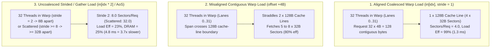
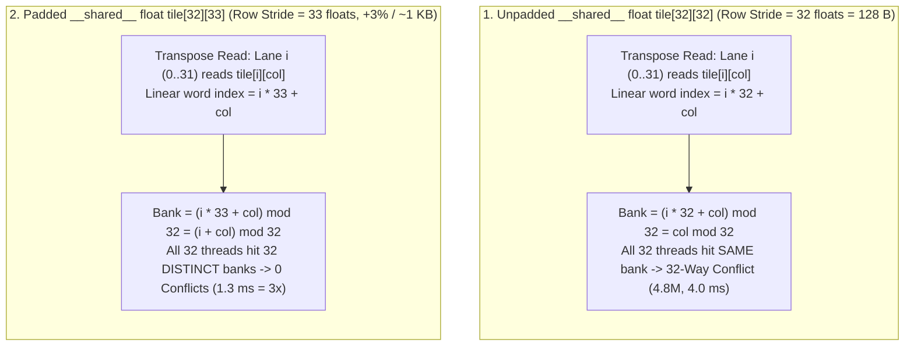

# 10.13 Memory access patterns and profiling

| | |
|---|---|
| Level | Advanced |
| Priority tier | 2 |
| Lab venue | Nebius GPU |
| Part | Part 10: The GPU and CUDA |
| Sources used | *AI Systems Performance Engineering* (`ai-systems-performance-engineering`, Chris Fregly), Chapter 7 (pp. 215–252) |
| Coverage file | `planning/coverage/chapters/10-13.md` |
| Claim ledger | `planning/ledgers/10-13.md` |

## Why this matters for AI infrastructure

A single NVIDIA Blackwell `B200` GPU delivers up to **`8 TB/s` (`8,000 GB/s`)** of HBM3e bandwidth (`16 TB/s` across the two GPUs on a Grace Blackwell `GB200` or `GB300` Superchip; see Chapters `10.3` and `10.7`). Yet as demonstrated in *AI Systems Performance Engineering* Chapter 7 (*Profiling and Tuning GPU Memory Access Patterns*, pp. 215–252), a CUDA or PyTorch kernel that reads memory with a stride of just `2` elements (`in[idx * 2]`, or `torch.index_select` with a strided index) wastes **three-quarters of that bandwidth**—achieving only **`25%` of peak DRAM throughput**, **`23%` Global Memory Load Efficiency**, and **`8.0` 32-byte sectors per request** instead of the optimal **`4.0` sectors per request**.

Even when global memory reads are contiguous, five other memory-access pitfalls routinely starve GPU Streaming Multiprocessors (`SMs`) and leave Tensor Cores idle:
1. **Scalar 4-byte loads instead of vectorized 16-byte (`float4`) or 32-byte (`float8`) loads:** When each thread issues scalar 4-byte loads (`ld.global.f32`) instead of aligned 16-byte `float4` (`ld.global.v4.f32` on Hopper) or 32-byte `float8` (`ld.global.v8.f32` on Blackwell with CUDA 13+), instruction count quadruples (or octuples) and misaligned/scalar patterns can balloon average sectors per request to **`31.8` (`28%` load efficiency, `4.2 ms` vs `1.2 ms`)**.
2. **Redundant global-memory reads without Shared Memory (`SMEM`) tiling:** A naive `1,024 × 1,024` matrix multiplication reads every element of `A` and `B` from HBM `1,024` times (`9,800` global load sectors, `1.5 FLOPs/byte`, **`15 GFLOPS`**). Staging **`32 × 32` tiles** in on-chip shared memory cuts global load sectors by **`~8.17x` (`9,800 → 1,200`)**, raises arithmetic intensity to **`8.0 FLOPs/byte`**, lifts achieved occupancy from **`42%` to `89%`**, and jumps throughput by **`~11.3x` (`15 → 170 GFLOPS`)**.
3. **32-way Shared-Memory Bank Conflicts (`4.8 million` conflicts):** Because on-chip shared memory is divided into **32 banks of 4-byte width** (wrapping every `128` bytes = `32` floats), reading down a column of a `__shared__ float tile[32][32]` during a matrix transpose (`tile[threadIdx.x][threadIdx.y]`) forces all 32 threads in a warp to hit the **exact same bank at 32 different addresses**—serializing the read `32x`. Adding **one padding column (`tile[32][33]`, `~3%` / `1 KB` overhead)** or **XOR index swizzling** drops bank conflicts from **`4.8 million` to `0`**, raises shared-memory utilization from **`52%` to `100%`**, cuts memory warp stalls from **`38%` to `0.5%`**, and speeds up the kernel **`3x` (`4.0 ms → 1.3 ms`)**.
4. **Using Shared Memory for intra-warp reductions instead of Warp Shuffle (`__shfl_down_sync`):** Summing 32 values within a single warp via shared memory wastes SMEM capacity and requires `__syncthreads()`, whereas a 5-step **`__shfl_down_sync` butterfly reduction** (`offsets 16, 8, 4, 2, 1`) exchanges values directly across warp registers with **zero shared memory and zero bank conflicts**.
5. **Missing `const __restrict__` on read-only lookup tables and stalling on 800-cycle DRAM loads without `TMA`:** Omitting `const __restrict__` on an immutable embedding/lookup table (`T = 1,024`) forces `600 GB/s` of redundant DRAM traffic (`2.5 ms` vs `1.0 ms`); and waiting synchronously for **`~800-cycle` DRAM round-trips** instead of double-buffering tiles with the **Tensor Memory Accelerator (`TMA`, `cuda::memcpy_async` + `cuda::pipeline`)** leaves SMs stalled (`18 ms` vs `7 ms`, a **`2.6x` speedup**).

A caution about the book's tables: the book states that the numeric values in its metric tables are illustrative to explain the concepts, and none were rerun for this handbook. The same `25%` to `90%` DRAM throughput change appears in Tables 7-1, 7-2 and 7-7, and Table 7-2 gives `31.8` sectors per request for a "scalar" baseline although a plain contiguous scalar load is `4.0` sectors per request (section 1.1). Treat the tables as representative examples that show direction and rough size, not as benchmarks.

In this chapter, we examine all seven memory-access optimization and Nsight Compute profiling techniques from *AI Systems Performance Engineering* Chapter 7, complete with CUDA C++ and PyTorch before-and-after code, Nsight Compute (`ncu`) counter tables, and a 25-check verification lab.

:::tip In one minute
- **Global Memory Coalescing (`128-byte` cache line = `4 × 32-byte` sectors):**
  - When all 32 threads in a warp read contiguous 4-byte floats (`in[idx]`, `stride = 1`) starting at a 128-byte-aligned address, the hardware merges all 32 reads into **1 cache line (`128 B` = `4.0` sectors/request, `99%–100%` load efficiency)**.
  - Strided access (`in[idx * 2]`, `AoS` structs, or `torch.index_select` gather) touches **`8.0` to `32.0` sectors/request**; fixing it (`SoA` / contiguous `stride = 1`) lifts DRAM throughput **`25% → 90%` (`3.6x`)** and cuts runtime **`4.8 ms → 1.3 ms` (`3.7x`)** (*ASP* Ch 7 Table 7-1).
- **Vectorized Global Loads (`float4` `16 B` on Hopper vs `alignas(32) float8` `32 B` on Blackwell):**
  - `cudaMalloc` guarantees **`>= 256-byte`** base alignment.
  - Using `float4` (`16 B`/thread, `ld.global.v4.f32`) moves **`512 B`/warp (`4 × 128 B` lines = `16` sectors)**; on Blackwell (`sm_100`, CUDA 13+), `alignas(32) float8` (`32 B`/thread, `ld.global.v8.f32`) moves **`1,024 B`/warp (`8 × 128 B` lines = `32` sectors)**, keeping `4.0` sectors/request and cutting runtime **`4.2 ms → 1.2 ms` (`3.5x`)** (Table 7-2).
- **Shared-Memory Tiling (`32 × 32` vs `64 × 64`) & Bank Conflicts (`tile[32][33]`):**
  - `32 × 32` tiling cuts global load sectors **`9,800 → 1,200`** and boosts GEMM **`15 → 170 GFLOPS` (`~11x`)** (Table 7-4), while `64 × 64` tiles must balance `16 KB`/matrix SMEM and `12`–`22` regs/thread (`12,288`–`22,528` regs/block, capping residency at `2` blocks = `2,048` threads/SM).
  - Padding `tile[32][32]` to **`tile[32][33]`** (`~3%` / `1 KB` overhead) or XOR swizzling eliminates **32-way column bank conflicts (`4.8M → 0`, `4.0 ms → 1.3 ms`, `3x`)** (Table 7-5).
- **Warp Shuffles (`__shfl_down_sync`), Read-Only Cache (`const __restrict__`), and `TMA` (`cuda::memcpy_async`):**
  - `__shfl_down_sync` reduces 32 lanes in **`5` register steps (`16, 8, 4, 2, 1`)** with 0 SMEM; `const __restrict__` routes read-only tables through L1 read-only cache (`2.5 ms → 1.0 ms`, `2.5x`, Table 7-6); and `TMA` double-buffering hides **`800-cycle` DRAM latency** (`18 ms → 7 ms`, `2.6x`, Table 7-7).
:::

---

## Prerequisites and outcomes

**Prerequisites:** Chapters `10.2`–`10.5` (SIMT warps, GPU memory hierarchy, Tensor Cores, and Roofline arithmetic intensity) and Chapters `10.11`–`10.12` (CUDA kernel indexing and streams).

**Outcomes:** After completing this chapter, you will be able to:
1. Calculate the exact **128-byte cache lines** and **32-byte sectors per request** touched by aligned (`4.0`), misaligned (`5.0` or `8.0`), strided (`8.0`), and scattered (`32.0`) warp loads, convert **Array of Structures (`AoS`)** to **Structure of Arrays (`SoA`)**, and interpret Nsight Compute's `Global Memory Load Efficiency` and `Average Sectors per Request`.
2. Implement **16-byte (`float4`, `ld.global.v4.f32`)** and **Blackwell 32-byte (`alignas(32) float8`, `ld.global.v8.f32`)** vectorized loads while preserving `cudaMalloc`'s `256-byte` alignment across element offsets.
3. Design **Shared Memory (`SMEM`) tiled kernels (`32 × 32` and `64 × 64`)**, budget per-block registers (`12,288` vs `22,528` regs/block against `65,536` regs/SM and `2,048` threads/SM), and eliminate **32-way shared-memory bank conflicts** using **`+1` column padding (`tile[32][33]`)** or **XOR index swizzling**.
4. Replace shared-memory intra-warp reductions with **`__shfl_down_sync` butterfly register reductions**, route immutable lookup tables through the **read-only data cache (`const __restrict__`)**, and hide **`800-cycle` DRAM latency** with **Tensor Memory Accelerator (`TMA`, `cuda::memcpy_async` + `cuda::pipeline`)** double buffering.

---

## 1. Coalesced vs. Uncoalesced Global Memory Access (`128-Byte` Lines & `32-Byte` Sectors)

### 1.1 How the GPU memory controller services a 32-thread warp load (`4.0` vs `5.0` vs `8.0` vs `32.0` sectors)

When the 32 threads in a warp execute a global-memory load instruction (`in[idx]`), the SM's Load/Store (`LD/ST`) units and hardware memory coalescer do not fetch individual 4-byte floats from HBM in isolation. Instead, modern NVIDIA GPUs (including Hopper and Blackwell) service global memory through **128-byte cache lines**, where each 128-byte cache line is subdivided into **four 32-byte sectors** (*AI Systems Performance Engineering* Ch 7, *Coalesced Versus Uncoalesced Global Memory Access*, pp. 216–221; `analyze_warp_global_memory_access()` in `code/part10/memory_access_patterns.py`):



Let us trace the exact sector math across all four access patterns (*ASP* Ch 7, pp. 216–220):
1. **Aligned, contiguous `stride = 1` (`in[idx]`, start address multiple of `128 B`):**
   Lanes `0..31` request bytes `0..127` (`32 × 4 B = 128 B`). Those `128` bytes map to **1 cache line (`128 B`)** containing **4 sectors of `32 B`**. Every byte fetched from HBM/L2 is used by a thread:
   - **Average Sectors per Request:** **`4.0`** (optimal for 4-byte scalar loads).
   - **Global Memory Load Efficiency (`useful_bytes / fetched_bytes`):** `128 / 128 =` **`100%`** (`99%` in the book's Table 7-1 example).
2. **Misaligned, contiguous `stride = 1` (start address not a multiple of `128 B`, e.g., offset `+4 B`):**
   Lanes `0..31` request bytes `4..131`, straddling two 128-byte cache lines (`Line 0` and `Line 1`). The memory controller fetches `4` sectors from `Line 0` plus `1` extra sector from `Line 1` = **`5` sectors (`160 B` fetched for `128 B` useful = `80.0%` efficiency)**—or up to `8` sectors across the two lines depending on the offset and caching policy.
3. **Uncoalesced `stride = 2` (`in[idx * 2]`, `N = 1 << 20 = 1,048,576`, *ASP* Ch 7 pp. 217–220):**
   Lanes `0..31` request even indices `0, 2, 4, ..., 62` (`256 B` span across `2` cache lines = **`8.0` sectors of `32 B`**). Half of every fetched sector is thrown away. In PyTorch, calling `torch.index_select(flat_tensor, 0, idx)` with a strided index (`torch.arange(0, numel, 2)`) triggers a gather kernel with this exact uncoalesced pattern, whereas `inp.clone()` (or `torch.compile(..., mode="max-autotune")`) performs a contiguous, vectorized copy.
4. **Worst-case scattered / large-stride access (`stride >= 8` floats = `>= 32 B` apart):**
   Each of the 32 threads lands in a *different* 32-byte sector at L2, forcing the memory controller to fetch **`32.0` sectors (`1,024 B` fetched for `128 B` useful = `12.5%` theoretical efficiency)**.

### 1.2 Array of Structures (`AoS`) vs. Structure of Arrays (`SoA`) and Nsight Compute Table 7-1

In C++ code, uncoalesced strided access most commonly comes from storing records as an **Array of Structures (`AoS`)** instead of a **Structure of Arrays (`SoA`)** (*ASP* Ch 7, Figure 7-2, p. 217):
- **Bad — Array of Structures (`AoS`):** `struct Particle { float x, y, z, w; }; Particle pts[N];` When all 32 threads in a warp read `pts[idx].x`, adjacent threads are separated by `sizeof(Particle) = 16 bytes` (`stride = 4` floats), wasting 3 of every 4 floats in each cache sector if `y, z, w` are unused.
- **Good — Structure of Arrays (`SoA`):** `struct Particles { float x[N], y[N], z[N], w[N]; };` When all 32 threads read `pts.x[idx]`, Lanes `0..31` read `32` contiguous floats (`128 B` = `4.0` sectors).

Look at the Nsight Compute improvement the book reports when converting `uncoalescedCopy` (`stride = 2`) to `coalescedCopy` (`stride = 1`) on `N = 1 << 20` floats (*AI Systems Performance Engineering* Ch 7, **Table 7-1**, p. 220):

| Nsight Compute Metric | Before (`uncoalescedCopy`, `stride = 2`) | After (`coalescedCopy`, `stride = 1`) | Improvement Factor |
|---|---:|---:|---|
| **DRAM Throughput (`% of peak`)** | `25%` | **`90%`** | **`3.6x` higher** |
| **Global Memory Load Efficiency** | `23%` | **`99%`** | **`4.3x` higher** (nearly 100% useful bytes) |
| **Average Sectors per Request** | `8.0` | **`4.0` (optimal)** | **`2.0x` fewer sectors** per warp request |
| **SM Active `%`** | `62%` | **`99%`** | SMs stay active instead of stalling on DRAM |
| **Kernel Execution Time (`ms`)** | `4.8 ms` | **`1.3 ms`** | **`3.7x` faster** |

---

## 2. Vectorized Global Memory Access (`float4` `16 B` on Hopper vs `float8` `32 B` on Blackwell)

### 2.1 Coalescing (inter-thread) vs. Vectorizing (intra-thread) and `cudaMalloc` 256-byte alignment

Even when a scalar `float` kernel is 100% coalesced (`4.0` sectors per request), each thread still issues a 4-byte `ld.global.f32` instruction, requiring 32 thread requests to fill a single 128-byte line. **Vectorized memory access** packs multiple contiguous floats into a single wider load/store instruction *per thread* (*AI Systems Performance Engineering* Ch 7, *Vectorized Memory Access*, pp. 221–226 & Tables 7-2 and 7-3; `calc_vectorized_warp_load()` in `code/part10/memory_access_patterns.py`):

| Vector Type & Architecture | Bytes per Thread | PTX Instruction Emitted by `nvcc` | Required Pointer Alignment | Bytes Moved per Warp Instruction (`32` lanes) | `128 B` Cache Lines per Warp | `32 B` Sectors per Warp | Sectors per `128 B` Transaction |
|---|---:|---|---:|---:|---:|---:|---:|
| **Scalar `float`** (All GPUs) | `4 B` (`1` float) | `ld.global.f32` / `st.global.f32` | `4 B` | `128 B` | `1` line | `4` sectors | `4.0` (if 128B aligned) |
| **`float4` (`128-bit`)** (Hopper `sm_90` & earlier) | **`16 B` (`4` floats)** | **`ld.global.v4.f32` / `st.global.v4.f32`** | **`16 B`** (`alignof(float4) == 16`) | **`512 B`** | **`4` lines** | **`16` sectors** | **`4.0` per line** (`4x` fewer load instructions) |
| **`alignas(32) float8` (`256-bit`)** (Blackwell `sm_100`, CUDA 13+) | **`32 B` (`8` floats)** | **`ld.global.v8.f32` / `st.global.v8.f32`** | **`32 B`** (`alignas(32)`) | **`1,024 B`** | **`8` lines** | **`32` sectors** | **`4.0` per line** (`8x` fewer load instructions) |

Two hardware alignment rules govern vectorized loads (*ASP* Ch 7, pp. 223–226):
1. **`cudaMalloc` guarantees `>= 256-byte` base alignment:** Every device pointer returned by `cudaMalloc` is aligned to at least `256` bytes, which automatically satisfies both `16-byte` (`float4`) and `32-byte` (`float8`) alignment at offset `0`. However, if you pass an interior pointer `d_ptr + offset` and cast it via `reinterpret_cast<const float4*>(d_ptr + offset)`, **`offset` must be a multiple of `4` floats (`16 B`) for `float4`—or `8` floats (`32 B`) for Blackwell `float8`**—or the misaligned cast forfeits vectorization and faults.
2. **Hopper `16 B` vs Blackwell `32 B` (`CUDA 13+`):** Prior to Blackwell (`sm_100`) and CUDA 13, global vector loads topped out at `16 bytes` (`128 bits`, `float4`) per thread, so an 8-float struct compiled into two `ld.global.v4.f32` instructions. On Blackwell (`sm_100`) with CUDA 13+ and `struct alignas(32) float8 { float v[8]; };`, `nvcc` emits a single **`32-byte` (`256-bit`) `ld.global.v8.f32` / `st.global.v8.f32`** instruction per thread (`1,024 B` per warp across `8 × 128 B` cache lines).

### 2.2 Nsight Compute Table 7-2: Scalar vs. Vectorized Copy (`4.2 ms → 1.2 ms`)

Comparing `copyScalar` (or a Python element-by-element tensor loop) against `copyVector16B` (`float4`, `N4 = N / 4`) on `N = 1 << 20` floats (*AI Systems Performance Engineering* Ch 7, **Table 7-2**, p. 225):

| Nsight Compute Metric | Before (`copyScalar`) | After (`copyVector16B` / `float4`) | Improvement Factor |
|---|---:|---:|---|
| **Global Memory Load Efficiency** | `28%` | **`97%`** | **`~3.5x` higher** |
| **Average Sectors per Request** | `31.8` | **`4.0` (per 128B line)** | Eliminates scattered sector waste |
| **DRAM Throughput (`% of peak`)** | `25%` | **`90%`** | **`3.6x` higher** |
| **Kernel Execution Time (`ms`)** | `4.2 ms` | **`1.2 ms`** | **`3.5x` faster** (`4.2 / 1.2 = 3.5x`) |

---

## 3. Shared-Memory Tiling (`32 × 32` vs `64 × 64`) and Eliminating Bank Conflicts (`tile[32][33]`)

### 3.1 Tiling `N × N` matrix multiplication in Shared Memory (`15 → 170 GFLOPS`, `9,800 → 1,200` sectors)

Coalescing and vectorizing make each global memory trip efficient, but they do not reduce *how many times* you go out to HBM. In `naiveMatMul` (`C = A × B` for `N = 1,024`, *ASP* Ch 7, pp. 226–231), each thread `(row, col)` loops `k = 0 .. N-1` and loads `A[row * N + k]` and `B[k * N + col]` directly from global memory—reading every element of `A` and `B` `N = 1,024` times from HBM.

**Shared-memory tiling (`tiledMatMul` with `TILE_SIZE = 32`, *ASP* Ch 7, pp. 228–230)** partitions `A` and `B` into `32 × 32` tiles (`__shared__ float sA[32][32]` and `sB[32][32]`, only `4 KB` each):
1. All `32 × 32 = 1,024` threads in the block cooperatively load one element of `sA` and one element of `sB` from HBM using coalesced 128-byte warp reads (`32` threads × `4 B` = `128 B` per row).
2. The block calls **`__syncthreads()`** to ensure the entire `32 × 32` tile is resident in shared memory.
3. Every thread loops `k = 0 .. 31` and accumulates `sum += sA[threadIdx.y][k] * sB[k][threadIdx.x]` from low-latency on-chip SRAM (`~20–30` cycles vs `~800` cycles for HBM), reusing each global load **`32` times**.
4. The block calls **`__syncthreads()`** again before advancing `t += 32` to load the next tile.

Look at the Nsight Compute transformation on `N = 1,024` (*AI Systems Performance Engineering* Ch 7, **Table 7-4**, p. 230):

| Nsight Compute Metric | Before (`naiveMatMul`) | After (`tiledMatMul` `32 × 32`) | Architectural Interpretation (*ASP* Ch 7, pp. 230–231) |
|---|---:|---:|---|
| **Global Memory Load Sectors** | `9,800` | **`1,200`** | **`8.17x` (`~8x`) reduction** in 32-byte HBM sector reads due to `32x` on-chip reuse. |
| **DRAM Throughput (`% of peak`)** | `90%` (wasteful) | **`25%` (`3.6x` less)** | Desirable drop: redundant HBM traffic was removed (`10 GB/s → 21 GB/s` effective). |
| **Arithmetic Intensity (`FLOPs/byte`)** | `1.5 FLOPs/byte` | **`8.0 FLOPs/byte`** | Shifts the kernel right along the Roofline toward compute-bound. |
| **Achieved Occupancy (`%`)** | `42%` | **`89%`** | Fewer HBM stalls allow resident warps to make continuous forward progress. |
| **Shared Memory Throughput (`% of peak`)** | `52%` | **`99%`** | Traffic shifted from off-chip HBM onto bank-conflict-free on-chip SRAM. |
| **Sustained FP32 Throughput (`GFLOPS`)** | `15 GFLOPS` | **`170 GFLOPS`** | **`~11x` higher** compute throughput on the same small `1,024 × 1,024` matrix. |

### 3.2 Why you cannot blindly grow tiles forever: The `64 × 64` tile register & occupancy budget

Why not increase `TILE_SIZE` from `32 × 32` to `64 × 64` or `128 × 128`? Let us walk through the exact resource math from *AI Systems Performance Engineering* Chapter 7 (pp. 231–232; `calc_tile_residency_and_register_budget()` in `code/part10/memory_access_patterns.py`):
- **Shared memory for a `64 × 64` FP32 tile:** Each matrix tile uses `64 × 64 × 4 B =` **`16,384 bytes` (`16 KB`)**, or `32 KB` for `sA + sB`. On Blackwell (`228 KB` / `227 KB` usable SMEM per SM), `32 KB` easily fits up to `7` blocks by shared memory alone.
- **Register budget for a `32 × 32` (`1,024`-thread) block computing a `64 × 64` tile (`2 × 2` subtile = `4` outputs per thread):**
  - **Minimal register case (`12` regs/thread):** the book gives a range of roughly `12` to `22` registers per thread for this kernel. The split `4` accumulator regs + `2` A-tile regs + `2` B-tile regs + `4` index/loop regs = `12` is an illustration chosen for this chapter, not a number from the book, so the total is **`12` registers/thread** by assumption. Across `1,024` threads, the block requires `12 × 1,024 =` **`12,288` registers/block**. Against Blackwell's **`65,536` (`64K`) 32-bit registers per SM**, registers alone could fit `65,536 // 12,288 = 5` blocks (`61,440` regs)—**but** the SM's hard ceiling of **`2,048` resident threads (`64` warps)** caps residency at **`2,048 // 1,024 = 2` blocks per SM**.
  - **Double-buffered / vectorized register case (`22` regs/thread):** Requiring `22` registers/thread consumes `22 × 1,024 =` **`22,528` registers/block**, which also caps the SM at `65,536 // 22,528 =` **`2` blocks per SM (`45,056` regs, `2,048` threads)**. If register usage climbs above `32` registers/thread on a `1,024`-thread block (`> 32,768` regs/block), residency drops to **only `1` block (`1,024` threads = `50%` occupancy)** or spills registers to slow local memory (`HBM`).

### 3.3 Shared-Memory Bank Conflicts (`32` Banks × `4 B` = `128 B` wrap) and `+1` Column Padding (`tile[32][33]`)

On-chip shared memory is organized into **32 independent memory banks** (matching the `32` threads in a warp), where successive **4-byte (`32-bit`) words** map to successive banks (`bank_id = word_index % 32`, wrapping back to `Bank 0` every **`32 × 4 B = 128 bytes`**) (*AI Systems Performance Engineering* Ch 7, *Avoid Shared-Memory Bank Conflicts*, pp. 233–238; `analyze_shared_memory_bank_conflicts()` in `code/part10/memory_access_patterns.py`):



Keep three hardware bank rules in mind (*ASP* Ch 7, pp. 233–238):
1. **Why `arr[threadIdx.x * 32]` or column transpose on `tile[32][32]` causes a 32-way conflict:**
   Because `32 floats × 4 B = 128 bytes`, stepping by `32` floats between threads (`lane * 32`) advances the byte address by `128` bytes per thread. Since `128 mod 128 == 0`, every single thread `0..31` lands in the **same bank** (`Bank 0` for column `0`), forcing the shared-memory crossbar to serialize the single warp instruction into **32 sequential bank replays**.
2. **The Broadcast Exception (`0` bank conflicts):**
   If all 32 threads in a warp read the **exact same address** (`tile[constant_row][constant_col]`), hardware performs a **single-cycle warp broadcast** with zero bank conflicts. Bank conflicts only occur when multiple threads in a warp access *different* addresses in the *same* bank.
3. **Two fixes — `+1` Column Padding (`tile[32][33]`) or XOR Swizzling (`CUTLASS`):**
   - **Padding (`__shared__ float tile[32][33]`):** Adding `1` unused padding float per row changes the row stride from `32` to `33`. Now Lane `i` reading column `col` accesses word `i * 33 + col`, which maps to bank `(i * 33 + col) % 32 == (i + col) % 32`. Every thread `0..31` hits a **different bank** (`32` unique banks = `0` conflicts) at a cost of just `1 / 32 = 3.125%` (`~3%`, or `128` bytes on a `4 KB` tile).
   - **XOR Swizzling:** Libraries like **`CUTLASS`** scramble the column index (`col ^ (row % 32)` or bit-mask XOR) at compile time so column reads map across all 32 banks with **zero extra padding bytes**.

Look at the Nsight Compute results for `transposeNaive` (`tile[32][32]`) versus `transposePadded` (`tile[32][33]`) on `N = 1,024` (*AI Systems Performance Engineering* Ch 7, **Table 7-5**, p. 237):

| Nsight Compute Metric | Before (`tile[32][32]`, no padding) | After (`tile[32][33]`, `+1` padding) | Improvement |
|---|---:|---:|---|
| **Shared-Memory Load Bank Conflicts** | `4.8 million` | **`0`** | **100% eliminated** |
| **Shared-Memory Utilization (`% of peak`)** | `52%` | **`100%`** | Full 32-bank parallel throughput |
| **Warp Stall Fraction (`memory`)** | `38%` | **`0.5%`** | Eliminates shared-memory replay stalls |
| **Kernel Execution Time (`ms`)** | `4.0 ms` (`4 ms`) | **`1.3 ms`** | **`3x` faster** |

---

## 4. Warp Shuffle Intrinsics (`__shfl_down_sync`), Read-Only Caches (`const __restrict__`), and `TMA` (`cuda::memcpy_async`)

### 4.1 Intra-warp register reductions with `__shfl_down_sync` (`0` shared memory, `0` bank conflicts)

When threads within the **same 32-thread warp** need to exchange data or reduce a sum/max (such as softmax row normalization or attention reductions), you do not need shared memory or `__syncthreads()` at all. CUDA's **warp shuffle intrinsics (`__shfl_sync`, `__shfl_down_sync`, `__shfl_xor_sync`, and Cooperative Groups `thread_group.shuffle()` / `__reduce_sync()`)** let threads read each other's registers directly across the warp lanes in **`5` log2 steps (`offsets 16, 8, 4, 2, 1`)** (*AI Systems Performance Engineering* Ch 7, *Warp Shuffle Intrinsics*, pp. 238–240; `simulate_warp_shuffle_down_reduction()` in `code/part10/memory_access_patterns.py`):

```cpp
// Warp-level butterfly reduction in registers (0 bytes of Shared Memory, 0 bank conflicts)
unsigned mask = __activemask();
float val = threadVal; // Each of the 32 lanes starts with its private partial sum
for (int offset = 16; offset > 0; offset >>= 1) {
    val += __shfl_down_sync(mask, val, offset);
}
// After 5 register steps (16 -> 8 -> 4 -> 2 -> 1), Lane 0 holds the sum of all 32 lanes
```

*(Remember: warp shuffles only exchange data among the `32` lanes of a single warp; reducing across multiple warps in a block still uses a small 32-float shared-memory array or Cooperative Groups / Thread Block Clusters, covered in Chapter `10.16`.)*

### 4.2 Routing immutable lookup tables through the Read-Only Data Cache (`const __restrict__`, Table 7-6)

During inference, kernels frequently perform gather lookups into immutable tables (such as a `T = 1,024` token/positional embedding table or quantization scale table, *ASP* Ch 7, *Read-Only Data Caches*, pp. 240–244). Unlike the tiny **`64 KB` `__constant__` memory space** (`~8 KB` per-SM cache, which is too small for large tensors and only broadcasts when all 32 threads read the exact same address), the GPU's **L1 Read-Only Data Cache** can cache large immutable arrays—**but only if the compiler can prove the pointer is immutable and non-aliasing**.

By qualifying the input pointer with **`const float* __restrict__ table`** (which allows modern `nvcc` to emit read-only `__ldg()` loads automatically without evicting read/write cache lines), Nsight Compute shows a **`2.5x` speedup** on `N = 1 << 20` lookups into `T = 1,024` (*AI Systems Performance Engineering* Ch 7, **Table 7-6**, p. 243):

| Nsight Compute Metric | Before (`const float* table`, no `__restrict__`) | After (`const float* __restrict__ table`) | Improvement |
|---|---:|---:|---|
| **Global Memory Load Efficiency** | `52%` | **`97%`** | Most fetched cache lines carry useful data |
| **DRAM Throughput (`GB/s`)** | `600 GB/s` | **`200 GB/s`** | **`3.0x` less off-chip DRAM traffic** |
| **L2 Read Throughput (`GB/s`)** | `1,500 GB/s` | **`1,800 GB/s`** | Lookups served from on-chip cache hierarchy |
| **SM Active `%`** | `45%` | **`93%`** | Nearly every cycle has active work |
| **Kernel Execution Time (`ms`)** | `2.5 ms` | **`1.0 ms`** | **`2.5x` faster** |

*(Note: For 2D/3D spatial interpolation workloads, CUDA also supports `cudaTextureObject_t` (`tex1Dfetch`, `tex2D`) and surface objects, whereas legacy texture/surface references are deprecated; for 1D AI tensors, `const __restrict__` is preferred, *ASP* Ch 7 p. 244.)*

### 4.3 Hiding `800-Cycle` DRAM Latency with `TMA` (`cuda::memcpy_async` + `cuda::pipeline`, Table 7-7)

Even a perfectly coalesced, vectorized load still faces a **`~800-cycle` HBM DRAM round-trip latency** on Hopper and Blackwell (*AI Systems Performance Engineering* Ch 7, *Asynchronous Memory Prefetching and Tensor Memory Accelerator*, pp. 244–250). If warps issue loads with their own `LD/ST` units and wait synchronously, SMs stall while data travels from HBM.

On Hopper (`sm_90`) and Blackwell (`sm_100`), the hardware **Tensor Memory Accelerator (`TMA`, `cp.async.bulk.*`)** offloads 1D-to-5D bulk tile transfers between global HBM and shared memory (`SMEM`) onto a dedicated on-chip DMA engine. Using the `libcu++` **`<cuda/pipeline>`** API (`cuda::pipeline_shared_state<cuda::thread_scope_block, 2>`) with two ping-pong shared buffers (`tile0` and `tile1`, aligned to `16 B` on Hopper or `32 B` on Blackwell/CUDA 13+), the block primes `tile0` and then overlaps **TMA fetching `tile[t & 1]`** while **SM warps compute `processTile(tiles[(t - 1) & 1])`**:

```cpp
// Block-scoped 2-stage TMA double-buffering pattern (ASP Ch 7 pp. 246-248)
__shared__ cuda::pipeline_shared_state<cuda::thread_scope_block, 2> state;
auto pipe = cuda::make_pipeline(cuda::this_thread_block(), &state);

// 1. Prime Stage 0: TMA asynchronously copies tile 0 from HBM -> tiles[0]
pipe.producer_acquire();
cuda::memcpy_async(tiles[0], global_ptr + 0 * TILE_SIZE,
                   cuda::aligned_size_t<32>{bytes}, pipe);
pipe.producer_commit();

// 2. Main loop: wait for tile t-1, compute on it, and overlap TMA prefetch of tile t
for (int t = 1; t < nTiles; ++t) {
    pipe.consumer_wait();
    processTile(tiles[(t - 1) & 1]);
    pipe.consumer_release();

    pipe.producer_acquire();
    cuda::memcpy_async(tiles[t & 1], global_ptr + t * TILE_SIZE,
                       cuda::aligned_size_t<32>{bytes}, pipe);
    pipe.producer_commit();
}
pipe.consumer_wait();
processTile(tiles[(nTiles - 1) & 1]);
pipe.consumer_release();
```

Look at the Nsight Compute metrics before and after enabling TMA double-buffering (*AI Systems Performance Engineering* Ch 7, **Table 7-7**, pp. 248–249):

| Nsight Compute Metric | Before (No Prefetch) | After (`TMA` + `cuda::memcpy_async` Double Buffering) | Improvement |
|---|---:|---:|---|
| **Global Memory Load Efficiency** | `23%` | **`99%`** | **`4.3x` higher** |
| **Average Sectors per Request** | `6.4` | **`4.0` (optimal)** | Coalesced 128-byte TMA bulk transfers |
| **DRAM Throughput (`% of peak`)** | `25%` | **`90%`** | **`3.6x` higher** sustained HBM utilization |
| **SM Active `%`** | `62%` | **`100%`** | Warps compute continuously while TMA fetches next tile |
| **Kernel Execution Time (`ms`)** | `18 ms` | **`7 ms`** | **`~2.6x` faster** |

---

## 5. Commands and Profiling Workflows That Matter

All Nsight Compute (`ncu`) and compilation commands below follow *AI Systems Performance Engineering* Chapter 7 (pp. 217–251). Because this handbook builds without an attached GPU, `nvcc` and `ncu` commands are marked **(untested here)**.

### 5.1 Profile global coalescing, sector counts, and shared-memory bank conflicts with `ncu` (untested here)

```bash
# 1. Compile kernels with lineinfo so Nsight Compute maps metrics to exact C++ source lines (untested here)
nvcc -O3 -lineinfo -arch=sm_90 memory_kernels.cu -o memory_kernels

# 2. Profile DRAM throughput %, Global Load Efficiency, and Average Sectors per Request (ASP Ch 7 p. 250) (untested here)
ncu --metrics \
  gpu__dram_throughput.avg.pct_of_peak_sustained_elapsed,\
  smsp__sass_average_data_bytes_per_sector_mem_global_op_ld.pct,\
  l1tex__average_t_sectors_per_request_pipe_lsu_mem_global_op_ld.ratio,\
  l1tex__data_bank_conflicts_pipe_lsu_mem_shared_op_ld.sum,\
  sm__warps_active.avg.pct_of_peak_sustained_active \
  ./memory_kernels
```

---

## 6. How It Fails: Six Production Memory-Access & Profiling Failure Modes

| # | Failure Mode | Nsight Compute Symptom | Root Cause | Fix |
|---|---|---|---|---|
| **1** | **Strided / `AoS` / `index_select` uncoalesced global loads** | `DRAM Throughput = 25%`, `Global Memory Load Efficiency = 23%`, `Average Sectors per Request = 8.0` (up to `32.0`), runtime `4.8 ms` (*ASP* Ch 7 Table 7-1). | Adjacent threads in a warp index memory with `stride > 1` (`in[idx * 2]`, `AoS` structs, or `torch.index_select` gather), touching multiple 128-byte cache lines per warp. | Restructure layout to **Structure of Arrays (`SoA`)** / contiguous `stride = 1` (`in[idx]`), reducing sectors/request to **`4.0`** (`1.3 ms`, `3.7x` faster). |
| **2** | **Scalar loads or misaligned `float4` / `float8` casts** | `Global Memory Load Efficiency = 28%`, `Average Sectors per Request = 31.8`, or `cudaErrorMisalignedAddress` crash (*ASP* Ch 7 Table 7-2 & p. 223). | Kernel issues 4-byte scalar loads instead of wide vector loads, or casts `d_ptr + offset` to `float4*`/`float8*` when `offset` is not a multiple of `16 B` (`4` floats) or `32 B` (`8` floats). | Use **`float4` (`16 B`, `ld.global.v4.f32`)** on Hopper or **`alignas(32) float8` (`32 B`, `ld.global.v8.f32`)** on Blackwell (CUDA 13+), ensuring `offset % 4 == 0` (or `offset % 8 == 0`). |
| **3** | **Redundant HBM loads in untiled GEMM / attention kernels** | `DRAM Throughput = 90%`, `Global Load Sectors = 9,800`, `Achieved Occupancy = 42%`, compute stuck at `15 GFLOPS` (`1.5 FLOPs/byte`, Table 7-4). | Inner loop reads `A[row, k]` and `B[k, col]` directly from global HBM on every step (`N` redundant loads per element). | Stage **`32 × 32` tiles** in `__shared__` memory (`__syncthreads()`), cutting global load sectors to **`1,200`** and raising throughput to **`170 GFLOPS` (`~11x`)**. |
| **4** | **Oversized tile (`64 × 64`+) exhausting registers per SM** | Increasing tile size reduces achieved occupancy below `50%` or triggers local-memory register spills (`100s–1,000` cycles). | A `1,024`-thread block using `> 32` registers/thread exceeds half of the SM's `65,536`-register file, dropping residency from `2` blocks (`2,048` threads) to `1` block (*ASP* Ch 7 pp. 231–232). | Balance tile size (`32 × 32` vs `64 × 64`) against `65,536` regs/SM and `227 KB` usable SMEM using `ncu` occupancy reports or `CUTLASS` / `cuTile` autotuners. |
| **5** | **32-way Shared-Memory Bank Conflicts on column reads (`tile[32][32]`)** | `Shared-Memory Load Bank Conflicts = 4.8 million`, `Shared-Memory Utilization = 52%`, `Warp Stall Fraction (memory) = 38%`, runtime `4.0 ms` (Table 7-5). | Reading down a column of `__shared__ float tile[32][32]` strides by `32 floats = 128 B`, mapping all 32 lanes to `Bank 0` (`32`-way serialization). | Pad shared array to **`__shared__ float tile[32][33]`** (`+1` column = `~3%` / `1 KB` overhead) or apply **XOR index swizzling**, dropping conflicts to **`0`** (`1.3 ms`, `3x` faster). |
| **6** | **Missing `const __restrict__` on read-only tables or unpipelined `800-cycle` DRAM loads** | High DRAM traffic (`600 GB/s`) and low `SM Active = 45%` on lookup tables (Table 7-6), or warps stalled waiting on synchronous global-to-shared loads (`18 ms`, Table 7-7). | Compiler cannot prove table immutability/non-aliasing without `const __restrict__`, and SM `LD/ST` units stall on 800-cycle HBM round trips. | Mark immutable tables **`const __restrict__`** (`2.5 ms → 1.0 ms`), use **`__shfl_down_sync`** for intra-warp reductions, and double-buffer tile loads with **`TMA` (`cuda::memcpy_async` + `cuda::pipeline`, `18 ms → 7 ms`)**. |

---

## 7. Hands-On Lab: Verify Coalescing Sector Math, Vectorized Loads, Shared-Memory Tiling, Bank Padding, and Warp Shuffles

**Venue:** Any Linux machine or Nebius GPU VM with Python 3.10+ (runs deterministically using standard library Python; all `nvcc` and `ncu` commands are provided in Section 5 and marked `(untested here)`).

Run `code/part10/memory_access_patterns_lab.py`:

```bash
python3 code/part10/memory_access_patterns_lab.py
```

Expected output (`25 passed, 0 failed`):

```text
=== Chapter 10.13 Lab: Memory Access Patterns and Profiling (ASP Chapter 7) ===
  [PASS] ASP Ch7 p.216: Aligned stride-1 FP32 warp load touches 1 x 128B cache line = 4.0 x 32B sectors (100% load efficiency)
  [PASS] ASP Ch7 p.216: Misaligned stride-1 FP32 warp load (offset +4B) straddles 2 cache lines and fetches 5 sectors
  [PASS] ASP Ch7 p.219 & Table 7-1: Stride-2 FP32 warp load touches 8.0 sectors across 2 cache lines; stride>=8 touches 32.0 sectors
  [PASS] ASP Ch7 Table 7-1: Coalescing raises DRAM throughput 25% -> 90% (3.6x), Load Efficiency 23% -> 99%, and cuts runtime 4.8 -> 1.3 ms (3.7x)
  [PASS] ASP Ch7 p.222 & Table 7-3: float4 (16B/thread, ld.global.v4.f32) moves 512 B/warp = 4 x 128B lines = 16 sectors (4.0 sectors/tx, 4x fewer instructions)
  [PASS] ASP Ch7 pp.223-226: Blackwell CUDA 13+ alignas(32) float8 (32B/thread, ld.global.v8.f32) moves 1,024 B/warp = 8 x 128B lines = 32 sectors
  [PASS] ASP Ch7 p.223: Misaligned element offset (260 % 16 != 0) forfeits vectorized load
  [PASS] ASP Ch7 Table 7-2: Vectorized loads raise Load Efficiency 28% -> 97%, cut sectors/req 31.8 -> 4.0, and cut runtime 4.2 -> 1.2 ms (3.5x)
  [PASS] ASP Ch7 Table 7-4: 32x32 shared-memory tiling cuts global load sectors 9,800 -> 1,200 (~8.17x), lifts occupancy 42% -> 89%, and raises GFLOPS 15 -> 170 (~11.3x)
  [PASS] ASP Ch7 p.231: 64x64 FP32 tile uses 16,384 B (16 KB) per matrix; 12 regs/thread * 1,024 = 12,288 regs/block (5 blocks by regs, capped at 2 blocks = 2,048 threads by SM thread limit)
  [PASS] ASP Ch7 p.232: 22 regs/thread * 1,024 = 22,528 regs/block fits 2 blocks (45,056 <= 65,536 regs) = 2,048 resident threads/SM
  [PASS] ASP Ch7 p.234: Row-major shared access hits 32 distinct banks (1-way, 0 bank conflicts)
  [PASS] ASP Ch7 pp.234-236: Unpadded tile[32][32] column transpose (128B stride) hits bank 0 across all 32 lanes -> 32-way bank conflict
  [PASS] ASP Ch7 pp.235-237: Padded tile[32][33] (+1 float = 3.12% ~ 3% overhead) shifts row modulo across 32 distinct banks -> 0 bank conflicts
  [PASS] ASP Ch7 p.234: All 32 threads reading the exact same shared-memory address triggers hardware broadcast (0 bank conflicts)
  [PASS] ASP Ch7 Table 7-5: Padding tile[32][33] drops bank conflicts 4.8M -> 0, lifts shared util 52% -> 100%, cuts warp stalls 38% -> 0.5%, and cuts runtime 4.0 -> 1.3 ms (~3x)
  [PASS] ASP Ch7 p.239: __shfl_down_sync butterfly reduction sums 32 lanes (1..32 == 528.0) in 5 steps (offsets 16,8,4,2,1) with 0 shared memory and 0 bank conflicts
  [PASS] ASP Ch7 Table 7-6: const __restrict__ raises Load Efficiency 52% -> 97%, L2 read 1,500 -> 1,800 GB/s, cuts DRAM 600 -> 200 GB/s, and cuts runtime 2.5 -> 1.0 ms (2.5x)
  [PASS] ASP Ch7 Table 7-7: TMA double-buffering (cuda::memcpy_async) lifts Load Efficiency 23% -> 99%, cuts sectors/req 6.4 -> 4.0, lifts SM Active 62% -> 100%, and cuts runtime 18 -> 7 ms (~2.6x)
  [PASS] Rejects non-positive stride_elements
  [PASS] Rejects invalid vector_bytes_per_thread (12)
  [PASS] Rejects non-positive tile_cols
  [PASS] Rejects unknown shared-memory access_mode
  [PASS] Rejects regs_per_thread > 255 hardware ceiling
  [PASS] Rejects warp shuffle list with length != 32

Summary: 25 passed, 0 failed (total 25)
```

---

## Exercises

1. **Warp sector and cache-line math across strides (`1`, `+4B` misaligned, `2`, and `8`):** Using `analyze_warp_global_memory_access()`, calculate how many 128-byte cache lines and 32-byte sectors a 32-thread warp touches when reading 4-byte floats with (a) `stride = 1` at a 128-byte-aligned address, (b) `stride = 1` at an address offset by `+4` bytes, (c) `stride = 2` (`in[idx * 2]`), and (d) `stride = 8` (`in[idx * 8]`), along with the theoretical Global Memory Load Efficiency for each.
2. **Vectorized `float4` (`16 B`) vs. Blackwell `float8` (`32 B`) warp transactions:** For a 32-thread warp, calculate (a) the total bytes moved per instruction, the number of 128-byte cache lines, the number of 32-byte sectors, and the PTX instruction emitted when using `float4` (`16 B`/thread) on Hopper versus `alignas(32) float8` (`32 B`/thread) on Blackwell (`sm_100`, CUDA 13+), and (b) explain why `reinterpret_cast<const float4*>(d_ptr + 25)` fails even though `cudaMalloc` returned a 256-byte-aligned `d_ptr`.
3. **Shared-memory tiling (`32 × 32` vs `64 × 64`) and register residency:** Using the numbers from *AI Systems Performance Engineering* Chapter 7 (pp. 230–232), state (a) the global load sector reduction (`9,800 → 1,200`), arithmetic intensity shift (`1.5 → 8.0 FLOPs/B`), and GFLOPS speedup (`15 → 170 GFLOPS`) achieved by `32 × 32` shared-memory tiling, and (b) calculate the shared-memory footprint (`sA + sB`) and total registers per `1,024`-thread block for a `64 × 64` tile using `12` registers/thread versus `22` registers/thread on a Blackwell SM (`65,536` registers, `2,048` max threads).
4. **Shared-memory bank conflict math (`tile[32][32]` vs `tile[32][33]`):** Prove mathematically using `(lane * row_stride + col) % 32` why reading down column `col = 0` (`tile[lane][0]`) across Lanes `0..31` causes all 32 threads to hit `Bank 0` (`32`-way conflict) when `row_stride = 32`, and why adding `1` padding column (`row_stride = 33`, `tile[32][33]`) maps the 32 lanes to 32 distinct banks (`0` conflicts) with only `3.125%` (`~3%`) memory overhead.
5. **Warp shuffle (`__shfl_down_sync`) vs shared-memory reduction:** Trace the 5 butterfly iterations (`offset = 16, 8, 4, 2, 1`) of `__shfl_down_sync` for a 32-lane warp where Lane `i` (`0..31`) starts with value `i + 1`, verify that Lane `0` accumulates `528.0`, and state why this pattern cannot reduce across two different warps without shared memory or cluster barriers.
6. **Read-Only Cache (`const __restrict__`) and `TMA` (`cuda::memcpy_async`) double-buffering:** Compare the Nsight Compute metrics from Tables 7-6 and 7-7 in *AI Systems Performance Engineering* Chapter 7, and write the 4-method `cuda::pipeline` stage sequence (`producer_acquire`, `producer_commit`, `consumer_wait`, `consumer_release`) that overlaps `TMA` tile prefetching into `tiles[t & 1]` with `processTile(tiles[(t - 1) & 1])`.

---

## Checkpoint questions (20)

<details>
<summary><strong>1. How many bytes are in a modern NVIDIA GPU global-memory cache line, how many sectors does it contain, and what is the optimal `Average Sectors per Request` in Nsight Compute for a coalesced 4-byte scalar warp load?</strong></summary>

A global-memory cache line is **`128 bytes`**, divided into **four `32-byte` sectors**. When all 32 threads in a warp read contiguous, 128-byte-aligned 4-byte floats (`32 × 4 B = 128 B`), the entire warp request maps to 1 cache line = **`4.0` sectors per request** (`99%–100%` Global Memory Load Efficiency).
</details>

<details>
<summary><strong>2. What happens to sector and cache-line counts when a 32-thread warp reads contiguous 4-byte floats starting at an address that is NOT 128-byte aligned (for example, offset by `+4` bytes)?</strong></summary>

The 128-byte warp span (`bytes 4..131`) straddles **two 128-byte cache lines** and fetches **`5` sectors (`160 bytes`)** instead of `4` sectors (`128 bytes`)—or up to `8` sectors across the two lines depending on the start offset—wasting memory bandwidth on unused bytes.
</details>

<details>
<summary><strong>3. In *AI Systems Performance Engineering* Chapter 7 (Table 7-1), how did `uncoalescedCopy` (`stride = 2`) compare to `coalescedCopy` (`stride = 1`) across Nsight Compute metrics?</strong></summary>

Coalescing (`stride = 1`) reduced **Average Sectors per Request** from **`8.0` to `4.0`**, raised **Global Memory Load Efficiency** from **`23%` to `99%`**, increased **DRAM Throughput** from **`25%` to `90%` (`3.6x`)**, lifted **SM Active `%`** from **`62%` to `99%`**, and cut **kernel execution time** from **`4.8 ms` to `1.3 ms` (`3.7x` faster)**.
</details>

<details>
<summary><strong>4. Why does an Array of Structures (`AoS`) cause uncoalesced global memory access on a GPU, and how does a Structure of Arrays (`SoA`) fix it?</strong></summary>

In an `AoS` (`struct { float x, y, z, w; } pts[N]`), adjacent threads reading `pts[idx].x` access memory addresses separated by a stride of `16 bytes` (`4` floats), pulling unused `y, z, w` fields into the cache sectors. In an `SoA` (`float x[N], y[N], z[N], w[N]`), adjacent threads reading `x[idx]` access contiguous 4-byte addresses (`stride = 1`), achieving full 128-byte warp coalescing.
</details>

<details>
<summary><strong>5. Why does `torch.index_select` with a strided index (`stride = 2`) perform poorly in PyTorch, and what PyTorch operation or compiler mode achieves coalesced/vectorized copies?</strong></summary>

`torch.index_select` launches a gather kernel where threads in a warp load addresses separated by `stride * 4` bytes (`8.0` sectors/request). Operating on contiguous tensors (`inp.clone()`) or compiling with **`torch.compile(..., mode="max-autotune")`** allows `TorchInductor` to emit coalesced, vectorized memory operations.
</details>

<details>
<summary><strong>6. Contrast global memory coalescing (inter-thread) with vectorized memory access (intra-thread) as summarized in Table 7-3 of *AI Systems Performance Engineering* Chapter 7.</strong></summary>

- **Coalescing (inter-thread):** Ensures the 32 threads in a warp access contiguous addresses (`stride = 1`) so hardware merges 32 × 4-byte reads into one 128-byte transaction (`4` sectors), without changing the number of load instructions per thread.
- **Vectorizing (intra-thread):** Packs 4 floats (`float4`, `16 B`) or 8 floats (`alignas(32) float8`, `32 B` on Blackwell) into **one wide load instruction per thread**, cutting per-thread load instructions by `4x` or `8x` while issuing `4` or `8` fully utilized 128-byte transactions per warp.
</details>

<details>
<summary><strong>7. How many bytes per warp, 128-byte cache lines, and 32-byte sectors are moved by a single warp-wide `float4` (`16 B`) load on Hopper versus a `float8` (`32 B`) load on Blackwell (`sm_100`, CUDA 13+), and what PTX instructions does `nvcc` emit?</strong></summary>

- **`float4` (`16 B`/thread, Hopper `sm_90`):** Emits **`ld.global.v4.f32` / `st.global.v4.f32`**, moving `32 × 16 B =` **`512 B`/warp** across **`4` × 128-byte cache lines (`16` sectors = `4.0` sectors/line)**.
- **`alignas(32) float8` (`32 B`/thread, Blackwell `sm_100`, CUDA 13+):** Emits **`ld.global.v8.f32` / `st.global.v8.f32`**, moving `32 × 32 B =` **`1,024 B`/warp** across **`8` × 128-byte cache lines (`32` sectors = `4.0` sectors/line)**.
</details>

<details>
<summary><strong>8. What minimum byte alignment does `cudaMalloc()` guarantee on returned device pointers, and how can an element offset break `float4` or `float8` vectorization?</strong></summary>

`cudaMalloc()` returns pointers aligned to at least **`256 bytes`**, which satisfies both `16-byte` (`float4`) and `32-byte` (`float8`) alignment at offset `0`. However, adding an element offset (`d_ptr + offset`) that is not a multiple of `4` floats (`16 B`) for `float4` or `8` floats (`32 B`) for `float8` breaks natural alignment and forfeits vectorized loads.
</details>

<details>
<summary><strong>9. In Table 7-2 of *AI Systems Performance Engineering* Chapter 7, how did `copyVector16B` (`float4`) improve Nsight Compute metrics compared to `copyScalar`?</strong></summary>

Vectorized `float4` loads raised **Global Memory Load Efficiency** from **`28%` to `97%` (`~3.5x`)**, dropped **Average Sectors per Request** from **`31.8` to `4.0`**, increased **DRAM Throughput** from **`25%` to `90%` (`3.6x`)**, and cut **kernel runtime** from **`4.2 ms` to `1.2 ms` (`3.5x` faster)**.
</details>

<details>
<summary><strong>10. Why does `tiledMatMul` (`32 × 32` shared-memory tile) require two `__syncthreads()` barriers inside its tile loop `for (int t = 0; t < N; t += TILE_SIZE)`?</strong></summary>

1. **First `__syncthreads()` (after loading `sA` and `sB`):** Ensures all threads in the block have finished writing their element of the current tile into shared memory before any thread reads `sA` and `sB` in the `k` compute loop (prevents read-after-write hazards).
2. **Second `__syncthreads()` (after the `k` compute loop):** Ensures all threads have finished reading the current shared-memory tile before faster threads advance to iteration `t + TILE_SIZE` and overwrite `sA` and `sB` with the next tile (prevents write-after-read hazards).
</details>

<details>
<summary><strong>11. In Table 7-4 of *AI Systems Performance Engineering* Chapter 7, why did DRAM throughput (% of peak) *drop* from `90%` to `25%` when `32 × 32` shared-memory tiling was applied, and why was that drop desirable?</strong></summary>

In `naiveMatMul`, `90%` DRAM throughput reflected **wasteful redundant HBM reads** (`9,800` global load sectors at `1.5 FLOPs/byte`, yielding only `15 GFLOPS`). Tiling reused each element `32` times in shared memory, cutting global load sectors by **`~8.17x` (`9,800 → 1,200`)** and dropping DRAM bus saturation to `25%` while lifting **Arithmetic Intensity to `8.0 FLOPs/byte`**, **Achieved Occupancy from `42%` to `89%`**, and **compute throughput from `15 GFLOPS` to `170 GFLOPS` (`~11x`)**.
</details>

<details>
<summary><strong>12. Walk through the register and shared-memory residency math for a `64 × 64` FP32 GEMM tile computed by a `32 × 32` (`1,024`-thread) block on a Blackwell SM (`65,536` registers, `2,048` max threads, `227 KB` usable SMEM) when each thread uses `12` registers versus `22` registers.</strong></summary>

- **Shared memory:** Each `64 × 64` FP32 tile is `16,384 B` (`16 KB`), so `sA + sB = 32 KB/block` (easily fits inside `227 KB` usable SMEM).
- **At `12` regs/thread:** `12 × 1,024 = 12,288` regs/block (`5` blocks = `61,440` regs fit in `65,536`), but the SM's **`2,048`-thread (`64`-warp) hardware limit** caps residency at **`2` blocks (`2,048` threads)**.
- **At `22` regs/thread:** `22 × 1,024 = 22,528` regs/block (`2` blocks = `45,056 <= 65,536` regs), which also caps residency at **`2` blocks (`2,048` threads)**; exceeding `32` regs/thread would drop residency to `1` block (`50%` occupancy).
</details>

<details>
<summary><strong>13. How is on-chip Shared Memory organized into banks on modern NVIDIA GPUs, and when does a shared-memory bank conflict occur—including the single-address exception?</strong></summary>

Shared memory has **32 banks**, each **4 bytes (`32 bits`) wide**, so successive 4-byte words map to `bank = word_index % 32` (wrapping every `128 bytes` = `32` floats). A **bank conflict** occurs whenever two or more threads in the same warp access **different addresses in the same bank** during the same cycle, forcing the hardware to serialize the accesses. **Exception:** If multiple threads (or all 32 threads) read the **exact same address**, hardware performs a single-cycle **broadcast** with zero bank conflicts.
</details>

<details>
<summary><strong>14. Why does reading `tile[threadIdx.x][threadIdx.y]` in `transposeNaive` (`__shared__ float tile[32][32]`) cause a 32-way bank conflict, and how does `__shared__ float tile[32][33]` (`+1` padding) or XOR swizzling fix it?</strong></summary>

In `tile[32][32]`, each row is `32` floats (`128 bytes`) wide. When a warp (varying `threadIdx.x = 0..31`, fixed `threadIdx.y`) reads down column `threadIdx.y`, adjacent lanes access addresses separated by `32` floats (`128 B`), so `(threadIdx.x * 32 + threadIdx.y) % 32 == threadIdx.y`—all 32 threads hit the **exact same bank** (`32`-way conflict). Padding to **`tile[32][33]`** (`+1` float = `~3%` / `1 KB` overhead) changes the row stride to `33` floats, so `(threadIdx.x * 33 + threadIdx.y) % 32 == (threadIdx.x + threadIdx.y) % 32`—mapping all 32 threads to **32 distinct banks** (`0` conflicts). **XOR swizzling** achieves the same 32-bank spread by XOR-transforming the column index with zero extra memory.
</details>

<details>
<summary><strong>15. In Table 7-5 of *AI Systems Performance Engineering* Chapter 7, what was the reported impact of padding `tile[32][32]` to `tile[32][33]` in Nsight Compute?</strong></summary>

Padding `tile[32][33]` reduced **Shared-Memory Load Bank Conflicts** from **`4.8 million` to `0`**, raised **Shared-Memory Utilization** from **`52%` to `100%`**, dropped **Warp Stall Fraction (`memory`)** from **`38%` to `0.5%`**, and cut **kernel runtime** from **`4.0 ms` to `1.3 ms` (`~3x` faster)**.
</details>

<details>
<summary><strong>16. How does a warp shuffle reduction (`__shfl_down_sync`) work, why does it avoid bank conflicts completely, and what is its scope limitation?</strong></summary>

`__shfl_down_sync(mask, val, offset)` (`offset = 16, 8, 4, 2, 1`) lets each lane in a warp read the register value of the lane `offset` positions higher directly across the warp's register file in **5 butterfly steps**. Because all data stays in **registers** and never touches shared memory, **no shared-memory bank conflicts or `__syncthreads()` barriers can occur**. Its scope is strictly limited to the **32 threads within a single warp**.
</details>

<details>
<summary><strong>17. How does the L1 Read-Only Data Cache (`const __restrict__` / `__ldg()`) differ from the 64 KB `__constant__` memory cache, and what speedup did `const __restrict__` achieve in Table 7-6?</strong></summary>

The **`64 KB` `__constant__` cache** (`~8 KB` per SM) is tiny and optimized for uniform single-address warp broadcasts (such as kernel launch coefficients), whereas the **L1 Read-Only Data Cache** caches larger immutable lookup tables (such as `T = 1,024` embedding/scale tables) when pointers are marked **`const __restrict__`**. In Table 7-6, adding `const __restrict__` cut **DRAM throughput from `600 GB/s` to `200 GB/s`**, raised **L2 read throughput from `1,500 GB/s` to `1,800 GB/s`**, lifted **Global Load Efficiency from `52%` to `97%`** and **SM Active from `45%` to `93%`**, and cut runtime from **`2.5 ms` to `1.0 ms` (`2.5x` faster)**.
</details>

<details>
<summary><strong>18. What is the Tensor Memory Accelerator (`TMA`) on Hopper and Blackwell GPUs, and how does `cuda::memcpy_async` with `cuda::pipeline` hide the `800-cycle` DRAM latency?</strong></summary>

**`TMA` (`cp.async.bulk.*`)** is a dedicated on-chip DMA unit that copies 1D-to-5D tiles between global HBM and shared memory (`SMEM`) asynchronously without using the SM's `LD/ST` pipelines or registers. Using a 2-stage block-scoped **`cuda::pipeline` (`tile0`, `tile1`)**, the block issues `cuda::memcpy_async` + `pipe.producer_commit()` for `tile t` while the SM warps compute `processTile` on `tile t-1` (`pipe.consumer_wait()` / `pipe.consumer_release()`), hiding the **`~800-cycle` DRAM latency** behind computation.
</details>

<details>
<summary><strong>19. In Table 7-7 of *AI Systems Performance Engineering* Chapter 7, how did TMA-accelerated double buffering (`cuda::memcpy_async`) change Nsight Compute metrics compared to a naive kernel without prefetching?</strong></summary>

TMA double buffering raised **Global Memory Load Efficiency** from **`23%` to `99%`**, dropped **Average Sectors per Request** from **`6.4` to `4.0`**, lifted **DRAM Throughput** from **`25%` to `90%`**, raised **SM Active `%`** from **`62%` to `100%`**, and cut **kernel execution time** from **`18 ms` to `7 ms` (`~2.6x` faster)**.
</details>

<details>
<summary><strong>20. Which Nsight Compute (`ncu`) metrics should you inspect first to distinguish (a) uncoalesced global loads, (b) shared-memory bank conflicts, and (c) uncached read-only DRAM thrashing?</strong></summary>

- **(a) Uncoalesced global loads:** Low **Global Memory Load Efficiency (`< 80%`)** paired with **Average Sectors per Request `> 4.0`** (for `float` loads; e.g., `8.0` or `31.8`) and low `gpu__dram_throughput.avg.pct_of_peak_sustained_elapsed`.
- **(b) Shared-memory bank conflicts:** High **`l1tex__data_bank_conflicts_pipe_lsu_mem_shared_op_ld.sum`** (e.g., `4.8M`), low Shared-Memory Utilization (`~52%`), and high memory warp stall fraction (`~38%`).
- **(c) Uncached read-only DRAM thrashing:** High off-chip DRAM read bandwidth (`600 GB/s`) with low L2/read-only hit rates on an immutable lookup buffer that lacks `const __restrict__`.
</details>

---

## Sources and review notes

### Primary sources read in full for this chapter
1. ***AI Systems Performance Engineering* (`ai-systems-performance-engineering`, Chris Fregly), Chapter 7 (*Profiling and Tuning GPU Memory Access Patterns*, pp. 215–252):**
   - **Coalesced vs Uncoalesced Global Memory Access (pp. 216–221):** 128-byte cache lines (`4 × 32-byte` sectors), aligned `4.0` sectors/req vs misaligned `5` or `8` sectors vs scattered `32` sectors, `AoS` vs `SoA` (`Figure 7-2`), `uncoalescedCopy` (`stride = 2`, `N = 1 << 20`) and PyTorch `torch.index_select` vs `coalescedCopy` and `inp.clone()` / `torch.compile(mode="max-autotune")`, and **Table 7-1** (`DRAM throughput 25% → 90%`, `Load Efficiency 23% → 99%`, `Sectors/req 8.0 → 4.0`, `SM Active 62% → 99%`, `Runtime 4.8 ms → 1.3 ms`).
   - **Vectorized Memory Access (pp. 221–226):** `float4` (`16 B`/thread, `512 B`/warp = `4 × 128 B` lines = `16` sectors, `ld.global.v4.f32`) on Hopper vs `struct alignas(32) float8` (`32 B`/thread, `1,024 B`/warp = `8 × 128 B` lines = `32` sectors, `ld.global.v8.f32`) on Blackwell (`sm_100`, CUDA 13+), `cudaMalloc` `>= 256-byte` alignment, **Table 7-2** (`Load Efficiency 28% → 97%`, `Sectors/req 31.8 → 4.0`, `DRAM 25% → 90%`, `Runtime 4.2 ms → 1.2 ms`), and **Table 7-3** (coalescing vs vectorizing).
   - **Tiling and Data Reuse Using Shared Memory (pp. 226–233):** `naiveMatMul` vs `tiledMatMul` (`32 × 32` tile on `N = 1,024`), **Table 7-4** (`DRAM 90% → 25%`, `Occupancy 42% → 89%`, `GFLOPS 15 → 170`, `Global load sectors 9,800 → 1,200`, `Shared memory throughput 52% → 99%`, `1.5 FLOPs/B @ 10 GB/s → 8.0 FLOPs/B @ 21 GB/s`), `64 × 64` tile register/SMEM math (`16 KB`/tile, `12` regs/thread = `12,288` regs/block vs `22` regs/thread = `22,528` regs/block against `65,536` regs/SM and `2,048` threads/SM = `2` blocks/SM), `CUTLASS`, `cuTile`, and `TileIR`.
   - **Avoid Shared-Memory Bank Conflicts (pp. 233–238):** `32` banks × `4 B` width (`128 B` wrap), `arr[threadIdx.x * 32]` 32-way conflict, single-address broadcast exception, `transposeNaive` (`tile[32][32]`) vs `transposePadded` (`tile[32][33]`, `+1` column = `~3%` / `1 KB` overhead) and XOR swizzling, and **Table 7-5** (`Bank conflicts 4.8M → 0`, `Shared util 52% → 100%`, `Warp stall 38% → 0.5%`, `Runtime 4.0 ms → 1.3 ms`).
   - **Warp Shuffle Intrinsics (pp. 238–240):** `__shfl_sync`, `__shfl_down_sync` 5-step butterfly reduction (`offset = 16, 8, 4, 2, 1`, `__activemask()`), Cooperative Groups `thread_group.shuffle()`, and `__reduce_sync()`.
   - **Read-Only Data Caches (pp. 240–244):** `const __restrict__` and `__ldg()` vs 64 KB `__constant__` cache, `T = 1,024` lookup table (`N = 1 << 20`), **Table 7-6** (`Load Efficiency 52% → 97%`, `DRAM 600 → 200 GB/s`, `L2 read 1,500 → 1,800 GB/s`, `SM Active 45% → 93%`, `Runtime 2.5 ms → 1.0 ms`), and `cudaTextureObject_t` (`tex1Dfetch`, `tex2D`).
   - **Asynchronous Memory Prefetching and Tensor Memory Accelerator (pp. 244–251):** `TMA` (`cp.async.bulk.*`), `cuda::memcpy_async` + `cuda::pipeline_shared_state<cuda::thread_scope_block, 2>` (`producer_acquire`, `producer_commit`, `consumer_wait`, `consumer_release`) hiding `800-cycle` DRAM latency, and **Table 7-7** (`Load Efficiency 23% → 99%`, `Sectors/req 6.4 → 4.0`, `DRAM 25% → 90%`, `SM Active 62% → 100%`, `Runtime 18 ms → 7 ms`).

### Related source files mapped in `MIGRATION_MAP.md`
- None mapped (all `nvidia-devops` Volume 02 memory-coalescing notes were already migrated into `10.2` and `10.3`).

### Run here
- `code/part10/memory_access_patterns_lab.py`: 25 checks passed (`0 failed`).

### Explicitly labelled inferences
- The general warp sector/cache-line simulator (`analyze_warp_global_memory_access()`), the vectorized load validator (`calc_vectorized_warp_load()`), the 2D bank-conflict modulo analyzer (`analyze_shared_memory_bank_conflicts()`), and the register/SMEM residency calculator (`calc_tile_residency_and_register_budget()`) in `code/part10/memory_access_patterns.py` are **my inference** encoding the hardware formulas and benchmark tables of *AI Systems Performance Engineering* Chapter 7.

### Not verified on live hardware
- A physical Blackwell/Hopper GPU was not attached during this build; `nvcc` and `ncu` commands in Section 5 are marked `(untested here)`.

### Not in the corpus
- Low-level CUTLASS 3.x `CuTe` layout swizzling algebra (`Swizzle<B, M, S>`) beyond the conceptual XOR swizzling overview in *ASP* Chapter 7.

### Corrections to the author's notes
- Validation pass 2026-10-25: Table 7-2 and the Table 7-4 occupancy (42% to 89%), GFLOPS and bandwidth figures were checked directly against the book text and match. Tables 7-1, 7-5, 7-6 and 7-7 and the Table 7-4 sector counts were not re-checked line by line in this pass (the chapter lab encodes them from the same source). The chapter now says that these are the author's example results, that the `25%` to `90%` figures repeat across three tables, and that the Table 7-2 baseline of `31.8` sectors per request is inconsistent with a contiguous scalar load.
- The `4 + 2 + 2 + 4 = 12` register split in section 3.2 is an illustration added by this handbook, not a figure from the book. It is now labelled as such. The `12` and `22` registers per thread values and the resulting `12,288` and `22,528` registers per block are consistent with the book's range.
- Arithmetic checked and correct (`9,800 / 1,200 = 8.17`, `4.2 / 1.2 = 3.5`, `528 = 1 + 2 + ... + 32`).
