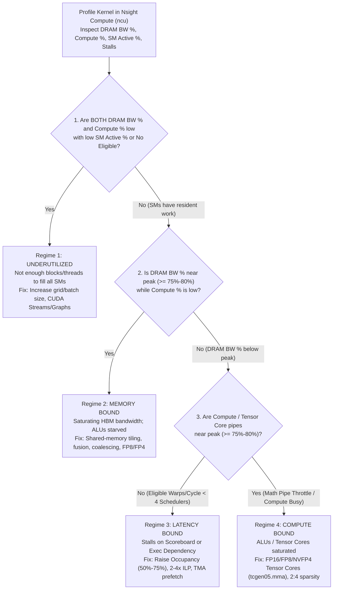

# 10.14 Occupancy, warp efficiency and instruction-level parallelism

| | |
|---|---|
| Level | Advanced |
| Priority tier | 2 |
| Lab venue | Nebius GPU |
| Part | Part 10: The GPU and CUDA |
| Sources used | *AI Systems Performance Engineering* (`ai-systems-performance-engineering`, Chris Fregly), Chapter 8 (pp. 253–294) |
| Coverage file | `planning/coverage/chapters/10-14.md` |
| Claim ledger | `planning/ledgers/10-14.md` |

## Why this matters for AI infrastructure

In Chapter `10.13`, we aligned global memory accesses onto 128-byte cache lines (`4.0` sectors per request), packed scalar loads into `16-byte` (`float4`) and `32-byte` (`float8`) vectors, staged tiles in conflict-free Shared Memory (`tile[32][33]`), and offloaded bulk copies to the Tensor Memory Accelerator (`TMA`).

Even after you fix every memory-layout defect, a GPU kernel can still run far below hardware peak if its Streaming Multiprocessors (`SMs`) lack enough runnable work to hide instruction and memory latency, or if its 32-thread warps waste cycles executing divergent branches and serialized dependency chains. As shown in *AI Systems Performance Engineering* Chapter 8 (*Occupancy Tuning, Warp Efficiency, and Instruction-Level Parallelism*, pp. 253–294):
- **The Four Execution Regimes (`Underutilized → Latency Bound → Memory Bound → Compute Bound`, Table 8-2):** If Nsight Compute (`ncu`) shows low DRAM bandwidth (`< 30%`) *and* low ALU/Tensor Core utilization (`< 30%`), the kernel is not memory-bandwidth bound—it is either **underutilized** (grid too small to fill all SMs) or **latency bound** (`Stall: Long Scoreboard`, `Short Scoreboard`, or `Exec Dependency` dominating because **`Eligible Warps per Cycle`** is lower than the SM's **`4` warp schedulers**).
- **The Occupancy Balance (`64` warps = `2,048` threads/SM vs register spilling):** On Ampere (`A100`), Hopper (`H100`/`H200`), and Blackwell (`B200`, compute capability `10.0`), each SM tracks up to **`64` resident warps (`2,048` threads)** (`48` warps = `1,536` threads/SM on `NVIDIA RTX PRO 6000` and `Spark DGX GB10` at compute capability `12.x`). At **`30%` achieved occupancy**, only **`~19` warps** are active per SM. Guiding the compiler with **`__launch_bounds__(256, 8)`** caps per-thread registers at **`65,536 // 2,048 = 32` registers/thread** so all `8` blocks (`2,048` threads = `100%` occupancy) fit on the SM; whereas pushing `-maxrregcount` too low spills registers into slow Local Memory (`HBM`), causing `Long Scoreboard` stalls.
- **The 2x Warp-Divergence Penalty (`30 ms → 15 ms`, Table 8-3):** When a threshold kernel (`if (X[i] > threshold)`) splits a 32-thread warp 50/50 between `if` and `else`, SIMT lockstep execution runs both branches serially (`50%` **Warp Execution Efficiency**, `50%` **Predicated-Off Threads**, `600M` dynamic instructions, `200` cycles branch-resolving stall latency, `30 ms` runtime). Replacing the branch with **predication (`?:` ternary select / PTX `@p` or PyTorch `torch.maximum` / `torch.where`)** cuts dynamic instructions in half (`600M → 300M`), halves branch stall latency (`200 → 100` cycles), lifts warp execution efficiency to **`99%`** (`0%` predicated-off threads), and halves runtime to **`15 ms` (`-50%`)**.
- **How Instruction-Level Parallelism (`ILP`) Cuts Required Occupancy by `3x` (Table 8-4):** With **`1`-way ILP** (no independent ops per thread), saturating a Blackwell SM requires **`~1,536` threads (`48` warps = `75%` occupancy)**. Exposing **`2`-way ILP** drops the requirement to **`~1,024` threads (`32` warps = `50%` occupancy)**, **`3`-way ILP** to **`~768` threads (`24` warps = `37.5%`)**, and **`4`-way ILP** to just **`~512` threads (`16` warps = `25%` occupancy)** while raising per-scheduler Instructions Per Cycle (**`IPC`**) from **`1.0` to `1.8`**.

Two cautions before the details. First, *AI Systems Performance Engineering* says directly that the numeric values in its metric tables (including Tables 8-3 and 8-4 used here) are illustrative and explain concepts, so none of them were rerun for this handbook. Second, some numbers in this chapter are rules of thumb added here, not figures from the book: the regime thresholds in the Table 8-2 diagram (below `30%`, at or above `75%` to `80%`), the order of the four regimes, the `Eligible Warps per Cycle < 4` test, and the `50%` to `75%` occupancy target. The book's Table 8-2 lists the four limiting factors (memory bound, compute bound, latency bound, underutilizing) with qualitative indicators only, and the book says there is no universal occupancy target and that many high-performance kernels hide latency at `25%` to `50%` achieved occupancy.

This chapter covers the complete Nsight Systems (`nsys`), Nsight Compute (`ncu`), and `torch.profiler` (`Kineto` / `CUPTI`) diagnostic workflow, all **10 Nsight Compute warp stall reasons** (Table 8-1), the **4 kernel performance regimes** (Table 8-2), **occupancy tuning (`__launch_bounds__`, `-maxrregcount`, `cudaOccupancyMaxPotentialBlockSize`)**, **eliminating warp divergence (predication, warp-unanimous branches, `__ballot_sync`)** (Table 8-3), and **exposing Instruction-Level Parallelism (`ILP`)** on Blackwell's unified INT32/FP32 cores (Table 8-4).

:::tip In one minute
- **Two-step profiler workflow (`nsys` → `ncu` + `torch.profiler`):**
  1. Use **Nsight Systems (`nsys`)** with `NVTX` ranges (`torch.cuda.nvtx`) to spot system-level CPU dataloader gaps, stream serialization, and hot kernels.
  2. Zoom into hot kernels with **Nsight Compute (`ncu`, compiled with `-lineinfo`)** to inspect Roofline arithmetic intensity, **Warp State Statistics (warp stall reasons)**, and **Occupancy Limiters** (`Registers`, `Shared Memory`, `Blocks`, `Threads`). (`torch.profiler` uses `Kineto` + `CUPTI` + Linux `perf`; its `with_flops=True` is formula-based, not hardware counters.)
- **Top Nsight Compute Warp Stall Reasons (Table 8-1):**
  - **`Stall: Long Scoreboard`:** Waiting on high-latency global DRAM (`HBM`) or spilled local-memory loads (`~800` cycles).
  - **`Stall: Short Scoreboard`:** Waiting on Shared Memory (`SMEM`) or SFU/MUFU returns (`~20–30` cycles).
  - **`Stall: Exec Dependency`:** Waiting on a previous instruction's register output inside the *same* thread (low **ILP**).
  - **`Stall: Memory Throttle` / `Math Pipe Throttle` (`Compute Unit Busy`):** Memory queues or ALU/Tensor Core pipelines are 100% saturated.
  - **`Stall: Synchronization`:** Waiting at `__syncthreads()` or cluster barriers.
  - **`Stall: Not Selected`:** Warp is ready to issue, but the scheduler picked another ready warp that cycle—**healthy sign of high occupancy**.
- **Occupancy vs. ILP (`Table 8-4`):**
  - Max resident warps/SM = **`64` (`2,048` threads)** on Ampere/Hopper/Blackwell (`48` warps = `1,536` threads on `RTX PRO 6000` / `Spark DGX GB10`).
  - Rule of thumb used in this chapter (the book gives no universal target and notes that many kernels hide latency at `25%`–`50%`): aim for roughly **`50%–75%` occupancy (`32–48` warps)** using `128–256` threads/block, `__launch_bounds__(256, 8)` (`<= 32` regs/thread), or **`2`-to-`4`-way ILP** (`1,536 → 1,024 → 768 → 512` threads/SM needed for saturation).
- **Blackwell Unified Core Dual-Issue Rule (*ASP* Ch 8, pp. 266, 283):**
  - On Blackwell, `INT32` and `FP32` cores are unified into a single core per lane that executes *either* `FP32` *or* `INT32` in a given cycle—**never both on the same core in the same cycle**. Dual-issue pairs **one arithmetic op (`FP32`/`INT32`/Tensor Core) + one memory (`LD/ST`) op** from the same warp.
:::

---

## Prerequisites and outcomes

**Prerequisites:** Chapters `10.2`–`10.5` (SIMT warps, memory hierarchy, Tensor Cores, Roofline model) and Chapters `10.11`–`10.13` (CUDA kernels, streams, and memory access patterns).

**Outcomes:** After completing this chapter, you will be able to:
1. Diagnose any CUDA or PyTorch kernel using **Nsight Systems (`nsys`)**, **Nsight Compute (`ncu`)**, and **`torch.profiler` (`Kineto`/`CUPTI`)**, mapping all **10 warp stall reasons** (Table 8-1) onto the **4 execution regimes (`Underutilized`, `Latency Bound`, `Memory Bound`, `Compute Bound`)** (Table 8-2).
2. Calculate theoretical and achieved **SM occupancy** across `64`-warp (`A100`/`H100`/`B200`) and `48`-warp (`RTX PRO 6000` / `GB10`) architectures, interpret **`Eligible Warps per Cycle`** vs **`Active Warps per Scheduler`**, and tune occupancy with **`__launch_bounds__`**, **`-maxrregcount`**, and **`cudaOccupancyMaxPotentialBlockSize()`**.
3. Eliminate **SIMT warp branch divergence** using **warp-unanimous conditions (`threadIdx.x / 32`)**, **warp-vote intrinsics (`__ballot_sync`, `__any_sync`, `__all_sync`)**, and **predication (`?:` / PTX `@p` / `torch.maximum` / `torch.where`)** (`30 ms → 15 ms`, Table 8-3).
4. Expose **2-to-4-way Instruction-Level Parallelism (`ILP`)** via dependency-chain reordering, loop unrolling (`#pragma unroll`), and multiple accumulators, respecting Blackwell's **unified `INT32`/`FP32` core dual-issue rule** and register-pressure boundary (Table 8-4).

---

## 1. Profiling Bottlenecks, Nsight Compute Warp Stall Reasons, and the Four Execution Regimes

### 1.1 The two-tier profiling stack: Nsight Systems (`nsys`), Nsight Compute (`ncu`), and `torch.profiler` (`Kineto`)

As established in *AI Systems Performance Engineering* Chapter 8 (*Profiling and Diagnosing GPU Bottlenecks*, pp. 254–258; expanded with full CLI recipes in Chapter `10.20`), GPU performance engineering always proceeds top-down from the **system timeline** to the **per-kernel hardware counters**:
1. **Nsight Systems (`nsys`) + `NVTX` annotations (`torch.cuda.nvtx`):** Captures the end-to-end timeline of CPU dataloader threads, Python call stacks, `H2D`/`D2H` DMA transfers, stream concurrency, and user-defined `NVTX` push/pop ranges (such as `"forward_pass"` and `"backward_pass"`). If the GPU sits idle while CPU threads prepare batches, the bottleneck is upstream in the data pipeline—not inside the CUDA kernel.
2. **PyTorch Profiler (`torch.profiler`, powered by `Kineto` + `CUPTI` + Linux `perf`):** Merges Python operator timings with `CUPTI` GPU kernel launches and exports Chrome traces (`chrome://tracing` / Perfetto). Note that `torch.profiler.profile(..., with_flops=True, profile_memory=True)` computes **formula-based FLOP estimates** for known operators (like `matmul`) rather than reading hardware PMU counters (*ASP* Ch 8, p. 256 & p. 291).
3. **Nsight Compute (`ncu`, compiled with `nvcc -lineinfo`):** Replays individual hot kernels to collect hardware performance counters across the SMs, L1/SMEM, L2 (`126 MB` on Blackwell), and HBM, plotting the kernel on the **Roofline chart** and breaking down **Warp State Statistics (Warp Stall Reasons)** per C++/PTX/SASS source line.

### 1.2 Decoding Nsight Compute's Warp Stall Reasons (Table 8-1)

Every clock cycle, each of the **4 warp schedulers** on a Blackwell/Hopper SM inspects its resident warps and tries to issue one (or two dual-issued) instructions from an **eligible warp**. When a warp is *not* eligible to issue an instruction on a given cycle, Nsight Compute records the exact hardware stall reason (*AI Systems Performance Engineering* Ch 8, *Analyzing Warp Stall Reasons with Nsight Compute* & **Table 8-1**, pp. 258–262; `classify_ncu_stall_and_regime()` in `code/part10/occupancy_warp_ilp.py`):

| Nsight Compute Warp Stall Reason | Hardware Meaning & Cause (*ASP* Ch 8, pp. 258–261 & Table 8-1) | Primary Optimization Remedy |
|---|---|---|
| **`Stall: Long Scoreboard`** | Warp is waiting on a **long-latency global memory (`HBM` / `L2`) load**—or a spilled **Local Memory** read/write—to arrive in registers (`~800` cycles). | Coalesce/vectorize loads, cache tiles in Shared Memory, prefetch asynchronously with **`TMA` (`cuda::memcpy_async`)**, or raise occupancy / ILP. |
| **`Stall: Short Scoreboard`** | Warp is waiting on a **variable-latency Shared Memory (`SMEM`) load** (`~20–30` cycles, exacerbated by bank conflicts) or Special Function Unit (**`SFU`**) math result. | Eliminate shared-memory bank conflicts (`tile[32][33]` padding or swizzling) and interleave independent instructions (`ILP`). |
| **`Stall: Exec Dependency`** | Warp is waiting on the register output of a **prior arithmetic/ALU instruction inside the same thread** (sequential instruction dependency chain). | Expose **2-to-4-way ILP** (`#pragma unroll`, multiple accumulators, reorder independent `u = x*x; v = y*y` ops before dependent uses). |
| **`Stall: Memory Throttle`** | The SM's Load/Store (`LD/ST`) memory request queues are completely full; no new memory transactions can be issued this cycle. | Coalesce and vectorize (`float4` / `float8`) to issue fewer, wider transactions; stage reusable data in registers/SMEM. |
| **`Stall: Compute Unit Busy` / `Math Pipe Throttle`** | FP32/INT32 ALU pipelines or **Tensor Core (`MMA`) pipelines** are 100% saturated; warps are ready, but math pipes cannot accept more work. | Kernel is **compute-bound**: switch to lower precision (`FP16` → `FP8` → `NVFP4`/`MXFP4`), use Tensor Cores (`tcgen05.mma`), or enable 2:4 sparsity. |
| **`Stall: Synchronization` (`Barrier`)** | Warp is paused at a **`__syncthreads()`** or cluster barrier waiting for slower warps in the block/cluster to arrive. | Remove redundant barriers, balance work across warps, or replace shared-memory reductions with **`__shfl_down_sync`** warp shuffles. |
| **`Stall: Instruction Fetch / Issue`** | Instruction cache (`I-cache`) miss or instruction decode/dispatch bottleneck (often caused by excessive loop unrolling bloating binary size). | Dial back `#pragma unroll` factor or split giant monolithic kernels. |
| **`Stall: Texture Throttle`** | Texture cache / sampling pipeline is saturated by `tex1Dfetch` / `tex2D` requests. | Use `const __restrict__` L1 read-only cache or shared-memory tiling. |
| **`Stall: Not Selected`** | **The warp WAS eligible and ready to issue**, but the scheduler picked *another* eligible warp in the same partition this cycle. | **Healthy indicator of high occupancy.** No action needed unless one warp monopolizes issue slots. |
| **`No Eligible` / `Idle`** | Scheduler had **zero eligible warps** to issue this cycle because too few blocks/warps were launched or all warps are stalled. | Increase grid/batch size, tune occupancy (`__launch_bounds__`), or expose per-thread ILP. |

### 1.3 The Four Kernel Execution Regimes (`Underutilized → Latency Bound → Memory Bound → Compute Bound`, Table 8-2)

As you iteratively tune a kernel, it typically progresses through four distinct performance regimes (*AI Systems Performance Engineering* Ch 8, *Iteratively Profiling and Determining the Kernel Bottleneck* & **Table 8-2**, pp. 265–268):



---

## 2. Occupancy Tuning: Hardware Limits, `Eligible Warps`, `__launch_bounds__`, and the Occupancy API

### 2.1 Theoretical vs. Achieved Occupancy (`64` warps on `B200` vs `48` warps on `RTX PRO 6000` / `GB10`)

**Occupancy** is the ratio of active warps resident on an SM to the maximum number of warps the SM hardware can host (`calc_sm_occupancy_and_limiters()` in `code/part10/occupancy_warp_ilp.py`; *AI Systems Performance Engineering* Ch 8, pp. 262–274):
- **Data-center Ampere (`A100`), Hopper (`H100`/`H200`), and Blackwell (`B200`, CC `10.0`):** Each SM supports up to **`64` resident warps (`2,048` threads)**, `32` thread blocks, `65,536` (`64K`) 32-bit registers (`max 255` regs/thread), and `228 KB` (`227 KB` usable) Shared Memory. If Nsight Compute reports **`30%` achieved occupancy** on a `B200` SM, only **`~19` warps** are active per SM on average (*ASP* Ch 8, p. 262).
- **Workstation / Desktop Blackwell (`NVIDIA RTX PRO 6000` and `Spark DGX` with the `GB10` Superchip, CC `12.x`):** Supports a higher compute capability number (`12.x`), but allows at most **`48` resident warps (`1,536` threads) per SM** (*ASP* Ch 8, p. 269).

Why is **100% occupancy NOT always the goal**?
- Going from **`10%` to `50%` occupancy** on a memory- or latency-bound kernel yields a massive speedup because the SM's **4 warp schedulers** finally have enough warps to hide DRAM stalls.
- Look at two Nsight Compute counters together (*ASP* Ch 8, p. 270): **`Active Warps per Scheduler`** and **`Eligible Warps per Cycle`**. Because a Blackwell SM has `4` warp schedulers, if `Eligible Warps per Cycle < 4`, the schedulers frequently run out of ready warps to issue when a warp stalls. Once **`50%–75%` occupancy (`32–48` warps/SM)** keeps `Eligible Warps per Cycle >= 4`, pushing occupancy to `100%` by shrinking registers per thread often *hurts* performance by causing **register spilling to Local Memory (`HBM`)** or reducing per-thread ILP.

### 2.2 Controlling occupancy with `__launch_bounds__`, `-maxrregcount`, and `cudaOccupancyMaxPotentialBlockSize`

When Nsight Compute reports **"Limited by Registers per Thread"** (for example, `256` threads/block × `80` regs/thread = `20,480` regs/block, which fits only `65,536 // 20,480 = 3` blocks = `24` warps = `37.5%` occupancy), you have three tools to tune register allocation and block sizing (*AI Systems Performance Engineering* Ch 8, pp. 271–274; `evaluate_launch_bounds()` in `code/part10/occupancy_warp_ilp.py`):

1. **Kernel-specific `__launch_bounds__(maxThreadsPerBlock, minBlocksPerSM)` (*ASP* Ch 8, p. 272):**
   ```cpp
   __global__ __launch_bounds__(256, 8)
   void myKernel(const float* __restrict__ in, float* __restrict__ out, int N) {
       // Promising maxThreadsPerBlock = 256 and minBlocksPerSM = 8 targets
       // 256 * 8 = 2,048 threads/SM (64 warps = 100% occupancy on B200).
       // nvcc automatically caps register usage at 65,536 / 2,048 = 32 regs/thread!
   }
   ```
2. **File-wide compiler flag `-maxrregcount=<N>`:** Caps registers per thread across the translation unit, but if `<N>` is set too low, `nvcc` spills excess live variables to Local Memory (`HBM`).
3. **Runtime CUDA Occupancy API (`cudaOccupancyMaxPotentialBlockSize`, *ASP* Ch 8, p. 273):**
   Queries the driver at runtime to pick the `bestBlockSize` and `minGridSize` for the compiled kernel's exact register and dynamic shared-memory footprint:
   ```cpp
   int minGridSize = 0, bestBlockSize = 0;
   cudaOccupancyMaxPotentialBlockSize(&minGridSize, &bestBlockSize,
                                      myKernel, /*dynamicSmemBytes=*/0, /*blockSizeLimit=*/0);
   myKernel<<<minGridSize, bestBlockSize>>>(d_in, d_out, N);
   ```
   *(In PyTorch, enable **`torch.compile(mode="max-autotune")`** or **`mode="reduce-overhead"`**—or `mode="max-autotune-no-cudagraphs"` when graphs are undesired—and **`torch.optim.AdamW(..., fused=True)`** so `TorchInductor` fuses tiny elementwise/optimizer launches into high-occupancy kernels, *ASP* Ch 8 p. 274.)*

---

## 3. Improving Warp Execution Efficiency: Branch Divergence, Predication, and Warp Intrinsics

### 3.1 How SIMT branch divergence serializes warps (`50/50` split vs `1 vs 31` split)

In Nsight Compute, **Warp Execution Efficiency** measures the average percentage of the 32 lanes in an active warp that are predicated *on* (doing useful work) per executed instruction (*AI Systems Performance Engineering* Ch 8, *Improving Warp Execution Efficiency (Warp Divergence)*, pp. 274–281).

Because all 32 threads in a warp share a single instruction pointer under **SIMT**, what happens when a kernel executes a data-dependent `if / else` branch (`threshold_naive.cu`, *ASP* Ch 8, p. 278)?
```cpp
// BEFORE: Divergent branch (threshold_naive.cu)
if (X[i] > threshold) {
    Y[i] = X[i]; // Pass 1: active only for lanes where X[i] > threshold
} else {
    Y[i] = 0.0f; // Pass 2: active only for lanes where X[i] <= threshold
}
```
- **50/50 split (`16` lanes take `if`, `16` lanes take `else`):** The warp executes Pass 1 with `16` lanes active and `16` lanes masked off (`Predicated-Off Threads = 50%`), then executes Pass 2 with the other `16` lanes active. Dynamic instruction count doubles, and **Warp Execution Efficiency drops to `50%`**.
- **1 vs 31 split (`1` lane takes `if`, `31` lanes take `else`):** During Pass 1, **`31 of 32` lanes (`96.88%`) sit completely idle** while the single divergent thread runs its branch.

### 3.2 Five techniques to eliminate warp divergence and Nsight Compute Table 8-3 (`30 ms → 15 ms`)

As cataloged in *AI Systems Performance Engineering* Chapter 8 (pp. 276–281), you can eliminate intra-warp divergence using five patterns:
1. **Predication (`?:` ternary operator / PTX `@p` conditional select, or `torch.maximum` / `torch.where` in PyTorch):**
   For short, lightweight branches (like ReLU / thresholding), replace `if / else` with a ternary expression (`threshold_predicated.cu`, *ASP* Ch 8, p. 279):
   ```cpp
   // AFTER: Predicated select (compiles to PTX @p selp / conditional move with 0 branches)
   float x = X[i];
   Y[i] = (x > threshold) ? x : 0.0f;
   ```
   In PyTorch, write `Y = torch.maximum(X, torch.zeros_like(X))` (or `torch.where`), wrapped in `@torch.compile()`.
2. **Warp-unanimous branching (`warpId = threadIdx.x / 32`):**
   Remember that divergence **only occurs within a single 32-thread warp**—different warps can take different branches with **zero divergence penalty**. Writing `int warpId = threadIdx.x / 32; if (warpId % 2 == 0) { /* Task A */ } else { /* Task B */ }` guarantees all 32 lanes in any given warp take the exact same branch (`100%` warp execution efficiency).
3. **Warp-vote intrinsics (`__ballot_sync`, `__any_sync`, `__all_sync`):**
   Let all 32 lanes vote in a single register instruction on whether any/all lanes need special handling (`__any_sync(mask, cond)`), or build a 32-bit bitmask of active lanes (`__ballot_sync(mask, cond)`) to compact work into active lanes instead of diverging the warp.
4. **Data sorting / partitioning outside the inner loop:** Group positive and negative (or similar-length) inputs before kernel launch so each warp processes homogeneous data.
5. **Splitting heavy branches into separate kernels:** When the `if` and `else` bodies contain hundreds of instructions, computing both paths via predication wastes ALU cycles; instead, use stream compaction / prefix sum and launch two specialized kernels.

Look at the Nsight Compute results when replacing `threshold_naive` with `threshold_predicated` (*AI Systems Performance Engineering* Ch 8, **Table 8-3**, p. 280; `TABLE_8_3_PREDICATION` in `code/part10/occupancy_warp_ilp.py`):

| Nsight Compute Metric (`ncu` Counter) | Before (`threshold_naive` `if/else`) | After (`threshold_predicated` `?:` / `max`) | Improvement |
|---|---:|---:|---|
| **Kernel Execution Time (`gpu__time_elapsed.avg`)** | `30 ms` | **`15 ms`** | **`-50%` (`2.0x` faster)** |
| **Dynamic Instruction Count (`smsp__inst_executed.sum`)** | `600 M` instructions | **`300 M` instructions** | **`-50%`** (single pass instead of two serial passes) |
| **Avg Warp Branch-Resolving Stall Latency** | `200` cycles | **`100` cycles** | **`-50%`** (`smsp__average_warp_latency_issue_stalled_branch_resolving`) |
| **Warp Execution Efficiency** | `50%` | **`99%`** | Nearly all 32 lanes active on every cycle |
| **Predicated-Off Threads (`%`)** | `50%` | **`0%`** | Zero masked-off lane passes |

---

## 4. Exposing Instruction-Level Parallelism (`ILP`), Blackwell Dual-Issue Rules, and Register Pressure

### 4.1 How ILP hides latency within a single warp and cuts required occupancy (`Table 8-4`)

Occupancy hides latency **across different warps** (Thread-Level Parallelism, `TLP`), whereas **Instruction-Level Parallelism (`ILP`)** hides latency **within a single warp** by issuing multiple *independent* loads and arithmetic instructions back-to-back before consuming their results (*AI Systems Performance Engineering* Ch 8, *Exposing Instruction-Level Parallelism*, pp. 282–290).

Look at how breaking a false sequential dependency chain unlocks ILP (*ASP* Ch 8, pp. 284–285):
```cpp
// BAD (Serial Dependency Chain -> Stall: Exec Dependency):
float u = x * x;
float temp = u + 1.0f; // Stalls waiting for u = x * x to finish BEFORE v = y * y can even issue!
float v = y * y;

// GOOD (Reordered Independent Ops -> 2-Way ILP):
float u = x * x;       // Issues on cycle t
float v = y * y;       // Independent of u! Issues immediately on cycle t+1 while u is in flight
float temp = u + 1.0f; // By the time temp issues, u has already progressed through the pipeline
```

Similarly, unrolling a 4-step dot-product loop (`#pragma unroll`) so that a thread issues **four independent loads (`a0, a1, a2, a3`)** followed by **four independent multiplies (`sum0..sum3`)** overlaps all four DRAM/L1 fetches in flight simultaneously (*ASP* Ch 8, p. 287).

As quantified in *AI Systems Performance Engineering* Chapter 8 (**Table 8-4**, p. 286; `ILP_SATURATION_TABLE` in `code/part10/occupancy_warp_ilp.py`), increasing per-thread ILP dramatically lowers the number of resident threads and warps needed to saturate a Blackwell SM (`2,048` max threads = `64` warps):

| `ILP` (Independent Ops per Thread) | Active Threads per SM Required for `~100%` Utilization | Active Warps per SM Required | Required SM Occupancy (`% of 2,048 threads`) | Operational Takeaway (*ASP* Ch 8, pp. 286–287) |
|---:|---:|---:|---:|---|
| **`1` (No ILP)** | **`~1,536` threads** | **`48` warps** | **`75.0%`** | Requires high occupancy (`48` warps) to hide stalls across warps. |
| **`2`-Way ILP** | **`~1,024` threads** | **`32` warps** | **`50.0%`** | Each warp keeps `2` ops in flight; saturates SM at `50%` occupancy. |
| **`3`-Way ILP** | **`~768` threads** | **`24` warps** | **`37.5%`** | Saturates SM with `24` warps (`37.5%` occupancy). |
| **`4`-Way ILP** | **`~512` threads** | **`16` warps** | **`25.0%`** | **`3x` fewer warps** (`16` vs `48`) needed to saturate the SM; beyond `4`-way (`5–6`-way), register pressure and decode limits yield diminishing returns. |

### 4.2 Blackwell's Unified `INT32`/`FP32` Core Dual-Issue Rule and Register Pressure

When tuning ILP and dual-issue on Blackwell (`B200`/`B300`), keep two hardware rules in mind (*AI Systems Performance Engineering* Ch 8, pp. 266, 283, 288–290):
1. **Blackwell Unified `INT32`/`FP32` Core Rule (`no same-core INT32 + FP32 dual-issue`):**
   On Ampere and Hopper, separate `INT32` and `FP32` datapaths allowed issuing an `INT32` pointer-arithmetic instruction alongside an `FP32` math instruction. On **Blackwell**, the `FP32` and `INT32` pipelines were merged into **unified CUDA cores** that can execute *either* `FP32` *or* `INT32` in a given clock cycle—**never both on the same core in the same cycle** (*ASP* Ch 8, pp. 266, 283). Instead, each of the SM's `4` warp schedulers dual-issues **one arithmetic instruction (`FP32`, `INT32`, or Tensor Core) + one memory (`LD/ST`) instruction** (or overlaps `SFU` operations) from the same warp.
2. **Monitoring IPC (`1.0 → 1.8`) vs Register Pressure:**
   When `#pragma unroll` and ILP succeed, Nsight Compute shows **`Stall: Exec Dependency` dropping** and per-scheduler **Instructions Per Cycle (`IPC`) rising (for example, from `1.0` to `1.8` instructions/cycle per scheduler, *ASP* Ch 8 p. 289)**. However, each unrolled accumulator (`a0..a3`, `sum0..sum3`) consumes extra registers. If Nsight Compute flips to **"Limited by Registers"** (or spills to Local Memory), dial back the unroll factor (`#pragma unroll 2` or `4`) to balance ILP against occupancy.

---

## 5. Commands and Profiling Workflows That Matter

All commands below follow *AI Systems Performance Engineering* Chapter 8 (pp. 255–291). Because this handbook builds without an attached GPU, `nsys`, `ncu`, and `nvidia-smi` commands are marked **(untested here)**.

### 5.1 System timeline (`nsys` + `NVTX`), kernel stall analysis (`ncu`), and power-throttle check (untested here)

```bash
# 1. Capture Nsight Systems timeline filtered to NVTX ranges (ASP Ch 8 p. 255) (untested here)
nsys profile --trace=cuda,nvtx,osrt,cudnn,cublas \
  --capture-range=nvtx --nvtx-capture="forward_pass" \
  --force-overwrite=true -o timeline_report python3 train.py

# 2. Compile with -lineinfo and profile Warp Stall Reasons, Occupancy, IPC, and Branch Divergence in Nsight Compute (untested here)
nvcc -O3 -lineinfo -arch=sm_90 kernels.cu -o kernels
ncu --set full --section WarpStateStats --section Occupancy \
    --section SourceCounters --section SpeedOfLight_RooflineChart \
    -o kernel_report ./kernels

# 3. Monitor real-time power draw, SM/memory clocks, and power-capping throttle reasons during near-peak compute runs (ASP Ch 8 p. 265) (untested here)
nvidia-smi --query-gpu=power.draw,clocks.current.sm,clocks.current.memory,clocks_event_reasons.active \
  --format=csv -l 1
```

---

## 6. How It Fails: Six Production Occupancy, Warp-Divergence, and ILP Failure Modes

| # | Failure Mode | Nsight Compute / Profiler Symptom | Root Cause | Fix |
|---|---|---|---|---|
| **1** | **Severe register pressure or aggressive `-maxrregcount` spilling** | Either theoretical occupancy drops to `12.5%–25%` (`Limited by Registers per Thread`), or `Stall: Long Scoreboard` and Local Memory traffic spike despite coalesced global loads. | Heavy per-thread live variables or `#pragma unroll` consumed `> 64–128` regs/thread (`65,536` regs/SM ceiling), or `-maxrregcount` was set too low and spilled registers to `HBM` (*ASP* Ch 8, pp. 271–273, 288). | Add **`__launch_bounds__(256, 8)`** (`<= 32` regs/thread for `2,048` threads/SM) or moderate bounds (`__launch_bounds__(256, 4)` = `64` regs/thread, `50%` occ), and dial back excessive unrolling. |
| **2** | **Latency-bound kernel with low `Eligible Warps per Cycle` (`< 4`)** | Both DRAM bandwidth (`< 30%`) and Compute utilization (`< 30%`) are low, and `Stall: Long Scoreboard` or `Stall: Exec Dependency` dominates (Table 8-2). | `Eligible Warps per Cycle` is below the SM's `4` warp schedulers (`< 4`), so when warps stall on a DRAM load or ALU dependency, no ready warp is available to issue (*ASP* Ch 8, p. 270). | Raise occupancy to `50%–75%` (`32–48` warps/SM) **and** expose `2`-to-`4`-way per-thread **ILP** (Table 8-4) so each warp keeps multiple independent loads/math ops in flight. |
| **3** | **2x SIMT branch divergence in elementwise conditionals (`30 ms` vs `15 ms`)** | `Warp Execution Efficiency = 50%`, `Predicated-Off Threads = 50%`, `smsp__inst_executed.sum = 600M` (double expected), `200`-cycle branch stall latency (Table 8-3). | Data-dependent `if (X[i] > threshold)` splits warps so each warp executes both branches serially with masked-off lanes (*ASP* Ch 8, pp. 278–280). | Replace short branches with **predication (`?:` ternary select / PTX `@p`, or `torch.maximum` / `torch.where` + `@torch.compile`)**, cutting instructions to `300M` and runtime to **`15 ms` (`-50%`)**. |
| **4** | **Serial instruction dependency chain inside a thread (`Exec Dependency`)** | Occupancy is healthy (`>= 50%`), yet `IPC` is stuck near `1.0` per scheduler and `Stall: Exec Dependency` is the top stall reason. | Thread computes `u = x * x;` and immediately uses `u` (`temp = u + 1.0f;`) *before* issuing independent work `v = y * y;` (*ASP* Ch 8, p. 285). | Reorder independent operations back-to-back (`u = x * x; v = y * y; temp = u + 1.0f;`) and unroll small loops with separate accumulators (`sum0..sum3`), lifting scheduler `IPC` toward **`1.8`**. |
| **5** | **Assuming `INT32` + `FP32` dual-issue on Blackwell unified cores** | A kernel tuned on Ampere/Hopper to interleave `INT32` loop/address math with `FP32` math fails to dual-issue those two instructions on the same lane on Blackwell (`B200`). | On Blackwell (`sm_100`), `INT32` and `FP32` execution units are merged into **unified CUDA cores** that execute *either* `FP32` *or* `INT32` per cycle (*ASP* Ch 8, pp. 266, 283). | Pair **one math instruction (`FP32`, `INT32`, or Tensor Core) with one memory (`LD/ST`) instruction** for per-scheduler dual-issue, and use multi-warp concurrency for mixed `INT32`/`FP32` streams. |
| **6** | **Trusting `torch.profiler` `with_flops=True` as hardware counter truth or ignoring power throttling** | Either custom CUDA/Triton kernels show `0` FLOPs in `torch.profiler`, or a compute-bound kernel slows down mid-run despite identical code. | `torch.profiler` (`Kineto`) estimates FLOPs from high-level operator formulas (`matmul`/`conv`) rather than GPU PMU counters (*ASP* Ch 8, p. 256); and sustained near-peak compute can hit TDP and trigger `HW Slowdown` / `SW Power Cap` clock throttling (p. 265). | Measure actual hardware FLOPs and pipe utilization in **Nsight Compute (`ncu`)**, and monitor `nvidia-smi --query-gpu=power.draw,clocks.current.sm,clocks_event_reasons.active -l 1` during benchmarks. |

---

## 7. Hands-On Lab: Verify SM Occupancy Limiters, `__launch_bounds__`, Nsight Compute Stall Regimes, Predication, and ILP Tables

**Venue:** Any Linux machine or Nebius GPU VM with Python 3.10+ (runs deterministically using standard library Python; all `nsys`, `ncu`, and `nvidia-smi` commands are provided in Section 5 and marked `(untested here)`).

Run `code/part10/occupancy_warp_ilp_lab.py`:

```bash
python3 code/part10/occupancy_warp_ilp_lab.py
```

Expected output (`25 passed, 0 failed`):

```text
=== Chapter 10.14 Lab: Occupancy, Warp Efficiency & Instruction-Level Parallelism (ASP Ch 8) ===
  [PASS] ASP Ch8 p.262: 30% achieved occupancy on a 64-warp (2,048-thread) SM corresponds to ~19 active warps/SM
  [PASS] ASP Ch8 p.269: RTX PRO 6000 / Spark DGX GB10 (CC 12.x) allows 48 warps (1,536 threads) per SM
  [PASS] ASP Ch8 p.263: 80 regs/thread * 256 = 20,480 regs/block caps 65,536-reg SM at 3 blocks (24 warps = 37.5%) -> LIMITED_BY_REGISTERS_PER_THREAD
  [PASS] ASP Ch8 p.263: 64 KB SMEM/block on 227 KB usable SMEM caps SM at 3 blocks (24 warps = 37.5%) -> LIMITED_BY_SHARED_MEMORY_PER_BLOCK
  [PASS] ASP Ch8 p.272: __launch_bounds__(256, 8) targets 8 * 256 == 2,048 threads/SM (64 warps, 100% occ) and caps regs at 65,536 // 2,048 == 32 regs/thread
  [PASS] ASP Ch8 Table 8-2: Low SM Active (35%) + NO_ELIGIBLE_IDLE stall classifies as UNDERUTILIZED
  [PASS] ASP Ch8 Table 8-2: Near-peak DRAM (92%) + low compute (18%) + LONG_SCOREBOARD classifies as MEMORY_BOUND
  [PASS] ASP Ch8 Table 8-2: High compute pipe (88%) + MATH_PIPE_THROTTLE classifies as COMPUTE_BOUND
  [PASS] ASP Ch8 Tables 8-1 & 8-2: Low DRAM (22%) + low compute (28%) + EXEC_DEPENDENCY (eligible warps 1.4 < 4) classifies as LATENCY_BOUND and recommends ILP
  [PASS] ASP Ch8 Table 8-1: Low DRAM (25%) + LONG_SCOREBOARD classifies as LATENCY_BOUND waiting on individual DRAM loads
  [PASS] ASP Ch8 Table 8-1: SYNCHRONIZATION_BARRIER stall recommends reducing __syncthreads() or using __shfl_down_sync
  [PASS] ASP Ch8 p.275: 50/50 branch split (16 vs 16 lanes) executes 2 serial passes at 50% warp execution efficiency; 1 vs 31 split idles 31 lanes in pass 1
  [PASS] ASP Ch8 Table 8-3: Predicating threshold branch cuts runtime 30 -> 15 ms (-50%), dynamic insts 600M -> 300M (-50%), branch stall 200 -> 100 cycles, lifts warp eff 50% -> 99%, and drops predicated-off threads 50% -> 0%
  [PASS] ASP Ch8 Table 8-4: ILP 1..4 requires 1536/1024/768/512 threads (48/32/24/16 warps = 75%/50%/37.5%/25% occupancy) to saturate a Blackwell SM
  [PASS] ASP Ch8 pp.266,283: Blackwell unified INT32/FP32 cores can dual-issue (FP32_MATH, LD_ST_MEMORY) but CANNOT dual-issue (INT32_MATH, FP32_MATH) on the same core in the same cycle
  [PASS] Rejects unknown gpu_profile
  [PASS] Rejects threads_per_block > 1024
  [PASS] Rejects regs_per_thread > 255
  [PASS] Rejects __launch_bounds__(512, 8) = 4,096 threads > 2,048 SM limit
  [PASS] Rejects unknown Nsight Compute stall reason
  [PASS] Rejects active_lanes_in_branch_a > 32
  [PASS] Rejects unsupported ILP table index (6)
  [PASS] ASP Ch8 p.262: 19 / 64 warps == 29.69% (~30% achieved occupancy)
  [PASS] ASP Ch8 p.289: Unrolling ILP raises scheduler IPC from 1.0 to 1.8 instructions/cycle (1.8x)
  [PASS] ASP Ch8 Table 8-4: 4-way ILP (16 warps) needs 3x fewer warps than 1-way ILP (48 warps) to saturate SM

Summary: 25 passed, 0 failed (total 25)
```

---

## Exercises

1. **Occupancy limiters and `__launch_bounds__(256, 8)` math:** On a Blackwell `B200` SM (`64` max warps = `2,048` max threads, `65,536` registers, `227 KB` usable SMEM), calculate (a) the average number of active warps when Nsight Compute reports `30%` achieved occupancy, (b) the theoretical occupancy and primary limiter for a `256`-thread block that uses `80` registers/thread and `4 KB` of shared memory, and (c) the target threads/SM, warps/SM, occupancy percentage, and maximum registers per thread enforced when you annotate the kernel with `__launch_bounds__(256, 8)`.
2. **Classifying the 4 execution regimes from Nsight Compute (`ncu`) counters:** Using Table 8-2 from *AI Systems Performance Engineering* Chapter 8, classify four kernel profiles into `UNDERUTILIZED`, `LATENCY_BOUND`, `MEMORY_BOUND`, or `COMPUTE_BOUND` and state the primary remedy for each: (a) DRAM `12%`, Compute `8%`, SM Active `35%`, top stall `No Eligible`; (b) DRAM `92%`, Compute `18%`, SM Active `95%`, top stall `Long Scoreboard`; (c) DRAM `22%`, Compute `28%`, SM Active `85%`, `Eligible Warps/Cycle = 1.4` (`< 4` schedulers), top stall `Exec Dependency`; (d) DRAM `30%`, Compute `88%`, SM Active `98%`, top stall `Math Pipe Throttle`.
3. **Eliminating warp divergence with predication (`Table 8-3`):** Explain why `if (X[i] > threshold) Y[i] = X[i]; else Y[i] = 0.0f;` executes `600M` dynamic instructions at `50%` Warp Execution Efficiency (`30 ms` runtime, `200`-cycle branch stall latency) when half of the elements exceed `threshold`, rewrite the kernel in both CUDA C++ (using predication) and PyTorch (with `@torch.compile`), and state all five resulting metrics from Table 8-3.
4. **Warp-unanimous branching vs per-lane branching:** Suppose half of the threads in a `256`-thread block must run `Task A` and half must run `Task B`. Explain why `if (threadIdx.x % 2 == 0)` causes 100% of warps to diverge (`50%` warp execution efficiency), whereas `int warpId = threadIdx.x / 32; if (warpId % 2 == 0)` causes **zero warp divergence (`100%` warp execution efficiency)**.
5. **Instruction-Level Parallelism (`ILP`) vs required occupancy (`Table 8-4`):** Using Table 8-4 from *AI Systems Performance Engineering* Chapter 8, list the active threads/SM, active warps/SM, and SM occupancy percentage needed to saturate a Blackwell SM at `ILP = 1, 2, 3, and 4`, and rewrite the dependent sequence `float u = x * x; float temp = u + 1.0f; float v = y * y;` so `u` and `v` overlap in flight.
6. **Blackwell unified `INT32`/`FP32` core dual-issue rule:** Explain why a loop that relies on dual-issuing an `INT32` instruction and an `FP32` instruction on the *same* CUDA core in the *same* clock cycle works on earlier architectures but does not dual-issue on a single Blackwell unified core, and state which instruction pairs *can* dual-issue per warp scheduler on Blackwell.

---

## Checkpoint questions (20)

<details>
<summary><strong>1. How do Nsight Systems (`nsys`), Nsight Compute (`ncu`), and `torch.profiler` (`Kineto` / `CUPTI`) divide profiling responsibilities, and why must you be careful with `torch.profiler`'s `with_flops=True` flag?</strong></summary>

- **Nsight Systems (`nsys`):** Captures the system-wide CPU/GPU timeline, dataloader gaps, `NVTX` ranges (`torch.cuda.nvtx`), and stream overlap.
- **Nsight Compute (`ncu`):** Collects hardware PMU counters for individual kernels (Roofline FLOPs/byte, warp stall reasons, occupancy limiters, source-line SASS/PTX stalls with `-lineinfo`).
- **`torch.profiler` (`Kineto` + `CUPTI` + Linux `perf`):** Correlates Python operators with GPU kernels; however, `with_flops=True` calculates **formula-based FLOP estimates** for known operators rather than reading hardware counters (*ASP* Ch 8, p. 256).
</details>

<details>
<summary><strong>2. Contrast `Stall: Long Scoreboard` against `Stall: Short Scoreboard` in Nsight Compute's Warp State Statistics.</strong></summary>

- **`Stall: Long Scoreboard`:** The warp is stalled waiting for a **long-latency off-chip global memory (`HBM` / `L2`) load**—or a spilled **Local Memory** access—to return to a register (`~800` cycles).
- **`Stall: Short Scoreboard`:** The warp is stalled waiting for a **shorter, variable-latency on-chip Shared Memory (`SMEM`) load** (`~20–30` cycles, often inflated by bank conflicts) or a Special Function Unit (**`SFU`**) result.
</details>

<details>
<summary><strong>3. What does a high percentage of `Stall: Exec Dependency` indicate in Nsight Compute, and what two code transformations fix it?</strong></summary>

`Stall: Exec Dependency` means warps are waiting on the register output of a **prior arithmetic/ALU instruction inside the same thread** (insufficient Instruction-Level Parallelism, `ILP`). Fix it by (1) **reordering independent instructions** (`u = x*x; v = y*y;` before `temp = u + 1.0f;`) and (2) **unrolling small loops (`#pragma unroll`)** with multiple independent accumulators (`sum0..sum3`).
</details>

<details>
<summary><strong>4. Why is seeing a high percentage of `Stall: Not Selected` in Nsight Compute usually a GOOD sign rather than a bug?</strong></summary>

`Stall: Not Selected` means the warp was **completely ready and eligible to issue an instruction**, but the SM's warp scheduler chose *another* eligible warp in that scheduling partition on that clock cycle. It proves that **occupancy is high enough to keep multiple ready warps available** so the scheduler can hide latency every cycle (*ASP* Ch 8, Table 8-1, p. 261).
</details>

<details>
<summary><strong>5. Contrast the four kernel execution regimes (`Underutilized`, `Latency Bound`, `Memory Bound`, and `Compute Bound`) from Table 8-2 of *AI Systems Performance Engineering* Chapter 8.</strong></summary>

1. **Underutilized:** Both DRAM bandwidth and FLOPs are low with idle gaps / `No Eligible` warps → launch more blocks/threads, batch work, or use CUDA Graphs.
2. **Latency Bound:** Neither DRAM bandwidth nor FLOPs is near peak, but warps stall on `Long Scoreboard` or `Exec Dependency` (`Eligible Warps/Cycle < 4`) → raise occupancy (`50%–75%`), add `2–4x` ILP, or use TMA prefetching.
3. **Memory Bound:** DRAM bandwidth is near peak (`>= 80%`) while ALU utilization is low → raise arithmetic intensity via shared-memory tiling, kernel fusion, coalescing/vectorizing, or lower precision.
4. **Compute Bound:** ALU / Tensor Core pipes are near peak (`Compute Unit Busy` / `Math Pipe Throttle`) → use lower precision (`FP16`/`FP8`/`NVFP4`/`MXFP4`), Tensor Cores (`tcgen05.mma`), or 2:4 sparsity.
</details>

<details>
<summary><strong>6. What is the maximum number of resident warps and threads per SM on Ampere/Hopper/Blackwell (`B200`, CC `10.0`) versus the `NVIDIA RTX PRO 6000` and `Spark DGX` (`GB10` Superchip, CC `12.x`)?</strong></summary>

- **Data-center Ampere (`A100`), Hopper (`H100`/`H200`), and Blackwell (`B200`, CC `10.0`):** **`64` warps (`2,048` threads) per SM** (so `30%` achieved occupancy = `~19` active warps/SM).
- **`NVIDIA RTX PRO 6000` and `Spark DGX` (`GB10` Superchip, CC `12.x`):** **`48` warps (`1,536` threads) per SM** (*ASP* Ch 8, p. 269).
</details>

<details>
<summary><strong>7. How do `Eligible Warps per Cycle` and `Active Warps per Scheduler` in Nsight Compute tell you whether raising occupancy will actually speed up your kernel?</strong></summary>

Each Blackwell/Hopper SM has **4 warp schedulers** (`Active Warps per Scheduler` ceiling = 1 issue/scheduler/cycle). If **`Eligible Warps per Cycle < 4`**, the schedulers frequently have no ready warp to switch to when a warp stalls—so raising occupancy (or ILP) will directly increase throughput. If **`Eligible Warps per Cycle >= 4`**, the schedulers already have plenty of ready warps every cycle, and adding more occupancy will yield diminishing returns compared to fixing memory bandwidth or instruction dependencies (*ASP* Ch 8, p. 270).
</details>

<details>
<summary><strong>8. What are the three occupancy limiters reported by Nsight Compute, and what happens if a `256`-thread block uses `80` registers per thread on a Blackwell SM (`65,536` registers)?</strong></summary>

The three limiters are **Registers per Thread**, **Shared Memory per Block**, and **Thread/Block Count Slots**. At `256` threads/block × `80` regs/thread = **`20,480` registers/block**, a `65,536`-register SM can host at most `65,536 // 20,480 =` **`3` blocks (`768` threads = `24` warps = `37.5%` theoretical occupancy)**, flagging **`Limited by Registers per Thread`**.
</details>

<details>
<summary><strong>9. What do the two parameters in `__launch_bounds__(256, 8)` specify, and how many registers per thread does that annotation allow on a Blackwell SM (`65,536` registers)?</strong></summary>

- **First parameter (`maxThreadsPerBlock = 256`):** Promises the kernel will never be launched with more than `256` threads per block.
- **Second parameter (`minBlocksPerSM = 8`):** Requests that the compiler limit register usage so at least `8` blocks (`8 × 256 = 2,048` threads = `64` warps = **`100%` occupancy**) can reside on each SM.
- **Register cap:** `65,536 registers // 2,048 threads =` **`32` registers per thread** (*ASP* Ch 8, p. 272).
</details>

<details>
<summary><strong>10. How do you query the optimal block size for a kernel programmatically at runtime in CUDA C++, and why must you still benchmark the suggested configuration?</strong></summary>

Call **`cudaOccupancyMaxPotentialBlockSize(&minGridSize, &bestBlockSize, myKernel, dynamicSmemBytes, blockSizeLimit)`** (and `cudaOccupancyMaxActiveBlocksPerMultiprocessor`). You must still benchmark because maximum theoretical occupancy (`100%`) is sometimes slower than `50%–75%` occupancy if smaller blocks reduce shared-memory tile reuse or per-thread ILP (*ASP* Ch 8, pp. 271–273).
</details>

<details>
<summary><strong>11. What PyTorch compiler modes and optimizer flags does *AI Systems Performance Engineering* Chapter 8 recommend to improve kernel occupancy and launch efficiency automatically?</strong></summary>

- **`torch.compile(mode="max-autotune")`** for long-running training/inference with stable shapes, or **`mode="reduce-overhead"`** for small-batch loops (or `mode="max-autotune-no-cudagraphs"` if CUDA Graphs are undesirable).
- **`torch.optim.AdamW(params, ..., fused=True)`** paired with Automatic Mixed Precision (`AMP`) to fuse dozens of tiny optimizer elementwise launches into a single high-occupancy kernel (*ASP* Ch 8, p. 274).
</details>

<details>
<summary><strong>12. Why does a 50/50 divergent `if / else` branch inside a warp drop `Warp Execution Efficiency` to `50%` and double dynamic instruction count?</strong></summary>

Because all 32 threads in a warp share a single hardware instruction counter (SIMT). When 16 threads take the `if` branch and 16 take the `else` branch, the hardware must execute the `if` instructions with the `else` lanes masked off (`50%` predicated-off threads), and then serially execute the `else` instructions with the `if` lanes masked off—doubling dynamic instructions while keeping only half the warp active on each pass.
</details>

<details>
<summary><strong>13. How does predication (`float val = (x > threshold) ? x : 0.0f;` or `torch.maximum`) eliminate warp divergence, and when can predication actually HURT performance?</strong></summary>

Predication compiles short conditionals into a uniform instruction stream using a per-lane predicate mask (`@p` `selp`/`mov` in PTX) with **zero branch instructions and zero warp serialization**. However, because every thread executes the instructions for *both* sides of the expression before selecting the result, predication **hurts performance if the branch bodies are long/compute-heavy** or if almost no warps actually diverge (*ASP* Ch 8, pp. 277–281).
</details>

<details>
<summary><strong>14. State the five Nsight Compute before-and-after metrics from Table 8-3 of *AI Systems Performance Engineering* Chapter 8 when replacing `threshold_naive` with `threshold_predicated`.</strong></summary>

1. **Kernel execution time (`gpu__time_elapsed.avg`):** `30 ms → 15 ms` (`-50%`, `2x` speedup).
2. **Dynamic instruction count (`smsp__inst_executed.sum`):** `600 M → 300 M` instructions (`-50%`).
3. **Avg warp branch-resolving stall latency:** `200 cycles → 100 cycles` (`-50%`).
4. **Warp execution efficiency:** `50% → 99%`.
5. **Predicated-off threads (`%`):** `50% → 0%`.
</details>

<details>
<summary><strong>15. What is a warp-unanimous branch (`int warpId = threadIdx.x / 32;`), and what do the warp-vote intrinsics (`__ballot_sync`, `__any_sync`, `__all_sync`) do?</strong></summary>

- **Warp-unanimous branch:** Because `threadIdx.x / 32` is identical for all 32 lanes inside a warp, branching on `warpId` guarantees that all 32 lanes take the exact same path with **zero SIMT divergence**.
- **Warp-vote intrinsics:** Evaluate a predicate across all active lanes of a warp in one register instruction—`__any_sync(mask, p)` returns true if *any* lane is true, `__all_sync(mask, p)` if *all* lanes are true, and `__ballot_sync(mask, p)` returns a 32-bit integer bitmask of which lanes evaluated true (*ASP* Ch 8, p. 277).
</details>

<details>
<summary><strong>16. Does increasing Instruction-Level Parallelism (`ILP`) change a kernel's Arithmetic Intensity (`FLOPs/byte`), and when does adding ILP yield zero speedup?</strong></summary>

**No.** ILP does not change total FLOPs or bytes moved (`FLOPs/byte` stays constant); it overlaps independent instructions in flight within each thread to hide latency and fill idle issue slots. If a kernel is already saturating 100% of the execution units or HBM bandwidth on every cycle with no latency stalls, adding more ILP yields zero speedup (*ASP* Ch 8, p. 283).
</details>

<details>
<summary><strong>17. State the threads/SM, warps/SM, and SM occupancy percentage required to saturate a Blackwell SM across `ILP = 1, 2, 3, and 4` from Table 8-4 of *AI Systems Performance Engineering* Chapter 8.</strong></summary>

- **`ILP = 1` (no ILP):** `~1,536` threads (`48` warps = **`75.0%` occupancy**).
- **`ILP = 2`:** `~1,024` threads (`32` warps = **`50.0%` occupancy**).
- **`ILP = 3`:** `~768` threads (`24` warps = **`37.5%` occupancy**).
- **`ILP = 4`:** `~512` threads (`16` warps = **`25.0%` occupancy**, `3x` fewer warps than `ILP = 1`).
</details>

<details>
<summary><strong>18. Why does pushing per-thread ILP beyond `4`-way (to `5`-way or `6`-way) typically hurt or stop improving performance on Blackwell?</strong></summary>

Once `2`-to-`4`-way ILP saturates the SM's warp schedulers and instruction issue slots, unrolling further (`5–6`-way) consumes extra registers per thread (risking occupancy drops or local-memory register spills) and can exceed the SM's instruction-fetch/decode bandwidth (*ASP* Ch 8, pp. 286–289).
</details>

<details>
<summary><strong>19. Why can a single Blackwell CUDA core NOT dual-issue an `INT32` instruction and an `FP32` instruction in the same clock cycle, and how does dual-issue work on Blackwell instead?</strong></summary>

On Blackwell (`sm_100`), the `INT32` and `FP32` execution units were unified into a single core per lane that must choose *either* `FP32` *or* `INT32` each clock cycle (*ASP* Ch 8, pp. 266, 283). Instead, each of the SM's `4` warp schedulers can dual-issue **one arithmetic instruction (`FP32`, `INT32`, or Tensor Core) + one memory (`LD/ST`) instruction** from the same warp in a single cycle.
</details>

<details>
<summary><strong>20. How do you verify in Nsight Compute (`ncu`) that loop unrolling (`#pragma unroll`) and ILP restructuring succeeded without causing excessive register pressure?</strong></summary>

Check three counters together (*ASP* Ch 8, pp. 288–289):
1. **`Stall: Exec Dependency`** percentage drops significantly.
2. **Issued Instructions Per Cycle (`IPC`) / Issue Efficiency** rises (for example, from **`1.0` to `1.8` instructions/cycle** per warp scheduler).
3. The **Occupancy** section does *not* show a severe drop (`Limited by Registers`) or non-zero **Local Memory Spills**.
</details>

---

## Sources and review notes

### Primary sources read in full for this chapter
1. ***AI Systems Performance Engineering* (`ai-systems-performance-engineering`, Chris Fregly), Chapter 8 (*Occupancy Tuning, Warp Efficiency, and Instruction-Level Parallelism*, pp. 253–294):**
   - **Profiling and Diagnosing GPU Bottlenecks (pp. 254–258):** Nsight Systems (`nsys`, `NVTX` `torch.cuda.nvtx`, `Figure 8-1`), data pipeline tuning, Nsight Compute (`ncu`, `-lineinfo`, Roofline chart `Figure 8-2`), and PyTorch Profiler (`torch.profiler`, `Kineto` + `CUPTI` + Linux `perf`, `with_flops=True` formula-based estimates vs hardware counters, Chrome tracing `Figure 8-3`).
   - **Analyzing Warp Stall Reasons with Nsight Compute (pp. 258–262):** `Stall: Long Scoreboard` (`Figure 8-4`), `Stall: Short Scoreboard` (`Figure 8-5`), `Stall: Memory Throttle`, `Stall: Not Selected`, `Stall: Exec Dependency`, `Stall: Compute Unit Busy` / `Math Pipe Throttle`, `Stall: Synchronization`, `Stall: Instruction Fetch/Issue`, `Stall: Texture Throttle`, `No Eligible` / `Idle`, and **Table 8-1**.
   - **Inspecting Achieved Occupancy and GPU Utilization (pp. 262–268):** `30%` occupancy = `~19` of `64` warps/SM, occupancy limiters (`Registers`, `Shared Memory`, `Thread Count`), `126 MB` L2 persistence & `10 TB/s` `NV-HBI`, `nvidia-smi` / NVML power-limit throttling (`nvmlDeviceGetPowerUsage`, `nvmlDeviceGetEnforcedPowerLimit`), and the 4 regimes (`Underutilized → Latency Bound → Memory Bound → Compute Bound`, **Table 8-2**).
   - **Tuning Occupancy (pp. 268–274):** `64` warps (`2,048` threads)/SM on Ampere/Hopper/Blackwell (`B200`) vs `48` warps (`1,536` threads)/SM on `RTX PRO 6000` & `Spark DGX` (`GB10`, CC `12.x`), `Eligible Warps per Cycle` vs `Active Warps per Scheduler`, `50%–75%` occupancy sweet spot (`32–48` warps), `-maxrregcount=<N>`, `__launch_bounds__(256, 8)` (`2,048` threads/SM, `<= 32` regs/thread), `cudaOccupancyMaxPotentialBlockSize()` / `cudaOccupancyMaxActiveBlocksPerMultiprocessor()`, `torch.compile(mode="max-autotune" | "reduce-overhead" | "max-autotune-no-cudagraphs")`, and `torch.optim.AdamW(..., fused=True)`.
   - **Improving Warp Execution Efficiency (Warp Divergence) (pp. 274–282):** SIMT lockstep divergence (`Figure 8-7`, `50/50` split = `50%` efficiency, `1 vs 31` split = `31/32` idle), warp-unanimous branches (`warpId = threadIdx.x / 32`), warp-vote intrinsics (`__ballot_sync`, `__any_sync`, `__all_sync`), predication (`threshold_naive.cu` vs `threshold_predicated.cu`, PTX `@p`, PyTorch `torch.maximum` / `torch.where`), and **Table 8-3** (`30 ms → 15 ms`, `600M → 300M` instructions, `200 → 100` cycles branch stall, `50% → 99%` warp execution efficiency, `50% → 0%` predicated-off threads).
   - **Exposing Instruction-Level Parallelism (pp. 282–292):** Unrolling & breaking dependency chains (`Figure 8-8`, `u = x*x; v = y*y; temp = u + 1.0f`), Blackwell `4` warp schedulers & unified `INT32`/`FP32` core dual-issue rule (`Figure 8-9`), **Table 8-4** (`ILP 1 → 1,536` threads / `48` warps / `75%` occ; `ILP 2 → 1,024` threads / `32` warps / `50%` occ; `ILP 3 → 768` threads / `24` warps / `37.5%` occ; `ILP 4 → 512` threads / `16` warps / `25%` occ), `#pragma unroll`, scheduler `IPC` rising from `1.0` to `1.8`, and mitigating register pressure.

### Related source files mapped in `MIGRATION_MAP.md`
- None mapped (Volume 02 Chapters 6 & 9 were already migrated into `10.2` and `10.3`).

### Run here
- `code/part10/occupancy_warp_ilp_lab.py`: 25 checks passed (`0 failed`).

### Explicitly labelled inferences
- The SM occupancy and limiter calculator (`calc_sm_occupancy_and_limiters()`), the `__launch_bounds__` register ceiling evaluator (`evaluate_launch_bounds()`), the 4-regime Nsight Compute stall classifier (`classify_ncu_stall_and_regime()`), and the divergence/ILP validator (`evaluate_warp_divergence_and_ilp()`) in `code/part10/occupancy_warp_ilp.py` are **my inference** encoding the rules and tables of *AI Systems Performance Engineering* Chapter 8.

### Not verified on live hardware
- A physical Blackwell/Hopper GPU was not attached during this build; `nsys`, `ncu`, and `nvidia-smi` commands in Section 5 are marked `(untested here)`.

### Not in the corpus
- Instruction-level SASS scoreboard control codes encoded inside raw 128-bit SASS instructions, which are generated internally by `ptxas`.

### Corrections to the author's notes
- Validation pass 2026-10-25: Tables 8-3 and 8-4 and the `IPC` change from `1.0` to `1.8` match the book text, and the book labels its metric-table numbers illustrative (and the IPC figure as an example). The chapter now says so. Tables 8-1 and 8-2 content is reproduced from the book's descriptions, not as numeric thresholds.
- The numeric regime thresholds (`< 30%`, `>= 75%` to `80%`), the regime order in the title and diagram, the `Eligible Warps per Cycle < 4` test, and the `50%` to `75%` occupancy target are rules of thumb added by this handbook. They are now labelled. The book's own guidance is that many kernels hide latency at `25%` to `50%` achieved occupancy.
- The page numbers cited for individual statements were not re-verified in this pass.
- Arithmetic checked and correct (`19 / 64 = 29.7%`, `65,536 / 2,048 = 32` registers, `256 x 80 = 20,480` registers per block giving `3` blocks and `37.5%`).
