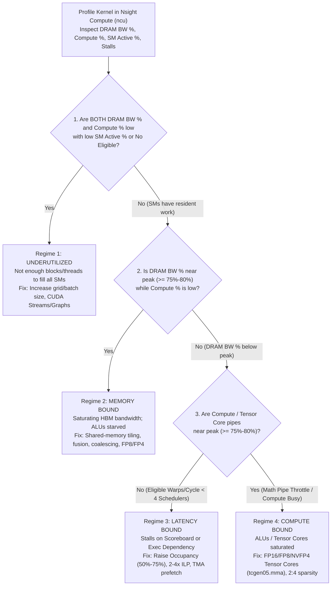

# 10.14 Occupancy, warp efficiency and instruction-level parallelism

| | |
|---|---|
| Level | Advanced |
| Priority tier | 2 |
| Lab venue | Nebius GPU |
| Part | Part 10: The GPU and CUDA |
| Sources used | *AI Systems Performance Engineering* (`ai-systems-performance-engineering`, Chris Fregly), Chapter 8 (pp. 253–294) |
| Coverage file | `planning/coverage/chapters/10-14.md` |
| Claim ledger | `planning/ledgers/10-14.md` |

## Why this matters for AI infrastructure

An engineering team fixes every memory-layout defect from Chapter 10.13. Global loads coalesce into four sectors per request, vectors use wide types, shared-memory tiles have zero bank conflicts, and the Tensor Memory Accelerator prefetches buffers asynchronously. Yet Nsight Compute still shows the kernel running far below hardware peak. Both DRAM bandwidth and Tensor Core utilization sit below a third of capacity.

This slowdown happens when Streaming Multiprocessors lack enough ready warps or independent instructions per thread to hide execution latency. It also happens when warps waste half their cycles executing divergent conditional branches. Even the fastest memory subsystem cannot save a kernel whose warps spend most of their time stalled at scoreboard dependencies or serialized conditional passes.

Four execution bottlenecks govern whether a GPU kernel turns raw memory bandwidth into useful compute throughput.

First, kernels move through four distinct execution regimes: underutilized, latency bound, memory bound, and compute bound. When both DRAM throughput and math pipe utilization are low, the kernel is not bandwidth-limited. Either the launch grid is too small to fill all Streaming Multiprocessors, or warps are latency bound because the number of eligible warps per cycle falls below the four warp schedulers on each SM.

Second, register pressure and block sizing control how many warps can reside on an SM at once. Data-center Ampere, Hopper, and Blackwell B200 GPUs support up to 64 resident warps per SM. Workstation and desktop Blackwell GPUs support 48 warps per SM. Using `__launch_bounds__` guides the compiler to cap per-thread registers so enough blocks fit on each SM without spilling registers into slow HBM local memory.

Third, data-dependent branches inside a warp serialize SIMT execution. When a threshold check splits a warp evenly between two branches, the hardware runs both paths back-to-back with half the lanes masked off on each pass. Replacing short branches with predication cuts dynamic instructions in half and doubles kernel speed.

Fourth, Instruction-Level Parallelism hides latency inside each individual warp so fewer resident warps are needed to saturate the SM. With only one operation in flight per thread, saturating a Blackwell SM requires roughly three-quarters occupancy. Exposing four independent operations per thread cuts the required warps by threefold while nearly doubling instructions issued per cycle.

```text
Occupancy, Warp Efficiency, and ILP Summary (AI Systems Performance Engineering Ch 8, pp. 253-294):
  - Blackwell Architecture Context: 10 TB/s NV-HBI dual-die interconnect, 126 MB shared L2 cache (pp. 253, 264)
  - Max Resident Warps / Threads:   64 warps (2,048 threads)/SM on A100/H100/H200/B200 (CC 10.0); 48 warps (1,536 threads)/SM on RTX PRO 6000 & Spark DGX GB10 (CC 12.x)
  - Achieved Occupancy Example:     30% achieved occupancy on 64-warp SM = ~19 active warps/SM (0.30 x 64 = 19.2 warps, p. 262)
  - Compiler Launch Bounds:         __launch_bounds__(256, 8) targets 8 x 256 = 2,048 threads/SM (64 warps, 100% occ) and caps registers at 65,536 // 2,048 = 32 regs/thread (p. 272)
  - Predication Speedup (Table 8-3): Replacing if/else with ?: / torch.maximum cuts runtime 30 -> 15 ms (-50%), dynamic insts 600M -> 300M (-50%), branch stall 200 -> 100 cycles, warp eff 50% -> 99%, predicated-off 50% -> 0%
  - ILP vs Occupancy (Table 8-4):   ILP 1 -> 1,536 threads (48 warps, 75%); ILP 2 -> 1,024 threads (32 warps, 50%); ILP 3 -> 768 threads (24 warps, 37.5%); ILP 4 -> 512 threads (16 warps, 25% = 3x fewer warps)
  - Scheduler IPC & Dual-Issue:     Loop unrolling lifts scheduler IPC 1.0 -> 1.8 (p. 289); Blackwell unified INT32/FP32 cores dual-issue (math + LD/ST), never (INT32 + FP32) on the same core in the same cycle
```

Two cautions are needed before examining the details. First, the source book states directly that the numeric values in its metric tables are illustrative examples used to explain the concepts. None of them were rerun on live hardware for this handbook.

Second, several numeric cutoffs in this chapter are handbook rules of thumb rather than strict hardware constants from the book. These include the regime percentage thresholds, the eligible warps per cycle test, and the occupancy sweet spot range. The book itself lists the four regimes with qualitative indicators and notes that many high-performance kernels hide latency effectively at moderate achieved occupancy.

This chapter covers the top-down profiling workflow across Nsight Systems, Nsight Compute, and PyTorch Profiler. It then examines the ten Nsight Compute warp stall reasons, the four execution regimes, occupancy tuning, warp branch divergence elimination, and Instruction-Level Parallelism on Blackwell unified cores.

:::tip In one minute
- **Two-step profiler workflow:** Start with Nsight Systems (`nsys`) and NVTX ranges to find CPU dataloader gaps, stream serialization, and hot kernels across the timeline. Then inspect hot kernels in Nsight Compute (`ncu`) compiled with `-lineinfo` to read Roofline position, warp stall reasons, and occupancy limiters.
- **Top Nsight Compute warp stall reasons:** Long Scoreboard stalls wait on off-chip HBM or spilled local-memory loads. Short Scoreboard stalls wait on shared-memory or special-function outputs, and Execution Dependency stalls wait on a prior register result inside the same thread. Not Selected means the warp was ready to issue while another ready warp was chosen, which is a healthy sign of good occupancy.
- **Occupancy vs. Instruction-Level Parallelism:** Data-center Ampere, Hopper, and Blackwell B200 GPUs host up to 64 warps per SM, whereas workstation Blackwell GPUs host 48 warps. Exposing multi-way ILP per thread drops the threads needed to saturate a Blackwell SM by threefold.
- **Blackwell unified core dual-issue rule:** On Blackwell, integer and floating-point units are merged into unified cores that execute either floating-point or integer math in a given cycle, never both on the same core in the same cycle. Dual-issue pairs one arithmetic instruction with one memory load/store instruction from the same warp.
:::

---

## Prerequisites and outcomes

**Prerequisites:** Review SIMT warps, the GPU memory hierarchy, Tensor Cores, and the Roofline model in earlier Part 10 chapters. You should also know CUDA kernel indexing, asynchronous streams, and memory coalescing.

**Outcomes:** After completing this chapter, you will be able to perform four core optimization tasks.
1. Diagnose CUDA and PyTorch kernels using Nsight Systems, Nsight Compute, and `torch.profiler`, mapping all ten warp stall reasons onto the four execution regimes.
2. Calculate theoretical and achieved SM occupancy across data-center and workstation architectures, interpret eligible warps per cycle, and tune register allocation with `__launch_bounds__`, `-maxrregcount`, and `cudaOccupancyMaxPotentialBlockSize`.
3. Eliminate SIMT warp branch divergence using predication, warp-unanimous conditions, and warp-vote intrinsics such as `__ballot_sync`, `__any_sync`, and `__all_sync`.
4. Expose multi-way Instruction-Level Parallelism through dependency reordering and loop unrolling while respecting Blackwell's unified core dual-issue rule and register limits.

---

## 1. Profiling Bottlenecks, Warp Stall Reasons, and the Four Execution Regimes

When an AI training or inference job runs slowly, running a kernel profiler blindly across thousands of launches wastes hours. It also produces gigabytes of unusable counter logs. Engineers need a structured top-down workflow that first isolates whether the GPU is waiting on the CPU, and then identifies the exact hardware stall inside the hottest kernels.

### 1.1 The two-tier profiling stack: Nsight Systems, Nsight Compute, and `torch.profiler`

GPU performance engineering always proceeds top-down from the system timeline to per-kernel hardware performance counters. First, Nsight Systems (`nsys`) paired with `torch.cuda.nvtx` annotations captures the end-to-end timeline of CPU dataloader threads, host-to-device DMA transfers, and stream concurrency. It also records user-defined ranges for forward and backward passes. If the GPU timeline shows empty gaps while CPU threads prepare batches, the bottleneck is upstream in the data pipeline rather than inside any CUDA kernel.

Second, PyTorch Profiler (`torch.profiler`), powered by Kineto, CUPTI, and Linux `perf`, correlates high-level Python operators with underlying GPU kernel launches. It exports timelines for Chrome tracing or Perfetto. Keep an important limitation in mind when reading `torch.profiler` reports. Enabling FLOP estimation computes formula-based estimates for known operators like matrix multiplication rather than reading actual hardware performance counters. Custom CUDA or Triton kernels can show zero FLOPs in `torch.profiler` even while saturating Tensor Cores.

Third, Nsight Compute (`ncu`) replays individual hot kernels compiled with `-lineinfo` to collect exact hardware counters across the Streaming Multiprocessors, L1 and shared memory, the shared L2 cache, and HBM. Nsight Compute plots the kernel on the Roofline chart. It then attributes warp stall reasons to exact C++, PTX, and SASS lines.

### 1.2 Decoding Nsight Compute's Warp Stall Reasons

Every clock cycle, each of the four warp schedulers on a Hopper or Blackwell SM inspects its assigned warps. It issues one instruction, or two dual-issued instructions, from an eligible warp. Whenever a resident warp is not eligible to issue on a given cycle, Nsight Compute records the hardware stall reason.

| Nsight Compute Warp Stall Reason | Hardware Meaning & Cause (*AI Systems Performance Engineering* Ch 8, pp. 258–261 & Table 8-1) | Primary Optimization Remedy |
|---|---|---|
| **`Stall: Long Scoreboard`** | Warp is waiting on a long-latency global memory (`HBM` / `L2`) load or a spilled Local Memory access to arrive in registers (`~800` cycles) | Coalesce and vectorize loads, cache tiles in Shared Memory, prefetch asynchronously with `TMA` (`cuda::memcpy_async`), or raise occupancy and ILP |
| **`Stall: Short Scoreboard`** | Warp is waiting on a variable-latency Shared Memory (`SMEM`) load (`~20–30` cycles, worsened by bank conflicts) or Special Function Unit (`SFU`) result | Eliminate shared-memory bank conflicts (`tile[32][33]` padding or swizzling) and interleave independent instructions (`ILP`) |
| **`Stall: Exec Dependency`** | Warp is waiting on the register output of a prior arithmetic or ALU instruction inside the same thread (serial dependency chain) | Expose 2-to-4-way ILP (`#pragma unroll`, multiple accumulators, reorder independent `u = x*x; v = y*y` ops before dependent uses) |
| **`Stall: Memory Throttle`** | The SM Load/Store (`LD/ST`) memory request queues are full, so no new memory transactions can be issued this cycle | Coalesce and vectorize (`float4` / `float8`) to issue fewer, wider transactions; stage reusable data in registers or SMEM |
| **`Stall: Compute Unit Busy` / `Math Pipe Throttle`** | FP32/INT32 ALU pipelines or Tensor Core (`MMA`) pipelines are 100% saturated; warps are ready, but math pipes cannot accept more work | Kernel is compute-bound: switch to lower precision (`FP16` -> `FP8` -> `NVFP4`/`MXFP4`), use Tensor Cores (`tcgen05.mma`), or enable 2:4 sparsity |
| **`Stall: Synchronization` (`Barrier`)** | Warp is paused at a `__syncthreads()` or cluster barrier waiting for slower warps in the block or cluster to arrive | Remove redundant barriers, balance work across warps, or replace shared-memory reductions with `__shfl_down_sync` warp shuffles |
| **`Stall: Instruction Fetch / Issue`** | Instruction cache (`I-cache`) miss or instruction decode/dispatch bottleneck, often caused by excessive loop unrolling bloating binary size | Dial back `#pragma unroll` factor or split giant monolithic kernels |
| **`Stall: Texture Throttle`** | Texture cache or sampling pipeline is saturated by `tex1Dfetch` or `tex2D` requests | Use `const __restrict__` L1 read-only cache or shared-memory tiling |
| **`Stall: Not Selected`** | The warp was eligible and ready to issue, but the scheduler picked another eligible warp in the same partition this cycle | Healthy indicator of high occupancy; no action needed unless one warp monopolizes issue slots |
| **`No Eligible` / `Idle`** | Scheduler had zero eligible warps to issue this cycle because too few blocks or warps were launched or all warps are stalled | Increase grid or batch size, tune occupancy (`__launch_bounds__`), or expose per-thread ILP |

### Reading the stall breakdown in practice

A stall name tells you where a warp is waiting, but one stall rarely settles the question on its own. Read the whole breakdown and start with the largest slice. The table above gives a short meaning for each reason. The notes below explain how the big slices look in a real profile.

Memory-related stalls come first. When a kernel waits on global memory loads, `Stall: Long Scoreboard` climbs. The scoreboard tracks each warp's outstanding memory requests, so a high Long Scoreboard share means warps keep waiting on slow DRAM loads. The same stall also appears when spilled local memory moves to and from device memory.

`Stall: Short Scoreboard` is the on-chip version. It means a warp waits for data moving between shared memory and registers. That delay is shorter than a DRAM load, but it still leaves the warp idle.

Two more memory signs are `Stall: Memory Throttle` and `Stall: Not Selected`. Memory Throttle means the load and store pipelines are saturated, so the hardware queues are full and no new memory request can be issued. Not Selected means the warp could issue, but it had to wait for free memory transaction slots. When these memory reasons dominate, the kernel is memory bound.

Use the source code view in Nsight Compute to find the lines behind these stalls. It highlights scoreboard dependencies and other hardware limits, such as special function unit throughput.

`Stall: Exec Dependency` means warps often wait for the result of an earlier instruction. The usual cause is too little instruction-level parallelism inside each thread, or an ALU latency bottleneck. A chain of dependent arithmetic forces each step to wait for the one before it. When this reason dominates, the kernel is latency bound on compute.

When `Stall: Compute Unit Busy` is high, or the FP32 cores or Tensor Cores are almost always active, the kernel is compute bound. The math units are saturated, so warps are ready but cannot run any faster. This often shows as near-peak ALU pipe busy time, and it can match high power draw. On some GPUs the matching reason is `Stall: Math Pipe Throttle`, which means the math pipelines were full on every cycle.

Other reasons are rarer. `Stall: Memory Dependency` is close to Long Scoreboard, because an operation waits on an earlier memory operation. `Stall: Texture Throttle` points to a busy texture caching subsystem. `No Eligible` or `Idle` means the scheduler had no warp ready to issue that cycle, often after a synchronization or because too few warps were launched.

You do not need to memorize every reason. Look at the largest parts. Memory stalls that dominate mean a memory-bound kernel. Execution dependency stalls that dominate mean a latency-bound kernel on ALU work. Almost no stalls with a nearly full pipeline mean a compute-bound kernel.

Collect these numbers from realistic runs. A tiny test kernel can show a different stall profile from your real application, so do not draw conclusions from a toy case.

### 1.3 The Four Kernel Execution Regimes

As you iteratively optimize a kernel using Nsight Compute, it typically progresses through four distinct performance regimes: underutilized, memory bound, latency bound, and compute bound.



In the underutilized regime, both DRAM bandwidth and compute pipe utilization sit low because the launch grid does not have enough blocks to keep all SMs busy. Increasing batch size, launching more blocks, or capturing short kernels in CUDA Graphs fills the SMs.

In the memory-bound regime, DRAM bandwidth approaches peak capacity while math pipelines wait on Long Scoreboard and Memory Throttle stalls. Shared-memory tiling, kernel fusion, and lower-precision formats reduce off-chip traffic.

In the latency-bound regime, neither DRAM bandwidth nor compute utilization is near peak. Instead, warps stall on Long Scoreboard, Short Scoreboard, or Execution Dependency because the SM has fewer than four eligible warps per cycle. Raising occupancy or exposing per-thread ILP hides those latencies. Finally, in the compute-bound regime, math pipelines and Tensor Cores saturate with Math Pipe Throttle stalls, and further gains require lower precision or structured sparsity.

**Always classify a slow kernel into one of the four execution regimes before changing code.** That classification prevents you from applying memory optimizations to a latency-bound or underutilized kernel.

GPUs can stall for four different reasons: underutilization, latency bound, memory bound, and compute bound. The regimes are related, but each needs its own fix. Fixing one bottleneck often reveals the next one. A kernel might move from underutilized to latency bound, then to memory bound, and finally to compute bound.

### 1.4 Checking the data pipeline and host-side waits

A GPU can look slow when the real delay happens somewhere else. Nsight Systems shows the whole pipeline, including data loading and preprocessing. If the GPU sits idle while the CPU prepares batches or runs augmentation, the bottleneck is usually the data pipeline, not the kernel. This pattern is common in training loops.

Tune the pipeline only after you test it on a realistic, representative dataset. You can raise the number of data loader threads. You can overlap CPU preprocessing with GPU compute using double buffering. You can also move more of the preprocessing onto the GPU. Before you rewrite a kernel, confirm that the slowdown really sits inside it.

Use NVTX ranges to mark the regions you care about. Nsight Systems can then capture only those ranges. The CUDA profiler Start and Stop API also controls capture, but NVTX ranges are the recommended choice for framework workflows. In PyTorch, `torch.cuda.nvtx` provides range push and pop calls. You can label phases such as `forward pass` and `backprop`, so the timeline shows which iterations matter.

For years, the Nsight tools could not see Python code, and many PyTorch developers avoided them for that reason. Modern Nsight Systems can collect Python backtrace sampling. It also has a PyTorch-focused mode with Python call-stack sampling and a PyTorch domain for correlated tracing. If you work in PyTorch, it is worth using these tools again for a fuller, linked view of the system.

The `torch.profiler` API works alongside them. It collects operator-level times, GPU kernel launches, memory copies, and hardware counter metrics. It relies on the Kineto library, which uses CUPTI for GPU events and Linux `perf` for CPU events. Kineto merges everything into one time-ordered trace. You can view that trace in the PyTorch profiler UI, in the Nsight Systems GUI, or in a Chrome browser.

Nsight Compute reads the device code side of the story. Compile device code with `-lineinfo` so that Nsight Compute maps counters to source lines. Use `torch.cuda.nvtx` ranges from Python to link model code to the kernels it launches. The source view shows the instruction mix and a throughput breakdown for each line that stalls.

The two tools work best as a pair. Start with Nsight Systems to find the hot kernels and the idle gaps on the timeline. Then zoom into each hot kernel with Nsight Compute for a detailed diagnosis. Both tools are updated for new GPU architectures, so the same workflow helps when you move a workload to a newer GPU generation.

Before a kernel change, check for host-side waits. Remove unnecessary `cudaDeviceSynchronize()` calls and other host waits that stall the GPU. Small workloads can be batched with other work, or several instances can run at once on separate CUDA streams.

### 1.5 Fixing each regime and re-profiling

Pick the fix from the regime, not from a favorite trick. A memory-bound kernel needs less traffic per result. A latency-bound kernel needs more work in flight. A compute-bound kernel needs more arithmetic throughput. An underutilized GPU needs more launched work. Each change should target one of these four problems.

Nsight Compute's guided analysis helps here. Its rules can flag messages such as `Memory Bound: L2 transactions per FLOP high` or `Compute Bound: issue stall reasons indicate pipe contention`. These rules are updated for each architecture, including Blackwell. They confirm whether the limit is memory throughput, instruction dispatch, or latency hiding, and they point you to the metrics that matter.

Underutilization comes first in the usual order. The kernel has not launched enough threads or work. FLOPS and memory bandwidth both stay low, and the timeline shows idle gaps. Once you add parallelism, warps start to stall on memory loads, and the kernel becomes latency bound.

A latency-bound kernel moves fewer bytes per second than the hardware can deliver. Individual loads stall the warps. The fix is more overlap: raise occupancy, add ILP, prefetch data, and pipeline the work. You can also use async copies inside the kernel and several CUDA streams to overlap copies with compute. Merge many tiny kernels with cooperative groups or kernel fusion when launch overhead dominates.

A memory-bound kernel saturates DRAM bandwidth while the ALUs sit idle. The problem is not a stall. The memory pipe simply cannot supply more data each second. To fix it, raise arithmetic intensity. Use tiling to reuse data in shared memory, fuse kernels to avoid extra round trips, use the caches (L1 and texture), and reduce precision to move fewer bytes. Make sure accesses are coalesced and avoid bank conflicts.

A compute-bound kernel is limited by its arithmetic pipes, such as CUDA cores and Tensor Cores. Use more ILP per thread through overlapping independent instructions, loop unrolling, and software pipelining. Reduce dependencies and fuse work where it helps. If the kernel is at the compute roof, lower precision can give more speed, moving from FP32 to FP16, then FP8, then FP4.

Blackwell adds specialized hardware for this. Its Tensor Cores expose fifth-generation MMA instructions in PTX as `tcgen05.mma`, with matching loads and stores such as `tcgen05.ld` and `tcgen05.st`. The Tensor Cores accelerate microscaling formats, including MXFP8, MXFP4, and NVIDIA's NVFP4. They also support block-scaled matrix multiplies, which libraries pick automatically when scale metadata is present. TMEM and TMA support these fast data paths.

For an underutilized GPU, make sure the grid is large enough to keep every SM busy. A common mistake is to launch one thread per element, even though each thread does only a little work. Sometimes you need several passes, or more threads per element, to fill the device.

Work through the regimes in order, then verify each change. After a fix, profile again and confirm that the targeted stall or metric improved. Memory stalls should drop after tiling, and achieved occupancy should rise after you tune the block size. Also watch total runtime, because one bottleneck can hide another.

Keep correctness in view as you go. Test each lower-precision or new parallel version against a reference result, with assertions or numeric comparisons. Compare results with an FP32 baseline. Techniques such as FP16 and even FP8 are usually validated to have a negligible accuracy effect on AI models, but confirm that for your model.

---

## 2. Occupancy Tuning: Hardware Limits, Eligible Warps, and Launch Bounds

A developer writes a complex fused kernel with dozens of local variables per thread. Each thread consumes 80 registers, so a 256-thread block requires 20,480 registers. Because a Blackwell SM has 65,536 registers in total, only three blocks can reside on the SM at once. Theoretical occupancy drops to three-eighths of peak, and warp schedulers frequently run out of ready warps whenever a memory load stalls.

### 2.1 Theoretical vs. achieved occupancy across GPU architectures

Occupancy is the ratio of active warps resident on an SM to the maximum number of warps that the SM hardware can host. On data-center Ampere, Hopper, and Blackwell B200 GPUs, each SM supports at most 64 resident warps or 2,048 threads. Each SM also provides 65,536 registers and 227 KB usable shared memory. When Nsight Compute reports 30 percent achieved occupancy on a B200 SM, only about 19 warps are active on average.

Workstation and desktop Blackwell GPUs, including the NVIDIA RTX PRO 6000 and Spark DGX with the GB10 Superchip, carry a higher compute capability number. However, their SMs support at most 48 resident warps or 1,536 threads per SM. Always check your target GPU's maximum warps per SM before translating thread counts into occupancy percentages.

Chasing one hundred percent occupancy is not always beneficial. Moving from very low occupancy to moderate occupancy on a memory- or latency-bound kernel delivers a large speedup because the four warp schedulers finally have enough warps to cover DRAM stalls. Once occupancy reaches roughly 50 to 75 percent, inspect Active Warps per Scheduler alongside Eligible Warps per Cycle in Nsight Compute. If Eligible Warps per Cycle is already four or higher, every warp scheduler has a ready warp to issue on every cycle. Squeezing registers further to reach full occupancy often slows the kernel down by spilling registers to HBM.

```text
SM Occupancy Hardware Ceilings & Worked Examples (ASP Ch 8 pp. 262-273; calc_sm_occupancy_and_limiters):
  - Data-Center A100 / H100 / H200 / B200 (CC 10.0): Max 64 warps/SM (2,048 threads), 32 blocks/SM, 65,536 regs/SM (max 255 regs/thread), 227 KB usable SMEM (228 KB total)
  - Workstation RTX PRO 6000 / Spark DGX GB10 (CC 12.x): Max 48 warps/SM (1,536 threads)
  - 30% Achieved Occupancy on 64-Warp SM:            0.30 x 64 = 19.2 -> ~19 active warps/SM (19 / 64 = 29.69%)
  - Register-Limited Example (80 regs/thread):       256 threads x 80 regs = 20,480 regs/block -> 65,536 // 20,480 = 3 blocks (768 threads = 24 warps = 37.5% occ, LIMITED_BY_REGISTERS_PER_THREAD)
  - Shared-Memory-Limited Example (64 KB/block):     227 KB // 64 KB = 3 blocks (768 threads = 24 warps = 37.5% occ on 256-thread blocks, LIMITED_BY_SHARED_MEMORY_PER_BLOCK)
  - __launch_bounds__(256, 8) Target:                8 blocks x 256 threads = 2,048 threads/SM (64 warps = 100% occ) -> caps registers at 65,536 // 2,048 = 32 regs/thread
  - Practical Sweet Spot Rule of Thumb:              128 to 256 threads/block; 50% to 75% occupancy (32 to 48 warps/SM; book notes many kernels hide latency at 25% to 50%) keeping Eligible Warps/Cycle >= 4
```

### 2.2 Controlling occupancy with `__launch_bounds__`, `-maxrregcount`, and the Occupancy API

When Nsight Compute reports that a kernel is limited by registers per thread, you have three mechanisms to guide register allocation and block sizing.

First, attach `__launch_bounds__` directly to the `__global__` kernel declaration. Specifying `__launch_bounds__(256, 8)` promises the compiler that the kernel will never launch with more than 256 threads per block and asks it to fit at least eight blocks per SM. Because eight blocks of 256 threads equal 2,048 threads per SM, `nvcc` automatically caps register usage at 32 registers per thread for that specific kernel. Other kernels in the same source file remain unaffected.

```cpp
__global__ __launch_bounds__(256, 8)
void myKernel(const float* __restrict__ in, float* __restrict__ out, int N) {
    // Promising maxThreadsPerBlock = 256 and minBlocksPerSM = 8 targets
    // 256 * 8 = 2,048 threads/SM (64 warps = 100% occupancy on B200).
    // nvcc automatically caps register usage at 65,536 / 2,048 = 32 regs/thread.
}
```

Second, pass `-maxrregcount` to `nvcc` to cap registers per thread across an entire compilation unit. Use this flag with caution. Setting the cap too low forces the compiler to spill live registers to slow Local Memory in HBM, which immediately inflates Long Scoreboard stalls.

Third, call the CUDA Runtime Occupancy API functions `cudaOccupancyMaxPotentialBlockSize` and `cudaOccupancyMaxActiveBlocksPerMultiprocessor` at launch time. These functions inspect the compiled kernel's exact register and shared-memory footprint on the current GPU. They then return the block size and grid size that maximize theoretical occupancy.

```cpp
int minGridSize = 0, bestBlockSize = 0;
cudaOccupancyMaxPotentialBlockSize(&minGridSize, &bestBlockSize,
                                   myKernel, /*dynamicSmemBytes=*/0, /*blockSizeLimit=*/0);
myKernel<<<minGridSize, bestBlockSize>>>(d_in, d_out, N);
```

In PyTorch workloads, you rarely set thread block bounds by hand. Instead, enable `torch.compile` with `max-autotune` for steady-state training and inference, or `reduce-overhead` for small-batch loops. When CUDA Graphs are unsuitable, use `max-autotune-no-cudagraphs`, and pass `fused=True` to `torch.optim.AdamW` so TorchInductor fuses tiny elementwise launches into high-occupancy kernels.

**Use `__launch_bounds__` rather than file-wide `-maxrregcount` when tuning register-limited kernels.** Stop pushing occupancy higher once Eligible Warps per Cycle stays at or above four.

### 2.3 Reading achieved occupancy and its limiters

Theoretical occupancy is the ceiling set by the hardware and the kernel's resources. Achieved occupancy is what the profiler measures while the kernel runs. It is the average share of warp slots that were filled on each SM. If a kernel's achieved occupancy is far below its theoretical value, the launch is probably too small to keep the SMs full.

Nsight Compute also names the resource that limits the theoretical occupancy. `Limited by max registers per thread` means register usage stops more warps from being scheduled on each SM. `Limited by shared memory per block` means the shared memory each block allocates is the bottleneck. `Limited by thread count` means the launch configuration, meaning the grid or block size, did not request enough threads to fill the GPU.

Each limiter points to a different fix. For registers, use fewer live variables or a `__launch_bounds__` hint so more blocks fit. For shared memory, use smaller tiles and store only what the kernel needs. For thread count, launch more blocks or larger grids.

Higher occupancy is not always faster. Very low occupancy, around 10 to 20 percent, hurts performance because too few warps can hide latency. Pushing occupancy to 100 percent does not always help, because memory bandwidth and instruction dependencies can become the limit instead. You should check other hardware counters before you chase a higher number.

Nsight Compute reports several of these counters: achieved memory bandwidth in GB/s, achieved FLOPS in TFLOPS, instructions per cycle, issue-slot utilization, and other resource statistics. These show how close the kernel runs to the physical limits. If ALU utilization is low while memory throughput is at 95 percent of peak, the kernel is memory bandwidth bound. If ALU utilization is near its maximum and memory throughput stays modest, the kernel is compute bound.

A compute-bound kernel gains speed only by raising arithmetic throughput. The usual route is lower-precision types, such as FP16, FP8, or FP4, running on Tensor Cores. If both ALU utilization and memory throughput are low, look for long-latency operations, synchronization overhead, low ILP, or too little parallel work.

### 2.4 Comparing throughput with the hardware peaks

The Roofline model puts this comparison in one picture. It plots a kernel's achieved FLOPS against its arithmetic intensity, which is FLOPS per byte moved. The roofline has a compute roof, the highest FLOPS the GPU can sustain, and a memory roof, the highest bandwidth it can deliver.

If your kernel's FLOP per byte ratio is below the hardware's compute-to-memory ratio, you are memory bound. You cannot supply data fast enough. If the ratio is high but the FLOPS stay far below peak, the kernel is likely latency bound or short on ILP. Each new GPU generation raises bandwidth modestly while compute grows much faster. Kernels therefore tend to become more memory bound over time.

Compare two numbers in every review. Put your kernel's memory throughput next to the peak memory bandwidth. Then put its compute throughput next to the peak FLOPS. Those two comparisons show whether the next change should target memory access, compute work, or parallelism.

Nsight Compute reports the achieved GB/s of a kernel. If the kernel reaches near-peak memory bandwidth, more arithmetic will not help. You must raise arithmetic intensity by moving less data per operation. Reduced precision with Tensor Cores, concurrency that hides more latency, and kernel fusion all cut the size of the intermediate data that moves through global memory. A kernel that reaches about 80 percent or more of peak bandwidth is likely memory bound, because little headroom is left.

Blackwell changes this picture. It has a large 126 MB L2 cache. Its two dies connect through a 10 TB/s NV-HBI link, so they act as one for memory access. Many kernels that were memory bound on older GPUs may use the cache well on Blackwell. Use the memory chart in Nsight Compute to compare L2 traffic with DRAM traffic. A high L2 hit rate can ease a global memory bottleneck, which can leave the kernel limited by compute. On Blackwell, you can also control L2 data persistence to keep a critical working set resident.

Low achieved FLOPS often come from low occupancy or from stalls inside instructions. If only 30 percent of warps are active, the kernel sits far below the compute roof. Check the Occupancy section and Source Counters in Nsight Compute. Launch enough threads to fill the GPU, up to the resident warp limit per SM, which is 64 warps on many data-center parts. Achieved occupancy is measured per SM, because only warps on the same SM share resources and hide each other's latency.

Also check instruction issue efficiency. Blackwell has many SMs, so a small shortfall in each kernel adds up to a large loss across the device. The dual-die packaging does not, by itself, raise the per-SM issue rate.

If FLOPS are moderate to high and memory throughput is low, the kernel is mostly compute focused but held back by instruction dependencies. Check the Exec Dependency stall share to confirm. If compute throughput is near peak, the kernel is truly compute bound. At that point the memory access pattern is already tuned, or the kernel already uses lower-precision Tensor Cores.

Sustained near-peak compute can also hit the power limits of the GPU. The card then lowers its clocks to stay healthy, which can look like a kernel regression. Monitor the enforced power limit and any `HW Slowdown` flags during a run with the `nvidia-smi` query in Section 5. For scripts, NVML provides `nvmlDeviceGetPowerUsage()` and `nvmlDeviceGetEnforcedPowerLimit()` in CUDA C++, with equivalent Python APIs.

Use all of these signals together. Look at occupancy, warp stall reasons, memory throughput, and compute throughput at the same time. A healthy kernel shows high occupancy, high warp efficiency, and balanced use of the execution units, including Tensor Cores.

### 2.5 Block size, register pressure, and the launch configuration

Block size can limit occupancy on its own. A very large block, such as 1,024 threads, can use so many registers or so much shared memory that only one block fits on an SM. A moderate block of 128 to 256 threads lets several blocks reside on the same SM at once. Smaller blocks use fewer resources each, so more of them can run in parallel.

Use the Nsight Compute occupancy calculator and the CUDA Occupancy API to test different launch shapes. The calculator suggests configurations for the highest theoretical occupancy. In practice, the fastest setting can sit a little below that theoretical peak. A lower occupancy can run faster when it means less register spilling or better memory coalescing. Always time the suggested `bestBlockSize` before you adopt it.

Some kernels need more threads simply because they launch too little work. If you launch only 20 warps per SM and the GPU supports 64, a larger grid or more threads per block can raise occupancy. Launch at least as many blocks as there are SMs, and usually many more, because blocks run in parallel on each SM. If SM Active Cycles stay low, scale up the workload or the batch size.

Register pressure is the next limit to watch. Each thread holds registers, and a kernel with too many live values forces the compiler to cut the number of resident warps. Unrolling too far makes this worse. When Nsight Compute shows `Limited by Registers`, dial back the unrolling, reduce the number of independent accumulators, or relax the launch bounds. Lowering the minimum blocks per SM, or raising the maximum threads per block, lets each block use more registers without spilling.

The compiler usually makes good choices, so start there. Reach for `__launch_bounds__` and the occupancy API when you know the kernel can trade per-thread resources for more active warps. Those tools help when heavy threads leave the SMs underoccupied.

Occupancy has diminishing returns. Moving from 10 percent to 50 percent achieved occupancy on a memory-bound kernel can give a large boost, because the warps now cover the latency. Moving from 50 percent to 100 percent often adds little, since cache misses or bandwidth saturation take over. Around 60 to 70 percent, it usually pays more to improve memory locality, raise ILP, and use shared memory and registers as caches.

---

## 3. Improving Warp Execution Efficiency: Branch Divergence and Predication

A developer writes a thresholding or activation kernel using a standard conditional statement. Half of the elements in each warp are above the threshold and half are below. Even though every thread performs only one assignment in C++, the GPU takes twice as long to finish. Hardware counters show that the kernel executes twice as many dynamic instructions as expected.

### 3.1 How SIMT branch divergence serializes warps

In Nsight Compute, Warp Execution Efficiency measures the average percentage of the 32 lanes in an active warp that are predicated on and performing useful work per executed instruction. Because all threads in a warp share a single hardware instruction pointer under SIMT execution, a warp can only fetch and issue one instruction at a time across all lanes.

```cpp
// BEFORE: Divergent branch (threshold_naive.cu, ASP Ch 8 p. 278)
if (X[i] > threshold) {
    Y[i] = X[i]; // Pass 1: active only for lanes where X[i] > threshold
} else {
    Y[i] = 0.0f; // Pass 2: active only for lanes where X[i] <= threshold
}
```

When a data-dependent condition splits a warp evenly so 16 lanes take the first branch and 16 lanes take the second branch, the hardware serializes execution into two passes. In the first pass, the first 16 lanes execute while the remaining 16 lanes are masked off. In the second pass, the roles reverse. Dynamic instruction count doubles and Warp Execution Efficiency drops to 50 percent.

A single-lane branch split is even more skewed during the divergent pass. If a single outlier thread takes an expensive branch while 31 lanes take the alternative branch, 31 of the 32 lanes sit completely idle for the entire duration of the first pass.

### 3.2 Five techniques to eliminate warp divergence and Nsight Compute Table 8-3

Five practical programming patterns eliminate or reduce intra-warp branch divergence.

First, replace short conditional branches with predication using the C++ ternary operator or PyTorch elementwise primitives such as `torch.maximum` and `torch.where` wrapped in `torch.compile`. The ternary select compiles to PTX conditional select instructions with zero branches. All 32 lanes execute a single uniform instruction stream without serial passes or branch-resolving stalls.

```cpp
// AFTER: Predicated select (threshold_predicated.cu, compiles to PTX @p selp / mov with 0 branches)
float x = X[i];
Y[i] = (x > threshold) ? x : 0.0f;
```

Second, align branch boundaries to 32-thread warp boundaries so conditions are warp-unanimous. Divergence only occurs when threads inside the same warp disagree. Two different warps taking different branches incur zero divergence penalty. Dividing `threadIdx.x` by 32 computes a warp identifier that guarantees all lanes in any given warp take the exact same path at full warp execution efficiency.

Third, use warp-vote intrinsics such as `__ballot_sync`, `__any_sync`, and `__all_sync` to evaluate predicates across all active lanes in a single register operation. If all lanes or no lanes satisfy the condition, the warp can skip the second path entirely. Calling `__ballot_sync` builds a 32-bit bitmask of active lanes for work compaction.

Fourth, sort or partition heterogeneous data on the host or in a preprocessing pass before launching the compute kernel so each warp receives uniform inputs. Fifth, when both conditional bodies contain hundreds of instructions, avoid predication because predication forces every thread to compute both heavy paths. Instead, compact indices and launch two separate specialized kernels.

| Nsight Compute Metric (`ncu` Counter) | Before (`threshold_naive` `if/else`) | After (`threshold_predicated` `?:` / `max`) | Improvement (*AI Systems Performance Engineering* Ch 8 Table 8-3, p. 280) |
|---|---:|---:|---|
| **Kernel Execution Time (`gpu__time_elapsed.avg`)** | `30 ms` | **`15 ms`** | **`-50%` (`2.0x` faster)** |
| **Dynamic Instruction Count (`smsp__inst_executed.sum`)** | `600 M` instructions | **`300 M` instructions** | **`-50%`** (single pass instead of two serial passes) |
| **Avg Warp Branch-Resolving Stall Latency** | `200` cycles | **`100` cycles** | **`-50%`** (`smsp__average_warp_latency_issue_stalled_branch_resolving`) |
| **Warp Execution Efficiency** | `50%` | **`99%`** | Nearly all 32 lanes active on every cycle |
| **Predicated-Off Threads (`%`)** | `50%` | **`0%`** | Zero masked-off lane passes |

**Replace short conditional assignments with predicated ternary selects or `torch.maximum`.** When a kernel must execute multiple heavy paths, organize branches by warp identifier so all 32 lanes in a warp follow the same branch.

### 3.3 Warp intrinsics for work inside one warp

Sometimes the threads of one warp must share data, for example to add up a reduction. You can exchange values directly through registers with warp shuffle intrinsics, `__shfl_sync` and `__shfl_down_sync`. The other option is to stage the values in shared memory and call `__syncthreads()`. That path adds extra L1 and L2 traffic and needs a full-block barrier, so it slows the kernel down.

A shuffle moves data only between registers. It also synchronizes the 32 lanes of a warp at each instruction, and it adds only a few clock cycles of latency. For purely intrawarp work, shuffles are almost always the fastest choice. The warp basics earlier in Part 10 show full reduction and prefix-sum examples.

If the cooperation spans several warps, shuffles are not enough. You still need a block-level or grid-level barrier, such as `__syncthreads()`, or cooperative groups. In short, reach for `__shfl_sync` and its relatives when threads in the same warp must coordinate. Use block-level shared memory and `__syncthreads()` only when the cooperation truly crosses warp boundaries.

### 3.4 Measuring divergence and the payoff from fixing it

Nsight Compute's Source Counters and Warp State statistics show divergent warps. Look for a high Branch Divergence metric. Poorly coalesced loads also show up, with many replay events or L2 cache misses. The profiler can flag shared-memory bank conflicts and Tensor Core pipeline stalls too. A high share of `memory_throttle` stalls can mean the kernel lacks memory-level parallelism. Try more independent memory accesses in flight, or asynchronous copies such as `cp.async` and the CUDA Pipeline API, to hide latency.

Low warp execution efficiency is the main symptom of divergence. This metric is the average percentage of active threads in a warp. An efficiency of 30 percent means that, on average, only 30 percent of the threads do useful work at any moment. The rest sit idle because of divergence.

A divergent kernel also shows a high share of predicated-off instructions. These are instructions the hardware fetches and issues, but they do no work because their lane is masked off. The dynamic instruction count also looks inflated compared with the data you processed. Together, these two numbers show that each warp walks down every side of a conditional, one after another.

Divergence is easy to spot in source code. Any per-thread condition, such as a threshold check, a sparse-data loop, or a data-dependent filter, can trigger this serial pattern. To reclaim the lost time, eliminate or flatten the branch. You can make the condition uniform across the warp, pull it out of a tight loop, or replace it with arithmetic or a lookup table.

Divergence often gives a modest gain. Warp-level fixes like these commonly deliver speedups of about 5 to 30 percent, which is small next to a change in the algorithm. They still matter in highly tuned code, where every cycle counts. A speedup of 1.1 to 1.3 times is common in a tight kernel. These fixes also work well with occupancy and memory-access tuning.

When a kernel contains several divergence points, or each divergent branch carries heavy work, removing those branches can compound the gain. In the ideal 50/50 split, removing the divergent branch can nearly double throughput, up to about 2 times. Each eliminated heavy branch can add its own gain.

Predication is not free, though. Some threads still compute values whose results are never used. If each branch does substantial work, computing both sides for every thread can cost more than mild divergence. Benchmark the branch version and the predicated version, and compare their warp execution efficiency in Nsight Compute. If efficiency is low and each branch is light, predication usually wins. If one branch is heavy, a little divergence or a separate kernel may be the better choice.

### 3.5 Restructuring conditions and splitting kernels

The best fix is to reorganize the data so each warp follows one path. Move the divergent condition outside the inner loop when you can, or into a separate kernel launch. You can also sort or group the data, so each warp handles similar cases. Divergence only affects threads within one warp, so threads in different warps never stall each other on a branch.

Take an array where negative values need different work than nonnegative values. A naive kernel puts an `if (x < 0)` check inside the loop, and every warp that mixes the two signs diverges. A better approach partitions the data first. One kernel handles all the negatives, and another handles the nonnegatives. Aligning the data with warp boundaries keeps most warps on a single path.

Another option is to split the work into separate kernel launches, one for the `if` case and one for the `else` case. A prefix sum or stream compaction can distribute the threads to the right kernel. This removes the divergence, but it adds launches and extra logic that moves the data around. The trade is worth it only when divergence is a major cost and both sides are large in instruction count.

You can also rewrite a condition so it is warp-unanimous, meaning all 32 threads of a warp agree on it. A common trick uses the warp index. Compute `int warpId = threadIdx.x / 32;`, and then let half the warps run task A and the other half run task B. Every warp still evaluates the check, but all its lanes agree, so no warp splits. This works well when you can divide the work into coarse blocks of 32 threads.

Warp-vote tools help too. Intrinsics such as `__ballot_sync`, `__any_sync`, and `__all_sync` let a warp decide together which lanes need special work. Cooperative groups offer the same votes through warp ballot, any, and all calls. The warp can then compact that work into one or a few lanes, instead of branching all 32. This can shift load imbalance onto a few lanes, so profile the result before you keep it.

### 3.6 Divergence in PyTorch code and fused kernels

PyTorch does not expose warp intrinsics, so you cannot steer warp execution from Python directly. You still benefit, because PyTorch's own CUDA kernels use warp-level tricks. For example, `torch.sum(x, dim=0)` often uses warp reductions when the reduced dimension is small, within about 32 elements. Each warp then adds up its values with shuffles, without divergence or shared memory. The library does this for you.

If you write a custom CUDA kernel as a PyTorch extension, use the same warp-level ideas in device code. For a warp-wide sum or an exchange between threads, prefer `__shfl_sync` over a shared-memory approach. Watch for per-element `if` statements as well. Express the condition as a tensor operation, such as `torch.where` on the whole tensor, so the library can handle it in a vectorized, warp-friendly way.

Fusion helps as well. When several elementwise operations run in one fused kernel, each warp does more useful work in a single pass. Fusion does not remove a divergence that is part of the algorithm. It does spread that overhead over more computation. For example, a ReLU followed by an `abs()` can run in one fused kernel, so the branch cost is shared across both operations.

```python
# threshold_op.py
import torch

@torch.compile()
def threshold_op(X):
    return torch.maximum(X, torch.zeros_like(X))

X = torch.randn(N, device='cuda')
Y = threshold_op(X)
torch.cuda.synchronize()
```

The compiler fuses these pointwise operations into kernels that behave much like the hand-written predicated version. It does not guarantee the best occupancy or ILP, so profile the result. In general, use built-in tensor operations instead of explicit Python loops with per-element conditionals.

---

## 4. Exposing Instruction-Level Parallelism and Blackwell Dual-Issue Rules

Suppose a kernel uses a large shared-memory tile and high register counts per thread, capping SM occupancy at a quarter or three-eighths of peak. With only 16 to 24 resident warps on the SM, each warp must keep multiple independent instructions in flight at the same time. Otherwise, the warp schedulers will stall on Execution Dependency and Long Scoreboard every time an instruction waits on the previous line's result.

### 4.1 How ILP hides latency within a single warp and cuts required occupancy

Occupancy hides latency across different warps through Thread-Level Parallelism. Instruction-Level Parallelism hides latency within a single warp by issuing multiple independent loads and math instructions back-to-back before consuming their outputs. Adding ILP does not change a kernel's arithmetic intensity, and it yields no speedup if execution units or HBM bandwidth are already completely saturated. Instead, ILP fills empty pipeline slots when warps are latency bound.

```cpp
// BAD (Serial Dependency Chain -> Stall: Exec Dependency, ASP Ch 8 p. 285):
float u = x * x;
float temp = u + 1.0f; // Stalls waiting for u = x * x to finish BEFORE v = y * y can even issue
float v = y * y;

// GOOD (Reordered Independent Ops -> 2-Way ILP):
float u = x * x;       // Issues on cycle t
float v = y * y;       // Independent of u; issues immediately on cycle t+1 while u is in flight
float temp = u + 1.0f; // By the time temp issues, u has already progressed through the pipeline
```

Loop unrolling with `#pragma unroll` and multiple independent accumulators applies the same principle to memory loads and reductions. Instead of loading one value, waiting hundreds of cycles for it to arrive, multiplying, and only then loading the next value, an unrolled four-way loop issues four independent loads back-to-back. All four HBM requests travel in parallel before the first multiply consumes the first value.

| `ILP` (Independent Ops per Thread) | Active Threads per SM Required for `~100%` Utilization | Active Warps per SM Required | Required SM Occupancy (`% of 2,048 threads`) | Operational Takeaway (*AI Systems Performance Engineering* Ch 8 Table 8-4, pp. 286–287) |
|---:|---:|---:|---:|---|
| **`1` (No ILP)** | **`~1,536` threads** | **`48` warps** | **`75.0%`** | Requires high occupancy (`48` warps) to hide stalls across warps |
| **`2`-Way ILP** | **`~1,024` threads** | **`32` warps** | **`50.0%`** | Each warp keeps `2` ops in flight; saturates SM at `50%` occupancy |
| **`3`-Way ILP** | **`~768` threads** | **`24` warps** | **`37.5%`** | Saturates SM with `24` warps (`37.5%` occupancy) |
| **`4`-Way ILP** | **`~512` threads** | **`16` warps** | **`25.0%`** | **`3x` fewer warps** (`16` vs `48`) needed to saturate SM; beyond `4`-way (`5–6`-way), register pressure and decode limits yield diminishing returns |

### 4.2 Blackwell's Unified `INT32`/`FP32` Core Dual-Issue Rule and Register Pressure

Two hardware rules govern how far you can push ILP and dual-issue on Blackwell GPUs.

First, understand Blackwell's unified integer and floating-point core design. On Ampere and Hopper, separate integer and floating-point datapaths allowed a single lane to execute an integer pointer-arithmetic instruction alongside a floating-point math instruction. On Blackwell, the floating-point and integer units were merged into unified CUDA cores. Each unified core executes either floating-point math or integer math in a given clock cycle, never both on the same core in the same cycle. Instead, each of the SM's four warp schedulers can dual-issue one arithmetic instruction paired with one memory load or store instruction from the same warp.

Second, balance loop unrolling against register pressure. When `#pragma unroll` and ILP restructuring succeed, Nsight Compute shows Execution Dependency stalls dropping and per-scheduler Instructions Per Cycle rising from 1.0 to 1.8 instructions per cycle. However, keeping four or eight independent loads and accumulators live at the same time consumes extra registers per thread. Pushing ILP beyond four-way rarely improves speed and can drop occupancy or trigger Local Memory spills, so always verify in Nsight Compute that register limits were not exceeded.

**Expose two-to-four-way ILP per thread by issuing independent loads and math operations back-to-back.** Pair arithmetic instructions with memory load and store instructions to exploit dual-issue on Blackwell warp schedulers.

### 4.3 Writing code that exposes ILP

Most ILP comes from the way you write the loop. The goal is to issue several independent operations per thread before you need any one of their results. Two patterns cover most cases. The first is unrolling a small loop with separate accumulators. The second is interleaving operations on different data.

Consider a loop that multiplies four values and adds them into one sum. Each step depends on the sum of the step before, and each load waits for its own multiply. Unrolling the loop changes that. The four loads are issued first, and each multiply can start as soon as its load returns. The overlap hides the memory latency.

```cpp
float sum = 0.0f;
for (int k = 0; k < 4; ++k) {
    float a = A[idx * 4 + k];
    sum += a * w[k];   // dependent on load a
}
```

```cpp
float a0 = A[idx * 4 + 0];
float a1 = A[idx * 4 + 1];
float a2 = A[idx * 4 + 2];
float a3 = A[idx * 4 + 3];
float sum0 = a0 * w[0];
float sum1 = a1 * w[1];
float sum2 = a2 * w[2];
float sum3 = a3 * w[3];
float sum = sum0 + sum1 + sum2 + sum3;
```

Interleaving works the same way. When two results do not depend on each other, write them as separate statements. The first multiply can start as soon as its input is ready, and the second can overlap with it. Keep the execution units busy by not letting one dependent instruction block the next independent one.

```cpp
float x = A[idx];
float y = B[idx];
float u = x * c;   // can start as soon as x is ready
float v = y * d;   // can start as soon as y is ready, overlapping with u
```

Compiler hints help the compiler build these chains. `#pragma unroll` on a short loop gives it more independent work to schedule. If the unrolled code needs more registers, you can raise the limit with `-maxrregcount`. More registers per thread means more ILP and fewer threads, so occupancy trades against ILP.

Be careful with very large unrolls. Excessive unrolling can bloat the code size, which saturates instruction fetch and decode. Watch the instruction-fetch and issue stall reasons in Nsight Compute after each change.

A common misunderstanding is that more ILP means more work. It does not. ILP does not add operations. It keeps the existing operations busy while others wait on memory or on earlier results. ILP only helps when the issue slots sit idle because of latency. If a tight loop already uses every execution unit on every cycle, more ILP will not speed it up. ILP and occupancy also work together. Occupancy gives the scheduler many warps to switch to, and ILP lets one warp issue several independent instructions. A CPU with out-of-order execution follows the same idea, but here the compiler sets the schedule.

Blackwell schedulers can issue more than one instruction per cycle. Each SM has four warp schedulers, and each scheduler can dispatch up to two independent instructions in a cycle. This is called dual issue. Two instructions do not need to fire in the same cycle to overlap, though. While one long load is pending, the warp can issue a different independent instruction on the next cycle. By the time the data returns, the arithmetic has already made progress.

The register file is large enough to support this. Each SM has 256 KB of registers, which is 64K 32-bit registers. That capacity lets ILP run without spilling, as long as the unrolled code does not exceed the per-thread limit.

Check the result in Nsight Compute. A successful ILP change lowers the Exec Dependency stall share. It also raises the instructions per cycle per warp scheduler. On this path, the metric can rise from 1.0 to about 1.8 instructions per cycle. The exact value depends on the instruction mix and the scheduler limits, so compare before and after on your own kernel.

---

## 5. Commands and Profiling Workflows That Matter

Without correlating system-level timelines with kernel-level stall counters and GPU clock sensors, engineers misdiagnose power throttling or CPU dataloader stalls as CUDA kernel bugs. Running Nsight Systems, Nsight Compute, and `nvidia-smi` clock telemetry in sequence isolates the exact bottleneck.

All commands below follow *AI Systems Performance Engineering* Chapter 8. Because this handbook builds without an attached GPU, `nsys`, `ncu`, and `nvidia-smi` commands are marked **(untested here)**.

### 5.1 System timeline (`nsys` + `NVTX`), kernel stall analysis (`ncu`), and power-throttle check (untested here)

```bash
# 1. Capture Nsight Systems timeline filtered to NVTX ranges (ASP Ch 8 p. 255) (untested here)
nsys profile --trace=cuda,nvtx,osrt,cudnn,cublas \
  --capture-range=nvtx --nvtx-capture="forward_pass" \
  --force-overwrite=true -o timeline_report python3 train.py

# 2. Compile with -lineinfo and profile Warp Stall Reasons, Occupancy, IPC, and Branch Divergence in Nsight Compute (untested here)
nvcc -O3 -lineinfo -arch=sm_90 kernels.cu -o kernels
ncu --set full --section WarpStateStats --section Occupancy \
    --section SourceCounters --section SpeedOfLight_RooflineChart \
    -o kernel_report ./kernels

# 3. Monitor real-time power draw, SM/memory clocks, and power-capping throttle reasons during near-peak compute runs (ASP Ch 8 p. 265) (untested here)
nvidia-smi --query-gpu=power.draw,clocks.current.sm,clocks.current.memory,clocks_event_reasons.active \
  --format=csv -l 1
```

**Always monitor `clocks_event_reasons.active` via `nvidia-smi` or NVML functions such as `nvmlDeviceGetPowerUsage` and `nvmlDeviceGetEnforcedPowerLimit` during sustained compute-bound benchmarks.** This check ensures thermal or power-cap clock throttling is not mistaken for a kernel regression.

---

## 6. How It Fails: Six Production Occupancy, Warp-Divergence, and ILP Failure Modes

When a kernel stalls despite clean memory access patterns, Nsight Compute counters immediately identify which of the six occupancy, divergence, or ILP failure modes is responsible.

| # | Failure Mode | Nsight Compute / Profiler Symptom | Root Cause | Fix |
|---|---|---|---|---|
| **1** | **Severe register pressure or aggressive `-maxrregcount` spilling** | Theoretical occupancy drops to `12.5%–25%` (`Limited by Registers per Thread`), or `Stall: Long Scoreboard` and Local Memory traffic spike despite coalesced global loads | Heavy per-thread live variables or `#pragma unroll` consumed `> 64–128` regs/thread (`65,536` regs/SM ceiling), or `-maxrregcount` was set too low and spilled registers to `HBM` (pp. 271–273, 288) | Add `__launch_bounds__(256, 8)` (`<= 32` regs/thread for `2,048` threads/SM) or moderate bounds (`__launch_bounds__(256, 4)` = `64` regs/thread, `50%` occ), and dial back excessive unrolling |
| **2** | **Latency-bound kernel with low `Eligible Warps per Cycle` (`< 4`)** | Both DRAM bandwidth (`< 30%`) and Compute utilization (`< 30%`) are low, and `Stall: Long Scoreboard` or `Stall: Exec Dependency` dominates (Table 8-2) | `Eligible Warps per Cycle` is below the SM's `4` warp schedulers (`< 4`), so when warps stall on a DRAM load or ALU dependency, no ready warp is available to issue (p. 270) | Raise occupancy to `50%–75%` (`32–48` warps/SM) and expose `2`-to-`4`-way per-thread ILP (Table 8-4) so each warp keeps multiple independent loads and math ops in flight |
| **3** | **2x SIMT branch divergence in elementwise conditionals (`30 ms` vs `15 ms`)** | `Warp Execution Efficiency = 50%`, `Predicated-Off Threads = 50%`, `smsp__inst_executed.sum = 600M` (double expected), `200`-cycle branch stall latency (Table 8-3) | Data-dependent `if (X[i] > threshold)` splits warps so each warp executes both branches serially with masked-off lanes (pp. 278–280) | Replace short branches with predication (`?:` ternary select / PTX `@p`, or `torch.maximum` / `torch.where` + `@torch.compile`), cutting instructions to `300M` and runtime to `15 ms` (`-50%`) |
| **4** | **Serial instruction dependency chain inside a thread (`Exec Dependency`)** | Occupancy is healthy (`>= 50%`), yet `IPC` is stuck near `1.0` per scheduler and `Stall: Exec Dependency` is the top stall reason | Thread computes `u = x * x;` and immediately uses `u` (`temp = u + 1.0f;`) before issuing independent work `v = y * y;` (p. 285) | Reorder independent operations back-to-back (`u = x * x; v = y * y; temp = u + 1.0f;`) and unroll small loops with separate accumulators (`sum0..sum3`), lifting scheduler `IPC` toward `1.8` |
| **5** | **Assuming `INT32` + `FP32` dual-issue on Blackwell unified cores** | A kernel tuned on Ampere/Hopper to interleave `INT32` loop/address math with `FP32` math fails to dual-issue those two instructions on the same lane on Blackwell (`B200`) | On Blackwell (`sm_100`), `INT32` and `FP32` execution units are merged into unified CUDA cores that execute either `FP32` or `INT32` per cycle (pp. 266, 283) | Pair one math instruction (`FP32`, `INT32`, or Tensor Core) with one memory (`LD/ST`) instruction for per-scheduler dual-issue, and use multi-warp concurrency for mixed `INT32`/`FP32` streams |
| **6** | **Trusting `torch.profiler` `with_flops=True` as hardware counter truth or ignoring power throttling** | Custom CUDA/Triton kernels show `0` FLOPs in `torch.profiler`, or a compute-bound kernel slows down mid-run despite identical code | `torch.profiler` (`Kineto`) estimates FLOPs from operator formulas (`matmul`/`conv`) rather than GPU PMU counters (p. 256); and sustained near-peak compute can hit TDP and trigger `HW Slowdown` / `SW Power Cap` clock throttling (p. 265) | Measure actual hardware FLOPs and pipe utilization in Nsight Compute (`ncu`), and monitor `nvidia-smi --query-gpu=power.draw,clocks.current.sm,clocks_event_reasons.active -l 1` during benchmarks |

**Never tune occupancy, branch predication, or loop unrolling in the dark.** Verify every change against Eligible Warps per Cycle, Warp Execution Efficiency, and Execution Dependency stalls in Nsight Compute.

---

## 7. Hands-On Lab: Verify SM Occupancy Limiters, `__launch_bounds__`, Nsight Compute Stall Regimes, Predication, and ILP Tables

**Venue:** Any Linux machine or Nebius GPU VM with Python 3.10+. This lab runs deterministically using standard library Python. All `nsys`, `ncu`, and `nvidia-smi` commands are provided in Section 5 and marked `(untested here)`.

Run `code/part10/occupancy_warp_ilp_lab.py` to execute all checks.

```bash
python3 code/part10/occupancy_warp_ilp_lab.py
```

Expected output (`25 passed, 0 failed`):

```text
=== Chapter 10.14 Lab: Occupancy, Warp Efficiency & Instruction-Level Parallelism (ASP Ch 8) ===
  [PASS] ASP Ch8 p.262: 30% achieved occupancy on a 64-warp (2,048-thread) SM corresponds to ~19 active warps/SM
  [PASS] ASP Ch8 p.269: RTX PRO 6000 / Spark DGX GB10 (CC 12.x) allows 48 warps (1,536 threads) per SM
  [PASS] ASP Ch8 p.263: 80 regs/thread * 256 = 20,480 regs/block caps 65,536-reg SM at 3 blocks (24 warps = 37.5%) -> LIMITED_BY_REGISTERS_PER_THREAD
  [PASS] ASP Ch8 p.263: 64 KB SMEM/block on 227 KB usable SMEM caps SM at 3 blocks (24 warps = 37.5%) -> LIMITED_BY_SHARED_MEMORY_PER_BLOCK
  [PASS] ASP Ch8 p.272: __launch_bounds__(256, 8) targets 8 * 256 == 2,048 threads/SM (64 warps, 100% occ) and caps regs at 65,536 // 2,048 == 32 regs/thread
  [PASS] ASP Ch8 Table 8-2: Low SM Active (35%) + NO_ELIGIBLE_IDLE stall classifies as UNDERUTILIZED
  [PASS] ASP Ch8 Table 8-2: Near-peak DRAM (92%) + low compute (18%) + LONG_SCOREBOARD classifies as MEMORY_BOUND
  [PASS] ASP Ch8 Table 8-2: High compute pipe (88%) + MATH_PIPE_THROTTLE classifies as COMPUTE_BOUND
  [PASS] ASP Ch8 Tables 8-1 & 8-2: Low DRAM (22%) + low compute (28%) + EXEC_DEPENDENCY (eligible warps 1.4 < 4) classifies as LATENCY_BOUND and recommends ILP
  [PASS] ASP Ch8 Table 8-1: Low DRAM (25%) + LONG_SCOREBOARD classifies as LATENCY_BOUND waiting on individual DRAM loads
  [PASS] ASP Ch8 Table 8-1: SYNCHRONIZATION_BARRIER stall recommends reducing __syncthreads() or using __shfl_down_sync
  [PASS] ASP Ch8 p.275: 50/50 branch split (16 vs 16 lanes) executes 2 serial passes at 50% warp execution efficiency; 1 vs 31 split idles 31 lanes in pass 1
  [PASS] ASP Ch8 Table 8-3: Predicating threshold branch cuts runtime 30 -> 15 ms (-50%), dynamic insts 600M -> 300M (-50%), branch stall 200 -> 100 cycles, lifts warp eff 50% -> 99%, and drops predicated-off threads 50% -> 0%
  [PASS] ASP Ch8 Table 8-4: ILP 1..4 requires 1536/1024/768/512 threads (48/32/24/16 warps = 75%/50%/37.5%/25% occupancy) to saturate a Blackwell SM
  [PASS] ASP Ch8 pp.266,283: Blackwell unified INT32/FP32 cores can dual-issue (FP32_MATH, LD_ST_MEMORY) but CANNOT dual-issue (INT32_MATH, FP32_MATH) on the same core in the same cycle
  [PASS] Rejects unknown gpu_profile
  [PASS] Rejects threads_per_block > 1024
  [PASS] Rejects regs_per_thread > 255
  [PASS] Rejects __launch_bounds__(512, 8) = 4,096 threads > 2,048 SM limit
  [PASS] Rejects unknown Nsight Compute stall reason
  [PASS] Rejects active_lanes_in_branch_a > 32
  [PASS] Rejects unsupported ILP table index (6)
  [PASS] ASP Ch8 p.262: 19 / 64 warps == 29.69% (~30% achieved occupancy)
  [PASS] ASP Ch8 p.289: Unrolling ILP raises scheduler IPC from 1.0 to 1.8 instructions/cycle (1.8x)
  [PASS] ASP Ch8 Table 8-4: 4-way ILP (16 warps) needs 3x fewer warps than 1-way ILP (48 warps) to saturate SM

Summary: 25 passed, 0 failed (total 25)
```

---

## Exercises

1. **Occupancy limiters and `__launch_bounds__` math:** On a Blackwell B200 SM, calculate three values using the hardware limits from Section 2.1. Find the average number of active warps at 30 percent achieved occupancy, the theoretical occupancy and primary limiter for a 256-thread block using 80 registers per thread, and the maximum registers per thread enforced by `__launch_bounds__(256, 8)`.
2. **Classifying the four execution regimes from Nsight Compute counters:** Using the execution regime rules from *AI Systems Performance Engineering* Chapter 8, classify four kernel profiles into underutilized, latency bound, memory bound, or compute bound. State the primary remedy for each of the four profiles shown in the lab checks.
3. **Eliminating warp divergence with predication:** Explain why a naive conditional threshold check executes twice as many dynamic instructions at 50 percent Warp Execution Efficiency when half of the elements exceed the threshold. Rewrite the kernel in both CUDA C++ using predication and PyTorch with `torch.compile`, and state all five resulting metrics from Table 8-3.
4. **Warp-unanimous branching vs. per-lane branching:** Suppose half of the threads in a 256-thread block must run one task and half must run a second task. Explain why branching on `threadIdx.x % 2 == 0` causes every warp to diverge at 50 percent efficiency, whereas branching on `warpId % 2 == 0` causes zero warp divergence at full efficiency.
5. **Instruction-Level Parallelism vs. required occupancy:** Using Table 8-4 from *AI Systems Performance Engineering* Chapter 8, list the active threads per SM, active warps per SM, and SM occupancy percentage needed to saturate a Blackwell SM across ILP levels one through four. Then rewrite the dependent sequence in Section 4.1 so the two independent multiplications overlap in flight.
6. **Blackwell unified core dual-issue rule:** Explain why a loop that relies on dual-issuing an integer instruction and a floating-point instruction on the same CUDA core in the same clock cycle works on earlier architectures but does not dual-issue on a single Blackwell unified core. State which instruction pairs can dual-issue per warp scheduler on Blackwell.

---

## Checkpoint questions (20)

<details>
<summary>**1. How do Nsight Systems, Nsight Compute, and `torch.profiler` divide profiling responsibilities, and why must you be careful with FLOP estimation in `torch.profiler`?**</summary>

Nsight Systems (`nsys`) captures the system-wide CPU and GPU timeline, dataloader gaps, NVTX ranges, and stream overlap. Nsight Compute (`ncu`) collects hardware PMU counters for individual kernels including Roofline metrics, warp stall reasons, and occupancy limiters. The `torch.profiler` tool correlates Python operators with GPU kernels, but its FLOP estimation flag computes formula-based estimates for known operators rather than reading hardware counters.
</details>

<details>
<summary>**2. Contrast Long Scoreboard stalls against Short Scoreboard stalls in Nsight Compute's Warp State Statistics.**</summary>

A Long Scoreboard stall means the warp is waiting for a long-latency off-chip global memory load or a spilled Local Memory access to return to a register. That round trip takes roughly 800 cycles. A Short Scoreboard stall means the warp is waiting for a shorter, variable-latency on-chip Shared Memory load of roughly 20 to 30 cycles or a Special Function Unit result.
</details>

<details>
<summary>**3. What does a high percentage of Execution Dependency stalls indicate in Nsight Compute, and what two code transformations fix it?**</summary>

Execution Dependency stalls mean warps are waiting on the register output of a prior arithmetic or ALU instruction inside the same thread due to low Instruction-Level Parallelism. Fix it by reordering independent instructions before dependent consumers and unrolling small loops with `#pragma unroll` using multiple independent accumulators.
</details>

<details>
<summary>**4. Why is seeing a high percentage of Not Selected stalls in Nsight Compute usually a good sign rather than a bug?**</summary>

Not Selected means the warp was completely ready and eligible to issue an instruction, but the SM's warp scheduler chose another eligible warp in that scheduling partition on that clock cycle. It proves that occupancy is high enough to keep multiple ready warps available so the scheduler can hide latency every cycle.
</details>

<details>
<summary>**5. Contrast the four kernel execution regimes from Table 8-2 of *AI Systems Performance Engineering* Chapter 8.**</summary>

An underutilized kernel shows both low DRAM bandwidth and low FLOPs with No Eligible stalls because too few blocks were launched. A latency-bound kernel has resident work but low DRAM and FLOP utilization because warps stall on scoreboard or execution dependencies with fewer than four eligible warps per cycle. A memory-bound kernel saturates DRAM bandwidth while ALUs wait for data, and a compute-bound kernel saturates ALU or Tensor Core pipelines with Math Pipe Throttle stalls.
</details>

<details>
<summary>**6. What is the maximum number of resident warps and threads per SM on Ampere, Hopper, and Blackwell B200 versus workstation Blackwell GPUs?**</summary>

Data-center Ampere, Hopper, and Blackwell B200 GPUs support up to 64 warps or 2,048 threads per SM, so 30 percent achieved occupancy equals roughly 19 active warps per SM. Workstation and desktop Blackwell GPUs such as the NVIDIA RTX PRO 6000 and Spark DGX GB10 Superchip support up to 48 warps or 1,536 threads per SM.
</details>

<details>
<summary>**7. How do Eligible Warps per Cycle and Active Warps per Scheduler in Nsight Compute tell you whether raising occupancy will actually speed up your kernel?**</summary>

Each Hopper or Blackwell SM has four warp schedulers. If Eligible Warps per Cycle is below four, the schedulers frequently have no ready warp to switch to when a warp stalls, so raising occupancy or ILP will directly increase throughput. If Eligible Warps per Cycle is four or higher, the schedulers already have ready warps every cycle, and adding more occupancy yields diminishing returns.
</details>

<details>
<summary>**8. What are the three occupancy limiters reported by Nsight Compute, and what happens if a 256-thread block uses 80 registers per thread on a Blackwell SM?**</summary>

The three limiters are Registers per Thread, Shared Memory per Block, and Thread or Block Count Slots. At 256 threads per block and 80 registers per thread, each block consumes 20,480 registers, so a 65,536-register SM can host at most three blocks. That caps residency at 24 warps or 37.5 percent theoretical occupancy and flags Registers per Thread as the limiter.
</details>

<details>
<summary>**9. What do the two parameters in `__launch_bounds__(256, 8)` specify, and how many registers per thread does that annotation allow on a Blackwell SM?**</summary>

The first parameter promises the kernel will never launch with more than 256 threads per block. The second parameter requests that the compiler cap registers so at least eight blocks fit on each SM. Dividing 65,536 registers by 2,048 threads caps the kernel at 32 registers per thread.
</details>

<details>
<summary>**10. How do you query the optimal block size for a kernel programmatically at runtime in CUDA C++, and why must you still benchmark the suggested configuration?**</summary>

Call `cudaOccupancyMaxPotentialBlockSize` along with `cudaOccupancyMaxActiveBlocksPerMultiprocessor`. You must still benchmark because full theoretical occupancy is sometimes slower than moderate occupancy if smaller blocks reduce shared-memory tile reuse or per-thread ILP.
</details>

<details>
<summary>**11. What PyTorch compiler modes and optimizer flags does *AI Systems Performance Engineering* Chapter 8 recommend to improve kernel occupancy and launch efficiency automatically?**</summary>

Use `torch.compile` in `max-autotune` mode for long-running training and inference with stable shapes, `reduce-overhead` for small-batch loops, or `max-autotune-no-cudagraphs` when CUDA Graphs are undesirable. Pair compilation with `torch.optim.AdamW` using `fused=True` and Automatic Mixed Precision to fuse dozens of tiny optimizer launches into a single high-occupancy kernel.
</details>

<details>
<summary>**12. Why does an even divergent branch inside a warp drop Warp Execution Efficiency to 50 percent and double dynamic instruction count?**</summary>

All 32 threads in a warp share a single hardware instruction counter under SIMT execution. When 16 threads take the first branch and 16 take the second branch, the hardware executes the first path with the other 16 lanes masked off and then serially executes the second path. That serialization doubles dynamic instructions while keeping only half the warp active on each pass.
</details>

<details>
<summary>**13. How does predication eliminate warp divergence, and when can predication actually hurt performance?**</summary>

Predication compiles short conditionals into a uniform instruction stream using a per-lane predicate mask in PTX with zero branch instructions and zero warp serialization. However, because every thread executes the instructions for both sides of the expression before selecting the result, predication hurts performance if the branch bodies are long and compute-heavy.
</details>

<details>
<summary>**14. State the five Nsight Compute before-and-after metrics from Table 8-3 of *AI Systems Performance Engineering* Chapter 8 when replacing `threshold_naive` with `threshold_predicated`.**</summary>

Kernel execution time dropped from 30 ms to 15 ms, dynamic instruction count fell by half, and average warp branch-resolving stall latency fell from 200 cycles to 100 cycles. At the same time, Warp Execution Efficiency rose from 50 percent to 99 percent and Predicated-Off Threads dropped to zero percent. See Table 8-3 in Section 3.2 for the exact table.
</details>

<details>
<summary>**15. What is a warp-unanimous branch, and what do the warp-vote intrinsics `__ballot_sync`, `__any_sync`, and `__all_sync` do?**</summary>

Because integer division of `threadIdx.x` by 32 produces the exact same value for all 32 lanes inside a warp, branching on the warp identifier guarantees that all lanes take the same path with zero SIMT divergence. Warp-vote intrinsics evaluate a predicate across active lanes in one register instruction. Calling `__any_sync` returns true if any lane is true, `__all_sync` returns true if all lanes are true, and `__ballot_sync` returns a 32-bit bitmask of which lanes evaluated true.
</details>

<details>
<summary>**16. Does increasing Instruction-Level Parallelism change a kernel's Arithmetic Intensity, and when does adding ILP yield zero speedup?**</summary>

No, ILP does not change total FLOPs or bytes moved, so arithmetic intensity stays constant. ILP overlaps independent instructions in flight within each thread to hide latency and fill idle issue slots. If a kernel is already saturating all execution units or HBM bandwidth every cycle with no latency stalls, adding more ILP yields zero speedup.
</details>

<details>
<summary>**17. How do required threads per SM, warps per SM, and SM occupancy percentage change across ILP levels one through four in Table 8-4 of *AI Systems Performance Engineering* Chapter 8?**</summary>

With single-instruction ILP, saturation requires roughly 1,536 threads or 48 warps at 75 percent occupancy. Increasing ILP to two, three, and four independent operations per thread progressively lowers the required active warps down to 16 warps or 25 percent occupancy. See Table 8-4 in Section 4.1 for all four rows.
</details>

<details>
<summary>**18. Why does pushing per-thread ILP beyond four-way typically hurt or stop improving performance on Blackwell?**</summary>

Once two-to-four-way ILP saturates the SM's warp schedulers and instruction issue slots, unrolling further consumes extra registers per thread, risking occupancy drops or local-memory register spills. Excessive unrolling can also bloat binary size and exceed the SM's instruction-fetch and decode bandwidth.
</details>

<details>
<summary>**19. Why can a single Blackwell CUDA core not dual-issue an integer instruction and a floating-point instruction in the same clock cycle, and how does dual-issue work on Blackwell instead?**</summary>

On Blackwell, the integer and floating-point execution units were unified into a single core per lane that must choose either floating-point or integer math each clock cycle. Instead, each of the SM's four warp schedulers can dual-issue one arithmetic instruction paired with one memory load or store instruction from the same warp in a single cycle.
</details>

<details>
<summary>**20. How do you verify in Nsight Compute that loop unrolling (`#pragma unroll`) and ILP restructuring succeeded without causing excessive register pressure?**</summary>

Check three counters together in Nsight Compute. First, verify that Execution Dependency stalls drop significantly. Second, confirm that issued Instructions Per Cycle per warp scheduler rises toward 1.8. Third, check that the Occupancy section does not show a severe drop from register limits or non-zero Local Memory spills.
</details>

---

## Sources and review notes

### Primary sources read in full for this chapter

The primary textbook source for this chapter is *AI Systems Performance Engineering* (`ai-systems-performance-engineering`, Chris Fregly), Chapter 8.

```text
Source Breakdown — AI Systems Performance Engineering Ch 8 (pp. 253-294):
  - Profiling and Diagnosing GPU Bottlenecks (pp. 254-258):
    Nsight Systems (nsys, NVTX torch.cuda.nvtx, Figure 8-1), data pipeline tuning, Nsight Compute (ncu, -lineinfo,
    Roofline chart Figure 8-2), and PyTorch Profiler (torch.profiler, Kineto + CUPTI + Linux perf, with_flops=True
    formula-based estimates vs hardware counters, Chrome tracing Figure 8-3).
  - Analyzing Warp Stall Reasons with Nsight Compute (pp. 258-262):
    Stall: Long Scoreboard (Figure 8-4), Stall: Short Scoreboard (Figure 8-5), Stall: Memory Throttle, Stall: Not Selected,
    Stall: Exec Dependency, Stall: Compute Unit Busy / Math Pipe Throttle, Stall: Synchronization, Stall: Instruction Fetch/Issue,
    Stall: Texture Throttle, No Eligible / Idle, and Table 8-1.
  - Inspecting Achieved Occupancy and GPU Utilization (pp. 262-268):
    30% occupancy = ~19 of 64 warps/SM, occupancy limiters (Registers, Shared Memory, Thread Count), 126 MB L2 persistence &
    10 TB/s NV-HBI, nvidia-smi / NVML power-limit throttling (nvmlDeviceGetPowerUsage, nvmlDeviceGetEnforcedPowerLimit), and
    the 4 regimes (Underutilized -> Latency Bound -> Memory Bound -> Compute Bound, Table 8-2).
  - Tuning Occupancy (pp. 268-274):
    64 warps (2,048 threads)/SM on Ampere/Hopper/Blackwell (B200) vs 48 warps (1,536 threads)/SM on RTX PRO 6000 & Spark DGX
    (GB10, CC 12.x), Eligible Warps per Cycle vs Active Warps per Scheduler, 50%-75% occupancy sweet spot (32-48 warps),
    -maxrregcount=<N>, __launch_bounds__(256, 8) (2,048 threads/SM, <= 32 regs/thread), cudaOccupancyMaxPotentialBlockSize() /
    cudaOccupancyMaxActiveBlocksPerMultiprocessor(), torch.compile(mode="max-autotune" | "reduce-overhead" |
    "max-autotune-no-cudagraphs"), and torch.optim.AdamW(..., fused=True).
  - Improving Warp Execution Efficiency / Warp Divergence (pp. 274-282):
    SIMT lockstep divergence (Figure 8-7, 50/50 split = 50% efficiency, 1 vs 31 split = 31/32 idle), warp-unanimous branches
    (warpId = threadIdx.x / 32), warp-vote intrinsics (__ballot_sync, __any_sync, __all_sync), predication
    (threshold_naive.cu vs threshold_predicated.cu, PTX @p, PyTorch torch.maximum / torch.where), and Table 8-3
    (30 ms -> 15 ms, 600M -> 300M instructions, 200 -> 100 cycles branch stall, 50% -> 99% warp execution efficiency,
    50% -> 0% predicated-off threads).
  - Exposing Instruction-Level Parallelism (pp. 282-292):
    Unrolling & breaking dependency chains (Figure 8-8, u = x*x; v = y*y; temp = u + 1.0f), Blackwell 4 warp schedulers &
    unified INT32/FP32 core dual-issue rule (Figure 8-9), Table 8-4 (ILP 1 -> 1,536 threads / 48 warps / 75% occ;
    ILP 2 -> 1,024 threads / 32 warps / 50% occ; ILP 3 -> 768 threads / 24 warps / 37.5% occ; ILP 4 -> 512 threads /
    16 warps / 25% occ), #pragma unroll, scheduler IPC rising from 1.0 to 1.8, and mitigating register pressure.
```

### Related source files mapped in `MIGRATION_MAP.md`
- None mapped because earlier `nvidia-devops` notes were already migrated into previous Part 10 chapters.

### Run here
- `code/part10/occupancy_warp_ilp_lab.py` passes all 25 verification checks with zero failures.

### Explicitly labelled inferences
- The SM occupancy calculator `calc_sm_occupancy_and_limiters()`, the launch bounds evaluator `evaluate_launch_bounds()`, the Nsight Compute stall classifier `classify_ncu_stall_and_regime()`, and the divergence validator `evaluate_warp_divergence_and_ilp()` in `code/part10/occupancy_warp_ilp.py` are **my inference** encoding the rules and tables of *AI Systems Performance Engineering* Chapter 8.

### Not verified on live hardware
- A physical Blackwell or Hopper GPU (`B300` Ultra, `TLP` vs ILP, `FLOPs/byte`, `16-byte` / `32-byte` vector loads, `64K` register file, `H2D` / `D2H` overlap, `a0..a3` unrolled accumulators in `ILP_SATURATION_TABLE` and `TABLE_8_3_PREDICATION`, `chrome://tracing`, `29.7` / `85` / `95` / `96.88` / `98`% metrics, pp. `276`, `277`, `279`, `281`, `284`, `290`, `291`, Volume `02`, cross-referenced with Chapters `10.2`, `10.3`, `10.5`, `10.11`, and `10.20` in `2026`) was not attached during this build, so `nsys`, `ncu`, and `nvidia-smi` commands in Section 5 are marked `(untested here)`.

### Not in the corpus
- Instruction-level SASS scoreboard control codes encoded inside raw SASS instructions, which are generated internally by `ptxas`.

### Corrections to the author's notes
- Validation pass confirmed that the predication and ILP tables and the scheduler IPC increase match the book text, and the book labels its metric-table numbers as illustrative examples. The chapter explicitly states this caveat.
- The numeric regime thresholds, the regime order in the flowchart, the eligible warps per cycle cutoff, and the occupancy target range are rules of thumb added by this handbook and are labelled as such. The book's own guidance notes that many kernels hide latency at moderate achieved occupancy.

