# 10.15 Kernel efficiency and arithmetic intensity

| Field | Value |
|---|---|
| Level | Advanced |
| Priority tier | 2 |
| Lab venue | Nebius GPU |
| Part | Part 10: The GPU and CUDA |
| Sources used | *AI Systems Performance Engineering* (`ai-systems-performance-engineering`, Chris Fregly), Chapter 9, pp. 295–326 |
| Coverage file | `planning/coverage/chapters/10-15.md` |
| Claim ledger | `planning/ledgers/10-15.md` |

## Why this matters for AI infrastructure

A kernel can have coalesced memory loads, conflict-free shared memory, high occupancy, and still leave the GPU mostly idle. This happens when every byte fetched from high-bandwidth memory performs only one or two floating-point operations. Compute throughput on modern GPUs has grown much faster than memory bandwidth. Low arithmetic intensity pins workloads under the slanted memory roof of the Roofline model long before Tensor Cores reach capacity.

In *AI Systems Performance Engineering* Chapter 9, Blackwell B200 compute throughput jumps by two orders of magnitude across precision formats while memory bandwidth remains finite. Even inside a multi-GPU NVLink rack, kernels with low FLOPs per byte saturate memory and interconnect buses first. Infrastructure engineers must raise arithmetic intensity so each memory transaction feeds dozens of math operations on chip.

Note on the numbers: the source text states that the numeric values in its metric tables, including Tables 9-1 and 9-2, are illustrative. Therefore, they were not rerun on live hardware for this handbook. The arithmetic intensity figures and padding percentages are exact arithmetic from the stated byte and operation counts.

| Transformation or Hardware Metric | Baseline | Optimized / Target | Key Mechanism and Impact |
|---|---|---|---|
| Blackwell B200 / B300 dense compute vs HBM | `80 teraFLOPS` FP32 (`8 TB/s` HBM, `130 TB/s` NVLink 5 on 72-GPU GB200/GB300 NVL72) | `10 petaFLOPS` NVFP4 on B200 (`125x` jump), `15 petaFLOPS` on B300 Ultra | Compute grew `~2` orders of magnitude faster than HBM bandwidth (pp. 295–326). |
| Fusing 3-pass L2 normalization (`fusedL2Norm`) | `36 bytes` per element (`4 FLOPs / 36 B = 0.1111 FLOPs/byte`, `1 FLOP / 12 B = 0.083 FLOPs/byte` per pass) | `12 bytes` per element (`3` to `4 FLOPs / 12 B = 0.25` to `0.3333 FLOPs/byte`) | Single kernel with `fmaf`, shared-memory reduction, and `rsqrtf` cuts HBM traffic by `3x` (pp. 300–302). |
| Multilevel microtiling + Thread Block Cluster TMA multicast | `32 × 32 = 1,024` MACs per SMEM tile on 1 SM | Up to `4x` less HBM traffic (`2 × 2` = `4`-CTA cluster) or `16x` (`16`-CTA cluster) | Register microtiles (`float4`, `half2`) + TMA multicast into DSMEM via `cudaFuncAttributeNonPortableClusterSizeAllowed` (pp. 297–299). |
| Feeding `256 KB` TMEM with CUTLASS, 2:4 sparsity, and NestedTensor | Hand-tuned MMA (`98%` util, `~52` regs, `~2 KB` SMEM) or padded batch `[4, 1024]` | CUTLASS Sm100 GEMM (`98%` util, `~60` regs, `~4 KB` SMEM) | `256 KB` (`256 KiB` = `262,144` B) TMEM holds `256 × 512` FP16 (`256 KiB`), `256 × 256` FP32 (`256 KiB`), or `256 × 256` NVFP4 (`32 KiB`) for `tcgen05.mma`; `to_sparse_semi_structured()` zeroes `8` of `16` weights; NestedTensor saves `53.1%` padding (pp. 303–317). |
| Inline PTX micro-tuning & DeepSeek DeepEP cache bypass | `1.07 ms` runtime, `35%` memory warp stalls, `1.5` IPC | `1.00 ms` (`1.07x` / `~7%` faster), `20%` stalls, `1.6` IPC | Uses `cp.async.bulk.prefetch.L2.global`, `mad.wide.u32`, `ld.global.cg.f32`, and DeepEP's `ld.global.nc.l1::no_allocate.l2::256b` on H800 guarded by `DISABLE_AGGRESSIVE_PTX_INSTRS=1` (pp. 318–323). |

:::tip In one minute
- Multilevel microtiling stages macro-tiles in Shared Memory and Tensor Memory while keeping vectorized microtiles in registers.
- Thread Block Cluster TMA multicast shares a single HBM tile load across four to sixteen SMs over Distributed Shared Memory.
- Vertical and horizontal kernel fusion keep intermediate tensors on chip and replace slow floating-point division with reciprocal square-root instructions.
- Hardware 2:4 structured sparsity and ragged nested tensors eliminate useless zero weights and padding tokens from memory transfers.
- Reduced precision formats and declarative CUTLASS templates multiply arithmetic intensity up to eightfold while driving Tensor Cores near peak capacity.
- Inline PTX instructions provide a final five to ten percent speedup by prefetching into L2 and preventing streaming reads from polluting the L1 cache.
:::

---

## Prerequisites and outcomes

**Prerequisites:** Complete Chapter 10.4 on Tensor Cores and precision formats, and Chapter 10.5 on the Roofline model. You should also review Chapters 10.13 and 10.14 on memory coalescing, tiling, bank conflicts, occupancy, and instruction-level parallelism.

**Outcomes:**
1. Combine multilevel microtiling, two-stage TMA software prefetching, and Thread Block Cluster TMA multicast to multiply on-chip data reuse.
2. Implement vertical and horizontal kernel fusion with `fusedL2Norm`. Apply recomputation trade-offs, 2:4 structured sparsity, and PyTorch ragged nested tensors.
3. Size matrix tiles for Blackwell per-SM Tensor Memory. Configure PyTorch reduced-precision execution and instantiate declarative CUTLASS Sm100 GEMM templates.
4. Audit inline PTX cache-bypass and prefetch instructions. Explain the portability risks of undocumented PTX modifiers in production libraries.

---

## 1. Multilevel Microtiling, Software Prefetching, and Thread Block Cluster Multicast

### 1.1 Multilevel microtiling across DRAM, L2, SMEM, TMEM, and registers

Staging a tile in Shared Memory reduces global HBM traffic. However, threads can still bottleneck on Shared Memory bandwidth if every scalar multiply-add reads operands from shared banks. When warps issue back-to-back math instructions, shared memory access latency and bank pressure limit how fast the arithmetic units can run. Adding a register-level staging tier between Shared Memory and the compute units removes this bottleneck.

Multilevel microtiling splits on-chip staging into two coordinated tiers. In the first tier, the thread block cooperatively streams a macro-tile from off-chip HBM through L2 into Shared Memory using asynchronous copies. Two ping-pong buffers allow the next macro-tile to prefetch while the current macro-tile computes. In the second tier, each thread loads a vectorized register microtile from Shared Memory into its private register file, or stages operands into Blackwell per-SM Tensor Memory for fifth-generation Tensor Core instructions.

Every element fetched from Shared Memory into registers participates in multiple outer-product operations at single-cycle register latency. On a Grace Blackwell Superchip using Unified Memory, engineers can also overlap host-to-device migration over NVLink-C2C using `cudaMemPrefetchAsync()`. However, explicit pinned memory or TMA transfers remain more predictable for strict latency targets.

| Staging Tier or Path | Hardware Units Involved | Tile / Buffer Sizing & Bandwidth | Source Reference |
|---|---|---|---|
| Single-level SMEM tiling baseline | HBM DRAM → L2 → Shared Memory (`SMEM`) | `32 × 32` tile = `32` MACs per float (`1,024` total MACs/tile), lifts intensity `1.5 → 8.0 FLOPs/byte` | Chapter 10.13 & *AI Systems Performance Engineering* Ch 9, p. 297 |
| Tier 1: Macro-tile prefetch | HBM DRAM → L2 → `SMEM` via TMA / `cp.async` | `128 × 128` or `256 × 128` macro-tile in ping-pong buffers (`A0/A1`, `B0/B1`) | *AI Systems Performance Engineering* Ch 9, pp. 296–298 & Fig. 9-2 |
| Tier 2: Register microtile / TMEM | `SMEM` → Registers (`float4`, `half2`) or `256 KB` per-SM `TMEM` | `4 × 4` or `8 × 8` thread sub-tile (`single-cycle`, tens of TB/s) or `tcgen05.mma` accumulator | *AI Systems Performance Engineering* Ch 9, pp. 296–298 |
| Host-to-device Unified Memory prefetch | Grace CPU → Blackwell GPU over NVLink-C2C | `900 GB/s` NVLink-C2C overlapped via `cudaMemPrefetchAsync()` | *AI Systems Performance Engineering* Ch 9, p. 298 |

### 1.2 Tiling across SMs with Thread Block Clusters and TMA multicast

Single-block tiling reuses data only among the threads of one Streaming Multiprocessor. In a large matrix multiplication, four or sixteen different SMs computing adjacent output tiles all need the exact same input tile of matrix A or matrix B from HBM. If every SM fetches that tile independently, global memory bandwidth is wasted on duplicate reads.

Thread Block Clusters and Distributed Shared Memory solve this by grouping multiple thread blocks scheduled simultaneously across neighboring SMs into a hardware-synchronized cluster. Instead of four SMs reading the same tile from HBM four times, the Tensor Memory Accelerator fetches the tile from HBM and L2 once. It then multicasts that tile simultaneously into the shared memory of all member blocks. This cuts global HBM traffic for shared tiles in proportion to the cluster size and multiplies GPU-wide arithmetic intensity.

By default, CUDA guarantees portable cluster sizes up to eight thread blocks. On Blackwell architectures, setting `cudaFuncAttributeNonPortableClusterSizeAllowed` unlocks non-portable clusters of up to sixteen thread blocks for even higher reuse. Engineers should always profile occupancy before enabling sixteen-block clusters because large clusters can constrain block scheduling across SMs.

| Cluster Configuration | CTAs per Cluster | HBM Traffic Reduction / Intensity Multiplier | Portability & API Requirement |
|---|---|---|---|
| Single CTA (no cluster) | `1` CTA | `1x` (baseline) | Standard `<<<grid, block>>>` launch |
| `2 × 2` Thread Block Cluster | `4` CTAs | Up to `4x` less HBM traffic (`4x` reuse via TMA multicast into DSMEM) | Portable across Hopper and Blackwell |
| Max portable cluster | `8` CTAs | Up to `8x` reuse | Default CUDA portable cluster ceiling |
| Blackwell non-portable cluster | `16` CTAs | Up to `16x` reuse | Requires `cudaFuncAttributeNonPortableClusterSizeAllowed` on `sm_100` |

The 16-block cluster is something you opt into, not the default. Blackwell can run clusters larger than the portable limit of 8 thread blocks, but only after you set `cudaFuncAttributeNonPortableClusterSizeAllowed` on the kernel. Without that attribute, the portable ceiling still applies.

Bigger is not automatically faster. A 16-block cluster can raise data reuse to 16× and lift arithmetic intensity by a similar factor. Larger clusters can also reduce occupancy, so the book advises profiling before you keep the 16-block setting. Measure the same kernel at 8 and at 16 blocks, then keep whichever one is faster.

---

## 2. Kernel Fusion, 2:4 Structured Sparsity, Recomputation, and PyTorch Intensity Levers

### 2.1 Vertical and horizontal kernel fusion and the fusedL2Norm worked example

Whenever a kernel finishes and writes an intermediate tensor back to HBM just so the next kernel can read it, the workload pays a full HBM round-trip and a kernel launch gap. In a naive multi-pass pipeline such as row-wise L2 normalization, separate kernels square each element, sum the squares across each row, and divide every element by the row norm. Each pass streams the entire tensor through global memory while performing only a single arithmetic operation per element.

Kernel fusion combines multiple operations into a single launch so intermediate values stay inside registers or Shared Memory. Vertical fusion chains sequential producer-to-consumer operations on the same tensor, while horizontal fusion batches independent parallel projections into one kernel. In the `fusedL2Norm` kernel from *AI Systems Performance Engineering* Chapter 9, a single thread block per row accumulates sums of squares in registers using `fmaf`. It then reduces the row sum in Shared Memory and normalizes the row in place.

The fused kernel also applies two instruction-level optimizations. First, it replaces slow floating-point division in the inner loop with a fast Special Function Unit reciprocal square root `rsqrtf` followed by a single-cycle multiply. Second, each thread computes `rsqrtf` once outside the write loop and reuses the scalar inverse across all elements in its grid-stride pass.

| Pipeline Variant | Operations Executed | HBM Bytes Moved per FP32 Element | Arithmetic Intensity (`FLOPs/byte`) |
|---|---|---|---|
| Single elementwise pass (`y = sin(x); z = sqrt(y);`) | `1` FLOP (or `2` reads + `1` write) | `12 bytes` (`2` reads + `1` write) or `8 bytes` (`1` read + `1` write) | `1 FLOP / 12 B = 0.083 FLOPs/byte` |
| Unfused 3-pass L2 normalization | Pass 1: square (`x^2`), Pass 2: row reduce, Pass 3: divide (`x / norm_b`), `4` FLOPs total | `36 bytes` (`3` passes × `12 B`) | `4 FLOPs / 36 B = 0.1111 FLOPs/byte` |
| Single-kernel `fusedL2Norm` (`code/part10/kernel_efficiency.py`) | Grid-stride `fmaf`, SMEM tree reduction, `rsqrtf` + multiply (`3` to `4` FLOPs) | `12 bytes` (`2` reads + `1` write = `3x` reduction; second read often hits L1/L2) | `3 / 12 = 0.25 FLOPs/byte` (`4 / 12 = 0.3333 FLOPs/byte` with norm, `3x` higher) |

```mermaid
flowchart TB
  subgraph Unfused["1. Naive Unfused 3-Pass L2 Norm (36 Bytes/Element)"]
    direction LR
    K1["Kernel 1: Square\nRead x, Write x_sq"] --> K2["Kernel 2: Row Reduce\nRead x_sq, Write norm_b"]
    K2 --> K3["Kernel 3: Divide\nRead x & norm_b, Write y"]
    K3 --> AI1["36 B/elem -> 0.1111 FLOPs/B"]
  end

  subgraph Fused["2. Single-Kernel fusedL2Norm (12 Bytes/Element)"]
    direction LR
    F1["Step 1: Register fmaf\nAccumulate v*v in local"] --> F2["Step 2: SMEM Reduction\nTree sum to sdata[0]"]
    F2 --> F3["Step 3: rsqrtf & Multiply\nout[i] = x[i] * rsqrtf(sdata[0])"]
    F3 --> AI2["12 B/elem -> 0.25 to 0.3333 FLOPs/B"]
  end
```



```cpp
// Fused row-wise L2 normalization kernel (ASP Ch 9 p. 301)
__global__ void fusedL2Norm(const float* __restrict__ x,
                            float* __restrict__ y,
                            int hidden) {
    extern __shared__ float sdata[]; // Shared-memory reduction buffer
    const int batch = blockIdx.x;    // One thread block per batch row
    const int tid = threadIdx.x;
    const float* batch_ptr = x + size_t(batch) * hidden;

    // 1) Accumulate sum of squares in registers across the row
    float local = 0.0f;
    for (int i = tid; i < hidden; i += blockDim.x) {
        float v = batch_ptr[i];
        local = fmaf(v, v, local); // Fused multiply-add: v * v + local
    }
    sdata[tid] = local;
    __syncthreads();

    // 2) Parallel tree reduction in Shared Memory to sdata[0]
    for (int offset = blockDim.x >> 1; offset > 0; offset >>= 1) {
        if (tid < offset) {
            sdata[tid] += sdata[tid + offset];
        }
        __syncthreads();
    }

    // 3) Multiply by reciprocal square root (rsqrtf) instead of slow FP32 division
    float inv = rsqrtf(sdata[0] + 1.0e-6f);
    float* out_batch = y + size_t(batch) * hidden;
    for (int i = tid; i < hidden; i += blockDim.x) {
        out_batch[i] = batch_ptr[i] * inv;
    }
}
```

### 2.2 2:4 structured sparsity and recomputation trade-offs

Dense weight matrices force memory buses to transfer parameters that contribute almost nothing to the output activation. Similarly, caching every forward-pass activation in HBM for backpropagation consumes both memory bandwidth and capacity. Engineers need algorithmic ways to skip zero weights in hardware and trade abundant compute cycles for fewer memory accesses.

On Ampere, Hopper, and Blackwell GPUs, Sparse Tensor Cores accelerate a fine-grained 2:4 structured sparsity pattern where at least two out of every four consecutive weights are zero. Hardware multiplexers compress zero weights out of storage and skip them during matrix multiply-accumulate instructions. This doubles effective parameters per byte and lifts Tensor Core throughput up to twofold. Because training gradients change dynamically and small batches do not amortize metadata index overhead, 2:4 sparsity is used primarily for calibrated post-training inference at large batch sizes via `cuSPARSELt` or PyTorch `to_sparse_semi_structured()`.

Recomputation applies the opposite trade-off by recalculating cheap intermediate values on the fly inside registers instead of reading stored tensors from HBM. Recomputing a square or activation function takes only a few clock cycles on an ALU, whereas fetching a saved activation from global memory costs hundreds of cycles. Activation checkpointing uses this exact principle during training to trade extra FLOPs for lower HBM bandwidth and VRAM usage.

| Technique | Pattern / Mechanism | Hardware & Batch Constraints | Effective Gain |
|---|---|---|---|
| Hardware 2:4 structured sparsity (`cuSPARSELt`, `to_sparse_semi_structured()`) | At least `2` of every `4` weights zeroed (`8` of every `16`-element chunk = `50%` sparsity) | Ampere, Hopper, Blackwell Sparse Tensor Cores; post-training inference with calibration; requires large batches (`batch_size = 128` or `256` vs `batch_size = 1`) | Up to `2x` Tensor Core speedup and `~2x` arithmetic intensity |
| Recomputation vs memory (Activation Checkpointing) | Recompute `x * x`, GELU, or attention activations in registers (`~1–4` ALU cycles) instead of HBM round-trips (`~800` cycles) | Memory-bandwidth bound kernels or VRAM-capacity bound training loops | Eliminates HBM write + read traffic at minimal compute cost |

### 2.3 PyTorch arithmetic intensity levers

Writing custom CUDA kernels for every operator is impractical when iterating on model architectures in Python. However, default eager-mode PyTorch launches separate kernels for each pointwise operation and pads variable-length sequence batches with zeros. That default behavior wastes over half of memory bandwidth on intermediate buffers and pad tokens.

PyTorch provides three native mechanisms that raise arithmetic intensity without custom C++ code. First, `torch.compile` uses TorchInductor to fuse chains of pointwise and reduction operations into single Triton or CUDA kernels automatically. Second, `torch.nn.attention.sdpa_kernel` with `SDPBackend.FLASH_ATTENTION` forces scaled dot-product attention onto the tiled online-softmax FlashAttention kernel. The quadratic attention matrix never touches HBM.

Third, `torch.nested.nested_tensor` packs variable-length sequences into a single jagged buffer without rectangular zero-padding. When serving an LLM batch with sequence lengths ranging from short prompts to long contexts, rectangular padding forces the GPU to read and compute thousands of useless zero tokens. Packing those sequences into a nested tensor ensures every byte fetched from HBM contributes to real token math.

| PyTorch Lever | API / Configuration | Workload Math / Example | Memory Traffic Saved |
|---|---|---|---|
| Compiler kernel fusion | `torch.compile` (TorchInductor) | Fuses pointwise + reduction op chains into single Triton/CUDA kernel | Eliminates intermediate HBM read/write passes |
| Explicit FlashAttention backend | `with sdpa_kernel(SDPBackend.FLASH_ATTENTION):` | Tiles `Q`, `K`, `V` in SRAM (`batch, seq, head_dim`) with online softmax | Avoids materializing `N × N` attention matrix in HBM |
| Ragged batching (`NestedTensor`) | `torch.nested.nested_tensor(seqs, layout=torch.jagged)` | Batch lengths `[128, 512, 256, 1024]` = `1,920` real tokens vs `4 × 1,024 = 4,096` padded tokens | Saves `(4,096 - 1,920) / 4,096 = 53.1%` wasted padding traffic |

```python
from torch.nn.attention import SDPBackend, sdpa_kernel
with sdpa_kernel(SDPBackend.FLASH_ATTENTION):
    out = torch.nn.functional.scaled_dot_product_attention(q, k, v)
```

---

## 3. Feeding Tensor Cores with TMEM, TMA, Mixed Precision, and CUTLASS

### 3.1 How reduced precision multiplies arithmetic intensity

Storing and transferring model weights in 32-bit floating-point format starves modern GPUs of both memory bandwidth and Tensor Core throughput. Scalar FP32 cores deliver only a small fraction of a GPU's total compute capacity while consuming four bytes for every parameter loaded from HBM. Halving the byte width of weights and activations transfers twice as many parameters per memory transaction and unlocks dedicated Tensor Core pipelines.

Each step down the precision ladder raises arithmetic intensity and peak throughput together. Enabling TF32 in PyTorch keeps the 8-bit exponent range of FP32 while routing matrix multiplications onto Tensor Cores. Moving to BF16 or FP16 halves memory traffic and quadruples compute throughput. BF16 is preferred for training because its 8-bit exponent prevents gradient underflow without needing a dynamic loss scaler.

For large-batch training and inference, 8-bit and 4-bit formats push efficiency even further. FP8 managed by Transformer Engine and INT8 accelerated by the `DP4A` dot-product instruction cut weight traffic by seventy-five percent compared to FP32. On Blackwell GPUs, two-level micro-scaled NVFP4 cuts weight bytes eightfold and raises dense Tensor Core throughput by more than two orders of magnitude over scalar FP32.

| Precision Format | Bytes per Element | Relative Weight Traffic vs FP32 | Arithmetic Intensity Multiplier vs FP32 | Hardware Execution Engine & Key Rule |
|---|---:|---:|---:|---|
| FP32 (IEEE 754) | `4.0 B` | `1.0x` (baseline) | `1.0x` | Scalar CUDA cores (`~80 TFLOPS` dense on B200); used for master weights, MMA accumulators, Softmax, and LayerNorm. |
| TF32 (`19-bit`: `8e + 10m`) | `4.0 B` (in HBM) | `1.0x` | Tensor Core speedup | Enabled via `torch.set_float32_matmul_precision('high')`; keeps 8-bit exponent while running on Tensor Cores. |
| BF16 (`8e + 7m`) / FP16 (`5e + 10m`) | `2.0 B` | `0.5x` (`-50%`) | `2.0x` | Sustains `> 90%` of BF16/FP16 Tensor Core peak (`~4x` FP32 TFLOPS). Prefer BF16 (`with torch.amp.autocast("cuda", dtype=torch.bfloat16):`) to avoid FP16 `GradScaler`. |
| FP8 (`E4M3` / `E5M2` / `MXFP8`) | `1.0 B` | `0.25x` (`-75%`) | `4.0x` | Managed by Transformer Engine with FP32/TF32 accumulation; achieves `2–3x` BF16/FP16 TFLOPS when `batch_size >= 128`. |
| INT8 (`DP4A` / INT8 MMA) | `1.0 B` | `0.25x` (`-75%`) | `4.0x` | `DP4A` executes `4` INT8 MACs per instruction (vs `1` FP32 FMA); exposed via TorchAO, `cuBLASLt`, and CUTLASS. |
| NVFP4 / MXFP4 (`4-bit` micro-scaled) | `0.5 B` | `0.125x` (`-87.5%`) | `8.0x` | Two-level microblock scaling: `10 PFLOPS` (`10,000 TFLOPS`) dense on B200 (`125x` higher than `80 TFLOPS` FP32) and `15 PFLOPS` (`+50%`) on B300 Ultra. |

### 3.2 Staging tiles through SMEM and per-SM TMEM

On Hopper GPUs, holding large matrix accumulators in the general-purpose register file caused severe register pressure and limited thread block occupancy. When a warp-group matrix multiplication needed tens of thousands of registers for partial sums, fewer warps could co-reside on the SM and instructions stalled on register dependencies. Blackwell solves this by adding a dedicated Tensor Memory SRAM buffer inside every SM.

High-throughput Blackwell kernels use a three-stage on-chip pipeline. First, the kernel allocates four ping-pong buffers in dynamic Shared Memory so `cuda::memcpy_async` and TMA stream the next input tiles from HBM into Shared Memory while Tensor Cores consume the current tiles. Second, fifth-generation Tensor Core instructions such as `tcgen05.mma`, `tcgen05.ld`, and `tcgen05.st` stage operands and accumulate partial sums directly inside the per-SM Tensor Memory buffer. General-purpose registers remain completely free for other operations.

Sizing tiles to fit this dedicated Tensor Memory budget is essential. A full-precision accumulator tile or a wide half-precision tile can fill one hundred percent of a single SM's Tensor Memory capacity. Choosing an oversized tile overflows the hardware buffer and forces the compiler or runtime to reject the configuration or spill to slower memory.

| Buffer or Tile Configuration | Dimensions & Precision | Exact Byte & KiB Footprint | Share of Per-SM Memory Ceiling |
|---|---|---|---|
| `two_stage_pipeline.cu` (`stage_ab_tiles`, pp. 308–309) | `4` buffers (`A0, A1, B0, B1`), `tile_elems % 128 == 0` (`32 × 4` for `float4`) | `4 × tile_elems × sizeof(float)` = `16,384 B` (`16.0 KiB` for `tile_elems = 1,024`) | Fits well inside `227 KB` per-SM `SMEM` (`65,536` regs/SM untouched) |
| Blackwell per-SM Tensor Memory (`TMEM`) capacity | Dedicated on-chip Tensor Core SRAM (`sm_100`) | `262,144 B` (`256.0 KiB` = `256 KB`) | `100%` hardware ceiling per SM |
| Wide FP16 / BF16 tile in `TMEM` | `256 × 512` at `2 B` per element | `256 × 512 × 2 B = 262,144 B` (`256.0 KiB`) | `100%` of per-SM `TMEM` |
| Square FP32 accumulator tile in `TMEM` | `256 × 256` at `4 B` per element | `256 × 256 × 4 B = 262,144 B` (`256.0 KiB`) | `100%` of per-SM `TMEM` |
| Square NVFP4 micro-scaled tile in `TMEM` | `256 × 256` at `0.5 B` per element | `256 × 256 × 0.5 B = 32,768 B` (`32.0 KiB`) | `12.5%` of per-SM `TMEM` (allows multiple FP4 tiles on chip) |
| Oversized FP16 tile (invalid for 1 SM) | `512 × 512` at `2 B` per element | `512 × 512 × 2 B = 524,288 B` (`512.0 KiB`) | `200%` (`> 256 KiB`, exceeds single-SM `TMEM` budget) |

### 3.3 Using CUTLASS templates versus hand-tuned MMA kernels

Writing raw assembly to coordinate TMA descriptors, register-bypassing copies, Tensor Memory accumulators, and warp specialization takes weeks of engineering effort for each GPU generation. Furthermore, standard CUDA C++ does not allow programmers to allocate Tensor Memory pointers directly with `malloc` or `__shared__` keywords. Relying on hand-tuned assembly for every matrix shape makes production codebases brittle and slow to migrate across architectures.

NVIDIA's CUTLASS template library encapsulates the entire hardware pipeline behind declarative C++ templates. A single `cutlass::gemm::device::Gemm` instantiation configures asynchronous TMA bulk tensor staging, register-bypassing `cp.async` copies, `tcgen05.mma` accumulation inside Tensor Memory, and fused epilogue activation in a few lines of code. This same template infrastructure powers `cuBLAS`, `cuBLASLt`, and PyTorch TorchInductor backends.

As shown in Table 9-1 of *AI Systems Performance Engineering*, a declarative CUTLASS template matches a hand-tuned MMA kernel at ninety-eight percent Tensor Core utilization. The template uses slightly more registers and Shared Memory per thread block to remain general, which stays well inside hardware occupancy limits. In exchange, teams inherit support for new precision formats and cluster multicast features automatically.

```cpp
// CUTLASS Blackwell (Sm100) FP16 GEMM with FP32 TMEM accumulation (ASP Ch 9 p. 315)
#include <cutlass/numeric_types.h>
#include <cutlass/gemm/device/gemm.h>

using Gemm = cutlass::gemm::device::Gemm<
    cutlass::half_t,               // Matrix A: FP16
    cutlass::layout::RowMajor,
    cutlass::half_t,               // Matrix B: FP16
    cutlass::layout::ColumnMajor,
    cutlass::half_t,               // Output Matrix C: FP16
    cutlass::layout::RowMajor,
    float,                         // Accumulator in TMEM: FP32
    cutlass::arch::OpClassTensorOp,
    cutlass::arch::Sm100           // Target architecture: Blackwell B200 (sm_100)
>;
```

| Metric | Hand-Tuned MMA Kernel | CUTLASS GEMM Template | Architectural Takeaway |
|---|---:|---:|---|
| Tensor Core Utilization | `98%` | `98%` | Matches hand-written assembly within `~2%` (`96%–98%` sustained). |
| Registers per Thread | `~52` | `~60` | Slightly higher for template generality, well below occupancy limits. |
| Shared Memory per Thread Block (`CTA`) | `~2 KB` | `~4 KB` | Double-buffered staging footprint; negligible vs `227 KB` SMEM/SM. |
| Development & Maintenance Effort | High (weeks per arch) | Low (declarative template) | Automatically inherits FP8/NVFP4, TMEM, TMA multicast, and cluster pairs. |

### 3.4 Overlapping copies with compute using the CUDA Pipeline API

A custom tile loop has a timing problem. If the kernel waits for the next tile to arrive from HBM before it starts math, the Tensor Cores sit idle during every wait. The fix is double buffering: while the current tile is being computed, the next tile is already on its way into shared memory.

The book shows this with `cuda::memcpy_async` and the CUDA Pipeline API (`<cuda/pipeline>`). The example below stages A and B tiles in four shared-memory buffers. The code is copied from the book and is not compiled or run here.

```cpp
// two_stage_pipeline.cu (from ASP Ch 9, pp. 308-309; not compiled here)
#include <cuda/pipeline>
#include <cooperative_groups.h>
namespace cg = cooperative_groups;

extern "C" __global__
void stage_ab_tiles(const float* __restrict__ globalA,
                    const float* __restrict__ globalB,
                    float* __restrict__ outC,
                    int tile_elems,
                    int num_tiles) {
    assert((tile_elems % (32 * 4)) == 0 &&
           "tile_elems must be multiple of 128 for float4 vectorization");

    extern __shared__ float smem[];
    auto block = cg::this_thread_block();

    float* A0 = smem + 0 * tile_elems;
    float* A1 = smem + 1 * tile_elems;
    float* B0 = smem + 2 * tile_elems;
    float* B1 = smem + 3 * tile_elems;

    constexpr auto scope = cuda::thread_scope_block;
    constexpr int stages = 2;
    __shared__ cuda::pipeline_shared_state<scope, stages> pstate;
    auto pipe = cuda::make_pipeline(block, &pstate);

    // Prime the pipeline with tile 0
    pipe.producer_acquire();
    cuda::memcpy_async(block, A0, globalA + 0 * tile_elems,
        cuda::aligned_size_t<32>{tile_elems * sizeof(float)}, pipe);
    cuda::memcpy_async(block, B0, globalB + 0 * tile_elems,
        cuda::aligned_size_t<32>{tile_elems * sizeof(float)}, pipe);
    pipe.producer_commit();

    for (int t = 1; t < num_tiles; ++t) {
        // Stage the next A and B tiles
        pipe.producer_acquire();
        cuda::memcpy_async(block, (t & 1) ? A1 : A0,
            globalA + t * tile_elems,
            cuda::aligned_size_t<32>{tile_elems*sizeof(float)}, pipe);
        cuda::memcpy_async(block, (t & 1) ? B1 : B0,
            globalB + t * tile_elems,
            cuda::aligned_size_t<32>{tile_elems*sizeof(float)}, pipe);
        pipe.producer_commit();

        // Consume the previously staged tiles
        pipe.consumer_wait();
        float* prevA = (t & 1) ? A0 : A1;
        float* prevB = (t & 1) ? B0 : B1;
        // Perform compute using prevA and prevB
        pipe.consumer_release();
    }

    // Consume the final staged tiles
    pipe.consumer_wait();
    int last = (num_tiles - 1) & 1;
    float* lastA = last ? A1 : A0;
    float* lastB = last ? B1 : B0;
    // Perform compute using lastA and lastB
    pipe.consumer_release();
}
```

Read the loop in three steps. The producer side issues copies for tile `t` into the free buffer. The consumer side waits until the older tile has landed, then computes on it. Finally, the last tile is consumed after the loop. When you launch this kernel, set the dynamic shared memory size to `4 x tile_elems x sizeof(float)` so all four buffers fit.

The copy side matters as much as the buffer count. The book recommends `cuda::memcpy_async` for bulk tensor transfers, because it maps to the Tensor Memory Accelerator (TMA). Reserve `cp.async` for niche cases that TMA cannot express, and those cases are rare. Whichever copy you use, make sure it has completed before you read the data.

### 3.5 The profile, diagnose, and optimize loop

Most kernel work follows one cycle: profile, diagnose, optimize, and profile again. Start by finding out whether the kernel is memory bound or compute bound. Then work through the levers in order: occupancy tuning, warp-level refinements, ILP, and higher arithmetic intensity through tiling, fusion, and Tensor Cores.

The payoff can be large. The book notes that a memory-bound GPU kernel can become compute bound after this cycle, and in strongly memory-bound workloads the gain can reach an order of magnitude. Use the Roofline view in Nsight Compute to confirm that the kernel really moved.

---

## 4. Inline PTX and SASS Micro-Optimizations and DeepSeek DeepEP Cache Bypass

### 4.1 Four legitimate use cases for inline PTX and Table 9-2

Even after coalescing, vectorization, shared-memory tiling, and CUTLASS templates are in place, compiler-generated code can still leave a five to ten percent performance gap in hot inner loops. The C++ compiler cannot always predict whether a global buffer will be read only once and pollute the L1 cache, nor does CUDA C++ expose every hardware special register. Dropping down to inline PTX with `asm volatile` gives engineers fine-grained control over cache policies, prefetching, address arithmetic, and hardware identifiers.

Chapter 9 highlights four specific inline PTX patterns. First, `cp.async.bulk.prefetch.L2.global` prefetches the next 128-byte cache line into L2 ahead of the loop index. Second, `ld.global.cg.f32` uses the cache-global modifier to cache streaming reads in L2 while bypassing L1 so hot reusable working sets are not evicted from L1. Third, `mad.wide.u32` computes 64-bit byte offsets in a single wide instruction while `membar.sys` enforces system-wide memory fences across NVLink-C2C and PCIe polling loops.

Fourth, reading the `%smid` special register identifies which physical Streaming Multiprocessor a thread block is executing on for persistent-kernel work partitioning. Combining wide address arithmetic, manual load scheduling, and L1-bypass hints in Table 9-2 cuts memory warp stalls from thirty-five percent to twenty percent of cycles. That reduction lifts instruction issue rate and speeds up the already-optimized C++ loop by seven percent.

```cpp
// 1. Prefetch 128 bytes (32 floats ahead, 16B-aligned) from global HBM into L2 cache (ASP Ch 9 p. 318)
asm volatile("cp.async.bulk.prefetch.L2.global [%0], %1;"
             :: "l"(in + idx + 32), "n"(128));

// 2. Cache-global load: caches in L2 only, bypassing L1 to prevent L1 pollution (ASP Ch 9 p. 319)
float val;
asm volatile("ld.global.cg.f32 %0, [%1];" : "=f"(val) : "l"(ptr));

// 3. Read physical Streaming Multiprocessor ID (%smid) for persistent kernel partitioning (ASP Ch 9 p. 319)
unsigned int smid;
asm volatile("mov.u32 %0, %%smid;" : "=r"(smid));
```

| Version | Warp Stall (`memory`) | Issue IPC (per scheduler) | Kernel Execution Time | Speedup |
|---|---:|---:|---:|---:|
| Optimized CUDA C++ (compiler schedule) | `35%` of cycles | `1.5` | `1.07 ms` | `1.00x` (baseline) |
| Hand-Tuned Inline PTX (`mad.wide.u32` + `ld.global.cg` + manual schedule) | `20%` of cycles | `1.6` | `1.00 ms` | `1.07x` (`~7%` faster) |

### 4.2 Case study: DeepSeek DeepEP cache bypass on H800

In Mixture-of-Experts training and inference, expert-parallel all-to-all dispatch and combine kernels stream large token buffers across NVLink and RDMA while compute kernels run simultaneously on the same SMs. On interconnect-constrained H800 GPUs, standard global loads allocate cache lines inside the L1 cache during communication streaming. That allocation evicts the hot working sets needed by active compute warps and stalls both compute and communication.

While building the open-source DeepEP communication library, DeepSeek engineers embedded an undocumented PTX instruction to solve this L1 cache thrashing problem. The instruction issues a non-coherent global load, instructs the hardware not to allocate lines in L1, and fetches 256-byte chunks directly into the L2 cache. As a result, streaming token transfers flow through L2 while active compute warps retain their hot L1 working set.

Relying on undocumented PTX instructions carries an operational risk in production infrastructure. Because the modifier is outside NVIDIA's official public PTX ISA specification, it is not guaranteed to remain stable across future driver releases or new GPU generations. DeepSeek mitigated this risk by wrapping the custom instruction behind a compile-time environment flag that falls back to standard documented PTX whenever needed.

```text
Instruction: ld.global.nc.l1::no_allocate.l2::256b
Fallback Guard: DISABLE_AGGRESSIVE_PTX_INSTRS=1
```

| Instruction Component / Flag | Hardware Behavior & Operational Role |
|---|---|
| `ld.global.nc` | Issues a non-coherent (`nc`) global memory load through the read-only/non-coherent path on H800 GPUs. |
| `l1::no_allocate` | Prevents the hardware from allocating cache lines in L1, preserving hot L1 working sets for concurrent compute warps. |
| `l2::256b` | Fetches `256-byte` chunks directly into the L2 cache for high-throughput MoE token streaming. |
| `DISABLE_AGGRESSIVE_PTX_INSTRS=1` | Build-time fallback guard in DeepEP that disables out-of-doc PTX and reverts to standard documented instructions on new toolkits or GPUs. |

### 4.3 PTX and SASS: what they are and when to stop

Inline assembly is the bottom layer of CUDA work. It lets experts tune a few instructions by hand, after everything above it is already tuned. The compiler is usually very good, so the gains are small. Treat this section as a tool for one hot loop after everything else is tuned, not as a default habit.

PTX is a low-level parallel thread execution virtual machine. It exposes the GPU as a parallel device and defines the instructions the GPU understands. CUDA C++ compiles to PTX, and PTX is then translated into native instructions for the target chip. SASS is that native assembly. It is what the hardware executes.

Inline PTX lets you write those instructions inside C++ with `asm()`. You can mix C++ and PTX by naming inputs and outputs. The compiler then places your instructions into the final SASS. This is useful in a few cases:

- The GPU instruction you need has no direct CUDA intrinsic.
- You want a cache hint on one specific memory access.
- You need a memory fence or barrier at an exact point.
- You want to reorder instructions to avoid a pipeline stall.
- You need a special register, such as the SM ID or the warp lane ID, that C++ does not expose.

Instruction order is one of the more practical cases. Suppose a kernel has two independent loads, each followed by a use. The compiler may issue load 1, use 1, load 2, and then use 2. A better order is to issue both loads back to back and then use both results, so their latencies overlap. Inline PTX lets you force that order, which is a manual way of raising ILP.

Some developers use `%smid` in persistent kernels so that only one block per SM does a given job. This is manual SM partitioning, and the CUDA C++ API does not offer it directly. It is a niche pattern, so use it only when the simpler approaches do not fit.

PTX is generally forward compatible. SASS changes with each GPU generation, so SASS-level code can break on new hardware. Even PTX sometimes needs an update after a hardware change if you want the same performance.

The expected gain is small on code that is already well optimized. For a memory-bound kernel, two independent load streams written in PTX may give a 5%–10% speedup, because the compiler can be conservative there. In a compute-bound kernel, you might pick a fast math instruction over a precise one. CUDA's fast math intrinsics, such as `__sinf()`, are one example.

Assembly has real costs. It is labor-intensive, it lowers portability, and it must be checked again on each new GPU. It can also make things slower if the order is wrong. Use Nsight Compute to check the SASS throughput metrics and the Warp Stall Reasons. A good change shows less memory-dependency stall and a higher instruction issue rate.

Use inline assembly as the last resort. Keep it isolated and documented, and verify every change with a profiler. For most work, CUDA's built-in optimizations, or well-tuned libraries such as CUB and Thrust, are good enough.

---

## 5. Commands and Configurations That Matter

All commands below follow *AI Systems Performance Engineering* Chapter 9. Shell commands and PyTorch snippets that require an attached CUDA GPU are marked untested here.

### 5.1 Inspect generated PTX and SASS and profile Roofline intensity

When a kernel underperforms expectations, inspecting the compiler-generated PTX and SASS reveals whether the compiler emitted fast reciprocal square-root instructions, vectorized loads, or unintended register spills. Combining `cuobjdump` with Nsight Compute Roofline profiling pinpoints whether the kernel is still memory-bandwidth bound.

```bash
# 1. Compile keeping intermediate .ptx and .cubin files to inspect instruction scheduling (untested here)
nvcc -O3 -arch=sm_90 -keep -lineinfo fused_l2_norm.cu -o fused_l2_norm
cuobjdump --dump-ptx ./fused_l2_norm | grep -E 'rsqrt|fma|ld\.global'
cuobjdump --dump-sass ./fused_l2_norm | head -n 40

# 2. Profile Arithmetic Intensity (FLOPs/byte) and Speed-of-Light Roofline ceilings in Nsight Compute (untested here)
ncu --set full --section SpeedOfLight_RooflineChart \
    --section MemoryWorkloadAnalysis --section WarpStateStats \
    ./fused_l2_norm
```

### 5.2 Enable TF32, BF16 AMP, FlashAttention, 2:4 sparsity, and NestedTensor in PyTorch

Configuring PyTorch to use Tensor Cores, ragged batching, structured sparsity, and fused attention requires only a few explicit API calls at model initialization and forward-pass time.

```python
# PyTorch arithmetic-intensity configuration template (ASP Ch 9 pp. 304-310) (untested here)
import torch
from torch.nn.attention import SDPBackend, sdpa_kernel
from torch.sparse import to_sparse_semi_structured

# 1. Enable TF32 Tensor Cores for FP32 matmul/linear layers
torch.set_float32_matmul_precision("high")

# 2. Pack variable-length sequences into a NestedTensor to eliminate zero-padding reads
seqs = [torch.randn(L, 4096, device="cuda", dtype=torch.bfloat16) for L in (128, 512, 256, 1024)]
nt = torch.nested.nested_tensor(seqs, layout=torch.jagged)

# 3. Convert a calibrated inference weight matrix (divisible by 16) to 2:4 structured sparsity
weight_bf16 = torch.randn(4096, 4096, device="cuda", dtype=torch.bfloat16)
weight_sparse = to_sparse_semi_structured(weight_bf16)

# 4. Run forward pass under BF16 AMP (no GradScaler needed) + explicit FlashAttention backend
with torch.amp.autocast("cuda", dtype=torch.bfloat16), sdpa_kernel(SDPBackend.FLASH_ATTENTION):
    pass
```

---

## 6. How It Fails: Six Production Arithmetic-Intensity Failure Modes

Even well-intentioned kernel fusions and precision optimizations can degrade performance or fail at launch if hardware limits are ignored. The table below summarizes the six most common failure modes from Chapter 9, their profiler symptoms, root causes, and fixes.

| # | Failure Mode | Production / Profiler Symptom | Root Cause | Fix |
|---|---|---|---|---|
| 1 | Unfused multi-pass elementwise/reduction chains (`36 B` vs `12 B`) | Nsight Compute Roofline places kernels at `0.083–0.111 FLOPs/byte` with `DRAM Throughput > 85%` and low Tensor Core utilization. | Separate kernels (`square`, `reduce`, `divide`) write and re-read intermediate tensors through HBM (`36 B`/elem). | Fuse vertically/horizontally (`fusedL2Norm` or `@torch.compile`), keeping intermediates in registers/SMEM (`12 B`/elem = `3x` less HBM traffic) and using `* rsqrtf(x)`. |
| 2 | Over-fusion or oversized TMEM/SMEM tiles causing register spills | After fusing too many ops or choosing a `512 × 512` FP16 tile (`512 KiB > 256 KiB` TMEM), occupancy drops and Local Memory traffic spikes. | Fused kernel exceeded per-thread register budget (`> 64–128` regs/thread) or exceeded the `256 KB` per-SM TMEM / `227 KB` SMEM ceiling (pp. 299, 315). | Cap fusion scope so zero register spilling occurs in `ncu`, and size TMEM tiles within `256 KiB` (`128 × 128`, `256 × 128`, or `256 × 512` FP16 = `256 KiB`). |
| 3 | Enabling 2:4 sparsity or FP8 on `batch_size = 1` or uncalibrated weights | `to_sparse_semi_structured()` or FP8 gives zero speedup at `batch_size = 1`, or model perplexity degrades after naive `50%` pruning. | At `batch_size = 1`, sparse index metadata and quantization scale/cast overhead are not amortized; pruning without calibration drops accuracy (pp. 304, 310). | Use 2:4 sparsity and FP8/NVFP4 on batched workloads (`batch_size >= 128`) or prefill serving, and fine-tune/calibrate weights after 2:4 pruning. |
| 4 | Rectangular zero-padding on ragged sequence batches (`53.1%` wasted traffic) | LLM inference server with variable-length prompts (`128` to `1,024` tokens) saturates HBM bandwidth while effective tokens/sec is less than half of expectations. | Padding `[128, 512, 256, 1024]` (`1,920` real tokens) to `[4, 1024]` (`4,096` tokens) wastes `53.1%` of HBM reads and Tensor Core FLOPs on pad zeros (p. 306). | Use `torch.nested.nested_tensor` (NestedTensor jagged layout) and varlen FlashAttention (`SDPBackend.FLASH_ATTENTION`) so only real tokens are fetched. |
| 5 | Launching a `16`-CTA Thread Block Cluster without opt-in attribute | Kernel launch fails immediately with `cudaErrorInvalidClusterSize` on Blackwell (B200) when requesting a `16`-CTA cluster for `16x` TMA multicast reuse. | CUDA's default portable cluster size limit is `8` CTAs; `16`-CTA clusters require explicit opt-in via `cudaFuncAttributeNonPortableClusterSizeAllowed` (p. 299). | Call `cudaFuncSetAttribute(kernel, cudaFuncAttributeNonPortableClusterSizeAllowed, 1)` before launching `> 8` CTAs, and verify SM occupancy does not drop. |
| 6 | Unprotected undocumented inline PTX breaking on new GPUs | Custom communication/compute library (like DeepEP) fails to compile (`ptxas` error) or faults when migrating across GPU generations. | Out-of-doc PTX modifiers (`l1::no_allocate.l2::256b`) are not part of the official forward-compatible PTX ISA contract (pp. 321–322). | Isolate inline PTX behind a compile-time fallback macro (such as `DISABLE_AGGRESSIVE_PTX_INSTRS=1`) that falls back to documented `ld.global.cg` / `cp.async.bulk.prefetch.tensor.L2`. |

---

## 7. Hands-On Lab: Verify fusedL2Norm Intensity, Cluster Multicast, TMEM Tile Budgets, CUTLASS, and Inline PTX

This deterministic verification lab runs on any Linux machine or Nebius GPU VM with Python 3.10 or newer using standard library Python. It validates the arithmetic-intensity ratios, cluster multicast factors, Tensor Memory tile budgets, precision multipliers, and inline PTX metrics from Chapter 9.

Run `code/part10/kernel_efficiency_lab.py`:

```bash
python3 code/part10/kernel_efficiency_lab.py
```

Expected output:

```text
=== Chapter 10.15 Lab: Kernel Efficiency and Arithmetic Intensity (ASP Chapter 9) ===
  [PASS] ASP Ch9 pp.300-302: Unfused L2 norm (1 FLOP/12B = 0.083 FLOPs/B per pass; 4 FLOPs/36B = 0.1111 FLOPs/B) vs fusedL2Norm (3-4 FLOPs/12B = 0.25 to 0.3333 FLOPs/B, 3x less HBM traffic)
  [PASS] ASP Ch9 pp.298-299: 2x2 (4-CTA) cluster TMA multicast reduces tile HBM traffic by 4x; non-portable 16-CTA cluster reduces by 16x
  [PASS] ASP Ch9 p.315: 256x512 FP16 tile (2 B) == 262,144 B (256.0 KiB) and 256x256 FP32 tile (4 B) == 262,144 B (256.0 KiB), filling 100% of 256 KB per-SM TMEM
  [PASS] ASP Ch9 p.311: 256x256 NVFP4 tile (0.5 B) uses only 32,768 B (32.0 KiB = 12.5% of 256 KB TMEM)
  [PASS] ASP Ch9 p.309: two_stage_pipeline.cu allocates 4 * tile_elems * sizeof(float) (16,384 B for tile_elems=1024) for A0, A1, B0, B1
  [PASS] ASP Ch9 p.311: B200 dense NVFP4 (10 PFLOPS = 10,000 TFLOPS) is 125.0x (~2 orders of magnitude) higher than FP32 (80 TFLOPS); B300 (15 PFLOPS) is +50.0% higher
  [PASS] ASP Ch9 p.312: INT8 cuts FP32 weight traffic by 75.0% (1 B vs 4 B) and DP4A executes 4 INT8 MACs/instruction
  [PASS] ASP Ch9 pp.303-310: 2:4 structured sparsity zeroes 8 of every 16 elements and requires large batches (128/256 vs batch=1) to amortize overhead
  [PASS] ASP Ch9 p.306: PyTorch NestedTensor on [128, 512, 256, 1024] processes 1,920 real tokens vs 4,096 padded tokens (saves 53.1% padding traffic)
  [PASS] ASP Ch9 Table 9-1: CUTLASS GEMM matches hand-tuned MMA at 98% Tensor Core utilization (~60 vs ~52 regs/thread, ~4 KB vs ~2 KB SMEM/CTA)
  [PASS] ASP Ch9 Table 9-2: Hand-tuned inline PTX (mad.wide.u32 + ld.global.cg) cuts memory warp stalls 35% -> 20%, lifts IPC 1.5 -> 1.6, and speeds up kernel 1.07 -> 1.00 ms (1.07x / ~7%)
  [PASS] ASP Ch9 pp.318-319: cp.async.bulk.prefetch.L2.global prefetches 128B into L2; ld.global.cg.f32 caches in L2 while bypassing L1
  [PASS] ASP Ch9 p.319: mov.u32 %0, %smid reads hardware SM ID special register
  [PASS] ASP Ch9 p.321: DeepSeek DeepEP 'ld.global.nc.l1::no_allocate.l2::256b' bypasses L1, fetches 256B into L2, is out-of-doc PTX, and uses DISABLE_AGGRESSIVE_PTX_INSTRS=1 fallback
  [PASS] Rejects 16-CTA cluster when cudaFuncAttributeNonPortableClusterSizeAllowed is False
  [PASS] Rejects cluster_ctas > 16 hardware ceiling
  [PASS] Rejects stage_tile_elems not divisible by 128 (32 * 4) for float4 vectorization
  [PASS] Rejects non-positive batch_size
  [PASS] Rejects unrecognized PTX instruction pattern
  [PASS] ASP Ch9 p.297: 32x32 tile produces 32 * 32 == 1,024 multiply-accumulates per tile
  [PASS] ASP Ch9 p.301: 4 FLOPs / 12 B (0.3333) is 3.0x higher arithmetic intensity than 4 FLOPs / 36 B (0.1111)
  [PASS] ASP Ch9 p.315: 512 x 512 FP16 tile (512 KiB) exceeds 256 KiB per-SM TMEM budget
  [PASS] ASP Ch9 p.310: BF16 Tensor Core peak (~4x FP32) and FP8 (~2-3x BF16) raise arithmetic intensity by 2x, 4x, and 8x (FP4)
  [PASS] ASP Ch9 p.318: Inline PTX prefetch 'in + idx + 32' prefetches 32 floats * 4 B == 128 bytes ahead into L2
  [PASS] ASP Ch9 Table 9-2: 1.07 ms / 1.00 ms == 1.07x (~7% inline PTX speedup)

Summary: 25 passed, 0 failed (total 25)
```

---

## Exercises

1. **Unfused versus fusedL2Norm arithmetic intensity math:** Using the byte and operation counts in Section 2.1, calculate the arithmetic intensity of a single one-FLOP elementwise pass moving twelve bytes. Then calculate the total bytes moved per element and arithmetic intensity of the three-pass unfused L2 normalization pipeline versus `fusedL2Norm` under both the conservative three-FLOP and full four-FLOP counts.
2. **Thread Block Cluster TMA multicast reuse:** Explain how a four-block cluster uses TMA multicast and Distributed Shared Memory to reduce global HBM tile traffic fourfold. State the default portable cluster limit in CUDA and name the exact kernel attribute required on Blackwell to launch a sixteen-block cluster.
3. **Sizing tiles for Blackwell TMEM and two-stage SMEM:** Calculate the exact byte and KiB footprint of a 256 by 512 FP16 tile, a 256 by 256 FP32 tile, a 256 by 256 NVFP4 tile, and a 512 by 512 FP16 tile against Blackwell's per-SM TMEM limit. Also compute the dynamic Shared Memory required by `stage_ab_tiles` when `tile_elems` equals 1,024.
4. **Precision scaling, 2:4 sparsity, and NestedTensor savings:** Calculate the dense compute ratio of B200 NVFP4 to B200 FP32 and the percentage gain of B300 NVFP4 over B200. State the weight traffic reduction percentage of INT8 versus FP32, the MACs per `DP4A` instruction, and the percentage of padded token traffic saved by `torch.nested.nested_tensor` on the four-sequence batch in Section 2.3.
5. **Hand-tuned MMA versus CUTLASS Sm100 GEMM:** Compare the Tensor Core utilization, registers per thread, Shared Memory per CTA, and engineering effort between a hand-tuned MMA kernel and a CUTLASS GEMM template from Table 9-1. Explain how `cp.async`, TMA, and `tcgen05.mma` move data from HBM to Shared Memory to Tensor Memory without consuming general-purpose registers.
6. **Auditing inline PTX and DeepSeek DeepEP cache bypass:** Explain what each modifier in `ld.global.nc.l1::no_allocate.l2::256b` does on an H800 GPU during expert-parallel all-to-all streaming. Compare its purpose against `ld.global.cg.f32` and `cp.async.bulk.prefetch.L2.global` in Table 9-2, and explain why DeepEP guards the instruction with `DISABLE_AGGRESSIVE_PTX_INSTRS=1`.

---

## Checkpoint questions (20)

<details>
<summary>**1. How does multilevel microtiling improve upon single-level Shared Memory tiling?**</summary>

Single-level tiling stages a macro-tile from HBM into Shared Memory, reducing global memory traffic. Multilevel microtiling adds a second tier by loading vectorized sub-tiles from Shared Memory into each thread's private registers or into Blackwell per-SM Tensor Memory for `tcgen05.mma`. Inner-loop outer products reuse operands at single-cycle register or Tensor Memory speeds while reducing Shared Memory bank pressure.

```text
Single-level: 32 x 32 SMEM tile = 1,024 MACs/tile (1.5 -> 8.0 FLOPs/byte)
Multilevel: Registers (float4/half2) or 256 KB TMEM <- SMEM <- L2 <- HBM (ASP Ch 9, pp. 296-298)
```
</details>

<details>
<summary>**2. How do Thread Block Clusters and TMA multicast increase arithmetic intensity across multiple SMs, and what attribute unlocks 16-CTA clusters on Blackwell?**</summary>

In a two-by-two Thread Block Cluster, TMA reads a shared matrix tile from HBM and L2 once. It multicasts that tile across the on-chip interconnect into the Distributed Shared Memory of all four SMs simultaneously. This cuts global HBM bytes moved by up to fourfold and multiplies arithmetic intensity by the same factor. Setting `cudaFuncAttributeNonPortableClusterSizeAllowed` unlocks non-portable clusters of up to sixteen CTAs on Blackwell for up to sixteenfold reuse.
</details>

<details>
<summary>**3. Contrast vertical kernel fusion against horizontal kernel fusion, and state the main hardware resource risk of over-fusing a kernel.**</summary>

Vertical fusion combines sequential producer-to-consumer operations into one kernel so intermediate values stay in registers or Shared Memory without HBM round-trips. Horizontal fusion combines independent parallel operations across data into a single launch. Excessive fusion increases live variables per thread and raises register pressure. If register usage lowers occupancy or spills to slow Local Memory in HBM, the extra spill traffic can erase the fusion gain.
</details>

<details>
<summary>**4. Walk through the byte and FLOP arithmetic of unfused L2 row normalization versus fusedL2Norm, and explain why rsqrtf is used instead of division by sqrtf.**</summary>

The unfused three-kernel pipeline writes and re-reads intermediate buffers through HBM, moving thirty-six bytes per element for four operations. The `fusedL2Norm` kernel accumulates squares in registers with `fmaf`, reduces across the block in Shared Memory, and normalizes in a single pass moving twelve bytes per element. Calling `rsqrtf` computes the reciprocal square root on the Special Function Unit once per row per thread. The inner loop then executes a fast multiply instead of a slow floating-point division.

```text
Unfused 3-pass: 36 B/elem, 4 FLOPs / 36 B = 0.1111 FLOPs/byte (1 FLOP / 12 B = 0.083 FLOPs/byte per pass)
fusedL2Norm: 12 B/elem (3x less HBM traffic), 3 to 4 FLOPs / 12 B = 0.25 to 0.3333 FLOPs/byte (ASP Ch 9, pp. 300-302)
```
</details>

<details>
<summary>**5. What is 2:4 structured sparsity on NVIDIA Sparse Tensor Cores, how many elements are zeroed in every 16-element chunk, and why is it primarily used for large-batch inference rather than training?**</summary>

Hardware 2:4 structured sparsity requires that out of every four consecutive weights, at least two are zero. That rule zeroes eight elements per sixteen-element chunk for fifty percent sparsity. Sparse Tensor Cores skip the zero weights in hardware, delivering up to twice the GEMM throughput and roughly twice the arithmetic intensity. It is used primarily for post-training inference via `cuSPARSELt` or `to_sparse_semi_structured()` at large batch sizes such as 128 or 256. Training gradients change dynamically, and batch size one does not amortize sparse metadata index overhead.
</details>

<details>
<summary>**6. When does recomputing values on the fly beat caching them in global memory?**</summary>

Recomputing values on the fly wins whenever a workload is memory-bandwidth bound or VRAM-capacity bound. Recomputing cheap math expressions or transformer activations inside registers takes only a few ALU cycles. Reading a stored intermediate tensor from HBM costs hundreds of cycles and consumes scarce memory bandwidth and capacity.

```text
Register ALU recomputation: ~1-4 cycles
HBM global memory load: ~800 cycles (ASP Ch 9, p. 305)
```
</details>

<details>
<summary>**7. How do SDPBackend.FLASH_ATTENTION and NestedTensor raise arithmetic intensity in PyTorch?**</summary>

Selecting `SDPBackend.FLASH_ATTENTION` forces `scaled_dot_product_attention` to tile queries, keys, and values in on-chip SRAM using online softmax without materializing the quadratic attention matrix in HBM. Packing variable-length sequences into a jagged `NestedTensor` eliminates rectangular zero-padding so every byte fetched from HBM carries real token data.

```text
Batch [128, 512, 256, 1024]: 1,920 real tokens vs 4,096 padded tokens -> 53.1% padding traffic saved (ASP Ch 9, pp. 305-306)
```
</details>

<details>
<summary>**8. In stage_ab_tiles, why is dynamic shared memory sized at four times tile_elems times sizeof(float), and why must tile_elems be a multiple of 128?**</summary>

Allocating `4 * tile_elems * sizeof(float)` creates two ping-pong shared buffers for Matrix A and two for Matrix B. That allows `cuda::memcpy_async` to prefetch the next tile while Tensor Cores compute the current tile. Requiring `tile_elems` to be a multiple of 128 ensures that thirty-two threads per warp loading four floats per thread via `float4` equals 128 floats or 512 bytes. That guarantees 16-byte and 32-byte alignment for vectorized warp copies.
</details>

<details>
<summary>**9. How do you enable TF32 matmuls and BF16 Automatic Mixed Precision in PyTorch, and why does BF16 not typically need GradScaler when FP16 does?**</summary>

Enable TF32 matrix multiplications with `torch.set_float32_matmul_precision('high')` and enable BF16 mixed precision with `with torch.amp.autocast("cuda", dtype=torch.bfloat16):`. FP16 has only a 5-bit exponent, so small gradients underflow to zero without dynamic loss scaling via `GradScaler`. BF16 has the exact same 8-bit exponent range as FP32, preventing gradient underflow natively.
</details>

<details>
<summary>**10. Compare the dense FP32 peak of a Blackwell B200 against its dense NVFP4 peak and the B300 Ultra's dense NVFP4 peak. How does NVFP4 maintain model accuracy at 4 bits?**</summary>

A Blackwell B200 delivers 10 petaFLOPS of dense NVFP4 compute compared to 80 teraFLOPS of dense FP32. That is a 125-fold increase in throughput while cutting weight storage eightfold. The B300 Ultra raises dense NVFP4 throughput by another fifty percent to 15 petaFLOPS. NVFP4 preserves model accuracy using two-level micro-scaling managed by Transformer Engine and accumulated in higher precision inside Tensor Memory.

```text
B200 FP32: 80 TFLOPS (4 B)
B200 NVFP4: 10 PFLOPS = 10,000 TFLOPS (0.5 B, 125x compute, 8x less storage)
B300 Ultra NVFP4: 15 PFLOPS (+50% / 1.5x over B200, ASP Ch 9, p. 311)
```
</details>

<details>
<summary>**11. What is the DP4A instruction, how much weight memory traffic does INT8 save compared to FP32, and which PyTorch and CUDA libraries expose INT8 GEMMs?**</summary>

The `DP4A` instruction is a four-element SIMD integer dot-product instruction that executes four INT8 multiply-accumulate operations per instruction compared to one FP32 fused multiply-add. Because INT8 uses one byte per weight instead of four bytes, weight memory traffic drops by seventy-five percent. In PyTorch and CUDA, INT8 quantization is exposed through TorchAO, `cuBLASLt`, and CUTLASS.
</details>

<details>
<summary>**12. How large is Blackwell's per-SM Tensor Memory, and why do a 256 by 512 FP16 tile and a 256 by 256 FP32 tile represent the exact per-SM TMEM ceiling?**</summary>

Each Blackwell SM contains 256 KB of dedicated Tensor Memory SRAM, which equals 262,144 bytes. Both a 256 by 512 FP16 tile at two bytes per element and a 256 by 256 FP32 tile at four bytes per element equal exactly 262,144 bytes. Each tile fills one hundred percent of the per-SM Tensor Memory budget. By contrast, a 256 by 256 NVFP4 tile at half a byte per element uses only 32,768 bytes, or 12.5 percent of Tensor Memory.
</details>

<details>
<summary>**13. How does the cp.async instruction differ from a traditional CUDA global-to-shared load?**</summary>

A traditional `sA[ty][tx] = A[idx]` statement first loads data from HBM and L1 into a thread register via `ld.global` and then writes that register into Shared Memory via `st.shared`. That intermediate register transfer consumes register file capacity and stalls the warp on the register dependency. Hardware `cp.async` and bulk TMA `cp.async.bulk.tensor` instructions copy data directly from global memory into Shared Memory without passing through per-thread registers. That frees registers for math accumulators.
</details>

<details>
<summary>**14. In Table 9-1, how did a declarative CUTLASS GEMM template compare to a hand-tuned MMA kernel?**</summary>

Both the declarative CUTLASS GEMM template and the hand-tuned MMA kernel achieved ninety-eight percent Tensor Core utilization. The CUTLASS template used slightly more registers per thread and Shared Memory per block while saving weeks of manual assembly tuning per architecture.

```text
Hand-Tuned MMA: 98% Tensor Core util, ~52 regs/thread, ~2 KB SMEM/CTA, High effort
CUTLASS GEMM:   98% Tensor Core util, ~60 regs/thread, ~4 KB SMEM/CTA, Low effort (Table 9-1, p. 316)
```
</details>

<details>
<summary>**15. Write the inline PTX statement from Chapter 9 that prefetches 128 bytes into the L2 cache, and state its alignment requirement.**</summary>

```cpp
asm volatile("cp.async.bulk.prefetch.L2.global [%0], %1;"
             :: "l"(in + idx + 32), "n"(128));
```

The target global address `in + idx + 32` must be 16-byte aligned and the prefetch byte count of 128 must be a multiple of 16 bytes. On modern architectures, `cp.async.bulk.prefetch.tensor.L2` is also available for tensor descriptors.
</details>

<details>
<summary>**16. What is the difference between the PTX load cache modifiers .ca and .cg, and when should you use .cg?**</summary>

The `.ca` modifier caches the loaded line at all levels in both L1 and L2, which is the default behavior. The `.cg` cache-global modifier caches the loaded line in L2 only, bypassing L1 allocation. Engineers should use `.cg` for streaming reads that are used once per thread so they do not evict hot, frequently reused working-set lines from the SM's L1 cache.
</details>

<details>
<summary>**17. How do you read the physical Streaming Multiprocessor ID in CUDA C++, and what is it used for?**</summary>

Standard CUDA C++ has no built-in variable for `%smid`, so kernels read it via inline PTX:

```cpp
unsigned int smid;
asm volatile("mov.u32 %0, %%smid;" : "=r"(smid));
```

Reading `%smid` is used in persistent kernels, profiler diagnostics, and manual SM work partitioning. It allows kernels to assign specific thread blocks on specific SMs to dedicated producer or communication roles.
</details>

<details>
<summary>**18. In Table 9-2, how did hand-tuned inline PTX compare to compiler-scheduled optimized CUDA C++?**</summary>

Combining `mad.wide.u32` address arithmetic, manual load scheduling, and `ld.global.cg` L1-bypass hints reduced memory warp stalls and sped up the kernel by seven percent over optimized C++.

```text
Optimized CUDA C++:    35% memory stalls, 1.5 IPC, 1.07 ms (1.00x)
Hand-Tuned Inline PTX: 20% memory stalls, 1.6 IPC, 1.00 ms (1.07x / ~7% faster, Table 9-2, p. 320)
```
</details>

<details>
<summary>**19. Break down every modifier in DeepSeek's DeepEP inline PTX instruction ld.global.nc.l1::no_allocate.l2::256b and explain why DeepSeek used it on H800 GPUs.**</summary>

The `ld.global.nc` prefix issues a non-coherent global memory load. The `l1::no_allocate` modifier prevents allocating cache lines in the L1 cache so streaming expert-parallel all-to-all communication buffers do not evict hot L1 data needed by active compute warps. Finally, the `l2::256b` modifier fetches data in 256-byte chunks directly into the L2 cache.
</details>

<details>
<summary>**20. Why is relying on undocumented inline PTX instructions or raw SASS risky in production, and how did DeepSeek mitigate that risk in DeepEP?**</summary>

Undocumented PTX modifiers and architecture-specific SASS opcodes are not part of NVIDIA's forward-compatible public PTX contract. They are not guaranteed to stay stable across new CUDA toolkits or future GPU generations. DeepSeek mitigated this risk by wrapping the custom instruction behind the build-time flag `DISABLE_AGGRESSIVE_PTX_INSTRS=1`, which falls back to standard documented PTX when upgrading drivers or hardware.
</details>

---

## Sources and review notes

The primary source for this chapter is *AI Systems Performance Engineering* by Chris Fregly, Chapter 9. No additional `nvidia-devops` notes were mapped to this chapter because earlier precision and Roofline notes were covered in Chapters 10.4 and 10.5.

| Section / Topic | Source Reference (*AI Systems Performance Engineering* Ch 9, `ai-systems-performance-engineering`) | Verification / Lab Coverage |
|---|---|---|
| Overview, Multilevel Microtiling & Software Prefetching | pp. 295–298: Roofline (`Fig. 9-1`), `32 × 32 = 1,024` MACs/tile, `Registers ← SMEM ← DRAM` (`Fig. 9-2`, `float4`/`half2`), `TMEM` + `tcgen05` staging, Grace Blackwell `cudaMemPrefetchAsync` over `900 GB/s` `NVLink-C2C` | `code/part10/kernel_efficiency_lab.py` |
| Tiling with Thread Block Clusters | pp. 298–299: `DSMEM` (`Fig. 9-3`), `2 × 2` (`4`-CTA) `TMA` multicast (`Fig. 9-4`, `4x` less HBM traffic), `8`-CTA portable vs `16`-CTA non-portable (`cudaFuncAttributeNonPortableClusterSizeAllowed`, `16x` reuse) | `analyze_l2_norm_fusion_and_cluster_multicast()` in `code/part10/kernel_efficiency.py` |
| Kernel Fusion (`fusedL2Norm`) | pp. 299–303: Vertical vs horizontal fusion, `y = sin(x); z = sqrt(y);` vs `z[i] = sqrt(sin(x[i]))`, unfused L2 norm (`1 FLOP / 12 B = 0.083 FLOPs/B`, `4 FLOPs / 36 B = 0.1111 FLOPs/B`) vs `fusedL2Norm` (`12 B`, `3 to 4 FLOPs / 12 B = 0.25 to 0.3333 FLOPs/B`, `fmaf`, `rsqrtf`) | `analyze_l2_norm_fusion_and_cluster_multicast()` |
| Structured Sparsity, Recomputation & PyTorch Levers | pp. 303–306: `2:4` sparsity (`Fig. 9-5`, `8` of `16` zeroed, `cuSPARSELt`, `to_sparse_semi_structured()`, `2x` speedup at `batch_size = 128–256` vs `1`), recomputing `x * x` in registers, `torch.compile`, `sdpa_kernel(SDPBackend.FLASH_ATTENTION)`, `NestedTensor` (`[128, 512, 256, 1024]` saves `53.1%` padding) | `evaluate_precision_and_sparsity_scaling()` |
| Mixed Precision, `256 KB` `TMEM` & `CUTLASS` (`Table 9-1`) | pp. 306–317: `256 KB` `TMEM` (`Fig. 9-6`), `two_stage_pipeline.cu` (`stage_ab_tiles`, `4 × tile_elems × sizeof(float)`, `tile_elems % 128 == 0`), `TF32`, `BF16` AMP (`Fig. 9-7`, `8`-bit vs `5`-bit `FP16` `GradScaler`), `FP8` (`2–3x` BF16), `NVFP4` (`10 PFLOPS` B200 vs `80 TFLOPS` FP32 = `125x`, `15 PFLOPS` B300 = `+50%`), `INT8` `DP4A` (`4` MACs/inst, `75%` reduction), `cutlass::arch::Sm100`, `256 × 512` FP16 (`256 KiB`) & `256 × 256` FP32 (`256 KiB`), `cp.async` (`Fig. 9-8`), Table 9-1 (`98%` util, `~52` vs `~60` regs, `~2 KB` vs `~4 KB` SMEM) | `evaluate_tmem_and_smem_stage_budgets()` & `TABLE_9_1_CUTLASS_VS_HANDTUNED` |
| Inline PTX (`Table 9-2`) & DeepSeek `DeepEP` | pp. 318–323: `cp.async.bulk.prefetch.L2.global` (`32` floats = `128 B` ahead) / `.tensor.L2`, `ld.global.cg.f32` vs `.ca`, `mad.wide.u32`, `membar.sys` (`__threadfence_system()`), `%smid`, Table 9-2 (`35% → 20%` stalls, `1.5 → 1.6` IPC, `1.07 → 1.00 ms` = `1.07x`), `ld.global.nc.l1::no_allocate.l2::256b`, `DISABLE_AGGRESSIVE_PTX_INSTRS=1` | `inspect_inline_ptx_instruction()` & `TABLE_9_2_INLINE_PTX` |

### Explicitly labelled inferences and verification notes

- The helper functions in `code/part10/kernel_efficiency.py` are **my inference** encoding the equations and tables of *AI Systems Performance Engineering* Chapter 9.
- A physical Blackwell or Hopper GPU (`H100`, `CGA` Cooperative Grid Array, `SFU` pipeline, `ld.global.ca` / `ld.global.ca.f32`, `33` / `314` metrics, Volume `02` and `MIGRATION_MAP.md`, cross-referenced with Chapter `10.16` in `2026`) was not attached during this build. Therefore, `nvcc`, `cuobjdump`, `ncu`, and PyTorch CUDA commands in Section 5 are marked untested here.
- Full source code of DeepSeek's DeepEP repository beyond the `ld.global.nc.l1::no_allocate.l2::256b` and `DISABLE_AGGRESSIVE_PTX_INSTRS=1` analysis in Chapter 9 is not in the local corpus.
- Validation notes: in the book's `fusedL2Norm` code, every thread computes `rsqrtf(sdata[0])` rather than broadcasting from thread zero. In addition, Tables 9-1 and 9-2 are illustrative in the source text and are described as reported figures here.

