# 10.15 Kernel efficiency and arithmetic intensity

| | |
|---|---|
| Level | Advanced |
| Priority tier | 2 |
| Lab venue | Nebius GPU |
| Part | Part 10: The GPU and CUDA |
| Sources used | *AI Systems Performance Engineering* (`ai-systems-performance-engineering`, Chris Fregly), Chapter 9 (pp. 295–326) |
| Coverage file | `planning/coverage/chapters/10-15.md` |
| Claim ledger | `planning/ledgers/10-15.md` |

## Why this matters for AI infrastructure

In Chapters `10.13` and `10.14`, we eliminated wasted global-memory sectors (`4.0` sectors per request), removed 32-way shared-memory bank conflicts (`tile[32][33]`), tuned SM occupancy (`50%–75%`), predicated divergent branches, and exposed `2`-to-`4`-way Instruction-Level Parallelism (`ILP`).

What happens when all of those latency-hiding and memory-access optimizations are in place, yet your kernel is still pinned under the slanted memory roof of the Roofline model (Chapter `10.5`) because each byte loaded from HBM only performs one or two floating-point operations? As shown in *AI Systems Performance Engineering* Chapter 9 (*Increasing CUDA Kernel Efficiency and Arithmetic Intensity*, pp. 295–326), modern GPU compute throughput (`10 petaFLOPS` dense `NVFP4` on Blackwell `B200` and `15 petaFLOPS` on `B300` Ultra vs `80 teraFLOPS` `FP32`—a **`125x` (`~2` orders of magnitude)** jump) has grown much faster than HBM bandwidth (`8 TB/s`). Even inside a 72-GPU `GB200`/`GB300 NVL72` rack with `130 TB/s` of NVLink 5 bandwidth, kernels with low **Arithmetic Intensity (`FLOPs/byte`)** saturate HBM and interconnect buses long before the Tensor Cores reach capacity.

Note on the numbers: the book states that the numeric values in its metric tables (including Tables 9-1 and 9-2) are illustrative, so they were not rerun for this handbook. The `0.1111`, `0.25` and `0.3333 FLOPs/byte` figures and the `53.1%` padding saving are arithmetic from the stated byte and FLOP counts.

Consider four concrete code-level transformations from *AI Systems Performance Engineering* Chapter 9:
- **Fusing a 3-Pass L2 Normalization Pipeline (`36 Bytes → 12 Bytes` per Element, pp. 300–302):** A naive L2 row normalization (`norm_b = sqrt(sum(x[b,i]^2))`, `y[b,i] = x[b,i] / norm_b`) launches separate kernels to square, reduce, and divide—moving **`36 bytes` per element** (`4 FLOPs / 36 B = 0.1111 FLOPs/byte`, with each individual 2-read/1-write pass at `1 FLOP / 12 B = 0.083 FLOPs/byte`). Collapsing all three passes into a single **`fusedL2Norm`** kernel with `fmaf`, shared-memory reduction, and reciprocal square-root **`rsqrtf`** cuts global HBM traffic by **`3x` down to `12 bytes` per element** (`3 to 4 FLOPs / 12 B =` **`0.25` to `0.3333 FLOPs/byte`**).
- **Multi-Level Microtiling + Thread Block Cluster `TMA` Multicast (`4x` to `16x` HBM Reduction, pp. 297–299):** Staging `32 × 32` tiles in Shared Memory (`SMEM`) produces `32 × 32 = 1,024` multiply-accumulates per tile; adding register microtiles (`float4` / `half2`) and **`2 × 2` (`4`-CTA) Thread Block Cluster `TMA` multicast** into Distributed Shared Memory (**`DSMEM`**) shares a single global HBM tile load across 4 SMs (**up to `4x` less HBM traffic**, or **up to `16x`** on a `16`-CTA non-portable cluster enabled via `cudaFuncAttributeNonPortableClusterSizeAllowed`).
- **Feeding `256 KB` `TMEM` with `TMA`, `CUTLASS`, `2:4` Sparsity, and Reduced Precision (pp. 303–317):** On Blackwell (`sm_100`), each SM's **`256 KB` (`256 KiB` = `262,144` bytes) Tensor Memory (`TMEM`)** holds an entire **`256 × 512` `FP16` tile (`256 KiB`)** or **`256 × 256` `FP32` accumulator tile (`256 KiB`)** (or an 8x-smaller `32 KiB` `256 × 256` `NVFP4` tile) for `tcgen05.mma` instructions. Instantiating a **`CUTLASS` `Sm100` GEMM template** matches a hand-tuned MMA kernel at **`98%` Tensor Core utilization** (`~60` vs `~52` regs/thread, `~4 KB` vs `~2 KB` SMEM/CTA, **Table 9-1**) in a fraction of the development time; and combining **2:4 structured sparsity** (`to_sparse_semi_structured()`, zeroing `8` of every `16` weights) or **PyTorch `NestedTensor`** (eliminating zero-padding across ragged sequences) doubles effective FLOPs per byte.
- **Inline `PTX` Micro-Optimizations and DeepSeek's `DeepEP` `H800` Cache Bypass (pp. 318–323):** Dropping down to inline `PTX` (`cp.async.bulk.prefetch.L2.global`, `mad.wide.u32`, `ld.global.cg.f32`) shaves **`~7%` (`1.07 ms → 1.00 ms`, `1.07x`, Table 9-2)** off hot inner loops by cutting memory warp stalls from **`35%` to `20%`** and lifting `IPC` from **`1.5` to `1.6`**. And in DeepSeek's **`DeepEP`** expert-parallel communication library on `H800` GPUs, engineers used the out-of-doc PTX instruction **`ld.global.nc.l1::no_allocate.l2::256b`** (guarded by `DISABLE_AGGRESSIVE_PTX_INSTRS=1`) to stream 256-byte chunks directly into L2 without evicting hot data from L1.

:::tip In one minute
- **Six levers that raise Arithmetic Intensity (`FLOPs/byte`) and push kernels right on the Roofline (*ASP* Ch 9):**
  1. **Multilevel Microtiling (`Registers ← SMEM / TMEM ← L2 ← HBM`):** Stage `32 × 32` (`1,024` MACs) or `256 × 512` tiles in on-chip SRAM (`SMEM` + `256 KB` `TMEM`) and `float4`/`half2` microtiles in registers, overlapped via 2-stage `cuda::memcpy_async` (`4 × tile_elems × sizeof(float)` dynamic SMEM for `A0, A1, B0, B1`).
  2. **Thread Block Cluster `TMA` Multicast (`DSMEM`):** A `2 × 2` (`4`-CTA) cluster multicasts one HBM tile load across 4 SMs (**up to `4x` less HBM traffic**; up to **`16x`** with `16` CTAs via `cudaFuncAttributeNonPortableClusterSizeAllowed`).
  3. **Vertical & Horizontal Kernel Fusion (`fusedL2Norm`):** Keep intermediate results in registers/SMEM (`36 B → 12 B` per element = **`3x` less HBM traffic**, lifting intensity from `0.1111` to `0.25–0.3333 FLOPs/B`), and replace `x / sqrtf(s)` with **`x * rsqrtf(s)`** (in the book's kernel every thread computes `rsqrtf(sdata[0])` once per row).
  4. **2:4 Structured Sparsity (`cuSPARSELt` & `to_sparse_semi_structured()`):** Prunes `2` of every `4` weights (`8` of every `16` chunk zeroed) for **up to `2x` Tensor Core speedup and `~2x` intensity** on inference batches (`batch_size >= 128`).
  5. **Recomputation vs. Memory & `NestedTensor`:** Recompute cheap expressions (`x * x` or activations) in registers instead of reading/writing HBM, and pack ragged LLM batches with **`NestedTensor`** (e.g., saving `53.1%` padding traffic on `[128, 512, 256, 1024]`).
  6. **Reduced Precision (`TF32`, `BF16`/`FP16`, `FP8`, `NVFP4`, `INT8 DP4A`) & `CUTLASS`:** Cuts weight bytes `2x` (`BF16`), `4x` (`FP8`/`INT8` `75%` reduction), or `8x` (`NVFP4`, `10 PFLOPS` on `B200` / `15 PFLOPS` on `B300`), with **`CUTLASS` `Sm100` GEMM** achieving **`98%` Tensor Core utilization** (Table 9-1).
- **Inline PTX (`asm volatile`) as the final 5%–10% lever (Table 9-2 & DeepSeek `DeepEP`):**
  - Use `cp.async.bulk.prefetch.L2.global` / `.tensor.L2` (`128 B` ahead), `ld.global.cg.f32` (cache in L2, bypass L1), `mad.wide.u32` (`1.07 ms → 1.00 ms`, `1.07x`), `%smid`, and DeepSeek's `ld.global.nc.l1::no_allocate.l2::256b` (always guarded by a fallback flag like `DISABLE_AGGRESSIVE_PTX_INSTRS=1`).
:::

---

## Prerequisites and outcomes

**Prerequisites:** Chapter `10.4` (Tensor Cores and precision formats), Chapter `10.5` (Roofline model), and Chapters `10.13`–`10.14` (memory coalescing, tiling, bank conflicts, occupancy, and ILP).

**Outcomes:** After completing this chapter, you will be able to:
1. Combine **multilevel microtiling (`Registers ← SMEM/TMEM ← HBM`)**, **2-stage `TMA` software prefetching (`stage_ab_tiles` with `A0, A1, B0, B1`)**, and **Thread Block Cluster `TMA` multicast (`4x` on `2 × 2` CTAs, up to `16x` on `16` CTAs)** to multiply on-chip data reuse.
2. Implement **vertical and horizontal kernel fusion** (`fusedL2Norm` cutting HBM traffic `36 B → 12 B` per element with `fmaf` and `rsqrtf`), **recomputation vs. memory trade-offs**, **2:4 structured sparsity (`cuSPARSELt`, `to_sparse_semi_structured()`)**, and PyTorch **`NestedTensor` / `SDPBackend.FLASH_ATTENTION`**.
3. Size tiles for Blackwell's **`256 KB` per-SM `TMEM` (`256 × 512` `FP16` = `256 KiB`, `256 × 256` `FP32` = `256 KiB`, `256 × 256` `NVFP4` = `32 KiB`)**, configure PyTorch **`TF32` / `AMP` (`torch.bfloat16`) / `INT8 DP4A` / `FP8` / `NVFP4`**, and instantiate **`CUTLASS` `Sm100` GEMM templates** (`98%` Tensor Core utilization, Table 9-1).
4. Write and audit **inline `PTX` micro-optimizations** (`cp.async.bulk.prefetch.L2.global`, `ld.global.cg.f32`, `mad.wide.u32`, `membar.sys`, `%smid`, Table 9-2) and explain the architecture and portability risk of **DeepSeek's `DeepEP` `ld.global.nc.l1::no_allocate.l2::256b`** instruction.

---

## 1. Multilevel Microtiling, Software Prefetching, and Thread Block Cluster Multicast

### 1.1 Multilevel microtiling (`DRAM → L2 → SMEM / TMEM → Registers`)

In Chapter `10.13`, staging a `32 × 32` tile in Shared Memory (`SMEM`) allowed each loaded float to participate in `32` multiply-accumulates (`32 × 32 = 1,024` total multiply-accumulates per tile), lifting arithmetic intensity from `1.5` to `8.0 FLOPs/byte`.

**Multilevel microtiling** (*AI Systems Performance Engineering* Ch 9, *Multilevel Microtiling and Software Prefetching*, pp. 296–298 & Figure 9-2) adds a second on-chip staging tier between Shared Memory and the arithmetic units:
1. **Tier 1 (`HBM DRAM → L2 → Shared Memory` via `TMA` / `cp.async`):** The thread block cooperatively streams a macro-tile (for example, `128 × 128` or `256 × 128`) from off-chip HBM into on-chip Shared Memory (`SMEM`), using two ping-pong buffers (`A0/A1` and `B0/B1`) so the next macro-tile prefetches while the current macro-tile computes.
2. **Tier 2 (`Shared Memory → Register Microtiles` or `TMEM`):** Instead of reading `SMEM` on every single scalar FMA, each thread loads a small **register microtile** (such as `float4` or `half2` vectors holding a `4 × 4` or `8 × 8` thread sub-tile) into its private register file—or on Blackwell Tensor Cores, `tcgen05.mma` instructions implicitly stage operands between `SMEM` and the **`256 KB` per-SM Tensor Memory (`TMEM`)** accumulator buffer.
3. **Result:** Every element fetched from `SMEM` into registers is reused across multiple outer-product FMAs inside the register file (`single-cycle` latency, tens of TB/s bandwidth), reducing both HBM traffic and shared-memory bank pressure. (On a Grace Blackwell Superchip using Unified Memory, you can also overlap host-to-device migration over `900 GB/s` `NVLink-C2C` using `cudaMemPrefetchAsync()`, though explicit pinned memory or `TMA` remains more predictable for strict latency targets, *ASP* Ch 9 p. 298.)

### 1.2 Tiling across SMs with Thread Block Clusters and `TMA` Multicast (`4x` to `16x` reuse)

Single-block tiling reuses data among the threads of *one* SM. What if four (or sixteen) different SMs executing adjacent output tiles of a large GEMM all need the **exact same input tile of matrix `A` or `B`** from HBM?

With **Thread Block Clusters (`Cooperative Groups` / `CGA`)** and **Distributed Shared Memory (`DSMEM`)** (*AI Systems Performance Engineering* Ch 9, *Tiling with Thread Block Clusters*, pp. 298–299 & Figures 9-3 and 9-4; expanded with full cluster code in Chapter `10.16`), multiple thread blocks (`CTAs`) scheduled simultaneously across neighboring SMs form a hardware-synchronized cluster:
- **`2 × 2` Cluster (`4` CTAs) with `TMA` Multicast:** Instead of four SMs independently reading the same tile from HBM four times, the **Tensor Memory Accelerator (`TMA`)** fetches the tile from HBM/L2 **once** and **multicasts** it simultaneously into the `SMEM` (`DSMEM`) of all `4` CTAs—cutting global HBM traffic for shared tiles by **up to `4x`** and multiplying GPU-wide arithmetic intensity by the same factor.
- **Portable (`8` CTAs) vs Non-Portable (`16` CTAs on Blackwell) Cluster Limits:** By default, CUDA guarantees portable cluster sizes up to **`8` CTAs**. On Blackwell (`sm_100`), setting the kernel attribute **`cudaFuncAttributeNonPortableClusterSizeAllowed`** unlocks clusters of up to **`16` CTAs**, enabling up to **`16x` tile reuse** across SMs (always profile occupancy before enabling `16`-CTA clusters, as large clusters can constrain block scheduling, *ASP* Ch 9 p. 299).

---

## 2. Kernel Fusion (`fusedL2Norm`), 2:4 Structured Sparsity, Recomputation, and PyTorch Intensity Levers

### 2.1 Vertical and horizontal kernel fusion and the `fusedL2Norm` (`36 B → 12 B`) worked example

Every time a kernel finishes and writes an intermediate tensor back to HBM just so the next kernel can read it back (`y = sin(x); z = sqrt(y);`), you pay a full HBM write + read round-trip (`12 bytes` per FP32 element for 2 reads + 1 write, or `8 bytes` for 1 read + 1 write) and a kernel launch gap. **Kernel fusion** combines multiple operations into a single kernel (`z[i] = sqrt(sin(x[i]))`) so intermediate values never leave registers or Shared Memory (*AI Systems Performance Engineering* Ch 9, *Kernel Fusion*, pp. 299–303):
- **Vertical fusion:** Combines sequential producer→consumer operations (`square → reduce → rsqrt → multiply`) on the same tensor.
- **Horizontal fusion:** Combines independent parallel operations (such as computing `Q`, `K`, and `V` projections or multi-branch residuals) into a single launch.

Let us trace the exact **`fusedL2Norm`** example from *AI Systems Performance Engineering* Chapter 9 (pp. 300–302; `analyze_l2_norm_fusion_and_cluster_multicast()` in `code/part10/kernel_efficiency.py`), which L2-normalizes each row `b` of a 2D tensor `x[batch, hidden]` (`norm_b = sqrt(sum_i x[b,i]^2 + eps)`, `y[b,i] = x[b,i] / norm_b`):

```mermaid
flowchart TB
  subgraph Unfused["1. Naive Unfused Multi-Kernel L2 Norm (36 Bytes/Element HBM Traffic)"]
    direction LR
    K1["Kernel 1: Square<br/>Read x, Write x_sq to HBM"] --> K2["Kernel 2: Row Reduce<br/>Read x_sq, Write norm_b to HBM"]
    K2 --> K3["Kernel 3: Normalize<br/>Read x & norm_b, Write y to HBM"]
    K3 --> AI1["Total HBM Traffic = 36 Bytes/elem (3 passes x 12 B)<br/>4 FLOPs / 36 B = 0.1111 FLOPs/B (0.083 FLOPs/B per 1-FLOP pass)"]
  end

  subgraph Fused["2. Single-Kernel fusedL2Norm (12 Bytes/Element = 3x Less HBM Traffic)"]
    direction LR
    F1["Step 1: Grid-stride read x[b,i]<br/>Accumulate local = fmaf(v, v, local) in registers"] --> F2["Step 2: Shared-Memory Reduction<br/>sdata[tid] tree reduction -> sdata[0]"]
    F2 --> F3["Step 3: Reciprocal Sqrt & Write<br/>inv = rsqrtf(sdata[0]); out[i] = x[b,i] * inv"]
    F3 --> AI2["Total HBM Traffic = 12 Bytes/elem (2 reads + 1 write)<br/>3 to 4 FLOPs / 12 B = 0.25 to 0.3333 FLOPs/B (3x higher intensity)"]
  end
```



```cpp
// Fused row-wise L2 normalization kernel (ASP Ch 9 p. 301)
__global__ void fusedL2Norm(const float* __restrict__ x,
                            float* __restrict__ y,
                            int hidden) {
    extern __shared__ float sdata[]; // Shared-memory reduction buffer
    const int batch = blockIdx.x;    // One thread block per batch row
    const int tid = threadIdx.x;
    const float* batch_ptr = x + size_t(batch) * hidden;

    // 1) Accumulate sum of squares in registers across the row
    float local = 0.0f;
    for (int i = tid; i < hidden; i += blockDim.x) {
        float v = batch_ptr[i];
        local = fmaf(v, v, local); // Fused multiply-add: v * v + local
    }
    sdata[tid] = local;
    __syncthreads();

    // 2) Parallel tree reduction in Shared Memory to sdata[0]
    for (int offset = blockDim.x >> 1; offset > 0; offset >>= 1) {
        if (tid < offset) {
            sdata[tid] += sdata[tid + offset];
        }
        __syncthreads();
    }

    // 3) Multiply by reciprocal square root (rsqrtf) instead of slow FP32 division
    float inv = rsqrtf(sdata[0] + 1.0e-6f);
    float* out_batch = y + size_t(batch) * hidden;
    for (int i = tid; i < hidden; i += blockDim.x) {
        out_batch[i] = batch_ptr[i] * inv;
    }
}
```

Notice three micro-optimizations inside `fusedL2Norm` (*ASP* Ch 9, pp. 301–302):
1. **`36 B → 12 B` global traffic (`3x` reduction):** Each element of `x` is read twice (`8 B`, with the second read often hitting L1/L2 cache) and written once (`4 B`) = **`12 bytes/element`**, lifting arithmetic intensity from `4 / 36 = 0.1111 FLOPs/B` (or `1 / 12 = 0.083 FLOPs/B` per single-op kernel) to **`3 / 12 = 0.25 FLOPs/B` (`4 / 12 = 0.3333 FLOPs/B` including the norm)**.
2. **`rsqrtf(sdata[0])` + multiply instead of `sqrtf` + `/` division:** Replaces a multi-cycle FP32 division in the inner loop with a fast Special Function Unit (`SFU`) reciprocal square root (`rsqrtf`) followed by a single-cycle FP32 multiply (`batch_ptr[i] * inv`).
3. **One `rsqrtf` per thread, outside the loop:** In the kernel above every thread computes `inv = rsqrtf(sdata[0] + 1.0e-6f)` once and reuses it for every element it writes, so the expensive `SFU` operation is amortized over the whole row instead of being repeated per element. (A variant where only `tid == 0` computes it and broadcasts through shared memory is possible, but it is not in the book's code and is not used here.)

### 2.2 2:4 Structured Sparsity (`cuSPARSELt` & `to_sparse_semi_structured()`) and Recomputation

Two algorithmic techniques raise effective FLOPs per byte even further (*AI Systems Performance Engineering* Ch 9, pp. 303–305):
1. **Hardware 2:4 Structured Sparsity (`Sparse Tensor Cores` + `cuSPARSELt`):**
   On Ampere, Hopper, and Blackwell, **Sparse Tensor Cores** accelerate a specific fine-grained pruning pattern: **out of every `4` consecutive weights, at least `2` must be zero** (meaning **`8` out of every `16`-element chunk are zeroed = `50%` sparsity**, *ASP* Ch 9 Figure 9-5, pp. 303–304).
   - Because zero weights are compressed out of storage and skipped by the Sparse Tensor Core muxes in hardware, each HBM weight load delivers **twice as many useful non-zero parameters**, raising effective arithmetic intensity and Tensor Core throughput by **up to `2x`**.
   - **When to use:** 2:4 sparsity is designed primarily for **post-training inference** (after pruning and fine-tuning/calibration to preserve accuracy; training gradients do not maintain a static 2:4 pattern) and requires **large batch sizes (such as `batch_size = 128` or `256` rather than `batch_size = 1`)** to amortize compressed metadata index overhead (*ASP* Ch 9, pp. 304, 310). In PyTorch, convert a linear weight tensor with **`to_sparse_semi_structured()`**.
2. **Recomputation vs. Memory (`Activation Checkpointing`):**
   When a kernel or training loop is memory-bandwidth or VRAM-capacity bound, **recomputing cheap intermediate values on the fly in registers** (such as recomputing `x * x`, `GELU`, or attention activations during backpropagation instead of writing them to HBM and reading them back) trades abundant ALU FLOPs to eliminate expensive HBM round-trips (*ASP* Ch 9, p. 305).

### 2.3 PyTorch Arithmetic Intensity Levers (`torch.compile`, `SDPBackend.FLASH_ATTENTION`, `NestedTensor`)

In PyTorch, three framework mechanisms directly raise arithmetic intensity (*AI Systems Performance Engineering* Ch 9, *PyTorch and Arithmetic Intensity*, pp. 305–306; `evaluate_precision_and_sparsity_scaling()` in `code/part10/kernel_efficiency.py`):
1. **`torch.compile` (`TorchInductor`):** Automatically fuses chains of pointwise and reduction ops into single Triton/CUDA kernels.
2. **Explicit `FlashAttention` backend selection (`torch.nn.attention.sdpa_kernel`):** Forces `scaled_dot_product_attention` onto the tiled, online-softmax `FlashAttention` kernel so the intermediate `N × N` attention matrix never touches HBM:
   ```python
   from torch.nn.attention import SDPBackend, sdpa_kernel
   with sdpa_kernel(SDPBackend.FLASH_ATTENTION):
       out = torch.nn.functional.scaled_dot_product_attention(q, k, v)
   ```
3. **Ragged batching with `torch.nested.nested_tensor` (`NestedTensor`):**
   In LLM serving, a batch of 4 sequences with lengths `[128, 512, 256, 1024]` contains **`128 + 512 + 256 + 1024 = 1,920` real tokens**, whereas rectangular zero-padding to `max_len = 1,024` forces the GPU to load and compute **`4 × 1,024 = 4,096` tokens**—wasting **`(4,096 - 1,920) / 4,096 = 53.1%`** of memory traffic on useless zeros. Packing variable-length sequences into a **`NestedTensor`** eliminates zero-padding so every fetched byte contributes to real math.

---

## 3. Feeding Tensor Cores with `TMEM` (`256 KB`), `TMA`, Mixed Precision, and `CUTLASS` (`Table 9-1`)

### 3.1 How Reduced Precision (`TF32`, `BF16`, `FP8`, `NVFP4`, `INT8 DP4A`) Multiplies Arithmetic Intensity

Every time you halve the byte width of weights and activations, you move **twice as many parameters per HBM transaction** while unlocking higher-throughput Tensor Core instructions (*AI Systems Performance Engineering* Ch 9, *Mixed Precision and Utilizing Tensor Cores*, pp. 306–314):

| Precision Format | Bytes per Element | Relative Weight Traffic vs `FP32` | Arithmetic Intensity Multiplier vs `FP32` | Hardware Execution Engine & Key Rule (*ASP* Ch 9, pp. 309–312) |
|---|---:|---:|---:|---|
| **`FP32` (IEEE 754)** | `4.0 B` | `1.0x` (baseline) | `1.0x` | Scalar CUDA cores (`~80 TFLOPS` dense on `B200`); used for FP32 master weights, MMA accumulators, Softmax, and LayerNorm. |
| **`TF32` (`19-bit`: `8e + 10m`)** | `4.0 B` (in HBM) | `1.0x` | Tensor Core speedup | Enabled in PyTorch via **`torch.set_float32_matmul_precision('high')`**; preserves FP32's 8-bit exponent range while running on Tensor Cores. |
| **`BF16` (`8e + 7m`) / `FP16` (`5e + 10m`)** | **`2.0 B`** | **`0.5x` (`-50%`)** | **`2.0x`** | Sustains `> 90%` of BF16/FP16 Tensor Core peak (`~4x` FP32 TFLOPS). **Prefer `BF16` for training** (`with torch.amp.autocast("cuda", dtype=torch.bfloat16):`) because its 8-bit exponent avoids `FP16` gradient underflow without needing `GradScaler`. |
| **`FP8` (`E4M3` / `E5M2` / `MXFP8`)** | **`1.0 B`** | **`0.25x` (`-75%`)** | **`4.0x`** | Managed by **Transformer Engine** with FP32/TF32 accumulation; achieves **`2–3x` the BF16/FP16 TFLOPS** when batch size (`>= 128`) amortizes scaling overhead. |
| **`INT8` (`DP4A` / INT8 MMA)** | **`1.0 B`** | **`0.25x` (`-75%`)** | **`4.0x`** | **`DP4A`** executes **`4` INT8 multiply-accumulates per instruction** (vs 1 FP32 FMA); supported in PyTorch via **`TorchAO`**, `cuBLASLt`, and `CUTLASS` for inference. |
| **`NVFP4` / `MXFP4` (`4-bit` micro-scaled)** | **`0.5 B`** | **`0.125x` (`-87.5%`)** | **`8.0x`** | Two-level microblock scaling on Blackwell: **`10 PFLOPS` (`10,000 TFLOPS`) dense on `B200`** (**`125x` higher than `80 TFLOPS` FP32**) and **`15 PFLOPS` (`+50%`) on `B300` Ultra**. |

### 3.2 Staging tiles through `SMEM` (`stage_ab_tiles`) and `256 KB` `TMEM` (`tcgen05.mma`)

On Blackwell (`sm_100`), high-throughput Tensor Core kernels use a three-stage on-chip pipeline (*AI Systems Performance Engineering* Ch 9, *Feeding Tensor Cores with TMEM and TMA* & *Transformer Engine and TMEM in Depth*, pp. 307–314 & Figure 9-6; `evaluate_tmem_and_smem_stage_budgets()` in `code/part10/kernel_efficiency.py`):
1. **`HBM → Shared Memory (`SMEM`)` via 2-Stage `TMA` (`two_stage_pipeline.cu` / `stage_ab_tiles`, pp. 308–309):**
   The kernel allocates dynamic shared memory of size **`4 × tile_elems × sizeof(float)`** to hold four ping-pong buffers (`A0, A1, B0, B1`, where `tile_elems` is a multiple of `32 × 4 = 128` floats for `float4` alignment). While `cuda::memcpy_async` (`TMA`) streams `A` and `B` for `Tile t` into `(A1, B1)`, the Tensor Cores consume `(A0, B0)` for `Tile t-1`.
2. **`Shared Memory ↔ Tensor Memory (`TMEM`, `256 KB` per SM)` via `tcgen05.mma`:**
   Instead of storing large matrix accumulators in the general-purpose register file (`65,536` regs/SM)—which caused heavy register pressure on Hopper `wgmma` kernels—Blackwell's 5th-generation Tensor Core instructions (**`tcgen05.mma`**, `tcgen05.ld`, `tcgen05.st`) move operands and accumulate partial sums inside the dedicated **`256 KB` (`256 KiB` = `262,144` bytes) per-SM `TMEM` SRAM buffer**:
   - A **`256 × 512` `FP16`/`BF16` tile (`2 B`)** uses `256 × 512 × 2 B =` **`262,144 B` (`256.0 KiB` = `100%` of per-SM `TMEM`)**.
   - A **`256 × 256` `FP32` accumulator tile (`4 B`)** uses `256 × 256 × 4 B =` **`262,144 B` (`256.0 KiB` = `100%` of per-SM `TMEM`)**.
   - A **`256 × 256` `NVFP4` tile (`0.5 B`)** uses only `256 × 256 × 0.5 B =` **`32,768 B` (`32.0 KiB` = `12.5%` of `TMEM`)**, allowing large FP4 tiles to stay resident on chip (*ASP* Ch 9, pp. 311, 315).

### 3.3 Using `CUTLASS` (`cutlass::arch::Sm100`) vs. Hand-Tuned MMA Kernels (`Table 9-1`)

Because programmers cannot allocate `TMEM` pointers directly in standard C++, NVIDIA's **`CUTLASS`** template library (which powers `cuBLAS`, `cuBLASLt`, and PyTorch `TorchInductor` fused-attention/GEMM backends) encapsulates `TMA` (`cp.async.bulk.tensor`) staging, register-bypassing `cp.async` copies (Figure 9-8), `tcgen05.mma` `TMEM` accumulation, warp specialization, and epilogue fusion (bias + activation) in a single C++ template instantiation (*AI Systems Performance Engineering* Ch 9, pp. 314–317):

```cpp
// CUTLASS Blackwell (Sm100) FP16 GEMM with FP32 TMEM accumulation (ASP Ch 9 p. 315)
#include <cutlass/numeric_types.h>
#include <cutlass/gemm/device/gemm.h>

using Gemm = cutlass::gemm::device::Gemm<
    cutlass::half_t,               // Matrix A: FP16
    cutlass::layout::RowMajor,
    cutlass::half_t,               // Matrix B: FP16
    cutlass::layout::ColumnMajor,
    cutlass::half_t,               // Output Matrix C: FP16
    cutlass::layout::RowMajor,
    float,                         // Accumulator in TMEM: FP32
    cutlass::arch::OpClassTensorOp,
    cutlass::arch::Sm100           // Target architecture: Blackwell B200 (sm_100)
>;
```

Compare a hand-tuned PTX/MMA kernel against `CUTLASS` GEMM (*AI Systems Performance Engineering* Ch 9, **Table 9-1**, p. 316; `TABLE_9_1_CUTLASS_VS_HANDTUNED` in `code/part10/kernel_efficiency.py`):

| Metric | Hand-Tuned MMA Kernel | `CUTLASS` GEMM Template | Architectural Takeaway (*ASP* Ch 9, pp. 316–317) |
|---|---:|---:|---|
| **Tensor Core Utilization** | **`98%`** | **`98%`** | Matches hand-written assembly within `~2%` (`96%–98%` sustained). |
| **Registers per Thread** | `~52` | `~60` | Slightly higher for template generality, well below occupancy limits. |
| **Shared Memory per Thread Block (`CTA`)** | `~2 KB` | `~4 KB` | Double-buffered staging footprint; negligible vs `227 KB` SMEM/SM. |
| **Development & Maintenance Effort** | **High** (weeks per architecture) | **Low** (declarative template) | Automatically inherits `FP8`/`NVFP4`, `TMEM`, `TMA` multicast, and cluster pairs across GPU generations. |

---

## 4. Inline `PTX` / `SASS` Micro-Optimizations (`Table 9-2`) and DeepSeek's `DeepEP` Cache Bypass

### 4.1 Four legitimate use cases for Inline `PTX` (`asm volatile`) and Nsight Compute Table 9-2 (`1.07x`)

Once algorithmic complexity, coalescing, vectorization, shared-memory tiling, occupancy, ILP, and `CUTLASS` / Tensor Core paths are exhausted, CUDA allows embedding **inline `PTX` virtual assembly** via `asm volatile("...");` (*AI Systems Performance Engineering* Ch 9, *Inline PTX and SASS Tuning for Microoptimizations*, pp. 318–321; `inspect_inline_ptx_instruction()` in `code/part10/kernel_efficiency.py`):

1. **Explicit L2 cache line prefetching (`cp.async.bulk.prefetch.L2.global` / `.tensor.L2`):**
   Prefetches the next 128-byte cache line (`32` floats = `128 B` ahead, 16B-aligned) from global HBM into L2 before the thread needs it:
   ```cpp
   // Prefetch 128 bytes (32 floats ahead) from global HBM into L2 cache (ASP Ch 9 p. 318)
   asm volatile("cp.async.bulk.prefetch.L2.global [%0], %1;"
                :: "l"(in + idx + 32), "n"(128));
   ```
2. **Overriding L1 cache pollution with `.cg` ("cache global", L2-only) vs `.ca` ("cache all", L1+L2):**
   When streaming a buffer that is read once and would otherwise evict hot reusable data from L1, emit a cache-global load that caches in L2 while bypassing L1:
   ```cpp
   float val;
   asm volatile("ld.global.cg.f32 %0, [%1];" : "=f"(val) : "l"(ptr));
   ```
3. **Single-instruction 64-bit address arithmetic (`mad.wide.u32`) and system memory fences (`membar.sys`):**
   Computes `base + index * stride` in a single wide multiply-add instruction (`mad.wide.u32`), or enforces CPU↔GPU coherence across `NVLink-C2C` / PCIe polling loops with `membar.sys` (`__threadfence_system()`).
4. **Reading hardware special registers (`%smid`):**
   Although standard CUDA C++ has no built-in variable for which physical Streaming Multiprocessor a block is running on, inline PTX reads `%smid` in one instruction for persistent-kernel SM work partitioning:
   ```cpp
   unsigned int smid;
   asm volatile("mov.u32 %0, %%smid;" : "=r"(smid));
   ```

Look at the impact reported in the book for combining `mad.wide.u32` address calculation, manual load reordering, and `ld.global.cg` L1-bypass hints on an already-optimized C++ loop (*AI Systems Performance Engineering* Ch 9, **Table 9-2**, p. 320; `TABLE_9_2_INLINE_PTX` in `code/part10/kernel_efficiency.py`):

| Version | Warp Stall (`memory`) | Issue `IPC` (per scheduler) | Kernel Execution Time | Speedup |
|---|---:|---:|---:|---:|
| **Optimized CUDA C++ (compiler schedule)** | `35%` of cycles | `1.5` | `1.07 ms` | `1.00x` (baseline) |
| **Hand-Tuned Inline PTX (manual schedule + `.cg` hints)** | **`20%` of cycles** | **`1.6`** | **`1.00 ms`** | **`1.07x` (`~7%` faster)** |

### 4.2 Case study: DeepSeek's `DeepEP` `ld.global.nc.l1::no_allocate.l2::256b` instruction (`H800`)

A famous production example of inline PTX micro-optimization is **DeepSeek's open-source `DeepEP` Mixture-of-Experts (`MoE`) expert-parallel communication library**, analyzed in *AI Systems Performance Engineering* Chapter 9 (*DeepSeek's Use of Inline PTX for Memory Allocation Optimization*, pp. 321–322):
- **The bottleneck:** On export-constrained `H800` Hopper GPUs, expert-parallel all-to-all dispatch and combine kernels stream large contiguous token buffers across NVLink and RDMA while SMs simultaneously run compute kernels that depend on hot working sets staying in L1 cache. Standard global loads (`ld.global.ca`) allocate lines in L1, evicting the compute kernels' hot L1 data.
- **The bespoke PTX instruction:** DeepSeek engineers discovered and embedded an out-of-doc PTX instruction:
  ```text
  ld.global.nc.l1::no_allocate.l2::256b
  ```
  - **`ld.global.nc`:** Issues a non-coherent (`nc`) global memory load through the read-only/non-coherent path.
  - **`l1::no_allocate`:** Instructs the hardware **not to allocate cache lines in L1**, preserving hot L1 working sets for active compute warps.
  - **`l2::256b`:** Fetches **256-byte chunks** directly into the L2 cache.
- **The operational risk and guardrail (`DISABLE_AGGRESSIVE_PTX_INSTRS=1`):** Because `ld.global.nc.l1::no_allocate.l2::256b` is not part of NVIDIA's official, forward-compatible public PTX ISA specification, the book says it is not guaranteed to stay stable across GPU generations, so code relying on it may break or give wrong results on future architectures. DeepSeek's `DeepEP` build system therefore wraps the instruction behind **`DISABLE_AGGRESSIVE_PTX_INSTRS=1`** so operators can fall back to standard documented PTX whenever upgrading drivers, toolkits, or GPU generations.

---

## 5. Commands and Configurations That Matter

All commands below follow *AI Systems Performance Engineering* Chapter 9 (pp. 299–322). Shell commands that require an attached CUDA GPU are marked **(untested here)**.

### 5.1 Inspect generated PTX / SASS (`-keep` / `cuobjdump`) and profile Roofline intensity in `ncu` (untested here)

```bash
# 1. Compile keeping intermediate .ptx and .cubin files to inspect compiler instruction scheduling (untested here)
nvcc -O3 -arch=sm_90 -keep -lineinfo fused_l2_norm.cu -o fused_l2_norm
cuobjdump --dump-ptx ./fused_l2_norm | grep -E 'rsqrt|fma|ld\.global'
cuobjdump --dump-sass ./fused_l2_norm | head -n 40

# 2. Profile Arithmetic Intensity (FLOPs/byte) and Speed-of-Light Roofline ceilings in Nsight Compute (untested here)
ncu --set full --section SpeedOfLight_RooflineChart \
    --section MemoryWorkloadAnalysis --section WarpStateStats \
    ./fused_l2_norm
```

### 5.2 Enable `TF32`, `BF16` AMP, `FlashAttention`, `2:4` Sparsity, and `NestedTensor` in PyTorch (untested here)

```python
# PyTorch arithmetic-intensity configuration template (ASP Ch 9 pp. 304-310) (untested here)
import torch
from torch.nn.attention import SDPBackend, sdpa_kernel
from torch.sparse import to_sparse_semi_structured

# 1. Enable TF32 Tensor Cores for FP32 matmul/linear layers
torch.set_float32_matmul_precision("high")

# 2. Pack variable-length sequences into a NestedTensor to eliminate zero-padding reads
seqs = [torch.randn(L, 4096, device="cuda", dtype=torch.bfloat16) for L in (128, 512, 256, 1024)]
nt = torch.nested.nested_tensor(seqs, layout=torch.jagged)

# 3. Convert a calibrated inference weight matrix (divisible by 16) to 2:4 structured sparsity
weight_bf16 = torch.randn(4096, 4096, device="cuda", dtype=torch.bfloat16)
weight_sparse = to_sparse_semi_structured(weight_bf16)

# 4. Run forward pass under BF16 AMP (no GradScaler needed) + explicit FlashAttention backend
with torch.amp.autocast("cuda", dtype=torch.bfloat16), sdpa_kernel(SDPBackend.FLASH_ATTENTION):
    pass
```

---

## 6. How It Fails: Six Production Arithmetic-Intensity & Kernel-Efficiency Failure Modes

| # | Failure Mode | Production / Profiler Symptom | Root Cause | Fix |
|---|---|---|---|---|
| **1** | **Unfused multi-pass elementwise/reduction chains (`36 B` vs `12 B`)** | Nsight Compute Roofline places kernels at `0.083–0.111 FLOPs/byte` with `DRAM Throughput > 85%` and low Tensor Core / ALU utilization. | Separate kernels (`square`, `reduce`, `divide`) write and re-read intermediate tensors through HBM (`36 B`/elem, *ASP* Ch 9 pp. 300–302). | Fuse vertically/horizontally (`fusedL2Norm` or `@torch.compile`), keeping intermediates in registers/SMEM (`12 B`/elem = **`3x` less HBM traffic**) and replacing `/ sqrtf(x)` with `* rsqrtf(x)`. |
| **2** | **Over-fusion or oversized `TMEM`/`SMEM` tiles causing register spills** | After fusing too many ops into one mega-kernel or choosing a `512 × 512` FP16 tile (`512 KiB > 256 KiB` `TMEM`), occupancy drops and Local Memory traffic spikes. | Fused kernel exceeded per-thread register budget (`> 64–128` regs/thread) or exceeded the **`256 KB` per-SM `TMEM` / `227 KB` `SMEM`** hardware ceiling (*ASP* Ch 9, pp. 299, 315). | Cap fusion scope so zero register spilling occurs in `ncu`, and size `TMEM` tiles within `256 KiB` (`128 × 128`, `256 × 128`, or `256 × 512` `FP16` = `256 KiB`). |
| **3** | **Enabling `2:4` sparsity or `FP8` on `batch_size = 1` or uncalibrated weights** | `to_sparse_semi_structured()` or `FP8` gives zero speedup (or slows down) at `batch_size = 1`, or model perplexity degrades after naive 50% pruning. | At `batch_size = 1`, sparse index metadata and quantization scale/cast overhead are not amortized across tokens; and 2:4 pruning without post-pruning calibration drops accuracy (*ASP* Ch 9, pp. 304, 310). | Use 2:4 sparsity and `FP8`/`NVFP4` on batched workloads (**`batch_size >= 128`**) or prefill/large-batch serving, and fine-tune/calibrate weights after 2:4 pruning. |
| **4** | **Rectangular zero-padding on ragged sequence batches (`53.1%` wasted traffic)** | LLM inference server with variable-length prompts (`128` to `1,024` tokens) saturates HBM bandwidth while effective tokens/sec is less than half of expectations. | Padding `[128, 512, 256, 1024]` (`1,920` real tokens) to `[4, 1024]` (`4,096` tokens) wastes **`53.1%`** of HBM reads and Tensor Core FLOPs on pad zeros (*ASP* Ch 9, p. 306). | Use **`torch.nested.nested_tensor` (`NestedTensor` / jagged layout)** and varlen `FlashAttention` (`SDPBackend.FLASH_ATTENTION`) so only real tokens are fetched. |
| **5** | **Launching a `16`-CTA Thread Block Cluster without `cudaFuncAttributeNonPortableClusterSizeAllowed`** | Kernel launch fails immediately with `cudaErrorInvalidClusterSize` on Blackwell (`B200`) when requesting a `16`-CTA cluster for `16x` TMA multicast reuse. | CUDA's default portable cluster size limit is **`8` CTAs**; `16`-CTA clusters require explicit opt-in via **`cudaFuncAttributeNonPortableClusterSizeAllowed`** (*ASP* Ch 9, p. 299). | Call `cudaFuncSetAttribute(kernel, cudaFuncAttributeNonPortableClusterSizeAllowed, 1)` before launching `> 8` CTAs, and verify SM occupancy does not drop. |
| **6** | **Unprotected undocumented inline PTX (`ld.global.nc.l1::no_allocate.l2::256b`) breaking on new GPUs** | Custom communication/compute library (like `DeepEP`) fails to compile (`ptxas` error) or faults when migrating from Hopper `H800`/`H100` to Blackwell `B200`. | Out-of-doc PTX modifiers (`l1::no_allocate.l2::256b`) are not part of the official forward-compatible PTX ISA contract (*ASP* Ch 9, pp. 321–322). | Isolate inline PTX behind a compile-time fallback macro (such as DeepSeek's **`DISABLE_AGGRESSIVE_PTX_INSTRS=1`**) that falls back to documented `ld.global.cg` / `cp.async.bulk.prefetch.tensor.L2`. |

---

## 7. Hands-On Lab: Verify `fusedL2Norm` Intensity, Cluster Multicast, `256 KB` `TMEM` Tile Budgets, `CUTLASS`, and Inline `PTX`

**Venue:** Any Linux machine or Nebius GPU VM with Python 3.10+ (runs deterministically using standard library Python; all `nvcc`, `cuobjdump`, `ncu`, and PyTorch commands are provided in Section 5 and marked `(untested here)`).

Run `code/part10/kernel_efficiency_lab.py`:

```bash
python3 code/part10/kernel_efficiency_lab.py
```

Expected output (`25 passed, 0 failed`):

```text
=== Chapter 10.15 Lab: Kernel Efficiency and Arithmetic Intensity (ASP Chapter 9) ===
  [PASS] ASP Ch9 pp.300-302: Unfused L2 norm (1 FLOP/12B = 0.083 FLOPs/B per pass; 4 FLOPs/36B = 0.1111 FLOPs/B) vs fusedL2Norm (3-4 FLOPs/12B = 0.25 to 0.3333 FLOPs/B, 3x less HBM traffic)
  [PASS] ASP Ch9 pp.298-299: 2x2 (4-CTA) cluster TMA multicast reduces tile HBM traffic by 4x; non-portable 16-CTA cluster reduces by 16x
  [PASS] ASP Ch9 p.315: 256x512 FP16 tile (2 B) == 262,144 B (256.0 KiB) and 256x256 FP32 tile (4 B) == 262,144 B (256.0 KiB), filling 100% of 256 KB per-SM TMEM
  [PASS] ASP Ch9 p.311: 256x256 NVFP4 tile (0.5 B) uses only 32,768 B (32.0 KiB = 12.5% of 256 KB TMEM)
  [PASS] ASP Ch9 p.309: two_stage_pipeline.cu allocates 4 * tile_elems * sizeof(float) (16,384 B for tile_elems=1024) for A0, A1, B0, B1
  [PASS] ASP Ch9 p.311: B200 dense NVFP4 (10 PFLOPS = 10,000 TFLOPS) is 125.0x (~2 orders of magnitude) higher than FP32 (80 TFLOPS); B300 (15 PFLOPS) is +50.0% higher
  [PASS] ASP Ch9 p.312: INT8 cuts FP32 weight traffic by 75.0% (1 B vs 4 B) and DP4A executes 4 INT8 MACs/instruction
  [PASS] ASP Ch9 pp.303-310: 2:4 structured sparsity zeroes 8 of every 16 elements and requires large batches (128/256 vs batch=1) to amortize overhead
  [PASS] ASP Ch9 p.306: PyTorch NestedTensor on [128, 512, 256, 1024] processes 1,920 real tokens vs 4,096 padded tokens (saves 53.1% padding traffic)
  [PASS] ASP Ch9 Table 9-1: CUTLASS GEMM matches hand-tuned MMA at 98% Tensor Core utilization (~60 vs ~52 regs/thread, ~4 KB vs ~2 KB SMEM/CTA)
  [PASS] ASP Ch9 Table 9-2: Hand-tuned inline PTX (mad.wide.u32 + ld.global.cg) cuts memory warp stalls 35% -> 20%, lifts IPC 1.5 -> 1.6, and speeds up kernel 1.07 -> 1.00 ms (1.07x / ~7%)
  [PASS] ASP Ch9 pp.318-319: cp.async.bulk.prefetch.L2.global prefetches 128B into L2; ld.global.cg.f32 caches in L2 while bypassing L1
  [PASS] ASP Ch9 p.319: mov.u32 %0, %smid reads hardware SM ID special register
  [PASS] ASP Ch9 p.321: DeepSeek DeepEP 'ld.global.nc.l1::no_allocate.l2::256b' bypasses L1, fetches 256B into L2, is out-of-doc PTX, and uses DISABLE_AGGRESSIVE_PTX_INSTRS=1 fallback
  [PASS] Rejects 16-CTA cluster when cudaFuncAttributeNonPortableClusterSizeAllowed is False
  [PASS] Rejects cluster_ctas > 16 hardware ceiling
  [PASS] Rejects stage_tile_elems not divisible by 128 (32 * 4) for float4 vectorization
  [PASS] Rejects non-positive batch_size
  [PASS] Rejects unrecognized PTX instruction pattern
  [PASS] ASP Ch9 p.297: 32x32 tile produces 32 * 32 == 1,024 multiply-accumulates per tile
  [PASS] ASP Ch9 p.301: 4 FLOPs / 12 B (0.3333) is 3.0x higher arithmetic intensity than 4 FLOPs / 36 B (0.1111)
  [PASS] ASP Ch9 p.315: 512 x 512 FP16 tile (512 KiB) exceeds 256 KiB per-SM TMEM budget
  [PASS] ASP Ch9 p.310: BF16 Tensor Core peak (~4x FP32) and FP8 (~2-3x BF16) raise arithmetic intensity by 2x, 4x, and 8x (FP4)
  [PASS] ASP Ch9 p.318: Inline PTX prefetch 'in + idx + 32' prefetches 32 floats * 4 B == 128 bytes ahead into L2
  [PASS] ASP Ch9 Table 9-2: 1.07 ms / 1.00 ms == 1.07x (~7% inline PTX speedup)

Summary: 25 passed, 0 failed (total 25)
```

---

## Exercises

1. **Unfused vs. `fusedL2Norm` arithmetic intensity math:** Using the byte and FLOP counts from *AI Systems Performance Engineering* Chapter 9 (pp. 300–302), calculate (a) the arithmetic intensity (`FLOPs/byte`) of a single 1-FLOP elementwise pass reading two FP32 inputs and writing one FP32 output (`12 B`), (b) the total bytes moved per element and arithmetic intensity of a 3-pass unfused L2 normalization pipeline (`36 B`, `4 FLOPs`), and (c) the HBM traffic reduction factor and conservative (`3 FLOPs`) vs full (`4 FLOPs`) arithmetic intensity of `fusedL2Norm` (`12 B`).
2. **Thread Block Cluster `TMA` multicast reuse (`4` vs `8` vs `16` CTAs):** Explain how a `2 × 2` (`4`-CTA) Thread Block Cluster uses `TMA` multicast and Distributed Shared Memory (`DSMEM`) to reduce global HBM tile traffic by up to `4x`, state the default portable CTA cluster limit in CUDA, and name the exact `cudaFuncSetAttribute` flag required on Blackwell to launch a `16`-CTA cluster (`16x` reuse).
3. **Sizing tiles for Blackwell's `256 KB` (`256 KiB`) per-SM `TMEM` and `stage_ab_tiles` `SMEM`:** Calculate the exact byte and KiB footprint of (a) a `256 × 512` `FP16` (`2 B`) tile, (b) a `256 × 256` `FP32` (`4 B`) accumulator tile, (c) a `256 × 256` `NVFP4` (`0.5 B`) tile, and (d) a `512 × 512` `FP16` tile against Blackwell's `256 KiB` (`262,144` B) per-SM `TMEM` limit, plus the dynamic shared memory required by `stage_ab_tiles` (`4 × tile_elems × sizeof(float)`) for `tile_elems = 1,024`.
4. **Precision scaling (`B200` / `B300` `NVFP4`, `INT8 DP4A`), `2:4` sparsity, and `NestedTensor` savings:** Calculate (a) the dense compute ratio of `B200` `NVFP4` (`10 PFLOPS`) to `B200` `FP32` (`80 TFLOPS`) and the percentage gain of `B300` `NVFP4` (`15 PFLOPS`) over `B200`, (b) the weight memory traffic reduction percentage of `INT8` vs `FP32` and the MACs per `DP4A` instruction, and (c) the percentage of padded token traffic saved by `torch.nested.nested_tensor` on a batch with sequence lengths `[128, 512, 256, 1024]`.
5. **Hand-tuned MMA vs. `CUTLASS` `Sm100` GEMM (`Table 9-1`):** Compare the Tensor Core utilization (`%`), registers per thread, shared memory per CTA (`KB`), and engineering effort between a hand-tuned MMA kernel and a `CUTLASS` GEMM template from Table 9-1, and explain how `cp.async` / `TMA` and `tcgen05.mma` move data from HBM → `SMEM` → `TMEM` without consuming general-purpose registers.
6. **Auditing inline `PTX` and DeepSeek's `DeepEP` `ld.global.nc.l1::no_allocate.l2::256b` (`Table 9-2`):** Explain what each modifier in `ld.global.nc.l1::no_allocate.l2::256b` does on an `H800` GPU during expert-parallel all-to-all streaming, compare it against `ld.global.cg.f32` and `cp.async.bulk.prefetch.L2.global` (Table 9-2: `35% → 20%` memory stalls, `1.5 → 1.6` IPC, `1.07 → 1.00 ms`), and explain why `DeepEP` guards it with `DISABLE_AGGRESSIVE_PTX_INSTRS=1`.

---

## Checkpoint questions (20)

<details>
<summary><strong>1. How does multilevel microtiling (`Registers ← SMEM / TMEM ← L2 ← HBM`) improve upon single-level Shared Memory tiling?</strong></summary>

Single-level tiling stages a macro-tile (e.g., `32 × 32`) from HBM into Shared Memory (`SMEM`), reducing HBM traffic (`1,024` multiply-accumulates per tile). **Multilevel microtiling** adds a second tier by loading vectorized sub-tiles (`float4` / `half2`) from `SMEM` into each thread's **registers** (or staging into Blackwell's `256 KB` **`TMEM`** for `tcgen05.mma`), so inner-loop outer products reuse operands at single-cycle register/TMEM speeds while reducing `SMEM` bandwidth pressure (*ASP* Ch 9, pp. 296–298).
</details>

<details>
<summary><strong>2. How do Thread Block Clusters (`CGA`) and `TMA` Multicast increase a kernel's arithmetic intensity across multiple SMs, and what attribute unlocks `16`-CTA clusters on Blackwell?</strong></summary>

In a **`2 × 2` (`4`-CTA) Thread Block Cluster**, `TMA` reads a shared matrix tile from HBM/L2 **once** and **multicasts** it across the on-chip interconnect into the Distributed Shared Memory (**`DSMEM`**) of all 4 SMs simultaneously—cutting global HBM bytes moved by **up to `4x`** (and multiplying `FLOPs/byte` by up to `4x`). Setting **`cudaFuncAttributeNonPortableClusterSizeAllowed`** unlocks non-portable clusters of up to **`16` CTAs** on Blackwell for up to **`16x` reuse** (*ASP* Ch 9, pp. 298–299).
</details>

<details>
<summary><strong>3. Contrast vertical kernel fusion against horizontal kernel fusion, and state the main hardware resource risk of over-fusing a kernel.</strong></summary>

- **Vertical fusion:** Combines sequential producer→consumer operations (`sin(x) → sqrt(y)`) into one kernel so intermediate values stay in registers/SMEM without HBM round-trips.
- **Horizontal fusion:** Combines independent parallel operations across data into a single launch.
- **Main risk:** Excessive fusion increases live variables per thread, raising **register pressure**; if register usage lowers occupancy or spills to slow Local Memory (`HBM`), the extra HBM spill traffic can erase the fusion gain (*ASP* Ch 9, pp. 299–302).
</details>

<details>
<summary><strong>4. Walk through the byte and FLOP arithmetic of unfused L2 row normalization (`36 B`) versus `fusedL2Norm` (`12 B`), and explain why `rsqrtf` is used instead of `/ sqrtf`.</strong></summary>

- **Unfused 3-kernel pipeline (`square → reduce → divide`):** Writes and re-reads intermediate buffers to HBM, moving **`36 bytes/element`** for `4 FLOPs` (`4 / 36 =` **`0.1111 FLOPs/byte`**; a single 1-FLOP pass moves `12 B` = `0.083 FLOPs/byte`).
- **`fusedL2Norm`:** Accumulates `fmaf(v, v, local)` in registers, reduces across the block in Shared Memory (`sdata`), and normalizes in a single kernel pass moving **`12 bytes/element`** (`2` reads + `1` write = **`3x` less HBM traffic**, `0.25` to `0.3333 FLOPs/byte`).
- **`rsqrtf` micro-optimization:** Computes the reciprocal square root (`1 / sqrt(s)`) once per row on the Special Function Unit (`SFU`) so the inner loop executes a fast FP32 multiply (`batch_ptr[i] * inv`) instead of a slow FP32 division (*ASP* Ch 9, pp. 300–302).
</details>

<details>
<summary><strong>5. What is 2:4 structured sparsity on NVIDIA Sparse Tensor Cores, how many elements are zeroed in every 16-element chunk, and why is it primarily used for large-batch inference rather than training?</strong></summary>

**2:4 structured sparsity** requires that out of every `4` consecutive weights, at least `2` are zero (**`8` zeroes per `16`-element chunk = `50%` sparsity**). Sparse Tensor Cores skip the zero weights in hardware, delivering **up to `2x` GEMM throughput and `~2x` higher arithmetic intensity**. It is used primarily for **post-training inference** (converted via `cuSPARSELt` or PyTorch `to_sparse_semi_structured()`) at **large batch sizes (`128`–`256`)** because training gradients change dynamically and `batch_size = 1` does not amortize sparse metadata index overhead (*ASP* Ch 9, pp. 303–304, 310).
</details>

<details>
<summary><strong>6. When does recomputing values on the fly (`Recomputation vs. Memory`) beat caching them in global memory?</strong></summary>

Whenever a workload is **memory-bandwidth bound or VRAM-capacity bound**: recomputing cheap math expressions (`x * x`, activations, or recomputed transformer layers in activation checkpointing) inside registers takes a few ALU cycles (`~1–4` cycles), whereas reading a stored intermediate tensor from HBM costs `~800` cycles and consumes scarce HBM bandwidth and capacity (*ASP* Ch 9, p. 305).
</details>

<details>
<summary><strong>7. How do `torch.nn.attention.sdpa_kernel(SDPBackend.FLASH_ATTENTION)` and `torch.nested.nested_tensor` (`NestedTensor`) raise arithmetic intensity in PyTorch?</strong></summary>

- **`SDPBackend.FLASH_ATTENTION`:** Forces `scaled_dot_product_attention` to tile Q, K, and V in on-chip SRAM using online softmax without materializing the `N × N` attention matrix in HBM.
- **`NestedTensor` (jagged layout):** Packs variable-length sequences (`[128, 512, 256, 1024]` = `1,920` tokens) into a single buffer without rectangular zero-padding (`4,096` tokens, saving **`53.1%`** wasted padding traffic) so every byte fetched from HBM carries real token data (*ASP* Ch 9, pp. 305–306).
</details>

<details>
<summary><strong>8. In `stage_ab_tiles` (`two_stage_pipeline.cu`), why is dynamic shared memory sized at `4 × tile_elems × sizeof(float)`, and why must `tile_elems` be a multiple of `128`?</strong></summary>

- **`4 × tile_elems × sizeof(float)`:** Allocates two ping-pong shared buffers for Matrix A (`A0`, `A1`) and two for Matrix B (`B0`, `B1`) so `cuda::memcpy_async` (`TMA`) can prefetch `Tile t` into `(A1, B1)` while Tensor Cores compute `Tile t-1` from `(A0, B0)`.
- **`tile_elems % 128 == 0`:** `32 threads/warp × 4 floats/thread (float4) = 128 floats` (`512 bytes`), guaranteeing 16-byte/32-byte alignment for vectorized warp copies (*ASP* Ch 9, pp. 308–309).
</details>

<details>
<summary><strong>9. How do you enable `TF32` matmuls and `BF16` Automatic Mixed Precision (`AMP`) in PyTorch, and why does `BF16` not typically need `GradScaler` when `FP16` does?</strong></summary>

- Enable `TF32`: `torch.set_float32_matmul_precision('high')`.
- Enable `BF16` AMP: `with torch.amp.autocast("cuda", dtype=torch.bfloat16):`.
- **Why no `GradScaler` for `BF16`:** `FP16` has only a **5-bit exponent**, so small gradients underflow to zero without dynamic loss scaling (`GradScaler`), whereas **`BF16` has the exact same 8-bit exponent range as `FP32`**, preventing gradient underflow natively (*ASP* Ch 9, pp. 309–310).
</details>

<details>
<summary><strong>10. Compare the dense `FP32` peak (`80 TFLOPS`) of a Blackwell `B200` against its dense `NVFP4` peak (`10 PFLOPS`) and the `B300` Ultra's dense `NVFP4` peak (`15 PFLOPS`). How does `NVFP4` maintain model accuracy at 4 bits?</strong></summary>

- **`B200` `NVFP4` (`10 PFLOPS` = `10,000 TFLOPS`) vs `FP32` (`80 TFLOPS`):** **`125x` (`~2` orders of magnitude)** higher theoretical throughput while cutting weight storage by **`8x` (`0.5 B` vs `4 B`)**.
- **`B300` Ultra `NVFP4` (`15 PFLOPS`):** **`+50%` (`1.5x`)** higher than `B200`.
- **Accuracy preservation:** `NVFP4` uses **two-level micro-scaling** (combining a per-microblock scale factor with a higher-level tensor scale) managed by the Transformer Engine and accumulated in `BF16`/`FP16`/`FP32` inside `TMEM` (*ASP* Ch 9, p. 311).
</details>

<details>
<summary><strong>11. What is the `DP4A` instruction, how much weight memory traffic does `INT8` save compared to `FP32`, and which PyTorch/CUDA libraries expose `INT8` GEMMs?</strong></summary>

**`DP4A`** is a 4-element SIMD integer dot-product instruction that executes **`4` INT8 multiply-accumulate (`MAC`) operations per instruction** (compared to 1 FP32 FMA), while `INT8` Tensor Core MMA instructions accelerate matrix tiles. Because `INT8` uses `1 byte` per weight instead of `4 bytes` (`FP32`), weight memory traffic drops by **`75%` (`4x` more weights per byte)**. In PyTorch, `INT8` quantization is exposed via **`TorchAO`**, `cuBLASLt`, and `CUTLASS` (*ASP* Ch 9, p. 312).
</details>

<details>
<summary><strong>12. How large is Blackwell's per-SM Tensor Memory (`TMEM`), and why do a `256 × 512` `FP16` tile and a `256 × 256` `FP32` tile represent the exact per-SM `TMEM` ceiling?</strong></summary>

Each Blackwell SM has **`256 KB` (`256 KiB` = `262,144` bytes)** of dedicated `TMEM` SRAM:
- **`256 × 512` `FP16` (`2 B`) tile:** `256 × 512 × 2 B =` **`262,144 bytes` (`256.0 KiB` = `100%` of `TMEM`)**.
- **`256 × 256` `FP32` (`4 B`) tile:** `256 × 256 × 4 B =` **`262,144 bytes` (`256.0 KiB` = `100%` of `TMEM`)**.
By contrast, a `256 × 256` `NVFP4` (`0.5 B`) tile uses only `32,768 B` (`32.0 KiB` = `12.5%` of `TMEM`) (*ASP* Ch 9, pp. 311, 315).
</details>

<details>
<summary><strong>13. How does the `cp.async` instruction (`Figure 9-8`) differ from a traditional CUDA global-to-shared load (`sA[ty][tx] = A[idx]`)?</strong></summary>

A traditional `sA[ty][tx] = A[idx]` load first loads data from HBM/L1 into a **thread register** (`ld.global`) and then writes that register into Shared Memory (`st.shared`), consuming register file capacity and stalling the warp on the intermediate register dependency. **`cp.async`** (and bulk **`TMA` `cp.async.bulk.tensor`**) copies data **directly from global memory into Shared Memory without passing through per-thread registers** (and can optionally bypass L1), freeing registers for math accumulators (*ASP* Ch 9, pp. 315–316 & Figure 9-8).
</details>

<details>
<summary><strong>14. In Table 9-1 of *AI Systems Performance Engineering* Chapter 9, how did a declarative `CUTLASS` GEMM template compare to a hand-tuned MMA kernel?</strong></summary>

- **Tensor Core utilization:** **`98%`** for both `CUTLASS` and hand-tuned MMA (within `~2%` across shapes).
- **Registers per thread:** `~60` (`CUTLASS`) vs `~52` (hand-tuned).
- **Shared memory per CTA:** `~4 KB` (`CUTLASS`) vs `~2 KB` (hand-tuned).
- **Development effort:** **Low** (a few template lines in `CUTLASS`) vs **High** (weeks of manual assembly tuning) (*ASP* Ch 9, Table 9-1, p. 316).
</details>

<details>
<summary><strong>15. Write the inline `PTX` statement from *AI Systems Performance Engineering* Chapter 9 that prefetches `128 bytes` (`32` floats ahead) into the L2 cache, and state its alignment requirement.</strong></summary>

```cpp
asm volatile("cp.async.bulk.prefetch.L2.global [%0], %1;"
             :: "l"(in + idx + 32), "n"(128));
```
The target global address (`in + idx + 32`) must be **16-byte aligned** and the prefetch byte count (`128`) must be a multiple of `16 bytes` (*ASP* Ch 9, p. 318; on modern architectures `cp.async.bulk.prefetch.tensor.L2` is also available for tensor descriptors).
</details>

<details>
<summary><strong>16. What is the difference between the PTX load cache modifiers `.ca` (`ld.global.ca.f32`) and `.cg` (`ld.global.cg.f32`), and when should you use `.cg`?</strong></summary>

- **`.ca` ("cache at all levels", default):** Caches the loaded line in both **L1 and L2**.
- **`.cg` ("cache global"):** Caches the loaded line in **L2 only**, **bypassing L1 allocation**. Use `.cg` for streaming reads that are used once per thread so they do not evict hot, frequently reused working-set lines from the SM's L1 cache (*ASP* Ch 9, p. 319).
</details>

<details>
<summary><strong>17. How do you read the physical Streaming Multiprocessor ID (`%smid`) in CUDA C++, and what is it used for?</strong></summary>

CUDA C++ has no high-level intrinsic for `%smid`, so you read it via inline PTX:
```cpp
unsigned int smid;
asm volatile("mov.u32 %0, %%smid;" : "=r"(smid));
```
It is used in **persistent kernels**, debugging, and manual SM work partitioning (for example, assigning specific blocks on specific SMs to dedicated producer or communication roles, *ASP* Ch 9 p. 319).
</details>

<details>
<summary><strong>18. In Table 9-2 of *AI Systems Performance Engineering* Chapter 9, how did hand-tuned inline PTX (`mad.wide.u32` + `ld.global.cg`) compare to compiler-scheduled optimized CUDA C++?</strong></summary>

Hand-tuned inline PTX reduced **memory warp stalls** from **`35%` to `20%` of cycles**, raised **Issue `IPC`** from **`1.5` to `1.6`**, and reduced **kernel runtime** from **`1.07 ms` to `1.00 ms`**—a **`1.07x` (`~7%`) speedup** (*ASP* Ch 9, Table 9-2, p. 320).
</details>

<details>
<summary><strong>19. Break down every modifier in DeepSeek's `DeepEP` inline PTX instruction `ld.global.nc.l1::no_allocate.l2::256b` and explain why DeepSeek used it on `H800` GPUs.</strong></summary>

- **`ld.global.nc`:** Non-coherent (`nc`) global memory load.
- **`l1::no_allocate`:** Bypasses allocating cache lines in the L1 cache so streaming expert-parallel all-to-all communication buffers do not evict hot L1 data needed by active compute warps.
- **`l2::256b`:** Fetches data in **256-byte chunks** directly into the L2 cache (*ASP* Ch 9, p. 321).
</details>

<details>
<summary><strong>20. Why is relying on undocumented inline PTX instructions like `ld.global.nc.l1::no_allocate.l2::256b` or raw `SASS` risky in production, and how did DeepSeek mitigate that risk in `DeepEP`?</strong></summary>

Undocumented PTX modifiers and architecture-specific `SASS` opcodes are **not guaranteed to remain forward-compatible** across new CUDA toolkit releases or new GPU generations (`Hopper → Blackwell → Rubin`). DeepSeek mitigated this by providing a build-time flag, **`DISABLE_AGGRESSIVE_PTX_INSTRS=1`**, which disables the bespoke PTX instructions and falls back to standard documented CUDA/PTX when deploying on newer hardware (*ASP* Ch 9, pp. 321–322).
</details>

---

## Sources and review notes

### Primary sources read in full for this chapter
1. ***AI Systems Performance Engineering* (`ai-systems-performance-engineering`, Chris Fregly), Chapter 9 (*Increasing CUDA Kernel Efficiency and Arithmetic Intensity*, pp. 295–326):**
   - **Overview & Multilevel Microtiling / Software Prefetching (pp. 295–298):** Roofline model (`Figure 9-1`), `32 × 32 = 1,024` multiplies per SMEM tile, multilevel microtiling (`Registers ← SMEM ← DRAM`, `Figure 9-2`, `float4`/`half2`), `TMEM` + `tcgen05` staging, and Grace Blackwell `cudaMemPrefetchAsync` over `NVLink-C2C`.
   - **Tiling with Thread Block Clusters (pp. 298–299):** `DSMEM` (`Figure 9-3`), `2 × 2` (`4`-CTA) `TMA` multicast (`Figure 9-4`, up to `4x` less HBM traffic), and `16`-CTA non-portable clusters on Blackwell (`cudaFuncAttributeNonPortableClusterSizeAllowed`, up to `16x` reuse).
   - **Kernel Fusion (pp. 299–303):** Vertical vs horizontal fusion, `y = sin(x); z = sqrt(y);` vs `z[i] = sqrt(sin(x[i]))`, unfused L2 norm (`1 FLOP / 12 B = 0.083 FLOPs/B` per pass, `4 FLOPs / 36 B = 0.1111 FLOPs/B` across 3 passes) vs `fusedL2Norm` (`12 B` per element, `3 to 4 FLOPs / 12 B = 0.25 to 0.3333 FLOPs/B`, `fmaf`, `rsqrtf` inverse-sqrt micro-optimization, and single-thread `rsqrtf` broadcast via SMEM).
   - **Structured Sparsity & Recomputation vs. Memory (pp. 303–305):** `2:4` structured sparsity (`Figure 9-5`, `8` of `16` elements zeroed, `cuSPARSELt`, PyTorch `to_sparse_semi_structured()`, up to `2x` speedup at `batch_size = 128`–`256` vs `batch_size = 1`), and recomputing `x * x` / activations in registers vs HBM loads.
   - **PyTorch and Arithmetic Intensity (pp. 305–306):** `torch.compile` (`TorchInductor`), `torch.nn.attention.sdpa_kernel(SDPBackend.FLASH_ATTENTION)`, and `NestedTensor` ragged batches.
   - **Mixed Precision and Utilizing Tensor Cores (pp. 306–314):** `256 KB` `TMEM` (`Figure 9-6`), `two_stage_pipeline.cu` (`stage_ab_tiles` with `4 × tile_elems × sizeof(float)` dynamic SMEM for `A0, A1, B0, B1`, `tile_elems % 128 == 0`), `TF32` (`torch.set_float32_matmul_precision('high')`), `AMP` (`torch.amp.autocast("cuda", dtype=torch.bfloat16)`, `Figure 9-7`, why `BF16` 8-bit exponent avoids `FP16` 5-bit exponent `GradScaler`), `FP8` (`2–3x` BF16), `NVFP4` (`10 PFLOPS` dense on `B200` vs `80 TFLOPS` FP32 = `125x`; `15 PFLOPS` dense on `B300` = `+50%`; `256 × 256` FP4 tile in `TMEM`), and `INT8` `DP4A` (`4` MACs/instruction, `75%` weight traffic reduction, `TorchAO`, `cuBLASLt`).
   - **Using CUTLASS for Optimal Arithmetic Intensity (pp. 314–317):** `cutlass::gemm::device::Gemm<cutlass::half_t, ..., float, cutlass::arch::OpClassTensorOp, cutlass::arch::Sm100>`, `256 × 512` FP16 (`256 KiB`) and `256 × 256` FP32 (`256 KB`) `TMEM` ceilings, `cp.async` bypassing registers (`Figure 9-8`), and **Table 9-1** (`98%` Tensor Core utilization, `~52` vs `~60` regs/thread, `~2 KB` vs `~4 KB` SMEM/CTA).
   - **Inline PTX and SASS Tuning & DeepSeek's `DeepEP` (pp. 318–323):** `cp.async.bulk.prefetch.L2.global` (`32` floats = `128 B` ahead) / `cp.async.bulk.prefetch.tensor.L2`, `ld.global.cg.f32` vs `.ca`, `mad.wide.u32`, `membar.sys` (`__threadfence_system()`), `%smid`, **Table 9-2** (`35% → 20%` memory stalls, `1.5 → 1.6` IPC, `1.07 ms → 1.00 ms` = `1.07x`), and DeepSeek's `DeepEP` `ld.global.nc.l1::no_allocate.l2::256b` with `DISABLE_AGGRESSIVE_PTX_INSTRS=1`.

### Related source files mapped in `MIGRATION_MAP.md`
- None mapped (`nvidia-devops` Volume 17 Ch 3 and Volume 02 Ch 4 were already migrated in `10.4` and `10.5`).

### Run here
- `code/part10/kernel_efficiency_lab.py`: 25 checks passed (`0 failed`).

### Explicitly labelled inferences
- The `fusedL2Norm` & cluster-multicast intensity calculator (`analyze_l2_norm_fusion_and_cluster_multicast()`), the `256 KB` `TMEM` & 4-buffer `SMEM` budget evaluator (`evaluate_tmem_and_smem_stage_budgets()`), the precision/sparsity/`NestedTensor` analyzer (`evaluate_precision_and_sparsity_scaling()`), and the inline PTX pattern classifier (`inspect_inline_ptx_instruction()`) in `code/part10/kernel_efficiency.py` are **my inference** encoding the equations and tables of *AI Systems Performance Engineering* Chapter 9.

### Not verified on live hardware
- A physical Blackwell/Hopper GPU was not attached during this build; `nvcc`, `cuobjdump`, `ncu`, and PyTorch CUDA commands in Section 5 are marked `(untested here)`.

### Not in the corpus
- Full source code of DeepSeek's `DeepEP` repository beyond the `ld.global.nc.l1::no_allocate.l2::256b` and `DISABLE_AGGRESSIVE_PTX_INSTRS=1` analysis in *ASP* Chapter 9 (pp. 321–322).

### Corrections to the author's notes
- Validation pass 2026-10-25: the "single-thread `rsqrtf` broadcast" optimization described in section 2.1 is not in the book. The book's `fusedL2Norm` code has every thread compute `rsqrtf(sdata[0])`. The text now describes the code as printed and marks the broadcast variant as not from the book.
- The DeepEP description matches the book (out-of-doc instruction, `l1::no_allocate`, `l2::256b`, build flag `DISABLE_AGGRESSIVE_PTX_INSTRS=1`). The statement that Blackwell or Rubin would reject the instruction was speculation and was replaced with the book's wording that it is not guaranteed stable across generations.
- Tables 9-1 and 9-2 are illustrative in the book; the chapter now says so and no longer calls them measured.
- Not re-checked in this pass: the "sustains more than 90% of BF16/FP16 Tensor Core peak (about 4x FP32 TFLOPS)" figure in section 3.1 and the individual page numbers.
- Arithmetic checked and correct (`4 / 36 = 0.1111`, `3 / 12 = 0.25`, `4 / 12 = 0.3333`, `(4,096 - 1,920) / 4,096 = 53.1%`). Both conservative (`3 FLOPs / 12 B = 0.25 FLOPs/B`) and full (`4 FLOPs / 12 B = 0.3333 FLOPs/B` vs `4 FLOPs / 36 B = 0.1111 FLOPs/B` unfused) `fusedL2Norm` arithmetic-intensity figures from *ASP* Chapter 9 (pp. 300–302) are presented and verified in `code/part10/kernel_efficiency_lab.py`.
