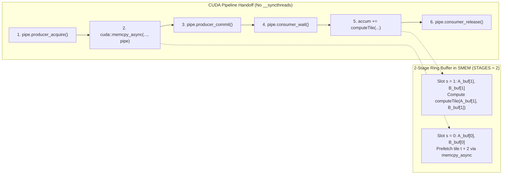
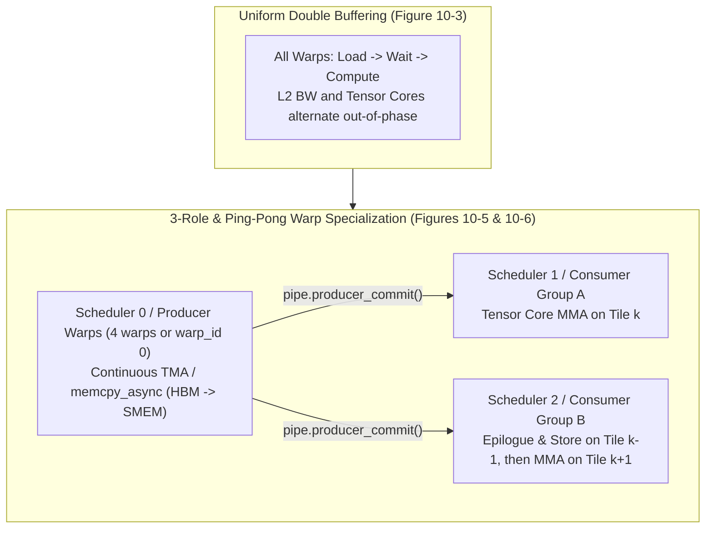

# 10.16 Intra-kernel pipelining, warp specialization and thread block clusters

| Field | Value |
|---|---|
| Level | Advanced |
| Priority tier | 2 |
| Lab venue | Nebius GPU |
| Part | Part 10: The GPU and CUDA |
| Sources used | *AI Systems Performance Engineering* (`ai-systems-performance-engineering`, Chris Fregly), Chapter 10 |
| Code | `code/part10/intra_kernel_pipelining.py`, `code/part10/intra_kernel_pipelining_lab.py` |
| Coverage file | `planning/coverage/chapters/10-16.md` |

## Why this matters for AI infrastructure

Picture a tiled matrix kernel that already looks healthy on paper. Its global loads are coalesced, which means neighboring threads read neighboring addresses, so the memory system is used well. Its occupancy is sensible, and its tiles sit in Shared Memory, the fast on-chip scratch space that threads in one block share. Then someone opens the profiler and sees the Tensor Cores idle for long stretches. Nothing is broken in the usual sense. The problem is the shape of the loop.

Here is what the loop does on each pass. Every warp issues a load from global memory into Shared Memory, which is the slow trip to device memory. It then stops at a block-wide `__syncthreads()` barrier and waits until every thread in the block has arrived and the data is ready. Only after that does it compute on the tile. It stops at another barrier before the next load can start. While the loads run, the math units wait. While the math runs, the memory system waits. The two kinds of work take turns instead of happening side by side.

A laundry with one washer and one dryer makes the same point. If you wash a load, wait for it to finish, dry it, and only then start the next wash, the washer sits idle during every drying cycle. The fix is simple. You load the washer with the next batch while the dryer works on the current one. GPU kernels need the same trick, and most of this chapter is about how to build it inside a single kernel launch.

*AI Systems Performance Engineering* Chapter 10 describes how Hopper and Blackwell kernels remove these gaps inside a kernel. Hopper and Blackwell are NVIDIA GPU generations. The chapter names four tools. The first is asynchronous ring buffers, which let a copy and a computation use different slots at the same moment. The second is warp specialization across the warp schedulers, where some warps only load and others only compute. The third is persistent megakernels, which stay resident and pull work in a loop. The fourth is Thread Block Clusters linked by Distributed Shared Memory, which let neighboring blocks read each other's Shared Memory directly. Together they keep the memory pipeline and the Tensor Cores busy at the same time.

| Pattern | Baseline | Optimized Result | Mechanism & Hardware Units |
|---|---|---|---|
| Asynchronous double/triple buffering (`<cuda/pipeline>`) | `41.3 ms` runtime, `68%` SM Active (`__syncthreads()` tiling) | `20.5 ms` (`2.01x` faster), `92%` SM Active (`+24%`) | `cuda::pipeline_shared_state<cuda::thread_scope_block, STAGES>` (`STAGES = 2` or `3`) + `cuda::memcpy_async` (`cp.async`) into ring-buffer slot `s = tile % STAGES`. |
| Warp specialization & ping-pong MMA | `20.5 ms` double-buffered (`~6` warps/SM limit) | `18.4 ms` (`+10.2%` faster), `96%` efficiency, `165 GB/s` L2, scales to `64` warps/SM | Assigns loader (`warp_id 0`), compute (`warp_id 1`), and storer (`warp_id 2`) or CUTLASS `gemm_tma_warpspecialized_pingpong` across `4` SM warp schedulers. |
| Persistent kernels, megakernels & cooperative grids (`grid.sync()`) | `1,000` tasks × `0.1 ms` = `100 ms` work + `20 ms` launch overhead (`1,000 × 0.02 ms`), `~35%` GPU util | `1` launch (`0.02 ms` cost), `100%` active SMs (`132` blocks × `256` threads = `33,792` threads at `12.5%` thread occ); megakernels `1.2x–6.7x` faster decode | Atomic queue `atomicAdd(&g_index, 1)` vs `vLLM`/`SGLang` per-layer launches; `cudaLaunchCooperativeKernel` + `grid.sync()` fuses `2,000` launches (`2` stages × `1,000` iters) into `1`. |
| Thread Block Clusters (`CTA` Clusters), DSMEM & TMA multicast (Tables 10-4 & 10-5) | `2x` global loads, `50%` L2 hit, `300 GB/s` DRAM BW/CTA (`18.4 ms` single-block warp-spec) | `1x` loads, `85%` L2 hit, `150 GB/s` DRAM BW/CTA (`0.6x` time = `40%` speedup); `17.2 ms` (`+6.5%`, `2.40x` vs naive, `97%` eff, `170 GB/s` L2) | Co-schedules `2` to `8` CTAs (`16` non-portable on Blackwell) in a GPC with DSMEM (`cluster.map_shared_rank()`), Scratch Memory, and `cluster.sync()`. |

:::note About the numbers and code in this chapter
The numbers in the metric tables, including Tables 10-2 through 10-5, come from *AI Systems Performance Engineering*. The source presents them as illustrative values that explain concepts, so they are not guaranteed specifications. None of them were rerun on live hardware for this handbook. The CUDA code is copied from *AI Systems Performance Engineering* and was not compiled here. Three cautions apply to the printed listings. Read them before you copy any listing into a project.

First, in `warp_specialized_pipeline_kernel`, the phases are separated by `cta.sync()`. That means the load, compute, and store roles run one after another inside each tile iteration. The listing does not show the full concurrent overlap reported in Table 10-3. The barriers are simple to read, but they remove the very overlap the table is about.

Second, in `gemm_tiled_pipeline`, the call `cuda::aligned_size_t<32>(sizeof(float))` passes a 4-byte size with a 32-byte alignment. The API requires the size to be a multiple of the alignment, so that call breaks the rule. Treat it as conceptual pseudocode, not as a line you can compile as written.

Third, the dynamic shared-memory budget uses the figure of 227,328 bytes from *AI Systems Performance Engineering*. That is the 227 KB per-block limit. Both tile choices of 112 and 128 fit safely below that ceiling.
:::

## Prerequisites and outcomes

**Prerequisites:** Complete Chapter 10.2 on SM warp schedulers and GPC hierarchy, and Chapter 10.3 on Shared Memory and DSMEM. Review Chapter 10.12 on `cuda::memcpy_async` and streams, Chapter 10.14 on occupancy and warp stalls, and Chapter 10.15 on multilevel tiling and Tensor Memory. You do not need all of them memorized. Each one gives a piece of the vocabulary that the rest of this chapter takes for granted, such as what a warp scheduler does and why a copy can run in the background.

The chapter walks through its material in a fixed order. It starts with a multi-stage ring-buffered tiled GEMM that uses `<cuda/pipeline>`, then sizes its two-stage and three-stage Shared Memory buffers and checks the speedups in Table 10-2. Next it builds a three-role warp-specialized pipeline and explains the collective ordering rule that keeps it correct. After that it looks at how CUTLASS ping-pong warp specialization and PyTorch FlashAttention-3 overlap TMA loads, Tensor Core math, and epilogue stores. The later parts cover persistent-kernel launch savings, megakernel speedups, and the co-resident grid limits for `cudaLaunchCooperativeKernel` and `grid.sync()`. The chapter then turns to Thread Block Clusters launched through `cudaLaunchKernelEx`, coordinated with `cluster.sync()` and `cluster.map_shared_rank()`. The last step traces the multi-block `warp_specialized_cluster_pipeline` kernel and compares the four stages of Table 10-5.

---

## 1. Intra-Kernel Pipelining and Double/Triple Buffering with `<cuda/pipeline>`

Suppose a kernel has already been tuned to use Shared Memory well, but its profiler still shows the math units waiting after every tile load. Your first question is why the warps cannot simply keep going. The answer comes from the barrier. A `__syncthreads()` call is a promise that every thread has reached the same point, so nobody can move ahead until the slowest thread gets there.

### 1.1 The two `<cuda/pipeline>` paradigms in Table 10-1

Traditional SIMT execution hides memory latency only by context-switching across many resident warps when a load stalls. SIMT stands for single instruction, multiple threads, which is how a GPU runs a group of threads together. If every warp in a tiled loop hits a `__syncthreads()` barrier at the end of a load phase, no warp can advance to the math phase until the slowest memory transaction finishes. Intra-kernel pipelining removes that stop-and-wait barrier by overlapping asynchronous memory copies and math operations inside a single kernel execution. Asynchronous here means the copy is started now and finished later, while the warp does other work.

An assembly line is a useful picture. One station fetches the next part while the station after it bolts the current part onto the product. Nobody waits for the whole part to be finished before the next station starts. A pipelined kernel does the same thing with tiles. The copy station fetches tile number 3 while the math station works on tile number 2.

*AI Systems Performance Engineering* Table 10-1 distinguishes two `<cuda/pipeline>` designs. In a uniform double-buffered or triple-buffered pipeline, all threads in the thread block step through tiles together. A ring buffer in Shared Memory overlaps prefetching the next tile with computing the current tile. A ring buffer is a fixed set of slots that are reused in order, like a row of cubbies that you fill and empty in turn. In a warp-specialized pipeline, separate warps are dedicated permanently to memory loading, Tensor Core computation, and output storing. Each warp scheduler issues a continuous stream of homogeneous instructions. Homogeneous here means that every warp on a scheduler does the same kind of work.

Both designs rely on four producer-consumer primitives in `<cuda/pipeline>`. A producer is the group of threads that starts the copies, and a consumer is the group that reads the finished data. The producer calls `pipe.producer_acquire()` to reserve the next ring-buffer stage slot. It then calls `pipe.producer_commit()` to batch-commit all `cuda::memcpy_async` copies issued in that stage. The consumer calls `pipe.consumer_wait()` or `cuda::pipeline_consumer_wait_prior<N>(pipe)` to wait only until the target stage arrives in Shared Memory. Finally it calls `pipe.consumer_release()` once computation finishes, so the producer can reuse that slot.

The table below lists the two variants side by side. Use it as a lookup when you pick a design for a new kernel.

| `<cuda/pipeline>` Variant | Best For | Main Execution Mechanism |
|---|---|---|
| Double-buffered or triple-buffered pipeline (`cuda::pipeline_shared_state<cuda::thread_scope_block, STAGES>`) | Uniform loop-based tiling (`GEMM`, stencil, convolution) where all threads in the CTA step through tiles together. | Overlaps asynchronous tile prefetch (`Stage 0`) with tile computation (`Stage 1`) using a ring buffer of `STAGES` (`2` or `3`) shared-memory slots. |
| Warp-specialized pipeline (`loader`, `compute`, `storer` warps) | Persistent kernels, fused attention (`FlashAttention-3`), and deep irregular pipelines with distinct hardware phases. | Dedicates separate warps (`warp_id 0`, `warp_id 1`, `warp_id 2`, or ping-pong consumer warp groups) to separate hardware engines (`TMA` / `LD/ST` vs Tensor Cores). |



### 1.2 Full cooperative double/triple-buffered GEMM and Table 10-2

Think of a two-stage pipeline as a two-tray oven. While one tray bakes, the other is being loaded with fresh dough. In a two-stage pipeline, one ring-buffer slot prefetches the next tile from DRAM while the arithmetic units compute on the previously loaded slot. DRAM is the main device memory, and a prefetch is a copy started early so the data is ready when it is needed. On Blackwell GPUs the Tensor Cores are fast enough, relative to HBM latency, that a single prefetch in flight may not hide the full memory delay. HBM is the high-bandwidth memory stacked next to the GPU die. Adding a third stage creates a triple-buffered ring that keeps two asynchronous prefetches in flight while computing on the third slot. In the oven picture, that is a third tray that lets the loader stay two trays ahead of the baker.

Even heavily tuned attention kernels cannot overlap everything, because data movement and online softmax rescaling compete for the same resources. Online softmax rescaling is the bookkeeping that keeps a running softmax correct as new blocks of scores arrive. *AI Systems Performance Engineering* reports that FlashAttention-3 reaches about 75 percent of peak FP16 FLOPS with warp-specialized overlap. FP16 is 16-bit floating point, and FLOPS counts floating-point operations per second.

The `gemm_tiled_pipeline` kernel below primes the ring buffer in a prologue loop. A prologue is the setup work that runs before the steady-state loop begins. The kernel then steps through the slots in steady state, where each pass waits for one slot, computes on it, releases it, and refills it with a later tile. In the illustrative Table 10-2 run, that halves the runtime of naive tiling, from 41.3 ms to 20.5 ms.

Read the code in three phases. The first phase, the prologue, starts the first `STAGES` tiles moving into Shared Memory. The second phase, the steady-state loop, waits for the tile in slot `s = tile % STAGES`, adds its dot products to the running sum, releases the slot, and starts a copy for the tile that is `STAGES` ahead. The third phase writes the finished value of each thread to `C_global`. The `% STAGES` part is what makes the slots wrap around like the cubbies in the ring buffer. Out-of-range elements are filled with zeros, so the math stays correct at the matrix edges.

```cpp
// Cooperative multi-stage (double/triple-buffered) tiled GEMM using <cuda/pipeline>
// Source: AI Systems Performance Engineering, Chapter 10
#include <cuda/pipeline>
#include <cooperative_groups.h>
#include <algorithm>

namespace cg = cooperative_groups;

#ifndef TILE_SIZE
#define TILE_SIZE 32
#endif
#ifndef STAGES
#define STAGES 2 // 2 = double buffer (16,384 B SMEM), 3 = triple buffer (24,576 B SMEM)
#endif

__device__ float computeTile(const float* __restrict__ A_sub,
                             const float* __restrict__ B_sub,
                             int tx, int ty) {
    float s = 0.0f;
    #pragma unroll
    for (int k = 0; k < TILE_SIZE; ++k) {
        s += A_sub[ty * TILE_SIZE + k] * B_sub[k * TILE_SIZE + tx];
    }
    return s;
}

extern "C" __global__
void gemm_tiled_pipeline(const float* __restrict__ A_global, // [M x K]
                         const float* __restrict__ B_global, // [K x N]
                         float* __restrict__ C_global,       // [M x N]
                         int M, int N, int K) {
    cg::thread_block cta = cg::this_thread_block();

    // Shared memory layout: A_buf[STAGES] (each 32x32 floats) then B_buf[STAGES]
    // For TILE_SIZE=32, STAGES=2: 4 * 1,024 * 4 B = 16,384 bytes (16 KiB)
    extern __shared__ float shared_mem[];
    float* A_buf[STAGES];
    float* B_buf[STAGES];
    {
        float* p = shared_mem;
        for (int s = 0; s < STAGES; ++s) { A_buf[s] = p; p += TILE_SIZE * TILE_SIZE; }
        for (int s = 0; s < STAGES; ++s) { B_buf[s] = p; p += TILE_SIZE * TILE_SIZE; }
    }

    __shared__ cuda::pipeline_shared_state<cuda::thread_scope_block, STAGES> state;
    auto pipe = cuda::make_pipeline(cta, &state);

    int tx = threadIdx.x, ty = threadIdx.y;
    int block_row = blockIdx.y * TILE_SIZE;
    int block_col = blockIdx.x * TILE_SIZE;
    float accum = 0.0f;
    int numTiles = (K + TILE_SIZE - 1) / TILE_SIZE;

    // 1. Prologue: prime the pipeline by prefetching the first STAGES tiles
    for (int s = 0; s < std::min(STAGES, numTiles); ++s) {
        int aRow = block_row + ty, aCol = s * TILE_SIZE + tx;
        int bRow = s * TILE_SIZE + ty, bCol = block_col + tx;
        pipe.producer_acquire();
        if (aRow < M && aCol < K) {
            cuda::memcpy_async(cta, A_buf[s] + ty * TILE_SIZE + tx,
                               &A_global[aRow * K + aCol],
                               cuda::aligned_size_t<32>(sizeof(float)), pipe);
        } else {
            A_buf[s][ty * TILE_SIZE + tx] = 0.0f;
        }
        if (bRow < K && bCol < N) {
            cuda::memcpy_async(cta, B_buf[s] + ty * TILE_SIZE + tx,
                               &B_global[bRow * N + bCol],
                               cuda::aligned_size_t<32>(sizeof(float)), pipe);
        } else {
            B_buf[s][ty * TILE_SIZE + tx] = 0.0f;
        }
        pipe.producer_commit();
    }

    // 2. Steady state: wait on stage s = tile % STAGES, compute, release s, and prefetch tile + STAGES
    for (int tile = 0; tile < numTiles; ++tile) {
        int s = tile % STAGES;
        pipe.consumer_wait();
        accum += computeTile(A_buf[s], B_buf[s], tx, ty);
        pipe.consumer_release();

        int nextTile = tile + STAGES;
        if (nextTile < numTiles) {
            int aRow = block_row + ty, aCol = nextTile * TILE_SIZE + tx;
            int bRow = nextTile * TILE_SIZE + ty, bCol = block_col + tx;
            pipe.producer_acquire();
            if (aRow < M && aCol < K) {
                cuda::memcpy_async(cta, A_buf[s] + ty * TILE_SIZE + tx,
                                   &A_global[aRow * K + aCol],
                                   cuda::aligned_size_t<32>{sizeof(float)}, pipe);
            } else {
                A_buf[s][ty * TILE_SIZE + tx] = 0.0f;
            }
            if (bRow < K && bCol < N) {
                cuda::memcpy_async(cta, B_buf[s] + ty * TILE_SIZE + tx,
                                   &B_global[bRow * N + bCol],
                                   cuda::aligned_size_t<32>{sizeof(float)}, pipe);
            } else {
                B_buf[s][ty * TILE_SIZE + tx] = 0.0f;
            }
            pipe.producer_commit();
        }
    }

    // 3. Epilogue: write final accumulated tile element to C_global
    int cRow = block_row + ty, cCol = block_col + tx;
    if (cRow < M && cCol < N) {
        C_global[cRow * N + cCol] = accum;
    }
}
```

| Metric (SMEM Sizing) | Naive Tiling | Two-Stage Double-Buffered (`STAGES = 2`) | Three-Stage Triple-Buffered (`STAGES = 3`) / Notes |
|---|---:|---:|---|
| Kernel execution time | `41.3 ms` | `20.5 ms` | `~2x` (`2.01x`) faster vs naive |
| SM Active % | `68%` | `92%` | `+24%` (`+24` percentage points vs naive) |
| Dynamic SMEM (`TILE_SIZE = 32`) | `8,192 B` (`2` tiles) | `16,384 B` (`16 KiB`, `4` buffers) | `24,576 B` (`24 KiB`, `6` buffers); FlashAttention-3 reaches `~75%` of peak FP16 FLOPS |

---

## 2. Warp Specialization and Producer-Consumer Pipelines

Consider a kernel where every warp is doing both jobs, loading and computing. The scheduler keeps switching between the two kinds of instruction, and neither job runs at full speed. Your question is whether it helps to give the jobs to different warps. The next subsection explains why it does.

### 2.1 Why warp specialization beats uniform double buffering

In a uniform double-buffered kernel, every warp executes the exact same instruction sequence. Each warp issues loads, waits on `consumer_wait()`, and then computes dot products. Each warp also belongs to one of the SM's four hardware warp schedulers. An SM is a streaming multiprocessor, the unit that runs thread blocks. A warp that is busy issuing address calculation and `memcpy_async` instructions cannot issue Tensor Core instructions in that same cycle, because the scheduler is working on the first kind of instruction. Moreover, whenever DRAM latency spikes, `pipe.consumer_wait()` stalls every warp in the block simultaneously. Everyone waits for the same slow copy.

Warp specialization breaks that symmetry by assigning distinct warps inside the thread block to dedicated hardware engines. Picture a restaurant kitchen. In a uniform kitchen, every cook chops, cooks, and plates every dish, so each cook switches tasks all the time. In a specialized kitchen, some cooks only prep ingredients, some only run the stove, and some only plate and send out orders. The stove never waits for someone to finish chopping, because the chopping happens on a different station. In a two-role split, four producer warps continuously fetch tiles into Shared Memory while eight consumer warps run Tensor Core math uninterrupted. In a three-role split, loader warps fetch input tiles, compute warps accumulate matrix products, and storer warps drain completed output tiles back to global memory.

Because those specialized warps reside on different hardware warp schedulers, one scheduler can issue a memory load, another can issue a Tensor Core MMA, and a third can issue a global store in the same clock cycle. MMA stands for matrix multiply-accumulate, the core operation of Tensor Cores. This turns out-of-phase oscillation between L2 bandwidth and Tensor Core utilization into continuous in-phase execution. L2 is the large on-chip cache shared by all SMs. In CUTLASS's `gemm_tma_warpspecialized_pingpong` schedule, two consumer warp groups also ping-pong between MMA compute and post-MMA epilogue stores. The epilogue is the final step that scales results and writes them out. Because the two groups take turns, the Tensor Cores never idle during epilogue cleanup.

The table lists four patterns, from the simplest to the most specialized. Each row names the roles and the hardware signature you would look for in Nsight Compute, which is NVIDIA's kernel profiler.

| Warp Specialization Pattern | Role Assignment across `4` SM Schedulers | Hardware Overlap & Nsight Compute Signature |
|---|---|---|
| Uniform double buffering | All warps alternate Load → Wait → Compute | L2 bandwidth and Tensor Core utilization oscillate out of phase; scales to `~6` warps/SM. |
| 2-role producer / consumer | `4` producer ("memory") warps + `8` consumer ("compute") warps | Producer warps queue TMA / `memcpy_async`; consumer warps stay on Tensor Cores. |
| 3-role loader / compute / storer | `warp_id == 0` (Loader), `warp_id == 1` (Compute), `warp_id == 2` (Storer) | Schedulers 0, 1, and 2 issue load, MMA, and store in the same cycle; L2 and Tensor Cores run in-phase up to `64` warps/SM. |
| Ping-pong consumer groups (CUTLASS `gemm_tma_warpspecialized_pingpong`) | `1` TMA loader group + `2` consumer groups (Group A & Group B) | While Consumer Group A runs post-MMA epilogue (scaling, shuffling, global store), Consumer Group B occupies Tensor Cores with the next MMA. |



### 2.2 Full 3-role `<cuda/pipeline>` kernel and the collective ordering rule

Start with the sizing question, because it comes first in practice. A three-role kernel keeps three square tiles for matrices A, B, and C in Shared Memory at once. Those three tiles must fit inside the per-block dynamic Shared Memory ceiling. Dynamic Shared Memory is the part of Shared Memory whose size is chosen at launch time, not at compile time. Selecting a tile dimension of 112 uses roughly two-thirds of the per-block budget. That launch succeeds only after the host opts in through `cudaFuncAttributeMaxDynamicSharedMemorySize`. Selecting a tile dimension of 160 exceeds the per-block hardware limit and causes kernel launch failure.

The sizing arithmetic is easy to check by hand. Multiply the tile edge by itself, multiply by the three tiles, and then multiply by the four bytes in a float. The table below walks through that calculation for each tile choice used in the chapter.

A strict correctness rule governs how `<cuda/pipeline>` methods are called inside warp-specialized kernels. The rule is about who is allowed to call them. When a kernel creates a unified block-scoped pipeline via `cuda::make_pipeline(cta, &pipe_state)`, the methods `producer_acquire()`, `producer_commit()`, `consumer_wait()`, and `consumer_release()` are collective. Collective means every participating thread in the block must take part in the call. They must execute in a consistent sequence outside divergent `warp_id` branches. A divergent branch is an if statement where some warps go one way and others go the other way. The kernel uses `cta.sync()` between role phases so each phase finishes before the next one starts. Calling pipeline collectives inside divergent warp branches requires instantiating a partitioned pipeline with explicit producer and consumer thread partitions. A partitioned pipeline tells the hardware exactly which threads are producers and which are consumers, so the rule no longer applies in the same way.

Think of a relay team where every runner must cross the handoff line together. If only the first lane's runners go to the line, the race stops. The collective rule works the same way for the pipeline.

| Tile Choice / Metric | Calculation (`3 × TILE_SIZE^2 × 4 B`) | Byte & KiB Footprint | Fits Blackwell `227,328 B` (`~227 KB`) Block Limit? |
|---|---|---|---|
| `TILE_SIZE = 112` (`warp_specialized_pipeline_kernel`) | `3 × 112 × 112 × 4 B` | `150,528 bytes` (`147.0 KiB`) | Yes (`66.22%` of `227,328 B`, queried via `cudaDevAttrMaxSharedMemoryPerBlockOptin`) |
| `TILE_SIZE = 128` (`warp_specialized_cluster_pipeline`) | `3 × 128 × 128 × 4 B` (`3 × 16,384 × 4 B`) | `196,608 bytes` (`192.0 KiB`) | Yes (`86.49%` of `227,328 B`) |
| `TILE_SIZE = 160` (oversized) | `3 × 160 × 160 × 4 B` | `307,200 bytes` (`300.0 KiB`) | No (`> 227,328 B`, fails with `cudaErrorInvalidValue`) |

```cpp
// 3-role warp-specialized kernel using a unified block-scoped <cuda/pipeline>
// Source: AI Systems Performance Engineering, Chapter 10
#include <cuda/pipeline>
#include <cooperative_groups.h>

namespace cg = cooperative_groups;

// smem_bytes = 3 * TILE_SIZE^2 * sizeof(float)
// 3 * 112 * 112 * 4 B = 150,528 bytes < 227,328 bytes (~227 KB Blackwell dynamic SMEM limit)
#define TILE_SIZE 112

__device__ void compute_full_tile(const float* __restrict__ A_tile,
                                  const float* __restrict__ B_tile,
                                  float* __restrict__ C_tile,
                                  int lane_id) {
    for (int idx = lane_id; idx < TILE_SIZE * TILE_SIZE; idx += warpSize) {
        int row = idx / TILE_SIZE;
        int col = idx % TILE_SIZE;
        float acc = 0.0f;
        #pragma unroll
        for (int k = 0; k < TILE_SIZE; ++k) {
            acc += A_tile[row * TILE_SIZE + k] * B_tile[k * TILE_SIZE + col];
        }
        C_tile[idx] = acc;
    }
}

extern "C" __global__
void warp_specialized_pipeline_kernel(const float* __restrict__ A_global,
                                      const float* __restrict__ B_global,
                                      float* __restrict__ C_global,
                                      int numTiles) {
    cg::thread_block cta = cg::this_thread_block();

    // Three square tiles in dynamic shared memory: A_tile, B_tile, C_tile (150,528 B total)
    extern __shared__ float shared_mem[];
    float* A_tile = shared_mem;
    float* B_tile = A_tile + TILE_SIZE * TILE_SIZE;
    float* C_tile = B_tile + TILE_SIZE * TILE_SIZE;

    int warp_id = threadIdx.x >> 5;
    int lane_id = threadIdx.x & 31;
    const int bytes = TILE_SIZE * TILE_SIZE * sizeof(float);

    // 3-stage pipeline shared by the block
    __shared__ cuda::pipeline_shared_state<cuda::thread_scope_block, 3> pipe_state;
    auto pipe = cuda::make_pipeline(cta, &pipe_state);

    // Block-strided persistent tile loop: one tile per block iteration
    for (int tile = blockIdx.x; tile < numTiles; tile += gridDim.x) {
        size_t offset = static_cast<size_t>(tile) * TILE_SIZE * TILE_SIZE;

        // CRITICAL RULE: Unified block-scoped pipeline collectives execute
        // across all participating CTA threads BEFORE role-specific branches
        pipe.producer_acquire();
        cuda::memcpy_async(cta, A_tile, A_global + offset,
                           cuda::aligned_size_t<16>{bytes}, pipe);
        cuda::memcpy_async(cta, B_tile, B_global + offset,
                           cuda::aligned_size_t<16>{bytes}, pipe);
        pipe.producer_commit();
        pipe.consumer_wait();
        cta.sync();

        // Role 1: Compute warp computes C_tile = A_tile * B_tile
        if (warp_id == 1) {
            compute_full_tile(A_tile, B_tile, C_tile, lane_id);
        }
        cta.sync();

        // Role 2: Storer warp writes C_tile back to C_global
        if (warp_id == 2) {
            for (int idx = lane_id; idx < TILE_SIZE * TILE_SIZE; idx += warpSize) {
                C_global[offset + idx] = C_tile[idx];
            }
        }
        cta.sync();

        pipe.consumer_release();
        cta.sync();
    }
}
```

| Metric | Naive Tiling | Two-Stage Double-Buffered (`double_buffered_pipeline`) | Single-Block Warp-Specialized (`warp_specialized_pipeline`) |
|---|---:|---:|---:|
| Kernel execution time | `41.3 ms` | `20.5 ms` (`2.01x` faster vs naive) | `18.4 ms` (`+10.2%` speedup vs two-stage, `2.24x` vs naive) |
| Warp execution efficiency | `68%` | `92%` (`+24%` vs naive) | `96%` (`+4%` vs two-stage) |
| Shared memory / barrier warp stalls | `High` | `Low` | `Minimal` |
| L2 load throughput | `80 GB/s` | `155 GB/s` (`+94%` vs naive) | `165 GB/s` (`+6.45%` vs two-stage) |
| Throughput scalability | Scales to `2–3` warps/SM | Scales to `~6` warps/SM | Scales nearly linearly up to `64` warps/SM (Blackwell limit) |
| DRAM bytes read vs SM cycles | Poor overlap | Great overlap | Excellent overlap |
| Dynamic instruction count | `1.7 B` | `1.05 B` (`-38%` vs naive) | `~1.00 B` (`-4.76%` / `~5%` vs two-stage) |

### 2.3 PyTorch torch.compile, Triton, and scaled_dot_product_attention

Python engineers do not need to write C++ pipeline code by hand to benefit from warp specialization in standard Transformer layers. Consider what happens in unfused eager-mode attention. The attention step is three operations in a row, the query-key product, the softmax, and the value product. Each operation becomes its own kernel. Between kernels, the full attention matrix is written out to HBM and read back in. That happens twice, which is why the code comment counts two intermediate round-trips. The round-trips make the Tensor Cores wait on memory transfers in every attention head.

Calling `torch.compile` through TorchInductor and OpenAI Triton, or invoking `torch.nn.functional.scaled_dot_product_attention`, lowers attention into fused kernels automatically. Fused means the three steps run inside one kernel, so the intermediate matrix does not need to make the trip to HBM. TorchInductor is the compiler backend inside `torch.compile`, and Triton is the Python-based language it generates kernels with. Those generated kernels use asynchronous pipeline barriers and warp-specialized producer-consumer groups under the hood. Inside the dispatched FlashAttention-2 or FlashAttention-3 kernel, loader warps prefetch key and value tiles into Shared Memory. Consumer warps overlap matrix multiplication and online softmax rescaling on Tensor Cores. Storer warps write the final context tensor back to HBM once at the end of the loop.

For an infrastructure engineer, the practical lesson is that you can often get this behavior from a single line of PyTorch. Most of the time you do not write the pipeline yourself. You choose the library call that already has it. The code below shows the before and after. Both versions compute attention, but the second one lets the library choose the fused kernel. When you review a model that still uses the first form, the question to ask is whether the attention call can be replaced without changing the result.

```python
# Unfused attention: 3 separate kernels + 2 intermediate N x N HBM round-trips (untested here)
scores = torch.matmul(queries, keys.transpose(-2, -1))
probabilities = F.softmax(scores, dim=-1)
context = torch.matmul(probabilities, values)

# Fused warp-specialized attention (FlashAttention-2 / FlashAttention-3 via SDPA) (untested here)
context = torch.nn.functional.scaled_dot_product_attention(queries, keys, values)
```

---

## 3. Persistent Kernels, Megakernels, and Cooperative Grid Synchronization

Picture an inference server that receives a thousand tiny tasks in a burst. If each task launches its own kernel, the GPU spends more time being told what to do than doing the work. Your question becomes how to stop paying the launch cost over and over. The answer is to launch once and let the work come to the kernel.

### 3.1 Persistent kernels: eliminating launch overhead and uneven tail waves

When an inference server or graph-processing stage executes a thousand tiny independent tasks, launching a separate CUDA kernel for every task wastes a large share of wall-clock time. Wall-clock time is the real elapsed time you would measure with a stopwatch. Each kernel launch incurs roughly twenty microseconds of host-to-device launch overhead. Host-to-device overhead is the cost of the CPU telling the GPU to start work. That adds twenty milliseconds of pure overhead on top of a hundred milliseconds of actual GPU work. Worse, because each tiny grid occupies only a few SMs and drains between launches, average GPU utilization hovers around thirty-five percent. Draining means the last blocks finish and the GPU sits partly empty before the next launch arrives.

A taxi analogy helps here. Sending one taxi for each passenger means the driver spends the trip back to the stand every time. A persistent kernel is like hiring one driver who stays on the road and picks up the next passenger from a queue. The driver never goes back to the stand between rides.

A persistent kernel eliminates both launch overhead and tail-wave draining. It does this by launching a single long-lived grid that stays resident across all SMs until the entire work queue is empty. On a GPU with 132 SMs, launching one block of 256 threads per SM creates 33,792 persistent worker threads. Those workers pull tasks continuously from a device-side atomic counter, `atomicAdd(&g_index, 1)`. An atomic counter is a shared number that threads increment one at a time, so no two threads grab the same task. The host pays the twenty-microsecond launch cost only once. Irregular task durations balance automatically across SMs, because a worker that finishes a short task simply grabs the next one.

Notice the distinction between per-SM thread occupancy and active SMs in a persistent launch. Occupancy measures how many threads are resident on an SM compared with the most it can hold. Running one block of 256 threads on an SM that supports 2,048 resident threads represents only 12.5 percent thread occupancy per SM. Yet because every single one of the 132 SMs runs a persistent block continuously, one hundred percent of the GPU's SMs remain actively engaged throughout the entire workload. Low occupancy does not mean idle hardware in this design. It means each SM has room to hold more work if the design needs it.

The table compares the two designs for the same workload. Read the first row as the work, the second as the launch cost, and the last two as the shape of the grid.

| Metric (`model_persistent_kernel()` in `code/part10/intra_kernel_pipelining.py`) | Traditional 1-Kernel-per-Task (`1,000` Launches) | Persistent Worker-Pool Kernel (`1` Launch on `132` SMs) |
|---|---:|---:|
| Task count & per-task compute work | `1,000` tasks × `0.1 ms` = `100.0 ms` work | `1,000` tasks × `0.1 ms` = `100.0 ms` work |
| Kernel launch overhead (`0.02 ms` / `20 µs` per launch) | `1,000 × 0.02 ms = 20.0 ms` (`+20%` extra time) | `1 × 0.02 ms = 0.02 ms` (saves `19.98 ms` / `~20 ms`) |
| Total wall-clock time | `120.0 ms` | `100.02 ms` (`2–3x` throughput gain on irregular queues) |
| Grid geometry & thread count | Tiny transient grids | `132` blocks (`1` block/SM) × `256` threads = `33,792` persistent threads |
| Per-SM thread occupancy vs Active SMs | `~35%` average GPU capacity utilization | `256 / 2,048 = 12.5%` (`~12%`) per-SM thread occupancy, `100%` of `132` SMs active |

```cpp
// Persistent worker-pool kernel pulling tasks from a device-side atomic counter
// Source: AI Systems Performance Engineering, Chapter 10
__device__ int g_index; // global task counter in device memory; initialized to 0 on host

__global__ void persistentKernel(Task* tasks, int totalTasks) {
    // Every thread loops continuously, atomically claiming the next task index
    while (true) {
        int idx = atomicAdd(&g_index, 1);
        if (idx >= totalTasks) break;
        processTask(tasks[idx]);
    }
}

// Host launch on a 132-SM GPU (33,792 persistent threads):
// cudaMemset(&g_index, 0, sizeof(int));
// persistentKernel<<<132, 256>>>(d_tasks, totalTasks);
// cudaDeviceSynchronize();
```

### 3.2 Megakernels for LLM inference

During autoregressive LLM decode, the model writes one token at a time, and each new token depends on the ones before it. Generating each token requires executing dozens of small operators across eighty or more Transformer layers. Standard serving engines launch separate kernels for RMSNorm, QKV projections, rotary embeddings, attention, all-reduce communication, and MLP blocks on every layer. RMSNorm and rotary embeddings are small per-token operations, and an all-reduce is the step where several GPUs combine their partial results. At small batch sizes, host launch latency and inter-kernel barrier gaps dominate token generation time. Batch size is how many requests the server handles together. With few requests, each kernel does very little math, so the gaps between kernels take a bigger share of the time.

Think of a factory that stops the whole line between every station to wait for a truck. The trucks cost more than the stations. A megakernel is the answer to that problem. It removes the stop between stations by keeping them all in one long-lived program.

Extending the persistent-kernel design across an entire Transformer forward pass produces an inference megakernel. A forward pass is one complete run of the model on the current tokens. Driven by an on-device task schedule, a single persistent megakernel fuses layer norms, projections, attention, and even cross-GPU communication inside one long-lived launch. The schedule lives on the device, so the GPU itself decides which task runs next. In Chapter 10 decode benchmarks, persistent megakernels reduce token decode latency by 1.2x to 6.7x compared to standard per-layer launches in vLLM and SGLang. vLLM and SGLang are two open-source LLM serving engines. The range is wide because the gain depends on the batch size and the model.

### 3.3 Cooperative Groups and grid-wide synchronization

Standard CUDA `__syncthreads()` synchronizes only the threads within a single thread block. Suppose your algorithm needs a global barrier across the whole array. A two-pass reduction and normalization over a thousand iterations is an example. Engineers traditionally had to end the kernel and launch a second kernel for the next pass, because a kernel launch is the only global barrier they had. Over a thousand iterations of a two-stage algorithm, that boundary forces two thousand separate kernel launches.

The Cooperative Groups API in `<cooperative_groups.h>` provides explicit thread collectives across five granularities. A granularity here is the size of the group, from a few threads inside a warp up to the whole device. One of those granularities is the whole-device grid handle, `cg::this_grid()`, which exposes `grid.sync()`. Calling `grid.sync()` synchronizes all resident thread blocks across the entire GPU and enforces global memory visibility without returning to the host. Visibility means a value written by one block is guaranteed to be seen by the others after the barrier. Two strict hardware rules govern `grid.sync()`. Every thread in every block must reach the barrier outside divergent conditionals. All blocks in the grid must co-reside simultaneously on the GPU. If any of those rules is broken, the barrier waits forever.

The host side has its own job. Before calling `cudaLaunchCooperativeKernel`, the host code must query `cudaOccupancyMaxActiveBlocksPerMultiprocessor`. That call reports how many blocks of the kernel can fit on each SM at once. The host then clamps `gridSize` to `maxCoopGrid`, and the kernel uses a grid-stride loop so each thread handles several elements. A grid-stride loop lets a smaller grid cover a larger array by stepping forward in strides. If an unclamped grid requests more blocks than can co-reside simultaneously, `cudaLaunchCooperativeKernel` fails immediately. That failure protects you from a missing-block deadlock, where the barrier waits for blocks that never got a spot on the GPU. When concurrent streams need to share SMs on the same GPU, engineers should avoid locking the full grid with `grid.sync()`. Thread Block Clusters with `cluster.sync()` are the smaller alternative.

The table lists the five granularities and the sizing rules for the whole-device grid.

| Cooperative Group Granularity / Metric | API Handle & Barrier | Sizing / Co-Residency Math & Rules |
|---|---|---|
| 1. Warp / sub-warp tiles | `cg::tiled_partition<32>(cta)` (or power-of-2 tiles `16, 8, 4, 2`) | Intra-warp collective shuffles and reductions |
| 2. Thread Block (`CTA`) | `cg::thread_block cta = cg::this_thread_block();` + `cta.sync()` | Equivalent to block-wide `__syncthreads()` |
| 3. Thread Block Cluster (`CGA`) | `cg::cluster_group cluster = cg::this_cluster();` + `cluster.sync()` | Hardware-accelerated barrier across `2` to `8` (`16` non-portable) co-scheduled CTAs in a GPC |
| 4. Whole-Device Grid (`combinedKernel`) | `cg::grid_group grid = cg::this_grid();` + `grid.sync()` via `cudaLaunchCooperativeKernel` | `maxCoopGrid = maxBlocksPerSm * prop.multiProcessorCount = 4 * 132 = 528` blocks; `N = 1,000,000` at `256` threads/block = `3,907` blocks must clamp to `528` (`N = 65,536` = `256 <= 528` fits directly); fuses `2` stages × `1,000` iterations = `2,000` launches into `1` launch (`1,999` eliminated) |
| 5. Multi-Device Grid | Cross-GPU cooperative barriers | Legacy / specialized multi-GPU lockstep |

The code below shows the fusion in action. It replaces two thousand launches with one launch that synchronizes itself between stages.

```cpp
// Fusing 2 stages x 1,000 iterations (2,000 kernel launches) into 1 cooperative persistent kernel
// Source: AI Systems Performance Engineering, Chapter 10
#include <cuda_runtime.h>
#include <cooperative_groups.h>

namespace cg = cooperative_groups;

__device__ inline float someComputationA(float x) { return x * 2.0f; }
__device__ inline float someComputationB(float a, float b) { return a + b; }

__global__ void combinedKernel(float* __restrict__ dataA,
                               float* __restrict__ dataB,
                               int N,
                               int iterations) {
    cg::grid_group grid = cg::this_grid(); // whole-grid group
    const int tid = blockIdx.x * blockDim.x + threadIdx.x;
    const int stride = gridDim.x * blockDim.x; // grid-stride step across clamped grid

    for (int it = 0; it < iterations; ++it) {
        // Stage 1: update all elements of dataA using a grid-stride loop
        for (int i = tid; i < N; i += stride) {
            dataA[i] = someComputationA(dataA[i]);
        }
        grid.sync(); // global barrier across all resident blocks + global memory visibility

        // Stage 2: consume finished dataA across blocks to update dataB
        for (int i = tid; i < N; i += stride) {
            const float mid = dataA[i];
            dataB[i] = someComputationB(mid, dataB[i]);
        }
        grid.sync(); // global barrier before next iteration
    }
}

void launchCombinedCooperative(float* dA, float* dB, int N, int iterations) {
    cudaDeviceProp prop{};
    cudaGetDeviceProperties(&prop, 0);
    if (!prop.cooperativeLaunch) return; // fallback to 2 launches/iteration if unsupported

    int maxBlocksPerSm = 0;
    const int blockSize = 256;
    cudaOccupancyMaxActiveBlocksPerMultiprocessor(&maxBlocksPerSm,
                                                  combinedKernel,
                                                  blockSize, 0);
    const int maxCoopGrid = maxBlocksPerSm * prop.multiProcessorCount; // e.g., 4 * 132 = 528

    int gridSize = (N + blockSize - 1) / blockSize;
    if (gridSize > maxCoopGrid) gridSize = maxCoopGrid; // MUST clamp to co-resident limit

    void* args[] = { &dA, &dB, &N, &iterations };
    cudaLaunchCooperativeKernel((void*)combinedKernel, gridSize, blockSize, args);
    cudaDeviceSynchronize();
}
```

---

## 4. Thread Block Clusters, DSMEM, Scratch Memory, Swizzling, and 2-SM CTA Pairs

Imagine two neighbors who each need a few bags of flour from the same warehouse. If each one drives to the warehouse separately, the trips are wasted. If they share a car, one trip serves both. Thread Block Clusters apply the same idea to GPU blocks, which are called CTAs in the hardware documentation. CTA stands for cooperative thread array, which is another name for a thread block. Your question is how neighboring blocks can share data without a trip to global memory.

### 4.1 Hardware hierarchy: GPC coscheduling, NV-HBI logical GPC, and Thread Block Swizzling

When thread blocks are dispatched in naive row-major order across a large output matrix, early blocks in a scheduling wave load disjoint rows and columns from HBM. A scheduling wave is the group of blocks that run at the same time across the GPU. Those uncoordinated loads evict shared tiles from the L2 cache before neighboring blocks in the next wave can reuse them. In addition, independent thread blocks have no hardware guarantee that they will run at the same time on neighboring SMs. Without that guarantee, a block cannot count on its neighbor being present.

A Thread Block Cluster is a hardware-level execution group introduced on Hopper and expanded on Blackwell. It guarantees that all member thread blocks are coscheduled simultaneously onto SMs inside the same GPU Processing Cluster. A GPC, or GPU processing cluster, is a group of SMs that sit together on the die. On dual-die Blackwell GPUs, each physical die contains its own GPC partition. The coherent High-Bandwidth Interface, called NV-HBI, links both dies into a combined logical GPC transparently. Logical here means the software sees one GPC even though the hardware has two dies. Thread Block Swizzling reorders logical tile coordinates into two-dimensional swizzled groups. The result is that all blocks active in a wave share the same matrix rows and columns out of L2 cache. Swizzling changes only the order in which tiles are assigned, not what each tile computes.

A shuffled deck makes the swizzle idea clear. Dealing cards in plain row order gives each player a different set of ranks. Dealing them in a zigzag pattern gives neighboring players overlapping cards. The total deal is the same, but the pieces that need to be near each other are now near each other.

The table lists the four hardware pieces behind this section. Each row says what the piece is and what it does for scheduling.

| Hardware Mechanism (Figures 10-10 to 10-12) | Architectural Scope | Performance & Scheduling Role |
|---|---|---|
| Thread Block Cluster (`CTA` Cluster) | `2` to `8` portable CTAs (`16` non-portable on Blackwell via `cudaFuncAttributeNonPortableClusterSizeAllowed`) | Hardware guarantees simultaneous coscheduling onto SMs inside the same GPC. |
| Blackwell dual-die `NV-HBI` logical GPC | `B200` / `B300` & `GB200` / `GB300` dual-die packages | `10 TB/s` High-Bandwidth Interface (`NV-HBI`) links both dies with full L2 cache coherence as a single logical GPC. |
| Cluster Launch Control (`CLC`) | Blackwell hardware cluster scheduler | Dynamically launches and balances persistent thread block clusters across available SMs. |
| Thread Block Swizzling | 2D reordering of `(blockIdx.x, blockIdx.y)` across output matrix `C` | Maximizes L2 cache hit rate within each scheduling wave, yielding double-digit percentage gains on tiled/persistent GEMMs. |

### 4.2 Distributed Shared Memory versus hardware Scratch Memory

Without a cross-SM interconnect, two thread blocks that need to exchange partial sums or share an input tile must write data out to L2 or HBM and wait for a global memory round-trip. A partial sum is an intermediate total that another block still needs to add to. The off-SM detour wastes memory bandwidth and adds hundreds of cycles of latency. Within a Thread Block Cluster, two distinct on-chip SRAM mechanisms eliminate that round-trip. SRAM is the fast memory built from transistors that sits on the chip itself.

Distributed Shared Memory, or DSMEM, stitches the local `__shared__` memory of every CTA in the cluster into a single unified address space. It travels over the dedicated SM-to-SM cluster network. Any thread block in the cluster can perform loads, stores, or `atomicAdd` operations directly into another member block's shared memory via `cluster.map_shared_rank(ptr, target_rank)`. A rank is the index of a block inside its cluster. This path bypasses both HBM DRAM and the L2 cache. To avoid remote bank serialization, warps accessing remote DSMEM should read or write contiguous, 32-byte-aligned sectors in unique address ranges. Bank serialization is what happens when several threads hit the same memory bank at once, so their accesses queue up one after another.

Underneath DSMEM sits Scratch Memory. This is a separate, hardware-managed on-chip SRAM region that kernel code cannot see. The GPU uses Scratch Memory automatically to track `cluster.sync()` barrier arrival counters, group progress, and DSMEM access flags. Think of it as the bookkeeping drawer behind the counter, where the staff keep the order tickets. If a large sixteen-block cluster or complex synchronization pattern exceeds the dedicated Scratch SRAM capacity, the hardware transparently spills coordination metadata to L1 and L2 backed local memory to preserve correctness. The drawer overflows into a bigger cabinet, which is slower but still correct.

### 4.3 Launching and coordinating a Thread Block Cluster

Launching a Thread Block Cluster requires either compile-time `__cluster_dims__` annotations or runtime configuration with `cudaLaunchKernelEx` and `cudaLaunchAttributeClusterDimension`. Compile-time means the cluster shape is written into the kernel source. Runtime means the host sets it when it launches. Inside the kernel, every block in the cluster must declare the exact same dynamic shared memory size. They also synchronize around remote DSMEM accesses using `cluster.sync()`. If one block declared a different size, the cluster would not agree on the layout of the shared buffers.

Read `MyClusterKernel` in three beats. First, each block fills its own `shared_buffer` and waits at `cluster.sync()`, so every member has its buffer ready. Second, each block maps a DSMEM pointer to Block 0's shared memory through `cluster.map_shared_rank(shared_buffer, 0)`. Non-zero ranks then run an on-chip `atomicAdd` straight into Block 0's shared memory over the SM-to-SM network. Third, a second `cluster.sync()` makes sure all of those remote updates finish before Block 0 reads the combined result. The two barriers are the handshake. Without the first, a block could read a neighbor's buffer before it was filled. Without the second, Block 0 could print before the adds land.

The host code below sets the cluster size at runtime. It uses a cluster of two blocks, which is the CTA pair pattern covered in the next part of this section.

```cpp
// Host launch and device kernel for a Thread Block Cluster using DSMEM + cluster.sync()
// Source: AI Systems Performance Engineering, Chapter 10
#include <cuda_runtime.h>
#include <cooperative_groups.h>
#include <cstdio>

namespace cg = cooperative_groups;

__global__ void MyClusterKernel() {
    // 1. Obtain handle to this Thread Block Cluster (guaranteed co-resident on a GPC)
    cg::cluster_group cluster = cg::this_cluster();

    // 2. Every block in the cluster MUST declare the same extern __shared__ size
    extern __shared__ int shared_buffer[];

    int clusterRank = cluster.block_rank();
    int clusterSize = cluster.num_blocks();

    // 3. Initialize this block's local shared memory
    shared_buffer[threadIdx.x] = threadIdx.x;

    // 4. Hardware-accelerated cluster-wide barrier: ensure all blocks initialized shared_buffer
    cluster.sync();

    // 5. Map a DSMEM pointer to Block 0's shared_buffer over the on-chip SM-to-SM network
    int* remote_buffer = cluster.map_shared_rank(shared_buffer, 0);
    if (clusterRank != 0 && threadIdx.x == 0) {
        // 6. On-chip DSMEM atomicAdd directly into Block 0's SMEM (no DRAM or L2 round-trip)
        atomicAdd(&remote_buffer[0], shared_buffer[0]);
    }

    // 7. Second cluster barrier ensures all remote atomicAdds have completed before rank 0 reads
    cluster.sync();

    if (clusterRank == 0 && threadIdx.x == 0) {
        printf("Combined sum in cluster[0] across %d blocks: %d\n", clusterSize, shared_buffer[0]);
    }
}

void launchClusterExample(void* args[]) {
    cudaLaunchConfig_t config{};
    config.gridDim = dim3(128, 1, 1);   // 128 total CTAs -> 64 clusters of 2 CTAs
    config.blockDim = dim3(256, 1, 1);
    config.dynamicSmemBytes = 256 * sizeof(int);

    cudaLaunchAttribute attr{};
    attr.id = cudaLaunchAttributeClusterDimension;
    attr.val.clusterDim.x = 2; // CTA pair (2 blocks per cluster)
    attr.val.clusterDim.y = 1;
    attr.val.clusterDim.z = 1;
    config.attrs = &attr;
    config.numAttrs = 1;

    // Required if clusterDim > 8 (up to 16 CTAs on Blackwell)
    cudaFuncSetAttribute(MyClusterKernel,
                         cudaFuncAttributeNonPortableClusterSizeAllowed, 1);

    cudaLaunchKernelEx(&config, MyClusterKernel, args, nullptr);
}
```

### 4.4 Thread Block Pairs, TMA multicast versus DSMEM, and Table 10-4

A single thread block often lacks the register file, Shared Memory, or Tensor Memory capacity to compute a 256 by 256 output tile by itself. The register file is the fast per-thread storage, and Tensor Memory is the on-SM memory that holds Tensor Core accumulators. Pairing two thread blocks into a Thread Block Pair coschedules them onto adjacent SMs inside a GPC. They then operate as one double-sized logical unit. Each CTA loads half of the input subtile into its local Shared Memory and holds half of the accumulator in its per-SM Tensor Memory. The accumulator is the running result that the Tensor Cores keep adding to.

In CUTLASS, this hardware capability is exposed as a 2-SM Unified MMA GEMM using `tcgen05.mma` with `cta_group::2`. CUTLASS is NVIDIA's library of templated matrix-multiply code, and UMMA is the unified matrix multiply-accumulate instruction on Blackwell. As shown in Table 10-4, pairing two CTAs over DSMEM cuts global load transactions in half, boosts L2 cache hit rate by thirty-five percentage points, halves DRAM bandwidth per CTA, and yields a forty percent execution speedup. The point to take away is that the pair reuses one loaded tile instead of loading it twice.

Engineers also need a clear rule for choosing between two ways of sharing data inside a cluster. The first is TMA multicast to `shared::cluster`. TMA stands for Tensor Memory Accelerator, the hardware unit that moves tiles without using threads. The second is DSMEM pointer sharing through `cluster.map_shared_rank()`. Choose TMA multicast when per-block tile reuse is high or the cluster size is large. TMA then broadcasts one L2 fetch into every CTA's local Shared Memory at the same time, so each block can read its copy repeatedly. Choose DSMEM pointer sharing when Shared Memory capacity is tight or the cluster size is small. In that case each follower block reads its slice of the leader's tile only once, so keeping a copy in every block would waste space.

The table compares two independent blocks with a CTA pair, and then gives the rule for choosing between the two sharing methods.

| Metric or Architecture Parameter | Two Independent CTAs (No DSMEM) | CTA Pair with DSMEM (`clusterDim.x = 2`, `2-SM UMMA`) | Improvement / Rule |
|---|---:|---:|---|
| Tile split across `2-SM CTA Pair` (`256 × 256` output tile) | Exceeds single-CTA resource budget | Each CTA holds `128 × 16` in local `SMEM` and `128 × 256` in per-SM `TMEM` | Exposed in CUTLASS as `2-SM UMMA` (`tcgen05.mma` with `cta_group::2`) |
| Global load transactions | `2x` (each CTA loads tile from HBM) | `1x` (tile loaded once) | `50%` fewer global loads |
| L2 cache hit rate | `50%` | `85%` | `+35` percentage points |
| Inter-CTA data reuse | `N/A` (no reuse) | Significant (tile reused by CTA 1 over SM-to-SM DSMEM) | Eliminates duplicate DRAM reads |
| Effective DRAM bandwidth per CTA | `300 GB/s` | `150 GB/s` | `50%` less DRAM bandwidth per CTA |
| Relative kernel execution time | `1.0x` | `0.6x` | `40%` speedup (`1.67x` faster) |
| TMA Multicast vs DSMEM `map_shared_rank` rule | Use TMA Multicast (`shared::cluster`) for high tile reuse or large clusters (`8–16` CTAs) | Use DSMEM `map_shared_rank()` when SMEM is tight or cluster is small (`2–4` CTAs) with single-touch follower reads | Tested in `code/part10/intra_kernel_pipelining_lab.py` |

### 4.5 Combining warp specialization with Thread Block Clusters and Table 10-5

In single-block warp specialization, each block still loads its own copy of the input tiles from global memory. That is wasteful when neighboring blocks need the same tiles. Combining `<cuda/pipeline>` asynchronous copies, three-role warp specialization, and Thread Block Cluster DSMEM sharing in `warp_specialized_cluster_pipeline` removes those duplicate inter-block loads. The leader block, where `cluster_rank == 0`, uses its loader warp, `warp_id == 0`, to stage the 128 by 128 input tiles once into its own Shared Memory. The other blocks then read those tiles over DSMEM instead of loading them again.

Remember that a `cuda::pipeline` created with `thread_scope_block` is scoped strictly to the single CTA that created it. The scope is the set of threads that the pipeline's handshake covers. Calling `pipe.producer_commit()` in the leader block does not synchronize `pipe.consumer_wait()` in follower blocks. Instead, the leader block waits locally via `cuda::pipeline_consumer_wait_prior<1>(pipe)`. All blocks in the cluster then call `cluster.sync()` before mapping pointers to the leader's tiles via `cluster.map_shared_rank(A_tile_local, 0)`. The cluster barrier is the signal that the leader's copy has finished.

Each block then computes a disjoint horizontal band of rows in its compute warp and writes its band to global memory in its storer warp. A band is a strip of rows, so every block works on a different strip of the same tile. A second `cluster.sync()` ensures all follower blocks finish reading DSMEM before the leader overwrites the tile buffer on the next iteration. Across the four-stage progression in Table 10-5, this cluster pipeline drives execution time down to 17.2 ms. That is a 2.40x total speedup over naive tiling, at ninety-seven percent warp execution efficiency.

The code below shows the whole pattern. Read it in five steps, one per numbered comment. The leader stages the tiles. The cluster publishes them. Each block computes its band. The storer writes the band. The final barrier protects the buffer for the next tile.

```cpp
// Multi-block warp-specialized cluster pipeline using DSMEM and a leader block-scoped pipeline
// Source: AI Systems Performance Engineering, Chapter 10
#include <cuda/pipeline>
#include <cooperative_groups.h>
#include <algorithm>

namespace cg = cooperative_groups;

#define TILE_SIZE 128
#define TILE_ELEMS (TILE_SIZE * TILE_SIZE) // 16,384 floats -> 3 tiles = 196,608 B (192 KiB) SMEM/CTA

__device__ void compute_rows_from_ds(const float* __restrict__ A_src,
                                     const float* __restrict__ B_src,
                                     float* __restrict__ C_dst,
                                     int row_begin, int row_end,
                                     int lane_id) {
    for (int row = row_begin + lane_id; row < row_end; row += warpSize) {
        for (int col = 0; col < TILE_SIZE; ++col) {
            float acc = 0.0f;
            #pragma unroll
            for (int k = 0; k < TILE_SIZE; ++k) {
                acc += A_src[row * TILE_SIZE + k] * B_src[k * TILE_SIZE + col];
            }
            C_dst[row * TILE_SIZE + col] = acc;
        }
    }
}

extern "C" __global__
void warp_specialized_cluster_pipeline(const float* __restrict__ A_global,
                                       const float* __restrict__ B_global,
                                       float* __restrict__ C_global,
                                       int numTiles) {
    cg::thread_block cta = cg::this_thread_block();
    cg::cluster_group cluster = cg::this_cluster();

    extern __shared__ float shared_mem[];
    float* A_tile_local = shared_mem;
    float* B_tile_local = A_tile_local + TILE_ELEMS;
    float* C_tile_local = B_tile_local + TILE_ELEMS;

    __shared__ cuda::pipeline_shared_state<cuda::thread_scope_block, 2> pipe_state;
    auto pipe = cuda::make_pipeline(cta, &pipe_state);

    const int lane_id = threadIdx.x & 31;
    const int warp_id = threadIdx.x >> 5;
    auto warp = cg::tiled_partition<32>(cta);

    const int cluster_rank = cluster.block_rank();
    const dim3 cluster_dims = cluster.dim_blocks();
    const int blocks_in_cluster = cluster_dims.x * cluster_dims.y * cluster_dims.z;

    for (int tile = blockIdx.x / cluster_dims.x; tile < numTiles;
         tile += gridDim.x / cluster_dims.x) {
        const size_t offset = static_cast<size_t>(tile) * TILE_ELEMS;

        // 1. Leader block (rank 0) stages A and B once for the entire cluster
        if (cluster_rank == 0) {
            pipe.producer_acquire();
            if (warp_id == 0) {
                cuda::memcpy_async(warp, A_tile_local, A_global + offset,
                                   TILE_ELEMS * sizeof(float), pipe);
                cuda::memcpy_async(warp, B_tile_local, B_global + offset,
                                   TILE_ELEMS * sizeof(float), pipe);
            }
            pipe.producer_commit();
            cuda::pipeline_consumer_wait_prior<1>(pipe); // ensure loads complete in leader SMEM
        }

        // 2. Publish leader's tiles to all follower blocks in the cluster via DSMEM
        cluster.sync();
        const float* A_src = cluster.map_shared_rank(A_tile_local, 0);
        const float* B_src = cluster.map_shared_rank(B_tile_local, 0);

        const int rows_per_block = (TILE_SIZE + blocks_in_cluster - 1) / blocks_in_cluster;
        const int row_begin = std::min(cluster_rank * rows_per_block, TILE_SIZE);
        const int row_end = std::min(row_begin + rows_per_block, TILE_SIZE);

        // 3. Compute warp (warp_id 1) in every block computes its disjoint row band via DSMEM
        if (warp_id == 1) {
            pipe.producer_acquire();
            compute_rows_from_ds(A_src, B_src, C_tile_local, row_begin, row_end, lane_id);
            pipe.producer_commit();
        }

        // 4. Storer warp (warp_id 2) in every block writes its row band to C_global
        if (warp_id == 2) {
            pipe.consumer_wait();
            for (int row = row_begin + lane_id; row < row_end; row += warpSize) {
                for (int col = 0; col < TILE_SIZE; ++col) {
                    C_global[offset + row * TILE_SIZE + col] = C_tile_local[row * TILE_SIZE + col];
                }
            }
            pipe.consumer_release();
        }

        // 5. Ensure all follower blocks finish reading DSMEM before leader overwrites next tile
        cluster.sync();
    }
}
```

| Metric | Naive Tiling | Two-Stage Double-Buffered (`double_buffer_pipeline`) | Single-Block Warp-Specialized (`warp_specialized_pipeline`) | Thread Block Cluster Pipeline (`warp_specialized_cluster_pipeline`) |
|---|---:|---:|---:|---:|
| Kernel execution time | `41.3 ms` | `20.5 ms` (`+2.01x` vs naive) | `18.4 ms` (`+10.2%` vs two-stage) | `17.2 ms` (`+6.5%` / `~1.2 ms` faster vs warp-spec, `2.40x` vs naive) |
| Warp execution efficiency | `68%` | `92%` (`+24%` vs naive) | `96%` (`+4%` vs two-stage) | `97%` (`+1%` vs warp-spec) |
| Warp state stall % (SMEM / barrier) | `High` | `Low` | `Minimal` | `Minimal (further reduced)` |
| L2 load throughput | `80 GB/s` | `155 GB/s` (`+94%` vs naive) | `165 GB/s` (`+6.45%` vs two-stage) | `170 GB/s` (`+3%` vs warp-spec) |
| Throughput scalability | `2–3` warps/SM | `~6` warps/SM | Up to `64` warps/SM (Blackwell) | Scales across CTAs up to `64` warps/SM (Blackwell) |
| DRAM read overlap | Poor overlap | Great overlap | Excellent overlap | Excellent overlap (even under CTA handoff) |
| Dynamic instruction count | `1.7 B` | `1.05 B` (`-38%` vs naive) | `~1.00 B` (`-4.76%` vs two-stage) | `~0.98 B` (`-2%` vs warp-spec) |

---

## 5. Commands and Configurations That Matter

Picture your first afternoon on a new Hopper or Blackwell node. A pipelined kernel builds without complaint, then fails at launch with a shared-memory error. The commands in this section are the ones you would reach for in that moment. Treat them as a checklist of what to verify, and run them yourself on the hardware you have.

### 5.1 Compile and profile pipeline, cooperative grid, and cluster kernels

Compiling kernels that use `<cuda/pipeline>` and Thread Block Clusters requires C++20 mode and an architecture-accelerated target such as `sm_90a` or `sm_100a`. The `a` suffix turns on the architecture-specific instructions that these features need. Read the flags in the first command as a short list. `-O3` asks the compiler for its highest optimization level. `-std=c++20` selects the C++ language version. `-lineinfo` keeps a link from compiled code back to your source lines, so the profiler can point at the line that is slow. Profiling with Nsight Compute verifies whether asynchronous copies overlap computation and whether L2 throughput climbs as expected. A good first profile checks the overlap, then the cache throughput, then whether the cluster stays resident on the GPU.

```bash
# 1. Compile double-buffered, warp-specialized, and cluster pipeline kernels for Hopper (sm_90a) or Blackwell (sm_100a) (untested here)
nvcc -O3 -std=c++20 -arch=sm_100a -lineinfo warp_specialized_cluster_pipeline.cu -o warp_spec_cluster

# 2. Profile async copy overlap, SM Active %, L2 throughput, and cluster residency in Nsight Compute (untested here)
ncu --set full --section LaunchStats --section Occupancy \
    --section MemoryWorkloadAnalysis --section WarpStateStats \
    ./warp_spec_cluster
```

### 5.2 Enable dynamic shared memory above 48 KB on Blackwell

By default, CUDA restricts dynamic Shared Memory per thread block to 48 KB. Unless the host code explicitly opts in to the device's extended Shared Memory limit, the kernel cannot use more than that. Think of the default as the standard locker size, and the opt-in as asking the front desk for a bigger locker. Always query `cudaDevAttrMaxSharedMemoryPerBlockOptin` first. Then call `cudaFuncSetAttribute` with `cudaFuncAttributeMaxDynamicSharedMemorySize` before launching large multi-stage or three-role kernels.

```cpp
// Host setup to enable 150,528 B (TILE_SIZE=112) or 196,608 B (TILE_SIZE=128) dynamic SMEM per block (untested here)
int max_smem_optin = 0;
cudaDeviceGetAttribute(&max_smem_optin, cudaDevAttrMaxSharedMemoryPerBlockOptin, 0);
// On Blackwell: max_smem_optin == 227328 bytes (~227 KB)
size_t smem_bytes = 3 * 128 * 128 * sizeof(float); // 196,608 bytes (192 KiB)
cudaFuncSetAttribute(warp_specialized_cluster_pipeline,
                     cudaFuncAttributeMaxDynamicSharedMemorySize,
                     static_cast<int>(smem_bytes));
```

---

## 6. How It Fails: Six Intra-Kernel Pipelining, Cooperative Grid, and Cluster Failure Modes

Late at night, a kernel that passed every test on a desktop GPU hangs on a production node. Nothing in the source looks wrong at first glance. Synchronizing asynchronous pipelines, whole-device grids, and multi-SM clusters introduces subtle concurrency hazards. A hazard here is a situation where the code looks right but the timing or the rules are wrong. The failures often show up as a hang, a wrong answer, or a launch error, and the symptom can be far from the cause. The table below catalogs the six primary failure modes from Chapter 10. For each one it lists the production or profiler symptom, the root cause, and the fix.

Use the table as a first-pass filter, not as a final answer. Many real incidents combine two rows, for example a barrier that was placed inside a branch and a launch that was never clamped. Read the symptom first, then check the rows that match it, then check the rest.

When you debug one of these, start from the symptom column. A hang points toward a barrier that some thread never reached. A launch error points toward sizing or opt-in. A wrong answer in only part of a tile points toward a block that read another block's data too early.

| # | Failure Mode | Production / Profiler Symptom | Root Cause | Fix |
|---|---|---|---|---|
| 1 | Calling unified CTA `cuda::pipeline` collectives inside divergent `warp_id` branches | Kernel hangs indefinitely or produces corrupted output tiles when transitioning from `double_buffered_pipeline` to `warp_specialized_pipeline`. | A unified `cuda::make_pipeline(cta, &pipe_state)` requires all threads in `cta` to execute `producer_acquire`, `producer_commit`, `consumer_wait`, and `consumer_release` in collective order. | Keep unified CTA pipeline collectives outside `if (warp_id == ...)` branches with explicit `cta.sync()` handoffs, or use a partitioned pipeline (`thread_scope_block` with explicit producer/consumer partitions). |
| 2 | Expecting a block-scoped `cuda::pipeline` in CTA 0 to synchronize follower CTAs (`cluster_rank > 0`) | Follower blocks (`cluster_rank > 0`) in `warp_specialized_cluster_pipeline` read zeros or stale tiles from `cluster.map_shared_rank(A_tile_local, 0)`. | `cuda::pipeline` is scoped strictly to its creating CTA (`thread_scope_block`); `producer_commit()` in rank 0 does not block or release `consumer_wait()` in rank 1. | Have rank 0 complete its local `pipeline_consumer_wait_prior<1>(pipe)`, then call `cluster.sync()` across all blocks before follower blocks call `map_shared_rank()`, and call a second `cluster.sync()` before rank 0 overwrites the buffer. |
| 3 | Unclamped `gridSize` in `cudaLaunchCooperativeKernel` (`gridSize > 528`) | `cudaLaunchCooperativeKernel` returns `cudaErrorCooperativeLaunchTooLarge` immediately and the kernel never executes when `N` increases. | Cooperative launches (`grid.sync()`) require every block in the grid to co-reside simultaneously (`maxCoopGrid = maxBlocksPerSm × multiProcessorCount`, e.g., `4 × 132 = 528` blocks). | Query `cudaOccupancyMaxActiveBlocksPerMultiprocessor`, clamp `gridSize = std::min(gridSize, maxCoopGrid)`, and use a grid-stride loop (`for (int i = tid; i < N; i += stride)`). |
| 4 | Divergent control flow skipping `cluster.sync()` or `grid.sync()` | Kernel hangs until the hardware watchdog or Kubernetes health check terminates the process (`Xid 31` / timeout). | Just like warp intrinsics (`__shfl_sync`) and `__syncthreads()`, every participating thread block in a cluster must reach `cluster.sync()` and every thread in the grid must reach `grid.sync()` in lockstep. | Never place `cluster.sync()` or `grid.sync()` inside conditional branches where a subset of blocks or threads can exit early (`if (tile >= numTiles) return;`). |
| 5 | Exceeding `227,328 bytes` (`~227 KB`) per-block dynamic SMEM or forgetting opt-in attribute | Launching `warp_specialized_pipeline_kernel` with `TILE_SIZE = 112` (`150,528 B`) or `128` (`196,608 B`) fails with `cudaErrorInvalidValue`. | Default per-block dynamic shared memory without opt-in is `48 KB`, and the hardware maximum per block on Blackwell is `227,328 bytes` (`~227 KB`; `TILE_SIZE = 160` requires `307,200 B` and cannot fit). | Choose `TILE_SIZE` so `3 × TILE_SIZE^2 × 4 <= 227,328 B` and call `cudaFuncSetAttribute(kernel, cudaFuncAttributeMaxDynamicSharedMemorySize, smem_bytes)`. |
| 6 | Monopolizing all SMs with a persistent kernel or `16`-CTA cluster when concurrent streams need the GPU | High-priority inference control streams or async prefetch kernels starve behind a background persistent kernel or oversized `16`-CTA cluster launch. | A full-grid persistent/cooperative kernel occupies all `132` SMs continuously, and `16`-CTA clusters lock `16` SMs per cluster. | Use `2`-CTA or `4`-CTA Thread Block Clusters instead of full-grid `grid.sync()` or `16`-CTA clusters so remaining SMs stay free to schedule independent streams concurrently. |

---

## 7. Hands-On Lab: Verify Pipeline Speedups, SMEM Budgets, Persistent Kernels, Cooperative Grids, and Cluster DSMEM

Before you spend time on a GPU node, you want to know whether the numbers in this chapter even add up. The lab in this section is a deterministic check. It does not need a GPU. It runs the arithmetic and the rule checks from this chapter in plain Python, so you can confirm the numbers before you spend time on hardware. It runs on any Linux machine or Nebius GPU VM with Python 3.10 or newer, using only the standard library. It validates all four stages of Table 10-5, the dynamic Shared Memory budgets, the persistent-kernel launch savings, the cooperative grid clamping, and the Thread Block Cluster DSMEM rules. These steps were not run on a live cluster for this handbook. The expected output below is the output the script prints.

Run `code/part10/intra_kernel_pipelining_lab.py` from the root of the repository. The script needs no GPU and no extra packages.

```bash
python3 code/part10/intra_kernel_pipelining_lab.py
```

The output lists each check with a PASS or FAIL label. A failing line tells you which rule the code no longer matches.

Expected output:

```text
=== Chapter 10.16 Lab: Intra-Kernel Pipelining, Warp Specialization & Thread Block Clusters (ASP Ch 10) ===
  [PASS] ASP Ch10 Table 10-2: Double-buffered pipeline cuts time 41.3 -> 20.5 ms (2.01x faster) and raises SM Active / warp eff 68% -> 92% (+24%)
  [PASS] ASP Ch10 Table 10-3: Single-block warp specialization cuts time 20.5 -> 18.4 ms (+10.2% speedup vs 2-stage), raises efficiency to 96%, L2 to 165 GB/s (+6.45%), and scales to 64 warps/SM
  [PASS] ASP Ch10 Table 10-5: Thread block cluster warp specialization cuts time 18.4 -> 17.2 ms (+6.5% vs single-block, 2.40x vs naive), reaches 97% efficiency and 170 GB/s L2
  [PASS] ASP Ch10 Tables 10-3 & 10-5: Dynamic instruction count drops 1.7B -> 1.05B (-38%) -> 1.00B (-4.76%) -> 0.98B (-2%)
  [PASS] ASP Ch10 gemm_tiled_pipeline: TILE_SIZE=32 uses 16,384 B (4 buffers, STAGES=2) and 24,576 B (6 buffers, STAGES=3)
  [PASS] ASP Ch10 warp_specialized_pipeline_kernel: 3 tiles * 112 * 112 * 4 B == 150,528 B (147.0 KiB, 66.22% of 227,328 B ~227 KB Blackwell per-block dynamic SMEM limit)
  [PASS] ASP Ch10 warp_specialized_cluster_pipeline: TILE_SIZE=128 (TILE_ELEMS=16,384) uses 3 * 16,384 * 4 B == 196,608 B (192.0 KiB, 86.49% of 227,328 B) and splits 64 rows/CTA across a 2-CTA cluster
  [PASS] ASP Ch10 SMEM guard: 3 tiles * 160 * 160 * 4 B (307,200 B) exceeds 227,328 B per-block dynamic SMEM limit
  [PASS] ASP Ch10 Persistent Kernel: 1,000 tasks * 0.1 ms = 100 ms work + 1,000 * 0.02 ms = 20.0 ms launch overhead (120.0 ms) vs 100.02 ms persistent (saves 19.98 ms ~ 20 ms)
  [PASS] ASP Ch10 Persistent Kernel grid: 132 SMs * 256 threads/block == 33,792 total persistent threads
  [PASS] ASP Ch10 Persistent Kernel residency: 256 / 2,048 threads == 12.5% (~12%) per-SM thread occupancy while keeping 100.0% of 132 SMs active
  [PASS] ASP Ch10 Cooperative Launch: 132 SMs * 4 active blocks/SM == 528 max concurrent cooperative blocks; N=1,000,000 (3,907 blocks) must be clamped to 528
  [PASS] ASP Ch10 combinedKernel: Fuses 2 stages * 1,000 iterations == 2,000 separate kernel launches into 1 cooperative persistent launch with grid.sync()
  [PASS] ASP Ch10 Cooperative Launch: N=65,536 at blockSize=256 requires 256 blocks <= 528 max cooperative blocks (launches without clamping)
  [PASS] ASP Ch10 Table 10-4: CTA pair with DSMEM cuts global loads 2x -> 1x, lifts L2 hit rate 50% -> 85%, cuts DRAM BW/CTA 300 -> 150 GB/s (-50%), and cuts kernel time 1.0x -> 0.6x (40% speedup)
  [PASS] ASP Ch10 cudaLaunchKernelEx: gridDim=128 with clusterDim.x=2 launches 64 CTA-pair clusters and selects DSMEM_MAP_SHARED_RANK when SMEM is tight
  [PASS] ASP Ch10 Cluster sharing rule: 8-CTA portable cluster with high tile reuse selects TMA_MULTICAST_SHARED_CLUSTER (16 clusters, 8x load reduction)
  [PASS] ASP Ch10 Non-portable 16-CTA cluster on Blackwell: 128 / 16 == 8 clusters with 16x load reduction when cudaFuncAttributeNonPortableClusterSizeAllowed is True
  [PASS] ASP Ch10 MyClusterKernel: 4-CTA cluster executes 3 remote on-chip DSMEM atomicAdd operations into rank 0 bounded by 2 cluster.sync() barriers
  [PASS] Rejects 16-CTA cluster when non_portable_allowed is False
  [PASS] Rejects cluster_dim_x > 16 hardware limit
  [PASS] Rejects grid_blocks not divisible by cluster_dim_x
  [PASS] Rejects unknown pipeline kernel variant
  [PASS] Rejects non-positive total_tasks in persistent kernel model
  [PASS] ASP Ch10 Table 10-3 & 10-5: L2 throughput progresses 80 -> 155 (+93.75% ~ +94%) -> 165 (+6.45%) -> 170 GB/s (+3.03% ~ +3%) up to 64 warps/SM

Summary: 25 passed, 0 failed (total 25)
```

---

## Exercises

Each exercise below uses one situation from this chapter. Work through them in order, because later ones build on the arithmetic of the earlier ones.

1. A kernel named `gemm_tiled_pipeline` uses a tile size of 32. Work out its dynamic Shared Memory need with two stages. Then work out the need with three stages.
2. A kernel named `warp_specialized_pipeline_kernel` runs at tile size 112. Compare its footprint with Blackwell's per-block limit. Then repeat the comparison at tile size 160.
3. A kernel named `warp_specialized_cluster_pipeline` runs at tile size 128. What is its Shared Memory footprint? How many rows does each CTA process in a two-block cluster? How many rows does each CTA process in a four-block cluster?
4. Tables 10-2, 10-3, and 10-5 show four stages. Pick naive tiling first. What are its runtime and warp execution efficiency? Then do the same for double buffering, the single-block warp specialization, and the cluster pipeline.
5. A job has 1,000 tasks of 0.1 ms each, and every launch costs 0.02 ms on a 132-SM GPU. What are the launch overhead and the total time for 1,000 separate launches? Compare that with one persistent launch of 132 blocks of 256 threads.
6. How many threads does that persistent launch use? Why do 100 percent of the SMs stay active when per-SM thread occupancy is only 12.5 percent?
7. A two-phase algorithm runs 1,000 iterations over 1,000,000 elements. It uses 256 threads per block on a 132-SM GPU. `cudaOccupancyMaxActiveBlocksPerMultiprocessor` reports four active blocks per SM. How many launches does `combinedKernel` remove?
8. For the same grid, what is the unclamped block count? Compare it with `maxCoopGrid`. What happens if `gridSize` is not clamped?
9. Table 10-4 pairs two CTAs over DSMEM. What changes for global loads? What changes for the L2 hit rate? What changes for DRAM bandwidth per CTA? What changes for kernel time? When would you choose TMA multicast to `shared::cluster` instead of DSMEM `map_shared_rank`?
10. Why does `pipe.producer_acquire()` inside `if (warp_id == 0)` hang on a unified CTA pipeline?
11. Why do follower blocks read stale data in `warp_specialized_cluster_pipeline` if they call `pipe.consumer_wait()` on the leader's pipeline without `cluster.sync()`?

---

## Checkpoint questions (20)

<details>
<summary>**1. What are the two main intra-kernel pipelining variants in Table 10-1, and when should you choose each?**</summary>

In a double-buffered or triple-buffered pipeline, all threads in the block cooperate uniformly to overlap tile loads and compute across loop iterations. This approach is best for uniform loop-based tiling such as GEMM where simpler code hides most DRAM latency. In a warp-specialized pipeline, dedicated warps are assigned to loader, compute, and storer roles across separate hardware engines. That design is best for persistent kernels, FlashAttention-3, and compute-heavy multi-stage pipelines.
</details>

<details>
<summary>**2. Name the four core producer-consumer methods of `<cuda/pipeline>` and state what each one does.**</summary>

Calling `pipe.producer_acquire()` reserves the next stage slot in the pipeline ring buffer for writing. Calling `pipe.producer_commit()` batch-commits all asynchronous copies issued in the current stage so consumers can track their arrival. Calling `pipe.consumer_wait()` stalls only the waiting consumer threads until the committed operations for that stage complete. Finally, `pipe.consumer_release()` frees the stage buffer for reuse on a subsequent tile iteration.
</details>

<details>
<summary>**3. When should you increase `<cuda/pipeline>` depth from two stages to three stages?**</summary>

Use two stages to overlap one asynchronous load with one compute stage. Add a third stage on modern GPUs like Blackwell when compute throughput outweighs memory latency. Two prefetches remain in flight while the third slot is computed, provided the six shared-memory buffers do not reduce SM occupancy.
</details>

<details>
<summary>**4. By how much does gemm_tiled_pipeline improve kernel execution time and SM Active percentage over naive tiling in Table 10-2?**</summary>

In Table 10-2, `gemm_tiled_pipeline` cuts kernel execution time in half and lifts SM active efficiency by overlapping `cuda::memcpy_async` tile prefetches with `computeTile` dot products without calling `__syncthreads()`.

```text
Naive tiling:          41.3 ms, 68% SM Active
gemm_tiled_pipeline:   20.5 ms (~2x / 2.01x faster), 92% SM Active (+24%, Table 10-2)
```
</details>

<details>
<summary>**5. How does warp specialization exploit an SM's multiple warp schedulers differently from single-warp double buffering?**</summary>

A single warp is bound to one warp scheduler, which can issue only one instruction stream per cycle. When warps are specialized into loader, compute, and storer roles across the SM's four independent warp schedulers, each scheduler drives a different hardware unit. Scheduler 0 issues a memory load, Scheduler 1 issues a Tensor Core MMA, and Scheduler 2 issues a global store in the exact same clock cycle. This turns out-of-phase L2 bandwidth and Tensor Core utilization into in-phase concurrent execution.
</details>

<details>
<summary>**6. How does CUTLASS's gemm_tma_warpspecialized_pingpong architecture prevent Tensor Cores from idling during post-MMA epilogues?**</summary>

It dedicates one warp group as the asynchronous TMA memory loader and pairs two consumer warp groups that ping-pong between Tensor Core MMA compute and post-MMA epilogue global stores. While Consumer Group A executes its epilogue cleanup—accumulating, scaling, writing to global memory, and advancing pointers—Consumer Group B immediately runs the next MMA on the Tensor Cores.
</details>

<details>
<summary>**7. Why does warp_specialized_pipeline_kernel choose a tile size of 112, and how much dynamic shared memory does it consume against Blackwell's per-block limit?**</summary>

The three-role kernel holds three square FP32 tiles in dynamic Shared Memory. At tile size 112, the footprint fits comfortably inside Blackwell's per-block dynamic Shared Memory limit configured via `cudaDevAttrMaxSharedMemoryPerBlockOptin` and `cudaFuncAttributeMaxDynamicSharedMemorySize`.

```text
TILE_SIZE = 112: 3 * 112 * 112 * 4 B = 150,528 B (147.0 KiB, 66.22% of 227,328 B ~227 KB limit)
```
</details>

<details>
<summary>**8. What is the collective ordering rule for a unified block-scoped cuda::make_pipeline(cta, &pipe_state) when implementing warp specialization?**</summary>

In a unified CTA-scoped pipeline, `pipe.producer_acquire()`, `pipe.producer_commit()`, `pipe.consumer_wait()`, and `pipe.consumer_release()` are collective across all participating threads in the block. They must execute in a consistent sequence outside divergent `warp_id` branches with `cta.sync()` between role phases. To call pipeline primitives inside divergent warp branches, engineers must instantiate a partitioned pipeline with explicit producer and consumer thread partitions.
</details>

<details>
<summary>**9. Compare double_buffered_pipeline and warp_specialized_pipeline in Table 10-3 across runtime, warp efficiency, L2 throughput, instruction count, and warp scalability.**</summary>

Moving from uniform double buffering to single-block warp specialization reduces execution time, raises warp efficiency and L2 throughput, lowers dynamic instructions, and extends warp scalability to the hardware limit.

```text
double_buffered_pipeline:  20.5 ms, 92% eff, 155 GB/s L2, 1.05 B insts, ~6 warps/SM
warp_specialized_pipeline: 18.4 ms (+10.2%), 96% eff (+4%), 165 GB/s L2 (+6.45%), ~1.00 B insts (-4.76%), 64 warps/SM (Table 10-3)
```
</details>

<details>
<summary>**10. How do torch.compile, F.scaled_dot_product_attention, and FlashAttention-3 use warp specialization under the hood, and what fraction of peak FP16 FLOPS does FlashAttention-3 achieve?**</summary>

Calling `F.scaled_dot_product_attention` or `torch.compile` via TorchInductor, Triton, and FlashAttention-3 fuses attention into a single kernel. Producer warps prefetch key and value tiles via TMA while consumer warps overlap GEMM and online softmax on Tensor Cores. The book reports that FlashAttention-3 reaches roughly seventy-five percent (`~75%`) of peak FP16 FLOPS.
</details>

<details>
<summary>**11. Walk through the launch-overhead and occupancy math for 1,000 tiny tasks on a 132-SM GPU using persistentKernel.**</summary>

Launching 1,000 separate kernels adds 20.0 ms of launch overhead on top of 100 ms of work and leaves the GPU at roughly thirty-five percent average utilization. Launching one `persistentKernel` grid of 132 blocks of 256 threads pays the 0.02 ms launch cost once. It keeps one hundred percent of the 132 SMs active even though per-SM thread occupancy is only 12.5 percent.

```text
1,000 launches: 100 ms work + 1,000 * 0.02 ms = 120.0 ms total, ~35% GPU util
1 persistent launch: 132 * 256 = 33,792 threads, 100.02 ms total (saves ~20 ms), 256 / 2,048 = 12.5% (~12%) thread occ, 100% active SMs
```
</details>

<details>
<summary>**12. What is an inference megakernel, and what latency reduction has it demonstrated compared to vLLM and SGLang per-layer launches?**</summary>

An inference megakernel fuses an entire multi-layer sequence of LLM operations—including projections, attention, normalizations, and cross-GPU communication—into a single persistent kernel driven by an on-device task queue. In Chapter 10 benchmarks, megakernels reduce decode latency by `1.2x` to `6.7x` compared to traditional per-layer kernel launches in vLLM and SGLang.
</details>

<details>
<summary>**13. How do you size a grid for cudaLaunchCooperativeKernel so grid.sync() does not fail at launch?**</summary>

Query `cudaOccupancyMaxActiveBlocksPerMultiprocessor` and multiply the active blocks per SM by `prop.multiProcessorCount` to obtain `maxCoopGrid`. Then clamp `gridSize` to `maxCoopGrid` and use a grid-stride loop inside the kernel so all blocks co-reside simultaneously.

```text
Example on 132-SM GPU at 4 blocks/SM: maxCoopGrid = 4 * 132 = 528 blocks
```
</details>

<details>
<summary>**14. How are Thread Block Clusters scheduled onto GPU Processing Clusters, and how does Blackwell handle its dual-die architecture?**</summary>

The GPU hardware guarantees that all CTAs in a Thread Block Cluster are coscheduled simultaneously onto SMs within the same GPC. On dual-die Blackwell GPUs, each die has a GPC partition linked by the `10 TB/s` coherent High-Bandwidth Interface and shared coherent L2 cache. Together they form a combined logical GPC handled transparently by the hardware.
</details>

<details>
<summary>**15. What is Thread Block Swizzling, and why does it produce double-digit performance gains on tiled GEMMs?**</summary>

Instead of dispatching CTAs in strict row-major or column-major order where early blocks evict shared matrix tiles before later blocks need them, Thread Block Swizzling reorders CTA tile coordinates into two-dimensional swizzled groups. CTAs executing in the same scheduling wave reuse the same A and B tiles out of the L2 cache, cutting L2 misses and HBM bandwidth pressure.
</details>

<details>
<summary>**16. Contrast Distributed Shared Memory with hardware Scratch Memory inside a Thread Block Cluster.**</summary>

Distributed Shared Memory is the programmer-visible distributed `__shared__` memory space stitched across all CTAs in a cluster via `cluster.map_shared_rank()`, routed over the dedicated SM-to-SM network bypassing DRAM and L2. Scratch Memory is a separate, kernel-invisible on-chip SRAM region managed automatically by the GPU. It tracks `cluster.sync()` barrier counters, group progress, and DSMEM access flags, spilling metadata to L1 and L2 backed local memory if exceeded.
</details>

<details>
<summary>**17. How should warps align their accesses when reading or writing remote DSMEM via cluster.map_shared_rank()?**</summary>

Organize remote DSMEM accesses just like coalesced global-memory accesses. Each warp in a CTA should read or write contiguous, 32-byte-aligned sectors in a unique address range so the SM-to-SM DSMEM router transfers data without bank conflicts or serialization.
</details>

<details>
<summary>**18. What is a Thread Block Pair, and what speedups does Table 10-4 report for a 2-CTA DSMEM workload?**</summary>

A Thread Block Pair coschedules two CTAs on adjacent SMs in a GPC to split a large tile, exposed in CUTLASS as a 2-SM Unified MMA. Table 10-4 reports substantial improvements in global load transactions, L2 hit rate, DRAM bandwidth per CTA, and overall kernel runtime.

```text
256 x 256 tile split: each CTA holds 128 x 16 in SMEM and 128 x 256 in TMEM
Table 10-4 gains: 2x -> 1x global loads (-50%), 50% -> 85% L2 hit rate (+35%), 300 -> 150 GB/s DRAM BW/CTA (-50%), 1.0x -> 0.6x time (40% speedup / 1.67x faster)
```
</details>

<details>
<summary>**19. When should you use TMA multicast versus DSMEM sharing via map_shared_rank()?**</summary>

Use TMA multicast to `shared::cluster` when per-block tile reuse is high or cluster size is large (`8–16` CTAs). TMA broadcasts the tile once into every CTA's local Shared Memory for fast repeated local reads. Use DSMEM `map_shared_rank()` after `cluster.sync()` when Shared Memory is tight or cluster size is small (`2–4` CTAs) and each follower block reads its portion of the leader's tile only once.
</details>

<details>
<summary>**20. Why does warp_specialized_cluster_pipeline beat single-block warp_specialized_pipeline in Table 10-5 even when both reach the same 64 warps per SM ceiling?**</summary>

In single-block warp specialization, each block independently fetches its own copy of input tiles and issues duplicate global loads. In `warp_specialized_cluster_pipeline`, the leader block loads each 128 by 128 tile once per cluster and shares it across all cluster CTAs via DSMEM after `cluster.sync()`. That eliminates duplicate global reads and improves runtime, efficiency, L2 throughput, and instruction count.

```text
Single-block warp-spec: 18.4 ms, 96% eff, 165 GB/s L2, ~1.00 B insts
Cluster warp-spec:      17.2 ms (+6.5% / ~1.2 ms faster, 2.40x vs naive), 97% eff (+1%), 170 GB/s L2 (+3%), ~0.98 B insts (-2%, Table 10-5)
```
</details>

---

## Sources and review notes

The primary source for this chapter is *AI Systems Performance Engineering* by Chris Fregly, Chapter 10, read in full via `tools/study_rag/bookch.py`. No additional `nvidia-devops` files were newly mapped in `MIGRATION_MAP.md` because Thread Block Clusters and DSMEM introduced in Chapters 10.2 and 10.15 are expanded here.

| Section / Topic | Source Reference (*AI Systems Performance Engineering* Ch 10, `ai-systems-performance-engineering`) | Verification / Lab Coverage |
|---|---|---|
| Intra-Kernel Pipelining & Double/Triple Buffering | Table 10-1 (Double-buffered vs Warp-specialized `<cuda/pipeline>`), Figs. 10-1 & 10-2, `gemm_tiled_pipeline` (`TILE_SIZE = 32`, `STAGES = 2` = `16,384 B` vs `STAGES = 3` = `24,576 B`), `FlashAttention-3` `~75%` peak FP16 FLOPS, Table 10-2 (`41.3 → 20.5 ms`, `68% → 92%` SM Active) | `evaluate_pipeline_smem_budget()` & `TABLE_10_2` in `code/part10/intra_kernel_pipelining.py` |
| Warp Specialization & Producer-Consumer Model | Figs. 10-3 to 10-7, `4` SM warp schedulers, in-phase L2 + Tensor Core utilization, `CUTLASS` `gemm_tma_warpspecialized_pingpong`, `warp_specialized_pipeline_kernel` (`TILE_SIZE = 112`, `150,528 B < 227,328 B` vs `TILE_SIZE = 160` = `307,200 B`), unified vs partitioned pipeline rules, Table 10-3 (`41.3 → 20.5 → 18.4 ms`, `68% → 92% → 96%` eff, `80 → 155 → 165 GB/s` L2, `1.7B → 1.05B → 1.00B` insts, `64` warps/SM) | `evaluate_pipeline_smem_budget()` & `TABLE_10_3` |
| PyTorch, Persistent Kernels, Megakernels & Cooperative Grids | `torch.compile`, `F.scaled_dot_product_attention`, `persistentKernel` (`1,000` tasks × `0.1 ms` + `0.02 ms` launch = `20 ms` saved, `132 × 256 = 33,792` threads at `12.5%` thread occ / `100%` active SMs), Fig. 10-8 megakernels (`1.2x–6.7x` decode latency reduction vs `vLLM`/`SGLang`), Fig. 10-9 Cooperative Groups, `cudaLaunchCooperativeKernel`, `132 × 4 = 528` max blocks, `combinedKernel` (`2,000` launches → `1` launch with `grid.sync()`) | `model_persistent_kernel()` & `evaluate_cooperative_grid()` |
| Thread Block Clusters, DSMEM, Scratch Memory & Table 10-5 | Figs. 10-10 to 10-18, `GPC` coscheduling, `10 TB/s` `NV-HBI` logical `GPC`, Cluster Launch Control (`CLC`), Thread Block Swizzling, `DSMEM`, Scratch Memory, `cudaLaunchKernelEx`, `MyClusterKernel`, `2-SM UMMA` (`128 × 16` SMEM + `128 × 256` TMEM), TMA Multicast (`shared::cluster`) vs DSMEM `map_shared_rank`, Table 10-4 (`2x → 1x` loads, `50% → 85%` L2, `300 → 150 GB/s` BW/CTA, `1.0x → 0.6x` = `40%` speedup), `warp_specialized_cluster_pipeline` (`TILE_SIZE = 128`, `196,608 B` SMEM), Table 10-5 (`17.2 ms`, `97%` eff, `170 GB/s` L2, `~0.98 B` insts) | `evaluate_cluster_dsmem()`, `TABLE_10_4_DSMEM_CTA_PAIR`, & `TABLE_10_5_PIPELINE_PROGRESSION` |

### Calculations and verification notes

- Dynamic shared-memory utilization ratios (`150,528 / 227,328 = 66.22%` and `196,608 / 227,328 = 86.49%`) and the overall speedup ratio `41.3 ms / 17.2 ms = 2.40x` across Table 10-5 are exact arithmetic ratios computed in `code/part10/intra_kernel_pipelining.py` from the book's byte counts and timings.
- All `nvcc`, `ncu`, `cudaLaunchCooperativeKernel`, and `cudaLaunchKernelEx` commands in Section 5 (`GPCs`, `ILP` vs TLP, `cp.async.bulk.tensor`, `232,448` B total SMEM carveout, cross-referenced with Chapter `10.13` in `2026`) are marked untested here because no Hopper or Blackwell GPU was available for this chapter.
- Low-level PTX barrier arrival count encodings for `mbarrier.init` and `mbarrier.arrive.expect_tx` inside `<cuda/pipeline>` implementation headers are not in the corpus. They are omitted in favor of the C++ `<cuda/pipeline>` and Cooperative Groups APIs covered in Chapter 10.
- Validation notes: Table 10-4 reports `0.6x` relative time and calls it a forty percent speedup, which corresponds to forty percent less time (`1.67x` faster). All lab checks in `code/part10/intra_kernel_pipelining_lab.py` pass (`25 passed, 0 failed`).


