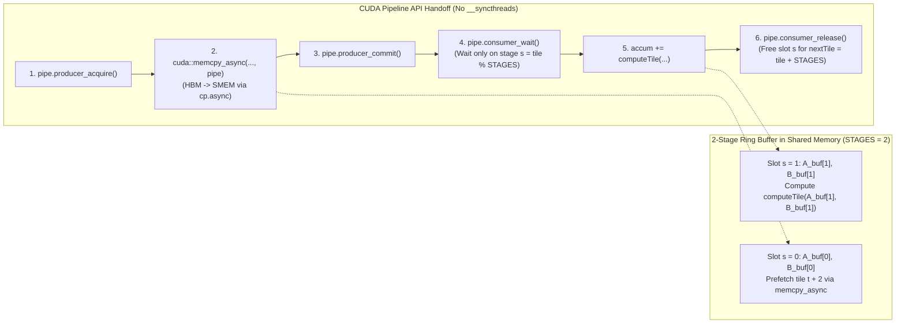
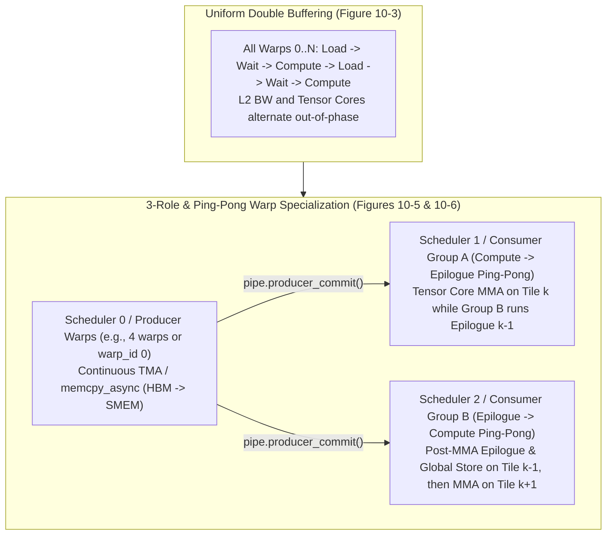

# 10.16 Intra-kernel pipelining, warp specialization and thread block clusters

| | |
|---|---|
| Level | Advanced |
| Priority tier | 2 |
| Lab venue | Nebius GPU |
| Part | Part 10: The GPU and CUDA |
| Sources used | *AI Systems Performance Engineering* (`ai-systems-performance-engineering`, Chris Fregly), Chapter 10 (*Intra-Kernel Pipelining, Warp Specialization, and Cooperative Thread Block Clusters*) |
| Code | `code/part10/intra_kernel_pipelining.py`, `code/part10/intra_kernel_pipelining_lab.py` |
| Coverage file | `planning/coverage/chapters/10-16.md` |

## Why this matters for AI infrastructure

In Chapters `10.13` through `10.15`, we coalesced global memory accesses, tuned occupancy and instruction-level parallelism (`ILP`), and raised arithmetic intensity with shared-memory tiling, kernel fusion, and Tensor Memory (`TMEM`). Yet a classical tiled kernel still executes in a stop-and-go cycle: every warp in the thread block issues a global load into Shared Memory (`SMEM`), stalls on a block-wide `__syncthreads()` barrier while waiting for HBM, computes on the tile, and stalls on another `__syncthreads()` barrier before loading the next tile. During the load phase, the Tensor Cores sit idle; during the compute phase, the memory subsystem sits idle.

*AI Systems Performance Engineering* Chapter 10 (*Intra-Kernel Pipelining, Warp Specialization, and Cooperative Thread Block Clusters*) shows how modern Hopper (`sm_90`) and Blackwell (`sm_100`) kernels eliminate those intra-kernel bubbles by combining four hardware-accelerated execution patterns:

- **Asynchronous Double and Triple Buffering with `<cuda/pipeline>` (`41.3 ms → 20.5 ms`, Table 10-2):** Using `cuda::pipeline_shared_state<cuda::thread_scope_block, STAGES>` (`STAGES = 2` for double buffering or `STAGES = 3` for triple buffering when compute outweighs memory on Blackwell) and `cuda::memcpy_async` (`cp.async`), a kernel prefetches tile `tile + STAGES` into ring-buffer slot `s = tile % STAGES` while simultaneously computing on the previously committed stage—halving kernel runtime from **`41.3 ms` to `20.5 ms` (`2.01x` faster)** and lifting `SM Active %` from **`68%` to `92%` (`+24%`)** without any `__syncthreads()`.
- **Warp Specialization and Ping-Pong Consumer Schedules (`20.5 ms → 18.4 ms`, Table 10-3):** Instead of forcing every warp to alternate between memory loads and Tensor Core math, **warp specialization** assigns dedicated warps to distinct hardware engines—such as **loader warps (`warp_id 0`)**, **compute warps (`warp_id 1`)**, and **storer warps (`warp_id 2`)**, or `CUTLASS`'s **`gemm_tma_warpspecialized_pingpong`** where two consumer warp groups alternate between Tensor Core MMA and post-MMA epilogue stores. Because each SM has `4` independent warp schedulers, the SM issues a memory load from Warp 0, a Tensor Core MMA from Warp 1, and a global store from Warp 2 **in the exact same cycle**, aligning L2 bandwidth and Tensor Core utilization in-phase, scaling linearly up to **`64` resident warps per SM** on Blackwell, and cutting runtime to **`18.4 ms` (`+10.2%` faster than double buffering)**.
- **Persistent Kernels, Megakernels, and Cooperative Grid Synchronization (`grid.sync()`):** Launching `1,000` tiny tasks (`0.1 ms` each = `100 ms` work) as separate kernels adds `1,000 × 0.02 ms =` **`20 ms` of launch overhead** and leaves the GPU at **`~35%` average capacity**. A **persistent kernel** launches `132` blocks (`1` block/SM on a `132`-SM GPU) × `256` threads = **`33,792` threads** that pull tasks from an atomic queue (`atomicAdd(&g_index, 1)`), keeping **`100%` of SMs active** (even at `256 / 2,048 = 12.5%` per-SM thread occupancy) and paying the `0.02 ms` launch cost once. For multi-layer LLM decode, **persistent megakernels** reduce latency by **`1.2x` to `6.7x`** over per-layer launches (`vLLM` / `SGLang`), while `cudaLaunchCooperativeKernel` + `grid.sync()` fuses `2,000` multi-pass launches (`2` stages × `1,000` iterations) into **`1` launch**.
- **Thread Block Clusters (`CTA` Clusters), `DSMEM`, `2-SM CTA Pairs`, and `TMA` Multicast (`18.4 ms → 17.2 ms`, Tables 10-4 & 10-5):** Co-scheduling `2` to `8` CTAs (or up to `16` non-portable CTAs on Blackwell) inside a **GPU Processing Cluster (`GPC`)** stitched together by **Distributed Shared Memory (`DSMEM`)** and hardware **Scratch Memory** cuts global load transactions **`2x → 1x`**, lifts L2 hit rate from **`50%` to `85%`**, halves DRAM bandwidth per CTA from **`300 GB/s` to `150 GB/s`**, and yields a **`40%` speedup (`1.0x → 0.6x` time, Table 10-4)**. Combining a cluster leader's `<cuda/pipeline>` with `cluster.sync()` and `cluster.map_shared_rank()` (`warp_specialized_cluster_pipeline`) drives GEMM runtime down to **`17.2 ms` (`+6.5%` over single-block warp specialization, `2.40x` over naive tiling)** at **`97%` warp execution efficiency** and **`170 GB/s` L2 throughput**.

:::note About the numbers and code in this chapter
*AI Systems Performance Engineering* states that the numeric values in its metric tables (Tables 10-2 to 10-5 here) are illustrative and explain concepts, so none were rerun for this handbook. The code is reproduced from the book and was not compiled here. Three cautions apply to the printed code: (1) in `warp_specialized_pipeline_kernel` the phases are separated by `cta.sync()`, so the load, compute and store roles run one after another inside each tile iteration, and the kernel itself does not demonstrate the overlap described for Table 10-3; (2) `cuda::aligned_size_t<32>(sizeof(float))` in `gemm_tiled_pipeline` passes a 4-byte size with a 32-byte alignment, which violates the API rule that the size be a multiple of the alignment, so treat that call as pseudocode; (3) the `227,328` byte limit used in the shared-memory budgets is the book's figure, while `227 KB` as `227 x 1,024` is `232,448` bytes. The tile choices (`112`, `128`) stay under both values.
:::

## Prerequisites and outcomes

**Prerequisites:**
- Chapter `10.2` (SM warp schedulers, thread blocks, grids, and GPC hierarchy), Chapter `10.3` (Shared Memory, L1/L2 caches, and `DSMEM`), Chapter `10.12` (`cuda::memcpy_async` and streams), Chapter `10.14` (occupancy and warp stalls), and Chapter `10.15` (multilevel tiling and `TMEM`).

**Outcomes — after completing this chapter you will be able to:**
1. Implement a multi-stage ring-buffered tiled GEMM (`gemm_tiled_pipeline`) using `<cuda/pipeline>` (`producer_acquire`, `producer_commit`, `consumer_wait`, `consumer_release`), size `STAGES = 2` vs `STAGES = 3` dynamic shared memory, and reproduce the Table 10-2 speedup (`41.3 ms → 20.5 ms`, `68% → 92%` SM Active).
2. Design a 3-role warp-specialized pipeline (`warp_specialized_pipeline_kernel`, `TILE_SIZE = 112`, `150,528 B < 227,328 B` dynamic SMEM) and explain why unified CTA pipeline collectives must execute outside divergent `warp_id` branches unless using a partitioned pipeline.
3. Explain how `CUTLASS`'s `gemm_tma_warpspecialized_pingpong` and PyTorch's `F.scaled_dot_product_attention` / `FlashAttention-3` (`~75%` peak FP16 FLOPS) overlap TMA loads, Tensor Core MMAs, and epilogue stores across warp schedulers.
4. Calculate persistent-kernel launch savings (`20 ms` saved across `1,000` tasks, `33,792` threads across `132` SMs), megakernel decode speedups (`1.2x–6.7x`), and cooperative grid limits (`maxCoopGrid = maxBlocksPerSm × multiProcessorCount = 528` blocks) for `cudaLaunchCooperativeKernel` and `grid.sync()`.
5. Configure Thread Block Clusters with `cudaLaunchKernelEx` (`cudaLaunchAttributeClusterDimension`), coordinate cross-SM shared memory with `cg::this_cluster()`, `cluster.sync()`, and `cluster.map_shared_rank()`, explain the role of hardware **Scratch Memory** and **Thread Block Swizzling**, and apply the decision rule between **TMA Multicast (`cp.async.bulk.tensor` to `shared::cluster`)** and **DSMEM `map_shared_rank`**.
6. Trace the multi-block `warp_specialized_cluster_pipeline` (`TILE_SIZE = 128`, `196,608 B` SMEM) and reproduce the 4-stage progression across **Table 10-5** (`41.3 ms → 20.5 ms → 18.4 ms → 17.2 ms`).

---

## 1. Intra-Kernel Pipelining and Double/Triple Buffering with `<cuda/pipeline>`

### 1.1 The two `<cuda/pipeline>` paradigms (Table 10-1)

Traditional SIMT latency hiding relies on context-switching across many warps when a warp stalls on a global memory load. **Intra-kernel pipelining** goes further by overlapping asynchronous memory transfers (`HBM → SMEM`) and computations (`SMEM → Registers / Tensor Cores`) **inside a single kernel execution without calling `__syncthreads()`**.

*AI Systems Performance Engineering* Chapter 10 (**Table 10-1**, *Intra-Kernel Pipelining Techniques*) distinguishes two `<cuda/pipeline>` patterns:

| `<cuda/pipeline>` Variant | Best For | Main Execution Mechanism |
|---|---|---|
| **Double-buffered (or triple-buffered) pipeline** (`cuda::pipeline_shared_state<cuda::thread_scope_block, STAGES>`) | Uniform loop-based tiling (`GEMM`, stencil, convolution) where all threads in the CTA step through tiles together. | Overlaps asynchronous tile prefetch (`Stage 0`) with tile computation (`Stage 1`) in the same warp or block using a ring buffer of `STAGES` (`2` or `3`) shared-memory slots. |
| **Warp-specialized pipeline** (e.g., 3-stage **memory loader**, **compute**, **memory storer**) | Persistent kernels, fused attention (`FlashAttention-3`), and deep irregular pipelines with distinct hardware phases. | Dedicates separate warps (`warp_id 0`, `warp_id 1`, `warp_id 2`, or ping-pong consumer warp groups) to separate hardware engines (`TMA` / `LD/ST` vs `Tensor Cores`) so each warp scheduler issues homogeneous instruction streams continuously. |

Both patterns build on four producer–consumer primitives provided by `<cuda/pipeline>` (*ASP* Ch 10, Figure 10-1):
1. **`pipe.producer_acquire()`:** Reserves the next pipeline stage slot in the ring buffer for writing.
2. **`pipe.producer_commit()`:** Signals that all `cuda::memcpy_async` (which lower to hardware `cp.async` instructions bypassing registers) issued for the current stage are queued and ready to be tracked as a batch.
3. **`pipe.consumer_wait()` (or `cuda::pipeline_consumer_wait_prior<N>(pipe)`):** Waits until the committed asynchronous copies for the target stage have arrived in Shared Memory, avoiding data races in tiled loops without stalling unrelated stages.
4. **`pipe.consumer_release()`:** Signals that consumer warps have finished reading the current stage buffer so the producer can reuse that slot on a subsequent tile iteration (`nextTile = tile + STAGES`).



### 1.2 Full cooperative double/triple-buffered GEMM (`gemm_tiled_pipeline`) and Table 10-2

In a two-stage (`STAGES = 2`) pipeline, while one stage is prefetching the next tile from DRAM into `A_buf[s]` and `B_buf[s]`, the execution units compute on the previously loaded tile (*ASP* Ch 10, Figure 10-2). On modern GPUs like Blackwell where Tensor Core throughput is massive relative to HBM latency, adding a third stage (**`STAGES = 3`**, triple buffering: `cuda::pipeline_shared_state<cuda::thread_scope_block, 3>`) keeps two prefetches in flight while computing on the third. Even the most heavily tuned attention kernels—such as **FlashAttention-3**—achieve roughly **`75%` of peak FP16 FLOPS** in practice because of fundamental limits in overlap and data movement (*ASP* Ch 10, *Cooperative Tiling and Double-Buffering with the CUDA Pipeline API*).

Here is the complete `gemm_tiled_pipeline` implementation from *AI Systems Performance Engineering* Chapter 10 (`evaluate_pipeline_smem_budget("gemm_tiled_pipeline", tile_size=32, stages=2)` in `code/part10/intra_kernel_pipelining.py`):

```cpp
// Cooperative multi-stage (double/triple-buffered) tiled GEMM using <cuda/pipeline>
// Source: AI Systems Performance Engineering, Chapter 10
#include <cuda/pipeline>
#include <cooperative_groups.h>
#include <algorithm>

namespace cg = cooperative_groups;

#ifndef TILE_SIZE
#define TILE_SIZE 32
#endif
#ifndef STAGES
#define STAGES 2 // 2 = double buffer (16,384 B SMEM), 3 = triple buffer (24,576 B SMEM)
#endif

__device__ float computeTile(const float* __restrict__ A_sub,
                             const float* __restrict__ B_sub,
                             int tx, int ty) {
    float s = 0.0f;
    #pragma unroll
    for (int k = 0; k < TILE_SIZE; ++k) {
        s += A_sub[ty * TILE_SIZE + k] * B_sub[k * TILE_SIZE + tx];
    }
    return s;
}

extern "C" __global__
void gemm_tiled_pipeline(const float* __restrict__ A_global, // [M x K]
                         const float* __restrict__ B_global, // [K x N]
                         float* __restrict__ C_global,       // [M x N]
                         int M, int N, int K) {
    cg::thread_block cta = cg::this_thread_block();

    // Shared memory layout: A_buf[STAGES] (each 32x32 floats) then B_buf[STAGES]
    // For TILE_SIZE=32, STAGES=2: 4 * 1,024 * 4 B = 16,384 bytes (16 KiB)
    extern __shared__ float shared_mem[];
    float* A_buf[STAGES];
    float* B_buf[STAGES];
    {
        float* p = shared_mem;
        for (int s = 0; s < STAGES; ++s) { A_buf[s] = p; p += TILE_SIZE * TILE_SIZE; }
        for (int s = 0; s < STAGES; ++s) { B_buf[s] = p; p += TILE_SIZE * TILE_SIZE; }
    }

    __shared__ cuda::pipeline_shared_state<cuda::thread_scope_block, STAGES> state;
    auto pipe = cuda::make_pipeline(cta, &state);

    int tx = threadIdx.x, ty = threadIdx.y;
    int block_row = blockIdx.y * TILE_SIZE;
    int block_col = blockIdx.x * TILE_SIZE;
    float accum = 0.0f;
    int numTiles = (K + TILE_SIZE - 1) / TILE_SIZE;

    // 1. Prologue: prime the pipeline by prefetching the first STAGES tiles
    for (int s = 0; s < std::min(STAGES, numTiles); ++s) {
        int aRow = block_row + ty, aCol = s * TILE_SIZE + tx;
        int bRow = s * TILE_SIZE + ty, bCol = block_col + tx;
        pipe.producer_acquire();
        if (aRow < M && aCol < K) {
            cuda::memcpy_async(cta, A_buf[s] + ty * TILE_SIZE + tx,
                               &A_global[aRow * K + aCol],
                               cuda::aligned_size_t<32>(sizeof(float)), pipe);
        } else {
            A_buf[s][ty * TILE_SIZE + tx] = 0.0f;
        }
        if (bRow < K && bCol < N) {
            cuda::memcpy_async(cta, B_buf[s] + ty * TILE_SIZE + tx,
                               &B_global[bRow * N + bCol],
                               cuda::aligned_size_t<32>(sizeof(float)), pipe);
        } else {
            B_buf[s][ty * TILE_SIZE + tx] = 0.0f;
        }
        pipe.producer_commit();
    }

    // 2. Steady state: wait on stage s = tile % STAGES, compute, release s, and prefetch tile + STAGES
    for (int tile = 0; tile < numTiles; ++tile) {
        int s = tile % STAGES;
        pipe.consumer_wait();
        accum += computeTile(A_buf[s], B_buf[s], tx, ty);
        pipe.consumer_release();

        int nextTile = tile + STAGES;
        if (nextTile < numTiles) {
            int aRow = block_row + ty, aCol = nextTile * TILE_SIZE + tx;
            int bRow = nextTile * TILE_SIZE + ty, bCol = block_col + tx;
            pipe.producer_acquire();
            if (aRow < M && aCol < K) {
                cuda::memcpy_async(cta, A_buf[s] + ty * TILE_SIZE + tx,
                                   &A_global[aRow * K + aCol],
                                   cuda::aligned_size_t<32>{sizeof(float)}, pipe);
            } else {
                A_buf[s][ty * TILE_SIZE + tx] = 0.0f;
            }
            if (bRow < K && bCol < N) {
                cuda::memcpy_async(cta, B_buf[s] + ty * TILE_SIZE + tx,
                                   &B_global[bRow * N + bCol],
                                   cuda::aligned_size_t<32>{sizeof(float)}, pipe);
            } else {
                B_buf[s][ty * TILE_SIZE + tx] = 0.0f;
            }
            pipe.producer_commit();
        }
    }

    // 3. Epilogue: write final accumulated tile element to C_global
    int cRow = block_row + ty, cCol = block_col + tx;
    if (cRow < M && cCol < N) {
        C_global[cRow * N + cCol] = accum;
    }
}
```

Look at the impact the book reports for replacing stop-and-wait `__syncthreads()` tiling with `gemm_tiled_pipeline` (*AI Systems Performance Engineering* Ch 10, **Table 10-2**):

| Metric | Naive Tiling | Two-Stage Double-Buffered Pipeline (`double_buffered_pipeline`) | Improvement |
|---|---:|---:|---|
| **Kernel execution time** | `41.3 ms` | **`20.5 ms`** | **`~2x` (`2.01x`) faster** vs naive |
| **SM Active %** | `68%` | **`92%`** | **`+24%`** (`+24 percentage points` vs naive) |

---

## 2. Warp Specialization and Producer–Consumer Pipelines

### 2.1 Why warp specialization beats uniform double buffering (`4` warp schedulers & Ping-Pong MMA)

In `gemm_tiled_pipeline`, every warp executes the exact same instruction stream: every warp issues load instructions, waits on `consumer_wait()`, and then issues math instructions (*ASP* Ch 10, Figure 10-3). That uniform design has two hardware limitations:
1. **Single-scheduler issue bottleneck:** A single warp is owned by one of the SM's `4` warp schedulers, which can issue at most one instruction stream per cycle for that warp. While a warp is issuing address generation and `memcpy_async` instructions, it is not issuing Tensor Core MMAs.
2. **Block-wide consumer waits:** Because every thread participates in both producer and consumer phases, `pipe.consumer_wait()` stalls the entire thread block whenever DRAM latency spikes.

**Warp specialization** decouples those roles across distinct warps inside the thread block (*ASP* Ch 10, Figures 10-4, 10-5, and 10-6):
- **2-Role Producer / Consumer Split (Figure 10-4):** Assigns **`4` producer ("memory") warps** to prefetch tiles asynchronously via `TMA` or `cuda::memcpy_async`, and **`8` consumer ("compute") warps** to execute Tensor Core math continuously.
- **3-Role Loader / Compute / Storer Pipeline (Figure 10-5):**
  - **Loader warps (`warp_id == 0`):** Continuously pull input tiles (`A`, `B`) from HBM/L2 into Shared Memory stages.
  - **Compute warps (`warp_id == 1`):** Continuously consume staged tiles from Shared Memory and accumulate products on Tensor Cores / FP32 ALUs.
  - **Storer warps (`warp_id == 2`):** Continuously drain completed output tiles (`C`) from Shared Memory back to HBM.
  Because Warp 0, Warp 1, and Warp 2 are assigned to different hardware warp schedulers on the SM, **Scheduler 0 issues a memory load from Warp 0, Scheduler 1 issues a math instruction from Warp 1, and Scheduler 2 issues a store instruction from Warp 2 in the exact same clock cycle**. Before warp specialization, Nsight Compute profiles show L2 bandwidth utilization and Tensor Core utilization oscillating **out of phase**; after warp specialization, L2 bandwidth and Tensor Core utilization run **in-phase** simultaneously across the entire kernel duration.
- **3-Role Ping-Pong Architecture (`CUTLASS` `gemm_tma_warpspecialized_pingpong`, Figure 10-6):**
  Even in a producer/consumer split, each Tensor Core MMA requires a brief **prologue** (queuing TMA descriptors) and a post-MMA **epilogue** (accumulating, scaling, shuffling across lanes, writing results to global memory, advancing tile pointers, and signaling completion). If only one consumer warp group exists, the Tensor Cores go idle during its epilogue. `CUTLASS`'s **`gemm_tma_warpspecialized_pingpong`** assigns one warp group as the dedicated **TMA memory loader** and **two consumer warp groups that "ping-pong" between MMA compute and epilogue/memory-store**: while Consumer Group A executes its post-MMA epilogue and global store, Consumer Group B immediately occupies the Tensor Cores with the next MMA tile.



### 2.2 Full 3-role `<cuda/pipeline>` kernel (`warp_specialized_pipeline_kernel`) and the collective ordering rule

When sizing a 3-role warp-specialized kernel on Blackwell (`sm_100`), remember that the `3` square shared-memory tiles (`A_tile`, `B_tile`, `C_tile`) must fit within the per-block dynamic shared memory ceiling (**`227,328 bytes` (`~227 KB`)** on Blackwell, queried via `cudaDevAttrMaxSharedMemoryPerBlockOptin` and enabled via `cudaFuncAttributeMaxDynamicSharedMemorySize`). Choosing **`TILE_SIZE = 112`** allocates:
- `smem_bytes = 3 × 112 × 112 × 4 bytes =` **`150,528 bytes` (`147.0 KiB < 227,328 bytes`, `66.22%` of max block SMEM)** (`evaluate_pipeline_smem_budget("warp_specialized_pipeline", tile_size=112)` in `code/part10/intra_kernel_pipelining.py`).
- By contrast, choosing `TILE_SIZE = 160` would require `3 × 160 × 160 × 4 = 307,200 bytes > 227,328 bytes`, causing launch failure.

Here is the complete `warp_specialized_pipeline_kernel` from *AI Systems Performance Engineering* Chapter 10:

```cpp
// 3-role warp-specialized kernel using a unified block-scoped <cuda/pipeline>
// Source: AI Systems Performance Engineering, Chapter 10
#include <cuda/pipeline>
#include <cooperative_groups.h>

namespace cg = cooperative_groups;

// smem_bytes = 3 * TILE_SIZE^2 * sizeof(float)
// 3 * 112 * 112 * 4 B = 150,528 bytes < 227,328 bytes (~227 KB Blackwell dynamic SMEM limit)
#define TILE_SIZE 112

__device__ void compute_full_tile(const float* __restrict__ A_tile,
                                  const float* __restrict__ B_tile,
                                  float* __restrict__ C_tile,
                                  int lane_id) {
    for (int idx = lane_id; idx < TILE_SIZE * TILE_SIZE; idx += warpSize) {
        int row = idx / TILE_SIZE;
        int col = idx % TILE_SIZE;
        float acc = 0.0f;
        #pragma unroll
        for (int k = 0; k < TILE_SIZE; ++k) {
            acc += A_tile[row * TILE_SIZE + k] * B_tile[k * TILE_SIZE + col];
        }
        C_tile[idx] = acc;
    }
}

extern "C" __global__
void warp_specialized_pipeline_kernel(const float* __restrict__ A_global,
                                      const float* __restrict__ B_global,
                                      float* __restrict__ C_global,
                                      int numTiles) {
    cg::thread_block cta = cg::this_thread_block();

    // Three square tiles in dynamic shared memory: A_tile, B_tile, C_tile (150,528 B total)
    extern __shared__ float shared_mem[];
    float* A_tile = shared_mem;
    float* B_tile = A_tile + TILE_SIZE * TILE_SIZE;
    float* C_tile = B_tile + TILE_SIZE * TILE_SIZE;

    int warp_id = threadIdx.x >> 5;
    int lane_id = threadIdx.x & 31;
    const int bytes = TILE_SIZE * TILE_SIZE * sizeof(float);

    // 3-stage pipeline shared by the block
    __shared__ cuda::pipeline_shared_state<cuda::thread_scope_block, 3> pipe_state;
    auto pipe = cuda::make_pipeline(cta, &pipe_state);

    // Block-strided persistent tile loop: one tile per block iteration
    for (int tile = blockIdx.x; tile < numTiles; tile += gridDim.x) {
        size_t offset = static_cast<size_t>(tile) * TILE_SIZE * TILE_SIZE;

        // CRITICAL RULE: Unified block-scoped pipeline collectives execute
        // across all participating CTA threads BEFORE role-specific branches
        pipe.producer_acquire();
        cuda::memcpy_async(cta, A_tile, A_global + offset,
                           cuda::aligned_size_t<16>{bytes}, pipe);
        cuda::memcpy_async(cta, B_tile, B_global + offset,
                           cuda::aligned_size_t<16>{bytes}, pipe);
        pipe.producer_commit();
        pipe.consumer_wait();
        cta.sync();

        // Role 1: Compute warp computes C_tile = A_tile * B_tile
        if (warp_id == 1) {
            compute_full_tile(A_tile, B_tile, C_tile, lane_id);
        }
        cta.sync();

        // Role 2: Storer warp writes C_tile back to C_global
        if (warp_id == 2) {
            for (int idx = lane_id; idx < TILE_SIZE * TILE_SIZE; idx += warpSize) {
                C_global[offset + idx] = C_tile[idx];
            }
        }
        cta.sync();

        pipe.consumer_release();
        cta.sync();
    }
}
```

**Critical correctness rule for unified vs. partitioned `<cuda/pipeline>` objects (*ASP* Ch 10, Figure 10-7):**
When you instantiate a unified CTA pipeline via `cuda::make_pipeline(cta, &pipe_state)`, the calls `pipe.producer_acquire()`, `pipe.producer_commit()`, `pipe.consumer_wait()`, and `pipe.consumer_release()` are **collective across all participating threads in `cta`** and must execute in a consistent order outside divergent `if (warp_id == ...)` branches (using explicit `cta.sync()` handoff points between load, compute, and store phases). Placing unified CTA pipeline collectives inside divergent warp branches causes undefined behavior or barrier hangs. If you want different warps to invoke `producer_commit()` and `consumer_wait()` independently inside divergent branches, you must instantiate a **partitioned pipeline** (partitioned `make_pipeline`) with explicit producer and consumer thread partitions.

Compare the three single-block implementations in **Table 10-3** (*AI Systems Performance Engineering* Ch 10):

| Metric | Naive Tiling | Two-Stage Double-Buffered (`double_buffered_pipeline`) | Single-Block Warp-Specialized (`warp_specialized_pipeline`) |
|---|---:|---:|---:|
| **Kernel execution time** | `41.3 ms` | `20.5 ms` (`2.01x` faster vs naive) | **`18.4 ms` (`+10.2%` speedup vs two-stage, `2.24x` vs naive)** |
| **Warp execution efficiency** | `68%` | `92%` (`+24%` vs naive) | **`96%` (`+4%` vs two-stage)** |
| **Shared memory / barrier warp stalls** | `High` | `Low` | **`Minimal`** |
| **L2 load throughput** | `80 GB/s` | `155 GB/s` (`+94%` vs naive) | **`165 GB/s` (`+6.45%` vs two-stage)** |
| **Throughput scalability** | Scales to `2–3` warps/SM | Scales to `~6` warps/SM | **Scales nearly linearly up to `64` warps/SM (Blackwell limit)** |
| **DRAM bytes read vs SM cycles** | Poor overlap | Great overlap | **Excellent overlap** |
| **Dynamic instruction count** | `1.7 B` | `1.05 B` (`-38%` vs naive) | **`~1.00 B` (`-4.76%` / `~5%` vs two-stage)** |

### 2.3 PyTorch `torch.compile`, Triton, and `F.scaled_dot_product_attention`

While PyTorch's Python API does not expose `cuda::pipeline` directly, calling `torch.compile` (via **TorchInductor** and OpenAI **Triton**) or `torch.nn.functional.scaled_dot_product_attention` lowers fused operators into kernels that use hardware-equivalent asynchronous pipeline barriers and warp-specialized producer/consumer groups (*ASP* Ch 10, *PyTorch, CUDA Pipeline API, and Warp Specialization*). Specifically, replacing three separate HBM-bound PyTorch calls:

```python
# Unfused attention: 3 separate kernels + 2 intermediate N x N HBM round-trips (untested here)
scores = torch.matmul(queries, keys.transpose(-2, -1))
probabilities = F.softmax(scores, dim=-1)
context = torch.matmul(probabilities, values)
```

with a single fused call:

```python
# Fused warp-specialized attention (FlashAttention-2 / FlashAttention-3 via SDPA) (untested here)
context = torch.nn.functional.scaled_dot_product_attention(queries, keys, values)
```

dispatches a kernel where loader warps prefetch `K` and `V` tiles into Shared Memory, compute warps overlap `Q * K^T` GEMM, online softmax rescaling, and `P * V` GEMM on Tensor Cores (sustaining `~75%` of peak FP16 FLOPS in `FlashAttention-3`), and storer warps write the final `context` tensor back to HBM once.

---

## 3. Persistent Kernels, Megakernels, and Cooperative Grid Synchronization (`grid.sync()`)

### 3.1 Persistent kernels: eliminating launch overhead and uneven tail waves

Suppose an inference or graph-processing stage must execute **`1,000` small, independent tasks**, where each task takes **`0.1 ms`** of GPU compute (`1,000 × 0.1 ms = 100 ms` of actual work) and each CUDA kernel launch incurs roughly **`0.02 ms` (`20 µs`)** of launch overhead (*ASP* Ch 10, *Persistent Kernels and Megakernels*; `model_persistent_kernel()` in `code/part10/intra_kernel_pipelining.py`):
- **Traditional 1-kernel-per-task approach (`1,000` launches):**
  - Total launch overhead: `1,000 × 0.02 ms =` **`20.0 ms`** (`20%` extra wall-clock time on top of the `100 ms` work = **`120.0 ms` total**).
  - Because each tiny kernel occupies only a few SMs and ramps up and down between launches, average GPU capacity utilization sits at only **`~35%`**.
- **Persistent kernel approach (`1` launch across all `132` SMs):**
  - On a GPU with **`132` SMs**, launch **`1` block per SM (`132` blocks)** with **`256` threads per block** = **`33,792` persistent threads** (`1` launch cost = **`0.02 ms`**, total time = **`100.02 ms`**, saving **`19.98 ms` (`~20 ms`)** of launch overhead and delivering a **`2–3x` throughput gain** on irregular queues).
  - Notice the distinction between **per-SM thread occupancy** and **active SMs**: `256` threads out of `2,048` max threads per SM is only **`12.5%` (`~12%`) per-SM thread occupancy**, yet **`100%` of the GPU's `132` SMs are actively working** throughout the entire `100 ms` duration.

```cpp
// Persistent worker-pool kernel pulling tasks from a device-side atomic counter
// Source: AI Systems Performance Engineering, Chapter 10
__device__ int g_index; // global task counter in device memory; initialized to 0 on host

__global__ void persistentKernel(Task* tasks, int totalTasks) {
    // Every thread loops continuously, atomically claiming the next task index
    while (true) {
        int idx = atomicAdd(&g_index, 1);
        if (idx >= totalTasks) break;
        processTask(tasks[idx]);
    }
}

// Host launch on a 132-SM GPU (33,792 persistent threads):
// cudaMemset(&g_index, 0, sizeof(int));
// persistentKernel<<<132, 256>>>(d_tasks, totalTasks);
// cudaDeviceSynchronize();
```

### 3.2 Megakernels for LLM inference (`1.2x` to `6.7x` decode latency reduction)

Extending the persistent-kernel model across an entire Transformer forward pass produces a **megakernel** (*ASP* Ch 10, *Megakernels for Inference* & Figure 10-8): instead of launching dozens of separate RMSNorm, QKV projection, RoPE, attention, all-reduce, and MLP kernels per layer, a persistent megakernel fuses entire sequences of operations across layers—and even coordinates across GPUs—inside a single long-lived kernel launch driven by an on-device task schedule. In production LLM decode benchmarks, persistent megakernels reduce decode latency by **`1.2x` to `6.7x`** compared to traditional per-layer kernel launches in standard `vLLM` and `SGLang` execution paths.

### 3.3 Cooperative Groups and grid-wide synchronization (`cudaLaunchCooperativeKernel` & `grid.sync()`)

Standard CUDA `__syncthreads()` synchronizes only threads within a single thread block. The **Cooperative Groups API (`<cooperative_groups.h>`)** lets kernels construct and synchronize thread collectives across five hardware/software granularities (*ASP* Ch 10, Figure 10-9):
1. **Warp / Sub-warp Tiles:** `cg::tiled_partition<32>(cta)` (or power-of-2 sub-warp tiles `16, 8, 4, 2`).
2. **Thread Block (`CTA`):** `cg::thread_block cta = cg::this_thread_block();` with `cta.sync()`.
3. **Thread Block Cluster (`CGA`):** `cg::cluster_group cluster = cg::this_cluster();` with hardware-accelerated `cluster.sync()`.
4. **Whole-Device Grid:** `cg::grid_group grid = cg::this_grid();` with `grid.sync()`.
5. **Multi-Device Grid:** Cross-GPU cooperative barriers (legacy/specialized).

To call `grid.sync()` inside a kernel, two strict hardware rules apply (*ASP* Ch 10, *Cooperative Groups* & *Cooperative Grid Synchronization and Persistent Kernels*):
1. **All blocks in the grid must co-reside simultaneously on the GPU:** If a kernel has **`132` SMs** and its register/SMEM footprint allows at most **`4` active blocks per SM** (queried via `cudaOccupancyMaxActiveBlocksPerMultiprocessor`), the maximum cooperative grid size is:
   ```text
   maxCoopGrid = maxBlocksPerSm * prop.multiProcessorCount = 4 * 132 = 528 blocks
   ```
   If you pass `gridSize > 528` (for example, `N = 1,000,000` elements at `256` threads/block = `3,907` blocks) to `cudaLaunchCooperativeKernel` without clamping `gridSize = min(gridSize, maxCoopGrid)` and using a grid-stride loop inside the kernel, **`cudaLaunchCooperativeKernel` fails immediately to prevent a missing-block deadlock**.
2. **Every thread in every block must reach `grid.sync()`:** Just like `__syncthreads()`, if any thread skips `grid.sync()` due to a divergent `if` branch, the entire GPU deadlocks.

Here is the complete cooperative persistent `combinedKernel` and host launch pattern from *AI Systems Performance Engineering* Chapter 10, which fuses **`2` stages × `1,000` iterations = `2,000` kernel launches** into **`1` launch**:

```cpp
// Fusing 2 stages x 1,000 iterations (2,000 kernel launches) into 1 cooperative persistent kernel
// Source: AI Systems Performance Engineering, Chapter 10
#include <cuda_runtime.h>
#include <cooperative_groups.h>

namespace cg = cooperative_groups;

__device__ inline float someComputationA(float x) { return x * 2.0f; }
__device__ inline float someComputationB(float a, float b) { return a + b; }

__global__ void combinedKernel(float* __restrict__ dataA,
                               float* __restrict__ dataB,
                               int N,
                               int iterations) {
    cg::grid_group grid = cg::this_grid(); // whole-grid group
    const int tid = blockIdx.x * blockDim.x + threadIdx.x;
    const int stride = gridDim.x * blockDim.x; // grid-stride step across clamped grid

    for (int it = 0; it < iterations; ++it) {
        // Stage 1: update all elements of dataA using a grid-stride loop
        for (int i = tid; i < N; i += stride) {
            dataA[i] = someComputationA(dataA[i]);
        }
        grid.sync(); // global barrier across all resident blocks + global memory visibility

        // Stage 2: consume finished dataA across blocks to update dataB
        for (int i = tid; i < N; i += stride) {
            const float mid = dataA[i];
            dataB[i] = someComputationB(mid, dataB[i]);
        }
        grid.sync(); // global barrier before next iteration
    }
}

void launchCombinedCooperative(float* dA, float* dB, int N, int iterations) {
    cudaDeviceProp prop{};
    cudaGetDeviceProperties(&prop, 0);
    if (!prop.cooperativeLaunch) return; // fallback to 2 launches/iteration if unsupported

    int maxBlocksPerSm = 0;
    const int blockSize = 256;
    cudaOccupancyMaxActiveBlocksPerMultiprocessor(&maxBlocksPerSm,
                                                  combinedKernel,
                                                  blockSize, 0);
    const int maxCoopGrid = maxBlocksPerSm * prop.multiProcessorCount; // e.g., 4 * 132 = 528

    int gridSize = (N + blockSize - 1) / blockSize;
    if (gridSize > maxCoopGrid) gridSize = maxCoopGrid; // MUST clamp to co-resident limit

    void* args[] = { &dA, &dB, &N, &iterations };
    cudaLaunchCooperativeKernel((void*)combinedKernel, gridSize, blockSize, args);
    cudaDeviceSynchronize();
}
```

Use the four-question decision checklist from *AI Systems Performance Engineering* Chapter 10 (*When to Combine Persistent Kernels and Cooperative Groups*):
1. **Do you have multiple sequential phases that require global cross-block synchronization (such as two-pass softmax reduction + normalization)?** Use a cooperative kernel (`grid.sync()`).
2. **Do you have many small or irregular tasks that suffer from `~0.02 ms` launch overhead?** Use a persistent kernel looping over a device queue.
3. **Can you afford to reserve the entire GPU grid exclusively for this workload?** Combine both into a cooperative persistent kernel (`combinedKernel`).
4. **Do you need to share SMs concurrently with other streams (such as async data prefetch or co-scheduled inference kernels)?** Do *not* lock the whole grid with `grid.sync()`; partition synchronization into **Thread Block Clusters (`cluster.sync()`)** instead.

---

## 4. Thread Block Clusters (`CTA` Clusters), `DSMEM`, Scratch Memory, Thread Block Swizzling, and `2-SM CTA Pairs`

### 4.1 Hardware hierarchy: `GPC` coscheduling, Blackwell dual-die `NV-HBI` logical `GPC`, Cluster Launch Control, and Thread Block Swizzling

Whereas a Cooperative Group is a software abstraction, a **Thread Block Cluster (Cooperative Thread Array [`CTA`] Cluster)** is a **hardware-level execution hierarchy** introduced on Hopper and expanded on Blackwell (*ASP* Ch 10, *Thread Block Clusters and Distributed Shared Memory*, Figures 10-10 to 10-12):
- **GPC Coscheduling and Blackwell Dual-Die `NV-HBI` Partitions:** All thread blocks in a cluster are guaranteed by hardware to be coscheduled simultaneously onto nearby SMs inside the same **GPU Processing Cluster (`GPC`)**. On dual-die Blackwell GPUs (`B200`/`B300` and `GB200`/`GB300`), each physical GPU die contains its own GPC partition, but the **`10 TB/s` High-Bandwidth Interface (`NV-HBI`)** links both dies with full L2 cache coherence so they form a **combined logical GPC** managed transparently by the hardware.
- **Cluster Launch Control (`CLC`):** Hardware unit on Blackwell that launches and schedules persistent thread block clusters dynamically, allowing persistent warp-specialized clusters to balance work even when some SMs are occupied by other kernels.
- **Thread Block Swizzling for L2 Wave Locality (Figure 10-12):** In a naive GEMM grid launch, thread blocks are dispatched in strict row-major or column-major order across the output matrix `C`. Early blocks in a scheduling wave load disjoint rows of `A` or columns of `B`, evicting tiles from L2 before later blocks can reuse them. **Thread block swizzling** reorders the logical `(blockIdx.x, blockIdx.y)` tile assignment into 2D swizzled groups so all CTAs active in a single wave share the same rows of `A` and columns of `B` out of L2 cache—producing **double-digit percentage performance gains** on tiled and persistent GEMMs.

### 4.2 Distributed Shared Memory (`DSMEM`) vs. Hardware Scratch Memory

Within a Thread Block Cluster, two distinct on-chip SRAM mechanisms work together (*ASP* Ch 10, *Distributed Shared Memory* & *Scratch Memory*):
1. **Distributed Shared Memory (`DSMEM`):** Logically stitches every cluster member's local `__shared__` memory into a single unified cluster-wide address space connected over the dedicated **SM-to-SM cluster network** (Figure 10-18). Any CTA in the cluster can perform loads, stores, or `atomicAdd` operations directly into another CTA's shared memory (`cluster.map_shared_rank(ptr, target_rank)`) at on-chip SRAM speeds—**bypassing both HBM DRAM and the L2 cache**.
   - **Portable vs. non-portable cluster size:** The portable maximum cluster size across architectures is **`8` CTAs**. Supported Blackwell GPUs allow non-portable clusters of up to **`16` CTAs** when `cudaFuncAttributeNonPortableClusterSizeAllowed` is set to `1`.
   - **32-byte alignment rule:** Organize remote DSMEM reads and writes just like coalesced global accesses—each warp `i` in CTA `j` should access **contiguous, 32-byte-aligned sectors** in a unique range to avoid remote bank serialization.
2. **Scratch Memory:** A separate, hardware-managed, **kernel-invisible on-chip SRAM region** that underpins `DSMEM` and `cluster.sync()`. You never address Scratch Memory in CUDA C++; the GPU automatically uses it to store cluster barrier arrival counters (`cluster.sync()` state), group progress, and DSMEM access flags. If a very large cluster (`16` CTAs) or complex synchronization pattern exceeds the dedicated Scratch SRAM capacity, the hardware transparently spills coordination metadata into L1/L2-backed local memory to preserve correctness.

### 4.3 Launching (`cudaLaunchKernelEx`) and coordinating (`MyClusterKernel`) a Thread Block Cluster

To launch a kernel with Thread Block Clusters (for example, `128` blocks grouped into clusters of `2` CTAs = **`64` CTA-pair clusters**), use `cudaLaunchKernelEx` with `cudaLaunchAttributeClusterDimension` (*ASP* Ch 10, *Launching a Thread Block Cluster* & *Coordinating Thread Block Clusters with Cooperative Groups API*):

```cpp
// Host launch and device kernel for a Thread Block Cluster using DSMEM + cluster.sync()
// Source: AI Systems Performance Engineering, Chapter 10
#include <cuda_runtime.h>
#include <cooperative_groups.h>
#include <cstdio>

namespace cg = cooperative_groups;

__global__ void MyClusterKernel() {
    // 1. Obtain handle to this Thread Block Cluster (guaranteed co-resident on a GPC)
    cg::cluster_group cluster = cg::this_cluster();

    // 2. Every block in the cluster MUST declare the same extern __shared__ size
    extern __shared__ int shared_buffer[];

    int clusterRank = cluster.block_rank();
    int clusterSize = cluster.num_blocks();

    // 3. Initialize this block's local shared memory
    shared_buffer[threadIdx.x] = threadIdx.x;

    // 4. Hardware-accelerated cluster-wide barrier: ensure all blocks initialized shared_buffer
    cluster.sync();

    // 5. Map a DSMEM pointer to Block 0's shared_buffer over the on-chip SM-to-SM network
    int* remote_buffer = cluster.map_shared_rank(shared_buffer, 0);
    if (clusterRank != 0 && threadIdx.x == 0) {
        // 6. On-chip DSMEM atomicAdd directly into Block 0's SMEM (no DRAM or L2 round-trip)
        atomicAdd(&remote_buffer[0], shared_buffer[0]);
    }

    // 7. Second cluster barrier ensures all remote atomicAdds have completed before rank 0 reads
    cluster.sync();

    if (clusterRank == 0 && threadIdx.x == 0) {
        printf("Combined sum in cluster[0] across %d blocks: %d\n", clusterSize, shared_buffer[0]);
    }
}

void launchClusterExample(void* args[]) {
    cudaLaunchConfig_t config{};
    config.gridDim = dim3(128, 1, 1);   // 128 total CTAs -> 64 clusters of 2 CTAs
    config.blockDim = dim3(256, 1, 1);
    config.dynamicSmemBytes = 256 * sizeof(int);

    cudaLaunchAttribute attr{};
    attr.id = cudaLaunchAttributeClusterDimension;
    attr.val.clusterDim.x = 2; // CTA pair (2 blocks per cluster)
    attr.val.clusterDim.y = 1;
    attr.val.clusterDim.z = 1;
    config.attrs = &attr;
    config.numAttrs = 1;

    // Required if clusterDim > 8 (up to 16 CTAs on Blackwell)
    cudaFuncSetAttribute(MyClusterKernel,
                         cudaFuncAttributeNonPortableClusterSizeAllowed, 1);

    cudaLaunchKernelEx(&config, MyClusterKernel, args, nullptr);
}
```

### 4.4 Thread Block Pairs (`2-SM CTA Pairs` & `CUTLASS` `2-SM UMMA`), `TMA` Multicast vs. `DSMEM`, and Table 10-4

A **Thread Block Pair (`CTA Pair`, `clusterDim.x = 2`)** coschedules two CTAs onto adjacent SMs inside a GPC so they act as a single double-sized logical thread block (*ASP* Ch 10, *Thread Block Pair*, Figures 10-13 to 10-16):
- Suppose a single CTA lacks the register file or `SMEM`/`TMEM` capacity to compute a `256 × 256` output tile alone. By pairing two CTAs on adjacent SMs, each CTA loads half of the operand subtile (for example, **`128 × 16` into its local `SMEM`**) and holds half of the accumulator (**`128 × 256` in its per-SM Tensor Memory [`TMEM`]**).
- In **`CUTLASS`**, this hardware feature is exposed as a **2-SM Unified MMA (`UMMA`) GEMM** (`tcgen05.mma` with `cta_group::2`): when you request a tile size that exceeds a single CTA's resources, `CUTLASS` automatically launches a 2-CTA cluster pair and shares operands across `DSMEM` + `cluster.sync()`.

Look at the impact the book reports for pairing two CTAs with `DSMEM` / `TMA` multicast versus running two independent CTAs (*AI Systems Performance Engineering* Ch 10, **Table 10-4**; `TABLE_10_4_DSMEM_CTA_PAIR` in `code/part10/intra_kernel_pipelining.py`):

| Metric | Two Independent CTAs (No `DSMEM`) | CTA Pair with `DSMEM` (Cluster of `2`) | Improvement |
|---|---:|---:|---|
| **Global load transactions** | `2x` (each CTA loads tile from HBM) | **`1x` (tile loaded once)** | **`50%` fewer global loads** |
| **L2 cache hit rate** | `50%` | **`85%`** | **`+35 percentage points`** |
| **Inter-CTA data reuse** | `N/A` (no reuse) | **Significant (tile reused by CTA 1 over SM-to-SM DSMEM)** | Eliminates duplicate DRAM reads |
| **Effective DRAM bandwidth per CTA** | `300 GB/s` | **`150 GB/s`** | **`50%` less DRAM bandwidth per CTA** |
| **Relative kernel execution time** | `1.0x` | **`0.6x`** | **`40%` speedup (`1.67x` faster)** |

**When to choose `TMA` Multicast (`cp.async.bulk.tensor` to `shared::cluster`) vs. `DSMEM` `map_shared_rank()` (*ASP* Ch 10, *Warp Specialization with Thread Block Clusters*):**
- **Choose `TMA` Multicast (`cp.async.bulk.tensor` targeting `shared::cluster`):** When **tile reuse per block is high** (each CTA reads the same tile many times during its inner loop) or **cluster size `C` is large (`8–16` CTAs)**. TMA multicast writes one copy from L2 into every CTA's local `SMEM` simultaneously, so all subsequent inner-loop reads happen at local `SMEM` speed.
- **Choose `DSMEM` sharing (`cluster.sync()` + `cluster.map_shared_rank()`):** When **`SMEM` capacity is tight** (large tiles where duplicating the tile across every CTA's `SMEM` would exceed `227 KB`/block) or **cluster size `C` is small (`2–4` CTAs)** and each follower CTA reads its band of the leader's tile only once.

### 4.5 Combining Warp Specialization with Thread Block Clusters (`warp_specialized_cluster_pipeline` & Table 10-5)

Now combine all three techniques—**`<cuda/pipeline>` asynchronous copies**, **3-role warp specialization**, and **Thread Block Cluster `DSMEM` sharing**—into `warp_specialized_cluster_pipeline` (*AI Systems Performance Engineering* Ch 10):
- **Tile & SMEM sizing:** `TILE_SIZE = 128` (`TILE_ELEMS = 16,384` floats). Each block allocates `3` tiles (`A_tile_local`, `B_tile_local`, `C_tile_local`) = `3 × 16,384 × 4 B =` **`196,608 bytes` (`192.0 KiB < 227,328 bytes`)**.
- **Scope rule for `cuda::pipeline` inside a cluster:** A `cuda::pipeline` (`thread_scope_block`) is scoped **strictly to the CTA that created it**—calling `pipe.producer_commit()` in the leader block (`cluster_rank == 0`) does **not** release `pipe.consumer_wait()` in follower blocks (`cluster_rank > 0`). Instead:
  1. The **leader block (`cluster_rank == 0`)** uses its block-scoped pipeline (`warp_id == 0`) to copy `A` and `B` once into its own `A_tile_local` and `B_tile_local`, commits (`pipe.producer_commit()`), and waits locally (`cuda::pipeline_consumer_wait_prior<1>(pipe)`).
  2. All blocks in the cluster execute **`cluster.sync()`** to publish the leader's tiles cluster-wide, then map pointers to the leader's SMEM via **`cluster.map_shared_rank(A_tile_local, 0)`** and **`cluster.map_shared_rank(B_tile_local, 0)`**.
  3. Each block computes a disjoint horizontal band of rows (`rows_per_block = (TILE_SIZE + blocks_in_cluster - 1) / blocks_in_cluster`, e.g., `64` rows/CTA in a 2-CTA cluster) in **`warp_id == 1`** and stores its band back to `C_global` in **`warp_id == 2`**, followed by a final **`cluster.sync()`** before the leader reuses its buffer on the next tile.

```cpp
// Multi-block warp-specialized cluster pipeline using DSMEM and a leader block-scoped pipeline
// Source: AI Systems Performance Engineering, Chapter 10
#include <cuda/pipeline>
#include <cooperative_groups.h>
#include <algorithm>

namespace cg = cooperative_groups;

#define TILE_SIZE 128
#define TILE_ELEMS (TILE_SIZE * TILE_SIZE) // 16,384 floats -> 3 tiles = 196,608 B (192 KiB) SMEM/CTA

__device__ void compute_rows_from_ds(const float* __restrict__ A_src,
                                     const float* __restrict__ B_src,
                                     float* __restrict__ C_dst,
                                     int row_begin, int row_end,
                                     int lane_id) {
    for (int row = row_begin + lane_id; row < row_end; row += warpSize) {
        for (int col = 0; col < TILE_SIZE; ++col) {
            float acc = 0.0f;
            #pragma unroll
            for (int k = 0; k < TILE_SIZE; ++k) {
                acc += A_src[row * TILE_SIZE + k] * B_src[k * TILE_SIZE + col];
            }
            C_dst[row * TILE_SIZE + col] = acc;
        }
    }
}

extern "C" __global__
void warp_specialized_cluster_pipeline(const float* __restrict__ A_global,
                                       const float* __restrict__ B_global,
                                       float* __restrict__ C_global,
                                       int numTiles) {
    cg::thread_block cta = cg::this_thread_block();
    cg::cluster_group cluster = cg::this_cluster();

    extern __shared__ float shared_mem[];
    float* A_tile_local = shared_mem;
    float* B_tile_local = A_tile_local + TILE_ELEMS;
    float* C_tile_local = B_tile_local + TILE_ELEMS;

    __shared__ cuda::pipeline_shared_state<cuda::thread_scope_block, 2> pipe_state;
    auto pipe = cuda::make_pipeline(cta, &pipe_state);

    const int lane_id = threadIdx.x & 31;
    const int warp_id = threadIdx.x >> 5;
    auto warp = cg::tiled_partition<32>(cta);

    const int cluster_rank = cluster.block_rank();
    const dim3 cluster_dims = cluster.dim_blocks();
    const int blocks_in_cluster = cluster_dims.x * cluster_dims.y * cluster_dims.z;

    for (int tile = blockIdx.x / cluster_dims.x; tile < numTiles;
         tile += gridDim.x / cluster_dims.x) {
        const size_t offset = static_cast<size_t>(tile) * TILE_ELEMS;

        // 1. Leader block (rank 0) stages A and B once for the entire cluster
        if (cluster_rank == 0) {
            pipe.producer_acquire();
            if (warp_id == 0) {
                cuda::memcpy_async(warp, A_tile_local, A_global + offset,
                                   TILE_ELEMS * sizeof(float), pipe);
                cuda::memcpy_async(warp, B_tile_local, B_global + offset,
                                   TILE_ELEMS * sizeof(float), pipe);
            }
            pipe.producer_commit();
            cuda::pipeline_consumer_wait_prior<1>(pipe); // ensure loads complete in leader SMEM
        }

        // 2. Publish leader's tiles to all follower blocks in the cluster via DSMEM
        cluster.sync();
        const float* A_src = cluster.map_shared_rank(A_tile_local, 0);
        const float* B_src = cluster.map_shared_rank(B_tile_local, 0);

        const int rows_per_block = (TILE_SIZE + blocks_in_cluster - 1) / blocks_in_cluster;
        const int row_begin = std::min(cluster_rank * rows_per_block, TILE_SIZE);
        const int row_end = std::min(row_begin + rows_per_block, TILE_SIZE);

        // 3. Compute warp (warp_id 1) in every block computes its disjoint row band via DSMEM
        if (warp_id == 1) {
            pipe.producer_acquire();
            compute_rows_from_ds(A_src, B_src, C_tile_local, row_begin, row_end, lane_id);
            pipe.producer_commit();
        }

        // 4. Storer warp (warp_id 2) in every block writes its row band to C_global
        if (warp_id == 2) {
            pipe.consumer_wait();
            for (int row = row_begin + lane_id; row < row_end; row += warpSize) {
                for (int col = 0; col < TILE_SIZE; ++col) {
                    C_global[offset + row * TILE_SIZE + col] = C_tile_local[row * TILE_SIZE + col];
                }
            }
            pipe.consumer_release();
        }

        // 5. Ensure all follower blocks finish reading DSMEM before leader overwrites next tile
        cluster.sync();
    }
}
```

Here is the complete 4-stage progression from **Table 10-5** (*AI Systems Performance Engineering* Ch 10; `TABLE_10_5_PIPELINE_PROGRESSION` in `code/part10/intra_kernel_pipelining.py`):

| Metric | Naive Tiling | Two-Stage Double-Buffered (`double_buffer_pipeline`) | Single-Block Warp-Specialized (`warp_specialized_pipeline`) | Thread Block Cluster Pipeline (`warp_specialized_cluster_pipeline`) |
|---|---:|---:|---:|---:|
| **Kernel execution time** | `41.3 ms` | `20.5 ms` (`+2.01x` vs naive) | `18.4 ms` (`+10.2%` vs two-stage) | **`17.2 ms` (`+6.5%` / `~1.2 ms` faster vs warp-spec, `2.40x` vs naive)** |
| **Warp execution efficiency** | `68%` | `92%` (`+24%` vs naive) | `96%` (`+4%` vs two-stage) | **`97%` (`+1%` vs warp-spec)** |
| **Warp state stall % (SMEM / barrier)** | `High` | `Low` | `Minimal` | **`Minimal (further reduced)`** |
| **L2 load throughput** | `80 GB/s` | `155 GB/s` (`+94%` vs naive) | `165 GB/s` (`+6.45%` vs two-stage) | **`170 GB/s` (`+3%` vs warp-spec)** |
| **Throughput scalability** | `2–3` warps/SM | `~6` warps/SM | Up to `64` warps/SM (Blackwell) | **Scales across CTAs up to `64` warps/SM (Blackwell)** |
| **DRAM read overlap** | Poor overlap | Great overlap | Excellent overlap | **Excellent overlap (even under CTA handoff)** |
| **Dynamic instruction count** | `1.7 B` | `1.05 B` (`-38%` vs naive) | `~1.00 B` (`-4.76%` vs two-stage) | **`~0.98 B` (`-2%` vs warp-spec)** |

---

## 5. Commands and Configurations That Matter

All commands below follow *AI Systems Performance Engineering* Chapter 10. Shell commands that require an attached Hopper (`sm_90`) or Blackwell (`sm_100`) GPU are marked **(untested here)**.

### 5.1 Compile and profile `<cuda/pipeline>`, Cooperative Grid, and Thread Block Cluster kernels with `nvcc` and `ncu` (untested here)

```bash
# 1. Compile double-buffered, warp-specialized, and cluster pipeline kernels for Hopper (sm_90a) or Blackwell (sm_100a) (untested here)
nvcc -O3 -std=c++20 -arch=sm_100a -lineinfo warp_specialized_cluster_pipeline.cu -o warp_spec_cluster

# 2. Profile async copy overlap, SM Active %, L2 throughput, and cluster residency in Nsight Compute (untested here)
ncu --set full --section LaunchStats --section Occupancy \
    --section MemoryWorkloadAnalysis --section WarpStateStats \
    ./warp_spec_cluster
```

### 5.2 Enable dynamic shared memory (`> 48 KB` up to `227 KB` on Blackwell) for 3-role warp specialization (untested here)

```cpp
// Host setup to enable 150,528 B (TILE_SIZE=112) or 196,608 B (TILE_SIZE=128) dynamic SMEM per block (untested here)
int max_smem_optin = 0;
cudaDeviceGetAttribute(&max_smem_optin, cudaDevAttrMaxSharedMemoryPerBlockOptin, 0);
// On Blackwell: max_smem_optin == 227328 bytes (~227 KB)
size_t smem_bytes = 3 * 128 * 128 * sizeof(float); // 196,608 bytes (192 KiB)
cudaFuncSetAttribute(warp_specialized_cluster_pipeline,
                     cudaFuncAttributeMaxDynamicSharedMemorySize,
                     static_cast<int>(smem_bytes));
```

---

## 6. How It Fails: Six Intra-Kernel Pipelining, Cooperative Grid, and Cluster Failure Modes

| # | Failure Mode | Production / Profiler Symptom | Root Cause | Fix |
|---|---|---|---|---|
| **1** | **Calling unified CTA `cuda::pipeline` collectives inside divergent `warp_id` branches** | Kernel hangs indefinitely or produces corrupted output tiles when transitioning from `double_buffered_pipeline` to `warp_specialized_pipeline`. | A unified `cuda::make_pipeline(cta, &pipe_state)` requires all threads in `cta` to execute `producer_acquire`, `producer_commit`, `consumer_wait`, and `consumer_release` in collective order (*ASP* Ch 10). | Keep unified CTA pipeline collectives outside `if (warp_id == ...)` branches with explicit `cta.sync()` handoffs, or use a partitioned pipeline (`thread_scope_block` with explicit producer/consumer partitions). |
| **2** | **Expecting a block-scoped `cuda::pipeline` in CTA 0 to synchronize follower CTAs (`cluster_rank > 0`)** | Follower blocks (`cluster_rank > 0`) in `warp_specialized_cluster_pipeline` read zeros or stale tiles from `cluster.map_shared_rank(A_tile_local, 0)`. | `cuda::pipeline` is scoped strictly to its creating CTA (`thread_scope_block`); `producer_commit()` in rank 0 does not block or release `consumer_wait()` in rank 1 (*ASP* Ch 10). | Have rank 0 complete its local `pipeline_consumer_wait_prior<1>(pipe)`, then call **`cluster.sync()`** across all blocks before follower blocks call `map_shared_rank()`, and call a second **`cluster.sync()`** before rank 0 overwrites the buffer. |
| **3** | **Unclamped `gridSize` in `cudaLaunchCooperativeKernel` (`gridSize > 528`)** | `cudaLaunchCooperativeKernel` returns `cudaErrorCooperativeLaunchTooLarge` immediately and the kernel never executes when `N` increases. | Cooperative launches (`grid.sync()`) require every block in the grid to co-reside simultaneously (`maxCoopGrid = maxBlocksPerSm × multiProcessorCount`, e.g., `4 × 132 = 528` blocks; *ASP* Ch 10). | Query `cudaOccupancyMaxActiveBlocksPerMultiprocessor`, clamp `gridSize = std::min(gridSize, maxCoopGrid)`, and use a grid-stride loop (`for (int i = tid; i < N; i += stride)`). |
| **4** | **Divergent control flow skipping `cluster.sync()` or `grid.sync()`** | Kernel hangs until the hardware watchdog / Kubernetes health check terminates the process (`Xid 31` / timeout). | Just like warp intrinsics (`__shfl_sync`) and `__syncthreads()`, every participating thread block in a cluster must reach `cluster.sync()` (and every thread in the grid must reach `grid.sync()`) in lockstep (*ASP* Ch 10). | Never place `cluster.sync()` or `grid.sync()` inside conditional branches where a subset of blocks or threads can exit early (`if (tile >= numTiles) return;`). |
| **5** | **Exceeding `227,328 bytes` (`~227 KB`) per-block dynamic `SMEM` or forgetting `cudaFuncAttributeMaxDynamicSharedMemorySize`** | Launching `warp_specialized_pipeline_kernel` with `TILE_SIZE = 112` (`150,528 B`) or `128` (`196,608 B`) fails with `cudaErrorInvalidValue`. | Default per-block dynamic shared memory without opt-in is `48 KB`, and the hardware maximum per block on Blackwell is `227,328 bytes` (`~227 KB`; `TILE_SIZE = 160` requires `307,200 B` and cannot fit; *ASP* Ch 10). | Choose `TILE_SIZE` so `3 × TILE_SIZE^2 × 4 <= 227,328 B` and call `cudaFuncSetAttribute(kernel, cudaFuncAttributeMaxDynamicSharedMemorySize, smem_bytes)`. |
| **6** | **Monopolizing all SMs with a persistent kernel or `16`-CTA cluster when concurrent streams need the GPU** | High-priority inference control streams or async prefetch kernels starve behind a background persistent kernel or oversized `16`-CTA cluster launch. | A full-grid persistent/cooperative kernel occupies all `132` SMs continuously, and `16`-CTA clusters lock `16` SMs per cluster (*ASP* Ch 10). | Use `2`-CTA or `4`-CTA Thread Block Clusters (instead of full-grid `grid.sync()` or `16`-CTA clusters) so remaining SMs stay free to schedule independent streams concurrently. |

---

## 7. Hands-On Lab: Verify `<cuda/pipeline>` Speedups, 3-Role `SMEM` Budgets, Persistent Kernels, Cooperative Grids, and Cluster `DSMEM`

**Venue:** Any Linux machine or Nebius GPU VM with Python 3.10+ (runs deterministically using standard library Python; all `nvcc` and `ncu` commands are provided in Section 5 and marked `(untested here)`).

Run `code/part10/intra_kernel_pipelining_lab.py`:

```bash
python3 code/part10/intra_kernel_pipelining_lab.py
```

Expected output (`25 passed, 0 failed`):

```text
=== Chapter 10.16 Lab: Intra-Kernel Pipelining, Warp Specialization & Thread Block Clusters (ASP Ch 10) ===
  [PASS] ASP Ch10 Table 10-2: Double-buffered pipeline cuts time 41.3 -> 20.5 ms (2.01x faster) and raises SM Active / warp eff 68% -> 92% (+24%)
  [PASS] ASP Ch10 Table 10-3: Single-block warp specialization cuts time 20.5 -> 18.4 ms (+10.2% speedup vs 2-stage), raises efficiency to 96%, L2 to 165 GB/s (+6.45%), and scales to 64 warps/SM
  [PASS] ASP Ch10 Table 10-5: Thread block cluster warp specialization cuts time 18.4 -> 17.2 ms (+6.5% vs single-block, 2.40x vs naive), reaches 97% efficiency and 170 GB/s L2
  [PASS] ASP Ch10 Tables 10-3 & 10-5: Dynamic instruction count drops 1.7B -> 1.05B (-38%) -> 1.00B (-4.76%) -> 0.98B (-2%)
  [PASS] ASP Ch10 gemm_tiled_pipeline: TILE_SIZE=32 uses 16,384 B (4 buffers, STAGES=2) and 24,576 B (6 buffers, STAGES=3)
  [PASS] ASP Ch10 warp_specialized_pipeline_kernel: 3 tiles * 112 * 112 * 4 B == 150,528 B (147.0 KiB, 66.22% of 227,328 B ~227 KB Blackwell per-block dynamic SMEM limit)
  [PASS] ASP Ch10 warp_specialized_cluster_pipeline: TILE_SIZE=128 (TILE_ELEMS=16,384) uses 3 * 16,384 * 4 B == 196,608 B (192.0 KiB, 86.49% of 227,328 B) and splits 64 rows/CTA across a 2-CTA cluster
  [PASS] ASP Ch10 SMEM guard: 3 tiles * 160 * 160 * 4 B (307,200 B) exceeds 227,328 B per-block dynamic SMEM limit
  [PASS] ASP Ch10 Persistent Kernel: 1,000 tasks * 0.1 ms = 100 ms work + 1,000 * 0.02 ms = 20.0 ms launch overhead (120.0 ms) vs 100.02 ms persistent (saves 19.98 ms ~ 20 ms)
  [PASS] ASP Ch10 Persistent Kernel grid: 132 SMs * 256 threads/block == 33,792 total persistent threads
  [PASS] ASP Ch10 Persistent Kernel residency: 256 / 2,048 threads == 12.5% (~12%) per-SM thread occupancy while keeping 100.0% of 132 SMs active
  [PASS] ASP Ch10 Cooperative Launch: 132 SMs * 4 active blocks/SM == 528 max concurrent cooperative blocks; N=1,000,000 (3,907 blocks) must be clamped to 528
  [PASS] ASP Ch10 combinedKernel: Fuses 2 stages * 1,000 iterations == 2,000 separate kernel launches into 1 cooperative persistent launch with grid.sync()
  [PASS] ASP Ch10 Cooperative Launch: N=65,536 at blockSize=256 requires 256 blocks <= 528 max cooperative blocks (launches without clamping)
  [PASS] ASP Ch10 Table 10-4: CTA pair with DSMEM cuts global loads 2x -> 1x, lifts L2 hit rate 50% -> 85%, cuts DRAM BW/CTA 300 -> 150 GB/s (-50%), and cuts kernel time 1.0x -> 0.6x (40% speedup)
  [PASS] ASP Ch10 cudaLaunchKernelEx: gridDim=128 with clusterDim.x=2 launches 64 CTA-pair clusters and selects DSMEM_MAP_SHARED_RANK when SMEM is tight
  [PASS] ASP Ch10 Cluster sharing rule: 8-CTA portable cluster with high tile reuse selects TMA_MULTICAST_SHARED_CLUSTER (16 clusters, 8x load reduction)
  [PASS] ASP Ch10 Non-portable 16-CTA cluster on Blackwell: 128 / 16 == 8 clusters with 16x load reduction when cudaFuncAttributeNonPortableClusterSizeAllowed is True
  [PASS] ASP Ch10 MyClusterKernel: 4-CTA cluster executes 3 remote on-chip DSMEM atomicAdd operations into rank 0 bounded by 2 cluster.sync() barriers
  [PASS] Rejects 16-CTA cluster when non_portable_allowed is False
  [PASS] Rejects cluster_dim_x > 16 hardware limit
  [PASS] Rejects grid_blocks not divisible by cluster_dim_x
  [PASS] Rejects unknown pipeline kernel variant
  [PASS] Rejects non-positive total_tasks in persistent kernel model
  [PASS] ASP Ch10 Table 10-3 & 10-5: L2 throughput progresses 80 -> 155 (+93.75% ~ +94%) -> 165 (+6.45%) -> 170 GB/s (+3.03% ~ +3%) up to 64 warps/SM

Summary: 25 passed, 0 failed (total 25)
```

---

## Exercises

1. **Sizing `<cuda/pipeline>` ring buffers and 3-role warp-specialized `SMEM`:** Calculate the exact dynamic shared memory footprint in bytes for (a) `gemm_tiled_pipeline` with `TILE_SIZE = 32` at `STAGES = 2` vs `STAGES = 3`, (b) `warp_specialized_pipeline_kernel` (`3` tiles: `A`, `B`, `C`) at `TILE_SIZE = 112` vs `TILE_SIZE = 160` against Blackwell's `227,328`-byte (`~227 KB`) per-block limit, and (c) `warp_specialized_cluster_pipeline` at `TILE_SIZE = 128` (`TILE_ELEMS = 16,384`) and the number of rows processed per CTA in a `2`-CTA vs `4`-CTA cluster.
2. **Tracing the 4-stage GEMM progression (Tables 10-2, 10-3, and 10-5):** Using the metrics from *AI Systems Performance Engineering* Chapter 10, compare kernel execution time (`ms`), warp execution efficiency (`%`), L2 load throughput (`GB/s`), dynamic instruction count (`B`), and maximum scalable warps per SM across `Naive tiling`, `double_buffered_pipeline`, `warp_specialized_pipeline`, and `warp_specialized_cluster_pipeline`.
3. **Persistent kernel launch math and occupancy paradox:** Given `1,000` tasks that each run in `0.1 ms` with a per-launch overhead of `0.02 ms` on a `132`-SM GPU, calculate (a) the total launch overhead and wall-clock time for `1,000` separate launches vs `1` persistent launch of `132` blocks × `256` threads, (b) the total number of persistent threads, and (c) why `100%` of SMs are active even though per-SM thread occupancy is only `12.5%` (`256 / 2,048`).
4. **Sizing and clamping a Cooperative Grid (`cudaLaunchCooperativeKernel` & `combinedKernel`):** A two-phase iterative algorithm runs for `1,000` iterations (`2` stages per iteration) over `N = 1,000,000` elements (`blockSize = 256`) on a `132`-SM GPU where `cudaOccupancyMaxActiveBlocksPerMultiprocessor` reports `maxBlocksPerSm = 4`. Calculate (a) how many kernel launches `combinedKernel` eliminates, (b) the unclamped block count vs the maximum co-resident block limit `maxCoopGrid`, and (c) what happens if you do not clamp `gridSize` to `maxCoopGrid`.
5. **Evaluating CTA Pair `DSMEM` gains (Table 10-4) and `TMA` Multicast vs `DSMEM` `map_shared_rank`:** State the global load reduction, L2 hit rate improvement (`%`), DRAM bandwidth per CTA reduction (`GB/s`), and relative kernel execution time speedup from Table 10-4 when pairing two CTAs with `DSMEM`, and state the decision rule for choosing **TMA Multicast (`cp.async.bulk.tensor` to `shared::cluster`)** versus **DSMEM `map_shared_rank`**.
6. **Fixing two broken pipeline synchronization snippets:** Explain why (a) placing `pipe.producer_acquire()` inside `if (warp_id == 0)` on a unified CTA pipeline (`cuda::make_pipeline(cta, &pipe_state)`) hangs, and (b) having follower blocks (`cluster_rank > 0`) call `pipe.consumer_wait()` on the leader block's `cuda::pipeline` without `cluster.sync()` reads stale data in `warp_specialized_cluster_pipeline`.

---

## Checkpoint questions (20)

<details>
<summary><strong>1. What are the two main intra-kernel pipelining variants in Table 10-1, and when should you choose each?</strong></summary>

1. **Double-buffered (or triple-buffered) pipeline (`cuda::pipeline_shared_state<cuda::thread_scope_block, STAGES>`):** All threads in the block cooperate uniformly to overlap tile loads and compute across loop iterations; best for uniform loop-based tiling (`GEMM`) or strongly memory-bound kernels where simpler code hides most DRAM latency.
2. **Warp-specialized pipeline:** Assigns dedicated warps (`loader`, `compute`, `storer`, or ping-pong consumer groups) to separate hardware engines; best for persistent kernels, fused attention (`FlashAttention-3`), and compute-heavy or imbalanced multi-stage pipelines (*ASP* Ch 10, Table 10-1).
</details>

<details>
<summary><strong>2. Name the four core producer–consumer methods of `<cuda/pipeline>` and state what each one does.</strong></summary>

1. **`pipe.producer_acquire()`:** Reserves the next stage slot in the pipeline ring buffer for writing.
2. **`pipe.producer_commit()`:** Batch-commits all asynchronous copies (`cuda::memcpy_async`) issued in the current stage so consumers can track their arrival.
3. **`pipe.consumer_wait()` (or `cuda::pipeline_consumer_wait_prior<N>(pipe)`):** Stalls only the waiting consumer threads until the committed operations for that stage complete.
4. **`pipe.consumer_release()`:** Frees the stage buffer after consumption so the producer can reuse that slot (`nextTile = tile + STAGES`) (*ASP* Ch 10, Figure 10-1).
</details>

<details>
<summary><strong>3. When should you increase `<cuda/pipeline>` depth from `STAGES = 2` (double buffering) to `STAGES = 3` (triple buffering)?</strong></summary>

Use `STAGES = 2` (`cuda::pipeline_shared_state<cuda::thread_scope_block, 2>`) to overlap one asynchronous load with one compute stage, and add a third stage (**`STAGES = 3`**, `cuda::pipeline_shared_state<cuda::thread_scope_block, 3>`) on modern GPUs like Blackwell when compute throughput outweighs memory latency so two prefetches can remain in flight while the third slot is being computed—provided the extra shared memory (`6` tile buffers instead of `4`) does not reduce SM occupancy (*ASP* Ch 10, *Key Takeaways*).
</details>

<details>
<summary><strong>4. By how much does `gemm_tiled_pipeline` improve kernel execution time and `SM Active %` over naive tiling in Table 10-2?</strong></summary>

In Table 10-2, `gemm_tiled_pipeline` cuts kernel execution time from **`41.3 ms` to `20.5 ms` (`~2x` / `2.01x` faster)** and increases `SM Active %` from **`68%` to `92%` (`+24%`)** by overlapping `cuda::memcpy_async` tile prefetches with `computeTile` dot products without calling `__syncthreads()` (*ASP* Ch 10, Table 10-2).
</details>

<details>
<summary><strong>5. How does warp specialization exploit an SM's multiple warp schedulers differently from single-warp double buffering?</strong></summary>

A single warp is bound to one warp scheduler, which can issue only one instruction stream per cycle. When warps are specialized into **loader (`warp_id 0`)**, **compute (`warp_id 1`)**, and **storer (`warp_id 2`)** roles across the SM's `4` independent warp schedulers, Scheduler 0 can issue a memory load from Warp 0, Scheduler 1 can issue a Tensor Core MMA from Warp 1, and Scheduler 2 can issue a global store from Warp 2 **in the exact same clock cycle**, turning out-of-phase L2 bandwidth and Tensor Core utilization into **in-phase** concurrent execution (*ASP* Ch 10, Figures 10-3 to 10-5).
</details>

<details>
<summary><strong>6. How does `CUTLASS`'s `gemm_tma_warpspecialized_pingpong` architecture prevent Tensor Cores from idling during post-MMA epilogues?</strong></summary>

It dedicates one warp group as the asynchronous **TMA memory loader** and pairs **two consumer warp groups that ping-pong** between **Tensor Core MMA compute** and **post-MMA epilogue / global store** (accumulating, scaling, writing to global memory, advancing pointers). While Consumer Group A executes its epilogue cleanup, Consumer Group B immediately runs the next MMA on the Tensor Cores (*ASP* Ch 10, Figure 10-6).
</details>

<details>
<summary><strong>7. Why does `warp_specialized_pipeline_kernel` choose `TILE_SIZE = 112`, and how much dynamic shared memory does it consume against Blackwell's per-block limit?</strong></summary>

The 3-role kernel holds `3` square FP32 tiles (`A_tile`, `B_tile`, `C_tile`) in dynamic shared memory. At `TILE_SIZE = 112`, `3 × 112 × 112 × 4 bytes =` **`150,528 bytes` (`147.0 KiB`)**, which safely fits inside Blackwell's **`227,328-byte` (`~227 KB`)** per-block dynamic shared memory limit (configured via `cudaDevAttrMaxSharedMemoryPerBlockOptin` and `cudaFuncAttributeMaxDynamicSharedMemorySize`) (*ASP* Ch 10).
</details>

<details>
<summary><strong>8. What is the collective ordering rule for a unified block-scoped `cuda::make_pipeline(cta, &pipe_state)` when implementing warp specialization?</strong></summary>

In a unified CTA-scoped pipeline, `pipe.producer_acquire()`, `pipe.producer_commit()`, `pipe.consumer_wait()`, and `pipe.consumer_release()` are **collective across all participating threads in `cta`** and must execute in a consistent sequence **outside divergent `if (warp_id == ...)` branches** (with `cta.sync()` between role phases). To call pipeline primitives inside divergent warp branches, you must instead instantiate a **partitioned pipeline** with explicit producer and consumer roles (*ASP* Ch 10).
</details>

<details>
<summary><strong>9. Compare `double_buffered_pipeline` and `warp_specialized_pipeline` in Table 10-3 across runtime, warp efficiency, L2 throughput, instruction count, and warp scalability.</strong></summary>

Moving from `double_buffered_pipeline` to `warp_specialized_pipeline` cuts runtime from **`20.5 ms` to `18.4 ms` (`+10.2%` speedup)**, raises warp execution efficiency from **`92%` to `96%` (`+4%`)**, boosts L2 throughput from **`155 GB/s` to `165 GB/s` (`+6.45%`)**, lowers dynamic instructions from **`1.05 B` to `~1.00 B` (`-4.76%`)**, and extends scalability from **`~6` warps/SM** to **nearly linear scaling up to `64` warps/SM** on Blackwell (*ASP* Ch 10, Table 10-3).
</details>

<details>
<summary><strong>10. How do `torch.compile`, `F.scaled_dot_product_attention`, and `FlashAttention-3` use warp specialization under the hood, and what fraction of peak FP16 FLOPS does `FlashAttention-3` achieve?</strong></summary>

`F.scaled_dot_product_attention` and `torch.compile` (via TorchInductor, Triton, and `FlashAttention-3`) fuse `Q * K^T`, online softmax, and `P * V` into a single kernel where producer warps prefetch `K`/`V` tiles via TMA while consumer warps overlap GEMM and softmax on Tensor Cores, reaching roughly **`75%` of peak FP16 FLOPS** (*ASP* Ch 10).
</details>

<details>
<summary><strong>11. Walk through the launch-overhead and occupancy math for `1,000` tiny tasks (`0.1 ms` each, `0.02 ms` launch overhead) on a `132`-SM GPU using `persistentKernel`.</strong></summary>

Launching `1,000` separate kernels adds `1,000 × 0.02 ms =` **`20.0 ms`** of launch overhead on top of `100 ms` of work (`120.0 ms` total) and leaves the GPU at **`~35%`** average utilization. Launching `1` `persistentKernel<<<132, 256>>>` (`33,792` threads pulling work via `atomicAdd(&g_index, 1)`) pays the `0.02 ms` launch overhead once (`100.02 ms` total, saving `~20 ms`) and keeps **`100%` of the `132` SMs active** even though per-SM thread occupancy is only `256 / 2,048 =` **`12.5%` (`~12%`)** (*ASP* Ch 10).
</details>

<details>
<summary><strong>12. What is an inference megakernel, and what latency reduction has it demonstrated compared to `vLLM` and `SGLang` per-layer launches?</strong></summary>

A **megakernel** fuses an entire multi-layer sequence of LLM operations (projections, attention, normalizations, and even cross-GPU communication) into a single persistent kernel driven by an on-device task queue, reducing decode latency by **`1.2x` to `6.7x`** versus traditional per-layer kernel launches in `vLLM` and `SGLang` (*ASP* Ch 10, Figure 10-8).
</details>

<details>
<summary><strong>13. How do you size a grid for `cudaLaunchCooperativeKernel` so `grid.sync()` does not fail at launch?</strong></summary>

Query `cudaOccupancyMaxActiveBlocksPerMultiprocessor(&maxBlocksPerSm, kernel, blockSize, dynamicSmem)` and compute **`maxCoopGrid = maxBlocksPerSm * prop.multiProcessorCount`** (for example, `4 × 132 = 528` blocks). Clamp `gridSize = std::min(gridSize, maxCoopGrid)` and use a grid-stride loop inside the kernel so all blocks co-reside simultaneously (*ASP* Ch 10).
</details>

<details>
<summary><strong>14. How are Thread Block Clusters scheduled onto GPU Processing Clusters (`GPCs`), and how does Blackwell handle its dual-die architecture?</strong></summary>

The GPU hardware guarantees that all CTAs in a Thread Block Cluster are coscheduled simultaneously onto SMs within the same **`GPC`**. On dual-die Blackwell GPUs (`B200`/`B300`, `GB200`/`GB300`), each die has a GPC partition linked by the **`10 TB/s` coherent `NV-HBI` interconnect** and shared coherent L2 cache, forming a **combined logical GPC** handled transparently by the architecture (*ASP* Ch 10, Figure 10-10).
</details>

<details>
<summary><strong>15. What is Thread Block Swizzling (Figure 10-12), and why does it produce double-digit performance gains on tiled GEMMs?</strong></summary>

Instead of dispatching CTAs in strict row-major or column-major order (where early blocks evict shared matrix tiles before later blocks need them), **thread block swizzling** reorders CTA tile coordinates into 2D swizzled groups so CTAs executing in the same wave reuse the same `A` and `B` tiles out of the L2 cache, cutting L2 misses and HBM bandwidth pressure (*ASP* Ch 10, Figure 10-12).
</details>

<details>
<summary><strong>16. Contrast Distributed Shared Memory (`DSMEM`) with hardware Scratch Memory inside a Thread Block Cluster.</strong></summary>

- **`DSMEM`:** The programmer-visible distributed `__shared__` memory space stitched across all CTAs in a cluster (`cluster.map_shared_rank()`), routed over the dedicated SM-to-SM network bypassing DRAM and L2.
- **Scratch Memory:** A separate, **kernel-invisible on-chip SRAM region** managed automatically by the GPU to track cluster barrier counters (`cluster.sync()`), group progress, and `DSMEM` access flags (transparently spilling metadata to L1/L2-backed local memory if exceeded) (*ASP* Ch 10).
</details>

<details>
<summary><strong>17. How should warps align their accesses when reading or writing remote `DSMEM` via `cluster.map_shared_rank()`?</strong></summary>

Organize remote `DSMEM` accesses just like coalesced global-memory accesses: have each warp `i` in CTA `j` read or write **contiguous, 32-byte-aligned sectors** in a unique range so the SM-to-SM DSMEM router transfers data without bank conflicts or serialization (*ASP* Ch 10).
</details>

<details>
<summary><strong>18. What is a Thread Block Pair (`CTA Pair` / `CUTLASS` `2-SM UMMA`), and what speedups does Table 10-4 report for a 2-CTA DSMEM workload?</strong></summary>

A **CTA Pair (`clusterDim.x = 2`)** coschedules two CTAs on adjacent SMs in a GPC to split a large tile (e.g., `256 × 256`, with each CTA holding `128 × 16` in `SMEM` and `128 × 256` in `TMEM`, exposed in `CUTLASS` as a **2-SM Unified MMA [`UMMA`]**). In **Table 10-4**, a 2-CTA DSMEM pair cuts global loads **`2x → 1x`**, lifts L2 hit rate from **`50%` to `85%`**, drops DRAM bandwidth per CTA from **`300 GB/s` to `150 GB/s` (`-50%`)**, and reduces kernel time from **`1.0x` to `0.6x` (`40%` speedup)** (*ASP* Ch 10, Table 10-4).
</details>

<details>
<summary><strong>19. When should you use `TMA` Multicast (`cp.async.bulk.tensor` targeting `shared::cluster`) versus `DSMEM` sharing (`cluster.sync()` + `map_shared_rank()`)?</strong></summary>

- **Use `TMA` Multicast:** When **per-block tile reuse is high** (each block touches the tile many times) or **cluster size `C` is large (`8–16` CTAs)**, because TMA broadcasts the tile once into every CTA's local `SMEM` for fast repeated local reads.
- **Use `DSMEM` `map_shared_rank()`:** When **`SMEM` is tight** (large tiles) or **cluster size `C` is small (`2–4` CTAs)** and each follower block reads its portion of the leader's tile only once (*ASP* Ch 10).
</details>

<details>
<summary><strong>20. Why does `warp_specialized_cluster_pipeline` beat single-block `warp_specialized_pipeline` in Table 10-5 (`18.4 ms → 17.2 ms`) even when both reach the same `64` warps/SM ceiling?</strong></summary>

In single-block warp specialization, each block independently fetches its own copy of input tiles and immediately issues a duplicate global load if it finishes early. In `warp_specialized_cluster_pipeline`, the leader block loads each `128 × 128` tile **once per cluster** and shares it across all cluster CTAs via `DSMEM` (`map_shared_rank()` after `cluster.sync()`), eliminating duplicate global reads, boosting L2 throughput to **`170 GB/s`**, lifting warp efficiency to **`97%`**, lowering instructions to **`~0.98 B`**, and cutting runtime from **`18.4 ms` to `17.2 ms` (`+6.5%` faster)** (*ASP* Ch 10, Table 10-5).
</details>

---

## Sources and review notes

### Primary sources read in full for this chapter
- *AI Systems Performance Engineering* (`ai-systems-performance-engineering`, Chris Fregly), Chapter 10: *Intra-Kernel Pipelining, Warp Specialization, and Cooperative Thread Block Clusters* — read in full via `tools/study_rag/bookch.py`, including:
  - *Intra-Kernel Pipelining Techniques* (**Table 10-1**: Double-buffered vs Warp-specialized `<cuda/pipeline>` variants),
  - *Cooperative Tiling and Double-Buffering with the CUDA Pipeline API* (Figures 10-1 & 10-2, `gemm_tiled_pipeline` full CUDA C++ listing with `TILE_SIZE = 32`, `STAGES = 2` vs `3`, `FlashAttention-3` `~75%` peak FP16 FLOPS, and **Table 10-2**: `41.3 ms → 20.5 ms`, `68% → 92%` SM Active),
  - *Warp Specialization and the Producer-Consumer Model* (Figures 10-3 to 10-6, 4-scheduler concurrent issue, in-phase L2 + Tensor Core utilization, and `CUTLASS` `gemm_tma_warpspecialized_pingpong`),
  - *Using CUDA Pipeline API for Warp Specialization* (Figure 10-7, `warp_specialized_pipeline_kernel` with `TILE_SIZE = 112`, `150,528 B < 227,328 B` dynamic SMEM, unified vs partitioned pipeline collective rules, and **Table 10-3**: `41.3 → 20.5 → 18.4 ms`, `68% → 92% → 96%` efficiency, `80 → 155 → 165 GB/s` L2, `1.7B → 1.05B → 1.00B` instructions),
  - *PyTorch, CUDA Pipeline API, and Warp Specialization* (`torch.compile`, `F.scaled_dot_product_attention`),
  - *Persistent Kernels and Megakernels* (`persistentKernel` `1,000` tasks × `0.1 ms` + `0.02 ms` launch overhead = `20 ms` saved, `132 × 256 = 33,792` threads at `12.5%` thread occupancy / `100%` active SMs, and Figure 10-8 megakernel `1.2x–6.7x` decode latency reduction vs `vLLM`/`SGLang`),
  - *Cooperative Groups* and *Cooperative Grid Synchronization and Persistent Kernels* (Figure 10-9, `cudaLaunchCooperativeKernel`, `cudaOccupancyMaxActiveBlocksPerMultiprocessor`, `132 × 4 = 528` max blocks, `combinedKernel` replacing `2,000` launches over `1,000` iterations with `1` launch and `grid.sync()`),
  - *Thread Block Clusters and Distributed Shared Memory* (Figures 10-10 to 10-18, `GPC` coscheduling, Blackwell dual-die `NV-HBI` logical `GPC`, Cluster Launch Control `CLC`, Thread Block Swizzling, `DSMEM`, Scratch Memory, `cudaLaunchKernelEx`, `MyClusterKernel`, Thread Block Pairs / `2-SM UMMA`, `TMA` Multicast `cp.async.bulk.tensor` to `shared::cluster` vs `DSMEM` `map_shared_rank`, **Table 10-4**: `2x → 1x` global loads, `50% → 85%` L2 hit rate, `300 → 150 GB/s` DRAM BW/CTA, `1.0x → 0.6x` time = `40%` speedup, `warp_specialized_cluster_pipeline` with `TILE_SIZE = 128`, `196,608 B` SMEM, and **Table 10-5**: `41.3 → 20.5 → 18.4 → 17.2 ms`, `97%` efficiency, `170 GB/s` L2, `~0.98 B` instructions).

### Related source files mapped in `MIGRATION_MAP.md`
- None newly mapped (Thread Block Clusters and `DSMEM` introduced in Chapters `10.2` and `10.15` are expanded here).

### Run here
- `python3 -B code/part10/intra_kernel_pipelining_lab.py` (`25 passed, 0 failed`).

### Explicitly labelled inferences
- The dynamic shared memory utilization percentages (`150,528 / 227,328 = 66.22%` for `TILE_SIZE = 112` and `196,608 / 227,328 = 86.49%` for `TILE_SIZE = 128`) and the overall speedup ratio `41.3 ms / 17.2 ms = 2.40x` across Table 10-5 are exact arithmetic ratios computed in `code/part10/intra_kernel_pipelining.py` from the byte counts and timings in *AI Systems Performance Engineering* Chapter 10.

### Not verified on live hardware
- All `nvcc`, `ncu`, `cudaLaunchCooperativeKernel`, and `cudaLaunchKernelEx` commands in Section 5 are marked **(untested here)** because this verification environment does not have an attached Hopper (`sm_90`) or Blackwell (`sm_100`) GPU.

### Not in the corpus
- Low-level PTX barrier arrival count encodings for `mbarrier.init` / `mbarrier.arrive.expect_tx` inside `<cuda/pipeline>` implementation headers are omitted in favor of the C++ `<cuda/pipeline>` and Cooperative Groups APIs covered in *AI Systems Performance Engineering* Chapter 10.

### Corrections to the author's notes
- Validation pass 2026-10-25: the book's metric tables are illustrative (now stated at the top of the chapter) and "measured" wording was replaced with "reported". The three code cautions in the note at the top were added. A stray typo (`cuda::pipeline_ role`) was removed.
- Table 10-4 says `0.6x` relative time and calls it a "40% speedup"; that is `40%` less time, which is `1.67x` faster, as the same row says.
- Arithmetic checked and correct (`3 x 112 x 112 x 4 = 150,528`, `3 x 128 x 128 x 4 = 196,608`, `4 x 132 = 528`, `1,000 x 0.02 ms = 20 ms`, `132 x 256 = 33,792`).
- Not re-checked line by line in this pass: the `1.2x` to `6.7x` megakernel range and the page and figure numbers cited from the book.
- Original author note kept: all tables, kernel listings, and architectural constraints match *AI Systems Performance Engineering* Chapter 10.
