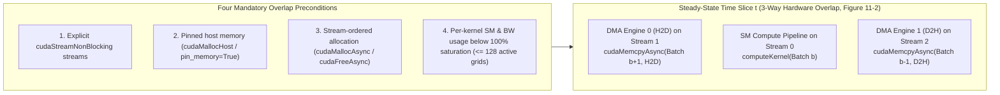
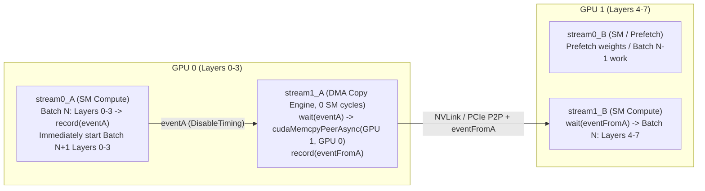
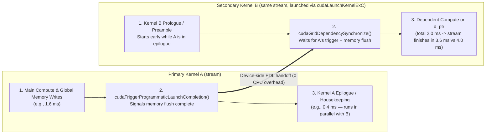

# 10.17 Inter-kernel pipelining, synchronization and stream-ordered allocation

| | |
|---|---|
| Level | Advanced |
| Priority tier | 2 |
| Lab venue | Nebius GPU |
| Part | Part 10: The GPU and CUDA |
| Sources used | *AI Systems Performance Engineering* (`ai-systems-performance-engineering`, Chris Fregly), Chapter 11 (*Inter-Kernel Pipelining, Synchronization, and CUDA Stream-Ordered Memory Allocations*) |
| Code | `code/part10/inter_kernel_pipelining.py`, `code/part10/inter_kernel_pipelining_lab.py` |
| Coverage file | `planning/coverage/chapters/10-17.md` |

## Why this matters for AI infrastructure

Chapter `10.16` showed how to hide latency **inside a single kernel** using `<cuda/pipeline>` double buffering, 3-role warp specialization, persistent work queues, and Thread Block Clusters (`DSMEM` / `TMA` multicast). Yet even a kernel that achieves `97%` warp execution efficiency inside its own loop will leave an AI cluster underutilized if the GPU stalls between kernels waiting for host-to-device (`H2D`) micro-batch staging, blocking `cudaMalloc` / `cudaFree` calls, legacy default-stream (`stream 0`) barriers, cross-GPU `NVLink` / `RDMA` transfers, or kernel teardown/startup gaps.

*AI Systems Performance Engineering* Chapter 11 (*Inter-Kernel Pipelining, Synchronization, and CUDA Stream-Ordered Memory Allocations*) extends intra-kernel pipelining into a full **two-layer (intra-kernel + inter-kernel) execution architecture**:

- **3-Way Overlap Across Compute Engines and Dual DMA Copy Engines (`asyncEngineCount >= 2`):** Modern NVIDIA GPUs pair independent Streaming Multiprocessor (`SM`) compute pipelines with at least two dedicated Direct Memory Access (`DMA`) copy engines (one for `H2D`, one for `D2H`) and support up to **`128` concurrently resident kernel grids**. By enqueuing micro-batches across explicit `cudaStreamNonBlocking` streams backed by pinned host memory (`cudaMallocHost` / `pin_memory=True`) and `cudaMallocAsync`, `stream 0` computes batch `b` while `stream 1` DMA-copies batch `b + 1` `H2D` and `stream 2` DMA-copies batch `b - 1` `D2H` (`36.0 ms → 18.16 ms`, **`1.98x`**, across `8` batches in the handbook's timeline model `simulate_inter_kernel_stream_pipeline()`, which is not a measurement).
- **Stream-Ordered Memory Pools (`cudaMallocAsync` & `PYTORCH_ALLOC_CONF=backend:cudaMallocAsync`):** Legacy `cudaMalloc` and `cudaFree` synchronize the entire GPU across all streams. Using `cudaMallocAsync` / `cudaFreeAsync` with a tuned pool release threshold (`cudaMemPoolAttrReleaseThreshold = prop.totalGlobalMem / 2`, e.g., **`96 GiB`** on a `192 GiB` GPU) allocates **`16 MB` (`16,777,216 B`)** per-batch attention scratch buffers, grows variable-length sequence workspaces (**`512 → 1,024` tokens** = `2.0x`), extends autoregressive decode `KV` caches, and feeds layerwise LLM pipelines (**layers `0–5` on `stream 0`**, **layers `6–11` on `stream 1`**) with zero cross-stream stalls.
- **Two-Layer Warp-Specialized and Thread Block Cluster Stream Pipelines:** Driving a 3-role, dual-pipeline kernel (`warp_specialized_two_pipelines`, `blockDim = 96`, `pipe_lc` + `pipe_cs`, `TILE_SIZE = 1,024`, **`24,576 B` [`24 KiB`] SMEM**) or a `4`-CTA clustered kernel (`launch_warp_specialized_cluster_pipeline_multistream`, `TILE_SIZE = 128`, **`196,608 B` [`192 KiB`] SMEM**, `528` blocks) across `NUM_STREAMS = 2` overlaps host staging and stream-ordered allocation behind active kernel execution—even when cooperative cluster kernels serialize on the SMs.
- **Multi-GPU P2P (`cudaMemcpyPeerAsync`), `NCCL` Ring All-Reduce, `NIXL`, and Programmatic Dependent Launch (`PDL`):** Across GPUs, dedicated high-priority streams overlap `cudaMemcpyPeerAsync` (which runs on the GPU's DMA copy engine using **`0` SM cycles**), low-occupancy `NCCL` ring all-reduce kernels (Figure 11-8: `4` GPUs, `4` chunks `1–4`), and `NIXL` (`nixlCommStream`) transfers, all capturable into a single `CUDA Graph` via `cudaStreamBeginCapture(streamA, cudaStreamCaptureModeGlobal)`. Finally, **Programmatic Dependent Launch (`PDL`)** lets a primary kernel fire `cudaTriggerProgrammaticLaunchCompletion()` as soon as its global memory writes flush so a dependent kernel waiting on `cudaGridDependencySynchronize()` overlaps its prologue directly with the primary kernel's epilogue in the same stream (`4.0 ms → 3.6 ms` in the handbook timeline model) without CPU round-trips.

:::note About the timings in this chapter
The stage timings `36.0 ms`, `18.16 ms` (`1.98x`), `32.16 ms` and the Programmatic Dependent Launch figures `4.0 ms` and `3.6 ms` come from small timeline models in `code/part10/inter_kernel_pipelining.py` that use made-up stage times (`1.0 ms` H2D, `2.0 ms` compute, `1.0 ms` D2H and so on). They illustrate the diagrams in the book and are not measurements on a GPU. The book says its own metric tables are illustrative too. The code is reproduced from the book and was not compiled here.
:::

## Prerequisites and outcomes

**Prerequisites:**
- Chapter `10.12` (foundational CUDA streams, events, and pinned memory) and Chapter `10.16` (`<cuda/pipeline>`, 3-role warp specialization, Cooperative Groups, and Thread Block Clusters).

**Outcomes — after completing this chapter you will be able to:**
1. Orchestrate concurrent kernels and 3-way `H2D` / `Compute` / `D2H` pipelines across `cudaStreamNonBlocking` streams, diagnose `50%` resource-contention splits under saturation, and respect the `128`-grid hardware concurrency limit.
2. Configure CUDA's stream-ordered memory allocator (`cudaMallocAsync`, `cudaFreeAsync`, `cudaMemPoolSetAttribute`, `cudaMemPoolAttrReleaseThreshold`) and `PYTORCH_ALLOC_CONF=backend:cudaMallocAsync` for variable-length LLM scratch buffers (`16 MB`, `512 → 1,024` tokens) and layerwise pipelines (`layers 0–5` and `6–11`).
3. Contrast the legacy default stream (`stream 0` / `cudaStreamLegacy`), Per-Thread Default Stream (`PTDS` / `cudaStreamPerThread`), and explicit non-blocking streams, and coordinate streams with `cudaEventRecord`, `cudaStreamWaitEvent`, and deadlock-free `cudaLaunchHostFunc` callbacks.
4. Implement two-layer pipelining with `warp_specialized_two_pipelines` (`24,576 B` SMEM, `float4` 128-element alignment) and `launch_warp_specialized_cluster_pipeline_multistream` (`196,608 B` SMEM, `cudaLaunchKernelExC`), explaining why cooperative launches serialize on SMs while still overlapping `H2D`/`D2H` and `cudaMallocAsync`.
5. Build multi-GPU pipeline and data-parallel overlap loops using `cudaMemcpyPeerAsync`, `cudaEventDisableTiming`, high-priority `NCCL` ring all-reduce streams, `NIXL` (`nixlCommStream`), and multi-stream `cudaStreamBeginCapture(..., cudaStreamCaptureModeGlobal)`.
6. Implement **Programmatic Dependent Launch (`PDL`)** (`cudaTriggerProgrammaticLaunchCompletion`, `cudaGridDependencySynchronize`, `cudaLaunchAttributeProgrammaticStreamSerialization`) and combine `PDL` + `__cluster_dims__(2,1,1)` Thread Block Clusters + Warp Specialization + Blackwell TMA reductions (`cp.reduce.async.bulk.tensor`).

---

## 1. Overlapping Kernel Execution and 3-Way Data Transfers with CUDA Streams

### 1.1 Concurrent kernel dispatch and host interleaving (`Figure 11-1`)

A **CUDA stream** is a FIFO queue of device operations (kernel launches, memory copies, and stream-ordered allocations/frees) that execute in issue order within the stream while overlapping freely with operations in other non-blocking streams whenever hardware resources permit (*AI Systems Performance Engineering* Ch 11, *Overlapping Kernel Execution with CUDA Streams*, Figure 11-1).

Consider launching **`5` kernels** (`ker_1, ker_2, ker_3` on `stream1` and `ker_A, ker_B` on `stream2`, each configured with `grid(128)` × `block(256)` = **`32,768` threads**) interleaved with asynchronous CPU work (`cpu_code_1()` and `cpu_code_2()`):

```cpp
// Launching 5 kernels across 2 non-blocking streams while interleaving CPU work (Figure 11-1)
// Source: AI Systems Performance Engineering, Chapter 11
#include <cstdio>
#include <cuda_runtime.h>

__global__ void ker_A() { /* ... device work ... */ }
__global__ void ker_B() { /* ... device work ... */ }
__global__ void ker_1() { /* ... device work ... */ }
__global__ void ker_2() { /* ... device work ... */ }
__global__ void ker_3() { /* ... device work ... */ }

void cpu_code_1() {}
void cpu_code_2() {}

int main() {
    // 1. Create two explicit non-blocking streams (do NOT sync with legacy stream 0)
    cudaStream_t stream1, stream2;
    cudaStreamCreateWithFlags(&stream1, cudaStreamNonBlocking);
    cudaStreamCreateWithFlags(&stream2, cudaStreamNonBlocking);

    dim3 grid(128), block(256); // 32,768 threads per launch

    // 2. Enqueue ker_1 on stream1; control returns immediately to CPU
    ker_1<<<grid, block, 0, stream1>>>();
    printf("CPU code 1 executing\n");
    cpu_code_1();

    // 3. Interleave launches across stream2 and stream1 + CPU code 2
    ker_A<<<grid, block, 0, stream2>>>();
    ker_B<<<grid, block, 0, stream1>>>();
    ker_2<<<grid, block, 0, stream2>>>();
    printf("CPU code 2 executing\n");
    cpu_code_2();
    ker_3<<<grid, block, 0, stream1>>>();

    // 4. Synchronize both streams and clean up
    cudaStreamSynchronize(stream1);
    cudaStreamSynchronize(stream2);
    cudaStreamDestroy(stream1);
    cudaStreamDestroy(stream2);
    return 0;
}
```

### 1.2 Three-way `H2D` / `Compute` / `D2H` overlap, hardware limits (`128` grids), and saturation contention (`Figure 11-2`)

Modern NVIDIA data-center GPUs provide at least **two independent DMA copy engines** (`deviceProp.asyncEngineCount >= 2`: one engine for `Host → Device` transfers and one engine for `Device → Host` transfers) alongside the SM compute pipeline (*ASP* Ch 11, *Using Streams to Overlap Compute with Data Transfers*, Figure 11-2). By pipelining batches across three (or more) streams, all three hardware engines run simultaneously:
- **`Stream 0` (SM Compute Pipeline):** Executes the compute kernel for **Batch `b`**.
- **`Stream 1` (DMA Copy Engine 0 — `H2D`):** Executes `cudaMemcpyAsync` to stage **Batch `b + 1`** from pinned host RAM into device HBM.
- **`Stream 2` (DMA Copy Engine 1 — `D2H`):** Executes `cudaMemcpyAsync` to copy the completed output of **Batch `b - 1`** from device HBM back to pinned host RAM.



Four physical and runtime rules govern whether multi-stream operations actually overlap on hardware (*ASP* Ch 11):
1. **Pinned host memory is mandatory for asynchronous `cudaMemcpyAsync`:** If you pass a pageable (`malloc` / standard CPU tensor) pointer to `cudaMemcpyAsync`, the CUDA driver must first perform a synchronous host-side staging copy into an internal pinned buffer, **blocking the calling CPU thread and serializing that transfer on the enqueuing stream** (in `simulate_inter_kernel_stream_pipeline()`, passing pageable memory degrades an 8-batch pipeline from **`18.16 ms` to `32.16 ms`**). Always allocate host staging buffers with `cudaMallocHost` in C++ or `pin_memory=True` in PyTorch's `DataLoader`.
2. **Stream-ordered memory allocation (`cudaMallocAsync`) is mandatory for dynamic per-batch buffers:** Calling legacy `cudaMalloc` or `cudaFree` inside a stream loop forces a **device-wide synchronization across all streams** (`36.0 ms` vs **`18.16 ms`** across 8 batches).
3. **Resource saturation splits throughput (`50%` each):** Concurrency only speeds up execution up to the point of hardware saturation. If a single kernel already consumes `100%` of SM compute throughput or `100%` of HBM memory bandwidth, launching a second kernel concurrently in another stream causes both operations to contend for the same bottleneck and run at **`50%` speed each**, yielding zero net wall-clock speedup.
4. **Hard `128` concurrent resident-grid limit:** Modern GPUs support a hard hardware maximum of **`128` concurrently executing kernels (resident grids)** per device. Any kernel launches beyond `128` active grids queue in hardware until an active grid finishes and frees a grid slot, and kernels can co-reside on the same SM only if their combined registers, shared memory, and thread block slots fit within the SM's limits.

---

## 2. The Stream-Ordered Memory Allocator (`cudaMallocAsync`) and LLM Scratch Pools

### 2.1 Tuning the device memory pool (`cudaMemPoolSetAttribute` & `PYTORCH_ALLOC_CONF`)

In PyTorch, the default CUDA caching allocator is stream-aware and avoids device-wide synchronization when satisfying requests from its cached blocks—synchronizing the device only when a cache miss forces an OS-level `cudaMalloc` call (*ASP* Ch 11, *Stream-Ordered Memory Allocator*). Setting:

```bash
export PYTORCH_ALLOC_CONF=backend:cudaMallocAsync
```

switches PyTorch to CUDA's native **stream-ordered memory allocator (`cudaMallocAsync` / `cudaFreeAsync`)**, which manages allocations and frees directly as stream-ordered queue items inside a per-device memory pool (`cudaMemPool_t`), reducing memory fragmentation across streams.

In CUDA C++, you configure the default device pool's release threshold via `cudaMemPoolSetAttribute` with `cudaMemPoolAttrReleaseThreshold` (for example, setting `threshold = prop.totalGlobalMem / 2`, which retains **`96 GiB`** in the pool on a **`192 GiB`** Blackwell `B200` GPU before releasing unused physical pages back to the OS):

```cpp
// Stream-ordered memory pool configuration and 2-stream overlapped pipeline
// Source: AI Systems Performance Engineering, Chapter 11
#include <cuda_runtime.h>
#include <cstdint>

void runStreamOrderedPipeline(const float* h_data1, float* h_result1,
                              const float* h_data2, float* h_result2,
                              size_t N, dim3 gridDim, dim3 blockDim) {
    cudaMemPool_t pool;
    int device = 0;
    cudaGetDevice(&device);
    cudaDeviceGetDefaultMemPool(&pool, device);

    cudaDeviceProp prop{};
    cudaGetDeviceProperties(&prop, device);
    // Keep up to 50% of total VRAM (e.g., 96 GiB on a 192 GiB GPU) in the pool before releasing to OS
    uint64_t threshold = prop.totalGlobalMem / 2;
    cudaMemPoolSetAttribute(pool, cudaMemPoolAttrReleaseThreshold, &threshold);

    cudaStream_t stream1, stream2;
    cudaStreamCreateWithFlags(&stream1, cudaStreamNonBlocking);
    cudaStreamCreateWithFlags(&stream2, cudaStreamNonBlocking);

    void *d_data1 = nullptr, *d_result1 = nullptr;
    void *d_data2 = nullptr, *d_result2 = nullptr;
    size_t dataSizeBytes = N * sizeof(float);

    // 1. Stream-ordered allocations: zero cross-stream synchronization
    cudaMallocAsync(&d_data1, dataSizeBytes, stream1);
    cudaMallocAsync(&d_result1, dataSizeBytes, stream1);
    cudaMallocAsync(&d_data2, dataSizeBytes, stream2);
    cudaMallocAsync(&d_result2, dataSizeBytes, stream2);

    // 2. Stream 1: H2D -> Kernel -> D2H
    cudaMemcpyAsync(d_data1, h_data1, dataSizeBytes, cudaMemcpyHostToDevice, stream1);
    // computeKernel<<<gridDim, blockDim, 0, stream1>>>((float*)d_data1, (float*)d_result1);
    cudaMemcpyAsync(h_result1, d_result1, dataSizeBytes, cudaMemcpyDeviceToHost, stream1);

    // 3. Stream 2 overlaps concurrently: H2D -> Kernel -> D2H
    cudaMemcpyAsync(d_data2, h_data2, dataSizeBytes, cudaMemcpyHostToDevice, stream2);
    // computeKernel<<<gridDim, blockDim, 0, stream2>>>((float*)d_data2, (float*)d_result2);
    cudaMemcpyAsync(h_result2, d_result2, dataSizeBytes, cudaMemcpyDeviceToHost, stream2);

    // 4. Stream-ordered frees enqueued before host synchronization
    cudaFreeAsync(d_data1, stream1);
    cudaFreeAsync(d_result1, stream1);
    cudaFreeAsync(d_data2, stream2);
    cudaFreeAsync(d_result2, stream2);

    cudaStreamSynchronize(stream1);
    cudaStreamSynchronize(stream2);
    cudaStreamDestroy(stream1);
    cudaStreamDestroy(stream2);
}
```

### 2.2 Three LLM workloads that depend on `cudaMallocAsync` (`Figure 11-3`)

*AI Systems Performance Engineering* Chapter 11 (*Using CUDA Streams and Stream-Ordered Memory Allocator with LLMs*, Figure 11-3; `plan_stream_ordered_pool()` in `code/part10/inter_kernel_pipelining.py`) highlights three LLM runtime patterns where legacy `cudaMalloc` causes catastrophic stalls and `cudaMallocAsync` preserves full overlap:

| LLM Runtime Pattern | Why Dynamic Allocation Occurs | What Happens with Legacy `cudaMalloc` | What Happens with `cudaMallocAsync` |
|---|---|---|---|
| **1. Per-batch attention scratch buffers (`16 MB` workspace, Figure 11-3)** | Each Transformer mini-batch requires temporary scratch memory (e.g., **`16 MB` = `16,777,216 bytes`**) for pre-softmax attention scores, layer norm, or intermediate activations. | Calling `cudaMalloc` on `stream1` forces a global barrier across the GPU, stalling `stream0`'s in-flight attention kernel. | `cudaMallocAsync(&scratchPtr, 16 * 1024 * 1024, stream1)` appends a queue item to `stream1`; `stream0` continues executing uninterrupted. |
| **2. Variable-length sequence batches (`512 → 1,024` tokens) & growing decode `KV` caches** | When Batch `N` has **`512` tokens/sequence** and Batch `N + 1` has **`1,024` tokens/sequence** (**`2.0x` growth**), or as autoregressive decode appends new `K`/`V` vectors each step, the previous buffer is too small. | Reallocating the larger buffer via `cudaMalloc` halts all concurrent `H2D` prompt staging and `D2H` token streaming. | `cudaMallocAsync` reserves the `2.0x` larger buffer inside the active stream while upstream `H2D` and downstream `D2H` streams run in parallel. |
| **3. Layerwise pipeline parallelism across streams (`layers 0–5` vs `layers 6–11`)** | A 12-layer Transformer block is split on one GPU so **`stream 0` runs layers `0–5`** and **`stream 1` runs layers `6–11`**, handing off intermediate activation buffers between halves. | Allocating the next batch's activation buffer after `stream 0` finishes layers `0–5` pauses `stream 1`'s execution of layers `6–11`. | `stream 0` calls `cudaMallocAsync` for the next micro-batch's activations while `stream 1` simultaneously computes layers `6–11` on the prior batch. |

---

## 3. Default vs. Explicit Streams, Per-Thread Default Streams (`PTDS`), Events, and Host Callbacks

### 3.1 Comparing Legacy Default Stream (`stream 0`), `PTDS`, and Explicit Non-Blocking Streams (`Figure 11-4`)

When a CUDA call omits a stream argument (or passes `0` / `nullptr`), its synchronization behavior depends on whether **Per-Thread Default Streams (`PTDS`)** are enabled (*ASP* Ch 11, *Legacy Default Stream*, *Modern Per-Thread Default Stream*, and *Best Practices for Default Stream Usage*):

| Stream Type | Creation / Activation Flag | Self-Ordering | Cross-Stream Synchronization Behavior | Production Recommendation |
|---|---|---|---|---|
| **Legacy Default Stream (`stream 0` / `cudaStreamLegacy`)** | Default when `PTDS` is not enabled and stream is omitted / `0`. | Strictly FIFO within `stream 0`. | **Global bidirectional barrier:** Any command issued to `stream 0` waits for *all* prior work in every blocking stream across the entire GPU to finish, and blocks *all* subsequent work in those streams until `stream 0` finishes. | **Never** launch performance-critical kernels or copies on `stream 0`; keep `stream 0` completely idle during training/inference loops. |
| **Per-Thread Default Stream (`PTDS` / `cudaStreamPerThread`, Figure 11-4)** | Compile with `nvcc --default-stream per-thread` or `#define CUDA_API_PER_THREAD_DEFAULT_STREAM 1` before CUDA headers. | Strictly FIFO within each CPU thread's private default stream. | **Private per host thread:** Thread A's default stream never waits on or blocks Thread B's default stream or explicit streams (note: if mixed with `cudaStreamLegacy` in the same process, `PTDS` still synchronizes with `cudaStreamLegacy`). | Enable in multi-threaded C++ runtimes so third-party libraries omitting stream arguments do not serialize across CPU threads. |
| **Explicit Non-Blocking Stream (`cudaStreamNonBlocking`)** | `cudaStreamCreateWithFlags(&s, cudaStreamNonBlocking)` | Strictly FIFO within stream `s`. | **Completely independent:** Never implicitly synchronizes with `stream 0` (`cudaStreamLegacy`) or any other stream; synchronizes *only* when explicitly instructed via `cudaStreamWaitEvent`. | **Best practice:** Create named non-blocking streams for all compute, `H2D`, `D2H`, `P2P`, and `NCCL`/`NIXL` queues. |

### 3.2 Fine-grained cross-stream events (`Figures 11-5 to 11-7`) and the `cudaLaunchHostFunc` deadlock rule

To enforce producer–consumer ordering across streams (for example, Stream A produces activations that Stream B consumes, and Stream B produces outputs that Stream D consumes, as in Figure 11-7), compare the three synchronization mechanisms (*ASP* Ch 11, *Fine-Grained Synchronization with Events and Callbacks*):
1. **`cudaDeviceSynchronize()` (Avoid in loops):** Blocks the calling CPU thread until **every stream across the entire GPU** drains to completion.
2. **`cudaStreamSynchronize(stream)` (Figure 11-5):** Blocks the calling CPU thread until all operations in `stream` complete—useful only at epoch boundaries or final cleanup.
3. **`cudaEventRecord(ev, producerStream)` + `cudaStreamWaitEvent(consumerStream, ev, 0)` (Figures 11-6 & 11-7):**
   - Returns control to the **CPU immediately (non-blocking on the host)**.
   - Stalls **only `consumerStream` on the GPU hardware scheduler** until `producerStream` reaches `ev`; all other GPU streams continue running at full speed.
   - **Optimization flag:** When an event is used purely for cross-stream ordering and you do not need `cudaEventElapsedTime` timestamps, create it with **`cudaEventCreateWithFlags(&ev, cudaEventDisableTiming)`** to strip timestamp-recording overhead.

**Host callbacks (`cudaLaunchHostFunc`) and the circular deadlock rule:**
When the CPU needs to recycle a custom host memory pool as soon as a GPU stream completes a kernel—without spinning on `cudaEventQuery` or blocking on `cudaStreamSynchronize`—register a host callback on the stream via `cudaLaunchHostFunc(stream, myHostCallback, userData)`.
- **Critical safety rule (*ASP* Ch 11, p. 287):** **Never invoke any device-side CUDA API (such as `cudaMemcpy`, `cudaMalloc`, or a kernel launch) from inside a `cudaLaunchHostFunc` callback.** Because the callback executes on an internal thread managed by the CUDA runtime while the stream is waiting for the callback to return, calling a CUDA API inside the callback creates a circular wait between the runtime thread and the GPU command processor, **deadlocking the application**. Limit `cudaLaunchHostFunc` callbacks strictly to pure CPU tasks (such as freeing or recycling host buffers or signaling a CPU condition variable).

---

## 4. Two-Layer Pipelining: Intra-Kernel Warp Specialization + Inter-Kernel CUDA Streams + Thread Block Clusters

### 4.1 Layering dual-pipeline 3-role warp specialization with CUDA streams (`warp_specialized_two_pipelines`)

In Chapter `10.16`, our single-block warp-specialized kernel used a single `<cuda/pipeline>` object. In *AI Systems Performance Engineering* Chapter 11 (*Pipelining with Warp Specialization (Intra-Kernel) and CUDA Streams (Inter-Kernel)*), we deepen intra-kernel overlap by giving the `3` warps per block (**`blockDim.x = 96` threads**: `warp_id 0` = loader, `warp_id 1` = compute, `warp_id 2` = storer) **two independent 2-stage block-scoped pipelines**:
1. **`pipe_lc` (`loader → compute`, depth `2`):** Coordinates asynchronous `float4` loads from HBM into Shared Memory.
2. **`pipe_cs` (`compute → storer`, depth `2`):** Coordinates handoff of computed results from Shared Memory to the storer warp.

Check the exact shared-memory and vectorization math (`evaluate_two_pipeline_warp_spec()` in `code/part10/inter_kernel_pipelining.py`):
- **1D tile size and `float4` alignment guard:** `TILE_SIZE = 1,024` floats per buffer, guarded by `static_assert((TILE_SIZE % (32 * 4)) == 0)` because `32` lanes × `4` floats (`sizeof(float4) = 16 B` per lane) = **`128` floats (`512 B` = four `128-byte` coalesced cache lines)** per unrolled warp copy step.
- **Double-buffered 3-tensor shared memory layout (`[A0 | B0 | C0 | A1 | B1 | C1]`):**
  ```text
  shmem_bytes = 2 (stages) * 3 (buffers: A, B, C) * TILE_SIZE (1,024) * sizeof(float) (4 B)
              = 6 * 1,024 * 4 = 24,576 bytes (24.0 KiB << 227,328 bytes Blackwell dynamic SMEM limit)
  ```
  While stage `s = 0` (`A0, B0, C0`) is being computed or stored, stage `s = 1` (`A1, B1, C1`) is prefetching the next tile (`next = tile + gridDim.x`).

Here is the complete device kernel and multi-stream host driver (`NUM_STREAMS = 2`, `BATCHES = 8`) from *AI Systems Performance Engineering* Chapter 11:

```cpp
// Two-level pipeline: Intra-kernel 3-role dual-pipeline (pipe_lc + pipe_cs)
// driven across Inter-kernel non-blocking CUDA streams + cudaMallocAsync
// Source: AI Systems Performance Engineering, Chapter 11
#include <cstdio>
#include <cuda_runtime.h>
#include <cooperative_groups.h>
#include <cuda/pipeline>

namespace cg = cooperative_groups;

// shmem_bytes = 2 (stages) * 3 (buffers) * 1,024 * 4 B = 24,576 B (24 KiB << 227 KB SMEM)
#define TILE_SIZE 1024
#define NUM_STREAMS 2
#define BATCHES 8

static_assert((TILE_SIZE % (32 * 4)) == 0,
              "TILE_SIZE must be a multiple of 128 (32 lanes * 4 floats) for float4 vectorization");

__global__ void warp_specialized_two_pipelines(const float* __restrict__ A_global,
                                               const float* __restrict__ B_global,
                                               float* __restrict__ C_global,
                                               int numTiles) {
    cg::thread_block cta = cg::this_thread_block();
    // Stage s in {0, 1}: [A_s | B_s | C_s], each of length TILE_SIZE (total 6 * TILE_SIZE floats)
    extern __shared__ float shared_mem[];

    using pipe_state = cuda::pipeline_shared_state<cuda::thread_scope_block, 2>;
    __shared__ alignas(pipe_state) unsigned char state_lc_storage[sizeof(pipe_state)];
    __shared__ alignas(pipe_state) unsigned char state_cs_storage[sizeof(pipe_state)];
    auto* state_lc = reinterpret_cast<pipe_state*>(state_lc_storage);
    auto* state_cs = reinterpret_cast<pipe_state*>(state_cs_storage);
    if (threadIdx.x == 0) {
        new (state_lc) pipe_state();
        new (state_cs) pipe_state();
    }
    cta.sync();

    auto pipe_lc = cuda::make_pipeline(cta, state_lc); // loader -> compute (depth 2)
    auto pipe_cs = cuda::make_pipeline(cta, state_cs); // compute -> storer (depth 2)

    const int warp_id = threadIdx.x >> 5; // 0 = loader, 1 = compute, 2 = storer
    const int lane_id = threadIdx.x & 31;
    auto warp = cg::tiled_partition<32>(cta);

    for (int tile = blockIdx.x; tile < numTiles; tile += gridDim.x) {
        const int stage = tile & 1;
        const size_t offset = static_cast<size_t>(tile) * TILE_SIZE;
        float* A_buf = shared_mem + stage * 3 * TILE_SIZE;
        float* B_buf = A_buf + TILE_SIZE;
        float* C_buf = B_buf + TILE_SIZE;

        // 1. Loader warp (warp 0) stages A_buf and B_buf using 16B float4 vectorized memcpy_async
        pipe_lc.producer_acquire();
        if (warp_id == 0) {
            #pragma unroll
            for (int chunk = 0; chunk < TILE_SIZE; chunk += 32 * 4) {
                cuda::memcpy_async(warp,
                    reinterpret_cast<float4*>(A_buf + chunk) + lane_id,
                    reinterpret_cast<const float4*>(A_global + offset + chunk) + lane_id,
                    sizeof(float4), pipe_lc);
                cuda::memcpy_async(warp,
                    reinterpret_cast<float4*>(B_buf + chunk) + lane_id,
                    reinterpret_cast<const float4*>(B_global + offset + chunk) + lane_id,
                    sizeof(float4), pipe_lc);
            }
        }
        pipe_lc.producer_commit();

        // 2. Wait for loader stage and compute C_buf = A_buf + B_buf in warp 1
        pipe_lc.consumer_wait();
        cta.sync();
        if (warp_id == 1) {
            #pragma unroll
            for (int chunk = 0; chunk < TILE_SIZE; chunk += 32) {
                C_buf[chunk + lane_id] = A_buf[chunk + lane_id] + B_buf[chunk + lane_id];
            }
        }
        cta.sync();
        pipe_lc.consumer_release();

        // 3. Handoff computed C_buf from compute (warp 1) to storer (warp 2) via pipe_cs
        pipe_cs.producer_acquire();
        pipe_cs.producer_commit();
        pipe_cs.consumer_wait();
        cta.sync();
        if (warp_id == 2) {
            #pragma unroll
            for (int chunk = 0; chunk < TILE_SIZE; chunk += 32) {
                C_global[offset + chunk + lane_id] = C_buf[chunk + lane_id];
            }
        }
        cta.sync();
        pipe_cs.consumer_release();
    }
}

void runTwoPipelineMultistreamHost() {
    cudaStream_t s[NUM_STREAMS];
    for (int i = 0; i < NUM_STREAMS; ++i)
        cudaStreamCreateWithFlags(&s[i], cudaStreamNonBlocking);

    const size_t bytesPerBatch = TILE_SIZE * sizeof(float);
    float *hA = nullptr, *hB = nullptr, *hC = nullptr;
    cudaMallocHost(&hA, BATCHES * bytesPerBatch); // pinned host memory
    cudaMallocHost(&hB, BATCHES * bytesPerBatch);
    cudaMallocHost(&hC, BATCHES * bytesPerBatch);

    for (int b = 0; b < BATCHES; ++b) {
        cudaStream_t st = s[b % NUM_STREAMS];
        float *dA = nullptr, *dB = nullptr, *dC = nullptr;
        cudaMallocAsync(&dA, bytesPerBatch, st);
        cudaMallocAsync(&dB, bytesPerBatch, st);
        cudaMallocAsync(&dC, bytesPerBatch, st);

        cudaMemcpyAsync(dA, hA + size_t(b) * TILE_SIZE, bytesPerBatch, cudaMemcpyHostToDevice, st);
        cudaMemcpyAsync(dB, hB + size_t(b) * TILE_SIZE, bytesPerBatch, cudaMemcpyHostToDevice, st);

        const dim3 block(96), grid(1); // 3 warps per block
        const size_t shmem = 6 * TILE_SIZE * sizeof(float); // 24,576 bytes
        warp_specialized_two_pipelines<<<grid, block, shmem, st>>>(dA, dB, dC, /*numTiles=*/1);

        cudaMemcpyAsync(hC + size_t(b) * TILE_SIZE, dC, bytesPerBatch, cudaMemcpyDeviceToHost, st);
        cudaFreeAsync(dA, st);
        cudaFreeAsync(dB, st);
        cudaFreeAsync(dC, st);
    }

    for (int i = 0; i < NUM_STREAMS; ++i) {
        cudaStreamSynchronize(s[i]);
        cudaStreamDestroy(s[i]);
    }
    cudaFreeHost(hA); cudaFreeHost(hB); cudaFreeHost(hC);
}
```

### 4.2 Combining Thread Block Clusters, Warp Specialization, and CUDA Streams (`launch_warp_specialized_cluster_pipeline_multistream`)

What happens when we drive Chapter `10.16`'s clustered kernel (`warp_specialized_cluster_pipeline`, where `TILE_SIZE = 128`, `TILE_ELEMS = 16,384`, `shmemBytes = 3 × 16,384 × 4 =` **`196,608 bytes` [`192 KiB`]**) across `NUM_STREAMS = 2` with `CLUSTER_BLOCKS = 4` (`blocksPerGrid = prop.multiProcessorCount × 4 = 132 × 4 =` **`528` blocks**, `blockDim = 96` = `3` warps, `32` rows per CTA)?

Look closely at the host launch and hardware scheduling behavior (*ASP* Ch 11, *Warp Specialization with Thread Block Clusters and CUDA Streams*; `evaluate_cluster_multistream_launch()` in `code/part10/inter_kernel_pipelining.py`):
1. **Extended C launch API (`cudaLaunchKernelExC`):** The host configures `cudaLaunchConfig_t` with `cfg.stream = st`, `cfg.dynamicSmemBytes = 196608`, and `2` launch attributes (`cudaLaunchAttributeClusterDimension = dim3(4, 1, 1)` and `cudaLaunchAttributeNonPortableClusterSizeAllowed = 1`), retrieves the kernel handle via `cudaGetKernel(&k, warp_specialized_cluster_pipeline)`, and launches with `cudaLaunchKernelExC(&cfg, reinterpret_cast<void*>(k), args)`.
2. **Why multi-stream still wins even when cooperative cluster kernels serialize on SMs:** Because a full-device cooperative cluster launch (`blocksPerGrid = prop.multiProcessorCount × CLUSTER_BLOCKS = 528` blocks) pins CTA slots across all SMs simultaneously, **Stream 1's cooperative kernel cannot execute on the SMs at the exact same moment as Stream 0's cooperative kernel**. However, enqueuing batches round-robin across `NUM_STREAMS = 2` still overlaps all non-SM stages: while Stream 0's cluster kernel executes on the SMs, **Stream 1 asynchronously allocates its buffers (`cudaMallocAsync`) and DMA-transfers Batch `b + 1` into HBM (`cudaMemcpyAsync` H2D)**, and **Stream 0's completed Batch `b - 1` streams back to the host (`cudaMemcpyAsync` D2H) and frees (`cudaFreeAsync`)**. The instant Stream 0's kernel finishes, Stream 1's kernel starts with zero H2D or allocation delay.
3. **Engineering trade-off note (*ASP* Ch 11):** Once a simpler double-buffered kernel + multi-stream pipeline already saturates HBM bandwidth and hides `CPU ↔ GPU` latency, layering 3-role warp specialization and Thread Block Clusters on top yields only a few extra percentage points of SM utilization—so reserve the full 3-layer combination for ultra-latency-sensitive inference kernels.

---

## 5. Multi-GPU Compute, P2P (`cudaMemcpyPeerAsync`), `NCCL` Ring All-Reduce, `NIXL`, and `CUDA Graph` Stream Capture

### 5.1 Multi-GPU pipeline parallelism (`cudaMemcpyPeerAsync`) and data parallelism (`NCCL` & `NIXL`, `Figure 11-8`)

Across multiple GPUs, CUDA streams coordinate four distinct engines simultaneously—**GPU A SMs**, **GPU A DMA Copy Engines**, **NVLink / PCIe / RDMA Interconnects**, and **GPU B SMs** (*ASP* Ch 11, *Multi-GPU Compute and Data Transfer Overlap with CUDA Streams*):



1. **Two-GPU Pipeline Parallelism (`Layers 0–3` on GPU 0 → `Layers 4–7` on GPU 1):**
   - On GPU 0, `stream0_A` computes `myTransformerLayers0to3`, records `eventA` (created with `cudaEventDisableTiming`), and **immediately launches Batch `N + 1` on `stream0_A`**.
   - On GPU 0, `stream1_A` calls `cudaStreamWaitEvent(stream1_A, eventA, 0)` and invokes `cudaMemcpyPeerAsync(destActivationsB, /*dstGPU=*/1, outputActivationsA, /*srcGPU=*/0, bytes, stream1_A)`, then records `eventFromA`. Because **`cudaMemcpyPeerAsync` executes entirely on GPU 0's DMA copy engine and consumes `0` SM cycles**, GPU 0's SMs run Batch `N + 1` at `100%` speed while Batch `N`'s activations traverse NVLink/PCIe.
   - On GPU 1, `stream1_B` calls `cudaStreamWaitEvent(stream1_B, eventFromA, 0)` and launches `myTransformerLayers4to7`.
2. **Multi-GPU Data Parallelism with High-Priority `NCCL` Streams and `SHARP` (`Figure 11-8`):**
   - In a **`4`-GPU ring all-reduce** (Figure 11-8), `NCCL` splits the gradient tensor into **`4` contiguous chunks (`Chunks 1–4`)** so GPU `k` sends chunk `i` to neighbor `k + 1` while receiving chunk `i - 1` from `k - 1`.
   - Unlike `cudaMemcpyPeerAsync`, **`NCCL` collectives execute as device kernels on SMs**, but they are purposely tuned as **low-occupancy kernels** that saturate NVLink/PCIe bandwidth using only a small number of thread blocks per GPU (and can offload reductions to **NVIDIA SHARP** switch hardware when supported).
   - PyTorch (`DistributedDataParallel` / `FSDP`) launches `ncclAllReduce` on a **dedicated high-priority communication stream (`commStream`)** synchronized via events (`cudaEventRecord(eventK, computeStream)` → `cudaStreamWaitEvent(commStream, eventK, 0)` → `ncclAllReduce(..., commStream)` → `cudaEventRecord(eventAllReduceDone, commStream)` → `cudaStreamWaitEvent(computeStream, eventAllReduceDone, 0)`), allowing backward compute for layer `k + 1` on `computeStream` to overlap with layer `k`'s all-reduce.
3. **`NIXL` (NVIDIA Inference Xfer Library):**
   - For disaggregated prefill/decode KV-cache transfers and tiered storage movement across NVLink, GPUDirect RDMA, and NVMe, **`NIXL`** (`nixlCommStream`) replaces manual `cudaMemcpyPeerAsync` calls with chunked, pipelined transfers on dedicated high-priority streams whose DMA copy commands preempt lower-priority queues without consuming upfront SM resources.

### 5.2 Capturing a multi-stream iteration into a `CUDA Graph` (`cudaStreamCaptureModeGlobal`)

Once a multi-stream training or inference step (including `computeStream` kernels, `commStream` `ncclAllReduce`, `cudaMemcpyPeerAsync`, `cudaMallocAsync`, `cudaFreeAsync`, and cross-stream `cudaEventRecord` / `cudaStreamWaitEvent` edges) is wired together, you can capture the entire multi-stream DAG into a single **CUDA Graph** (*ASP* Ch 11, p. 11):

```cpp
// Capturing a multi-stream compute + NCCL communication DAG into a single CUDA Graph
// Source: AI Systems Performance Engineering, Chapter 11
cudaGraph_t graph;
// CRITICAL: Use cudaStreamCaptureModeGlobal when capturing across multiple streams (streamA + streamB)
cudaStreamBeginCapture(streamA, cudaStreamCaptureModeGlobal);

computeGradientsLayer1<<<grid, block, 0, streamA>>>(/* ... */);
cudaEventRecord(ev1, streamA);
cudaStreamWaitEvent(streamB, ev1, 0);
ncclAllReduce(grad1, grad1, count1, ncclFloat, ncclSum, comm, streamB);

computeGradientsLayer2<<<grid, block, 0, streamA>>>(/* ... */);
cudaEventRecord(ev2, streamA);
cudaStreamWaitEvent(streamB, ev2, 0);
ncclAllReduce(grad2, grad2, count2, ncclFloat, ncclSum, comm, streamB);

cudaStreamWaitEvent(streamA, evAllDone, 0); // rejoin streamB into streamA before ending capture
cudaStreamEndCapture(streamA, &graph);
```

Using **`cudaStreamCaptureModeGlobal`** ensures operations enqueued on both `streamA` and `streamB` (joined by events) are recorded into the same graph capture session so `cudaGraphLaunch()` replays the entire multi-stream iteration with near-zero CPU launch overhead.

---

## 6. Programmatic Dependent Launch (`PDL`) and Combining `PDL` + Thread Block Clusters + Warp Specialization

### 6.1 Overlapping Kernel B's prologue with Kernel A's epilogue in the same stream (`Figure 11-9`)

Normally, two kernels enqueued into the **same CUDA stream** execute strictly back-to-back: `kernel_B` cannot begin on any SM until every thread block of `kernel_A` has finished its epilogue and exited. **Programmatic Dependent Launch (`PDL`)** (supported on Hopper `sm_90` and Blackwell `sm_100`) breaks that serial boundary inside a single stream without CPU intervention (*ASP* Ch 11, *Programmatic Dependent Launch*, Figure 11-9; `model_programmatic_dependent_launch()` in `code/part10/inter_kernel_pipelining.py`):



The three-part `PDL` contract requires:
1. **In Primary `kernel_A` (`cudaTriggerProgrammaticLaunchCompletion()`):** Once `kernel_A` has produced all data required by `kernel_B`, call `cudaTriggerProgrammaticLaunchCompletion()`. This flushes `kernel_A`'s global memory writes and signals the hardware scheduler that `kernel_B` can launch while `kernel_A` continues its remaining independent epilogue work.
2. **In Secondary `kernel_B` (`cudaGridDependencySynchronize()`):** `kernel_B` can start its non-dependent prologue early, then calls `cudaGridDependencySynchronize()` before touching any memory written by `kernel_A`.
3. **On the Host (`cudaLaunchAttributeProgrammaticStreamSerialization` via `cudaLaunchKernelExC`):** Configure `kernel_B`'s `cudaLaunchConfig_t` with `attrs[0].id = cudaLaunchAttributeProgrammaticStreamSerialization` and `attrs[0].val.programmaticStreamSerializationAllowed = 1`, then enqueue `kernel_B` via `cudaLaunchKernelExC`. In our lab model (`1.6 ms` primary main + `0.4 ms` primary epilogue + `2.0 ms` secondary), `PDL` overlaps the `0.4 ms` epilogue completely, cutting total stream execution time from **`4.0 ms` to `3.6 ms` (saving `0.4 ms`)**.

### 6.2 Combining `PDL` + Thread Block Clusters (`__cluster_dims__(2,1,1)`) + Warp Specialization (`primary_gemm` → `secondary_gemm`, `Figures 11-10 & 11-11`)

Finally, *AI Systems Performance Engineering* Chapter 11 (*Combining PDL and Thread Block Clusters with Warp Specialization*, Figures 11-10 & 11-11) combines all three hardware mechanisms into a single two-kernel GEMM pipeline (`primary_gemm` → `secondary_gemm`):
- **Compile-time cluster annotation (`__cluster_dims__(2, 1, 1)`):** Groups pairs of CTAs on nearby SMs within a GPC (`cluster.sync()` wraps hardware `mbarrier` instructions).
- **Tile & static SMEM sizing (`131,072 bytes` = `128 KiB`):** `TILE_M = 128, TILE_K = 128, TILE_N = 128`, allocating `__shared__ float tileA[128 * 128]` (`65,536 B`) + `__shared__ float tileB[128 * 128]` (`65,536 B`) = **`131,072 bytes` (`128 KiB`)** per CTA.
- **TMA Multicast (`cp.async.bulk.tensor`) and Blackwell TMA Reduce (`cp.reduce.async.bulk.tensor`):** In production Blackwell kernels, the producer warp (`warpId < numProducerWarps`) drives descriptor-based TMA multicast (`cp.async.bulk.tensor` into `DSMEM`) and can fuse small reductions directly into the copy engine using **descriptor-based TMA reduce operations (`cp.reduce.async.bulk.tensor`)**, lowering register pressure.

```cpp
// Combining Programmatic Dependent Launch (PDL), Thread Block Clusters (__cluster_dims__(2,1,1)),
// and Warp Specialization in primary_gemm -> secondary_gemm
// Source: AI Systems Performance Engineering, Chapter 11
#include <cstdio>
#include <cuda_runtime.h>
#include <cuda_runtime_api.h>
#include <cooperative_groups.h>
#include <cuda/barrier>
#include <cuda/pipeline>

namespace cg = cooperative_groups;

constexpr int TILE_M = 128;
constexpr int TILE_K = 128;
constexpr int TILE_N = 128; // tileA + tileB = 2 * 16,384 * 4 B = 131,072 B (128 KiB) SMEM

__device__ void do_compute(const float* tileA, const float* tileB, float* C) {}

__global__ __cluster_dims__(2, 1, 1) // Compile-time cluster of 2 CTAs
void primary_gemm(const float* __restrict__ A,
                  const float* __restrict__ B,
                  float* __restrict__ C,
                  int M, int N, int K) {
    cg::cluster_group cluster = cg::this_cluster();
    cg::thread_block cta = cg::this_thread_block();

    int tid = threadIdx.x + threadIdx.y * blockDim.x;
    int warpId = tid / warpSize;
    const int numProducerWarps = 1;

    __shared__ float tileA[TILE_M * TILE_K];
    __shared__ float tileB[TILE_K * TILE_N];
    __shared__ cuda::pipeline_shared_state<cuda::thread_scope_block, 1> pipe_state;
    auto pipe = cuda::make_pipeline(cta, &pipe_state);
    auto warp = cg::tiled_partition<32>(cta);

    // 1. CTA-uniform pipeline acquire; producer warp issues async copies
    pipe.producer_acquire();
    if (warpId < numProducerWarps) {
        cuda::memcpy_async(warp, tileA, A, TILE_M * TILE_K * sizeof(float), pipe);
        cuda::memcpy_async(warp, tileB, B, TILE_K * TILE_N * sizeof(float), pipe);
    }
    pipe.producer_commit();
    cta.sync();
    pipe.consumer_wait();

    // 2. Compute on the staged tile and synchronize across the 2-CTA cluster
    do_compute(tileA, tileB, C);
    cluster.sync();

    // 3. Signal dependent secondary_gemm via PDL that main writes/flushes are complete
    cudaTriggerProgrammaticLaunchCompletion();

    // 4. Remaining epilogue work runs concurrently with secondary_gemm's startup
}

__global__ __cluster_dims__(2, 1, 1)
void secondary_gemm(const float* __restrict__ A,
                    const float* __restrict__ B,
                    float* __restrict__ C,
                    int M, int N, int K) {
    // Wait for primary_gemm's PDL signal and global memory flush before reading shared data
    cudaGridDependencySynchronize();
    // Proceed with warp-specialized cluster GEMM on the dependent layer/tile...
}
```

---

## 7. Commands and Configurations That Matter

All commands below follow *AI Systems Performance Engineering* Chapter 11. Shell commands that require an attached Hopper (`sm_90`) or Blackwell (`sm_100`) GPU are marked **(untested here)**.

### 7.1 Enable Per-Thread Default Streams (`PTDS`), compile `PDL` + Cluster kernels, and trace multi-stream overlap in `nsys` (untested here)

```bash
# 1. Compile with Per-Thread Default Stream (PTDS) enabled and Hopper/Blackwell arch (untested here)
nvcc -O3 -std=c++20 -arch=sm_100a --default-stream per-thread -lineinfo \
     pdl_cluster_gemm.cu -o pdl_cluster_gemm

# 2. Enable CUDA's stream-ordered memory allocator in PyTorch (untested here)
export PYTORCH_ALLOC_CONF=backend:cudaMallocAsync

# 3. Trace multi-stream H2D/Compute/D2H overlap, cudaMallocAsync, NCCL, and PDL in Nsight Systems (untested here)
nsys profile --trace=cuda,nvtx,osrt --sample=none -o multistream_pdl_report ./pdl_cluster_gemm
nsys stats multistream_pdl_report.nsys-rep
```

---

## 8. How It Fails: Six Multi-Stream, Allocator, Callback, and `PDL` Failure Modes

| # | Failure Mode | Production / Profiler Symptom | Root Cause | Fix |
|---|---|---|---|---|
| **1** | **Stray operations on the legacy default stream (`stream 0`)** | Nsight Systems timeline shows all `stream1` and `stream2` kernels and `cudaMemcpyAsync` transfers stopping at a wall before and after a single helper kernel. | A kernel or copy was launched without an explicit stream (into `cudaStreamLegacy` / `stream 0`), or custom streams were created with `cudaStreamCreate` (blocking) instead of `cudaStreamNonBlocking` (*ASP* Ch 11). | Create all streams with `cudaStreamCreateWithFlags(&s, cudaStreamNonBlocking)`, pass explicit streams to every CUDA/cuBLAS/NCCL call, and compile multi-threaded apps with `--default-stream per-thread` (`PTDS`). |
| **2** | **Passing pageable host memory to `cudaMemcpyAsync`** | `cudaMemcpyAsync` blocks the host CPU thread and fails to overlap with kernel execution on that stream (`18.16 ms → 32.16 ms` in our 8-batch model). | DMA engines require physical page-locked host addresses; pageable memory forces a synchronous CPU staging copy into a temporary pinned buffer (*ASP* Ch 11). | Allocate host staging buffers with `cudaMallocHost` / `cudaHostAlloc` in C++ or set `pin_memory=True` on PyTorch `DataLoader`. |
| **3** | **Calling blocking `cudaMalloc` / `cudaFree` inside a multi-stream or multi-GPU loop** | Variable-length LLM batches (`512 → 1,024` tokens) or `16 MB` scratch allocations cause periodic multi-millisecond bubbles across *all* streams (including `NCCL` and `P2P` streams). | Legacy `cudaMalloc` and `cudaFree` synchronize the entire GPU device before returning (*ASP* Ch 11, Figure 11-3). | Replace with `cudaMallocAsync` / `cudaFreeAsync`, set `cudaMemPoolAttrReleaseThreshold` (`prop.totalGlobalMem / 2`), and export `PYTORCH_ALLOC_CONF=backend:cudaMallocAsync`. |
| **4** | **Calling device CUDA APIs inside a `cudaLaunchHostFunc` callback** | Application deadlocks permanently inside the CUDA runtime when a stream reaches a registered host callback. | The callback runs on an internal CUDA runtime thread while the stream waits for the callback to finish; invoking `cudaMemcpy` or a kernel launch inside the callback creates a circular wait (*ASP* Ch 11). | Restrict `cudaLaunchHostFunc` callbacks strictly to pure CPU operations (such as recycling host memory or notifying a CPU worker thread). |
| **5** | **Using default capture mode instead of `cudaStreamCaptureModeGlobal` across multi-stream `NCCL` + compute** | `cudaStreamEndCapture` fails or omits cross-stream `ncclAllReduce` operations enqueued on `streamB` when capturing from `streamA`. | Without `cudaStreamCaptureModeGlobal` and event fork/join edges (`cudaEventRecord` + `cudaStreamWaitEvent`), multi-stream operations are not captured into the unified graph (*ASP* Ch 11). | Begin capture with `cudaStreamBeginCapture(streamA, cudaStreamCaptureModeGlobal)` and fork/join `streamB` into `streamA` using CUDA events before `cudaStreamEndCapture`. |
| **6** | **Firing `cudaTriggerProgrammaticLaunchCompletion()` before global memory writes are produced** | Secondary `kernel_B` reads corrupted or incomplete values from `d_ptr` after returning from `cudaGridDependencySynchronize()`. | Primary `kernel_A` called `cudaTriggerProgrammaticLaunchCompletion()` before finishing the global-memory stores that `kernel_B` depends on (*ASP* Ch 11, Figure 11-9). | Call `cudaTriggerProgrammaticLaunchCompletion()` in `kernel_A` *only* after all data required by `kernel_B` has been written and synchronized across participating CTAs/clusters. |

---

## 9. Hands-On Lab: Verify 3-Way Stream Overlap, Stream-Ordered Pools, Dual-Pipeline Warp Specialization, Cluster Streams, and `PDL`

**Venue:** Any Linux machine or Nebius GPU VM with Python 3.10+ (runs deterministically using standard library Python; all `nvcc` and `nsys` commands are provided in Section 7 and marked `(untested here)`).

Run `code/part10/inter_kernel_pipelining_lab.py`:

```bash
python3 code/part10/inter_kernel_pipelining_lab.py
```

Expected output (`25 passed, 0 failed`):

```text
=== Chapter 10.17 Lab: Inter-Kernel Pipelining, Sync & Stream-Ordered Allocation (ASP Ch 11) ===
  [PASS] ASP Ch11 3-way stream overlap: 8 batches serialize at 36.0 ms (4.5 ms/batch) vs 18.16 ms overlapped (1.98x speedup) with pinned memory + cudaMallocAsync
  [PASS] ASP Ch11 Pageable host memory penalty: Calling cudaMemcpyAsync on pageable memory forces staging copy and degrades 8-batch time to 32.16 ms
  [PASS] ASP Ch11 Blocking cudaMalloc penalty: Legacy cudaMalloc forces global device sync across all streams (36.0 ms vs 18.16 ms)
  [PASS] ASP Ch11 Saturation & residency limits: 2 concurrent streams on a saturated engine get 50.0% each; max concurrent resident grids == 128
  [PASS] ASP Ch11 Figure 11-3: Per-stream attention scratch allocation reserves 16 MB (16,777,216 B) via cudaMallocAsync without stalling other streams
  [PASS] ASP Ch11 Variable-length LLM sequences: Batch N (512 tokens) -> Batch N+1 (1,024 tokens) doubles scratch requirement (2.0x) in stream order
  [PASS] ASP Ch11 cudaMemPoolAttrReleaseThreshold: Setting release threshold to totalGlobalMem / 2 retains 96 GiB in pool on a 192 GiB GPU
  [PASS] ASP Ch11 PyTorch & layerwise LLM pipelining: PYTORCH_ALLOC_CONF=backend:cudaMallocAsync and stream 0 (layers 0-5) + stream 1 (layers 6-11)
  [PASS] ASP Ch11 warp_specialized_two_pipelines: 2 stages * 3 buffers ([A0|B0|C0|A1|B1|C1]) * 1,024 floats * 4 B == 24,576 B (24 KiB << 227,328 B SMEM)
  [PASS] ASP Ch11 warp_specialized_two_pipelines: blockDim=96 (3 warps: loader 0, compute 1, storer 2) with 2 pipelines (pipe_lc, pipe_cs) across NUM_STREAMS=2, BATCHES=8
  [PASS] ASP Ch11 float4 alignment guard: TILE_SIZE=1,024 is a multiple of 128 (32 lanes * 4 floats = 128 B coalesced warp copy)
  [PASS] ASP Ch11 launch_warp_specialized_cluster_pipeline_multistream: TILE_SIZE=128 (TILE_ELEMS=16,384) uses 3 * 16,384 * 4 B == 196,608 B (192 KiB < 227,328 B)
  [PASS] ASP Ch11 Cluster multistream geometry: 132 SMs * CLUSTER_BLOCKS=4 == 528 blocksPerGrid, blockDim=96 (3 warps), 32 rows/block
  [PASS] ASP Ch11 Cooperative cluster stream nuance: Cooperative kernels serialize on SMs across streams while still overlapping H2D, D2H, and cudaMallocAsync/cudaFreeAsync
  [PASS] ASP Ch11 Programmatic Dependent Launch (PDL): Overlapping secondary_gemm (2.0 ms) with primary_gemm epilogue (0.4 ms after 1.6 ms main) cuts stream time 4.0 -> 3.6 ms (saves 0.4 ms)
  [PASS] ASP Ch11 PDL API contract: cudaTriggerProgrammaticLaunchCompletion -> cudaGridDependencySynchronize + cudaLaunchAttributeProgrammaticStreamSerialization
  [PASS] ASP Ch11 primary_gemm + __cluster_dims__(2,1,1): tileA[128*128] + tileB[128*128] uses 131,072 B (128 KiB) static SMEM across a 2-CTA cluster
  [PASS] Rejects TILE_SIZE not divisible by 128 (32 * 4) in warp_specialized_two_pipelines
  [PASS] Rejects batchLength not divisible by TILE_ELEMS (16,384) in cluster multistream launch
  [PASS] Rejects cluster TILE_SIZE whose 3 tiles exceed 227,328 B dynamic SMEM limit
  [PASS] Rejects non-positive num_batches in stream pipeline simulator
  [PASS] Rejects invalid release threshold fraction > 1.0 in stream-ordered pool planner
  [PASS] Rejects negative primary_epilogue_ms in PDL model
  [PASS] ASP Ch11 Multi-GPU pipeline & NCCL ring: 2-GPU Transformer split (layers 0-3 on GPU 0, layers 4-7 on GPU 1) and 4-GPU NCCL ring with 4 chunks (1-4)
  [PASS] ASP Ch11 Figure 11-1: 5 kernels (ker_1..3 on stream1, ker_A..B on stream2) launched with grid(128), block(256) == 32,768 threads/kernel

Summary: 25 passed, 0 failed (total 25)
```

---

## Exercises

1. **Quantifying 3-way multi-stream overlap vs pageable memory and blocking `cudaMalloc`:** Using `simulate_inter_kernel_stream_pipeline()` for `8` batches (`h2d_ms = 1.0`, `compute_ms = 2.0`, `d2h_ms = 1.0`, `sync_malloc_ms = 0.5`, `async_malloc_ms = 0.02`), calculate total execution time and speedup for (a) fully overlapped non-blocking streams with pinned host memory and `cudaMallocAsync`, (b) pageable host memory, and (c) blocking `cudaMalloc`. Also state the per-stream throughput share when two streams contend on a 100%-saturated engine and the hardware limit on concurrent resident grids.
2. **Sizing `cudaMemPoolAttrReleaseThreshold` and LLM variable-length scratch buffers:** On a `192 GiB` GPU, calculate the byte value of `threshold = prop.totalGlobalMem / 2` passed to `cudaMemPoolSetAttribute`, the exact byte size of a `16 MB` per-stream attention scratch buffer, the scratch growth factor when sequence length increases from `512` to `1,024` tokens, and the environment variable that enables `cudaMallocAsync` in PyTorch.
3. **Comparing `cudaStreamLegacy`, `cudaStreamPerThread` (`PTDS`), and `cudaStreamNonBlocking`:** Explain how `stream 0` (`cudaStreamLegacy`) interacts with other streams, state both ways to enable `PTDS` (`nvcc` flag and preprocessor macro), and explain why calling `cudaMemcpy` inside a `cudaLaunchHostFunc` callback deadlocks.
4. **Sizing `warp_specialized_two_pipelines` (`pipe_lc` + `pipe_cs`):** For `TILE_SIZE = 1,024` floats, `2` stages, and `3` buffers per stage (`[A0|B0|C0|A1|B1|C1]`), calculate (a) the dynamic shared memory footprint in bytes and KiB, (b) why `TILE_SIZE` must be a multiple of `128` (`32 × 4`), and (c) how `pipe_lc` and `pipe_cs` coordinate the `3` warps (`blockDim = 96`).
5. **Multi-stream Thread Block Clusters (`launch_warp_specialized_cluster_pipeline_multistream`):** For `TILE_SIZE = 128` (`TILE_ELEMS = 16,384`), `CLUSTER_BLOCKS = 4`, and `132` SMs across `NUM_STREAMS = 2`, calculate (a) `shmemBytes` per CTA, (b) `blocksPerGrid` and `rows_per_block`, and (c) why launching across `NUM_STREAMS = 2` still improves end-to-end throughput even though the cooperative cluster kernels serialize on the SMs.
6. **Programmatic Dependent Launch (`PDL`) + `__cluster_dims__(2,1,1)` timing and SMEM math:** Given `primary_gemm` (`1.6 ms` prologue/main + `0.4 ms` epilogue) and `secondary_gemm` (`2.0 ms` total) with `TILE_M = 128, TILE_K = 128, TILE_N = 128`, calculate (a) the total stream execution time without vs with `PDL`, (b) the static shared memory footprint (`tileA` + `tileB`) per CTA, and (c) the three API calls/attributes required on the primary kernel, secondary kernel, and host launch.

---

## Checkpoint questions (20)

<details>
<summary><strong>1. How many dedicated DMA copy engines do modern NVIDIA GPUs provide alongside the SM compute pipeline, and how does 3-way stream overlap use them?</strong></summary>

Modern GPUs provide at least **two independent DMA copy engines** (`deviceProp.asyncEngineCount >= 2`: one for `Host → Device` and one for `Device → Host`). In a 3-way pipeline (Figure 11-2), `Stream 0` runs the compute kernel for Batch `b` on the SMs while `Stream 1` copies Batch `b + 1` `H2D` on DMA Engine 0 and `Stream 2` copies Batch `b - 1` `D2H` on DMA Engine 1 (*ASP* Ch 11).
</details>

<details>
<summary><strong>2. What happens to `cudaMemcpyAsync` when you pass a pageable (non-pinned) host pointer?</strong></summary>

The CUDA runtime must first perform a synchronous host-side staging copy into an internal page-locked buffer, which **blocks the calling CPU thread and serializes the transfer on the enqueuing stream**, preventing that copy from overlapping with kernel execution on that stream. Always use `cudaMallocHost` in C++ or `pin_memory=True` in PyTorch `DataLoader` (*ASP* Ch 11).
</details>

<details>
<summary><strong>3. What happens when two concurrent streams launch kernels that each demand 100% of a saturated GPU resource, and what is the hard hardware limit on concurrent resident grids?</strong></summary>

When SM compute or memory bandwidth is already 100% saturated, two concurrent operations contend for the same bottleneck and each runs at roughly **`50%` throughput**, yielding no net speedup. Across the entire device, modern GPUs enforce a hard hardware limit of **`128` concurrently executing kernels (resident grids)** (*ASP* Ch 11).
</details>

<details>
<summary><strong>4. Why does legacy `cudaMalloc` / `cudaFree` break multi-stream pipelines, and how does `cudaMallocAsync` / `cudaFreeAsync` solve it?</strong></summary>

Legacy `cudaMalloc` and `cudaFree` are blocking, device-wide operations that force a global synchronization across **every stream on the GPU**. `cudaMallocAsync` and `cudaFreeAsync` enqueue allocation and deallocation requests as stream-ordered items inside a device memory pool (`cudaMemPool_t`), synchronizing only within the requesting stream while all other streams continue executing (*ASP* Ch 11, Figure 11-3).
</details>

<details>
<summary><strong>5. How do you enable CUDA's stream-ordered allocator in PyTorch, and how does it differ from PyTorch's default caching allocator?</strong></summary>

Set **`PYTORCH_ALLOC_CONF=backend:cudaMallocAsync`**. PyTorch's default caching allocator is stream-aware on cache hits (synchronizing the device only when a cache miss triggers an OS `cudaMalloc`), whereas `backend:cudaMallocAsync` delegates directly to CUDA's stream-ordered pool to reduce cross-stream fragmentation and improve buffer reuse (*ASP* Ch 11).
</details>

<details>
<summary><strong>6. What does `cudaMemPoolSetAttribute(pool, cudaMemPoolAttrReleaseThreshold, &threshold)` control?</strong></summary>

It sets the byte threshold (`uint64_t`, e.g., `prop.totalGlobalMem / 2` = `96 GiB` on a `192 GiB` GPU) of reserved physical memory that the device memory pool retains across `cudaFreeAsync` calls before releasing unused memory back to the OS, avoiding repeated expensive OS `mmap`/`ioctl` round-trips during high-churn mini-batch loops (*ASP* Ch 11).
</details>

<details>
<summary><strong>7. Describe three LLM training/inference scenarios where `cudaMallocAsync` prevents global device stalls.</strong></summary>

1. **Per-batch attention scratch workspaces** (e.g., allocating a **`16 MB`** temporary buffer per stream for softmax/attention intermediates, Figure 11-3).
2. **Variable-length sequence batches (`512 → 1,024` tokens) and growing autoregressive decode `KV` caches** that require dynamically resizing buffers in stream order.
3. **Layerwise LLM pipelining across streams** (where `stream 0` computes layers `0–5` and calls `cudaMallocAsync` for the next batch's activations while `stream 1` computes layers `6–11` on the prior batch) (*ASP* Ch 11).
</details>

<details>
<summary><strong>8. What are the two implicit synchronization rules of the legacy default stream (`stream 0` / `cudaStreamLegacy`)?</strong></summary>

1. **Implicit self-synchronization:** Operations issued to `stream 0` execute strictly sequentially.
2. **Implicit cross-stream global barrier:** Any operation issued to `stream 0` waits for all prior work in every blocking stream across the GPU to finish, and blocks any subsequent work in those streams until `stream 0` finishes (*ASP* Ch 11).
</details>

<details>
<summary><strong>9. How do Per-Thread Default Streams (`PTDS` / `cudaStreamPerThread`) work, and what are the two ways to enable them?</strong></summary>

With `PTDS` enabled, each host CPU thread gets its own private default stream that does not wait on or block other threads' default streams (Figure 11-4). Enable `PTDS` by compiling with **`nvcc --default-stream per-thread`** or defining **`CUDA_API_PER_THREAD_DEFAULT_STREAM=1`** before including any CUDA headers (*ASP* Ch 11).
</details>

<details>
<summary><strong>10. Why should you always create explicit streams with `cudaStreamCreateWithFlags(&s, cudaStreamNonBlocking)`?</strong></summary>

`cudaStreamNonBlocking` disables the implicit synchronization barrier between stream `s` and the legacy default stream (`stream 0`), ensuring that an accidental or third-party call on `stream 0` does not stall stream `s` (*ASP* Ch 11).
</details>

<details>
<summary><strong>11. Contrast `cudaDeviceSynchronize()`, `cudaStreamSynchronize(s)`, and `cudaEventRecord(ev, s0)` + `cudaStreamWaitEvent(s1, ev, 0)`, and state when to pass `cudaEventDisableTiming`.</strong></summary>

- `cudaDeviceSynchronize()` blocks the CPU until **all streams on the GPU** finish.
- `cudaStreamSynchronize(s)` blocks the CPU until **stream `s`** finishes (Figure 11-5).
- `cudaEventRecord(ev, s0)` + `cudaStreamWaitEvent(s1, ev, 0)` returns control to the **CPU immediately** and stalls **only `s1` on the GPU** until `s0` reaches `ev` (Figure 11-6). Pass **`cudaEventDisableTiming`** when creating `ev` if you only need synchronization and not elapsed-time timestamps (*ASP* Ch 11).
</details>

<details>
<summary><strong>12. What is `cudaLaunchHostFunc`, and why must you never call `cudaMemcpy` or launch a kernel inside its callback?</strong></summary>

`cudaLaunchHostFunc` enqueues a CPU callback function to run automatically on a host thread once prior work in a CUDA stream completes. Because the callback executes on an internal thread managed by the CUDA runtime while the GPU stream waits for the callback to finish, calling any device CUDA API (such as `cudaMemcpy`) inside the callback can create a circular wait and **deadlock** (*ASP* Ch 11).
</details>

<details>
<summary><strong>13. How does `warp_specialized_two_pipelines` organize its Shared Memory (`24,576 B`) and its two `<cuda/pipeline>` objects (`pipe_lc` and `pipe_cs`)?</strong></summary>

It launches `blockDim.x = 96` (`3` warps: loader `0`, compute `1`, storer `2`) with `2` stages × `3` buffers (`[A0 | B0 | C0 | A1 | B1 | C1]`) of `TILE_SIZE = 1,024` floats = `6 × 1,024 × 4 B =` **`24,576 bytes` (`24 KiB`)** of dynamic SMEM. `pipe_lc` (depth `2`) coordinates `loader → compute` handoffs and `pipe_cs` (depth `2`) coordinates `compute → storer` handoffs (*ASP* Ch 11).
</details>

<details>
<summary><strong>14. Why does `warp_specialized_two_pipelines` enforce `static_assert((TILE_SIZE % (32 * 4)) == 0)`?</strong></summary>

Each warp has `32` lanes and each lane copies a `16-byte` `float4` (`4` floats) per `cuda::memcpy_async` instruction, achieving a `128-byte` coalesced cache line transfer per `8` lanes (`512 B` = `128` floats across the 32-lane warp). Requiring `TILE_SIZE` (`1,024`) to be a multiple of `128` (`32 × 4`) ensures every unrolled warp copy iteration is 16-byte aligned without scalar tail loops (*ASP* Ch 11).
</details>

<details>
<summary><strong>15. In `launch_warp_specialized_cluster_pipeline_multistream`, why do cooperative cluster kernels serialize across streams on the SMs, and why does `NUM_STREAMS = 2` still improve throughput?</strong></summary>

A full-device cooperative/cluster launch (`blocksPerGrid = prop.multiProcessorCount × CLUSTER_BLOCKS = 528` blocks) pins CTA slots across all SMs simultaneously, so Stream 1's kernel must wait until Stream 0's kernel finishes on the SMs. However, using `NUM_STREAMS = 2` overlaps Stream 1's `cudaMallocAsync` and `cudaMemcpyAsync` (`H2D`)—and Stream 0's `cudaMemcpyAsync` (`D2H`) and `cudaFreeAsync`—behind active kernel execution so the next cooperative kernel launches with zero staging delay (*ASP* Ch 11).
</details>

<details>
<summary><strong>16. In a 2-GPU pipeline-parallel Transformer (`Layers 0–3` on GPU 0, `Layers 4–7` on GPU 1), why doesn't `cudaMemcpyPeerAsync` slow down GPU 0's compute stream for Batch `N + 1`?</strong></summary>

Because `cudaMemcpyPeerAsync` executes entirely on **GPU 0's dedicated DMA copy engine (`stream1_A`) and consumes `0` SM cycles**, allowing GPU 0's SMs (`stream0_A`) to begin computing Batch `N + 1` immediately after recording `eventA` (*ASP* Ch 11).
</details>

<details>
<summary><strong>17. How do `NCCL` and `NIXL` differ from `cudaMemcpyPeerAsync` in how they use SMs, DMA engines, and stream priorities?</strong></summary>

`cudaMemcpyPeerAsync` runs purely on DMA copy engines (`0` SMs). **`NCCL`** collectives (such as the 4-GPU, 4-chunk ring all-reduce in Figure 11-8) run as **low-occupancy SM device kernels** on a dedicated **high-priority communication stream (`commStream`)** (or offload reductions to **NVIDIA SHARP**). **`NIXL`** (`nixlCommStream`) pipelines chunked P2P and disaggregated transfers across NVLink, RDMA, and storage on high-priority streams so DMA copy commands preempt lower-priority work (*ASP* Ch 11).
</details>

<details>
<summary><strong>18. Why must you pass `cudaStreamCaptureModeGlobal` to `cudaStreamBeginCapture` when capturing a multi-stream iteration (`streamA` compute + `streamB` `ncclAllReduce`)?</strong></summary>

`cudaStreamCaptureModeGlobal` instructs CUDA to record operations enqueued on **all participating streams** (joined by `cudaEventRecord` and `cudaStreamWaitEvent`) into the same `cudaGraph_t` capture session so `cudaGraphLaunch()` replays the complete multi-stream DAG (*ASP* Ch 11).
</details>

<details>
<summary><strong>19. Explain the three-part API mechanism of Programmatic Dependent Launch (`PDL`, Figure 11-9).</strong></summary>

1. **Primary kernel (`kernel_A`):** Calls **`cudaTriggerProgrammaticLaunchCompletion()`** as soon as all global memory writes needed by `kernel_B` are flushed, allowing `kernel_B` to start while `kernel_A` runs its epilogue.
2. **Secondary kernel (`kernel_B`):** Calls **`cudaGridDependencySynchronize()`** to wait for `kernel_A`'s trigger and memory flush before reading shared data.
3. **Host launch (`cudaLaunchKernelExC`):** Sets **`cudaLaunchAttributeProgrammaticStreamSerialization` (`programmaticStreamSerializationAllowed = 1`)** on `kernel_B`'s `cudaLaunchConfig_t` (*ASP* Ch 11, Figure 11-9).
</details>

<details>
<summary><strong>20. How does `primary_gemm` → `secondary_gemm` (Figures 11-10 & 11-11) combine intra-kernel, inter-block, and inter-kernel overlap, and what Blackwell TMA feature can fuse small reductions during copies?</strong></summary>

1. **Intra-kernel:** Producer warps stage `128 × 128` tiles (`131,072 B` static SMEM) asynchronously while consumer warps compute MMAs.
2. **Inter-block:** `__cluster_dims__(2, 1, 1)` coschedules 2-CTA pairs on a GPC with `cluster.sync()` (`mbarrier`) and TMA multicast (`cp.async.bulk.tensor`). On Blackwell, descriptor-based **TMA reduce operations (`cp.reduce.async.bulk.tensor`)** can perform on-the-fly reductions during tiled copies to lower register pressure.
3. **Inter-kernel:** `PDL` overlaps `secondary_gemm`'s startup with `primary_gemm`'s epilogue inside the same stream (*ASP* Ch 11, Figures 11-10 & 11-11).
</details>

---

## Sources and review notes

### Primary sources read in full for this chapter
- *AI Systems Performance Engineering* (`ai-systems-performance-engineering`, Chris Fregly), Chapter 11: *Inter-Kernel Pipelining, Synchronization, and CUDA Stream-Ordered Memory Allocations* — read in full via `tools/study_rag/bookch.py`, including:
  - *Overlapping Kernel Execution with CUDA Streams* (Figure 11-1: 5 kernels `ker_1..3` on `stream1`, `ker_A..B` on `stream2`, `grid(128)`, `block(256)`, and multi-stream `warp_specialized_pipeline`),
  - *Using Streams to Overlap Compute with Data Transfers* (Figure 11-2: 3-way `H2D`/`Compute`/`D2H` overlap across `asyncEngineCount >= 2` DMA copy engines, `50%` contention under saturation, `128` max concurrent resident grids, and pageable vs pinned `cudaMallocHost` / `pin_memory=True`),
  - *Stream-Ordered Memory Allocator* and *Using CUDA Streams and Stream-Ordered Memory Allocator with LLMs* (`cudaMallocAsync`, `cudaFreeAsync`, `cudaDeviceGetDefaultMemPool`, `cudaMemPoolSetAttribute`, `cudaMemPoolAttrReleaseThreshold`, `PYTORCH_ALLOC_CONF=backend:cudaMallocAsync`, Figure 11-3 `16 MB` attention scratch buffer, `512 → 1,024` variable-length sequences, growing decode KV cache, and layerwise pipelining `layers 0–5` on `stream 0` & `6–11` on `stream 1`),
  - *Legacy Default Stream*, *Modern Per-Thread Default Stream*, *Default Versus Explicit (Nondefault) Streams*, and *Best Practices for Default Stream Usage* (`cudaStreamLegacy`, `cudaStreamPerThread` / `PTDS`, `--default-stream per-thread`, `CUDA_API_PER_THREAD_DEFAULT_STREAM=1`, Figure 11-4, and `cudaStreamNonBlocking`),
  - *Fine-Grained Synchronization with Events and Callbacks* and *Using CUDA Events for Cross-Stream Synchronization* (Figures 11-5, 11-6, and 11-7, `cudaEventRecord`, `cudaStreamWaitEvent`, `cudaEventDisableTiming`, and `cudaLaunchHostFunc` deadlock rules),
  - *Pipelining with Warp Specialization (Intra-Kernel) and CUDA Streams (Inter-Kernel)* (`warp_specialized_two_pipelines` with `blockDim = 96`, `pipe_lc` + `pipe_cs`, `TILE_SIZE = 1,024`, `24,576 B` SMEM, `float4` 128-element alignment, `NUM_STREAMS = 2`, `BATCHES = 8`),
  - *Warp Specialization with Thread Block Clusters and CUDA Streams* (`launch_warp_specialized_cluster_pipeline_multistream` with `TILE_SIZE = 128`, `196,608 B` SMEM, `CLUSTER_BLOCKS = 4`, `528` blocks, `cudaLaunchKernelExC`, and cooperative kernel SM serialization vs `H2D`/`D2H`/`cudaMallocAsync` overlap),
  - *Multi-GPU Compute and Data Transfer Overlap with CUDA Streams* (2-GPU pipeline parallelism with `cudaMemcpyPeerAsync` on DMA engines, Figure 11-8 4-GPU `NCCL` ring all-reduce with 4 chunks `1–4` on high-priority `commStream` + `SHARP`, `NIXL` `nixlCommStream`, and `cudaStreamBeginCapture` with `cudaStreamCaptureModeGlobal`),
  - *Programmatic Dependent Launch* and *Combining PDL and Thread Block Clusters with Warp Specialization* (Figures 11-9, 11-10, and 11-11, `cudaTriggerProgrammaticLaunchCompletion`, `cudaGridDependencySynchronize`, `cudaLaunchAttributeProgrammaticStreamSerialization`, `primary_gemm` / `secondary_gemm` with `__cluster_dims__(2,1,1)`, `131,072 B` static SMEM, and Blackwell TMA reduce `cp.reduce.async.bulk.tensor`).

### Related source files mapped in `MIGRATION_MAP.md`
- None newly mapped (expands the foundational stream and memory pool concepts from Chapters `10.3`, `10.11`, and `10.12`).

### Run here
- `python3 -B code/part10/inter_kernel_pipelining_lab.py` (`25 passed, 0 failed`).

### Explicitly labelled inferences
- The illustrative stage timings in `simulate_inter_kernel_stream_pipeline()` (`1.0 ms` H2D, `2.0 ms` compute, `1.0 ms` D2H, `0.5 ms` sync `cudaMalloc`, `0.02 ms` `cudaMallocAsync` across `BATCHES = 8` yielding `36.0 ms` vs `18.16 ms`, `1.98x` speedup) and `model_programmatic_dependent_launch()` (`1.6 ms` main + `0.4 ms` epilogue + `2.0 ms` secondary yielding `4.0 ms → 3.6 ms`) are my deterministic timeline models in `code/part10/inter_kernel_pipelining.py` illustrating the timeline diagrams in Figures 11-2 and 11-9 of *AI Systems Performance Engineering* Chapter 11.

### Not verified on live hardware
- All `nvcc`, `nsys`, `ncclAllReduce`, `nixlCommStream`, and `cudaLaunchKernelExC` commands in Section 7 are marked **(untested here)** because this verification environment does not have an attached Hopper (`sm_90`) or Blackwell (`sm_100`) GPU.

### Not in the corpus
- Low-level driver internals of `NIXL` descriptor registration and InfiniBand Verbs queue-pair setup are outside the CUDA stream scope of *AI Systems Performance Engineering* Chapter 11 and are covered in Part 12 (Networking).

### Corrections to the author's notes
- Validation pass 2026-10-25: the intro and Section 1 presented the `36.0 ms` to `18.16 ms` and `4.0 ms` to `3.6 ms` figures as results. They are outputs of the handbook's own timeline models with assumed stage times. The note at the top of the chapter now says so.
- The statement about the book's `warp_specialized_two_pipelines` prologue snippet is kept below.
- Not re-checked line by line in this pass: page and figure numbers cited from the book.
- Original author note kept: note that in the book's printed `warp_specialized_two_pipelines` prologue snippet (`if (first > numTiles)`), our code listing presents the clean unified steady-state loop (`for (int tile = blockIdx.x; tile < numTiles; tile += gridDim.x)`) so that every tile in `[0, numTiles)` is processed deterministically.
