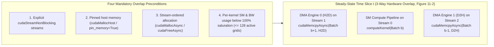
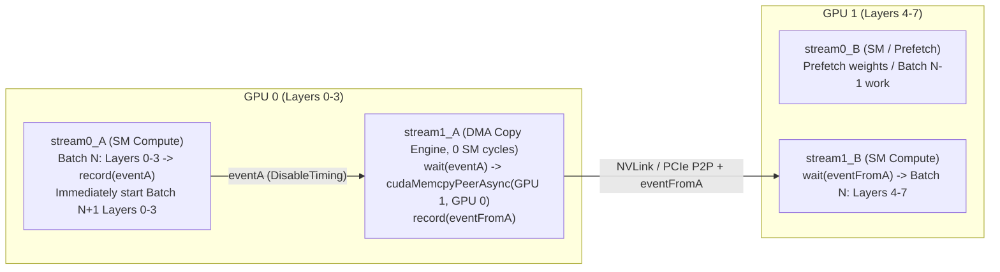
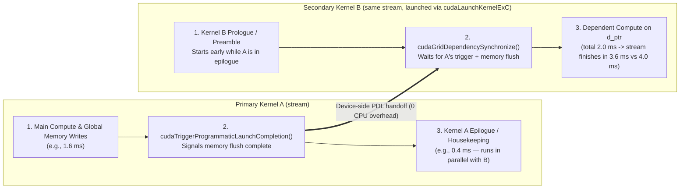

# 10.17 Inter-kernel pipelining, synchronization and stream-ordered allocation

| | |
|---|---|
| Level | Advanced |
| Priority tier | 2 |
| Lab venue | Nebius GPU |
| Part | Part 10: The GPU and CUDA |
| Sources used | *AI Systems Performance Engineering* (`ai-systems-performance-engineering`, Chris Fregly), Chapter 11 (*Inter-Kernel Pipelining, Synchronization, and CUDA Stream-Ordered Memory Allocations*) |
| Code | `code/part10/inter_kernel_pipelining.py`, `code/part10/inter_kernel_pipelining_lab.py` |
| Coverage file | `planning/coverage/chapters/10-17.md` |

## Why this matters for AI infrastructure

An individual kernel can reach nearly complete warp execution efficiency inside its own loop and still leave an AI cluster idle. Between kernels, the GPU often stalls waiting for host-to-device micro-batch transfers, blocking memory allocations, legacy default-stream barriers, or cross-GPU network copies. Training engineers and inference operators see these stalls as wide empty gaps on the Nsight Systems timeline and degraded token throughput.

Chapter 11 of *AI Systems Performance Engineering* extends intra-kernel pipelining into a full two-layer execution architecture that overlaps work inside and across kernels.

- Three-way overlap across compute engines and dual Direct Memory Access copy engines keeps the Streaming Multiprocessor compute pipelines. Both copy engines busy at the same time. Modern NVIDIA GPUs pair their compute pipelines with at least two copy engines and support up to 128 resident kernel grids. Enqueuing micro-batches across explicit non-blocking streams with pinned host memory and stream-ordered allocation overlaps current compute, next input staging, and prior output retrieval.
- Stream-ordered memory pools eliminate the global synchronization barriers caused by legacy blocking allocation and deallocation calls. Using `cudaMallocAsync` and `cudaFreeAsync` with a tuned pool release threshold allocates temporary attention scratch buffers and grows variable-length sequence workspaces without cross-stream stalls. It also feeds layerwise large language model pipelines across multiple streams on a single GPU.
- Two-layer pipelines combine intra-kernel warp specialization or Thread Block Clusters with inter-kernel CUDA Streams. Driving a three-role dual-pipeline kernel or a four-block clustered kernel across multiple streams hides host staging and stream-ordered allocation behind active kernel execution. This overlap still works even when cooperative cluster kernels serialize on the Streaming Multiprocessors.
- Multi-GPU peer-to-peer transfers, NCCL ring AllReduce, NIXL, and Programmatic Dependent Launch extend stream overlap across devices and across back-to-back kernels. Dedicated high-priority streams overlap peer Direct Memory Access on the copy engine. Low-occupancy NCCL collectives, and NIXL transfers, all of which can be captured into a CUDA Graph. Programmatic Dependent Launch lets a primary kernel trigger a dependent kernel as soon as its global memory writes flush. The prologue and epilogue overlap in the same stream.

| Architectural Layer | Key Mechanism | Primary Parameters and Figures | Model or Hardware Result |
|---|---|---|---|
| Three-way stream overlap | `cudaStreamNonBlocking`, `cudaMallocHost`, `pin_memory=True`, `asyncEngineCount >= 2` | Figure 11-1, Figure 11-2, 8 batches, max 128 resident grids | 36.0 ms serial to 18.16 ms overlapped, 1.98x speedup in `simulate_inter_kernel_stream_pipeline()` |
| Stream-ordered memory pool | `cudaMallocAsync`, `cudaFreeAsync`, `cudaMemPoolAttrReleaseThreshold`, `PYTORCH_ALLOC_CONF=backend:cudaMallocAsync` | Figure 11-3, threshold `prop.totalGlobalMem / 2` = 96 GiB on 192 GiB GPU, 16 MB = 16,777,216 B scratch | Sequence growth 512 to 1,024 tokens = 2.0x; layerwise split layers 0-5 on stream 0 and layers 6-11 on stream 1 |
| Two-layer warp and cluster streams | `warp_specialized_two_pipelines` and `launch_warp_specialized_cluster_pipeline_multistream` | `blockDim = 96`, `pipe_lc` + `pipe_cs`, `TILE_SIZE = 1,024` at 24,576 B or `TILE_SIZE = 128` at 196,608 B, 528 blocks | Overlaps H2D, D2H, and `cudaMallocAsync` across `NUM_STREAMS = 2` |
| Multi-GPU and PDL | `cudaMemcpyPeerAsync`, NCCL, `nixlCommStream`, `cudaTriggerProgrammaticLaunchCompletion`, `cudaGridDependencySynchronize` | Figure 11-8 with 4 GPUs and 4 chunks 1-4; Figure 11-9, Figure 11-10, Figure 11-11 | 0 SM cycles for peer DMA; PDL cuts 4.0 ms to 3.6 ms in `model_programmatic_dependent_launch()` |

:::note About the timings in this chapter
The stage timings and the Programmatic Dependent Launch figures in the table above come from small timeline models in `code/part10/inter_kernel_pipelining.py`. Those models use assumed stage durations such as 1.0 ms H2D. 2.0 ms compute, and 1.0 ms D2H to illustrate the diagrams in the book and are not GPU measurements. The book notes that its own metric tables are illustrative as well, and the CUDA listings reproduced from the book were not compiled here.
:::

## Prerequisites and outcomes

**Prerequisites:**

- Chapter 10.12 covering foundational CUDA Streams, CUDA Events, and pinned memory, plus Chapter 10.16 covering `<cuda/pipeline>`, three-role warp specialization, Cooperative Groups, and Thread Block Clusters.

**Outcomes — after completing this chapter you will be able to:**

1. Orchestrate concurrent kernels and three-way H2D, compute, and D2H pipelines across non-blocking streams, diagnose 50% resource-contention splits under saturation, and respect the 128-grid hardware concurrency limit.
2. Configure the stream-ordered memory allocator using `cudaMallocAsync`, `cudaFreeAsync`, `cudaMemPoolSetAttribute`, and `cudaMemPoolAttrReleaseThreshold` for temporary scratch buffers, growing token sequences, and layerwise pipelines.
3. Contrast the legacy default stream, the Per-Thread Default Stream, and explicit non-blocking streams, and coordinate streams with CUDA Events and deadlock-free `cudaLaunchHostFunc` callbacks.
4. Implement two-layer pipelining with dual-pipeline warp specialization and multi-stream Thread Block Clusters launched via `cudaLaunchKernelExC`.
5. Build multi-GPU pipeline and data-parallel overlap loops using peer asynchronous copies, high-priority NCCL ring AllReduce streams, NIXL communication streams, and global multi-stream graph capture.
6. Implement Programmatic Dependent Launch and combine it with Thread Block Clusters, warp specialization, and Blackwell Tensor Memory Accelerator reductions.

---

## 1. Overlapping Kernel Execution and 3-Way Data Transfers with CUDA Streams

### 1.1 Concurrent kernel dispatch and host interleaving (`Figure 11-1`)

When a training script launches every kernel into a single queue, small kernels that use only part of the GPU leave the remaining Streaming Multiprocessors idle. Worse, if the host waits for each launch before running CPU bookkeeping, host and device execution serialize completely. A CUDA Stream solves this problem by acting as an independent first-in, first-out queue of device operations.

Operations inside a single stream execute in strict issue order. Operations enqueued into different non-blocking streams can overlap on the GPU whenever hardware resources are free. As shown in Figure 11-1 of *AI Systems Performance Engineering* Chapter 11. Because kernel launches are asynchronous, control returns to the CPU immediately so host functions can run in parallel with device work.

| Parameter | Configuration | Detail |
|---|---|---|
| Total kernels launched | 5 kernels | `ker_1`, `ker_2`, `ker_3` on `stream1` and `ker_A`, `ker_B` on `stream2` |
| Launch geometry per kernel | `grid(128)` by `block(256)` | 32,768 threads per kernel launch |
| Interleaved host functions | `cpu_code_1()` and `cpu_code_2()` | Execute on the CPU while device streams run |

```cpp
// Launching 5 kernels across 2 non-blocking streams while interleaving CPU work (Figure 11-1)
// Source: AI Systems Performance Engineering, Chapter 11
#include <cstdio>
#include <cuda_runtime.h>

__global__ void ker_A() { /* ... device work ... */ }
__global__ void ker_B() { /* ... device work ... */ }
__global__ void ker_1() { /* ... device work ... */ }
__global__ void ker_2() { /* ... device work ... */ }
__global__ void ker_3() { /* ... device work ... */ }

void cpu_code_1() {}
void cpu_code_2() {}

int main() {
    // 1. Create two explicit non-blocking streams (do NOT sync with legacy stream 0)
    cudaStream_t stream1, stream2;
    cudaStreamCreateWithFlags(&stream1, cudaStreamNonBlocking);
    cudaStreamCreateWithFlags(&stream2, cudaStreamNonBlocking);

    dim3 grid(128), block(256); // 32,768 threads per launch

    // 2. Enqueue ker_1 on stream1; control returns immediately to CPU
    ker_1<<<grid, block, 0, stream1>>>();
    printf("CPU code 1 executing\n");
    cpu_code_1();

    // 3. Interleave launches across stream2 and stream1 + CPU code 2
    ker_A<<<grid, block, 0, stream2>>>();
    ker_B<<<grid, block, 0, stream1>>>();
    ker_2<<<grid, block, 0, stream2>>>();
    printf("CPU code 2 executing\n");
    cpu_code_2();
    ker_3<<<grid, block, 0, stream1>>>();

    // 4. Synchronize both streams and clean up
    cudaStreamSynchronize(stream1);
    cudaStreamSynchronize(stream2);
    cudaStreamDestroy(stream1);
    cudaStreamDestroy(stream2);
    return 0;
}
```

### 1.2 Three-way `H2D` / `Compute` / `D2H` overlap, hardware limits (`128` grids), and saturation contention (`Figure 11-2`)

In a naive inference or training loop, each micro-batch copies inputs from host to device. Runs the kernel, and copies outputs from device to host one after another. While the PCIe or NVLink bus transfers data, the Streaming Multiprocessors sit idle, and while the Streaming Multiprocessors compute, both directions of the bus sit idle. Over eight batches, this stop-and-go execution nearly doubles wall-clock latency.

Modern NVIDIA data-center GPUs provide at least two independent Direct Memory Access copy engines where `deviceProp.asyncEngineCount >= 2` alongside the Streaming Multiprocessor compute pipeline. One copy engine handles host-to-device transfers while the second copy engine handles device-to-host transfers, as illustrated in Figure 11-2 of *AI Systems Performance Engineering* Chapter 11. Pipelining micro-batches across three or more non-blocking streams keeps all three hardware engines busy during steady state.

- Stream 0 drives the Streaming Multiprocessor compute pipeline for the current micro-batch.
- Stream 1 drives copy engine 0 to run a host-to-device asynchronous copy for the next micro-batch from pinned host RAM into HBM.
- Stream 2 drives copy engine 1 to run a device-to-host asynchronous copy for the completed output of the previous micro-batch back to pinned host RAM.



Four physical and runtime rules govern whether multi-stream operations actually overlap on hardware.

1. Pinned host memory is mandatory for asynchronous `cudaMemcpyAsync` transfers. Passing a pageable pointer forces the CUDA driver to perform a synchronous CPU staging copy into an internal pinned buffer. Which blocks the calling CPU thread and serializes that stream. Always allocate host staging buffers with `cudaMallocHost` in C++ or set `pin_memory=True` in PyTorch.
2. Stream-ordered memory allocation is mandatory when buffers are allocated dynamically inside a multi-stream loop. Calling legacy `cudaMalloc` or `cudaFree` forces a device-wide synchronization across all streams on the GPU.
3. Resource saturation splits throughput evenly between contending streams. If a single kernel already consumes 100% of compute throughput. HBM bandwidth, launching a second kernel in another stream makes both kernels contend and run at 50% speed each.
4. Modern GPUs enforce a hard hardware limit of 128 concurrently executing kernel grids per device. Any kernel launches beyond 128 active grids wait in hardware queues. An active grid finishes, and co-resident kernels must fit within each Streaming Multiprocessor's register, shared memory, and block limits.

| Pipeline Scenario (`simulate_inter_kernel_stream_pipeline`, 8 Batches) | Stage Timings Assumed | Total Time | Speedup vs Serial |
|---|---|---|---|
| Serial baseline or blocking `cudaMalloc` | 1.0 ms H2D, 2.0 ms compute, 1.0 ms D2H, 0.5 ms sync `cudaMalloc` = 4.5 ms/batch | 36.0 ms | 1.00x |
| Overlapped with pageable host memory | 0.02 ms `cudaMallocAsync`, synchronous CPU staging on H2D/D2H | 32.16 ms | 1.12x |
| Overlapped with pinned host memory and `cudaMallocAsync` | Full 3-way overlap across `asyncEngineCount >= 2` | 18.16 ms | 1.98x |

---

## 2. The Stream-Ordered Memory Allocator (`cudaMallocAsync`) and LLM Scratch Pools

### 2.1 Tuning the device memory pool (`cudaMemPoolSetAttribute` & `PYTORCH_ALLOC_CONF`)

Dynamic deep learning workloads frequently allocate and free temporary tensors inside the training or inference loop. When a runtime falls back to OS-level blocking allocations, the driver halts every stream on the GPU to update page tables. Even PyTorch's default caching allocator, which is stream-aware on cache hits, synchronizes the entire device whenever a cache miss triggers a fresh allocation from the driver.

Exporting `PYTORCH_ALLOC_CONF=backend:cudaMallocAsync` switches PyTorch to CUDA's native stream-ordered memory allocator. This allocator processes allocation and deallocation calls as stream-ordered queue items inside a per-device memory pool `cudaMemPool_t`, reducing cross-stream fragmentation. When a tensor is freed asynchronously on stream A. Stream B can reuse that physical memory immediately after an event dependency without waiting for the rest of the GPU.

```bash
export PYTORCH_ALLOC_CONF=backend:cudaMallocAsync
```

In CUDA C++, you tune how much memory the default device pool retains before returning physical pages to the operating system by calling `cudaMemPoolSetAttribute` with `cudaMemPoolAttrReleaseThreshold`. Setting the threshold to half of total global memory retains up to 50% of total VRAM in the pool across asynchronous free calls. On a 192 GiB Blackwell B200 GPU, that threshold keeps 96 GiB cached in the pool so subsequent mini-batches never pay operating-system mapping overhead.

```cpp
// Stream-ordered memory pool configuration and 2-stream overlapped pipeline
// Source: AI Systems Performance Engineering, Chapter 11
#include <cuda_runtime.h>
#include <cstdint>

void runStreamOrderedPipeline(const float* h_data1, float* h_result1,
                              const float* h_data2, float* h_result2,
                              size_t N, dim3 gridDim, dim3 blockDim) {
    cudaMemPool_t pool;
    int device = 0;
    cudaGetDevice(&device);
    cudaDeviceGetDefaultMemPool(&pool, device);

    cudaDeviceProp prop{};
    cudaGetDeviceProperties(&prop, device);
    // Keep up to 50% of total VRAM (e.g., 96 GiB on a 192 GiB GPU) in the pool before releasing to OS
    uint64_t threshold = prop.totalGlobalMem / 2;
    cudaMemPoolSetAttribute(pool, cudaMemPoolAttrReleaseThreshold, &threshold);

    cudaStream_t stream1, stream2;
    cudaStreamCreateWithFlags(&stream1, cudaStreamNonBlocking);
    cudaStreamCreateWithFlags(&stream2, cudaStreamNonBlocking);

    void *d_data1 = nullptr, *d_result1 = nullptr;
    void *d_data2 = nullptr, *d_result2 = nullptr;
    size_t dataSizeBytes = N * sizeof(float);

    // 1. Stream-ordered allocations: zero cross-stream synchronization
    cudaMallocAsync(&d_data1, dataSizeBytes, stream1);
    cudaMallocAsync(&d_result1, dataSizeBytes, stream1);
    cudaMallocAsync(&d_data2, dataSizeBytes, stream2);
    cudaMallocAsync(&d_result2, dataSizeBytes, stream2);

    // 2. Stream 1: H2D -> Kernel -> D2H
    cudaMemcpyAsync(d_data1, h_data1, dataSizeBytes, cudaMemcpyHostToDevice, stream1);
    // computeKernel<<<gridDim, blockDim, 0, stream1>>>((float*)d_data1, (float*)d_result1);
    cudaMemcpyAsync(h_result1, d_result1, dataSizeBytes, cudaMemcpyDeviceToHost, stream1);

    // 3. Stream 2 overlaps concurrently: H2D -> Kernel -> D2H
    cudaMemcpyAsync(d_data2, h_data2, dataSizeBytes, cudaMemcpyHostToDevice, stream2);
    // computeKernel<<<gridDim, blockDim, 0, stream2>>>((float*)d_data2, (float*)d_result2);
    cudaMemcpyAsync(h_result2, d_result2, dataSizeBytes, cudaMemcpyDeviceToHost, stream2);

    // 4. Stream-ordered frees enqueued before host synchronization
    cudaFreeAsync(d_data1, stream1);
    cudaFreeAsync(d_result1, stream1);
    cudaFreeAsync(d_data2, stream2);
    cudaFreeAsync(d_result2, stream2);

    cudaStreamSynchronize(stream1);
    cudaStreamSynchronize(stream2);
    cudaStreamDestroy(stream1);
    cudaStreamDestroy(stream2);
}
```

### 2.2 Three LLM workloads that depend on `cudaMallocAsync` (`Figure 11-3`)

Large language model serving and training engines allocate scratch memory whose size changes from batch to batch and step to step. When a serving engine uses blocking allocations for these buffers, a single sequence-length jump stalls every concurrent stream on the GPU. Figure 11-3 of *AI Systems Performance Engineering* Chapter 11 and `plan_stream_ordered_pool()` in `code/part10/inter_kernel_pipelining.py` show three places where `cudaMallocAsync` preserves full overlap.

| LLM Runtime Pattern | Why Dynamic Allocation Occurs | What Happens with Legacy `cudaMalloc` | What Happens with `cudaMallocAsync` |
|---|---|---|---|
| 1. Per-batch attention scratch buffers (`16 MB` workspace, Figure 11-3) | Each Transformer mini-batch requires temporary scratch memory of 16 MB = 16,777,216 bytes for pre-softmax attention scores, layer norm, or intermediate activations. | Calling `cudaMalloc` on `stream1` forces a global barrier across the GPU, stalling `stream0`'s in-flight attention kernel. | `cudaMallocAsync(&scratchPtr, 16 * 1024 * 1024, stream1)` appends a queue item to `stream1`; `stream0` continues executing uninterrupted. |
| 2. Variable-length sequence batches (`512` to `1,024` tokens) and growing decode KV caches | When Batch N has 512 tokens per sequence and Batch N + 1 has 1,024 tokens per sequence for a 2.0x growth, or as autoregressive decode appends K/V vectors, the previous buffer is too small. | Reallocating the larger buffer via `cudaMalloc` halts all concurrent H2D prompt staging and D2H token streaming. | `cudaMallocAsync` reserves the 2.0x larger buffer inside the active stream while upstream H2D and downstream D2H streams run in parallel. |
| 3. Layerwise pipeline parallelism across streams (`layers 0-5` vs `layers 6-11`) | A 12-layer Transformer block is split on one GPU so `stream 0` runs layers 0-5 and `stream 1` runs layers 6-11, handing off intermediate activation buffers between halves. | Allocating the next batch's activation buffer after `stream 0` finishes layers 0-5 pauses `stream 1`'s execution of layers 6-11. | `stream 0` calls `cudaMallocAsync` for the next micro-batch's activations while `stream 1` simultaneously computes layers 6-11 on the prior batch. |

---

## 3. Default vs. Explicit Streams, Per-Thread Default Streams (`PTDS`), Events, and Host Callbacks

### 3.1 Comparing Legacy Default Stream (`stream 0`), `PTDS`, and Explicit Non-Blocking Streams (`Figure 11-4`)

A single stray CUDA call that omits its stream argument can silently destroy multi-stream concurrency across an entire application. By default, omitting the stream argument sends work to the legacy default stream, which acts as a global bidirectional barrier against every blocking stream on the GPU. Engineers debugging Nsight Systems traces recognize this bug immediately when all active streams stop at a vertical wall before and after a tiny helper kernel.

CUDA provides three distinct stream behaviors depending on how streams are created. Whether Per-Thread Default Streams are enabled, as shown in Figure 11-4 of *AI Systems Performance Engineering* Chapter 11.

| Stream Type | Creation or Activation Flag | Self-Ordering | Cross-Stream Synchronization Behavior | Production Recommendation |
|---|---|---|---|---|
| Legacy Default Stream (`stream 0` / `cudaStreamLegacy`) | Default when PTDS is not enabled and stream is omitted or `0`. | Strictly FIFO within `stream 0`. | Global bidirectional barrier: any command issued to `stream 0` waits for all prior work in every blocking stream across the GPU to finish, and blocks all subsequent work in those streams until `stream 0` finishes. | Never launch performance-critical kernels or copies on `stream 0`; keep `stream 0` completely idle during training and inference loops. |
| Per-Thread Default Stream (PTDS / `cudaStreamPerThread`, Figure 11-4) | Compile with `nvcc --default-stream per-thread` or `#define CUDA_API_PER_THREAD_DEFAULT_STREAM 1` before CUDA headers. | Strictly FIFO within each CPU thread's private default stream. | Private per host thread: Thread A's default stream never waits on or blocks Thread B's default stream or explicit streams, though it still synchronizes with `cudaStreamLegacy` if mixed. | Enable in multi-threaded C++ runtimes so third-party libraries omitting stream arguments do not serialize across CPU threads. |
| Explicit Non-Blocking Stream (`cudaStreamNonBlocking`) | `cudaStreamCreateWithFlags(&s, cudaStreamNonBlocking)` | Strictly FIFO within stream `s`. | Completely independent: never implicitly synchronizes with `stream 0` (`cudaStreamLegacy`) or any other stream; synchronizes only when explicitly instructed via `cudaStreamWaitEvent`. | Create named non-blocking streams for all compute, H2D, D2H, P2P, and NCCL or NIXL queues. |

### 3.2 Fine-grained cross-stream events (`Figures 11-5 to 11-7`) and the `cudaLaunchHostFunc` deadlock rule

```text
When one stream produces tensors that another stream consumes, using host-blocking calls such as `cudaDeviceSynchronize()` or `cudaStreamSynchronize()` stalls the CPU and drains unrelated GPU queues. Producer-consumer pipelines need a way to enforce ordering on the GPU hardware scheduler without stopping the host thread or unrelated streams. Figures 11-5 through 11-7 in *AI Systems Performance Engineering* Chapter 11 contrast coarse host synchronization against fine-grained CUDA Events.
```

- Device-wide synchronization via `cudaDeviceSynchronize()` blocks the calling CPU thread until every stream across the entire GPU drains to completion. Never call it inside a hot training or inference loop.
- Single-stream host synchronization in Figure 11-5 blocks the calling CPU thread until all operations in that specific stream complete. Reserve it for epoch boundaries or final cleanup.
- Event-based stream synchronization in Figures 11-6. 11-7 pairs `cudaEventRecord` on the producer stream with `cudaStreamWaitEvent` on the consumer stream and returns control to the CPU immediately. Only the consumer stream waits on the GPU hardware scheduler until the producer stream reaches the recorded event, while all other GPU streams continue at full speed.
- Disabling event timestamps via `cudaEventDisableTiming` strips timestamp-recording overhead whenever an event is used purely for cross-stream ordering rather than elapsed-time measurement.

Sometimes the CPU needs to recycle a custom host memory buffer as soon as a GPU stream completes a kernel without spinning on an event query. Blocking on stream synchronization. You can enqueue a host function on the stream by calling `cudaLaunchHostFunc(stream, myHostCallback, userData)`. Never invoke any device-side CUDA API such as a memory copy, allocation, or kernel launch from inside that host callback. Because the callback runs on an internal CUDA runtime thread. The stream waits for the callback to return, calling a CUDA API inside the callback creates a circular wait and deadlocks the application.

---

## 4. Two-Layer Pipelining: Intra-Kernel Warp Specialization + Inter-Kernel CUDA Streams + Thread Block Clusters

### 4.1 Layering dual-pipeline 3-role warp specialization with CUDA streams (`warp_specialized_two_pipelines`)

A single pipeline object inside a thread block overlaps global-to-shared loads with compute. But the compute warp and storer warp still contend if they share a single stage barrier. In addition, a single kernel launch still pays host-to-device and device-to-host transfer latency between batches. Combining a dual-pipeline three-role warp-specialized kernel with multiple CUDA Streams solves both bottlenecks at once.

```text
In *AI Systems Performance Engineering* Chapter 11, `warp_specialized_two_pipelines` launches 3 warps per block with 96 threads: warp 0 is the loader, warp 1 is the compute warp, and warp 2 is the storer. The block coordinates those three roles using two independent two-stage block-scoped pipelines. First, `pipe_lc` connects the loader to the compute warp with depth 2 for asynchronous vectorized loads from HBM into shared memory. Second, `pipe_cs` connects the compute warp to the storer warp with depth 2 so computed tiles hand off cleanly while the next tile computes.
```

```text
1D tile size:          TILE_SIZE = 1,024 floats per buffer
Alignment guard:       static_assert((TILE_SIZE % (32 * 4)) == 0)
Warp copy step:        32 lanes * 4 floats (sizeof(float4) = 16 B/lane) = 128 floats = 512 B (four 128-byte cache lines)
Shared memory layout:  2 stages * 3 buffers [A0 | B0 | C0 | A1 | B1 | C1] * 1,024 floats * 4 B
                       = 6 * 1,024 * 4 = 24,576 bytes (24.0 KiB << 227,328 bytes Blackwell dynamic SMEM limit)
Host stream driver:    NUM_STREAMS = 2, BATCHES = 8, prefetching next = tile + gridDim.x
```

Here is the complete device kernel and multi-stream host driver from *AI Systems Performance Engineering* Chapter 11.

```cpp
// Two-level pipeline: Intra-kernel 3-role dual-pipeline (pipe_lc + pipe_cs)
// driven across Inter-kernel non-blocking CUDA streams + cudaMallocAsync
// Source: AI Systems Performance Engineering, Chapter 11
#include <cstdio>
#include <cuda_runtime.h>
#include <cooperative_groups.h>
#include <cuda/pipeline>

namespace cg = cooperative_groups;

// shmem_bytes = 2 (stages) * 3 (buffers) * 1,024 * 4 B = 24,576 B (24 KiB << 227 KB SMEM)
#define TILE_SIZE 1024
#define NUM_STREAMS 2
#define BATCHES 8

static_assert((TILE_SIZE % (32 * 4)) == 0,
              "TILE_SIZE must be a multiple of 128 (32 lanes * 4 floats) for float4 vectorization");

__global__ void warp_specialized_two_pipelines(const float* __restrict__ A_global,
                                               const float* __restrict__ B_global,
                                               float* __restrict__ C_global,
                                               int numTiles) {
    cg::thread_block cta = cg::this_thread_block();
    // Stage s in {0, 1}: [A_s | B_s | C_s], each of length TILE_SIZE (total 6 * TILE_SIZE floats)
    extern __shared__ float shared_mem[];

    using pipe_state = cuda::pipeline_shared_state<cuda::thread_scope_block, 2>;
    __shared__ alignas(pipe_state) unsigned char state_lc_storage[sizeof(pipe_state)];
    __shared__ alignas(pipe_state) unsigned char state_cs_storage[sizeof(pipe_state)];
    auto* state_lc = reinterpret_cast<pipe_state*>(state_lc_storage);
    auto* state_cs = reinterpret_cast<pipe_state*>(state_cs_storage);
    if (threadIdx.x == 0) {
        new (state_lc) pipe_state();
        new (state_cs) pipe_state();
    }
    cta.sync();

    auto pipe_lc = cuda::make_pipeline(cta, state_lc); // loader -> compute (depth 2)
    auto pipe_cs = cuda::make_pipeline(cta, state_cs); // compute -> storer (depth 2)

    const int warp_id = threadIdx.x >> 5; // 0 = loader, 1 = compute, 2 = storer
    const int lane_id = threadIdx.x & 31;
    auto warp = cg::tiled_partition<32>(cta);

    for (int tile = blockIdx.x; tile < numTiles; tile += gridDim.x) {
        const int stage = tile & 1;
        const size_t offset = static_cast<size_t>(tile) * TILE_SIZE;
        float* A_buf = shared_mem + stage * 3 * TILE_SIZE;
        float* B_buf = A_buf + TILE_SIZE;
        float* C_buf = B_buf + TILE_SIZE;

        // 1. Loader warp (warp 0) stages A_buf and B_buf using 16B float4 vectorized memcpy_async
        pipe_lc.producer_acquire();
        if (warp_id == 0) {
            #pragma unroll
            for (int chunk = 0; chunk < TILE_SIZE; chunk += 32 * 4) {
                cuda::memcpy_async(warp,
                    reinterpret_cast<float4*>(A_buf + chunk) + lane_id,
                    reinterpret_cast<const float4*>(A_global + offset + chunk) + lane_id,
                    sizeof(float4), pipe_lc);
                cuda::memcpy_async(warp,
                    reinterpret_cast<float4*>(B_buf + chunk) + lane_id,
                    reinterpret_cast<const float4*>(B_global + offset + chunk) + lane_id,
                    sizeof(float4), pipe_lc);
            }
        }
        pipe_lc.producer_commit();

        // 2. Wait for loader stage and compute C_buf = A_buf + B_buf in warp 1
        pipe_lc.consumer_wait();
        cta.sync();
        if (warp_id == 1) {
            #pragma unroll
            for (int chunk = 0; chunk < TILE_SIZE; chunk += 32) {
                C_buf[chunk + lane_id] = A_buf[chunk + lane_id] + B_buf[chunk + lane_id];
            }
        }
        cta.sync();
        pipe_lc.consumer_release();

        // 3. Handoff computed C_buf from compute (warp 1) to storer (warp 2) via pipe_cs
        pipe_cs.producer_acquire();
        pipe_cs.producer_commit();
        pipe_cs.consumer_wait();
        cta.sync();
        if (warp_id == 2) {
            #pragma unroll
            for (int chunk = 0; chunk < TILE_SIZE; chunk += 32) {
                C_global[offset + chunk + lane_id] = C_buf[chunk + lane_id];
            }
        }
        cta.sync();
        pipe_cs.consumer_release();
    }
}

void runTwoPipelineMultistreamHost() {
    cudaStream_t s[NUM_STREAMS];
    for (int i = 0; i < NUM_STREAMS; ++i)
        cudaStreamCreateWithFlags(&s[i], cudaStreamNonBlocking);

    const size_t bytesPerBatch = TILE_SIZE * sizeof(float);
    float *hA = nullptr, *hB = nullptr, *hC = nullptr;
    cudaMallocHost(&hA, BATCHES * bytesPerBatch); // pinned host memory
    cudaMallocHost(&hB, BATCHES * bytesPerBatch);
    cudaMallocHost(&hC, BATCHES * bytesPerBatch);

    for (int b = 0; b < BATCHES; ++b) {
        cudaStream_t st = s[b % NUM_STREAMS];
        float *dA = nullptr, *dB = nullptr, *dC = nullptr;
        cudaMallocAsync(&dA, bytesPerBatch, st);
        cudaMallocAsync(&dB, bytesPerBatch, st);
        cudaMallocAsync(&dC, bytesPerBatch, st);

        cudaMemcpyAsync(dA, hA + size_t(b) * TILE_SIZE, bytesPerBatch, cudaMemcpyHostToDevice, st);
        cudaMemcpyAsync(dB, hB + size_t(b) * TILE_SIZE, bytesPerBatch, cudaMemcpyHostToDevice, st);

        const dim3 block(96), grid(1); // 3 warps per block
        const size_t shmem = 6 * TILE_SIZE * sizeof(float); // 24,576 bytes
        warp_specialized_two_pipelines<<<grid, block, shmem, st>>>(dA, dB, dC, /*numTiles=*/1);

        cudaMemcpyAsync(hC + size_t(b) * TILE_SIZE, dC, bytesPerBatch, cudaMemcpyDeviceToHost, st);
        cudaFreeAsync(dA, st);
        cudaFreeAsync(dB, st);
        cudaFreeAsync(dC, st);
    }

    for (int i = 0; i < NUM_STREAMS; ++i) {
        cudaStreamSynchronize(s[i]);
        cudaStreamDestroy(s[i]);
    }
    cudaFreeHost(hA); cudaFreeHost(hB); cudaFreeHost(hC);
}
```

### 4.2 Combining Thread Block Clusters, Warp Specialization, and CUDA Streams (`launch_warp_specialized_cluster_pipeline_multistream`)

Full-device cooperative and clustered kernels often reserve every Streaming Multiprocessor on the GPU at once. Because no free Streaming Multiprocessors remain, a second cooperative cluster kernel launched on another stream cannot co-reside on the compute engines at the exact same moment. Engineers often assume that multi-stream execution is useless for full-grid cluster kernels, leaving host transfers and memory allocations exposed between runs.

Even when cooperative cluster kernels serialize on the Streaming Multiprocessors, driving them across two streams via `launch_warp_specialized_cluster_pipeline_multistream` still overlaps all non-compute stages. While Stream 0 executes its cluster kernel on the Streaming Multiprocessors, Stream 1 runs stream-ordered allocations and stages the next micro-batch into HBM via host-to-device asynchronous copy. At the same time, Stream 0 streams the completed output of the previous micro-batch back to the host and frees its buffers asynchronously.

```text
Cluster kernel:       warp_specialized_cluster_pipeline
Tile geometry:        TILE_SIZE = 128, TILE_ELEMS = 16,384 floats, 32 rows per CTA
Shared memory / CTA:  shmemBytes = 3 * 16,384 * 4 = 196,608 bytes (192 KiB < 227,328 B dynamic SMEM limit)
Cluster launch grid:  CLUSTER_BLOCKS = 4, blocksPerGrid = prop.multiProcessorCount * 4 = 132 * 4 = 528 blocks
Block and stream cfg: blockDim = 96 (3 warps), NUM_STREAMS = 2
Host launch API:      cudaLaunchKernelExC with cudaLaunchConfig_t (cfg.stream = st, cfg.dynamicSmemBytes = 196608)
Launch attributes:    2 attributes: cudaLaunchAttributeClusterDimension = dim3(4, 1, 1)
                      and cudaLaunchAttributeNonPortableClusterSizeAllowed = 1
Kernel handle lookup: cudaGetKernel(&k, warp_specialized_cluster_pipeline)
```

Once a simpler double-buffered kernel and multi-stream pipeline already saturate HBM bandwidth. Hide host-to-device latency, adding three-role warp specialization and Thread Block Clusters yields only a few extra percentage points of utilization. Reserve the full three-layer combination for ultra-latency-sensitive inference kernels where every microsecond of tile handoff matters.

---

## 5. Multi-GPU Compute, P2P (`cudaMemcpyPeerAsync`), `NCCL` Ring All-Reduce, `NIXL`, and `CUDA Graph` Stream Capture

### 5.1 Multi-GPU pipeline parallelism (`cudaMemcpyPeerAsync`) and data parallelism (`NCCL` & `NIXL`, `Figure 11-8`)

In multi-GPU training and inference, running peer-to-peer activation transfers. Gradient reductions on the same stream as forward and backward compute stalls every GPU at every layer boundary. A pipeline-parallel stage on GPU 0 sits idle while its activations cross NVLink to GPU 1. And data-parallel backward passes wait for ring AllReduce collectives to finish before starting the next layer. Separating compute and communication onto dedicated streams across GPUs lets compute engines and network engines run simultaneously.



*AI Systems Performance Engineering* Chapter 11 details three multi-GPU overlap patterns across NVLink, PCIe, and RDMA interconnects.

```text
1. Two-GPU pipeline parallelism splits Layers 0-3 onto GPU 0 and Layers 4-7 onto GPU 1. On GPU 0, the compute stream runs `myTransformerLayers0to3`, records an event with timing disabled, and immediately starts the next micro-batch. Meanwhile, the communication stream waits on that event, calls `cudaMemcpyPeerAsync` to push activations to GPU 1, and records a completion event for GPU 1's compute stream to wait on before running `myTransformerLayers4to7`. Because peer copy executes on GPU 0's copy engine using 0 SM cycles, GPU 0 computes the next batch at 100% speed during the transfer.
```
```text
2. Multi-GPU data parallelism overlaps backward compute with NCCL ring AllReduce collectives, shown in Figure 11-8 across 4 GPUs and 4 contiguous tensor chunks labeled Chunks 1-4. Unlike peer Direct Memory Access copies, NCCL collectives run as device kernels on Streaming Multiprocessors, but they are tuned as low-occupancy kernels that saturate link bandwidth using only a few thread blocks or offload reductions to NVIDIA SHARP switch hardware. Frameworks launch `ncclAllReduce` on a dedicated high-priority communication stream coordinated via CUDA Events so backward compute overlaps gradient communication.
```
3. Disaggregated prefill and decode KV-cache transfers use the NVIDIA Inference Xfer Library NIXL on a dedicated high-priority `nixlCommStream`. NIXL replaces manual peer copies with chunked. Pipelined transfers across NVLink, GPUDirect RDMA, and NVMe storage so high-priority copy commands preempt lower-priority queues without consuming upfront Streaming Multiprocessor resources.

### 5.2 Capturing a multi-stream iteration into a `CUDA Graph` (`cudaStreamCaptureModeGlobal`)

Even when compute and NCCL streams overlap on the GPU. Launching dozens of small kernels, events, and collective calls from Python every step can still bottleneck on host CPU driver overhead. Capturing the entire multi-stream DAG into a single CUDA Graph removes that CPU launch overhead while preserving every cross-stream overlap edge.

To capture across multiple streams, begin capture on the primary stream using `cudaStreamCaptureModeGlobal`. Fork work onto secondary streams with CUDA Events, and join all secondary streams back into the primary stream before calling `cudaStreamEndCapture`. Once instantiated, a single cudaGraphLaunch call replays the entire multi-stream compute and communication step.

```cpp
// Capturing a multi-stream compute + NCCL communication DAG into a single CUDA Graph
// Source: AI Systems Performance Engineering, Chapter 11
cudaGraph_t graph;
// CRITICAL: Use cudaStreamCaptureModeGlobal when capturing across multiple streams (streamA + streamB)
cudaStreamBeginCapture(streamA, cudaStreamCaptureModeGlobal);

computeGradientsLayer1<<<grid, block, 0, streamA>>>(/* ... */);
cudaEventRecord(ev1, streamA);
cudaStreamWaitEvent(streamB, ev1, 0);
ncclAllReduce(grad1, grad1, count1, ncclFloat, ncclSum, comm, streamB);

computeGradientsLayer2<<<grid, block, 0, streamA>>>(/* ... */);
cudaEventRecord(ev2, streamA);
cudaStreamWaitEvent(streamB, ev2, 0);
ncclAllReduce(grad2, grad2, count2, ncclFloat, ncclSum, comm, streamB);

cudaStreamWaitEvent(streamA, evAllDone, 0); // rejoin streamB into streamA before ending capture
cudaStreamEndCapture(streamA, &graph);
```

---

## 6. Programmatic Dependent Launch (`PDL`) and Combining `PDL` + Thread Block Clusters + Warp Specialization

### 6.1 Overlapping Kernel B's prologue with Kernel A's epilogue in the same stream (`Figure 11-9`)

Normally, two kernels enqueued into the same CUDA Stream execute strictly back-to-back. The hardware scheduler will not start the secondary kernel on any Streaming Multiprocessor until every thread block of the primary kernel has finished its epilogue and exited. During the tail wave of the primary kernel, most Streaming Multiprocessors sit idle while the secondary kernel waits behind the stream boundary.

Programmatic Dependent Launch, supported on Hopper. Blackwell GPUs, breaks that strict boundary inside a single stream without CPU intervention, as shown in Figure 11-9 of *AI Systems Performance Engineering* Chapter 11. As soon as the primary kernel finishes writing the global memory data that the secondary kernel needs, the primary kernel signals the hardware command processor. The GPU immediately starts the secondary kernel's non-dependent prologue on free Streaming Multiprocessors while the primary kernel finishes its remaining epilogue work.



Implementing Programmatic Dependent Launch requires a three-part contract across the primary kernel, the secondary kernel, and the host launch.

1. In the primary kernel, call `cudaTriggerProgrammaticLaunchCompletion()` once all global memory writes needed by the secondary kernel are complete. This call flushes global writes and signals the hardware scheduler that the secondary kernel may launch while the primary kernel executes its epilogue.
2. In the secondary kernel, execute any independent preamble or constant setup first, then call `cudaGridDependencySynchronize()` before reading any global memory written by the primary kernel.
3. On the host, configure the secondary kernel's launch configuration with `cudaLaunchAttributeProgrammaticStreamSerialization` set to 1, and enqueue the launch via `cudaLaunchKernelExC`.

| Execution Mode (`model_programmatic_dependent_launch`) | Primary Main + Epilogue | Secondary Duration | Total Stream Time | Time Saved |
|---|---|---|---|---|
| Standard back-to-back stream serialization | 1.6 ms main + 0.4 ms epilogue | 2.0 ms after epilogue finishes | 4.0 ms | 0.0 ms |
| Programmatic Dependent Launch enabled | 1.6 ms main + 0.4 ms overlapped epilogue | 2.0 ms starting at 1.6 ms mark | 3.6 ms | 0.4 ms |

### 6.2 Combining `PDL` + Thread Block Clusters (`__cluster_dims__(2,1,1)`) + Warp Specialization (`primary_gemm` → `secondary_gemm`, `Figures 11-10 & 11-11`)

```text
High-throughput inference pipelines often chain two matrix multiplications back-to-back, such as the up-projection and down-projection in a Transformer MLP block. Running those two GEMM kernels without intra-kernel, inter-block, and inter-kernel overlap leaves memory buses idle during compute and Streaming Multiprocessors idle during kernel handoffs. Figures 11-10 and 11-11 in *AI Systems Performance Engineering* Chapter 11 combine Programmatic Dependent Launch, Thread Block Clusters, and warp specialization in a `primary_gemm` to `secondary_gemm` pipeline.
```

Each kernel uses the compile-time attribute `__cluster_dims__(2, 1, 1)` to co-schedule pairs of thread blocks within a Graphics Processing Cluster and synchronize them via cluster barrier instructions. Inside each block, producer warps stage tiles into shared memory while consumer warps compute matrix-multiply-accumulate instructions. On Blackwell GPUs, producer warps pair descriptor-based Tensor Memory Accelerator multicast `cp.async.bulk.tensor` with descriptor-based Tensor Memory Accelerator reductions `cp.reduce.async.bulk.tensor` to fuse small reductions directly into the copy engine and lower register pressure.

```text
Cluster dimension:     __cluster_dims__(2, 1, 1) (2 CTAs per cluster)
Tile dimensions:       TILE_M = 128, TILE_K = 128, TILE_N = 128 (16,384 floats per tile)
Static shared memory:  tileA[128 * 128] (65,536 B) + tileB[128 * 128] (65,536 B)
                       = 2 * 16,384 * 4 B = 131,072 bytes (128 KiB) per CTA
Inter-kernel handoff:  primary_gemm calls cudaTriggerProgrammaticLaunchCompletion() after cluster.sync()
                       secondary_gemm calls cudaGridDependencySynchronize() before consuming C
```

```cpp
// Combining Programmatic Dependent Launch (PDL), Thread Block Clusters (__cluster_dims__(2,1,1)),
// and Warp Specialization in primary_gemm -> secondary_gemm
// Source: AI Systems Performance Engineering, Chapter 11
#include <cstdio>
#include <cuda_runtime.h>
#include <cuda_runtime_api.h>
#include <cooperative_groups.h>
#include <cuda/barrier>
#include <cuda/pipeline>

namespace cg = cooperative_groups;

constexpr int TILE_M = 128;
constexpr int TILE_K = 128;
constexpr int TILE_N = 128; // tileA + tileB = 2 * 16,384 * 4 B = 131,072 B (128 KiB) SMEM

__device__ void do_compute(const float* tileA, const float* tileB, float* C) {}

__global__ __cluster_dims__(2, 1, 1) // Compile-time cluster of 2 CTAs
void primary_gemm(const float* __restrict__ A,
                  const float* __restrict__ B,
                  float* __restrict__ C,
                  int M, int N, int K) {
    cg::cluster_group cluster = cg::this_cluster();
    cg::thread_block cta = cg::this_thread_block();

    int tid = threadIdx.x + threadIdx.y * blockDim.x;
    int warpId = tid / warpSize;
    const int numProducerWarps = 1;

    __shared__ float tileA[TILE_M * TILE_K];
    __shared__ float tileB[TILE_K * TILE_N];
    __shared__ cuda::pipeline_shared_state<cuda::thread_scope_block, 1> pipe_state;
    auto pipe = cuda::make_pipeline(cta, &pipe_state);
    auto warp = cg::tiled_partition<32>(cta);

    // 1. CTA-uniform pipeline acquire; producer warp issues async copies
    pipe.producer_acquire();
    if (warpId < numProducerWarps) {
        cuda::memcpy_async(warp, tileA, A, TILE_M * TILE_K * sizeof(float), pipe);
        cuda::memcpy_async(warp, tileB, B, TILE_K * TILE_N * sizeof(float), pipe);
    }
    pipe.producer_commit();
    cta.sync();
    pipe.consumer_wait();

    // 2. Compute on the staged tile and synchronize across the 2-CTA cluster
    do_compute(tileA, tileB, C);
    cluster.sync();

    // 3. Signal dependent secondary_gemm via PDL that main writes/flushes are complete
    cudaTriggerProgrammaticLaunchCompletion();

    // 4. Remaining epilogue work runs concurrently with secondary_gemm's startup
}

__global__ __cluster_dims__(2, 1, 1)
void secondary_gemm(const float* __restrict__ A,
                    const float* __restrict__ B,
                    float* __restrict__ C,
                    int M, int N, int K) {
    // Wait for primary_gemm's PDL signal and global memory flush before reading shared data
    cudaGridDependencySynchronize();
    // Proceed with warp-specialized cluster GEMM on the dependent layer/tile...
}
```

---

## 7. Commands and Configurations That Matter

Without the right compiler flags and profiler tracing options, multi-threaded applications silently serialize on the legacy default stream and stream overlap bugs remain invisible. All commands below follow *AI Systems Performance Engineering* Chapter 11. Shell commands that require an attached Hopper or Blackwell GPU are marked untested here.

### 7.1 Enable Per-Thread Default Streams (`PTDS`), compile `PDL` + Cluster kernels, and trace multi-stream overlap in `nsys` (untested here)

Use `--default-stream per-thread` during compilation to isolate default streams per host thread. Export the stream-ordered allocator configuration for PyTorch workloads, and run Nsight Systems to inspect multi-stream overlap on the timeline.

```bash
# 1. Compile with Per-Thread Default Stream (PTDS) enabled and Hopper/Blackwell arch (untested here)
nvcc -O3 -std=c++20 -arch=sm_100a --default-stream per-thread -lineinfo \
     pdl_cluster_gemm.cu -o pdl_cluster_gemm

# 2. Enable CUDA's stream-ordered memory allocator in PyTorch (untested here)
export PYTORCH_ALLOC_CONF=backend:cudaMallocAsync

# 3. Trace multi-stream H2D/Compute/D2H overlap, cudaMallocAsync, NCCL, and PDL in Nsight Systems (untested here)
nsys profile --trace=cuda,nvtx,osrt --sample=none -o multistream_pdl_report ./pdl_cluster_gemm
nsys stats multistream_pdl_report.nsys-rep
```

---

## 8. How It Fails: Six Multi-Stream, Allocator, Callback, and `PDL` Failure Modes

When a multi-stream pipeline runs slower than expected or hangs in production, the root cause almost always traces back to one of six synchronization or memory-staging mistakes. The table below pairs each failure mode with its profiler symptom, root cause, and fix.

| # | Failure Mode | Production or Profiler Symptom | Root Cause | Fix |
|---|---|---|---|---|
| 1 | Stray operations on the legacy default stream (`stream 0`) | Nsight Systems timeline shows all `stream1` and `stream2` kernels and `cudaMemcpyAsync` transfers stopping at a wall before and after a single helper kernel. | A kernel or copy was launched without an explicit stream into `cudaStreamLegacy` / `stream 0`, or custom streams were created with blocking `cudaStreamCreate` instead of `cudaStreamNonBlocking`. | Create all streams with `cudaStreamCreateWithFlags(&s, cudaStreamNonBlocking)`, pass explicit streams to every CUDA, cuBLAS, and NCCL call, and compile multi-threaded apps with `--default-stream per-thread`. |
| 2 | Passing pageable host memory to `cudaMemcpyAsync` | `cudaMemcpyAsync` blocks the host CPU thread and fails to overlap with kernel execution on that stream, degrading our 8-batch model from 18.16 ms to 32.16 ms. | DMA engines require physical page-locked host addresses; pageable memory forces a synchronous CPU staging copy into a temporary pinned buffer. | Allocate host staging buffers with `cudaMallocHost` or `cudaHostAlloc` in C++ or set `pin_memory=True` on PyTorch `DataLoader`. |
| 3 | Calling blocking `cudaMalloc` or `cudaFree` inside a multi-stream or multi-GPU loop | Variable-length LLM batches growing from 512 to 1,024 tokens or 16 MB scratch allocations cause periodic multi-millisecond bubbles across all streams. | Legacy `cudaMalloc` and `cudaFree` synchronize the entire GPU device before returning, as shown in Figure 11-3. | Replace with `cudaMallocAsync` and `cudaFreeAsync`, set `cudaMemPoolAttrReleaseThreshold` to `prop.totalGlobalMem / 2`, and export `PYTORCH_ALLOC_CONF=backend:cudaMallocAsync`. |
| 4 | Calling device CUDA APIs inside a `cudaLaunchHostFunc` callback | Application deadlocks permanently inside the CUDA runtime when a stream reaches a registered host callback. | The callback runs on an internal CUDA runtime thread while the stream waits for the callback to finish; invoking `cudaMemcpy` or a kernel launch inside the callback creates a circular wait. | Restrict `cudaLaunchHostFunc` callbacks strictly to pure CPU operations such as recycling host memory or notifying a CPU worker thread. |
| 5 | Using default capture mode instead of `cudaStreamCaptureModeGlobal` across multi-stream NCCL and compute | `cudaStreamEndCapture` fails or omits cross-stream `ncclAllReduce` operations enqueued on `streamB` when capturing from `streamA`. | Without `cudaStreamCaptureModeGlobal` and event fork-join edges via `cudaEventRecord` and `cudaStreamWaitEvent`, multi-stream operations are not captured into the unified graph. | Begin capture with `cudaStreamBeginCapture(streamA, cudaStreamCaptureModeGlobal)` and fork and join `streamB` into `streamA` using CUDA Events before `cudaStreamEndCapture`. |
| 6 | Firing `cudaTriggerProgrammaticLaunchCompletion()` before global memory writes are produced | Secondary `kernel_B` reads corrupted or incomplete values from `d_ptr` after returning from `cudaGridDependencySynchronize()`. | Primary `kernel_A` called `cudaTriggerProgrammaticLaunchCompletion()` before finishing the global-memory stores that `kernel_B` depends on. | Call `cudaTriggerProgrammaticLaunchCompletion()` in `kernel_A` only after all data required by `kernel_B` has been written and synchronized across participating blocks or clusters. |

---

## 9. Hands-On Lab: Verify 3-Way Stream Overlap, Stream-Ordered Pools, Dual-Pipeline Warp Specialization, Cluster Streams, and `PDL`

This lab verifies the three-way stream overlap timeline model, stream-ordered pool sizing, dual-pipeline warp specialization geometry, multi-stream Thread Block Cluster launches, and Programmatic Dependent Launch calculations. It runs deterministically on any Linux machine. Nebius GPU VM with Python 3.10 or newer using standard library Python, while all compiler and profiler commands in Section 7 are marked untested here.

Run `code/part10/inter_kernel_pipelining_lab.py` from the repository root.

```bash
python3 code/part10/inter_kernel_pipelining_lab.py
```

Expected output with 25 passed and 0 failed tests is shown below.

```text
=== Chapter 10.17 Lab: Inter-Kernel Pipelining, Sync & Stream-Ordered Allocation (ASP Ch 11) ===
  [PASS] ASP Ch11 3-way stream overlap: 8 batches serialize at 36.0 ms (4.5 ms/batch) vs 18.16 ms overlapped (1.98x speedup) with pinned memory + cudaMallocAsync
  [PASS] ASP Ch11 Pageable host memory penalty: Calling cudaMemcpyAsync on pageable memory forces staging copy and degrades 8-batch time to 32.16 ms
  [PASS] ASP Ch11 Blocking cudaMalloc penalty: Legacy cudaMalloc forces global device sync across all streams (36.0 ms vs 18.16 ms)
  [PASS] ASP Ch11 Saturation & residency limits: 2 concurrent streams on a saturated engine get 50.0% each; max concurrent resident grids == 128
  [PASS] ASP Ch11 Figure 11-3: Per-stream attention scratch allocation reserves 16 MB (16,777,216 B) via cudaMallocAsync without stalling other streams
  [PASS] ASP Ch11 Variable-length LLM sequences: Batch N (512 tokens) -> Batch N+1 (1,024 tokens) doubles scratch requirement (2.0x) in stream order
  [PASS] ASP Ch11 cudaMemPoolAttrReleaseThreshold: Setting release threshold to totalGlobalMem / 2 retains 96 GiB in pool on a 192 GiB GPU
  [PASS] ASP Ch11 PyTorch & layerwise LLM pipelining: PYTORCH_ALLOC_CONF=backend:cudaMallocAsync and stream 0 (layers 0-5) + stream 1 (layers 6-11)
  [PASS] ASP Ch11 warp_specialized_two_pipelines: 2 stages * 3 buffers ([A0|B0|C0|A1|B1|C1]) * 1,024 floats * 4 B == 24,576 B (24 KiB << 227,328 B SMEM)
  [PASS] ASP Ch11 warp_specialized_two_pipelines: blockDim=96 (3 warps: loader 0, compute 1, storer 2) with 2 pipelines (pipe_lc, pipe_cs) across NUM_STREAMS=2, BATCHES=8
  [PASS] ASP Ch11 float4 alignment guard: TILE_SIZE=1,024 is a multiple of 128 (32 lanes * 4 floats = 128 B coalesced warp copy)
  [PASS] ASP Ch11 launch_warp_specialized_cluster_pipeline_multistream: TILE_SIZE=128 (TILE_ELEMS=16,384) uses 3 * 16,384 * 4 B == 196,608 B (192 KiB < 227,328 B)
  [PASS] ASP Ch11 Cluster multistream geometry: 132 SMs * CLUSTER_BLOCKS=4 == 528 blocksPerGrid, blockDim=96 (3 warps), 32 rows/block
  [PASS] ASP Ch11 Cooperative cluster stream nuance: Cooperative kernels serialize on SMs across streams while still overlapping H2D, D2H, and cudaMallocAsync/cudaFreeAsync
  [PASS] ASP Ch11 Programmatic Dependent Launch (PDL): Overlapping secondary_gemm (2.0 ms) with primary_gemm epilogue (0.4 ms after 1.6 ms main) cuts stream time 4.0 -> 3.6 ms (saves 0.4 ms)
  [PASS] ASP Ch11 PDL API contract: cudaTriggerProgrammaticLaunchCompletion -> cudaGridDependencySynchronize + cudaLaunchAttributeProgrammaticStreamSerialization
  [PASS] ASP Ch11 primary_gemm + __cluster_dims__(2,1,1): tileA[128*128] + tileB[128*128] uses 131,072 B (128 KiB) static SMEM across a 2-CTA cluster
  [PASS] Rejects TILE_SIZE not divisible by 128 (32 * 4) in warp_specialized_two_pipelines
  [PASS] Rejects batchLength not divisible by TILE_ELEMS (16,384) in cluster multistream launch
  [PASS] Rejects cluster TILE_SIZE whose 3 tiles exceed 227,328 B dynamic SMEM limit
  [PASS] Rejects non-positive num_batches in stream pipeline simulator
  [PASS] Rejects invalid release threshold fraction > 1.0 in stream-ordered pool planner
  [PASS] Rejects negative primary_epilogue_ms in PDL model
  [PASS] ASP Ch11 Multi-GPU pipeline & NCCL ring: 2-GPU Transformer split (layers 0-3 on GPU 0, layers 4-7 on GPU 1) and 4-GPU NCCL ring with 4 chunks (1-4)
  [PASS] ASP Ch11 Figure 11-1: 5 kernels (ker_1..3 on stream1, ker_A..B on stream2) launched with grid(128), block(256) == 32,768 threads/kernel

Summary: 25 passed, 0 failed (total 25)
```

---

## Exercises

1. Quantifying three-way multi-stream overlap versus pageable memory and blocking allocations. Using the timeline model in Section 1.2 across 8 batches. Calculate total execution time and speedup for fully overlapped non-blocking streams with pinned host memory and stream-ordered allocation, for pageable host memory, and for blocking allocation. Also state the per-stream throughput share when two streams contend on a saturated engine and the hardware limit on concurrent resident grids.
```text
2. Sizing pool release thresholds and LLM variable-length scratch buffers. On a 192 GiB GPU, calculate the byte value of half of total global memory passed to `cudaMemPoolSetAttribute` and the exact byte size of a 16 MB per-stream attention scratch buffer. State the scratch growth factor when sequence length increases from 512 to 1,024 tokens and the environment variable that enables stream-ordered allocation in PyTorch.
```
3. Comparing legacy, per-thread, and non-blocking streams. Explain how the legacy default stream interacts with other streams. State both ways to enable Per-Thread Default Streams via a compiler flag. A preprocessor macro, and explain why calling a device copy inside a `cudaLaunchHostFunc` callback deadlocks.
```text
4. Sizing `warp_specialized_two_pipelines` with dual pipelines. For a 1,024-float tile across 2 stages and 3 buffers per stage, calculate the dynamic shared memory footprint in bytes and KiB. Explain why the tile size must be a multiple of 128 and how the two pipelines coordinate the 3 warps when the block has 96 threads.
```
```text
5. Multi-stream Thread Block Clusters in `launch_warp_specialized_cluster_pipeline_multistream`. For a 128-by-128 tile of 16,384 floats, a 4-block cluster, and 132 Streaming Multiprocessors across 2 streams, calculate shared memory bytes per block, total blocks per grid, and rows per block. Explain why launching across 2 streams still improves end-to-end throughput even though the cooperative cluster kernels serialize on the Streaming Multiprocessors.
```
```text
6. Programmatic Dependent Launch and cluster timing and shared memory math. Given a primary GEMM with 1.6 ms main work plus 0.4 ms epilogue and a secondary GEMM with 2.0 ms total work using 128-by-128 tiles, calculate total stream execution time with and without Programmatic Dependent Launch. Compute the static shared memory footprint per block and list the three API calls or attributes required on the primary kernel, secondary kernel, and host launch.
```

---

## Checkpoint questions (20)

<details>
<summary>`&lt;strong>`1. How many dedicated DMA copy engines do modern NVIDIA GPUs provide alongside the SM compute pipeline, and how does 3-way stream overlap use them?`&lt;/strong>`</summary>

```text
Modern GPUs provide at least two independent Direct Memory Access copy engines where `deviceProp.asyncEngineCount >= 2`, with one engine for host-to-device copies and one for device-to-host copies. In a three-way pipeline, Stream 0 runs the compute kernel for the current batch on the Streaming Multiprocessors while Stream 1 copies the next batch host-to-device on copy engine 0 and Stream 2 copies the previous batch device-to-host on copy engine 1.
```
</details>

<details>
<summary>`&lt;strong>`2. What happens to `cudaMemcpyAsync` when you pass a pageable (non-pinned) host pointer?`&lt;/strong>`</summary>

The CUDA runtime must first perform a synchronous host-side staging copy into an internal page-locked buffer. That staging copy blocks the calling CPU thread and serializes the transfer on the enqueuing stream, preventing overlap with kernel execution on that stream. Always use `cudaMallocHost` in C++ or `pin_memory=True` in PyTorch.
</details>

<details>
<summary>`&lt;strong>`3. What happens when two concurrent streams launch kernels that each demand 100% of a saturated GPU resource, and what is the hard hardware limit on concurrent resident grids?`&lt;/strong>`</summary>

When compute throughput or memory bandwidth is already 100% saturated. Two concurrent operations contend for the same bottleneck and each runs at roughly 50% throughput, yielding no net speedup. Across the entire device, modern GPUs enforce a hard hardware limit of 128 concurrently executing kernel grids.
</details>

<details>
<summary>`&lt;strong>`4. Why does legacy `cudaMalloc` / `cudaFree` break multi-stream pipelines, and how does `cudaMallocAsync` / `cudaFreeAsync` solve it?`&lt;/strong>`</summary>

Legacy blocking allocation and deallocation calls are device-wide operations that force a global synchronization across every stream on the GPU. Calling `cudaMallocAsync` and `cudaFreeAsync` enqueues allocation. Deallocation requests as stream-ordered items inside a device memory pool, synchronizing only within the requesting stream while all other streams continue executing.
</details>

<details>
<summary>`&lt;strong>`5. How do you enable CUDA's stream-ordered allocator in PyTorch, and how does it differ from PyTorch's default caching allocator?`&lt;/strong>`</summary>

Set `PYTORCH_ALLOC_CONF=backend:cudaMallocAsync`. PyTorch's default caching allocator is stream-aware on cache hits. Synchronizes the device only when a cache miss triggers an OS allocation. Whereas the stream-ordered backend delegates directly to CUDA's memory pool to reduce cross-stream fragmentation and improve buffer reuse.
</details>

<details>
<summary>`&lt;strong>`6. What does `cudaMemPoolSetAttribute(pool, cudaMemPoolAttrReleaseThreshold, &threshold)` control?`&lt;/strong>`</summary>

It sets the byte threshold of reserved physical memory that the device memory pool retains. Asynchronous free calls before releasing unused pages back to the operating system. Setting half of total global memory retains 96 GiB on a 192 GiB GPU, avoiding repeated expensive OS mapping round-trips during high-churn mini-batch loops.
</details>

<details>
<summary>`&lt;strong>`7. Describe three LLM training/inference scenarios where `cudaMallocAsync` prevents global device stalls.`&lt;/strong>`</summary>

1. Per-batch attention scratch workspaces that allocate a 16 MB temporary buffer per stream for softmax and attention intermediates, as shown in Figure 11-3.
2. Variable-length sequence batches growing from 512 to 1,024 tokens and growing autoregressive decode KV caches that dynamically resize buffers in stream order.
```text
3. Layerwise LLM pipelining across streams where stream 0 computes layers 0-5 and allocates the next batch's activations asynchronously while stream 1 computes layers 6-11 on the prior batch.
```
</details>

<details>
<summary>`&lt;strong>`8. What are the two implicit synchronization rules of the legacy default stream (`stream 0` / `cudaStreamLegacy`)?`&lt;/strong>`</summary>

1. Implicit self-synchronization: operations issued to the legacy default stream execute strictly sequentially in FIFO order.
2. Implicit cross-stream global barrier: any operation issued to the legacy default stream waits for all prior work in every blocking stream. The GPU to finish, and blocks any subsequent work in those streams until it finishes.
</details>

<details>
<summary>`&lt;strong>`9. How do Per-Thread Default Streams (`PTDS` / `cudaStreamPerThread`) work, and what are the two ways to enable them?`&lt;/strong>`</summary>

With Per-Thread Default Streams enabled, each host CPU thread gets its own private default stream that does not wait on. Block other threads' default streams, as shown in Figure 11-4. Enable it by compiling with `nvcc --default-stream per-thread` or defining `CUDA_API_PER_THREAD_DEFAULT_STREAM=1` before including any CUDA headers.
</details>

<details>
<summary>`&lt;strong>`10. Why should you always create explicit streams with `cudaStreamCreateWithFlags(&s, cudaStreamNonBlocking)`?`&lt;/strong>`</summary>

Passing `cudaStreamNonBlocking` disables the implicit synchronization barrier between the new stream and the legacy default stream. That guarantees an accidental or third-party call on the legacy default stream will not stall your explicit stream.
</details>

<details>
<summary>`&lt;strong>`11. Contrast `cudaDeviceSynchronize()`, `cudaStreamSynchronize(s)`, and `cudaEventRecord(ev, s0)` + `cudaStreamWaitEvent(s1, ev, 0)`, and state when to pass `cudaEventDisableTiming`.`&lt;/strong>`</summary>

- Device synchronization blocks the CPU until all streams on the GPU finish.
- Stream synchronization blocks the CPU until that single stream finishes, as shown in Figure 11-5.
- Recording an event on a producer stream and waiting on it with `cudaStreamWaitEvent` on a consumer stream returns control to the CPU immediately. Stalls only the consumer stream on the GPU, as shown in Figure 11-6. Pass `cudaEventDisableTiming` when creating the event if you only need synchronization and not elapsed-time timestamps.
</details>

<details>
<summary>`&lt;strong>`12. What is `cudaLaunchHostFunc`, and why must you never call `cudaMemcpy` or launch a kernel inside its callback?`&lt;/strong>`</summary>

`cudaLaunchHostFunc` enqueues a CPU callback function to run automatically on a host thread once prior work in a CUDA Stream completes. Because the callback executes on an internal thread managed by the CUDA runtime. The GPU stream waits for the callback to finish, calling any device CUDA API inside the callback creates a circular wait and deadlocks.
</details>

<details>
<summary>`&lt;strong>`13. How does `warp_specialized_two_pipelines` organize its Shared Memory (`24,576 B`) and its two `<cuda/pipeline>` objects (`pipe_lc` and `pipe_cs`)?`&lt;/strong>`</summary>

```text
It launches 96 threads per block for 3 warps: loader warp 0, compute warp 1, and storer warp 2. Shared memory holds 2 stages by 3 buffers of 1,024 floats, totaling 24,576 bytes or 24 KiB of dynamic shared memory. Pipeline `pipe_lc` with depth 2 coordinates loader-to-compute handoffs, while `pipe_cs` with depth 2 coordinates compute-to-storer handoffs.
```
</details>

<details>
<summary>`&lt;strong>`14. Why does `warp_specialized_two_pipelines` enforce `static_assert((TILE_SIZE % (32 * 4)) == 0)`?`&lt;/strong>`</summary>

```text
Each warp has 32 lanes and each lane copies a 16-byte `float4` of 4 floats per asynchronous copy instruction, transferring 128 floats or 512 bytes across the 32-lane warp. Requiring the tile size of 1,024 to be a multiple of 128 ensures every unrolled warp copy iteration is 16-byte aligned without scalar tail loops.
```
</details>

<details>
<summary>`&lt;strong>`15. In `launch_warp_specialized_cluster_pipeline_multistream`, why do cooperative cluster kernels serialize across streams on the SMs, and why does `NUM_STREAMS = 2` still improve throughput?`&lt;/strong>`</summary>

```text
A full-device cluster launch of 528 blocks pins block slots across all Streaming Multiprocessors simultaneously, so Stream 1's kernel must wait until Stream 0's kernel finishes on the Streaming Multiprocessors. Using two streams still overlaps Stream 1's asynchronous allocations and host-to-device copies, plus Stream 0's device-to-host copies and asynchronous frees, behind active kernel execution so the next cluster kernel starts with zero staging delay.
```
</details>

<details>
<summary>`&lt;strong>`16. In a 2-GPU pipeline-parallel Transformer (`Layers 0–3` on GPU 0, `Layers 4–7` on GPU 1), why doesn't `cudaMemcpyPeerAsync` slow down GPU 0's compute stream for Batch `N + 1`?`&lt;/strong>`</summary>

`cudaMemcpyPeerAsync` executes entirely on GPU 0's dedicated Direct Memory Access copy engine and consumes 0 Streaming Multiprocessor cycles. That allows GPU 0's Streaming Multiprocessors on the compute stream to begin computing the next micro-batch immediately after recording the handoff event.
</details>

<details>
<summary>`&lt;strong>`17. How do `NCCL` and `NIXL` differ from `cudaMemcpyPeerAsync` in how they use SMs, DMA engines, and stream priorities?`&lt;/strong>`</summary>

```text
Peer asynchronous copies run purely on copy engines using 0 Streaming Multiprocessors. NCCL collectives such as the 4-GPU, 4-chunk ring AllReduce in Figure 11-8 run as low-occupancy device kernels on Streaming Multiprocessors inside a high-priority communication stream or offload reductions to NVIDIA SHARP. NIXL `nixlCommStream` pipelines chunked peer-to-peer and disaggregated transfers across NVLink, RDMA, and storage on high-priority streams so copy commands preempt lower-priority work.
```
</details>

<details>
<summary>`&lt;strong>`18. Why must you pass `cudaStreamCaptureModeGlobal` to `cudaStreamBeginCapture` when capturing a multi-stream iteration (`streamA` compute + `streamB` `ncclAllReduce`)?`&lt;/strong>`</summary>

Passing `cudaStreamCaptureModeGlobal` instructs CUDA to record operations enqueued on all participating streams joined by event dependencies into the same graph capture session. That way, cudaGraphLaunch replays the complete multi-stream DAG.
</details>

<details>
<summary>`&lt;strong>`19. Explain the three-part API mechanism of Programmatic Dependent Launch (`PDL`, Figure 11-9).`&lt;/strong>`</summary>

1. The primary kernel calls `cudaTriggerProgrammaticLaunchCompletion()` as soon as all global memory writes needed by the secondary kernel are flushed. Allowing the secondary kernel to start while the primary kernel runs its epilogue.
2. The secondary kernel calls `cudaGridDependencySynchronize()` to wait for the primary kernel's trigger and memory flush before reading shared data.
3. The host launch sets `cudaLaunchAttributeProgrammaticStreamSerialization` on the secondary kernel's launch configuration.
</details>

<details>
<summary>`&lt;strong>`20. How does `primary_gemm` → `secondary_gemm` (Figures 11-10 & 11-11) combine intra-kernel, inter-block, and inter-kernel overlap, and what Blackwell TMA feature can fuse small reductions during copies?`&lt;/strong>`</summary>

1. Intra-kernel overlap uses producer warps to stage 128 by 128 tiles in 131,072 B of static shared memory asynchronously while consumer warps compute matrix multiplications.
2. Inter-block overlap uses `__cluster_dims__(2, 1, 1)` to co-schedule two-block clusters on a GPC with hardware barrier synchronization and Tensor Memory Accelerator multicast. On Blackwell, descriptor-based Tensor Memory Accelerator reduce operations `cp.reduce.async.bulk.tensor` perform on-the-fly reductions during tiled copies to lower register pressure.
3. Inter-kernel overlap uses Programmatic Dependent Launch to overlap the secondary GEMM startup with the primary GEMM epilogue inside the same stream.
</details>

---

## Sources and review notes

The primary sources, lab verification commands, timeline models, and review notes for this chapter are summarized below.

```text
Primary sources read in full for this chapter:
- AI Systems Performance Engineering (ai-systems-performance-engineering, Chris Fregly), Chapter 11:
  Inter-Kernel Pipelining, Synchronization, and CUDA Stream-Ordered Memory Allocations — read in full via tools/study_rag/bookch.py, including:
  - Overlapping Kernel Execution with CUDA Streams (Figure 11-1: 5 kernels ker_1..3 on stream1, ker_A..B on stream2, grid(128), block(256), and multi-stream warp_specialized_pipeline),
  - Using Streams to Overlap Compute with Data Transfers (Figure 11-2: 3-way H2D/Compute/D2H overlap across asyncEngineCount >= 2 DMA copy engines, 50% contention under saturation, 128 max concurrent resident grids, and pageable vs pinned cudaMallocHost / pin_memory=True),
  - Stream-Ordered Memory Allocator and Using CUDA Streams and Stream-Ordered Memory Allocator with LLMs (cudaMallocAsync, cudaFreeAsync, cudaDeviceGetDefaultMemPool, cudaMemPoolSetAttribute, cudaMemPoolAttrReleaseThreshold, PYTORCH_ALLOC_CONF=backend:cudaMallocAsync, Figure 11-3 16 MB attention scratch buffer, 512 -> 1,024 variable-length sequences, growing decode KV cache, and layerwise pipelining layers 0–5 on stream 0 & 6–11 on stream 1),
  - Legacy Default Stream, Modern Per-Thread Default Stream, Default Versus Explicit (Nondefault) Streams, and Best Practices for Default Stream Usage (cudaStreamLegacy, cudaStreamPerThread / PTDS, --default-stream per-thread, CUDA_API_PER_THREAD_DEFAULT_STREAM=1, Figure 11-4, and cudaStreamNonBlocking),
  - Fine-Grained Synchronization with Events and Callbacks and Using CUDA Events for Cross-Stream Synchronization (Figures 11-5, 11-6, and 11-7, cudaEventRecord, cudaStreamWaitEvent, cudaEventDisableTiming, and cudaLaunchHostFunc deadlock rules),
  - Pipelining with Warp Specialization (Intra-Kernel) and CUDA Streams (Inter-Kernel) (warp_specialized_two_pipelines with blockDim = 96, pipe_lc + pipe_cs, TILE_SIZE = 1,024, 24,576 B SMEM, float4 128-element alignment, NUM_STREAMS = 2, BATCHES = 8),
  - Warp Specialization with Thread Block Clusters and CUDA Streams (launch_warp_specialized_cluster_pipeline_multistream with TILE_SIZE = 128, 196,608 B SMEM, CLUSTER_BLOCKS = 4, 528 blocks, cudaLaunchKernelExC, and cooperative kernel SM serialization vs H2D/D2H/cudaMallocAsync overlap),
  - Multi-GPU Compute and Data Transfer Overlap with CUDA Streams (2-GPU pipeline parallelism with cudaMemcpyPeerAsync on DMA engines, Figure 11-8 4-GPU NCCL ring all-reduce with 4 chunks 1–4 on high-priority commStream + SHARP, NIXL nixlCommStream, and cudaStreamBeginCapture with cudaStreamCaptureModeGlobal),
  - Programmatic Dependent Launch and Combining PDL and Thread Block Clusters with Warp Specialization (Figures 11-9, 11-10, and 11-11, cudaTriggerProgrammaticLaunchCompletion, cudaGridDependencySynchronize, cudaLaunchAttributeProgrammaticStreamSerialization, primary_gemm / secondary_gemm with __cluster_dims__(2,1,1), 131,072 B static SMEM, and Blackwell TMA reduce cp.reduce.async.bulk.tensor).

Related source files mapped in MIGRATION_MAP.md:
- None newly mapped (expands the foundational stream and memory pool concepts from Chapters 10.3, 10.11, and 10.12).

Run here:
- python3 -B code/part10/inter_kernel_pipelining_lab.py (25 passed, 0 failed).

Explicitly labelled inferences:
- The illustrative stage timings in simulate_inter_kernel_stream_pipeline() (1.0 ms H2D, 2.0 ms compute, 1.0 ms D2H, 0.5 ms sync cudaMalloc, 0.02 ms cudaMallocAsync across BATCHES = 8 yielding 36.0 ms vs 18.16 ms, 1.98x speedup) and model_programmatic_dependent_launch() (1.6 ms main + 0.4 ms epilogue + 2.0 ms secondary yielding 4.0 ms -> 3.6 ms) are deterministic timeline models in code/part10/inter_kernel_pipelining.py illustrating Figures 11-2 and 11-9 of AI Systems Performance Engineering Chapter 11.

Not verified on live hardware:
- All nvcc, nsys, ncclAllReduce, nixlCommStream, and cudaLaunchKernelExC commands in Section 7 are marked (untested here) because this verification environment does not have an attached Hopper (sm_90) or Blackwell (sm_100) GPU.

Not in the corpus:
- Low-level driver internals of NIXL descriptor registration and InfiniBand Verbs queue-pair setup are outside the CUDA stream scope of AI Systems Performance Engineering Chapter 11 and are covered in Part 12 (Networking).

Corrections to the author's notes:
- Validation pass 2026-10-25: the intro and Section 1 presented the 36.0 ms to 18.16 ms and 4.0 ms to 3.6 ms figures as results. They are outputs of the handbook's own timeline models with assumed stage times. The note at the top of the chapter now says so.
- In the book's printed warp_specialized_two_pipelines prologue snippet (if (first > numTiles)), our code listing presents the clean unified steady-state loop (for (int tile = blockIdx.x; tile < numTiles; tile += gridDim.x)) so that every tile in [0, numTiles) is processed deterministically.
```

