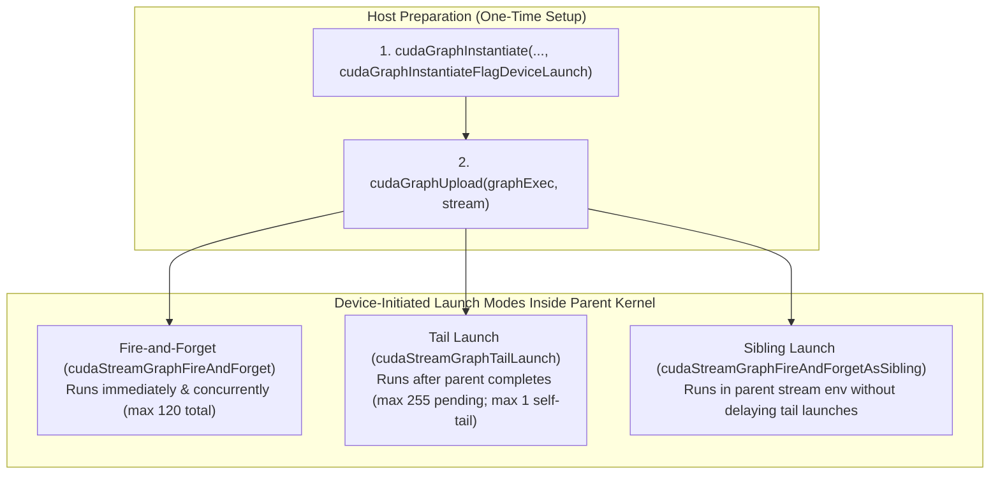

# 10.18 Dynamic scheduling, CUDA graphs and device-initiated orchestration

| | |
|---|---|
| Level | Advanced |
| Priority tier | 2 |
| Lab venue | Nebius GPU |
| Part | Part 10: The GPU and CUDA |
| Sources used | *AI Systems Performance Engineering* (`ai-systems-performance-engineering`, Chris Fregly), Chapter 12 (*Dynamic Scheduling, CUDA Graphs, and Device-Initiated Kernel Orchestration*); `nvidia-devops` Volume 03 (*CUDA Fundamentals*, Chapters 1–13 & Labs 01–04) |
| Code | `code/part10/dynamic_scheduling_graphs.py`, `code/part10/dynamic_scheduling_graphs_lab.py` |
| Coverage file | `planning/coverage/chapters/10-18.md` |

## Why this matters for AI infrastructure

A language-model server decodes one token at a time. Each token needs about eighty layers, and each layer launches a few tiny kernels. The GPU finishes each kernel in about 3 microseconds. The CPU needs about 15 microseconds to submit it. The GPU spends most of its time waiting for the next launch, and nothing in the profile looks broken.

Hiding memory latency inside a kernel and overlapping copies across streams fixes static pipeline stalls. It does not fix three other problems that appear when work is irregular or made of thousands of micro-kernels. Streaming Multiprocessors then sit idle even on a rack-scale system such as the DGX GB200 NVL72. Chapter 12 of *AI Systems Performance Engineering* and Volume 03 of the nvidia-devops notes address these three bottlenecks.

The first is load imbalance inside a kernel. When threads run loops with different trip counts, as in `uneven_static.cu`, early blocks exit while slow blocks keep their SMs busy. In `uneven_dynamic.cu`, the kernel `computeKernelDynamicBatch` uses a work queue in the L2 cache instead. One warp leader claims a batch of items with `atomicAdd` and broadcasts the indices with `__shfl_sync`. The book's illustrative run halves the runtime.

The second is host launch overhead. When tiny decode kernels finish faster than the CPU can enqueue them, tens of thousands of launches per response pin CPU cores inside the CUDA driver while the GPU waits. Capturing the multi-layer forward pass into a CUDA Graph replaces them with one replay call per token.

The third is the round trip for data-dependent decisions. If the GPU must copy a flag to the CPU to learn what to run next, every SM waits. Device-initiated graph launches through `cudaGraphInstantiateFlagDeviceLaunch`, conditional graph nodes, Dynamic Parallelism compiled with `-rdc=true`, and NVSHMEM one-sided puts keep scheduling and branching on the device.

| Bottleneck or System | Mechanism and Configuration | Key Source Metrics | Reported Impact |
|---|---|---|---|
| Rack-scale NVLink domain | DGX GB200 NVL72 unified memory fabric | 36 Grace CPUs + 72 Blackwell GPUs | Up to 30 TB combined CPU and GPU unified memory |
| Intra-kernel load imbalance | `uneven_static.cu` vs `uneven_dynamic.cu` (`N = 1,048,576`, `work = idx % 256`, `batchSize = 32`) | Atomics drop 32x from 1,048,576 to 32,768; `atomic_transactions_per_request` reaches 1.0 | Runtime drops from 200 ms to 100 ms for a 2.0x speedup |
| Host CPU decode launch overhead | CUDA Graphs (`cudaGraphLaunch`, `torch.cuda.CUDAGraph`) | 5 to 15 µs CPU launch vs 3 µs GPU kernel (3 kernels = 45 µs CPU vs 9 µs GPU = 83.3% / > 80% waste); 500 tokens * 80 layers = 40,000 launches (100% CPU, 20% GPU) | Collapses 40,000 launches to 500 replays; Table 12-1 cuts 100-iter time from 1.00 ms to 0.75 ms (25% faster, 300 to 100 launches, 300 to 0 syncs, ~3 µs to 0 µs gaps) |
| Data-dependent device orchestration | Device graph launch (Fire-and-Forget max 120, Tail max 255 pending / 1 self-tail, Sibling), Conditional Nodes (`IF`, `IF/ELSE`, `WHILE`, `SWITCH`), Dynamic Parallelism (`-rdc=true`), NVSHMEM | Device graph launch has ~2x lower latency; Table 12-2 DP cuts GPU idle cycles from 40% to 5% | Table 12-2 cuts runtime from 1.00 ms to 0.75 ms |

:::note About the numbers and code in this chapter
```text
*AI Systems Performance Engineering* states that the numeric values in its metric tables, including Tables 12-1 and 12-2 and the 200 ms to 100 ms work-queue result, are illustrative. Similarly, the Volume 03 timings such as 45 µs, 812.4 ms, 1,928.3 ms, 3,140.9 ms, and 2,214.8 ms come from reference notes marked as illustrative or single-run examples. None were measured on a GPU for this handbook, and the CUDA listings reproduced from the book were not compiled here.
```
:::

## Prerequisites and outcomes

**Prerequisites:**

- Chapters 10.11 through 10.17 covering CUDA kernels, streams, events, pinned memory, cudaMallocAsync, Nsight profiling metrics, and `<cuda/pipeline>`.

**Outcomes:** After this chapter you will be able to:

1. Diagnose L2 atomic contention with the Nsight Compute counter `atomic_transactions_per_request`, and build a warp-leader work queue that claims items in batches.
2. Capture, instantiate, warm up, and replay CUDA Graphs in C++ with `cudaStreamBeginCapture` and `cudaGraphLaunch`, and in PyTorch with `torch.cuda.CUDAGraph`.
3. Update a captured graph in place with `cudaGraphExecUpdate`.
4. Launch a graph from a device kernel in fire-and-forget, tail, or sibling mode, and build conditional graph nodes.
5. Use Dynamic Parallelism with `-rdc=true`, where a parent kernel starts child kernels, and set the pending-launch and stack limits.
6. Coordinate GPUs with NVSHMEM one-sided puts and with NCCL all-reduces captured in a graph.
7. Choose among these tools with the roofline, and diagnose regressions with the Volume 03 profiling funnel using `nsys`, `ncu`, `nvidia-smi`, and `compute-sanitizer`.

---

## 1. Dynamic Scheduling with L2-Cache Atomic Work Queues

### 1.1 L2-cache atomics, `atomic_transactions_per_request`, and batching (`batchSize = 8, 16, 32`)

Some work depends on its input, such as sparse attention blocks, variable-length token sequences, or graph traversals. With such work, static `idx = blockIdx.x * blockDim.x + threadIdx.x` assignment leaves fast-finishing Streaming Multiprocessors idle while slow ones finish the tail. In Nsight Systems, this imbalance appears as ragged stream tails. In Nsight Compute, it shows up as a low ratio of SM Active Cycles to Elapsed Cycles or low achieved occupancy.

Replacing static indexing with a naive global atomic counter where every thread calls `atomicAdd(&queue_head, 1)` creates a second bottleneck. Modern NVIDIA GPUs service global atomicAdd instructions inside the on-chip L2 cache. They do not round-trip to HBM DRAM, as Figure 12-1 of *AI Systems Performance Engineering* Chapter 12 shows. Uncontended L2 atomics are fast, but when thousands of threads hammer the same counter address simultaneously, the L2 cache serializes and replays conflicting requests.

In Nsight Compute's Memory Workload Analysis section, two hardware counters diagnose this contention directly.

- `atomic_transactions` counts the total number of L2-cache atomic transactions executed, including contention replays.
- `atomic_transactions_per_request` measures the contention ratio, defined as the average number of L2 transactions generated per atomicAdd instruction. A value near 1.0 is ideal because every atomicAdd completes in a single L2 transaction with zero retries. A value well above 1.0 means threads are stalling on serialized cache-line updates.

To drive `atomic_transactions_per_request` back toward 1.0, threads claim work in batches rather than one element at a time.

| Queue Strategy (`N = 1 << 20 = 1,048,576` elements) | Batch Size | Total L2 `atomicAdd` Calls | Atomic Reduction Factor | Typical Throughput Impact |
|---|---|---|---|---|
| Unbatched per-thread atomic | `1` | 1,048,576 | 1.0x | High L2 contention stall |
| Modest batching | `8` | 131,072 | 8.0x | 10% to 30% typical throughput gain |
| Medium batching | `16` | 65,536 | 16.0x | Eliminates most L2 replay stalls |
| Full warp batching | `32` | 32,768 | 32.0x | Up to ~2x speedup under extreme imbalance |

```cpp
// Unbatched atomic queue (high L2 contention: 1,048,576 atomics for N = 1 << 20)
int idx = atomicAdd(&queue_head, 1);
if (idx < N) process(data[idx]);

// Batched atomic queue (32x fewer atomics: 32,768 atomics for N = 1 << 20)
const int batchSize = 32;
int start = atomicAdd(&queue_head, batchSize);
for (int i = start; i < start + batchSize && i < N; ++i) {
    process(data[i]);
}
```

Batching has a catch, though. Because L2 atomics are so fast on modern GPUs, a modest batch of 8 or 16 usually clears most of the contention. A faster counter does not mean the problem is gone, so check the rest of the kernel too.

Nsight Compute's Warp Stall Reasons and Register Pressure reports are the place to look. They show whether your fused loop now runs into register spills or shared-memory bank conflicts.

If atomics stay hot after all of this, the book points to other designs. Per-block counters and a hierarchical split of the work are the two options it names.

In short, batching work per atomic keeps many warps busy with real computation. The alternative is a crowd of warps queuing at one counter that cannot keep up.

### 1.2 Warp-leader dynamic work queue (`uneven_static.cu` `200 ms` vs `uneven_dynamic.cu` `100 ms`)

```text
If every thread claims 32 contiguous items for itself, adjacent lanes in a warp no longer access adjacent memory addresses simultaneously, hurting memory coalescing. Instead, a warp-leader dynamic work queue elects one active leader thread per warp to claim 32 items for the entire warp at once, as shown in Figure 12-2 of *AI Systems Performance Engineering* Chapter 12.
```

Inside the loop, the warp queries its active lanes with `unsigned mask = __activemask()` and picks the lowest active lane via `int leader = __ffs(mask) - 1`. Only that single leader lane executes `atomicAdd(&globalIndex, warpSize)` to claim 32 items, and then `__shfl_sync(mask, base, leader)` broadcasts the starting index to all active lanes in registers. On `N = 1,048,576` elements where each element idx performs `work = idx % 256` iterations of `sinf(x) * cosf(x)`. Replacing the static kernel uneven_static.cu at ~200 ms with uneven_dynamic.cu cuts runtime to ~100 ms for a 2.0x speedup.

Start with the static baseline the dynamic queue replaces. Each thread takes the element that matches its own index, then loops `idx % 256` times. Threads with small values finish early, and their SMs sit idle while the longest threads keep running.

```cpp
// uneven_static.cu (baseline): fixed element per thread, uneven loop length
__global__ void computeKernel(const float* input, float* output, int N) {
    int idx = blockIdx.x * blockDim.x + threadIdx.x;
    if (idx < N) {
        int work = idx % 256;
        float result = 0.0f;
        for (int i = 0; i < work; ++i) {
            result += sinf(input[idx]) * cosf(input[idx]);
        }
        output[idx] = result;
    }
}
```

The dynamic version keeps the same math but changes who owns which element. Each warp claims its next batch from a shared counter.

```cpp
// Warp-batched dynamic atomic work queue (uneven_dynamic.cu: ~100 ms vs ~200 ms static = 2.0x speedup)
// Source: AI Systems Performance Engineering, Chapter 12
#include <cuda_runtime.h>
#include <cmath>

__device__ unsigned int globalIndex = 0;

__global__ void computeKernelDynamicBatch(const float* input,
                                          float* output,
                                          int N) {
    int lane = threadIdx.x & (warpSize - 1); // lane id in [0, 31]

    while (true) {
        // 1. Elect an active leader lane (safe under warp divergence)
        unsigned mask = __activemask();
        int leader = __ffs(mask) - 1;

        // 2. Only the warp leader performs 1 L2 atomicAdd for the entire 32-lane warp
        unsigned int base = 0;
        if (lane == leader) {
            base = atomicAdd(&globalIndex, warpSize);
        }

        // 3. Broadcast starting index to all active lanes in the warp
        base = __shfl_sync(mask, base, leader);
        unsigned int idx = base + lane;
        if (idx >= static_cast<unsigned int>(N)) break; // dynamic termination

        // 4. Hoist loop invariants out of the variable trip-count loop (or use __sincosf)
        float s = sinf(input[idx]);
        float c = cosf(input[idx]);
        int work = idx % 256;
        float result = 0.0f;
        #pragma unroll 1
        for (int i = 0; i < work; ++i) {
            result += s * c;
        }
        output[idx] = result;
    }
}

void launchDynamicBatchQueue(const float* d_in, float* d_out, int N, cudaStream_t stream) {
    // CRITICAL: Reset device symbol globalIndex to 0 before each kernel invocation
    unsigned int zero = 0;
    cudaMemcpyToSymbolAsync(globalIndex, &zero, sizeof(unsigned int), 0,
                            cudaMemcpyHostToDevice, stream);
    dim3 block(256), grid((N + 255) / 256);
    computeKernelDynamicBatch<<<grid, block, 0, stream>>>(d_in, d_out, N);
}
```

The warp-leader queue has limits. When the imbalance is mild, the cost of the atomic and the shuffle can cancel the gain. The big win appears when a few threads carry most of the work.

Watch for the signs that a static split is wasting the GPU. Look for warp idle stalls, low achieved occupancy, or timeline gaps caused by uneven run times per task. With moderate imbalance, you can often see a 10% to 20% speedup.

Measure before and after the change, and keep it only if the numbers move.

The result is near-uniform SM utilization. Under a static split, many warps finish long before the slowest ones and leave hardware resources unused.

In short, the dynamic queue keeps SM use nearly uniform. Every warp keeps claiming and processing tasks until the counter passes `N`. A static split leaves finished warps idle while the slowest warps keep going.

---

## 2. CUDA Graphs: Eliminating Host Submission Overhead in C++, PyTorch, and Inference Engines

### 2.1 Why CPU launch overhead dominates LLM decode (`15 µs` launch vs `3 µs` kernel & `40,000` launches)

```text
Even though a standard CUDA kernel launch is asynchronous, the host CPU still spends 5 to 15 µs, or up to ~20 µs with driver and sync bookkeeping, validating state and submitting command descriptors over PCIe or NVLink-C2C. During the prefill phase of a large language model, each kernel runs for milliseconds so a 15 µs CPU launch cost is invisible. During single-token autoregressive decode, however, individual layer kernels can finish on the GPU in 3 µs.
```

```text
When the GPU finishes a kernel in 3 µs while the CPU needs 15 µs to launch the next one, the GPU sits completely idle waiting for the host CPU for over 80% of wall-clock time. Volume 03 Chapter 10 of `nvidia-devops` and `analyze_decode_launch_overhead()` in `code/part10/dynamic_scheduling_graphs.py` quantify both a three-kernel micro-chain and a production 80-layer decode loop.
```

```text
Micro-kernel chain (3 decode kernels):
  GPU execution time:   3 kernels * 3 us   = 9.0 us total GPU work
  CPU launch overhead:  3 kernels * 15 us  = 45.0 us total CPU submission overhead
  Total elapsed time:   45.0 + 9.0         = 54.0 us (83.3% [> 80%] spent waiting on CPU dispatch)

Production Triton / vLLM 80-layer LLM decode (500 generated tokens):
  Without CUDA Graphs:  500 tokens * 80 layers = 40,000 individual kernel launches
                        Host CPU cores pin at 100% in the CUDA driver; GPU utilization sits at 20%
  With CUDA Graphs:     Capture 80-layer pass once -> 500 cudaGraphLaunch replays (1 replay per token)
```

### 2.2 Stream capture, PyTorch `torch.cuda.CUDAGraph`, static memory pools, and Table 12-1

Repeatedly launching the exact same sequence of kernels and copies from the CPU wastes driver cycles re-validating parameters that never change. A CUDA Graph records the entire sequence of kernel nodes. Memory copies, and dependency edges into a cudaGraph_t once. Compiles it into an executable cudaGraphExec_t outside the hot loop, and replays the whole graph with a single cudaGraphLaunch call.

```cpp
// Capturing and replaying a 3-kernel pipeline (A -> B -> C) 100 times with CUDA Graphs
// Source: AI Systems Performance Engineering, Chapter 12
cudaStream_t stream;
cudaStreamCreateWithFlags(&stream, cudaStreamNonBlocking);

cudaGraph_t graph;
cudaGraphExec_t instance;

// 1. Capture kernelA -> kernelB -> kernelC into graph without executing them yet
cudaStreamBeginCapture(stream, cudaStreamCaptureModeGlobal);
kernelA<<<grid, block, 0, stream>>>(d_X);
kernelB<<<grid, block, 0, stream>>>(d_Y);
kernelC<<<grid, block, 0, stream>>>(d_Z);
cudaStreamEndCapture(stream, &graph);

// 2. Validate and instantiate executable graph outside the hot loop
cudaGraphInstantiate(&instance, graph, nullptr, nullptr, 0);

// 3. Replay 100 iterations with 1 host call per iteration and 0 per-kernel syncs
for (int iter = 0; iter < 100; ++iter) {
    cudaGraphLaunch(instance, stream);
}
cudaStreamSynchronize(stream);

cudaGraphExecDestroy(instance);
cudaGraphDestroy(graph);
```

In PyTorch, capturing a torch.cuda.CUDAGraph requires two strict invariants, as shown in Figure 12-4 of *AI Systems Performance Engineering* Chapter 12.

1. Run a warm-up pass on a non-default stream followed by `torch.cuda.synchronize()` before entering `with torch.cuda.graph(g, stream=stream):`. That warm-up completes lazy cuBLAS and cuDNN workspace allocations and JIT compilations outside the capture window.
2. Preserve pointer stability across replays by preallocating static tensors static_x. static_y, static_z, and static_w and writing in-place with `out=` or `.copy_()`, or by sharing a dedicated static graph memory pool via `torch.cuda.graph_pool_handle()`. Calling `torch.compile(..., mode="reduce-overhead")` wraps static-shape regions in CUDA Graphs automatically, while inference engines such as vLLM and TensorRT-LLM pre-capture one graph per bucketed batch size at startup.

```python
# PyTorch CUDAGraph capture with warmup and pointer-stable static buffers (ASP Ch 12) (untested here)
import torch

X = torch.randn(1 << 20, device="cuda")
static_x = torch.empty_like(X)
static_y = torch.empty_like(X)
static_z = torch.empty_like(X)
static_w = torch.empty_like(X)

# 1. Warm up once to initialize cuBLAS/cuDNN contexts and allocator caches
_ = (X * 1.1 + 2.0).sqrt()
torch.cuda.synchronize()
static_x.copy_(X)

# 2. Capture into a CUDAGraph using out= parameters to preserve fixed tensor addresses
g = torch.cuda.CUDAGraph()
stream = torch.cuda.Stream()
torch.cuda.synchronize()
with torch.cuda.graph(g, stream=stream):
    torch.mul(static_x, 1.1, out=static_y)
    torch.add(static_y, 2.0, out=static_z)
    torch.sqrt(static_z, out=static_w)

# 3. Replay 100 iterations (copy new inputs into static_x before g.replay())
for _ in range(100):
    g.replay()
torch.cuda.synchronize()
```

PyTorch is not the only place graphs show up. Inference engines lean on them heavily, and the pattern repeats.

Engines such as vLLM and TensorRT-LLM capture a model's execution into a set of predefined graphs. Each graph covers a sequence-length range or an input batch size. These engines often pad or bucket incoming inputs so they fit a supported graph shape. The captured graph can then replay with fixed shapes, which can cut latency for large production workloads.

A concrete case: the server captures one CUDA Graph per batch size at startup or model load. When a request arrives, it launches the graph that matches that request's batch size.

PyTorch's compiler helps too. `torch.compile` with `mode='reduce-overhead'` may wrap eligible segments in CUDA Graphs. It does not graph every code path. Graphing needs static tensor addresses and CUDA-only regions, and it can use more memory because of pooled buffers. Profile your model to confirm the gain.

Table 12-1 in *AI Systems Performance Engineering* Chapter 12 summarizes the reported impact of CUDA Graphs across 100 iterations of the three-kernel `A -> B -> C` pipeline.

| Metric | Before CUDA Graphs (Standard Stream Launches) | After CUDA Graphs (`cudaGraphLaunch` / `g.replay()`) | Improvement |
|---|---:|---:|---|
| CPU launch calls per 100 iterations | 300 separate kernel launches | 100 graph replays (1 per iteration) | 3.0x fewer host launch calls |
| Host synchronization calls | 300 `cudaDeviceSynchronize` calls | 0 inside loop | Eliminates host-device handshakes |
| Average GPU idle gap between kernels | ~3 µs gaps per iteration | 0 µs (continuous back-to-back execution) | Removes inter-kernel launch bubbles |
| End-to-end iteration latency | ~1.00 ms | ~0.75 ms | 25% faster (20%–30% typical reduction) |

### 2.3 Dynamic Graph Updates (`cudaGraphExecUpdate`), Per-Slot Buffer Ownership, and Production Graph Caches

Production inference servers rarely receive the exact same batch size on every request, and rebuilding a cudaGraphExec_t from scratch takes milliseconds. Worse, if a server ignores failed graph updates. Shares static buffers across concurrent streams without slot locking, or wraps a transfer-bound workload in a graph, it will either corrupt tensors or see zero speedup.

Volume 03 Chapter 10 of nvidia-devops and *AI Systems Performance Engineering* Chapter 12 establish three production rules for dynamic graph management.

- Patch existing graphs in place with `cudaGraphExecUpdate(graphExec, newGraph, &resultInfo)` or `cudaGraphExecKernelNodeSetParams(...)` whenever node topology stays constant. For example, capture a template graph at a maximum batch size of 128. Update launch dimensions for an incoming batch of 64 while keeping sub-100 µs replay overhead.
- Always check the return status of cudaGraphExecUpdate for cudaGraphExecUpdateErrorTopologyChanged. When a request shape changes from 512 to 513 in a way that alters the node topology. CudaGraphExecUpdate rejects the update, and ignoring that status with `--skip-update-check` silently replays the stale 512-shape graph against 513-shape buffers.
- Isolate concurrent multi-stream replays using per-slot buffer ownership across `Slot 0`, `Slot 1`, and `Slot 2`, as shown in Volume 03 Chapter 10 Figure 3.10.3. Give each pipeline slot its own cudaGraphExec_t, dedicated input and output buffers, and completion cudaEvent_t, and never reuse Slot k until `Completion Event k` signals.

Sometimes the graph's structure must change, such as when you need a different number of kernels. The book notes that you cannot add or remove nodes freely, so patching is not enough. Fall back to a recapture-then-update workflow. Wrap one iteration of your code with `cudaStreamBeginCapture` and `cudaStreamEndCapture` to build the new graph. After that, small tweaks on later runs can go through the lighter `cudaGraphExecUpdate`.

Patching is fast. An update takes only a few microseconds, so replay keeps its sub-100 µs overhead. If a change is incompatible with the graph, the call returns an error status, and you must capture again.

The same idea gives you a parameterized path. For a loop of GPU work where only the batch size changes, capture once, patch on each new size, and keep both CPU overhead and flexibility.

| Diagnostic Scenario (`nsys stats --report cuda_api_sum`) | Call Count | Total API Time | Share of API Time | Engineering Decision |
|---|---:|---:|---:|---|
| `cudaLaunchKernel` in transfer-bound pipeline | 500 calls | 4,120,000 ns | 2.1% | Do not wrap in CUDA Graphs; launch overhead is negligible |
| `cudaMemcpyAsync` moving 512 MB per call | 500 calls | 189,340,000 ns | 97.3% | Optimize PCIe/NVLink transfers and pinned memory instead |

---

## 3. Device-Initiated CUDA Graph Launches and Conditional Graph Nodes

### 3.1 Device-side graph launch modes (`Fire-and-Forget`, `Tail`, and `Sibling`, `Figures 12-5 to 12-8`)

Host-launched CUDA Graphs still require the CPU to issue cudaGraphLaunch on every step. When a recurrent loop or multi-step scheduler depends on device state between steps, returning to the host CPU adds PCIe latency and jitter. Device-initiated CUDA Graph launches let a running GPU kernel trigger a pre-recorded cudaGraphExec_t directly from device code. Cutting launch latency by ~2x compared to host graph launches and keeping latency flat as graph width grows.

```text
Before any device kernel can launch a graph, the host must perform two setup steps, shown in Figures 12-5 through 12-8 of *AI Systems Performance Engineering* Chapter 12.
```

1. Instantiate the graph with cudaGraphInstantiateFlagDeviceLaunch via `cudaGraphInstantiate(&graphExec, graph, nullptr, nullptr, cudaGraphInstantiateFlagDeviceLaunch);`.
2. Upload the executable graph to the device ahead of time by calling `cudaGraphUpload(graphExec, stream);`.

Inside a __global__ kernel, calling `cudaGraphLaunch(graphExec, mode)` supports three reserved device launch modes.

| Device Graph Launch Mode | Reserved Stream Constant | Execution and Ordering Semantics | Hardware and Runtime Concurrency Limit |
|---|---|---|---|
| 1. Fire-and-Forget Launch | `cudaStreamGraphFireAndForget` | Child graph begins executing immediately and concurrently with the launching parent kernel; parent does not wait. Ideal for independent side tasks. | Up to 120 total fire-and-forget graphs during the course of a graph's execution. |
| 2. Tail Launch (Figures 12-6 & 12-7) | `cudaStreamGraphTailLaunch` | Defers child graph execution until the launching kernel completes, running as a sequential continuation. Nested tail launches from a child execute before the parent's remaining queued tail launches. | Up to 255 pending tail launches enqueued in a CUDA Graph; at most 1 pending self-tail-launch via `cudaGetCurrentGraphExec()` at a time. |
| 3. Sibling Launch | `cudaStreamGraphFireAndForgetAsSibling` | Launches immediately as a peer in the parent graph's stream environment so it runs concurrently without delaying any tail launches of the parent graph. | Bounded by fire-and-forget and resident grid limits. |



Combining an L2 atomic work queue `atomicAdd(&queueHead, 1)` with cudaStreamGraphTailLaunch and `cudaGetCurrentGraphExec()` turns a small scheduler kernel into a persistent GPU-resident decode driver. The scheduler kernel claims the next token batch on the device, tail-launches the pre-captured Transformer decode cudaGraphExec_t, and re-enqueues itself without touching the CPU.

When a device-launched graph runs, its work shows up on the GPU timeline. Nsight Systems draws child graphs as separate streams of work. Put NVTX markers in the parent kernel just before and after each `cudaGraphLaunch` call. Then you can confirm that each graph runs where you expect relative to its parent.

Fire-and-forget graphs suit side tasks, because the parent does not wait for them. Tail launches work differently. They run after the parent kernel reaches its end, one at a time, in the order they were queued. If the launched graph produces results the parent needs, pick a tail launch, since the parent waits for that work. If the graph is only a side task, fire-and-forget lets the parent move on.

A tail launch can also queue more tail launches. When it does, the new ones run before the older queued tail launches.

Tail launches make a useful loop. A persistent scheduler kernel can tail-launch a graph, then relaunch itself once that graph finishes. The kernel asks `cudaGetCurrentGraphExec()` for a handle to its own graph, then enqueues itself again with `cudaGraphLaunch` in tail mode. The GPU runs the loop without the host calling in again.

Device-initiated graphs open up new patterns. Imagine a GPU compression pipeline where a kernel chooses a compression algorithm based on the data. Instead of ending the kernel so the CPU can launch the compressor, the kernel launches a prerecorded graph for LZ or Huffman compression. The GPU never idles while it waits for the CPU to decide.

With device-initiated graphs, you must manage dependencies yourself. A tail launch is right when the next kernel consumes the graph's output. A fire-and-forget launch is right when the graph is a side job that the parent does not need to wait on.

### 3.2 Conditional Graph Nodes (`IF`, `IF/ELSE`, `WHILE`, `SWITCH`, `Figures 12-9 to 12-11`)

```text
Standard CUDA Graphs only replay a fixed sequence of nodes. If an inference loop needs early exit, speculative decoding verification, or dynamic expert routing, a fixed graph would normally have to stop and copy a condition flag back to the CPU. Conditional Graph Nodes solve this by embedding GPU-evaluated branches and loops directly inside a `cudaGraph_t` using a device-writable cudaGraphConditionalHandle, as shown in Figures 12-9 through 12-11 of *AI Systems Performance Engineering* Chapter 12.
```

- IF nodes using cudaGraphCondTypeIf with `size = 1` execute their single body subgraph once if the condition handle is nonzero.
- `IF/ELSE` nodes with `size = 2` execute body subgraph 0 when the handle is nonzero and body subgraph 1 when the handle is 0.
- WHILE nodes repeatedly execute their body subgraph as long as the condition handle remains nonzero. Re-evaluating the handle after each iteration, and can nest IF nodes inside WHILE bodies as in Figure 12-11.
- SWITCH nodes with `size = N` hold N body subgraphs and execute the i-th subgraph when `handle == i`, or skip execution if `handle >= N`.

Standard CUDA Graphs replay a fixed sequence, and every decision stays on the host. Conditional graph nodes change that. A device kernel writes a small value into a condition handle, and the graph reads that value at run time. Based on it, the GPU runs a branch or loops, with no return to the CPU.

Conditional graph nodes let you control graph execution from values computed in device kernels, all without involving the CPU. A complex branching workflow can then run as one repeatable graph launch.

The control flow types are IF, IF/ELSE, WHILE, and SWITCH. An IF body runs once when the value is nonzero. A WHILE body keeps running while the value stays nonzero, and it checks again after each pass. A WHILE body can also hold an IF node, which gives you multilevel decisions without any CPU hop.

Conditional nodes pay off most when a graph is built once and run many times. The cost of building the graph is spread across all those launches.

Here is the complete C++ implementation of an IF conditional node from *AI Systems Performance Engineering* Chapter 12 using `threshold = 123456` on `N = 1 << 20 = 1,048,576` elements.

```cpp
// Conditional Graph Node (cudaGraphCondTypeIf) evaluated entirely on the GPU
// Source: AI Systems Performance Engineering, Chapter 12
#include <cuda_runtime.h>
#include <cstdio>

__device__ int reduce_sum(const int* data, size_t N) { return data[0]; }

// 1. Upstream device kernel sets the condition handle from a SINGLE thread (avoids races)
__global__ void setHandle(cudaGraphConditionalHandle handle, int* data, size_t N) {
    constexpr int threshold = 123456;
    if (threadIdx.x == 0 && blockIdx.x == 0) {
        unsigned int flag = (reduce_sum(data, N) > threshold) ? 1u : 0u;
        cudaGraphSetConditional(handle, flag);
    }
}

// 2. Conditional body kernel: runs on GPU only when flag != 0
__global__ void bodyKernel() {
    printf("Conditional body executed on GPU\n");
}

void runConditionalGraphExample() {
    cudaStream_t stream;
    cudaStreamCreateWithFlags(&stream, cudaStreamNonBlocking);

    cudaGraph_t graph;
    cudaGraphCreate(&graph, 0);

    // Create condition handle associated with graph
    cudaGraphConditionalHandle condHandle;
    cudaGraphConditionalHandleCreate(&condHandle, graph);

    constexpr size_t N = 1 << 20; // 1,048,576 ints
    int* d_data = nullptr;
    cudaMalloc(&d_data, N * sizeof(int));

    // Add upstream setHandle kernel node
    cudaGraphNode_t setNode;
    cudaKernelNodeParams setParams = {};
    setParams.func = (void*)setHandle;
    setParams.gridDim = dim3(1);
    setParams.blockDim = dim3(32);
    void* setArgs[] = { &condHandle, &d_data, (void*)&N };
    setParams.kernelParams = setArgs;
    cudaGraphAddKernelNode(&setNode, graph, nullptr, 0, &setParams);

    // Add IF conditional node dependent on setNode
    cudaGraphNode_t condNode;
    cudaConditionalNodeParams ifParams = {};
    ifParams.handle = condHandle;
    ifParams.type = cudaGraphCondTypeIf;
    ifParams.size = 1; // 1 body subgraph for IF (2 for IF/ELSE)
    cudaGraphAddConditionalNode(&condNode, graph, &setNode, 1, &ifParams);

    // Populate the IF body subgraph (phGraphOut[0])
    cudaGraph_t bodyGraph = ifParams.phGraphOut[0];
    cudaGraphNode_t bodyNode;
    cudaKernelNodeParams bodyParams = {};
    bodyParams.func = (void*)bodyKernel;
    bodyParams.gridDim = dim3(1);
    bodyParams.blockDim = dim3(32);
    cudaGraphAddKernelNode(&bodyNode, bodyGraph, nullptr, 0, &bodyParams);

    // Instantiate with DeviceLaunch flag, upload, and launch
    cudaGraphExec_t graphExec;
    cudaGraphInstantiate(&graphExec, graph, nullptr, nullptr,
                         cudaGraphInstantiateFlagDeviceLaunch);
    cudaGraphUpload(graphExec, stream);
    cudaGraphLaunch(graphExec, stream);
    cudaStreamSynchronize(stream);

    cudaGraphExecDestroy(graphExec);
    cudaGraphDestroy(graph);
    cudaStreamDestroy(stream);
    cudaFree(d_data);
}
```

Two details in that example matter. Set the condition from a single thread, such as `if (threadIdx.x == 0)`, so threads do not race. Also make sure the kernels before it flush their memory writes, so the value is visible before the conditional node runs.

PyTorch's CUDA Graph API does not create conditional nodes from Python, as of the book's writing. Using them means custom C++ integration for now. Framework support is still evolving.

---

## 4. Dynamic Parallelism (`DP`, `-rdc=true`) and Table 12-2

```text
Sometimes the number of child tasks, their grid dimensions, or recursive subdivisions emerge dynamically from data at runtime and cannot be pre-recorded into any fixed graph topology. Examples include adaptive mesh refinement, hierarchical tree traversals, and per-token auxiliary attention blocks. Dynamic Parallelism allows a running `parentKernel` to launch `childKernel<<<blocks, threads>>>` directly on the GPU, as shown in Figures 12-12 and 12-13 of *AI Systems Performance Engineering* Chapter 12.
```

- Compile with relocatable device code enabled via `nvcc -rdc=true` and link against `-lcudadevrt`.
- Guard child launches with `if (blockIdx.x == 0 && threadIdx.x == 0)` so every thread in the parent grid does not spawn duplicate child grids. A parent kernel implicitly waits for all of its device-launched child kernels to complete before the parent kernel itself exits.
- Manage hardware queue and stack limits on the host. CUDA allows 2,048 outstanding device-initiated child launches by default, which can be raised via `cudaDeviceSetLimit(cudaLimitDevRuntimePendingLaunchCount, newLimit)`, while deep nesting requires raising stack memory via `cudaDeviceSetLimit(cudaLimitStackSize, newSize)`.

```cpp
// Device-launched Dynamic Parallelism (dp_device_launched.cu: compile with nvcc -rdc=true)
// Source: AI Systems Performance Engineering, Chapter 12
#include <cuda_runtime.h>

__global__ void childKernel(float* data, int n) {
    int idx = blockIdx.x * blockDim.x + threadIdx.x;
    if (idx < n) {
        data[idx] = data[idx] * data[idx];
    }
}

__global__ void parentKernel(float* data, int n) {
    // Launch children from a single thread (block 0, thread 0) to avoid duplicate grids
    if (blockIdx.x == 0 && threadIdx.x == 0) {
        const int threadsPerBlock = 256;
        const int firstHalfCount = n / 2;               // 524,288 for N = 1,048,576
        const int secondHalfCount = n - firstHalfCount; // 524,288
        const int blocksFirst = (firstHalfCount + threadsPerBlock - 1) / threadsPerBlock;   // 2,048
        const int blocksSecond = (secondHalfCount + threadsPerBlock - 1) / threadsPerBlock; // 2,048

        // Device-initiated child launches (parent implicitly waits for children before exiting)
        childKernel<<<blocksFirst, threadsPerBlock>>>(data, firstHalfCount);
        childKernel<<<blocksSecond, threadsPerBlock>>>(data + firstHalfCount, secondHalfCount);
    }
}
```

```text
Table 12-2 in *AI Systems Performance Engineering* Chapter 12 compares host-driven launches against device-driven Dynamic Parallelism for 1 parent plus 2 children across `N = 1,048,576` elements.
```

| Metric | Before (`dp_host_launched.cu`: Host Launch) | After (`dp_device_launched.cu`: Device DP Launch) | Impact |
|---|---:|---:|---|
| Total host launches | 3 (1 parent + 2 children) | 1 (parent only) | Eliminates 2 CPU-GPU round-trips |
| Average launch overhead per call | ~20 µs | ~25 µs | Slight +5 µs on-device scheduling cost |
| GPU idle cycles (during sequence) | ~40% | ~5% | -35 percentage points (87.5% less idle time) |
| Overall execution time | 1.00 ms | 0.75 ms | 25% faster + preserves L2 cache locality |

### When dynamic parallelism is the right tool

Dynamic parallelism fits work that appears only at run time. A parent kernel can look at its own outputs and decide how many children to launch. Hierarchical reductions, adaptive mesh refinement, and graph traversals are typical cases. The number of follow-up tasks is unknown until the data has been processed.

Take an inference pipeline where only some inputs need an extra model. In the host-driven flow, kernel A finishes, its results travel back to the CPU, and the CPU then launches kernel B. The GPU idles through that round trip. With dynamic parallelism, kernel A checks its output and launches kernel B on the device. The timeline gap closes, which keeps SMs busy.

An LLM follows the same logic. Most tokens use the normal transformer path, while a few need an auxiliary attention block. A kernel can detect those tokens and tail-launch the extra attention only for them.

To spot the pattern, open the profiler and look for `Kernel A`, then an idle gap, then `Kernel B`. The gap is the CPU preparing the next launch. A device-side launch replaces that gap.

Dynamic parallelism has costs. Each child launch uses scheduling resources and stack space. On a stack overflow, raise the stack size with `cudaDeviceSetLimit(cudaLimitStackSize, newSize)`. CUDA warns you when it hits its default limit. By default, 2,048 device launches can be pending at once. A parent that loops over thousands of tiny kernels can exceed that, and the run then fails with a runtime error. Raise the cap with `cudaDeviceSetLimit(cudaLimitDevRuntimePendingLaunchCount, newLimit)`. Watch device memory too, because each pending child reserves resources.

Use dynamic parallelism only when the parallelism comes from the data. If the sequence is fixed, capture it as a CUDA Graph and replay it on the device. Graphs also suit repeated, fixed control flow, because their setup cost is amortized.

### Why the device-launched version is faster

In the host-driven version, the parent kernel runs and then the CPU waits. The CPU launches each child in turn. Explicit synchronization after the parent and between children leaves idle gaps on the GPU.

In the device-launched version, the parent spawns both children itself. The host submits one kernel and waits once. The parent does not finish until its children do, so no host synchronization is needed between stages.

A device launch costs a little more per call. In the book's example, the per-launch cost rises from about 20 µs to about 25 µs. That small rise is minor next to the saved CPU round trips. Data also stays on the GPU between stages, so children read the parent's output without a copy back to the host.

Dynamic parallelism does not win every time. A device launch has roughly the same overhead as a host launch. Small child kernels may not earn that cost back, and some algorithms run slower. Profile before and after each change. Nsight Compute can profile child kernels launched with dynamic parallelism and show what they cost.

---

## 5. Multi-GPU Orchestration (`NVSHMEM` PGAS & Graph-Captured `NCCL`), Roofline Decisions, and the Volume 03 Production Profiling Funnel

### Overlapping peer copies, NCCL, and CUDA-aware MPI

Scaling from one GPU to many keeps the same goal: hide data movement behind useful work. The host dispatches work to each GPU, and then the GPUs take over. While one stream computes, a second stream can move data peer to peer over NVLink or PCIe, without touching host memory.

At cluster scale, overlap is essential for near-linear scaling. Even with NVLink, bandwidth and latency fall short of on-device HBM, so you hide that communication behind compute. For a simple hand-off, `cudaMemcpyPeerAsync` moves a block between GPUs on a dedicated stream.

```cpp
cudaMemcpyPeerAsync(dest_ptr, dest_gpu, src_ptr, src_gpu, size, comm_stream);
```

For collectives, such as the gradient all-reduce in PyTorch Distributed Data Parallel (DDP), use NCCL's nonblocking calls on a separate stream. NCCL arranges the tensors into rings or trees that use the NVLink and NVSwitch paths. Your compute kernels keep running on their own streams meanwhile.

CUDA-aware MPI follows the same idea. If your MPI library is CUDA-aware, it recognizes GPU device pointers and sends the data over InfiniBand with GPUDirect RDMA:

```cpp
MPI_Send(device_buf, count, MPI_FLOAT, peer_rank, ...);
```

The data goes straight from GPU memory across the network, with no staging copy in host memory. Within one node, peer copies use NVLink or PCIe through GPUDirect Peer-to-Peer. These paths keep the CPU off the data path, lower transfer latency, and let node-to-node traffic overlap with GPU compute.

### 5.1 Fine-grained GPU-to-GPU PGAS orchestration with `NVSHMEM`

Bulk primitives like cudaMemcpyPeerAsync and NCCL work well for large contiguous tensors. But they incur host launch overhead when kernels need fine-grained, irregular word-level transfers or cross-GPU work stealing. NVIDIA SHMEM exposes a Partitioned Global Address Space. GPUs where each GPU is a Processing Element queried via `nvshmem_my_pe()` with symmetric heap memory allocated via `nvshmem_malloc()`. As shown in Figure 12-14 of *AI Systems Performance Engineering* Chapter 12.

Inside a kernel, a thread on Processing Element 0 can write directly into Processing Element 1's HBM over NVLink. GPUDirect RDMA using one-sided puts and signals without touching the host CPU. First, the sender writes the payload with nvshmem_float_p. Second, it calls `nvshmem_quiet()` to ensure the remote write completes before the flag is visible. Third, it flips the remote flag with nvshmem_int_p while the receiver spins on nvshmem_int_wait_until.

```cpp
// NVSHMEM one-sided put + quiet + flag signal and cross-GPU atomic work stealing
// Source: AI Systems Performance Engineering, Chapter 12
#include <cuda_runtime.h>
#include <nvshmem.h>
#include <nvshmemx.h>

__device__ int* remote_flag;
__device__ float* remote_data;

// PE 0: One-sided put payload into PE 1, fence with nvshmem_quiet(), then signal remote_flag[0] = 1
__global__ void sender_kernel(float* local_data, int dest_pe) {
    int idx = blockIdx.x * blockDim.x + threadIdx.x;
    float value = local_data[idx];
    nvshmem_float_p(remote_data + 1, value, dest_pe); // 1. One-sided RMA put to dest_pe
    nvshmem_quiet();                                  // 2. Ensure remote write completes
    nvshmem_int_p(remote_flag + 0, 1, dest_pe);       // 3. Flip remote signal flag on dest_pe
}

// PE 1: Spin on symmetric flag in local HBM, then consume payload immediately
__global__ void receiver_kernel(float* recv_buffer) {
    nvshmem_int_wait_until(remote_flag + 0, NVSHMEM_CMP_EQ, 1);
    recv_buffer[0] = remote_data[1] * 2.0f;
}

// Cross-GPU dynamic work-stealing queue using NVSHMEM atomics
__global__ void work_steal_kernel(int* queue_head, int N_tasks) {
    while (true) {
        int idx = nvshmem_int_atomic_inc(queue_head);
        if (idx >= N_tasks) break;
        // Process task[idx]...
    }
}
```

Whenever a kernel calls a device-wide NVSHMEM barrier such as `nvshmem_barrier_all()`, launch it across all Processing Elements simultaneously with `nvshmemx_collective_launch()` so every GPU co-resides in lockstep. For irregular point-to-point pipelines where GPU 0 runs Attention. Pushes activations to GPU 1's persistent MLP kernel, prefer fine-grained point-to-point signals like nvshmem_int_wait_until or nvshmemx_signal_op over global barriers.

For workloads that need tight, event-driven coordination, such as dynamic task queues and fine-grained event notifications, NVSHMEM is a strong choice. It treats each GPU as a processing element (PE) in a partitioned global address space (PGAS). With PGAS, one GPU writes directly into another GPU's memory from device code, bypassing the CPU. Latency depends on the interconnect, and NVLink is generally faster than PCIe or network transports.

NVSHMEM is built for irregular, data-dependent work. A PE is one OS process in an NVSHMEM application. In the book's example, each PE binds to one GPU. Because one-sided operations skip both the CPU and the kernel-launch path, a transfer behaves like a single hardware transaction. That is why it can reach near-peak wire speed.

The trade-off is that NVSHMEM is shared-memory programming on GPUs. You must manage synchronization and avoid races. Global barriers are easy to misuse, because they make every GPU wait for the slowest peer. Prefer fine-grained signals and point-to-point sync when you can. The library offers `nvshmem_wait_until`, `nvshmem_signal_fetch`, `nvshmem_signal_wait_until`, and the `nvshmemx_signal_op` variants for that. They suit cases where only a subset of devices must coordinate.

In short, NVSHMEM turns a cluster of GPUs into one shared-memory domain. Device-only kernel launches, data transfers, and synchronization run at latencies and throughputs that beat CPU-mediated approaches.

Here is a concrete pipeline. GPU 0 computes attention for batch 1, then puts the activations into GPU 1 and signals. GPU 1 runs a persistent kernel that sees the flag and starts the MLP stage. Meanwhile GPU 0 moves on to batch 2. After a few iterations, both GPUs work in step, and each handoff hides behind active compute.

For load balancing, each PE can claim work from a shared counter. The `nvshmem_int_atomic_inc` call hands each kernel its next task index, so work is stolen across GPUs without the host.

When every PE must move in lockstep, launch with `nvshmemx_collective_launch()`. It starts the kernels on all GPUs at once. Inside, `nvshmem_barrier_all()` makes every PE wait there, then continue together. Any kernel that uses NVSHMEM device-level synchronization or collectives needs this launch call.

NVSHMEM kernels can sit inside CUDA Graphs like any other kernel. Their device operations stay inside the kernel and are not separate graph nodes. The library's real strength is letting kernels adapt at run time, without a fixed communication script.

### 5.2 Capturing multi-GPU `NCCL` bucketed all-reduces in CUDA Graphs (`Figures 12-15 & 12-16`)

```text
At cluster scale, small variations in Python or OS scheduling on any single rank delay collective launches across all ranks. Capturing `computeGradientsLayer1` on `streamA`, bucketed `ncclAllReduce` on `streamB`, and `computeGradientsLayer2` on `streamA` into a single CUDA Graph via `cudaStreamBeginCapture(captureStream, cudaStreamCaptureModeGlobal)`, cudaGraphInstantiate, and cudaGraphUpload eliminates per-step CPU jitter, as shown in Figures 12-15 and 12-16 of *AI Systems Performance Engineering* Chapter 12.
```

1. Enforce an identical collective sequence across all ranks. Every rank in the communicator captures and replays the exact same order of ncclAllReduce calls on the same ncclComm_t.
2. Run warmup collectives before capture so NCCL ring and tree channels and RDMA buffers are initialized outside the graph capture window.
3. Preallocate gradient and communication buffers at fixed addresses before capture, and use cudaGraphExecUpdate if pointer addresses or sizes change.

Traditionally, each GPU launches `ncclAllReduce` from the host, then waits before the next compute phase. That host-driven order adds overhead and idle time between the forward and backward passes.

NCCL calls can be recorded into a CUDA Graph the same way kernels are. Capture the forward kernels, the all-reduce, and the backward kernels into one graph, then replay it each training step. Use the same capture stream for everything, NCCL included. Each process replays an identical graph, so NCCL finds its peers without extra host work. The host's per-step job shrinks to one `cudaGraphLaunch`.

Overlap matters too. Split the gradient work into two passes, one for the earlier layers and one for the later layers, and map them to separate streams. The all-reduce on stream B then runs while stream A computes the next layers. This bucketed pattern hides most of the network time behind computation. DDP does a version of this on its own, but a captured graph can cut CPU overhead further and make performance more predictable.

Three rules apply to graph-captured collectives. First, every rank must record and replay the same collective sequence on the same communicator. A mismatched order risks a deadlock, or worse, silently wrong results. Second, run warmup collectives before capture so communicators initialize early. Third, allocate gradient and communication buffers before capture. If a parameter such as batch size changes, patch it with `cudaGraphExecUpdate` instead of recapturing.

At large scale, these per-step savings add up. They produce tighter synchronization and higher utilization across the whole cluster.

### 5.3 Roofline-guided orchestration decisions and the Volume 03 Production Profiling Funnel

```text
Tuning a kernel in Nsight Compute before checking whether the pipeline is actually bottlenecked on host synchronization, tiny transfer chunks, or memory fragmentation wastes days of engineering time. Volume 03 Chapters 12 and 13 and Lab 04 of `nvidia-devops` combine a three-level production profiling funnel with the Roofline-guided orchestration matrix from Figure 12-17 of *AI Systems Performance Engineering* Chapter 12.
```

| Profiling Level or Roofline Regime | Diagnostic Evidence (`nsys`, `ncu`, `nvidia-smi`, `compute-sanitizer`) | Recommended Orchestration or Fix |
|---|---|---|
| Level 1 to Level 2: Host, Transfer, or Sync Bottleneck (812.4 ms baseline) | Stop before kernel profiling if `nsys` shows host gaps or serialization:<br/>- Regression A (device sync after each launch): 1,928.3 ms (2.37x / ~2.4x slower).<br/>- Regression B (tiny 16 KiB = 4,096-elem chunks vs 16 MiB = 4,194,304-elem chunks, 1,024x more launches): 3,140.9 ms (3.87x / ~3.9x slower).<br/>- Regression C (pageable host buffers staging on CPU): 2,214.8 ms (2.73x / ~2.7x slower). | Remove per-launch `cudaDeviceSynchronize()`, size chunks to amortize 5–15 µs submission cost or capture into CUDA Graphs, and use pinned memory `cudaMallocHost` with `cudaStreamNonBlocking`. |
| Level 3: Sloped Memory Roof (Memory-Bound Kernel) | High HBM/DRAM throughput (> 80%), low arithmetic intensity (FLOPs/byte below ridge point). | Overlap transfers with CUDA Streams and `cudaMemcpyAsync`, use reduced precision FP16/FP8/NVFP4, and fuse memory-bound elementwise chains. |
| Level 3: Below Flat Compute Roof due to Launch or Tail Gaps | High arithmetic intensity, but `nsys` shows ~3–15 µs inter-kernel gaps or `ncu` shows tail wave imbalance (`work = idx % 256`). | Collapse launch gaps with CUDA Graphs, Device-Initiated Graph Tail Launches, Dynamic Parallelism (`-rdc=true`), Persistent Megakernels, or L2-batched atomic queues. |
| Level 3: Intermediate Regime (Under Both Roofs) | Neither compute nor HBM bandwidth is saturated by a single stream. | Increase concurrency by running multiple streams, concurrent CUDA Graphs, or multi-instance persistent kernels in parallel. |
| Allocator Fragmentation OOM vs Physical OOM | `nvidia-smi -q -d MEMORY` reports Total: 40,960 MiB, Reserved: 405 MiB, Used: 38,660 MiB, Free: 1,895 MiB, yet a 512.00 MiB allocation fails because `torch.cuda.memory_summary()` shows 1,240 MiB reserved-but-unallocated fragmented across 340 blocks. | Enable stream-ordered memory pools (`PYTORCH_ALLOC_CONF=backend:cudaMallocAsync`), preallocate static graph pools (`torch.cuda.graph_pool_handle()`), and bound shape-bucketed graph caches. |
| Deferred Asynchronous `cudaErrorIllegalAddress` | Error surfaces lazily at a downstream `cudaMemcpy` or `cudaStreamSynchronize`. Running `compute-sanitizer --tool=memcheck` pinpoints `scale_kernel` at block `(3906,0,0)`, thread `(287,0,0)` (`blockDim = 256`) -> global index `3906 * 256 + 287 = 1,000,223 > 1,000,003`. | Enforce bounds checks (`if (idx < N)`) and collect the 10-item V3 Incident Evidence Bundle before restarting the pod or node. |

### Reading the roofline before choosing a tool

The roofline model is the quickest way to pick an optimization. It compares operational arithmetic intensity, the FLOPS performed per byte moved, against two ceilings. The sloped memory roof is the peak you can reach when bandwidth limits you. The flat compute roof is the peak arithmetic rate when the ALUs limit you.

Memory-bound kernels sit near the sloped roof. Let the roofline chart drive your strategy. Hide transfers behind computation with asynchronous memcopies on CUDA streams, or run several memory-bound kernels at once so the memory system stays busy. Kernel fusion helps only a little here. It removes some global-memory round trips, but the larger gain comes from covering latency and keeping more loads and stores in flight.

Compute-bound kernels sit under the flat roof, and their ALUs need to stay fed. Fusion helps a lot in this case. A high-intensity kernel is the clearest example. Combining the add and scale steps into one pass raises FLOPS per byte, which moves the kernel right on the plot and closer to peak FLOP/s. Persistent kernels, thread block clusters, and device-initiated graphs do not change intensity. They cut idle gaps between launches, which lifts the kernel toward the compute ceiling.

Many real workloads are neither strongly memory bound nor compute bound. Concurrency helps them. Run several modest kernels in parallel using streams, concurrent graphs, or multiple persistent kernels. Their combined throughput then sits higher on both axes.

Measure before deciding. Nsight Compute counts FLOPS and bytes moved, places your kernel on the plot, and shows how far it sits below each roof. If the kernel is memory bound, reach for overlap and lower precision such as FP16, FP8, or FP4, which shrinks the bytes in the denominator. If it is compute bound but short of peak, cut launch overhead with fusion, persistent kernels, CUDA Graphs, or device-side launches. If it sits under both roofs, raise concurrency.

The roofline guides your expectations, but measured data tells the full story. Compute throughput, achieved occupancy, and memory throughput confirm whether an optimization worked. Keep profiling after each change.

### Scaling to many GPUs

The pattern is the same whether you use peer copies, NCCL rings, or NVSHMEM atomics. Dispatch kernels once, pipeline transfers with compute, and keep the host off the critical path. Four GPUs should act like one GPU that is four times faster, but only if every GPU stays fed and the transfers overlap. Without overlap, scaling flattens once communication time equals compute time. As you add GPUs, pipeline more aggressively and move orchestration onto the devices with async copies, graph-captured NCCL, and NVSHMEM primitives.

### Key takeaways

- Batch the work per atomic. Warp-level L2 batching cuts contention and keeps warps busy. The book cites up to about 2x in extreme imbalance and typically 10% to 30%. A batch of 8 or 16 removes most contention on modern GPUs.
- Record fixed pipelines once. Replaying a CUDA Graph with one host call per iteration cuts per-iteration CPU scheduling overhead. The book cites a 20% to 30% latency reduction.
- Capture launch sequences. Stream capture keeps dependencies intact while removing the per-call CPU enqueue cost.
- Launch from the device. Tail-launch a prerecorded graph or use dynamic parallelism so the GPU stays busy without host intervention.
- Overlap communication. Use separate streams for peer copies, NCCL collectives, CUDA-aware MPI, or NVSHMEM one-sided operations.
- Let the roofline choose. Memory-bound kernels need overlap and lower precision. Compute-bound kernels that are launch-limited need fusion, persistent kernels, and graphs. Mixed kernels need more concurrency. Verify each change with profiling.

Combining dynamic dispatch, cooperative kernels, graph capture and replay, and GPU-native memory sharing lets you build pipelines that keep every part of a GPU cluster saturated for ultrascale AI workloads.

NVIDIA's modern platforms blur the line between the CPU and the GPU more than ever. The Grace Blackwell and Vera Rubin systems, for example, connect the CPU to multiple GPUs over coherent NVLink. Software still has to use that hardware well. The techniques in this chapter, whether written in CUDA C++ or through higher-level library APIs, are how you do it.

---

## 6. Commands and Configurations That Matter

Compiling device-side launches requires relocatable device code, and diagnosing atomic contention, launch overhead, or out-of-bounds writes requires targeted profiler and sanitizer flags. All commands below follow *AI Systems Performance Engineering* Chapter 12 and nvidia-devops Volume 03. Shell commands that require an attached CUDA GPU are marked untested here.

### 6.1 Compile Dynamic Parallelism (`-rdc=true`), NVSHMEM, and inspect L2 atomic contention & CUDA Graphs in `ncu` / `nsys` (untested here)

Use `-rdc=true` and `-lcudadevrt` when compiling Dynamic Parallelism kernels. Profile L2 atomic metrics in ncu, inspect API launch percentages in `nsys stats`, and isolate illegal memory accesses with compute-sanitizer.

```bash
# 1. Compile device-launched Dynamic Parallelism (-rdc=true is mandatory) (untested here)
nvcc -O3 -std=c++20 -arch=sm_100 -rdc=true dp_device_launched.cu -lcudadevrt -o dp_device_launched

# 2. Profile L2 atomic contention (atomic_transactions_per_request target ~1.0) in Nsight Compute (untested here)
ncu --metrics l1tex__t_set_accesses_pipe_lsu_mem_global_op_atom.sum,lts__t_sectors_op_atom.sum \
    --section MemoryWorkloadAnalysis ./uneven_dynamic

# 3. Check whether host launch overhead (cudaLaunchKernel %) justifies CUDA Graphs in Nsight Systems (untested here)
nsys profile --trace=cuda,nvtx,osrt --sample=none -o graph_eval ./my_inference_service
nsys stats --report cuda_api_sum graph_eval.nsys-rep

# 4. Pinpoint deferred out-of-bounds kernel writes with compute-sanitizer (V3 Ch 12) (untested here)
compute-sanitizer --tool=memcheck ./inference_engine
```

---

## 7. How It Fails: Six Dynamic Scheduling, CUDA Graph, and Device Orchestration Failure Modes

Dynamic work queues, captured CUDA Graphs, and device-initiated launches introduce subtle state and synchronization contracts. Violating any of these contracts causes severe L2 stalls, silent output corruption, memory leaks, or multi-GPU hangs, as summarized in the table below.

| # | Failure Mode | Production or Profiler Symptom | Root Cause | Fix |
|---|---|---|---|---|
| 1 | Unbatched per-thread `atomicAdd(&queue_head, 1)` hotspot | Nsight Compute shows `atomic_transactions_per_request >> 1.0` and high L2 atomic stall cycles on dynamic queues. | All 32 threads in every warp issue separate `atomicAdd` updates to the same L2 cache line, totaling 1,048,576 atomics for `N = 1 << 20`. | Elect one active warp leader via `__activemask()` and `__ffs(mask) - 1`, fetch a batch of `warpSize = 32` or 8 or 16 via `atomicAdd(&globalIndex, warpSize)`, and broadcast with `__shfl_sync`. |
| 2 | Forgetting to reset `__device__ globalIndex = 0` or skipping CUDA Graph warmup | Second iteration of `computeKernelDynamicBatch` exits immediately producing zeros, or `torch.cuda.graph()` fails during capture with `operation not permitted while stream is capturing`. | Device global counters persist across launches unless reset via `cudaMemcpyToSymbol`, and lazy cuBLAS, cuDNN, or allocator initializations inside a capture window invalidate stream capture. | Reset `globalIndex` to 0 before every launch, and run one full eager warmup pass plus `torch.cuda.synchronize()` before `cudaStreamBeginCapture` or `with torch.cuda.graph()`. |
| 3 | Ignoring `cudaGraphExecUpdate` return status (`cudaGraphExecUpdateErrorTopologyChanged`) or mutating tensor addresses | Inference service returns stale or corrupted outputs when request shape changes from 512 to 513. | `cudaGraphExecUpdate` fails when node topology changes, and captured graphs read fixed virtual addresses baked in at instantiation. | Always check `cudaGraphExecUpdate` return codes and rebuild on `cudaGraphExecUpdateErrorTopologyChanged`, copy new inputs into static buffers `static_x.copy_()`, and isolate per-slot `GraphExec` and buffer sets across `Slot 0..2`. |
| 4 | Unbounded shape-keyed CUDA Graph cache in variable-length LLM serving | GPU HBM usage climbs steadily over hours until the server crashes with `CUDA out of memory` despite `nvidia-smi` showing free fragmented blocks. | Caching a new `cudaGraphExec_t` and static memory pool for every unique batch size and sequence length pair leaks memory without bound. | Bucket requests into a small fixed set of padded batch and sequence classes, cap maximum cached graph instances, and fall back to stream execution for rare shapes. |
| 5 | Launching device-side CUDA Graphs without `cudaGraphInstantiateFlagDeviceLaunch` / `cudaGraphUpload` or exceeding 2,048 DP child launches | Kernel faults at `cudaGraphLaunch` on device, or `parentKernel` fails mid-loop when spawning thousands of child kernels. | Device-launched graphs must be instantiated with `cudaGraphInstantiateFlagDeviceLaunch` and uploaded via `cudaGraphUpload`, and Dynamic Parallelism defaults to 2,048 max pending child launches alongside 120 fire-and-forget and 255 tail graph limits. | Pass `cudaGraphInstantiateFlagDeviceLaunch` and `cudaGraphUpload`, set `cudaGraphSetConditional` from a single thread where `threadIdx.x == 0`, and raise `cudaLimitDevRuntimePendingLaunchCount` and `cudaLimitStackSize` when needed. |
| 6 | Mismatched NCCL collective order across ranks in Graph-Captured DDP / FSDP or missing `nvshmem_quiet()` | Multi-GPU training hangs at `cudaGraphLaunch`, or `receiver_kernel` on PE 1 reads stale `remote_data` after `remote_flag` turns 1. | Ranks captured different `ncclAllReduce` sequences, or `sender_kernel` flipped `remote_flag` via `nvshmem_int_p` without calling `nvshmem_quiet()` to fence the prior `nvshmem_float_p` payload write. | Ensure all ranks capture the identical NCCL sequence after warmup collectives, and always call `nvshmem_quiet()` between payload puts and signal flag puts. |

---

## 8. Hands-On Lab: Verify L2 Atomic Queues, CUDA Graph Tables, Decode Launch Overhead, Dynamic Parallelism, and Volume 03 Regressions

```text
This lab verifies the warp-batched L2 atomic work queue math, LLM decode CPU launch overhead, CUDA Graph Table 12-1 and Dynamic Parallelism Table 12-2 models, Roofline orchestration rules, and Volume 03 Lab 04 controlled regressions. It runs deterministically on any Linux machine or Nebius GPU VM with Python 3.10 or newer using standard library Python, while all `nvcc`, `ncu`, `nsys`, and `compute-sanitizer` commands in Section 6 are marked untested here.
```

Run `code/part10/dynamic_scheduling_graphs_lab.py` from the repository root.

```bash
python3 code/part10/dynamic_scheduling_graphs_lab.py
```

Expected output with 25 passed and 0 failed tests is shown below.

```text
=== Chapter 10.18 Lab: Dynamic Scheduling, CUDA Graphs & Device Orchestration (ASP Ch 12 + V3) ===
  [PASS] ASP Ch12 DGX GB200 NVL72: 36 Grace CPUs + 72 Blackwell GPUs with up to 30 TB unified memory in a single NVLink domain
  [PASS] ASP Ch12 Warp-batched atomic queue (batchSize=32): Reduces 1,048,576 atomics by 32.0x to 32,768 atomics and drives atomic_transactions_per_request toward 1.0
  [PASS] ASP Ch12 uneven_static.cu vs uneven_dynamic.cu (N=1<<20, work=idx%256): Dynamic warp-leader queue cuts runtime 200 ms -> 100 ms (2.0x speedup)
  [PASS] ASP Ch12 Modest atomic batching: batchSize=8 (131,072 atomics, 8.0x reduction) and batchSize=16 (65,536 atomics, 16.0x reduction)
  [PASS] ASP Ch12 Table 12-1: CUDA Graphs cut 100-iteration launches 300 -> 100, syncs 300 -> 0, inter-kernel gaps ~3 us -> 0 us, and iteration latency 1.00 -> 0.75 ms (-25.0%)
  [PASS] V3 Ch10 Decode Launch Overhead: 3 kernels of 3 us (9 us GPU work) with 15 us CPU launch each (45 us CPU work) spend 83.3% (>80%) of time in CPU launch overhead
  [PASS] V3 Ch10 Triton 80-layer LLM decode (500 tokens): Collapses 500 * 80 == 40,000 individual kernel launches into 500 graph replays
  [PASS] V3 Ch10 nsys cuda_api_sum non-graph bottleneck: 4,120,000 ns cudaLaunchKernel (2.1%) vs 189,340,000 ns 512 MB cudaMemcpyAsync (97.3%) across 500 calls
  [PASS] ASP Ch12 Device-Initiated CUDA Graph limits: max 120 fire-and-forget graphs, max 255 pending tail launches, max 1 pending self-tail-launch
  [PASS] ASP Ch12 Conditional Graph Nodes: IF, IF/ELSE, WHILE, SWITCH supported; setHandle example uses threshold = 123,456 on N = 1 << 20 (1,048,576)
  [PASS] ASP Ch12 Table 12-2 Dynamic Parallelism: Host launches drop 3 -> 1, per-launch cost is ~20 -> ~25 us, GPU idle drops 40% -> 5% (-35% pts), runtime drops 1.00 -> 0.75 ms (-25%)
  [PASS] ASP Ch12 Dynamic Parallelism pending launch limit: default cudaLimitDevRuntimePendingLaunchCount == 2,048
  [PASS] ASP Ch12 Roofline orchestration: Memory-bound workloads prioritize stream overlap + FP16/FP8/FP4; launch-limited compute-bound workloads prioritize fusion, persistent kernels, and CUDA Graphs
  [PASS] V3 Lab 04 Controlled Regression A (Device Sync): Adding cudaDeviceSynchronize() after each launch slows 67,108,864-elem pipeline 812.4 -> 1,928.3 ms (2.37x ~ 2.4x slower)
  [PASS] V3 Lab 04 Controlled Regression B (Tiny Chunks): Shrinking chunks 4,194,304 (16 MiB) -> 4,096 (16 KiB, 1,024x more chunks) slows pipeline 812.4 -> 3,140.9 ms (3.87x ~ 3.9x slower)
  [PASS] V3 Lab 04 Controlled Regression C (Pageable Host Memory): Replacing pinned buffers with pageable memory slows pipeline 812.4 -> 2,214.8 ms (2.73x ~ 2.7x slower)
  [PASS] V3 Ch12 Allocator Fragmentation OOM: 1,895 MiB FB Free (40,960 MiB total, 38,660 MiB used, 405 MiB reserved) with 1,240 MiB fragmented across 340 blocks fails 512 MiB contiguous alloc
  [PASS] V3 Ch12 compute-sanitizer memcheck: block 3906 * blockDim 256 + thread 287 == global index 1,000,223 > 1,000,003 array bound
  [PASS] Rejects non-positive batch_size in atomic work queue model
  [PASS] Rejects non-positive num_elements in atomic work queue model
  [PASS] Rejects non-positive cpu_launch_us in decode launch overhead model
  [PASS] Rejects unknown roofline regime in orchestration recommender
  [PASS] V3 Ch10 Dynamic Graph Update batch sizing: template captured at max batch 128 updated via cudaGraphExecUpdate for batch 64; shape 512 -> 513 topology change triggers rebuild
  [PASS] ASP Ch12 Dynamic Parallelism array split (N=1,048,576, threadsPerBlock=256): firstHalfCount=524,288 and secondHalfCount=524,288 each launch 2,048 blocks
  [PASS] ASP Ch12 NVSHMEM symmetric buffer setup: 2 ints (8 B) for flag_buf + 2 floats (8 B) for data_buf across PEs with sender blockDim=128

Summary: 25 passed, 0 failed (total 25)
```

---

## Exercises

1. A kernel processes `N = 1,048,576` elements. How many `atomicAdd` calls does it make when every thread adds 1? How many does it make when a warp leader adds a `batchSize` of 8, 16, or 32?
2. What value of `atomic_transactions_per_request` do you aim for? What speedup does `computeKernelDynamicBatch` at 100 ms show over `computeKernel` at 200 ms on `work = idx % 256`?
3. Three decode kernels each run 3 µs on the GPU and cost 15 µs of CPU launch time. What share of wall-clock time is CPU launch overhead?
4. A model with 80 layers generates 500 tokens. How many kernel launches do CUDA Graphs remove? Summarize the four before-and-after metrics in Table 12-1 over 100 iterations.
5. Contrast `cudaStreamGraphFireAndForget`, `cudaStreamGraphTailLaunch`, and `cudaStreamGraphFireAndForgetAsSibling`. State their limits of 120, 255, and 1.
6. List the host and device calls that build an IF conditional node, `cudaGraphCondTypeIf`, which runs `bodyKernel` when `reduce_sum(data, N) > 123456`.
7. Table 12-2 covers one parent and two children on `N = 1,048,576` at `threadsPerBlock = 256`. State the before and after values for host launches, per-launch overhead, GPU idle cycles, and runtime.
8. Which two `cudaDeviceSetLimit` flags control pending child launches, whose default is 2,048, and the stack size?
9. Trace the calls `nvshmem_float_p`, `nvshmem_quiet`, `nvshmem_int_p`, and `nvshmem_int_wait_until` between `sender_kernel` on Processing Element 0 and `receiver_kernel` on Processing Element 1. When is `nvshmemx_collective_launch()` required?
10. State the three rules for capturing a multi-GPU `ncclAllReduce` inside a CUDA Graph.
11. The Lab 04 pipeline has 67,108,864 elements and an 812.4 ms baseline. For Regressions A, B, and C in Section 5.3, give the slowdown factor and root cause.
12. A 512 MiB allocation fails although `nvidia-smi` reports 1,895 MiB free, with 1,240 MiB fragmented across 340 blocks. Explain why.
13. `compute-sanitizer` reports block 3906 and thread 287 at `blockDim = 256`. What is the faulting global index?

---

## Checkpoint questions (20)

<details>
<summary>**1. How many Grace CPUs, Blackwell GPUs, and terabytes of unified memory are connected in a single NVLink domain in an NVIDIA `DGX GB200 NVL72` rack?**</summary>

An NVIDIA DGX GB200 NVL72 rack connects 36 Grace CPUs and 72 Blackwell GPUs into a single NVLink domain with unified addressing. The rack provides up to 30 TB of combined CPU and GPU unified memory.
</details>

<details>
<summary>**2. Where are global atomic operations serviced on modern NVIDIA GPUs, and what do `atomic_transactions` and `atomic_transactions_per_request` measure in Nsight Compute?**</summary>

Global atomics such as atomicAdd are serviced in the on-chip L2 cache. In Nsight Compute's Memory Workload Analysis section, atomic_transactions counts total L2 atomic transactions including contention replays, and atomic_transactions_per_request measures the average L2 transactions per atomic instruction. A value near 1.0 indicates zero contention, whereas a value above 1.0 indicates threads stalling and retrying due to contention.
</details>

<details>
<summary>**3. How does `computeKernelDynamicBatch` (`uneven_dynamic.cu`) elect a warp leader and reduce L2 atomic contention by `32x`, and what speedup does it achieve over `uneven_static.cu`?**</summary>

```text
Each iteration calls `unsigned mask = __activemask(); int leader = __ffs(mask) - 1;`, has only `lane == leader` execute `base = atomicAdd(&globalIndex, warpSize);` for 32 items, and broadcasts `base` to all active lanes via `__shfl_sync(mask, base, leader)`. On `N = 1,048,576` elements with `work = idx % 256`, this reduces atomic calls by 32x from 1,048,576 to 32,768 and halves runtime from ~200 ms to ~100 ms for a 2.0x speedup.
```
</details>

<details>
<summary>**4. Why is LLM autoregressive decode often CPU-bound without CUDA Graphs, and how many kernel launches occur for `500` tokens on an `80`-layer model?**</summary>

```text
Each CPU kernel launch costs 5 to 15 µs, whereas a single decode kernel may execute in 3 µs on the GPU, wasting 83.3% or over 80% of time in CPU launch overhead across a 3-kernel chain. Generating 500 tokens across an 80-layer model dispatches 40,000 individual kernel launches, whereas capturing the 80 layers into a CUDA Graph reduces host work to 500 graph replays.
```
</details>

<details>
<summary>**5. Summarize the four metrics comparing 100 iterations of a 3-kernel pipeline before and after CUDA Graphs in Table 12-1.**</summary>

```text
Across 100 iterations of the three-kernel pipeline in Table 12-1, CUDA Graphs reduce CPU launch calls from 300 to 100 and reduce host `cudaDeviceSynchronize` calls from 300 to 0. They also eliminate ~3 µs inter-kernel idle gaps down to 0 µs and cut per-iteration latency from ~1.00 ms to ~0.75 ms, which is 25% faster.
```
</details>

<details>
<summary>**6. Why must you run a warm-up pass and use static buffers (`torch.cuda.graph_pool_handle()`) when capturing a PyTorch `torch.cuda.CUDAGraph`?**</summary>

A warm-up pass initializes cuBLAS and cuDNN handles, JIT caches, and allocator blocks outside the capture window so stream capture does not fail. Static buffers and `torch.cuda.graph_pool_handle()` guarantee pointer stability because an instantiated cudaGraphExec_t replays operations against the exact fixed virtual memory addresses recorded during capture.
</details>

<details>
<summary>**7. How does `cudaGraphExecUpdate` work for variable batch sizes (e.g., `128 → 64`), and what happens if a service ignores `cudaGraphExecUpdateErrorTopologyChanged` (`512 → 513`)?**</summary>

```text
You capture a template graph at the maximum batch size of 128 and call cudaGraphExecUpdate or cudaGraphExecKernelNodeSetParams to patch launch dimensions, scalars, or pointers for batch 64 while keeping sub-100 µs replay cost. If a shape change from 512 to 513 alters the graph topology, cudaGraphExecUpdate returns cudaGraphExecUpdateErrorTopologyChanged, and ignoring that return code replays the stale 512-shape graph and corrupts outputs.
```
</details>

<details>
<summary>**8. How do you verify in Nsight Systems whether a workload will actually benefit from CUDA Graphs?**</summary>

```text
Inspect `nsys stats --report cuda_api_sum` and the GPU timeline. In Volume 03 Chapter 10's diagnostic example across 500 calls, `cudaLaunchKernel` takes only 4,120,000 ns or 2.1% of time while a 512 MB `cudaMemcpyAsync` takes 189,340,000 ns or 97.3% of time, so CUDA Graphs provide no meaningful end-to-end speedup.
```
</details>

<details>
<summary>**9. What two host steps are required before a kernel can launch a `cudaGraphExec_t` on the device, and how does device-launch latency compare to host-launch latency?**</summary>

1. Instantiate the graph with cudaGraphInstantiateFlagDeviceLaunch.
2. Upload the executable graph to the GPU with `cudaGraphUpload(graphExec, stream)` before any device launch.
Device-initiated graph launches achieve roughly 2x lower launch latency than host-side graph launches and maintain flat latency as graph size and width grow.
</details>

<details>
<summary>**10. Contrast the three device-initiated graph launch modes (`Fire-and-Forget`, `Tail`, and `Sibling`) and state their concurrency limits.**</summary>

- cudaStreamGraphFireAndForget runs immediately and concurrently with the parent kernel, supporting up to 120 total fire-and-forget graphs per execution.
- cudaStreamGraphTailLaunch runs sequentially after the launching kernel completes, supporting up to 255 pending tail launches and at most 1 pending self-tail-launch via `cudaGetCurrentGraphExec()`.
- cudaStreamGraphFireAndForgetAsSibling runs immediately as a peer in the parent's stream environment without delaying the parent graph's tail launches.
</details>

<details>
<summary>**11. What four types of Conditional Graph Nodes does CUDA support, and why must `cudaGraphSetConditional` be called from a single thread?**</summary>

CUDA supports IF via cudaGraphCondTypeIf, `IF/ELSE`, WHILE, and SWITCH conditional graph nodes. Calling `cudaGraphSetConditional(handle, flag)` must be guarded to a single thread such as `if (threadIdx.x == 0 && blockIdx.x == 0)` after memory writes flush so multiple threads do not race when writing the condition handle.
</details>

<details>
<summary>**12. When should you choose Dynamic Parallelism (`DP`) over device-initiated CUDA Graphs, and what compiler flag is required?**</summary>

Choose Dynamic Parallelism compiled with `nvcc -rdc=true` when child grid counts, dimensions, or recursive branches emerge dynamically from data at runtime. Unlike CUDA Graphs, Dynamic Parallelism does not require a pre-recorded graph topology.
</details>

<details>
<summary>**13. Summarize the Table 12-2 comparison between host-launched and device-launched Dynamic Parallelism (`1` parent + `2` children), and state the two `cudaDeviceSetLimit` controls for DP.**</summary>

```text
In Table 12-2, moving child dispatch to the GPU drops host launches from 3 to 1 and shifts per-launch cost from ~20 µs to ~25 µs. It slashes GPU idle cycles from ~40% to ~5% for a 35 percentage point reduction and cuts total runtime from 1.00 ms to 0.75 ms, which is 25% faster. Use `cudaDeviceSetLimit(cudaLimitDevRuntimePendingLaunchCount, newLimit)` to raise the default 2,048 pending-launch cap and `cudaDeviceSetLimit(cudaLimitStackSize, newSize)` to prevent stack overflow.
```
</details>

<details>
<summary>**14. How does `NVSHMEM` implement one-sided GPU-to-GPU communication (`sender_kernel` → `receiver_kernel`), and why is `nvshmem_quiet()` mandatory before setting the signal flag?**</summary>

NVSHMEM creates a Partitioned Global Address Space across Processing Elements using symmetric allocations via nvshmem_malloc. Processing Element 0 writes payload data via nvshmem_float_p. Calls `nvshmem_quiet()` to guarantee the remote write has completed in Processing Element 1's HBM. And then sets the remote flag via nvshmem_int_p while Processing Element 1 waits with `nvshmem_int_wait_until(..., NVSHMEM_CMP_EQ, 1)`.
</details>

<details>
<summary>**15. When must an `NVSHMEM` kernel be launched with `nvshmemx_collective_launch()`, and how do GPUs perform cross-device work stealing in `NVSHMEM`?**</summary>

Any kernel that invokes device-side NVSHMEM collectives or barriers such as `nvshmem_barrier_all()` must be launched with `nvshmemx_collective_launch()` so all Processing Elements run concurrently without deadlocking. For dynamic load balancing across GPUs, kernels atomically claim tasks from a symmetric queue counter via `nvshmem_int_atomic_inc(queue_head)`.
</details>

<details>
<summary>**16. What three rules apply when capturing multi-GPU `ncclAllReduce` operations inside a `CUDA Graph`?**</summary>

1. Use cudaStreamCaptureModeGlobal and ensure every rank captures and replays the exact same sequence of NCCL collectives on the same communicator.
2. Run warmup collectives before capture to initialize NCCL channels and buffers.
3. Preallocate all gradient and communication buffers at fixed addresses prior to capture.
</details>

<details>
<summary>**17. How does the Roofline Model guide orchestration choices across memory-bound, launch-limited compute-bound, and intermediate workloads?**</summary>

- Memory-bound kernels near the sloped roof overlap data transfers using CUDA Streams and cudaMemcpyAsync and lower precision to FP16, FP8, or FP4.
- Compute-bound kernels sitting below the flat roof due to gaps eliminate launch and tail gaps using kernel fusion, persistent kernels, CUDA Graphs, or device-initiated launches.
- Intermediate workloads sitting below both roofs increase concurrency by running multiple streams, graphs, or persistent kernels in parallel.
</details>

<details>
<summary>**18. What are the three profiling levels in the Volume 03 Production Profiling Funnel, and why is GPU utilization (`nvidia-smi`) not a diagnosis?**</summary>

1. Level 1 measures end-to-end customer service level objectives such as tokens per second, P95 and P99 latency, and step time.
2. Level 2 inspects the system timeline in nsys for host gaps, stream serialization, transfers, and sync calls, stopping there if timeline gaps explain the slowdown.
3. Level 3 analyzes kernels in ncu for Roofline position, occupancy, warp stalls, and coalescing.
High nvidia-smi utilization only means at least one warp was active. A sampling window, which can reflect memory stalls or tiny kernel overhead rather than useful throughput.
</details>

<details>
<summary>**19. In Volume 03 Lab 04 (`67,108,864` elements, `812.4 ms` baseline), what slowdowns result from injecting (A) per-launch `cudaDeviceSynchronize()`, (B) `16 KiB` tiny chunks (`4,096` elements), and (C) pageable host memory?**</summary>

- Regression A with cudaDeviceSynchronize after each launch runs in 1,928.3 ms, which is 2.37x or ~2.4x slower due to lost overlap and host blocking.
```text
- Regression B with 4,096-element 16 KiB chunks versus 4,194,304-element 16 MiB chunks runs 1,024x more launches in 3,140.9 ms, which is 3.87x or ~3.9x slower due to submission overhead.
```
- Regression C with pageable host buffers runs in 2,214.8 ms, which is 2.73x or ~2.7x slower due to hidden CPU staging copies serializing stream transfers.
</details>

<details>
<summary>**20. How can a `512 MiB` allocation fail with `CUDA out of memory` when `nvidia-smi -q` reports `1,895 MiB` free, and how does `compute-sanitizer --tool=memcheck` pinpoint deferred `cudaErrorIllegalAddress` faults?**</summary>

```text
In Volume 03 Chapter 12, `nvidia-smi` reports 1,895 MiB free out of 40,960 MiB total, with 38,660 MiB used and 405 MiB reserved. However, `torch.cuda.memory_summary()` reveals 1,240 MiB of reserved-but-unallocated memory fragmented across 340 small blocks, none of which can satisfy a contiguous 512 MiB request. For deferred `cudaErrorIllegalAddress` faults, `compute-sanitizer --tool=memcheck` intercepts the exact faulting instruction on the device at block 3906, thread 287 with `blockDim = 256`, where global index `1,000,223 > 1,000,003`.
```
</details>

---

## Sources and review notes

### Primary sources read in full for this chapter
- *AI Systems Performance Engineering* (`ai-systems-performance-engineering`, Chris Fregly), Chapter 12 (*Dynamic Scheduling, CUDA Graphs, and Device-Initiated Kernel Orchestration*):
  - Dynamic Scheduling with Atomic Work Queues (`DGX GB200 NVL72`, `atomic_transactions_per_request ~ 1.0`, `uneven_static.cu` `200 ms` vs `uneven_dynamic.cu` `100 ms` = `2x` speedup on `N = 1 << 20`),
  - CUDA Graphs (`Table 12-1` / `TABLE_12_1_CUDA_GRAPHS`: `300 -> 100` launches, `300 -> 0` syncs, `~3 us -> 0 us` gaps, `1.00 -> 0.75 ms` = `25%` faster, `torch.cuda.CUDAGraph`, `torch.cuda.graph_pool_handle()`, `cudaGraphExecUpdate`),
  - Device-Initiated CUDA Graph Launch (`cudaGraphInstantiateFlagDeviceLaunch`, `cudaGraphUpload`, `cudaStreamGraphFireAndForget` max `120`, `cudaStreamGraphTailLaunch` max `255` & `1` self-tail-launch, Conditional Graph Nodes `IF`/`IF/ELSE`/`WHILE`/`SWITCH`),
  - Dynamic Parallelism (`-rdc=true`, `2,048` default `cudaLimitDevRuntimePendingLaunchCount`, `Table 12-2` / `TABLE_12_2_DYNAMIC_PARALLELISM`),
  - Orchestrate Across Multiple GPUs (`NVSHMEM`, `nvshmem_float_p`, `nvshmem_quiet`, `nvshmem_int_p`, `nvshmem_int_wait_until`, `nvshmemx_collective_launch`, Programmatic Dependent Launch `PDL` cross-referenced with Chapter `10.16`, and Roofline orchestration regimes).
- `nvidia-devops` Volume 03 (*CUDA Fundamentals*) notes read in full:
  - `nvidia-zero-to-hero/volume-03/chapter-10-cuda-graphs-and-repeated-execution.md` (`chapter-10-cuda-graphs-and-repeated-execution.md`) and `nvidia-zero-to-hero/volume-03/chapter-chapter-10-cuda-graphs-and-repeated-execution.md`
  - `nvidia-zero-to-hero/volume-03/chapter-12-profiling-and-production-troubleshooting.md` and `nvidia-zero-to-hero/volume-03/chapter-chapter-12-profiling-and-production-troubleshooting.md`
  - `nvidia-zero-to-hero/volume-03/chapter-13-volume-03-summary.md` and `nvidia-zero-to-hero/volume-03/chapter-chapter-13-volume-03-summary.md`
  - `nvidia-zero-to-hero/volume-03/labs/lab-04-profile-and-diagnose-a-cuda-application.md`
  - Related Volume 03 files in `MIGRATION_MAP.md` (read via `tools/study_rag/bookch.py` in `2026`): `nvidia-zero-to-hero/volume-03/index.md`, `nvidia-zero-to-hero/volume-03/chapter-01-why-cuda-exists.md` (`nvidia-zero-to-hero/volume-03/chapter-chapter-01-why-cuda-exists.md`), `nvidia-zero-to-hero/volume-03/chapter-02-cuda-software-stack.md` (`nvidia-zero-to-hero/volume-03/chapter-chapter-02-cuda-software-stack.md`), `nvidia-zero-to-hero/volume-03/chapter-03-cuda-programming-and-execution-model.md` (`nvidia-zero-to-hero/volume-03/chapter-chapter-03-cuda-programming-and-execution-model.md`), `nvidia-zero-to-hero/volume-03/chapter-04-kernel-launch-configuration-and-indexing.md` (`nvidia-zero-to-hero/volume-03/chapter-chapter-04-kernel-launch-configuration-and-indexing.md`), `nvidia-zero-to-hero/volume-03/chapter-05-cuda-memory-management-and-data-movement.md` (`nvidia-zero-to-hero/volume-03/chapter-chapter-05-cuda-memory-management-and-data-movement.md`), `nvidia-zero-to-hero/volume-03/chapter-06-synchronization-errors-and-correctness.md` (`nvidia-zero-to-hero/volume-03/chapter-chapter-06-synchronization-errors-and-correctness.md`), `nvidia-zero-to-hero/volume-03/chapter-07-streams-events-and-asynchronous-execution.md` (`nvidia-zero-to-hero/volume-03/chapter-chapter-07-streams-events-and-asynchronous-execution.md`), `nvidia-zero-to-hero/volume-03/chapter-08-pinned-memory-and-transfer-overlap.md` (`nvidia-zero-to-hero/volume-03/chapter-chapter-08-pinned-memory-and-transfer-overlap.md`), `nvidia-zero-to-hero/volume-03/chapter-09-unified-memory-and-demand-paging.md`, `nvidia-zero-to-hero/volume-03/chapter-11-compilation-binaries-and-compatibility.md` (`nvidia-zero-to-hero/volume-03/chapter-chapter-11-compilation-binaries-and-compatibility.md`), `nvidia-zero-to-hero/volume-03/labs/lab-01-inspect-and-validate-a-cuda-environment.md`, `nvidia-zero-to-hero/volume-03/labs/lab-02-build-and-validate-a-cuda-vector-pipeline.md`, and `nvidia-zero-to-hero/volume-03/labs/lab-03-build-an-overlapped-cuda-pipeline.md` (multi-node `nvshmem_init_attr` covered in Part 12).

### Verification and review notes
- **Run here:** `python3 -B code/part10/dynamic_scheduling_graphs_lab.py` (25 passed, 0 failed).
- **Arithmetic computed by the handbook:** The atomic call counts (`1,048,576 / 32 = 32,768`, `1,048,576 / 16 = 65,536`, `1,048,576 / 8 = 131,072`), the CPU launch share `45.0 / (45.0 + 9.0) = 83.3%`, and the Lab 04 slowdown ratios (`1,928.3 / 812.4 = 2.37x`, `3,140.9 / 812.4 = 3.87x`, `2,214.8 / 812.4 = 2.73x`) are exact arithmetic ratios computed in `code/part10/dynamic_scheduling_graphs.py` from the source figures.
- **Not verified on live hardware:** All `nvcc -rdc=true`, `ncu`, `nsys`, `compute-sanitizer`, and `nvshmem` commands in Section 6 are marked `(untested here)` because no CUDA GPU was available for this chapter.

