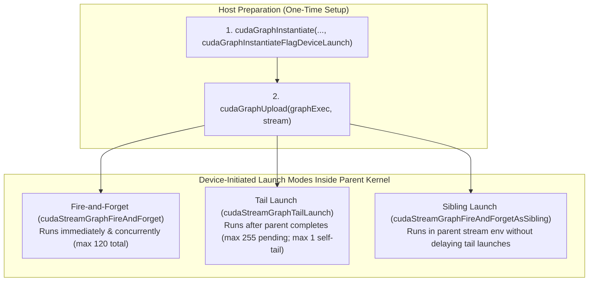

# 10.18 Dynamic scheduling, CUDA graphs and device-initiated orchestration

| | |
|---|---|
| Level | Advanced |
| Priority tier | 2 |
| Lab venue | Nebius GPU |
| Part | Part 10: The GPU and CUDA |
| Sources used | *AI Systems Performance Engineering* (`ai-systems-performance-engineering`, Chris Fregly), Chapter 12 (*Dynamic Scheduling, CUDA Graphs, and Device-Initiated Kernel Orchestration*); `nvidia-devops` Volume 03 (*CUDA Fundamentals*, Chapters 1–13 & Labs 01–04) |
| Code | `code/part10/dynamic_scheduling_graphs.py`, `code/part10/dynamic_scheduling_graphs_lab.py` |
| Coverage file | `planning/coverage/chapters/10-18.md` |

## Why this matters for AI infrastructure

Chapters `10.16` and `10.17` hid memory and launch latency inside a kernel (`<cuda/pipeline>`, warp specialization, Thread Block Clusters) and across streams (`cudaMallocAsync`, `cudaMemcpyPeerAsync`, `PDL`). Yet three major orchestration bottlenecks still arise on modern multi-GPU systems—including rack-scale systems such as NVIDIA's **`DGX GB200 NVL72`**, which links **`36` Grace CPUs** and **`72` Blackwell GPUs** into a single NVLink domain with unified addressing and up to **`30 TB`** of combined CPU and GPU unified memory (*AI Systems Performance Engineering* Chapter 12):

1. **Intra-kernel load imbalance across SMs (`200 ms → 100 ms`):** When threads execute variable-trip-count loops (`work = idx % 256` on `N = 1,048,576` elements in `uneven_static.cu`), early blocks finish while slow blocks hold SMs hostage. Moving to a **warp-batched L2-cache atomic work queue** (`computeKernelDynamicBatch` in `uneven_dynamic.cu`, where one elected warp leader claims `batchSize = 32` items via `atomicAdd(&globalIndex, warpSize)` and broadcasts the base index via `__shfl_sync`) cuts L2 atomic operations **`32x` (`1,048,576 → 32,768`)**, drives Nsight Compute's `atomic_transactions_per_request` contention ratio down to **`1.0`**, and halves runtime from **`200 ms` to `100 ms` (`2.0x` speedup)**.
2. **Host CPU launch overhead during autoregressive LLM decode (`45 µs` CPU launch for `9 µs` GPU work; `40,000` launches per response):** Every standard `<<<grid, block>>>` launch costs the host CPU roughly **`5` to `15 µs`** (up to `~20 µs` with host synchronization). In `nvidia-devops` Volume 03 Chapter 10, launching `3` decode kernels that each run in **`3 µs`** on the GPU (`9 µs` total GPU work) requires `3 × 15 µs =` **`45 µs`** of CPU launch overhead—wasting **`83.3%` (`> 80%`)** of wall-clock time on CPU submission. Generating a `500`-token response across an `80`-layer LLM dispatches `500 × 80 =` **`40,000` individual CUDA kernels**, pinning CPU cores at `100%` while GPU utilization sits at `20%`. **CUDA Graphs** capture the `80`-layer pass once and replay it with `1` host call per token (`500` replays total), cutting 100-iteration latency in **Table 12-1** from **`1.00 ms` to `0.75 ms` (`25%` faster, `300 → 100` launches, `300 → 0` syncs, `~3 µs → 0 µs` gaps)**.
3. **Host round-trips for data-dependent branching and multi-GPU coordination:** When the next kernel or branch depends on values computed on the GPU, copying flags back to the CPU stalls every SM. **Device-initiated CUDA Graph launches** (`cudaGraphInstantiateFlagDeviceLaunch`, **`~2x` lower launch latency** than host graph launches across **Fire-and-Forget** [`120` max], **Tail** [`255` max pending, `1` self-tail-launch], and **Sibling** modes), **Conditional Graph Nodes** (`IF`, `IF/ELSE`, `WHILE`, `SWITCH`), **Dynamic Parallelism (`-rdc=true`, Table 12-2: `40% → 5%` GPU idle cycles, `1.00 → 0.75 ms`)**, and **NVSHMEM Partitioned Global Address Space (`PGAS`)** one-sided puts/signals keep scheduling, branching, and GPU-to-GPU work stealing `100%` on the device.

:::note About the numbers and code in this chapter
*AI Systems Performance Engineering* says the numeric values in its metric tables (Tables 12-1 and 12-2 here, and the `200 ms` to `100 ms` work-queue result) are illustrative, and the Volume 03 timings (`45 µs`, `812.4 ms`, `1,928.3 ms`, `3,140.9 ms`, `2,214.8 ms`) come from notes that mark their outputs as illustrative or one reference run. None were measured on a GPU for this handbook, and the CUDA code is reproduced from the book and was not compiled here.
:::

## Prerequisites and outcomes

**Prerequisites:**
- Chapters `10.11`–`10.17` (CUDA kernels, streams, events, pinned memory, `cudaMallocAsync`, Nsight profiling metrics, and `<cuda/pipeline>`).

**Outcomes — after completing this chapter you will be able to:**
1. Diagnose L2 atomic contention using Nsight Compute (`atomic_transactions` and `atomic_transactions_per_request -> 1.0`) and implement a warp-leader batched atomic work queue (`__activemask()`, `__ffs()`, `atomicAdd`, `__shfl_sync`) that achieves a `2.0x` speedup (`200 ms → 100 ms`) on imbalanced workloads.
2. Capture, instantiate, warm up, and replay **CUDA Graphs** in C++ (`cudaStreamBeginCapture`, `cudaGraphInstantiate`, `cudaGraphLaunch`) and PyTorch (`torch.cuda.CUDAGraph`, `torch.cuda.graph_pool_handle()`, `mode="reduce-overhead"`), update node parameters dynamically with `cudaGraphExecUpdate`, and design bounded shape-bucketed graph caches with per-slot buffer ownership (`Slot 0..2`).
3. Launch CUDA Graphs directly from device kernels (`cudaGraphInstantiateFlagDeviceLaunch` + `cudaGraphUpload`) using **Fire-and-Forget (`cudaStreamGraphFireAndForget`, max `120`)**, **Tail (`cudaStreamGraphTailLaunch`, max `255` pending / `1` self-tail-launch via `cudaGetCurrentGraphExec()`)**, and **Sibling (`cudaStreamGraphFireAndForgetAsSibling`)** modes, and build GPU-evaluated **Conditional Graph Nodes (`IF`, `IF/ELSE`, `WHILE`, `SWITCH`)**.
4. Implement **Dynamic Parallelism (`-rdc=true`)** where a parent kernel spawns child kernels on the device (**Table 12-2**: `3 → 1` host launches, `40% → 5%` idle cycles, `1.00 → 0.75 ms`), configuring `cudaLimitDevRuntimePendingLaunchCount` (`2,048` default) and `cudaLimitStackSize`.
5. Orchestrate multi-GPU pipelines with **NVSHMEM (`PGAS`)** one-sided puts (`nvshmem_float_p`, `nvshmem_quiet`, `nvshmem_int_p`, `nvshmem_int_wait_until`), cross-GPU atomic work stealing (`nvshmem_int_atomic_inc`), lockstep `nvshmemx_collective_launch` (`nvshmem_barrier_all`), and graph-captured bucketed `NCCL` all-reduce.
6. Apply the **Roofline-guided orchestration framework** (*ASP* Ch 12 Figure 12-17) and the **Volume 03 3-Level Production Profiling Funnel & Lab 04 Failure Diagnostics** (`812.4 ms` baseline vs `1,928.3 ms` sync `2.37x`, `3,140.9 ms` tiny chunks `3.87x`, `2,214.8 ms` pageable `2.73x`, allocator fragmentation OOM across `340` blocks, and `compute-sanitizer` bounds localization).

---

## 1. Dynamic Scheduling with L2-Cache Atomic Work Queues

### 1.1 L2-cache atomics, `atomic_transactions_per_request`, and batching (`batchSize = 8, 16, 32`)

When different threads or thread blocks execute input-dependent work (such as sparse attention blocks, variable-length token sequences, or graph traversals), static `idx = blockIdx.x * blockDim.x + threadIdx.x` assignment leaves fast-finishing SMs idle while slow SMs finish the tail. You can spot this in **Nsight Systems** as ragged stream tails and in **Nsight Compute** as a low ratio of **SM Active Cycles to Elapsed Cycles** or low achieved occupancy (*AI Systems Performance Engineering* Ch 12, *Dynamic Scheduling with Atomic Work Queues*).

Modern NVIDIA GPUs service global `atomicAdd` instructions directly inside the on-chip **L2 cache** rather than round-tripping to HBM DRAM (Figure 12-1). Uncontended L2 atomics are fast, but when thousands of threads hammer the same counter simultaneously, L2 serializes and replays conflicting requests. In Nsight Compute's **Memory Workload Analysis** section, monitor two counters:
- **`atomic_transactions`:** Total number of L2-cache atomic transactions executed, including contention replays.
- **`atomic_transactions_per_request` (Contention Ratio):** Average number of L2 transactions generated per `atomicAdd` instruction.
  - **`~1.0` (Ideal):** Every `atomicAdd` completes in a single L2 transaction with zero retries.
  - **`> 1.0` (Contention hotspot):** Threads are stalling and retrying serialized atomic updates on the same cache line.

To collapse contention back toward **`1.0`**, amortize counter updates by **claiming work in batches** (`batchSize = 32`, or even **`8` or `16`** items per atomic, which eliminates most contention and yields **`10%–30%`** typical throughput gains, up to **`~2x`** under extreme imbalance; `evaluate_atomic_work_queue()` in `code/part10/dynamic_scheduling_graphs.py`):

```cpp
// Unbatched atomic queue (high L2 contention: 1,048,576 atomics for N = 1 << 20)
int idx = atomicAdd(&queue_head, 1);
if (idx < N) process(data[idx]);

// Batched atomic queue (32x fewer atomics: 32,768 atomics for N = 1 << 20)
const int batchSize = 32;
int start = atomicAdd(&queue_head, batchSize);
for (int i = start; i < start + batchSize && i < N; ++i) {
    process(data[i]);
}
```

### 1.2 Warp-leader dynamic work queue (`uneven_static.cu` `200 ms` vs `uneven_dynamic.cu` `100 ms`)

Instead of having every thread claim `32` items sequentially, elect **one active leader thread per warp** (`__activemask()` and `__ffs(mask) - 1`), have the leader execute a single `atomicAdd(&globalIndex, warpSize)` (`32` items), and broadcast the starting index to all active lanes in the warp via `__shfl_sync(mask, base, leader)` (*ASP* Ch 12, *Atomic Queues*, Figure 12-2).

Compare the static imbalanced kernel (`uneven_static.cu`, where each thread executes `work = idx % 256` iterations of `sinf(x) * cosf(x)` on `N = 1 << 20 = 1,048,576` elements in **`~200 ms`**) against the warp-batched dynamic queue (`uneven_dynamic.cu`, which completes the exact same work in **`~100 ms` = `2.0x` speedup**):

```cpp
// Warp-batched dynamic atomic work queue (uneven_dynamic.cu: ~100 ms vs ~200 ms static = 2.0x speedup)
// Source: AI Systems Performance Engineering, Chapter 12
#include <cuda_runtime.h>
#include <cmath>

__device__ unsigned int globalIndex = 0;

__global__ void computeKernelDynamicBatch(const float* input,
                                          float* output,
                                          int N) {
    int lane = threadIdx.x & (warpSize - 1); // lane id in [0, 31]

    while (true) {
        // 1. Elect an active leader lane (safe under warp divergence)
        unsigned mask = __activemask();
        int leader = __ffs(mask) - 1;

        // 2. Only the warp leader performs 1 L2 atomicAdd for the entire 32-lane warp
        unsigned int base = 0;
        if (lane == leader) {
            base = atomicAdd(&globalIndex, warpSize);
        }

        // 3. Broadcast starting index to all active lanes in the warp
        base = __shfl_sync(mask, base, leader);
        unsigned int idx = base + lane;
        if (idx >= static_cast<unsigned int>(N)) break; // dynamic termination

        // 4. Hoist loop invariants out of the variable trip-count loop (or use __sincosf)
        float s = sinf(input[idx]);
        float c = cosf(input[idx]);
        int work = idx % 256;
        float result = 0.0f;
        #pragma unroll 1
        for (int i = 0; i < work; ++i) {
            result += s * c;
        }
        output[idx] = result;
    }
}

void launchDynamicBatchQueue(const float* d_in, float* d_out, int N, cudaStream_t stream) {
    // CRITICAL: Reset device symbol globalIndex to 0 before each kernel invocation
    unsigned int zero = 0;
    cudaMemcpyToSymbolAsync(globalIndex, &zero, sizeof(unsigned int), 0,
                            cudaMemcpyHostToDevice, stream);
    dim3 block(256), grid((N + 255) / 256);
    computeKernelDynamicBatch<<<grid, block, 0, stream>>>(d_in, d_out, N);
}
```

---

## 2. CUDA Graphs: Eliminating Host Submission Overhead in C++, PyTorch, and Inference Engines

### 2.1 Why CPU launch overhead dominates LLM decode (`15 µs` launch vs `3 µs` kernel & `40,000` launches)

Even though a CUDA kernel launch is asynchronous, the host CPU still spends roughly **`5` to `15 µs`** (or `~20 µs` when including driver/sync bookkeeping) marshaling arguments, validating state, and submitting command descriptors over PCIe/NVLink-C2C to the GPU's GigaThread Engine (`nvidia-devops` Volume 03, `chapter-10-cuda-graphs-and-repeated-execution.md` and `chapter-chapter-10-cuda-graphs-and-repeated-execution.md`; `analyze_decode_launch_overhead()` in `code/part10/dynamic_scheduling_graphs.py`):
- **Micro-kernel chain (`3` kernels × `3 µs` GPU execution vs `15 µs` CPU launch):**
  - Total GPU execution time: `3 × 3 µs =` **`9.0 µs`**.
  - Total CPU launch overhead: `3 × 15 µs =` **`45.0 µs`** (`54.0 µs` total elapsed, meaning **`83.3%` [`> 80%`]** of the timeline is spent waiting on the CPU to dispatch work).
- **Production Triton / vLLM 80-layer LLM decode scenario:**
  - Generating a **`500`-token** response across an **`80`-layer** Transformer requires launching the 80-layer sequence `500` times = **`40,000` individual kernel launches** in under a second. Without CUDA Graphs, CPU cores pin at **`100%`** inside the CUDA driver while GPU utilization languishes at **`20%`**. Capturing the `80`-layer forward pass into a single **CUDA Graph** replaces `40,000` kernel launches with **`500` lightweight `cudaGraphLaunch` replays** (`1` per generated token).

### 2.2 Stream capture, PyTorch `torch.cuda.CUDAGraph`, static memory pools, and Table 12-1

To capture a workflow into a `cudaGraph_t` and instantiate an executable `cudaGraphExec_t` in C++ (*AI Systems Performance Engineering* Ch 12, *Capturing a CUDA Graph with a CUDA Stream*, Figure 12-3):

```cpp
// Capturing and replaying a 3-kernel pipeline (A -> B -> C) 100 times with CUDA Graphs
// Source: AI Systems Performance Engineering, Chapter 12
cudaStream_t stream;
cudaStreamCreateWithFlags(&stream, cudaStreamNonBlocking);

cudaGraph_t graph;
cudaGraphExec_t instance;

// 1. Capture kernelA -> kernelB -> kernelC into graph without executing them yet
cudaStreamBeginCapture(stream, cudaStreamCaptureModeGlobal);
kernelA<<<grid, block, 0, stream>>>(d_X);
kernelB<<<grid, block, 0, stream>>>(d_Y);
kernelC<<<grid, block, 0, stream>>>(d_Z);
cudaStreamEndCapture(stream, &graph);

// 2. Validate and instantiate executable graph outside the hot loop
cudaGraphInstantiate(&instance, graph, nullptr, nullptr, 0);

// 3. Replay 100 iterations with 1 host call per iteration and 0 per-kernel syncs
for (int iter = 0; iter < 100; ++iter) {
    cudaGraphLaunch(instance, stream);
}
cudaStreamSynchronize(stream);

cudaGraphExecDestroy(instance);
cudaGraphDestroy(graph);
```

In PyTorch, CUDA Graph capture requires **two strict invariants** (*ASP* Ch 12, *PyTorch, Inference Engines, and CUDA Graphs* & *Memory Pools for CUDA Graphs*, Figure 12-4):
1. **Mandatory warm-up pass before capture:** Run `opC(opB(opA(X)))` followed by `torch.cuda.synchronize()` on a non-default stream *before* entering `with torch.cuda.graph(g, stream=stream):` so lazy cuBLAS/cuDNN workspace allocations and JIT compilations complete outside the capture window.
2. **Pointer stability (`static_x.copy_(new_X)` and `torch.cuda.graph_pool_handle()`):** A captured `cudaGraphExec_t` bakes fixed virtual memory addresses into every node. You must preallocate persistent static buffers (`static_x`, `static_y`, `static_z`, `static_w`) and write in-place (`out=` or `.copy_()`) or share a dedicated static graph memory pool via `torch.cuda.graph_pool_handle()`. Note that `torch.compile(..., mode="reduce-overhead")` automatically wraps eligible static-shape CUDA regions in CUDA Graphs using pooled buffers, while inference engines (`vLLM`, `TensorRT-LLM`) pre-capture one graph per bucketed batch size during startup and pad incoming requests to the nearest captured batch bucket.

```python
# PyTorch CUDAGraph capture with warmup and pointer-stable static buffers (ASP Ch 12) (untested here)
import torch

X = torch.randn(1 << 20, device="cuda")
static_x = torch.empty_like(X)
static_y = torch.empty_like(X)
static_z = torch.empty_like(X)
static_w = torch.empty_like(X)

# 1. Warm up once to initialize cuBLAS/cuDNN contexts and allocator caches
_ = (X * 1.1 + 2.0).sqrt()
torch.cuda.synchronize()
static_x.copy_(X)

# 2. Capture into a CUDAGraph using out= parameters to preserve fixed tensor addresses
g = torch.cuda.CUDAGraph()
stream = torch.cuda.Stream()
torch.cuda.synchronize()
with torch.cuda.graph(g, stream=stream):
    torch.mul(static_x, 1.1, out=static_y)
    torch.add(static_y, 2.0, out=static_z)
    torch.sqrt(static_z, out=static_w)

# 3. Replay 100 iterations (copy new inputs into static_x before g.replay())
for _ in range(100):
    g.replay()
torch.cuda.synchronize()
```

Look at the impact the book reports across `100` iterations of the `A → B → C` pipeline in **Table 12-1** (*AI Systems Performance Engineering* Ch 12; `TABLE_12_1_CUDA_GRAPHS` in `code/part10/dynamic_scheduling_graphs.py`):

| Metric | Before CUDA Graphs (Standard Stream Launches) | After CUDA Graphs (`cudaGraphLaunch` / `g.replay()`) | Improvement |
|---|---:|---:|---|
| **CPU launch calls per `100` iterations** | `300` separate kernel launches | **`100` graph replays (`1` per iteration)** | **`3.0x` fewer host launch calls** |
| **Host synchronization calls** | `300` `cudaDeviceSynchronize` calls | **`0` inside loop** | Eliminates host-device handshakes |
| **Average GPU idle gap between kernels** | `~3 µs` gaps per iteration | **`0 µs` (continuous back-to-back execution)** | Removes inter-kernel launch bubbles |
| **End-to-end iteration latency** | `~1.00 ms` | **`~0.75 ms`** | **`25%` faster (`20%–30%` typical reduction)** |

### 2.3 Dynamic Graph Updates (`cudaGraphExecUpdate`), Per-Slot Buffer Ownership, and Production Graph Caches (`V3 Ch 10`)

When a workflow's **topology** (number of nodes and dependency edges) stays constant while launch parameters change (for example, capturing a template graph at a maximum batch size of **`128`** and serving an incoming request of batch size **`64`**), you do not need to rebuild the graph from scratch (*ASP* Ch 12, *Dynamic Graph Update* & `nvidia-devops` V3 Ch 10):
- Call **`cudaGraphExecUpdate(graphExec, newGraph, &resultInfo)`** or **`cudaGraphExecKernelNodeSetParams(...)`** to patch grid/block dimensions, scalar arguments, or buffer pointers in a few microseconds while preserving **`sub-100 µs`** graph replay overhead.
- **Always check the `cudaGraphExecUpdate` return status (`cudaGraphExecUpdateErrorTopologyChanged`):** In `nvidia-devops` Volume 03 Chapter 10, when a request changes shape from `512` to `513` in a way that alters the node topology, `cudaGraphExecUpdate` returns **`cudaGraphExecUpdateErrorTopologyChanged`**. If a service ignores that return code (`--skip-update-check`), it silently replays the old `512`-shape `graphExec` against `513`-shape buffers and produces corrupted outputs. Production code must branch on the update status and fall back to a full `cudaGraphInstantiate` rebuild (or stream execution) whenever an update is rejected.
- **Per-Slot Buffer Ownership (`Slot 0..2`, V3 Ch 10 Figure 3.10.3):** Under concurrent multi-stream execution, never share a single buffer set across multiple in-flight replays. Allocate **one `cudaGraphExec_t` + dedicated input/output buffers + completion `cudaEvent_t` per pipeline slot (`Slot 0`, `Slot 1`, `Slot 2`)**, and do not reuse Slot `k` until `Completion Event k` signals.
- **When CUDA Graphs provide zero benefit (`nsys` check, V3 Ch 10):** Before adopting graphs, run `nsys stats --report cuda_api_sum`. In V3 Ch 10's diagnostic example, `500` calls to `cudaLaunchKernel` take only **`4,120,000 ns` (`2.1%` of API time)** while `500` calls to `cudaMemcpyAsync` moving `512 MB` take **`189,340,000 ns` (`97.3%` of API time)**. Wrapping that transfer-bound workflow in a CUDA Graph yields zero end-to-end speedup.

---

## 3. Device-Initiated CUDA Graph Launches and Conditional Graph Nodes

### 3.1 Device-side graph launch modes (`Fire-and-Forget`, `Tail`, and `Sibling`, `Figures 12-5 to 12-8`)

Host-launched CUDA Graphs still require the CPU to issue `cudaGraphLaunch` each iteration. **Device-initiated CUDA Graph launches** allow a running GPU kernel to trigger a pre-recorded `cudaGraphExec_t` directly from device code—achieving **`~2x` lower launch latency** than host-side graph launches and maintaining **flat launch latency** regardless of how many nodes or parallel branches the graph contains (*AI Systems Performance Engineering* Ch 12, *Device-Initiated CUDA Graph Launch*, Figures 12-5 to 12-8).

To prepare a graph for device-side launch, the host must:
1. Instantiate the graph with **`cudaGraphInstantiateFlagDeviceLaunch`**:
   `cudaGraphInstantiate(&graphExec, graph, nullptr, nullptr, cudaGraphInstantiateFlagDeviceLaunch);`
2. Upload the executable graph to device memory **before** any kernel attempts to launch it:
   `cudaGraphUpload(graphExec, stream);`

Inside a `__global__` kernel, calling `cudaGraphLaunch(graphExec, mode)` supports three reserved stream launch modes:

| Device Graph Launch Mode | Reserved Stream Constant | Execution & Ordering Semantics | Hardware / Runtime Concurrency Limit |
|---|---|---|---|
| **1. Fire-and-Forget Launch** | `cudaStreamGraphFireAndForget` | Child graph begins executing **immediately and concurrently** with the launching parent kernel; parent does not wait. Ideal for independent side tasks. | Up to **`120` total fire-and-forget graphs** during the course of a graph's execution. |
| **2. Tail Launch ( Figures 12-6 & 12-7)** | `cudaStreamGraphTailLaunch` | Defers child graph execution until the launching kernel **completes**, running as a sequential continuation. Ideal when downstream nodes consume the parent kernel's output or for persistent GPU-resident schedulers (`cudaGetCurrentGraphExec()`). Nested tail launches from a child execute *before* the parent's remaining queued tail launches. | Up to **`255` pending tail launches** enqueued in a CUDA Graph; at most **`1` pending self-tail-launch** (`cudaGetCurrentGraphExec()`) at a time. |
| **3. Sibling Launch (Figure 12-8)** | `cudaStreamGraphFireAndForgetAsSibling` | Launches immediately as a **peer (sibling)** in the parent graph's stream environment so it runs concurrently **without delaying any tail launches** of the parent graph. | Bounded by fire-and-forget / resident grid limits. |



**Persistent In-Kernel LLM Decode Scheduler (`ASP` Ch 12):** By combining an L2 atomic work queue (`atomicAdd(&queueHead, 1)`) with `cudaStreamGraphTailLaunch` and `cudaGetCurrentGraphExec()`, a lightweight persistent scheduler kernel claims the next token batch on the GPU, tail-launches the pre-captured Transformer decode `cudaGraphExec_t`, and re-enqueues itself—running the entire multi-step autoregressive decode loop on the GPU with zero CPU intervention.

### 3.2 Conditional Graph Nodes (`IF`, `IF/ELSE`, `WHILE`, `SWITCH`, `Figures 12-9 to 12-11`)

Standard CUDA Graphs have static control flow. **Conditional Graph Nodes** embed GPU-evaluated branches and loops directly inside a `cudaGraph_t` via a device-writable **`cudaGraphConditionalHandle`** (*ASP* Ch 12, *Conditional Graph Nodes*, Figures 12-9 to 12-11):
- **`IF` (`cudaGraphCondTypeIf`, `size = 1`):** Executes its single body subgraph once if the condition handle is nonzero.
- **`IF/ELSE` (`size = 2`):** Executes body subgraph `0` when the handle is nonzero (`true`) and body subgraph `1` when `0` (`false`).
- **`WHILE`:** Repeatedly executes its body subgraph as long as the condition handle remains nonzero, re-evaluating after each iteration (and can nest `IF` nodes inside `WHILE` bodies, Figure 12-11).
- **`SWITCH` (`size = N`):** Holds `N` body subgraphs and executes the `i`-th subgraph when `handle == i` (or skips execution if `handle >= N`).

Here is the complete C++ implementation of an `IF` conditional node from *AI Systems Performance Engineering* Chapter 12 (`threshold = 123456`, `N = 1 << 20 = 1,048,576`):

```cpp
// Conditional Graph Node (cudaGraphCondTypeIf) evaluated entirely on the GPU
// Source: AI Systems Performance Engineering, Chapter 12
#include <cuda_runtime.h>
#include <cstdio>

__device__ int reduce_sum(const int* data, size_t N) { return data[0]; }

// 1. Upstream device kernel sets the condition handle from a SINGLE thread (avoids races)
__global__ void setHandle(cudaGraphConditionalHandle handle, int* data, size_t N) {
    constexpr int threshold = 123456;
    if (threadIdx.x == 0 && blockIdx.x == 0) {
        unsigned int flag = (reduce_sum(data, N) > threshold) ? 1u : 0u;
        cudaGraphSetConditional(handle, flag);
    }
}

// 2. Conditional body kernel: runs on GPU only when flag != 0
__global__ void bodyKernel() {
    printf("Conditional body executed on GPU\n");
}

void runConditionalGraphExample() {
    cudaStream_t stream;
    cudaStreamCreateWithFlags(&stream, cudaStreamNonBlocking);

    cudaGraph_t graph;
    cudaGraphCreate(&graph, 0);

    // Create condition handle associated with graph
    cudaGraphConditionalHandle condHandle;
    cudaGraphConditionalHandleCreate(&condHandle, graph);

    constexpr size_t N = 1 << 20; // 1,048,576 ints
    int* d_data = nullptr;
    cudaMalloc(&d_data, N * sizeof(int));

    // Add upstream setHandle kernel node
    cudaGraphNode_t setNode;
    cudaKernelNodeParams setParams = {};
    setParams.func = (void*)setHandle;
    setParams.gridDim = dim3(1);
    setParams.blockDim = dim3(32);
    void* setArgs[] = { &condHandle, &d_data, (void*)&N };
    setParams.kernelParams = setArgs;
    cudaGraphAddKernelNode(&setNode, graph, nullptr, 0, &setParams);

    // Add IF conditional node dependent on setNode
    cudaGraphNode_t condNode;
    cudaConditionalNodeParams ifParams = {};
    ifParams.handle = condHandle;
    ifParams.type = cudaGraphCondTypeIf;
    ifParams.size = 1; // 1 body subgraph for IF (2 for IF/ELSE)
    cudaGraphAddConditionalNode(&condNode, graph, &setNode, 1, &ifParams);

    // Populate the IF body subgraph (phGraphOut[0])
    cudaGraph_t bodyGraph = ifParams.phGraphOut[0];
    cudaGraphNode_t bodyNode;
    cudaKernelNodeParams bodyParams = {};
    bodyParams.func = (void*)bodyKernel;
    bodyParams.gridDim = dim3(1);
    bodyParams.blockDim = dim3(32);
    cudaGraphAddKernelNode(&bodyNode, bodyGraph, nullptr, 0, &bodyParams);

    // Instantiate with DeviceLaunch flag, upload, and launch
    cudaGraphExec_t graphExec;
    cudaGraphInstantiate(&graphExec, graph, nullptr, nullptr,
                         cudaGraphInstantiateFlagDeviceLaunch);
    cudaGraphUpload(graphExec, stream);
    cudaGraphLaunch(graphExec, stream);
    cudaStreamSynchronize(stream);

    cudaGraphExecDestroy(graphExec);
    cudaGraphDestroy(graph);
    cudaStreamDestroy(stream);
    cudaFree(d_data);
}
```

---

## 4. Dynamic Parallelism (`DP`, `-rdc=true`) and Table 12-2

When the number of child tasks, grid dimensions, or recursive subdivisions emerges dynamically from data at runtime (such as adaptive mesh refinement, hierarchical tree/graph traversals, or per-token auxiliary attention blocks in LLMs) and cannot be pre-recorded into a fixed CUDA Graph, **Dynamic Parallelism (`DP`)** allows a running `parentKernel` to launch `childKernel<<<blocks, threads>>>` directly on the GPU (*AI Systems Performance Engineering* Ch 12, *Dynamic Parallelism*, Figures 12-12 & 12-13):
- **Compilation requirement (`-rdc=true`):** Requires relocatable device code (`nvcc -rdc=true`).
- **Single-thread launch rule & implicit parent-child synchronization:** Guard child launches with `if (blockIdx.x == 0 && threadIdx.x == 0)` so every thread does not spawn duplicate grids. A parent kernel **implicitly waits for all of its device-launched child kernels to complete** before the parent kernel itself finishes—so no device-side `cudaDeviceSynchronize()` is needed.
- **Hardware resource limits (`2,048` pending launches & stack size):**
  - By default, CUDA allows **`2,048` outstanding device-initiated child launches** at one time; if a parent loop spawns more than `2,048` children, raise the limit on the host via **`cudaDeviceSetLimit(cudaLimitDevRuntimePendingLaunchCount, newLimit)`**.
  - Nested child launches consume device stack memory; prevent stack overflows via **`cudaDeviceSetLimit(cudaLimitStackSize, newSize)`**.

```cpp
// Device-launched Dynamic Parallelism (dp_device_launched.cu: compile with nvcc -rdc=true)
// Source: AI Systems Performance Engineering, Chapter 12
#include <cuda_runtime.h>

__global__ void childKernel(float* data, int n) {
    int idx = blockIdx.x * blockDim.x + threadIdx.x;
    if (idx < n) {
        data[idx] = data[idx] * data[idx];
    }
}

__global__ void parentKernel(float* data, int n) {
    // Launch children from a single thread (block 0, thread 0) to avoid duplicate grids
    if (blockIdx.x == 0 && threadIdx.x == 0) {
        const int threadsPerBlock = 256;
        const int firstHalfCount = n / 2;               // 524,288 for N = 1,048,576
        const int secondHalfCount = n - firstHalfCount; // 524,288
        const int blocksFirst = (firstHalfCount + threadsPerBlock - 1) / threadsPerBlock;   // 2,048
        const int blocksSecond = (secondHalfCount + threadsPerBlock - 1) / threadsPerBlock; // 2,048

        // Device-initiated child launches (parent implicitly waits for children before exiting)
        childKernel<<<blocksFirst, threadsPerBlock>>>(data, firstHalfCount);
        childKernel<<<blocksSecond, threadsPerBlock>>>(data + firstHalfCount, secondHalfCount);
    }
}
```

Compare host-driven vs. device-driven nested launches (`1` parent + `2` children on `N = 1,048,576`) in **Table 12-2** (*AI Systems Performance Engineering* Ch 12; `TABLE_12_2_DYNAMIC_PARALLELISM` in `code/part10/dynamic_scheduling_graphs.py`):

| Metric | Before (`dp_host_launched.cu`: Host Launch) | After (`dp_device_launched.cu`: Device DP Launch) | Impact |
|---|---:|---:|---|
| **Total host launches** | `3` (`1` parent + `2` children) | **`1` (parent only)** | Eliminates `2` CPU-GPU round-trips |
| **Average launch overhead per call** | `~20 µs` | **`~25 µs`** | Slight `+5 µs` on-device scheduling cost |
| **GPU idle cycles (during sequence)** | `~40%` | **`~5%`** | **`-35 percentage points` (`87.5%` less idle time)** |
| **Overall execution time** | `1.00 ms` | **`0.75 ms`** | **`25%` faster** + preserves L2 cache locality |

---

## 5. Multi-GPU Orchestration (`NVSHMEM` PGAS & Graph-Captured `NCCL`), Roofline Decisions, and the Volume 03 Production Profiling Funnel

### 5.1 Fine-grained GPU-to-GPU PGAS orchestration with `NVSHMEM` (`Figure 12-14`)

While `cudaMemcpyPeerAsync` and `NCCL` handle bulk tensor transfers, **NVIDIA SHMEM (`NVSHMEM`)** exposes a **Partitioned Global Address Space (`PGAS`)** across GPUs where each GPU is a Processing Element (`PE`, queried via `nvshmem_my_pe()`) with symmetric heap memory allocated via `nvshmem_malloc()` (*ASP* Ch 12, *Fine-Grained GPU-to-GPU Memory Sharing with NVSHMEM*, Figure 12-14). Inside a kernel, a thread on `PE 0` can write directly into `PE 1`'s HBM over NVLink or GPUDirect RDMA with **one-sided puts and signals**—bypassing the host CPU completely:

```cpp
// NVSHMEM one-sided put + quiet + flag signal and cross-GPU atomic work stealing
// Source: AI Systems Performance Engineering, Chapter 12
#include <cuda_runtime.h>
#include <nvshmem.h>
#include <nvshmemx.h>

__device__ int* remote_flag;
__device__ float* remote_data;

// PE 0: One-sided put payload into PE 1, fence with nvshmem_quiet(), then signal remote_flag[0] = 1
__global__ void sender_kernel(float* local_data, int dest_pe) {
    int idx = blockIdx.x * blockDim.x + threadIdx.x;
    float value = local_data[idx];
    nvshmem_float_p(remote_data + 1, value, dest_pe); // 1. One-sided RMA put to dest_pe
    nvshmem_quiet();                                  // 2. Ensure remote write completes
    nvshmem_int_p(remote_flag + 0, 1, dest_pe);       // 3. Flip remote signal flag on dest_pe
}

// PE 1: Spin on symmetric flag in local HBM, then consume payload immediately
__global__ void receiver_kernel(float* recv_buffer) {
    nvshmem_int_wait_until(remote_flag + 0, NVSHMEM_CMP_EQ, 1);
    recv_buffer[0] = remote_data[1] * 2.0f;
}

// Cross-GPU dynamic work-stealing queue using NVSHMEM atomics
__global__ void work_steal_kernel(int* queue_head, int N_tasks) {
    while (true) {
        int idx = nvshmem_int_atomic_inc(queue_head);
        if (idx >= N_tasks) break;
        // Process task[idx]...
    }
}
```

When a kernel uses device-wide NVSHMEM barriers (`nvshmem_barrier_all()`), launch it across all PEs simultaneously with **`nvshmemx_collective_launch()`** so all GPUs co-reside and enter the barrier in lockstep; for irregular point-to-point pipelines (such as GPU 0 running Attention and pushing activations to GPU 1's persistent MLP kernel), prefer fine-grained point-to-point signals (`nvshmem_int_wait_until` / `nvshmemx_signal_op`) over global `nvshmem_barrier_all()` calls.

### 5.2 Capturing multi-GPU `NCCL` bucketed all-reduces in CUDA Graphs (`Figures 12-15 & 12-16`)

Capturing `computeGradientsLayer1` (`streamA`) + bucketed `ncclAllReduce` (`streamB`) + `computeGradientsLayer2` (`streamA`) into a single `CUDA Graph` via `cudaStreamBeginCapture(captureStream, cudaStreamCaptureModeGlobal)` + `cudaGraphInstantiate` + `cudaGraphUpload` eliminates per-step CPU jitter across thousands of GPUs (*ASP* Ch 12, *Capturing Multi-GPU Collectives with NCCL and CUDA Graphs*, Figures 12-15 & 12-16). Follow three mandatory rules:
1. **Identical collective sequence across all ranks:** Every rank in the communicator must capture and replay the exact same sequence of `ncclAllReduce` calls on the same `ncclComm_t`; a mismatched sequence deadlocks or corrupts reductions.
2. **Run warmup collectives before capture:** Execute preliminary warmup collectives ahead of `cudaStreamBeginCapture` so NCCL ring/tree channels and RDMA buffers are initialized outside the graph.
3. **Preallocate gradient and communication buffers before capture** (and use `cudaGraphExecUpdate` if pointer addresses or sizes change).

### 5.3 Roofline-guided orchestration decisions (`Figure 12-17`) and the Volume 03 Production Profiling Funnel (`V3 Ch 12, Ch 13 & Lab 04`)

Combine *AI Systems Performance Engineering* Chapter 12's **Roofline-Guided Orchestration Matrix** (Figure 12-17) with `nvidia-devops` Volume 03's **3-Level Production Profiling Funnel** (Chapters 12–13 & Lab 04; `recommend_roofline_orchestration()` and `evaluate_v3_lab04_diagnostics()` in `code/part10/dynamic_scheduling_graphs.py`):

| Profiling Level / Roofline Regime | Diagnostic Evidence (`nsys`, `ncu`, `nvidia-smi`, `compute-sanitizer`) | Recommended Orchestration / Fix |
|---|---|---|
| **Level 1 → Level 2: Host / Transfer / Sync Bottleneck (V3 Lab 04 Regressions on `67,108,864` elements, `812.4 ms` baseline)** | **STOP before kernel profiling** if `nsys` shows host gaps or serialization:<br/>- **Regression A (Device sync after each launch):** **`1,928.3 ms` (`2.37x` / `~2.4x` slower)**.<br/>- **Regression B (Tiny `16 KiB` = `4,096`-elem chunks vs `16 MiB` = `4,194,304`-elem chunks, `1,024x` more launches):** **`3,140.9 ms` (`3.87x` / `~3.9x` slower)**.<br/>- **Regression C (Pageable host buffers staging on CPU):** **`2,214.8 ms` (`2.73x` / `~2.7x` slower)**. | Remove per-launch `cudaDeviceSynchronize()`, size chunks to amortize `5–15 µs` submission cost (or capture into **CUDA Graphs**), and use pinned memory (`cudaMallocHost`) + `cudaStreamNonBlocking`. |
| **Level 3: Sloped Memory Roof (`Memory-Bound` Kernel, Figure 12-17)** | High HBM/DRAM throughput (`> 80%`), low arithmetic intensity (`FLOPs/byte` below ridge point). | Overlap transfers with **CUDA streams** and `cudaMemcpyAsync`, use reduced precision (`FP16`/`FP8`/`NVFP4`), and fuse memory-bound elementwise chains. |
| **Level 3: Below Flat Compute Roof due to Launch / Tail Gaps (`Compute-Bound, Launch-Limited`)** | High arithmetic intensity, but `nsys` shows `~3–15 µs` inter-kernel gaps or `ncu` shows tail wave imbalance (`work = idx % 256`). | Collapse launch gaps with **CUDA Graphs**, **Device-Initiated Graph Tail Launches**, **Dynamic Parallelism (`-rdc=true`)**, **Persistent Megakernels**, or **L2-batched atomic queues**. |
| **Level 3: Intermediate Regime (Under Both Roofs)** | Neither compute nor HBM bandwidth is saturated by a single stream. | Increase concurrency by running **multiple streams, concurrent CUDA Graphs, or multi-instance persistent kernels** in parallel. |
| **Allocator Fragmentation OOM vs Physical OOM (V3 Ch 12)** | `nvidia-smi -q -d MEMORY` reports `Total: 40,960 MiB`, `Reserved: 405 MiB`, `Used: 38,660 MiB`, **`Free: 1,895 MiB`**, yet a **`512.00 MiB`** allocation fails because `torch.cuda.memory_summary()` shows **`1,240 MiB` reserved-but-unallocated fragmented across `340` blocks**. | Enable stream-ordered memory pools (`PYTORCH_ALLOC_CONF=backend:cudaMallocAsync`), preallocate static graph pools (`torch.cuda.graph_pool_handle()`), and bound shape-bucketed graph caches. |
| **Deferred Asynchronous `cudaErrorIllegalAddress` (V3 Ch 12 & Ch 13)** | Error surfaces lazily at a downstream `cudaMemcpy` or `cudaStreamSynchronize`. Running `compute-sanitizer --tool=memcheck` pinpoints `scale_kernel` at **`block (3906,0,0)`, `thread (287,0,0)` (`blockDim = 256`)** → global index `3906 × 256 + 287 =` **`1,000,223 > 1,000,003`**. | Enforce bounds checks (`if (idx < N)`) and always collect the **10-item V3 Incident Evidence Bundle** (timestamp/workload ID, image digest, GPU/driver inventory, `nvidia-smi -q`, full CUDA error log, kernel `Xid` logs, Pod/node events, repro shape, recent changes, and `nsys` trace) *before* restarting the pod or node. |

---

## 6. Commands and Configurations That Matter

All commands below follow *AI Systems Performance Engineering* Chapter 12 and `nvidia-devops` Volume 03 (Chapters 10, 12, 13 & Lab 04). Shell commands that require an attached CUDA GPU are marked **(untested here)**.

### 6.1 Compile Dynamic Parallelism (`-rdc=true`), NVSHMEM, and inspect L2 atomic contention & CUDA Graphs in `ncu` / `nsys` (untested here)

```bash
# 1. Compile device-launched Dynamic Parallelism (-rdc=true is mandatory) (untested here)
nvcc -O3 -std=c++20 -arch=sm_100 -rdc=true dp_device_launched.cu -lcudadevrt -o dp_device_launched

# 2. Profile L2 atomic contention (atomic_transactions_per_request target ~1.0) in Nsight Compute (untested here)
ncu --metrics l1tex__t_set_accesses_pipe_lsu_mem_global_op_atom.sum,lts__t_sectors_op_atom.sum \
    --section MemoryWorkloadAnalysis ./uneven_dynamic

# 3. Check whether host launch overhead (cudaLaunchKernel %) justifies CUDA Graphs in Nsight Systems (untested here)
nsys profile --trace=cuda,nvtx,osrt --sample=none -o graph_eval ./my_inference_service
nsys stats --report cuda_api_sum graph_eval.nsys-rep

# 4. Pinpoint deferred out-of-bounds kernel writes with compute-sanitizer (V3 Ch 12) (untested here)
compute-sanitizer --tool=memcheck ./inference_engine
```

---

## 7. How It Fails: Six Dynamic Scheduling, CUDA Graph, and Device Orchestration Failure Modes

| # | Failure Mode | Production / Profiler Symptom | Root Cause | Fix |
|---|---|---|---|---|
| **1** | **Unbatched per-thread `atomicAdd(&queue_head, 1)` hotspot** | Nsight Compute shows `atomic_transactions_per_request >> 1.0` and high L2 atomic stall cycles on dynamic queues. | All `32` threads in every warp issue separate `atomicAdd` updates to the same L2 cache line (`1,048,576` atomics for `N = 1 << 20`, *ASP* Ch 12). | Elect one active warp leader (`__activemask()`, `__ffs(mask) - 1`), fetch a batch of `warpSize = 32` (or `8`/`16`) via `atomicAdd(&globalIndex, warpSize)`, and broadcast with `__shfl_sync`. |
| **2** | **Forgetting to reset `__device__ globalIndex = 0` or skipping CUDA Graph warmup** | Second iteration of `computeKernelDynamicBatch` exits immediately producing zeros, or `torch.cuda.graph()` fails during capture with `operation not permitted while stream is capturing`. | Device global counters persist across launches unless reset via `cudaMemcpyToSymbol`, and lazy cuBLAS/cuDNN/allocator initializations inside a capture window invalidate stream capture (*ASP* Ch 12 & *V3* Ch 10). | Reset `globalIndex` to `0` before every launch, and run one full eager warmup pass + `torch.cuda.synchronize()` before `cudaStreamBeginCapture` / `with torch.cuda.graph()`. |
| **3** | **Ignoring `cudaGraphExecUpdate` return status (`cudaGraphExecUpdateErrorTopologyChanged`) or mutating tensor addresses** | Inference service returns stale or corrupted outputs when request shape changes from `512` to `513` (*V3* Ch 10). | `cudaGraphExecUpdate` fails when node topology changes, and captured graphs read fixed virtual addresses baked in at instantiation (*ASP* Ch 12 & *V3* Ch 10). | Always check `cudaGraphExecUpdate` return codes (rebuilding on `cudaGraphExecUpdateErrorTopologyChanged`), copy new inputs into static buffers (`static_x.copy_()`), and isolate per-slot `GraphExec` + buffer sets (`Slot 0..2`). |
| **4** | **Unbounded shape-keyed CUDA Graph cache in variable-length LLM serving** | GPU HBM usage climbs steadily over hours until the server crashes with `CUDA out of memory` despite `nvidia-smi` showing free fragmented blocks (*V3* Ch 10 & Ch 12). | Caching a new `cudaGraphExec_t` and static memory pool for every unique `(batch_size, seq_len)` pair leaks memory without bound (*V3* Ch 10). | Bucket requests into a small fixed set of padded batch/sequence classes, cap maximum cached graph instances, and fall back to stream execution for rare shapes. |
| **5** | **Launching device-side CUDA Graphs without `cudaGraphInstantiateFlagDeviceLaunch` / `cudaGraphUpload` or exceeding `2,048` DP child launches** | Kernel faults at `cudaGraphLaunch` on device, or `parentKernel` fails mid-loop when spawning thousands of child kernels (*ASP* Ch 12). | Device-launched graphs must be instantiated with `cudaGraphInstantiateFlagDeviceLaunch` and uploaded via `cudaGraphUpload`, and Dynamic Parallelism defaults to `2,048` max pending child launches (`120` fire-and-forget / `255` tail graph launches; *ASP* Ch 12). | Pass `cudaGraphInstantiateFlagDeviceLaunch` + `cudaGraphUpload`, set `cudaGraphSetConditional` from a single thread (`threadIdx.x == 0`), and raise `cudaLimitDevRuntimePendingLaunchCount` / `cudaLimitStackSize` when needed. |
| **6** | **Mismatched `NCCL` collective order across ranks in Graph-Captured DDP / FSDP or missing `nvshmem_quiet()`** | Multi-GPU training hangs at `cudaGraphLaunch`, or `receiver_kernel` on `PE 1` reads stale `remote_data` after `remote_flag` turns `1` (*ASP* Ch 12). | Ranks captured different `ncclAllReduce` sequences, or `sender_kernel` flipped `remote_flag` via `nvshmem_int_p` without calling `nvshmem_quiet()` to fence the prior `nvshmem_float_p` payload write (*ASP* Ch 12). | Ensure all ranks capture the identical `NCCL` sequence after warmup collectives, and always call `nvshmem_quiet()` between payload puts and signal flag puts. |

---

## 8. Hands-On Lab: Verify L2 Atomic Queues, CUDA Graph Tables, Decode Launch Overhead, Dynamic Parallelism, and Volume 03 Regressions

**Venue:** Any Linux machine or Nebius GPU VM with Python 3.10+ (runs deterministically using standard library Python; all `nvcc`, `ncu`, `nsys`, and `compute-sanitizer` commands are provided in Section 6 and marked `(untested here)`).

Run `code/part10/dynamic_scheduling_graphs_lab.py`:

```bash
python3 code/part10/dynamic_scheduling_graphs_lab.py
```

Expected output (`25 passed, 0 failed`):

```text
=== Chapter 10.18 Lab: Dynamic Scheduling, CUDA Graphs & Device Orchestration (ASP Ch 12 + V3) ===
  [PASS] ASP Ch12 DGX GB200 NVL72: 36 Grace CPUs + 72 Blackwell GPUs with up to 30 TB unified memory in a single NVLink domain
  [PASS] ASP Ch12 Warp-batched atomic queue (batchSize=32): Reduces 1,048,576 atomics by 32.0x to 32,768 atomics and drives atomic_transactions_per_request toward 1.0
  [PASS] ASP Ch12 uneven_static.cu vs uneven_dynamic.cu (N=1<<20, work=idx%256): Dynamic warp-leader queue cuts runtime 200 ms -> 100 ms (2.0x speedup)
  [PASS] ASP Ch12 Modest atomic batching: batchSize=8 (131,072 atomics, 8.0x reduction) and batchSize=16 (65,536 atomics, 16.0x reduction)
  [PASS] ASP Ch12 Table 12-1: CUDA Graphs cut 100-iteration launches 300 -> 100, syncs 300 -> 0, inter-kernel gaps ~3 us -> 0 us, and iteration latency 1.00 -> 0.75 ms (-25.0%)
  [PASS] V3 Ch10 Decode Launch Overhead: 3 kernels of 3 us (9 us GPU work) with 15 us CPU launch each (45 us CPU work) spend 83.3% (>80%) of time in CPU launch overhead
  [PASS] V3 Ch10 Triton 80-layer LLM decode (500 tokens): Collapses 500 * 80 == 40,000 individual kernel launches into 500 graph replays
  [PASS] V3 Ch10 nsys cuda_api_sum non-graph bottleneck: 4,120,000 ns cudaLaunchKernel (2.1%) vs 189,340,000 ns 512 MB cudaMemcpyAsync (97.3%) across 500 calls
  [PASS] ASP Ch12 Device-Initiated CUDA Graph limits: max 120 fire-and-forget graphs, max 255 pending tail launches, max 1 pending self-tail-launch
  [PASS] ASP Ch12 Conditional Graph Nodes: IF, IF/ELSE, WHILE, SWITCH supported; setHandle example uses threshold = 123,456 on N = 1 << 20 (1,048,576)
  [PASS] ASP Ch12 Table 12-2 Dynamic Parallelism: Host launches drop 3 -> 1, per-launch cost is ~20 -> ~25 us, GPU idle drops 40% -> 5% (-35% pts), runtime drops 1.00 -> 0.75 ms (-25%)
  [PASS] ASP Ch12 Dynamic Parallelism pending launch limit: default cudaLimitDevRuntimePendingLaunchCount == 2,048
  [PASS] ASP Ch12 Roofline orchestration: Memory-bound workloads prioritize stream overlap + FP16/FP8/FP4; launch-limited compute-bound workloads prioritize fusion, persistent kernels, and CUDA Graphs
  [PASS] V3 Lab 04 Controlled Regression A (Device Sync): Adding cudaDeviceSynchronize() after each launch slows 67,108,864-elem pipeline 812.4 -> 1,928.3 ms (2.37x ~ 2.4x slower)
  [PASS] V3 Lab 04 Controlled Regression B (Tiny Chunks): Shrinking chunks 4,194,304 (16 MiB) -> 4,096 (16 KiB, 1,024x more chunks) slows pipeline 812.4 -> 3,140.9 ms (3.87x ~ 3.9x slower)
  [PASS] V3 Lab 04 Controlled Regression C (Pageable Host Memory): Replacing pinned buffers with pageable memory slows pipeline 812.4 -> 2,214.8 ms (2.73x ~ 2.7x slower)
  [PASS] V3 Ch12 Allocator Fragmentation OOM: 1,895 MiB FB Free (40,960 MiB total, 38,660 MiB used, 405 MiB reserved) with 1,240 MiB fragmented across 340 blocks fails 512 MiB contiguous alloc
  [PASS] V3 Ch12 compute-sanitizer memcheck: block 3906 * blockDim 256 + thread 287 == global index 1,000,223 > 1,000,003 array bound
  [PASS] Rejects non-positive batch_size in atomic work queue model
  [PASS] Rejects non-positive num_elements in atomic work queue model
  [PASS] Rejects non-positive cpu_launch_us in decode launch overhead model
  [PASS] Rejects unknown roofline regime in orchestration recommender
  [PASS] V3 Ch10 Dynamic Graph Update batch sizing: template captured at max batch 128 updated via cudaGraphExecUpdate for batch 64; shape 512 -> 513 topology change triggers rebuild
  [PASS] ASP Ch12 Dynamic Parallelism array split (N=1,048,576, threadsPerBlock=256): firstHalfCount=524,288 and secondHalfCount=524,288 each launch 2,048 blocks
  [PASS] ASP Ch12 NVSHMEM symmetric buffer setup: 2 ints (8 B) for flag_buf + 2 floats (8 B) for data_buf across PEs with sender blockDim=128

Summary: 25 passed, 0 failed (total 25)
```

---

## Exercises

1. **Warp-batched L2 atomic work queues (`uneven_static.cu` vs `uneven_dynamic.cu`):** For `N = 1 << 20` (`1,048,576` elements), calculate (a) the total number of `atomicAdd` operations executed when every thread increments by `1` vs when a warp leader increments by `batchSize = 8`, `16`, or `32`, (b) the target value of Nsight Compute's `atomic_transactions_per_request` metric, and (c) the speedup of `computeKernelDynamicBatch` (`100 ms`) over `computeKernel` (`200 ms`) on `work = idx % 256`.
2. **LLM decode CPU launch overhead and CUDA Graph Table 12-1:** Calculate (a) the percentage of wall-clock time spent in CPU launch overhead when `3` decode kernels each run in `3 µs` on the GPU with `15 µs` of CPU launch overhead per kernel, (b) how many kernel launches CUDA Graphs eliminate when generating `500` tokens on an `80`-layer LLM in Triton, and (c) the 4-row before/after comparison from Table 12-1 (`100` iterations of `A → B → C`).
3. **Device-initiated CUDA Graph launch modes and Conditional Graph Nodes:** Contrast `cudaStreamGraphFireAndForget`, `cudaStreamGraphTailLaunch`, and `cudaStreamGraphFireAndForgetAsSibling`, state the hardware concurrency limits (`120`, `255`, and `1`), and list the host and device API calls needed to build an `IF` conditional node (`cudaGraphCondTypeIf`) that runs `bodyKernel` when `reduce_sum(data, N) > 123456`.
4. **Dynamic Parallelism (`Table 12-2` and `-rdc=true`):** Using Table 12-2 (`1` parent + `2` children on `N = 1,048,576`, `threadsPerBlock = 256`), state the before/after values for host launches, per-launch overhead (`µs`), GPU idle cycles (`%`), and overall runtime (`ms`), plus the two `cudaDeviceSetLimit` flags that control pending child launches (`2,048` default) and stack size.
5. **NVSHMEM one-sided PGAS communication and Graph-Captured `NCCL`:** Trace the exact sequence of `nvshmem_float_p`, `nvshmem_quiet`, `nvshmem_int_p`, and `nvshmem_int_wait_until` between `sender_kernel` (`PE 0`) and `receiver_kernel` (`PE 1`), explain when `nvshmemx_collective_launch()` is required, and state the three rules for capturing multi-GPU `ncclAllReduce` inside a `CUDA Graph`.
6. **Volume 03 Production Profiling Funnel & Lab 04 Failure Diagnostics:** Given the Lab 04 `67,108,864`-element pipeline (`812.4 ms` baseline), calculate the slowdown factor and root cause for Regressions A (`1,928.3 ms`), B (`3,140.9 ms`), and C (`2,214.8 ms`), explain why a `512 MiB` allocation fails when `nvidia-smi` reports `1,895 MiB` free (`1,240 MiB` fragmented across `340` blocks), and compute the faulting global index reported by `compute-sanitizer` for `block (3906,0,0)`, `thread (287,0,0)` at `blockDim = 256`.

---

## Checkpoint questions (20)

<details>
<summary><strong>1. How many Grace CPUs, Blackwell GPUs, and terabytes of unified memory are connected in a single NVLink domain in an NVIDIA `DGX GB200 NVL72` rack?</strong></summary>

A `DGX GB200 NVL72` connects **`36` Grace CPUs** and **`72` Blackwell GPUs** into a single NVLink domain with unified addressing and up to **`30 TB`** of combined CPU and GPU unified memory (*ASP* Ch 12).
</details>

<details>
<summary><strong>2. Where are global atomic operations serviced on modern NVIDIA GPUs, and what do `atomic_transactions` and `atomic_transactions_per_request` measure in Nsight Compute?</strong></summary>

Global atomics (`atomicAdd`) are serviced in the on-chip **L2 cache**. In Nsight Compute's *Memory Workload Analysis* section, `atomic_transactions` counts total L2 atomic transactions (including contention replays), and `atomic_transactions_per_request` measures the average L2 transactions per atomic instruction—where **`~1.0`** indicates zero contention and **`> 1.0`** indicates threads stalling and retrying due to contention (*ASP* Ch 12).
</details>

<details>
<summary><strong>3. How does `computeKernelDynamicBatch` (`uneven_dynamic.cu`) elect a warp leader and reduce L2 atomic contention by `32x`, and what speedup does it achieve over `uneven_static.cu`?</strong></summary>

Each iteration calls `unsigned mask = __activemask(); int leader = __ffs(mask) - 1;`, has only `lane == leader` execute `base = atomicAdd(&globalIndex, warpSize);` (`32` items), and broadcasts `base` to all active lanes via `__shfl_sync(mask, base, leader)`. On `N = 1 << 20` (`work = idx % 256`), this cuts atomic calls by **`32x` (`1,048,576 → 32,768`)** and halves runtime from **`~200 ms` to `~100 ms` (`2.0x` speedup)** (*ASP* Ch 12).
</details>

<details>
<summary><strong>4. Why is LLM autoregressive decode often CPU-bound without CUDA Graphs, and how many kernel launches occur for `500` tokens on an `80`-layer model?</strong></summary>

Each CPU kernel launch costs **`5` to `15 µs`**, whereas a single decode kernel may execute in **`3 µs`** on the GPU (`15 / 18 =` **`83.3%` [`> 80%`]** of time wasted in CPU launch overhead). Generating `500` tokens across an `80`-layer model dispatches `500 × 80 =` **`40,000` individual kernel launches**; capturing the `80` layers into a CUDA Graph reduces host work to **`500` graph replays** (*V3* Ch 10).
</details>

<details>
<summary><strong>5. Summarize the four metrics comparing 100 iterations of a 3-kernel pipeline before and after CUDA Graphs in Table 12-1.</strong></summary>

Across `100` iterations of `A → B → C`, CUDA Graphs reduce CPU launch calls from **`300` to `100`** (`1` replay/iteration), reduce host `cudaDeviceSynchronize` calls from **`300` to `0`**, eliminate **`~3 µs` inter-kernel idle gaps (`→ 0 µs`)**, and cut per-iteration latency from **`~1.00 ms` to `~0.75 ms` (`25%` faster)** (*ASP* Ch 12, Table 12-1).
</details>

<details>
<summary><strong>6. Why must you run a warm-up pass and use static buffers (`torch.cuda.graph_pool_handle()`) when capturing a PyTorch `torch.cuda.CUDAGraph`?</strong></summary>

A warm-up pass initializes cuBLAS/cuDNN handles, JIT caches, and allocator blocks outside the capture window (which would otherwise fail capture). Static buffers and `torch.cuda.graph_pool_handle()` guarantee **pointer stability**, because an instantiated `cudaGraphExec_t` replays operations against the exact fixed virtual memory addresses recorded during capture (*ASP* Ch 12 & *V3* Ch 10).
</details>

<details>
<summary><strong>7. How does `cudaGraphExecUpdate` work for variable batch sizes (e.g., `128 → 64`), and what happens if a service ignores `cudaGraphExecUpdateErrorTopologyChanged` (`512 → 513`)?</strong></summary>

You capture a template graph at the maximum batch size (`128`) and call `cudaGraphExecUpdate` (or `cudaGraphExecKernelNodeSetParams`) to patch launch dimensions, scalars, or pointers for batch `64` in a few microseconds (`sub-100 µs` replay cost). If a shape change (`512 → 513`) alters the graph topology, `cudaGraphExecUpdate` returns **`cudaGraphExecUpdateErrorTopologyChanged`**; ignoring that return code replays the stale `512`-shape graph and corrupts outputs (*ASP* Ch 12 & *V3* Ch 10).
</details>

<details>
<summary><strong>8. How do you verify in Nsight Systems whether a workload will actually benefit from CUDA Graphs?</strong></summary>

Inspect `nsys stats --report cuda_api_sum` and the GPU timeline. If `cudaLaunchKernel` accounts for only a tiny fraction of time (e.g., **`2.1%` / `4,120,000 ns`** across `500` calls) while a `512 MB` `cudaMemcpyAsync` accounts for **`97.3%` (`189,340,000 ns`)**, or if kernels are long-running without CPU gaps, CUDA Graphs will provide no meaningful end-to-end speedup (*V3* Ch 10).
</details>

<details>
<summary><strong>9. What two host steps are required before a kernel can launch a `cudaGraphExec_t` on the device, and how does device-launch latency compare to host-launch latency?</strong></summary>

1. Instantiate the graph with **`cudaGraphInstantiateFlagDeviceLaunch`**.
2. Upload the executable graph to the GPU with **`cudaGraphUpload(graphExec, stream)`** before any device launch.
Device-initiated graph launches achieve roughly **`2x` lower launch latency** than host-side graph launches and maintain **flat latency** as graph size and width grow (*ASP* Ch 12).
</details>

<details>
<summary><strong>10. Contrast the three device-initiated graph launch modes (`Fire-and-Forget`, `Tail`, and `Sibling`) and state their concurrency limits.</strong></summary>

- **`cudaStreamGraphFireAndForget`:** Runs immediately and concurrently with the parent kernel (up to **`120` total fire-and-forget graphs** per execution).
- **`cudaStreamGraphTailLaunch`:** Runs sequentially after the launching kernel completes (up to **`255` pending tail launches**, and at most **`1` pending self-tail-launch** via `cudaGetCurrentGraphExec()`).
- **`cudaStreamGraphFireAndForgetAsSibling`:** Runs immediately as a peer in the parent's stream environment without delaying the parent graph's tail launches (*ASP* Ch 12, Figures 12-6 to 12-8).
</details>

<details>
<summary><strong>11. What four types of Conditional Graph Nodes does CUDA support (Figure 12-9), and why must `cudaGraphSetConditional` be called from a single thread?</strong></summary>

CUDA supports **`IF` (`cudaGraphCondTypeIf`)**, **`IF/ELSE`**, **`WHILE`**, and **`SWITCH`** conditional graph nodes. `cudaGraphSetConditional(handle, flag)` must be called from a single thread (e.g., `if (threadIdx.x == 0 && blockIdx.x == 0)`) after memory writes flush so multiple threads do not race when writing the condition handle (*ASP* Ch 12).
</details>

<details>
<summary><strong>12. When should you choose Dynamic Parallelism (`DP`) over device-initiated CUDA Graphs, and what compiler flag is required?</strong></summary>

Choose **Dynamic Parallelism** (compiled with **`nvcc -rdc=true`**) when child grid counts, dimensions, or recursive branches emerge dynamically from data at runtime and cannot be expressed as a pre-recorded graph topology (*ASP* Ch 12).
</details>

<details>
<summary><strong>13. Summarize the Table 12-2 comparison between host-launched and device-launched Dynamic Parallelism (`1` parent + `2` children), and state the two `cudaDeviceSetLimit` controls for DP.</strong></summary>

In Table 12-2, moving child dispatch to the GPU drops host launches from **`3` to `1`**, changes per-launch cost from **`~20 µs` to `~25 µs`**, slashes GPU idle cycles from **`~40%` to `~5%` (`-35` percentage points)**, and cuts total runtime from **`1.00 ms` to `0.75 ms` (`25%` faster)**. Use **`cudaDeviceSetLimit(cudaLimitDevRuntimePendingLaunchCount, newLimit)`** to raise the default **`2,048`** pending-launch cap and **`cudaDeviceSetLimit(cudaLimitStackSize, newSize)`** to prevent stack overflow (*ASP* Ch 12, Table 12-2).
</details>

<details>
<summary><strong>14. How does `NVSHMEM` implement one-sided GPU-to-GPU communication (`sender_kernel` → `receiver_kernel`), and why is `nvshmem_quiet()` mandatory before setting the signal flag?</strong></summary>

`NVSHMEM` creates a Partitioned Global Address Space (`PGAS`) across Processing Elements (`PEs`) using symmetric allocations (`nvshmem_malloc`). `PE 0` writes payload data via `nvshmem_float_p`, calls **`nvshmem_quiet()`** to guarantee the remote write has completed in `PE 1`'s HBM, and then sets the remote flag via `nvshmem_int_p`; `PE 1` waits with `nvshmem_int_wait_until(..., NVSHMEM_CMP_EQ, 1)` (*ASP* Ch 12, Figure 12-14).
</details>

<details>
<summary><strong>15. When must an `NVSHMEM` kernel be launched with `nvshmemx_collective_launch()`, and how do GPUs perform cross-device work stealing in `NVSHMEM`?</strong></summary>

Any kernel that invokes device-side NVSHMEM collectives or barriers (such as `nvshmem_barrier_all()`) **must** be launched with `nvshmemx_collective_launch()` so all PEs run concurrently without deadlocking. For dynamic load balancing across GPUs, kernels atomically claim tasks from a symmetric queue counter via **`nvshmem_int_atomic_inc(queue_head)`** (*ASP* Ch 12).
</details>

<details>
<summary><strong>16. What three rules apply when capturing multi-GPU `ncclAllReduce` operations inside a `CUDA Graph`?</strong></summary>

1. Use `cudaStreamCaptureModeGlobal` and ensure **every rank captures and replays the exact same sequence of NCCL collectives on the same communicator**.
2. Run **warmup collectives before capture** to initialize NCCL channels and buffers.
3. **Preallocate all gradient and communication buffers at fixed addresses** prior to capture (*ASP* Ch 12, Figure 12-15).
</details>

<details>
<summary><strong>17. How does the Roofline Model (Figure 12-17) guide orchestration choices across memory-bound, launch-limited compute-bound, and intermediate workloads?</strong></summary>

- **Memory-bound (near sloped roof):** Overlap data transfers using CUDA streams (`cudaMemcpyAsync`) and lower precision (`FP16`/`FP8`/`FP4`).
- **Compute-bound but below flat roof due to gaps:** Eliminate launch and tail gaps using kernel fusion, persistent kernels, CUDA Graphs, or device-initiated launches.
- **Intermediate (below both roofs):** Increase concurrency by running multiple streams, graphs, or persistent kernels in parallel (*ASP* Ch 12, Figure 12-17).
</details>

<details>
<summary><strong>18. What are the three profiling levels in the Volume 03 Production Profiling Funnel, and why is GPU utilization (`nvidia-smi`) not a diagnosis?</strong></summary>

1. **Level 1 — End-to-End Customer SLO** (tokens/s, P95/P99 latency, step time).
2. **Level 2 — System Timeline (`nsys`)** (host gaps, stream serialization, transfers, sync calls — **stop here** if gaps/serialization explain the slowdown).
3. **Level 3 — Kernel Analysis (`ncu`)** (Roofline, occupancy, warp stalls, coalescing).
High `nvidia-smi` utilization only means at least one warp was active during a sample window; it can reflect memory stalls, tiny unbatched kernel overhead, or retries rather than useful throughput (*V3* Ch 12).
</details>

<details>
<summary><strong>19. In Volume 03 Lab 04 (`67,108,864` elements, `812.4 ms` baseline), what slowdowns result from injecting (A) per-launch `cudaDeviceSynchronize()`, (B) `16 KiB` tiny chunks (`4,096` elements), and (C) pageable host memory?</strong></summary>

- **Regression A (`cudaDeviceSynchronize` after each launch):** **`1,928.3 ms` (`2.37x` / `~2.4x` slower)** due to lost overlap and host blocking.
- **Regression B (`4,096`-element = `16 KiB` chunks vs `4,194,304`-element = `16 MiB` chunks, `1,024x` more launches/copies):** **`3,140.9 ms` (`3.87x` / `~3.9x` slower)** due to per-call submission overhead dominating execution.
- **Regression C (Pageable host buffers):** **`2,214.8 ms` (`2.73x` / `~2.7x` slower)** due to hidden CPU staging copies serializing stream transfers (*V3* Lab 04).
</details>

<details>
<summary><strong>20. How can a `512 MiB` allocation fail with `CUDA out of memory` when `nvidia-smi -q` reports `1,895 MiB` free, and how does `compute-sanitizer --tool=memcheck` pinpoint deferred `cudaErrorIllegalAddress` faults?</strong></summary>

In *V3* Ch 12, `nvidia-smi` reports `1,895 MiB` device-wide free memory (`40,960 MiB` total, `38,660 MiB` used, `405 MiB` reserved), while `torch.cuda.memory_summary()` reveals **`1,240 MiB` reserved-but-unallocated memory fragmented across `340` small blocks**—none of which provides a single contiguous `512 MiB` span. For deferred `cudaErrorIllegalAddress` faults, `compute-sanitizer --tool=memcheck` intercepts the exact faulting instruction on the device (e.g., `scale_kernel` at `block (3906,0,0)`, `thread (287,0,0)` with `blockDim = 256` → global index **`1,000,223 > 1,000,003`**) instead of reporting the error at a later `cudaMemcpy` or sync (*V3* Ch 12 & Ch 13).
</details>

---

## Sources and review notes

### Primary sources read in full for this chapter
- *AI Systems Performance Engineering* (`ai-systems-performance-engineering`, Chris Fregly), Chapter 12: *Dynamic Scheduling, CUDA Graphs, and Device-Initiated Kernel Orchestration* — read in full via `tools/study_rag/bookch.py`, including:
  - *Dynamic Scheduling with Atomic Work Queues*, *Atomic Counters*, and *Atomic Queues* (`DGX GB200 NVL72` `36` Grace CPUs + `72` Blackwell GPUs + `30 TB` unified memory, Figures 12-1 & 12-2, Nsight Compute `atomic_transactions` & `atomic_transactions_per_request` `~1.0` target, batching `8`, `16`, `32` items per atomic, `uneven_static.cu` `200 ms` vs `uneven_dynamic.cu` `100 ms` = `2x` speedup on `N = 1 << 20`, `work = idx % 256`),
  - *CUDA Graphs*, *PyTorch, Inference Engines, and CUDA Graphs*, *Memory Pools for CUDA Graphs*, *Capturing a CUDA Graph with a CUDA Stream*, and *Dynamic Graph Update* (Figures 12-3 & 12-4, **Table 12-1**: `300 → 100` launches, `300 → 0` syncs, `~3 µs → 0 µs` gaps, `1.00 → 0.75 ms` = `25%` faster, `torch.cuda.CUDAGraph`, `torch.cuda.graph_pool_handle()`, `mode='reduce-overhead'`, `vLLM` / `TensorRT-LLM` shape bucketing, and `cudaGraphExecUpdate` batch `128 → 64`),
  - *Device-Initiated CUDA Graph Launch*, *Atomic Queues and Device-Initiated CUDA Graphs for In-Kernel Persistent Scheduling*, and *Conditional Graph Nodes* (Figures 12-5 to 12-11, `cudaGraphInstantiateFlagDeviceLaunch`, `cudaGraphUpload`, `~2x` lower latency, `cudaStreamGraphFireAndForget` max `120`, `cudaStreamGraphTailLaunch` max `255` & `1` self-tail-launch via `cudaGetCurrentGraphExec()`, `cudaStreamGraphFireAndForgetAsSibling`, and `IF` / `IF/ELSE` / `WHILE` / `SWITCH` conditional nodes with `threshold = 123456`),
  - *Dynamic Parallelism* (Figures 12-12 & 12-13, `-rdc=true`, `dp_host_launched.cu` vs `dp_device_launched.cu`, `2,048` default `cudaLimitDevRuntimePendingLaunchCount`, `cudaLimitStackSize`, and **Table 12-2**: `3 → 1` host launches, `~20 → ~25 µs`, `~40% → ~5%` GPU idle cycles, `1.00 → 0.75 ms` = `25%` faster),
  - *Orchestrate Across Multiple GPUs and Cluster Nodes (NVSHMEM)*, *Fine-Grained GPU-to-GPU Memory Sharing with NVSHMEM*, *Capturing Multi-GPU Collectives with NCCL and CUDA Graphs*, *Pattern for N-GPU Scaling*, and *Roofline-Guided Scheduling and Orchestration Decisions* (Figures 12-14 to 12-17, `nvshmem_float_p`, `nvshmem_quiet`, `nvshmem_int_p`, `nvshmem_int_wait_until`, `nvshmem_int_atomic_inc`, `nvshmemx_collective_launch`, `nvshmem_barrier_all`, graph-captured bucketed `ncclAllReduce`, and Roofline orchestration regimes).
- `nvidia-devops` Volume 03 (*CUDA Fundamentals*) notes read in full:
  - `nvidia-zero-to-hero/volume-03/chapter-10-cuda-graphs-and-repeated-execution.md`
  - `nvidia-zero-to-hero/volume-03/chapter-chapter-10-cuda-graphs-and-repeated-execution.md`
  - `nvidia-zero-to-hero/volume-03/chapter-12-profiling-and-production-troubleshooting.md`
  - `nvidia-zero-to-hero/volume-03/chapter-chapter-12-profiling-and-production-troubleshooting.md`
  - `nvidia-zero-to-hero/volume-03/chapter-13-volume-03-summary.md`
  - `nvidia-zero-to-hero/volume-03/chapter-chapter-13-volume-03-summary.md`
  - `nvidia-zero-to-hero/volume-03/labs/lab-04-profile-and-diagnose-a-cuda-application.md`

### Related source files mapped in `MIGRATION_MAP.md`
- `nvidia-zero-to-hero/volume-03/index.md`
- `nvidia-zero-to-hero/volume-03/chapter-01-why-cuda-exists.md` and `nvidia-zero-to-hero/volume-03/chapter-chapter-01-why-cuda-exists.md`
- `nvidia-zero-to-hero/volume-03/chapter-02-cuda-software-stack.md` and `nvidia-zero-to-hero/volume-03/chapter-chapter-02-cuda-software-stack.md`
- `nvidia-zero-to-hero/volume-03/chapter-03-cuda-programming-and-execution-model.md` and `nvidia-zero-to-hero/volume-03/chapter-chapter-03-cuda-programming-and-execution-model.md`
- `nvidia-zero-to-hero/volume-03/chapter-04-kernel-launch-configuration-and-indexing.md` and `nvidia-zero-to-hero/volume-03/chapter-chapter-04-kernel-launch-configuration-and-indexing.md`
- `nvidia-zero-to-hero/volume-03/chapter-05-cuda-memory-management-and-data-movement.md` and `nvidia-zero-to-hero/volume-03/chapter-chapter-05-cuda-memory-management-and-data-movement.md`
- `nvidia-zero-to-hero/volume-03/chapter-06-synchronization-errors-and-correctness.md` and `nvidia-zero-to-hero/volume-03/chapter-chapter-06-synchronization-errors-and-correctness.md`
- `nvidia-zero-to-hero/volume-03/chapter-07-streams-events-and-asynchronous-execution.md` and `nvidia-zero-to-hero/volume-03/chapter-chapter-07-streams-events-and-asynchronous-execution.md`
- `nvidia-zero-to-hero/volume-03/chapter-08-pinned-memory-and-transfer-overlap.md` and `nvidia-zero-to-hero/volume-03/chapter-chapter-08-pinned-memory-and-transfer-overlap.md`
- `nvidia-zero-to-hero/volume-03/chapter-09-unified-memory-and-demand-paging.md`
- `nvidia-zero-to-hero/volume-03/chapter-11-compilation-binaries-and-compatibility.md` and `nvidia-zero-to-hero/volume-03/chapter-chapter-11-compilation-binaries-and-compatibility.md`
- `nvidia-zero-to-hero/volume-03/labs/lab-01-inspect-and-validate-a-cuda-environment.md`
- `nvidia-zero-to-hero/volume-03/labs/lab-02-build-and-validate-a-cuda-vector-pipeline.md`
- `nvidia-zero-to-hero/volume-03/labs/lab-03-build-an-overlapped-cuda-pipeline.md`

### Run here
- `python3 -B code/part10/dynamic_scheduling_graphs_lab.py` (`25 passed, 0 failed`).

### Explicitly labelled inferences
- The atomic call counts (`1,048,576 / 32 = 32,768`, `1,048,576 / 16 = 65,536`, `1,048,576 / 8 = 131,072`), the CPU launch share `45.0 / (45.0 + 9.0) = 83.3%`, and the Lab 04 slowdown ratios (`1,928.3 / 812.4 = 2.37x`, `3,140.9 / 812.4 = 3.87x`, `2,214.8 / 812.4 = 2.73x`) are exact arithmetic ratios computed in `code/part10/dynamic_scheduling_graphs.py` from the source figures in *AI Systems Performance Engineering* Chapter 12 and `nvidia-devops` Volume 03.

### Not verified on live hardware
- All `nvcc -rdc=true`, `ncu`, `nsys`, `compute-sanitizer`, and `nvshmem` commands in Section 6 are marked **(untested here)** because this verification environment does not have an attached CUDA GPU.

### Not in the corpus
- Multi-node InfiniBand verbs bootstrap internals for `NVSHMEM` (`nvshmem_init_attr` with MPI/PMI) are omitted here and covered in Part 12.

### Corrections to the author's notes
- Validation pass 2026-10-25: added the note at the top that the book's metric tables and the Volume 03 timings are illustrative, and replaced "measured" with "reported".
- Arithmetic checked and correct (`3 x 15 = 45 µs`, `45 / (45 + 9) = 83.3%`, `500 x 80 = 40,000`, `1,048,576 / 32 = 32,768`).
- Not re-checked line by line in this pass: the Fire-and-Forget `120` and Tail `255` limits and the page and figure numbers cited from the book.
- In `uneven_dynamic.cu` (*ASP* Ch 12), the prose mentions `if (lane == 0)` while the listing elects `int leader = __ffs(mask) - 1; if (lane == leader)`—our code and explanation preserve the listing's divergence-safe `__activemask()` + `__ffs(mask) - 1` leader election pattern.
