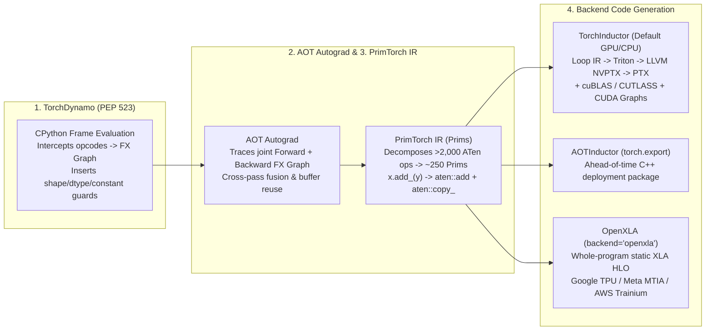

# 10.19 Triton language and compilers: OpenAI Triton, torch.compile, XLA

| | |
|---|---|
| Level | Advanced |
| Priority tier | 2 |
| Lab venue | Nebius GPU |
| Part | Part 10: The GPU and CUDA |
| Sources used | *AI Systems Performance Engineering* (`ai-systems-performance-engineering`, Chris Fregly), Chapter 14 (*PyTorch Compiler, OpenAI Triton, and XLA Backends*) |
| Code | `code/part10/triton_and_compilers.py`, `code/part10/triton_and_compilers_lab.py` |
| Coverage file | `planning/coverage/chapters/10-19.md` |

## Why this matters for AI infrastructure

In Chapters `10.11` through `10.18`, we wrote and tuned raw CUDA C++ kernels using coalesced vector loads (`float4`), shared-memory tiling, `<cuda/pipeline>` double buffering, 3-role warp specialization, Thread Block Clusters (`DSMEM` / `TMA`), and CUDA Graphs. Writing and maintaining every operator in hand-tuned CUDA C++ or PTX across rapidly evolving GPU architectures (Ampere `sm_80`, Hopper `sm_90`, Blackwell `sm_100`) is expensive. Modern AI infrastructure relies on **compiler stacks and Python-native GPU domain-specific languages (`DSLs`)** to generate those exact hardware primitives automatically—while still letting engineers write custom kernels in Python when the compiler's fusion heuristics fall short.

*AI Systems Performance Engineering* Chapter 14 (*PyTorch Compiler, OpenAI Triton, and XLA Backends*) dissects the three layers of this compilation ecosystem:

- **The Four-Stage `torch.compile` Pipeline (`TorchDynamo → AOT Autograd → PrimTorch IR → TorchInductor`, Figures 14-1 to 14-4):**
  1. **`TorchDynamo`** hooks into CPython's frame evaluation API (**`PEP 523`**) at the bytecode level to capture PyTorch tensor operations into an **FX Graph** guarded by shape/dtype/constant checks (`torch.compiler.set_stance`: `"default"`, `"fail_on_recompile"`, `"eager_on_recompile"`, `"force_eager"`).
  2. **`AOT Autograd`** traces both the forward and backward passes ahead of time into a **joint forward-and-backward FX graph**, fusing operations across the forward/backward boundary and reusing intermediate activation buffers.
  3. **`PrimTorch IR` (`Prims`)** canonicalizes PyTorch's **`> 2,000` ATen operators** down to roughly **`~250` core primitive operations** (`8.0x` reduction) and converts in-place mutations (`x.add_(y)`) into functional operations plus explicit copies (`aten::add` + `aten::copy_`) so compiler backends can fuse aggressively without aliasing hazards.
  4. **`TorchInductor`** lowers the joint graph into a Python define-by-run loop-level IR (`Pointwise` with `sympy.Expr` indexing) and emits **OpenAI Triton** kernels (which compile directly to **NVIDIA PTX via LLVM NVPTX** without invoking `nvcc`), routes large GEMMs to `cuBLAS`/`cuBLASLt`/`CUTLASS`, wraps static-shape graphs in **CUDA Graphs** (`mode="reduce-overhead"` or `"max-autotune"`), compiles **`FlexAttention`** to **`85%–90%` of FlashAttention performance**, or exports ahead-of-time C++ artifacts via `torch.export()` + **`AOTInductor`**.
- **OpenAI Triton (`SPMD` Programming Model, `@triton_op`, `@triton.autotune`, `TMA` Descriptors, and `Proton` Profiler):** Unlike CUDA's thread-level `SIMT` model, Triton uses a block-level **Single-Program, Multiple-Data (`SPMD`)** model where each program instance (`tl.program_id`) maps to one CUDA thread block operating on vectors (`BLOCK_SIZE = 1,024` elements across `num_warps × 32` threads). Using **`tl.make_tensor_descriptor`** (16-byte aligned leading strides → hardware **TMA**), **`tl.dot`** (lowering to Blackwell **`tcgen05` UMMA** with **`256 KB`/SM `TMEM`** accumulators), and **`tl.range(..., num_stages=NUM_STAGES, warp_specialize=True)`**, Triton's persistent GEMM (`matmul_kernel_persistent`) completes an `8,192 × 8,192 × 512` matmul in **`159.352 ms` (`4,312.421` Proton score)**—beating standard tiled Triton (**`165.349 ms`**), `torch.matmul` (**`174.671 ms`**), and `cuBLAS` (**`174.920 ms`, `8.90%` faster**).
- **PyTorch `XLA` (`OpenXLA` Backend, Figure 14-6):** Activated via `torch.compile(model, backend="openxla")`, lowering PyTorch graphs into static whole-program `OpenXLA` executables for Google Cloud TPUs, Meta **`MTIA`**, and AWS **`Trainium` / `Inferentia`** (AWS Neuron SDK).

:::note About the benchmark numbers in this chapter
The Proton figures (`159.352 ms`, `165.349 ms`, `174.671 ms`, `174.920 ms` and the scores) come from the book, which says the numeric values in its metric tables are illustrative. Read them as ratios only. A single `8,192 x 8,192 x 512` matrix multiply is `2 x 8,192 x 8,192 x 512 =` about `68.7` GFLOP, which a modern data-center GPU runs in a small fraction of a millisecond, so a total of `159.352 ms` can only be an aggregate over many launches (or an illustrative value), not the time of one GEMM. The Triton and `torch.compile` code was not run here.
:::

## Prerequisites and outcomes

**Prerequisites:**
- Chapters `10.13`–`10.18` (coalescing, tiling, Blackwell `TMEM` & `TMA`, `<cuda/pipeline>` double buffering, warp specialization, and CUDA Graphs).

**Outcomes — after completing this chapter you will be able to:**
1. Trace a PyTorch model through `TorchDynamo` (`PEP 523`), `AOT Autograd`, `PrimTorch IR` (`> 2,000` ATen ops → `~250` primitives), and `TorchInductor` (loop-level `Pointwise` IR → Triton → LLVM NVPTX → PTX), and choose between `default`, `reduce-overhead`, `max-autotune`, `max-autotune-no-cudagraphs`, and `AOTInductor`.
2. Handle variable-length LLM sequences using **SymPy** symbolic shapes (`torch._dynamo.mark_dynamic` vs `dynamic=True`, why `dynamic=True` disables CUDA Graphs, and the `±10%–20%` bucket-padding rule of thumb).
3. Diagnose and eliminate graph breaks (`torch._dynamo.explain`, `Graph Count: 3 → 1`, guarding `print` with `if not torch._dynamo.is_compiling():`, replacing Python `if` branches with `torch.where` or `torch.cond`, `torch.compiler.set_stance("fail_on_recompile")`, and understanding intentional `DDP`/`FSDP` communication breaks).
4. Audit compiled code and numerical accuracy using **Table 14-1 (`11` `TORCH_LOGS` flags)**, `TORCH_COMPILE_DEBUG=1`, `TORCH_TRACE` + `tlparse`, `TORCHDYNAMO_REPRO_AFTER="aot"`, `TORCHDYNAMO_REPRO_LEVEL=4`, `fallback_random=True`, and `CUBLAS_WORKSPACE_CONFIG=:4096:8`.
5. Write, autotune (`@triton.autotune`), and register (`@triton_op` + `wrap_triton` + `register_autograd`) custom **OpenAI Triton** kernels, including `vector_add_kernel`, `tiled_gemm_kernel`, `pipelined_matmul`, and `matmul_kernel_persistent` (`tl.make_tensor_descriptor` TMA + `tcgen05` `TMEM` + `warp_specialize=True` + `prefetch-next → compute-current → swap`).
6. Profile Triton kernels with **Triton `Proton`** (`8,192 × 8,192 × 512` benchmark: `159.352 ms` persistent vs `174.920 ms` `cuBLAS`) and contrast `TorchInductor` against `OpenXLA` (`backend="openxla"`).

---

## 1. The PyTorch 2.x Compiler Stack (`torch.compile`)



### 1.1 Stage 1 — `TorchDynamo`: CPython bytecode capture (`PEP 523`), FX Graphs, guards, and compiler stances

When you wrap a model with `compiled_model = torch.compile(model, mode="max-autotune")`, the first stage is **`TorchDynamo`** (*AI Systems Performance Engineering* Ch 14, *TorchDynamo for Bytecode Capture and Graph Extraction*, Figures 14-1 to 14-3):
- **Bytecode interception via `PEP 523`:** Instead of executing Python operations one-by-one in eager mode, TorchDynamo hooks into CPython's Frame Evaluation API (**`PEP 523`**) to inspect Python bytecode instructions dynamically. Whenever it encounters PyTorch tensor operations, it appends them as nodes into an **FX Graph** (`Placeholder` inputs and `aten::*` operator nodes) until it reaches an unsupported Python construct (a **graph break**, which runs in eager mode before Dynamo resumes capturing the next FX Graph).
- **FX Graph representation:** For a simple function `def f(x, y): z = x.sin() + y; return z.sum()`, TorchDynamo constructs:
  ```text
  graph():
      %x : Tensor = Placeholder[target=x]
      %y : Tensor = Placeholder[target=y]
      %sin : Tensor = torch.sin(%x)
      %add : Tensor = torch.add(%sin, %y)
      %sum : Tensor = torch.sum(%add)
      return %sum
  ```
- **Guards and recompilation stances (`torch.compiler.set_stance()`):** TorchDynamo attaches runtime **guards** on tensor shapes, dtypes, devices, and Python constants that influenced the trace. You can control how Dynamo reacts when it encounters a graph break or guard failure using `torch.compiler.set_stance()` (`COMPILER_STANCES` in `code/part10/triton_and_compilers.py`):
  1. **`"default"`:** Compiles supported regions and silently falls back to eager execution on graph breaks or recompiles on guard misses.
  2. **`"fail_on_recompile"`:** Raises an immediate exception if any graph break, unsupported op, or recompilation occurs—recommended in development and CI pipelines to catch accidental graph breaks early.
  3. **`"eager_on_recompile"`:** Uses already-cached compiled graphs when guards match, but falls back to eager execution instead of recompiling when a guard fails.
  4. **`"force_eager"`:** Ignores all `torch.compile` directives and executes everything in eager mode.

### 1.2 Stage 2 — `AOT Autograd`: Ahead-of-time joint forward and backward graph fusion

In standard eager PyTorch, the C++ autograd engine executes backward operations one-by-one dynamically during `loss.backward()`. **`AOT Autograd`** (*ASP* Ch 14, *AOT Autograd Fusion for Forward and Backward Passes*) runs the Dynamo-captured FX forward graph through PyTorch's autograd engine in functional mode (`torch.autograd.forward_ad`) **ahead of time** to capture the exact gradient operations and build a **single joint forward-and-backward FX graph**.
- **Why joint capture matters for training:** Because both passes are visible in one static dataflow graph, downstream passes perform common-subexpression elimination, **fuse elementwise operations across the forward/backward boundary**, and **reuse intermediate buffers** between forward and backward passes to reduce peak HBM memory footprint and kernel launch counts.

### 1.3 Stage 3 — `PrimTorch IR` (`Prims`): Decomposing `> 2,000` ATen ops into `~250` functional primitives

PyTorch exposes **`> 2,000` operators** in its full `aten` API—far too many for every hardware compiler backend to implement and maintain directly. **`PrimTorch IR` (`Prims`)** (*ASP* Ch 14, *PrimTorch IR (Prims) Simplified Operator Set*; `PRIMTORCH_CORE_PRIMITIVES_APPROX = 250` in `code/part10/triton_and_compilers.py`) canonicalizes the joint graph down to roughly **`~250` core primitive operations** (`8.0x` reduction in operator surface area).

Crucially, `PrimTorch IR` performs **functionalization** to eliminate in-place mutations and aliasing hazards. For example, an in-place mutation `x.add_(y)` is decomposed into a pure functional addition followed by an explicit storage copy node:

```text
%z = aten::add(x, y)
%copy = aten::copy_(x, %z)   # writes %z's data back into x's storage explicitly
```

Because mutations become explicit `aten::copy_` nodes at the edges of a purely functional dataflow graph, `TorchInductor`'s fusion and memory-planning passes can reorder and fuse inner operations without reasoning about hidden in-place side effects.

### 1.4 Stage 4 — `TorchInductor`: Define-by-run loop IR, compilation modes, `AOTInductor`, `TE`, and `FlexAttention`

**`TorchInductor`** is PyTorch's default compiler backend for NVIDIA GPUs, AMD GPUs, and CPUs (*ASP* Ch 14, *TorchInductor Backend Code Generation*, Figure 14-4):
- **Python define-by-run loop-level IR (`Pointwise` + `SymPy`):** Inductor lowers `aten` + `PrimTorch` nodes into fused loop nests expressed in Python using `sympy.Expr` index expressions. For example, `z = x.permute(1, 0) + x[2, :]` lowers into a single fused `Pointwise` loop node without materializing a transposed tensor in HBM:
  ```python
  # TorchInductor loop-level IR representation of z = x.permute(1, 0) + x[2, :] (ASP Ch 14)
  def inner_fn(index):
      i1, i0 = index
      tmp0 = ops.load("x", i1 + i0 * size1) # reads x[i1, i0] (permuted on the fly)
      tmp1 = ops.load("x", 2 * size1 + i0)  # reads x[2, i0] (broadcast row)
      return ops.add(tmp0, tmp1)

  # torchinductor.ir.Pointwise(device=torch.device("cuda"), dtype=torch.float32,
  #                            inner_fn=inner_fn, ranges=[size0, size1])
  ```
- **Direct lowering to PTX via Triton + LLVM NVPTX (no `nvcc`):** For NVIDIA GPUs, TorchInductor emits Python **OpenAI Triton** kernels from its loop IR and invokes the Triton JIT compiler, which lowers Triton IR through **LLVM NVPTX** directly into **NVIDIA PTX** (and driver-compiled SASS) without calling `nvcc`. For large matrix multiplications, Inductor's autotuner benchmarks its generated Triton kernels against **`cuBLAS` / `cuBLASLt` / `CUTLASS`** and caches whichever implementation wins for that shape—fusing surrounding LayerNorm, bias, residual, and activation ops into the epilogue or neighboring Triton kernels.
- **`torch.compile` modes and `AOTInductor`:**
  - **`mode="default"`:** Fast compilation with standard fusion and low-overhead heuristics.
  - **`mode="reduce-overhead"`:** Wraps compiled static-shape regions in **CUDA Graphs** to eliminate Python and driver launch overhead (note: **disabled automatically if `dynamic=True`**).
  - **`mode="max-autotune"`:** Benchmarks multiple Triton tile/warp configurations alongside `cuBLAS`/`CUTLASS` candidates and enables CUDA Graphs (longest initial compile time, highest steady-state throughput).
  - **`mode="max-autotune-no-cudagraphs"`:** Performs full kernel autotuning without capturing CUDA Graphs (ideal when shapes vary or graph pools are undesirable).
  - **`torch.export()` + `AOTInductor`:** Compiles exported model graphs ahead of time into standalone C++/shared-library deployment artifacts.
- **Explicit `Transformer Engine (TE)` and `FlexAttention` (`85%–90%` of FlashAttention):**
  - `torch.compile` does **not** automatically replace standard `torch.nn.Linear` layers with NVIDIA **Transformer Engine (`TE`)** FP8 kernels; you must instantiate `transformer_engine.pytorch.layers` explicitly in your model, and `torch.compile` will fuse operations around them.
  - PyTorch's **`FlexAttention`** (`torch.nn.attention.flex_attention`) lets users write custom attention score modifications (ALiBi, sliding window, document masking, block sparsity) in Python that `TorchInductor` compiles into fused Triton kernels achieving **`~85%–90%` of modern FlashAttention performance** in both forward and backward passes. Always enable the fast SDPA and TF32 flags early in your script:
    ```python
    import torch
    torch.set_float32_matmul_precision("high")
    torch.backends.cuda.matmul.allow_tf32 = True
    torch.backends.cudnn.allow_tf32 = True
    torch.backends.cuda.enable_flash_sdp(True)
    torch.backends.cuda.enable_math_sdp(True)
    torch.backends.cuda.enable_mem_efficient_sdp(True)
    ```

---

## 2. Dynamic Shapes (`SymPy`), Graph Breaks (`explain`), Compiler Logging, and Numerical Determinism

### 2.1 Dynamic shapes (`SymPy`, `mark_dynamic`, and the `±10%–20%` padding rule)

LLM workloads frequently process variable sequence lengths. `TorchDynamo` and `TorchInductor` use the **SymPy** symbolic math library to track dynamic dimensions (`s0, s1`) through index arithmetic (`z.size(0) = x.size(0) + y.size(0)`) and emit range guards such as `sequence_length <= 256` or `sequence_length <= 1024` (*ASP* Ch 14, *Dynamic Shapes and Variable Sequence Lengths*):
1. **Default behavior (`dynamic=None`):** Specializes on the exact shape of the first batch, then on the **first shape change** recompiles a generalized symbolic kernel (`1` extra compile).
2. **Preempting recompilation on known varying axes (`torch._dynamo.mark_dynamic(tensor, dim)`):** Marks *only* the sequence or batch dimension `dim` as symbolic before the first call, avoiding the second compilation pass while keeping hidden dimensions (`d_model`) static.
3. **Why `dynamic=True` disables CUDA Graphs:** Passing `torch.compile(model, dynamic=True)` forces *every* tensor dimension to be symbolic upfront and **disables CUDA Graph capture** (because CUDA Graphs require fixed shapes and static memory addresses). Even if you pass `mode="reduce-overhead"`, setting `dynamic=True` prevents CUDA Graphs from being used.
4. **The `±10%–20%` hybrid bucket-padding rule of thumb:** If sequence lengths vary by only **`10%–20%`**, padding inputs to fixed bucket sizes (`±10%–20%`) and using static shapes + CUDA Graphs (`mode="reduce-overhead"` or `"max-autotune"`) typically outperforms full dynamic shapes; when lengths span orders of magnitude, combine coarse size buckets with `mark_dynamic()` or `mode="max-autotune-no-cudagraphs"`.

### 2.2 Diagnosing and eliminating graph breaks (`torch._dynamo.explain`, `torch.where`, `torch.cond`, and `DDP`/`FSDP`)

Every **graph break** interrupts whole-graph fusion, forces a synchronization back to the Python interpreter, executes the unsupported statement in eager mode, and starts a new FX Graph afterward. Use `torch._dynamo.explain(fn)(*inputs)` to inspect the exact break count and user stack lines (*ASP* Ch 14, *Graph Breaks and TorchDynamo explain()*; `analyze_dynamo_graph_breaks()` in `code/part10/triton_and_compilers.py`):

```python
# Diagnosing 2 graph breaks (3 subgraphs) with torch._dynamo.explain() and fixing both (ASP Ch 14) (untested here)
import torch
import torch._dynamo as dynamo

# BEFORE: Graph Count = 3, Graph Break Count = 2, Op Count = 5
def toy_example(a: torch.Tensor, b: torch.Tensor) -> torch.Tensor:
    x = a / (torch.abs(a) + 1)
    print("woo")          # Break 1: builtin: print [...ConstantVariable] False
    if b.sum() < 0:       # Break 2: generic_jump TensorVariable() (data-dependent branch)
        b = -b
    return x * b

# AFTER (Option A - torch.where, simplest & zero restrictions): Graph Count = 1, Graph Break Count = 0
def model_where(a: torch.Tensor, b: torch.Tensor) -> torch.Tensor:
    x = a / (torch.abs(a) + 1)
    if not torch._dynamo.is_compiling():
        print("do not print during tracing/compiling")
    b = torch.where(b.sum() < 0, -b, b)
    return x * b

# AFTER (Option B - torch.cond, compiles both branches as subgraphs): Graph Count = 1, Graph Break Count = 0
def model_cond(a: torch.Tensor, b: torch.Tensor) -> torch.Tensor:
    x = a / (torch.abs(a) + 1)
    if not torch._dynamo.is_compiling():
        print("do not print during tracing/compiling")
    b = torch.cond(
        b.sum() < 0,         # 0-dim bool tensor predicate
        lambda b: -b,        # true_fn
        lambda b: b.clone(), # false_fn (clone() avoids aliasing; same shape & dtype required)
        (b,),
    )
    return x * b
```

**Intentional graph breaks in `DDP` and `FSDP` (`Figure 14-5`):**
When combining `torch.compile` with `DistributedDataParallel` (`DDP`) or `FullyShardedDataParallel` (`FSDP` configured with **`use_original_params=True`** and wrapped per Transformer block submodule), `dynamo.explain()` will show graph breaks at `all-reduce` / `all-gather` / `reduce-scatter` collective boundaries (Figure 14-5). **Do not try to remove these communication breaks:** PyTorch intentionally splits the graph at each gradient bucket or FSDP submodule boundary so communication on the NCCL stream overlaps with backward/forward computation of the next compiled subgraph.

### 2.3 Compiler logging (**Table 14-1**), `TORCH_COMPILE_DEBUG=1`, `tlparse`, and numerical determinism

*AI Systems Performance Engineering* Chapter 14 (**Table 14-1**, *Debugging Compiler Phases, Graph Breaks, and Performance*) catalogs the **`11` `TORCH_LOGS` flags** (`TABLE_14_1_TORCH_LOGS` in `code/part10/triton_and_compilers.py`):

| `TORCH_LOGS` Flag | What It Logs | When to Use It |
|---|---|---|
| **`graph_breaks`** | Every graph break event with file/line stack trace | First step whenever `torch.compile` speedup is lower than expected |
| **`recompiles`** | Every guard failure that triggers a graph recompilation | Catching per-iteration changing Python constants, seeds, or un-marked dynamic shapes |
| **`guards`** | All generated shape, dtype, device, and constant guard expressions | Inspecting why a compiled graph is invalidated across batches |
| **`perf_hints`** | Missed optimization hints (e.g., `"CUDA Graph not used because input is mutated"`) | Finding why Inductor skipped CUDA Graphs or fell back to eager ops |
| **`output_code`** | Full generated Python wrapper + Triton kernel / PTX source code | Verifying kernel fusion, `mma.sync` / `tcgen05`, and `tl.range` pipelining |
| **`dynamic`** | Symbolic shape (`SymPy`) propagation and dynamic dimension decisions | Debugging `mark_dynamic()` and range guards (`sequence_length <= 1024`) |
| **`dynamo`** | Verbose bytecode tracing logs from `TorchDynamo` | Deep bytecode capture troubleshooting |
| **`aot_graphs`** | Forward and backward FX graphs produced by `AOT Autograd` | Inspecting joint forward/backward fusion and saved activations |
| **`inductor`** | Verbose lowering and scheduling logs from `TorchInductor` | Debugging loop IR fusion and memory planning |
| **`graph_outputs`** | Final compiled FX graph structure | Auditing subgraph boundaries |
| **`graph_code`** | Python code equivalent of each FX graph produced by `TorchDynamo` | Inspecting functional `aten` decomposition |

For deeper inspection and numerical accuracy debugging (*ASP* Ch 14, *Debugging Numerical Correctness and Accuracy*):
- **`TORCH_COMPILE_DEBUG=1`:** Creates `/tmp/torchinductor_<pid>/...` containing `.fx` graphs, `outputcode.py`, `fx_graph_runnable.py`, IR dumps, and generated `.triton` / PTX assembly.
- **`TORCH_TRACE=/path/to/logs` + `tlparse`:** Low-overhead structured compilation trace parser that renders stack-frame compilation trees and Perfetto timelines (safe even in production).
- **Pinpointing numerical divergence (`TORCHDYNAMO_REPRO_AFTER` & `TORCHDYNAMO_REPRO_LEVEL`):**
  Setting **`TORCHDYNAMO_REPRO_AFTER="aot"`** and **`TORCHDYNAMO_REPRO_LEVEL=4`** runs each dumped stage graph in eager mode alongside compiled mode and automatically emits a minified standalone reproduction script if any stage produces a numerical mismatch.
- **RNG and bitwise `cuBLAS` determinism:**
  - Set **`torch._inductor.config.fallback_random=True`** if fused kernels must match eager-mode random number sequences exactly.
  - To enforce bitwise-reproducible `cuBLAS` matmuls (disabling non-deterministic split-K atomic reductions), set **`export CUBLAS_WORKSPACE_CONFIG=:4096:8`** (or **`:16:8`**, reserving `8` workspace buffers of `4,096 KiB` or `16 KiB`) **before** starting Python and call **`torch.use_deterministic_algorithms(True)`** (and `torch.set_float32_matmul_precision("highest")` when debugging FP32 vs TF32 accuracy).

---

## 3. OpenAI Triton: SPMD Programming, PyTorch Op Registration, Autotuning, TMA Descriptors, and Persistent GEMMs

### 3.1 Triton's `SPMD` programming model (`vector_add_kernel`, `BLOCK_SIZE` vs `num_warps`)

While NVIDIA announced Python-centric CUDA DSLs in 2025 (`cuTile`, `CuTe Python DSL`, `CUTLASS Python DSL`, and `cuPyNumeric`), **OpenAI Triton** remains the primary GPU kernel language used by `TorchInductor` and custom PyTorch extensions (*ASP* Ch 14, *Writing Custom Kernels with OpenAI Triton*).

Unlike CUDA C++'s **Single-Instruction, Multiple-Threads (`SIMT`)** model where you program an individual scalar thread (`threadIdx.x`), Triton uses a **Single-Program, Multiple-Data (`SPMD`)** model where you program **an entire thread block (`CTA`) operating on blocked vectors/tiles**:
- **`pid = tl.program_id(axis=0)`:** Returns the unique block index (analogous to `blockIdx.x`), while `tl.num_programs(axis=0)` returns the grid dimension (`gridDim.x`).
- **`BLOCK_SIZE: tl.constexpr` vs `num_warps` (`plan_triton_kernel_launch()` in `code/part10/triton_and_compilers.py`):**
  - `BLOCK_SIZE` (for example, `1,024`) is a compile-time constant specifying **how many data elements each Triton program instance processes** (`offsets = pid * BLOCK_SIZE + tl.arange(0, BLOCK_SIZE)`).
  - The actual number of CUDA threads per thread block is **`num_warps × 32`** (default **`num_warps = 4` = `128` threads/block**, so each thread processes `1,024 / 128 = 8` elements).
  - On modern GPUs with large register files and shared memory, increase `num_warps` from `4` (`128` threads) to **`8` (`256` threads) when `BLOCK_SIZE >= 2,048`** and to **`16` (`512` threads) when `BLOCK_SIZE >= 4,096`**.

### 3.2 Registering custom Triton kernels with PyTorch (`@triton_op`, `wrap_triton`, and `register_autograd`)

If you call a raw `@triton.jit` kernel directly inside a `torch.compile` region without registering it, `TorchDynamo` treats it as an opaque boundary or graph break. Wrapping the kernel with **`torch.library.triton_op`** and **`wrap_triton`** makes it a first-class PyTorch operator that `TorchInductor` can inline, reorder, and fuse without breaking the graph (*ASP* Ch 14, *Registering Custom Kernels with PyTorch*):

```python
# Registering a custom Triton kernel with PyTorch for seamless torch.compile fusion (ASP Ch 14) (untested here)
import torch
import triton
import triton.language as tl
from torch import Tensor
from torch.library import triton_op, wrap_triton

@triton.jit
def vector_add_kernel(x_ptr, y_ptr, out_ptr, n_elements, BLOCK_SIZE: tl.constexpr):
    pid = tl.program_id(axis=0)
    offsets = pid * BLOCK_SIZE + tl.arange(0, BLOCK_SIZE)
    mask = offsets < n_elements
    x = tl.load(x_ptr + offsets, mask=mask)
    y = tl.load(y_ptr + offsets, mask=mask)
    tl.store(out_ptr + offsets, x + y, mask=mask)

@triton_op("my_triton_lib::vector_add", mutates_args=())
def vector_add(x: Tensor, y: Tensor) -> Tensor:
    assert x.device.type == "cuda" and y.device.type == "cuda"
    n = x.numel()
    out = torch.empty_like(x)
    grid_fn = lambda meta: (triton.cdiv(n, meta["BLOCK_SIZE"]),)
    wrap_triton(vector_add_kernel)[grid_fn](x, y, out, n, BLOCK_SIZE=1024)
    return out

# For training support, register the backward pass via register_autograd:
# vector_add.register_autograd(backward_fn, setup_context=setup_context_fn)
```

### 3.3 Autotuning (`@triton.autotune`), Warp Specialization (`warp_specialize=True`), TMA Descriptors (`tl.make_tensor_descriptor`), and Persistent GEMM (`matmul_kernel_persistent`)

To reach peak Tensor Core utilization on Hopper (`sm_90`) and Blackwell (`sm_100`), combine four advanced Triton features (*ASP* Ch 14, *Autotuning Triton Kernels* & *Advanced Triton Kernel Implementations*):
1. **Data-driven autotuning (`@triton.autotune`):** Decorate the kernel with `@triton.autotune(configs=[...], key=['M', 'N', 'K'])` (or supply a custom `key_fn=...`). On the first invocation for a given `(M, N, K)` key, Triton compiles and benchmarks every `triton.Config` candidate (sweeping `BLOCK_M`, `BLOCK_N`, `BLOCK_K`, `num_warps ∈ {4, 8, 16}`, and `num_stages ∈ {2, 3, 4}`) and caches the winner. Always warm up the autotuner with representative production tensor shapes.
2. **Warp specialization in Triton (`warp_specialize=True` & `num_consumer_groups`):**
   - Pass **`warp_specialize=True`** and **`num_stages > 1`** to `tl.range(0, K_tiles, num_stages=NUM_STAGES, warp_specialize=True)` so Triton partitions the block's warps into producer (TMA memory prefetch) and consumer (Tensor Core MMA) groups.
   - In `triton.Config`, tune warp specialization explicitly via **`num_consumer_groups = 2`** and **`num_buffers_warp_spec = 3`**:
     ```python
     triton.Config(
         {"BLOCK_M": 128, "BLOCK_N": 128, "BLOCK_K": 64},
         num_warps=8, num_stages=2,
         num_consumer_groups=2, num_buffers_warp_spec=3,
     )
     ```
3. **Hardware TMA Tensor Descriptors (`tl.make_tensor_descriptor`) and Blackwell `tcgen05` `TMEM`:**
   - Instead of manual pointer arithmetic, construct descriptors via `A_desc = tl.make_tensor_descriptor(A_ptr, shape=[M, K], strides=[stride_am, stride_ak], block_shape=[BLOCK_M, BLOCK_K])`.
   - **Mandatory TMA alignment rules:** Leading strides must be **multiples of `16 bytes`**, and the **innermost (last) dimension must be contiguous**.
   - On Blackwell (`sm_100`), `A_desc.load([m0, k0])` lowers to hardware **TMA (`cp.async.bulk.tensor`)**, and `acc += tl.dot(a_cur, b_cur)` lowers to **5th-gen Tensor Core UMMA (`tcgen05.mma`)** with the FP32 accumulator `acc = tl.zeros((BLOCK_M, BLOCK_N), dtype=tl.float32)` residing in **`256 KB`/SM Tensor Memory (`TMEM`)** rather than general-purpose registers.
4. **The `prefetch-next → compute-current → swap` survival rule and 1D Persistent GEMM (`matmul_kernel_persistent`):**
   - When pipelining (`num_stages > 1`), **never overwrite or drop the reference to `a_cur`/`b_cur` before `tl.dot(a_cur, b_cur)` executes**; if you overwrite `a_cur` early, the compiler can legally reorder the next iteration's loads past current uses, collapsing load/compute overlap. Always structure the loop as:
     1. **Prefetch NEXT tile (`a_next = A_desc.load([m0, next_k])`)**,
     2. **Compute on CURRENT tile (`acc += tl.dot(a_cur, b_cur)`)**,
     3. **Swap (`a_cur = a_next; b_cur = b_next`)**.
   - In `matmul_kernel_persistent`, launch a bounded 1D grid `grid = lambda META: (min(65536, MT * NT),)` where each program steps across multiple output tiles via `tile_idx = pid; while tile_idx < TILE_COUNT: ... tile_idx += nprog` (`nprog = tl.num_programs(0)`), which outperforms non-persistent kernels especially when `K > 1,024`.

```python
# Production Persistent Tiled GEMM in OpenAI Triton with TMA Descriptors, TMEM, and Warp Specialization
# Source: AI Systems Performance Engineering, Chapter 14 (untested here)
import torch
import triton
import triton.language as tl

@triton.jit
def matmul_kernel_persistent(
    A_ptr, B_ptr, C_ptr,
    M, N, K,
    stride_am, stride_ak, stride_bk, stride_bn, stride_cm, stride_cn,
    BLOCK_M: tl.constexpr, BLOCK_N: tl.constexpr, BLOCK_K: tl.constexpr,
    NUM_STAGES: tl.constexpr,
):
    pid = tl.program_id(0)
    nprog = tl.num_programs(0)
    MT = tl.cdiv(M, BLOCK_M)
    NT = tl.cdiv(N, BLOCK_N)
    TILE_COUNT = MT * NT

    # 1. Tensor descriptors -> lower to TMA on Hopper/Blackwell (strides multiple of 16B, inner contiguous)
    A_desc = tl.make_tensor_descriptor(
        A_ptr, shape=[M, K], strides=[stride_am, stride_ak], block_shape=[BLOCK_M, BLOCK_K]
    )
    B_desc = tl.make_tensor_descriptor(
        B_ptr, shape=[K, N], strides=[stride_bk, stride_bn], block_shape=[BLOCK_K, BLOCK_N]
    )

    tile_idx = pid
    while tile_idx < TILE_COUNT:
        pid_m = tile_idx // NT
        pid_n = tile_idx % NT
        m0 = pid_m * BLOCK_M
        n0 = pid_n * BLOCK_N
        offs_m = m0 + tl.arange(0, BLOCK_M)
        offs_n = n0 + tl.arange(0, BLOCK_N)

        # 2. FP32 accumulator (resides in 256 KB/SM TMEM on Blackwell via tcgen05 UMMA)
        acc = tl.zeros((BLOCK_M, BLOCK_N), dtype=tl.float32)
        K_tiles = (K + BLOCK_K - 1) // BLOCK_K

        if K_tiles > 0:
            # Prologue: load first current tiles (fast in-bounds TMA path shown)
            a_cur = A_desc.load([m0, 0])
            b_cur = B_desc.load([0, n0])

            # 3. Pipelined K-loop: prefetch-NEXT -> compute-CURRENT -> swap with warp_specialize=True
            for kt in tl.range(0, K_tiles, num_stages=NUM_STAGES, warp_specialize=True):
                next_k = (kt + 1) * BLOCK_K
                if kt + 1 < K_tiles:
                    a_next = A_desc.load([m0, next_k])
                    b_next = B_desc.load([next_k, n0])
                acc += tl.dot(a_cur, b_cur)
                if kt + 1 < K_tiles:
                    a_cur = a_next
                    b_cur = b_next

        c_ptrs = C_ptr + (offs_m[:, None] * stride_cm + offs_n[None, :] * stride_cn)
        c_mask = (offs_m[:, None] < M) & (offs_n[None, :] < N)
        tl.store(c_ptrs, acc, mask=c_mask)
        tile_idx += nprog # Persistent stride across output tiles
```

---

## 4. Profiling with Triton `Proton` and the PyTorch `XLA` (`OpenXLA`) Backend

### 4.1 Triton `Proton` profiler (`8,192 × 8,192 × 512` GEMM benchmark) and portable cache hints

**Triton `Proton`** is Triton's built-in hierarchical profiler (`proton.start("matmul", hook="triton")` and `with proton.scope("name", metadata):`), which records user metadata (FLOPs, bytes, tile dimensions) and emits NVTX ranges that correlate directly with **Nsight Systems** timelines and **Nsight Compute** kernel inspections (*ASP* Ch 14, *Profiling with Triton Proton Profiler*).

Look at the Proton profile comparison across four implementations multiplying **`M = 8,192, N = 8,192, K = 512`** matrices (`PROTON_8192_MATMUL_BENCHMARK` in `code/part10/triton_and_compilers.py`):

| Proton Scope (`[M=8192, N=8192, K=512]`) | Execution Time (`ms`) | Proton Throughput Metric | Relative Comparison |
|---|---:|---:|---|
| **`ROOT` (overall profile scope)** | `168.314 ms` | `16,331.291` | Aggregate root scope |
| **`cublas` (`[M=8192, N=8192, K=512]`)** | `174.920 ms` | `3,928.623` | `1.00x` baseline |
| **`torch` (`torch.matmul`, `[M=8192, N=8192, K=512]`)** | `174.671 ms` | `3,934.214` | Matches `cublas` (`-0.14%`) |
| **`matmul_kernel` (standard 2D tiled Triton)** | `165.349 ms` | `4,156.033` | `5.47%` faster than `cublas` |
| **`matmul_kernel_persistent` (persistent TMA + `TMEM` Triton)** | **`159.352 ms`** | **`4,312.421`** | **`1.10x` (`15.568 ms` / `8.90%` faster than `cublas`)** |

**Portable cache eviction hints vs. undocumented PTX (*ASP* Ch 14, *Key Takeaways*):** Rather than embedding fragile, undocumented inline PTX modifiers (such as `ld.global.nc.l1::no_allocate.l2::256b`, which can break across driver or GPU generations), prefer Triton's portable **`eviction_policy="evict_last"`** (or `"evict_first"`) and **`cache_modifier=`** arguments on `tl.load()` / `tl.store()`.

### 4.2 PyTorch `XLA` (`OpenXLA`) vs. `TorchInductor` (`Figure 14-6`)

While `TorchInductor` is the default backend for NVIDIA and AMD GPUs, **`PyTorch XLA`** (`torch.compile(model, backend="openxla")`, built on **OpenXLA**, Figure 14-6) targets accelerators that consume XLA `HLO` / `StableHLO` IR—including **Google Cloud TPUs**, **Meta's `MTIA` (Meta Training and Inference Accelerator)**, and **AWS `Trainium` and `Inferentia`** (via the AWS Neuron SDK):

| Feature | `TorchInductor` (`backend="inductor"`) | `PyTorch XLA` (`backend="openxla"`) |
|---|---|---|
| **Primary Hardware Targets** | NVIDIA GPUs (via Triton + LLVM NVPTX / `cuBLAS` / `CUTLASS`), AMD GPUs, CPUs | Google Cloud TPUs, Meta `MTIA`, AWS `Trainium` & `Inferentia` (AWS Neuron) |
| **Compilation Granularity** | Subgraph / define-by-run loop IR; supports incremental compilation & eager fallback on graph breaks | **Whole-program ahead-of-time static graph** compilation |
| **Dynamic Shape Behavior** | Uses **SymPy** symbolic shapes + range guards (`sequence_length <= 1024`) to compile one kernel for a range of sizes | **Static shape specialization:** Every new shape signature triggers an expensive **whole-program recompilation** (cached per shape signature) |
| **Mandatory LLM Serving Strategy** | Bucket within `±10%–20%` for CUDA Graphs, or use `mark_dynamic()` for wide length variation | **Pad or bucket all inputs to a small fixed set of static shapes** so whole-graph recompilation never triggers during live inference |

---

## 5. Commands and Configurations That Matter

All commands below follow *AI Systems Performance Engineering* Chapter 14. Commands that require an attached CUDA GPU are marked **(untested here)**.

### 5.1 Inspect `torch.compile` graph breaks, generated Triton/PTX code, `tlparse` traces, and bitwise `cuBLAS` determinism (untested here)

```bash
# 1. Log graph breaks, guards, recompiles, performance hints, and generated Triton code (Table 14-1) (untested here)
TORCH_LOGS="graph_breaks,recompiles,guards,perf_hints,output_code" python3 train.py

# 2. Dump full TorchInductor debug artifacts (.fx, outputcode.py, .triton, PTX) to /tmp/torchinductor_<pid> (untested here)
TORCH_COMPILE_DEBUG=1 python3 train.py

# 3. Capture structured compilation trace and render stack-frame tree with tlparse (untested here)
TORCH_TRACE=/tmp/tracedir python3 train.py
tlparse /tmp/tracedir

# 4. Isolate numerical discrepancies after AOT Autograd and enforce bitwise cuBLAS determinism (untested here)
export TORCHDYNAMO_REPRO_AFTER="aot"
export TORCHDYNAMO_REPRO_LEVEL=4
export CUBLAS_WORKSPACE_CONFIG=:4096:8
python3 verify_accuracy.py
```

---

## 6. How It Fails: Six `torch.compile`, Triton, and `OpenXLA` Failure Modes

| # | Failure Mode | Production / Profiler Symptom | Root Cause | Fix |
|---|---|---|---|---|
| **1** | **Silent graph breaks from `print()`, logging, or Python `if tensor.sum() < 0:` branches** | `torch.compile` provides almost no speedup; `torch._dynamo.explain()` reports `Graph Count: 3, Graph Break Count: 2` (`builtin: print` and `generic_jump TensorVariable()`). | Side-effecting Python calls (`print`, I/O) and data-dependent Python branches split the FX graph and force eager fallbacks (*ASP* Ch 14). | Guard debug prints with `if not torch._dynamo.is_compiling():`, rewrite tensor branches with `torch.where()` or `torch.cond()`, and enforce `torch.compiler.set_stance("fail_on_recompile")` in CI. |
| **2** | **Per-iteration recompilation storms from changing Python scalars or un-marked dynamic axes** | Training steps remain slow long after warmup; `TORCH_LOGS="recompiles,guards"` logs a new compilation on every batch. | Passing a changing Python int/float (step counter, seed, timestamp) or varying sequence lengths without `mark_dynamic()` invalidates Dynamo guards each step (*ASP* Ch 14). | Pass changing scalars as 0-D tensors, call `torch._dynamo.mark_dynamic(tensor, dim)` on sequence axes before compiling, or bucket lengths within `±10%–20%`. |
| **3** | **Combining `mode="reduce-overhead"` with `dynamic=True` expecting CUDA Graphs** | `TORCH_LOGS="perf_hints"` reports CUDA Graphs were skipped (or `"CUDA Graph not used because input is mutated"`), leaving CPU launch overhead high. | Setting `dynamic=True` forces all dimensions symbolic and disables CUDA Graph capture; in-place input mutations also block graph capture (*ASP* Ch 14). | Remove in-place input mutations, avoid global `dynamic=True`, and use bucketed static shapes with `mode="reduce-overhead"` or `"max-autotune"`. |
| **4** | **Silent overlap collapse in pipelined Triton loops (`num_stages > 1`)** | Custom Triton GEMM with `tl.range(..., num_stages=2)` shows zero load/compute overlap in Nsight Compute (`DRAM` and `Tensor Core` utilization stay out-of-phase). | Overwriting `a_cur = A_desc.load(...)` before `tl.dot(a_cur, b_cur)` consumes it allows the compiler to reorder/sink next-iteration loads past current compute (*ASP* Ch 14). | Keep `a_cur` and `a_next` in separate variables following the strict **`prefetch-next → compute-current → swap`** sequence. |
| **5** | **Calling raw `@triton.jit` kernels inside `torch.compile` or mis-sizing `BLOCK_SIZE` vs `num_warps`** | Custom Triton kernel causes a Dynamo graph break, or developers set `BLOCK_SIZE = 1024` assuming it launches `1,024` CUDA threads per block. | Unregistered Triton functions are opaque to Dynamo/Inductor, and `BLOCK_SIZE` sets elements per program while `num_warps × 32` (`default 4 × 32 = 128`) sets threads per CTA (*ASP* Ch 14). | Register Triton kernels with `@triton_op` + `wrap_triton` (+ `register_autograd`), and scale `num_warps` to `8` (`BLOCK_SIZE >= 2048`) or `16` (`BLOCK_SIZE >= 4096`) via `@triton.autotune`. |
| **6** | **Runtime exception under `torch.use_deterministic_algorithms(True)` or XLA recompilation spikes on unpadded prompts** | PyTorch throws a runtime error on `torch.matmul` when determinism is enabled, or an `OpenXLA` (`backend="openxla"`) inference service stalls for seconds on every new prompt length. | `cuBLAS` split-K reductions are non-deterministic unless a fixed workspace is configured, and `OpenXLA` compiles whole static graphs ahead of time per unique shape (*ASP* Ch 14). | Export `CUBLAS_WORKSPACE_CONFIG=:4096:8` (or `:16:8`) when using `torch.use_deterministic_algorithms(True)`, and pad/bucket all `OpenXLA` inputs to fixed shape buckets. |

---

## 7. Hands-On Lab: Verify the PyTorch Compiler Stack, `dynamo.explain`, `TORCH_LOGS`, Triton `SPMD` & `TMA` Rules, and `Proton` Benchmarks

**Venue:** Any Linux machine or Nebius GPU VM with Python 3.10+ (runs deterministically using standard library Python; all `TORCH_LOGS`, `TORCH_COMPILE_DEBUG=1`, `tlparse`, and Triton GPU commands are provided in Section 5 and marked `(untested here)`).

Run `code/part10/triton_and_compilers_lab.py`:

```bash
python3 code/part10/triton_and_compilers_lab.py
```

Expected output (`25 passed, 0 failed`):

```text
=== Chapter 10.19 Lab: OpenAI Triton, torch.compile & XLA Backends (ASP Ch 14) ===
  [PASS] ASP Ch14 TorchDynamo & PrimTorch IR: Uses CPython PEP 523 frame evaluation and reduces >2,000 ATen ops to ~250 core PrimTorch primitives (8.0x reduction)
  [PASS] ASP Ch14 torch.compiler.set_stance: Supports 4 stances (default, fail_on_recompile, eager_on_recompile, force_eager)
  [PASS] ASP Ch14 FlexAttention & Dynamic Shape padding rule: FlexAttention reaches 85%-90% of FlashAttention; bucket/pad when seq_len varies by 10%-20%
  [PASS] ASP Ch14 dynamo.explain(toy_example): print('woo') + 'if b.sum() < 0:' produces Graph Count=3, Graph Break Count=2, Op Count=5
  [PASS] ASP Ch14 Graph break elimination & dynamic=True CUDA Graph rule: Guarding print + torch.where/torch.cond yields 1 graph (0 breaks); dynamic=True disables CUDA Graphs
  [PASS] ASP Ch14 Table 14-1 TORCH_LOGS: All 11 compiler logging flags registered (graph_breaks, dynamo, aot_graphs, inductor, graph_outputs, graph_code, dynamic, perf_hints, output_code, recompiles, guards)
  [PASS] ASP Ch14 Numerical repro & cuBLAS deterministic workspace: TORCHDYNAMO_REPRO_LEVEL=4 and CUBLAS_WORKSPACE_CONFIG=:4096:8 (or :16:8)
  [PASS] ASP Ch14 Dynamic shape guard progression: sequence_length <= 256 generalizes to sequence_length <= 1024 on first shape change
  [PASS] ASP Ch14 Triton vector_add_kernel (n_elements=10,000, BLOCK_SIZE=1,024): Launches cdiv(10000, 1024) == 10 program instances with default 4 warps (128 threads, 8.0 elems/thread)
  [PASS] ASP Ch14 Triton num_warps scaling rule: BLOCK_SIZE=2,048 selects 8 warps (256 threads); BLOCK_SIZE=4,096 selects 16 warps (512 threads)
  [PASS] ASP Ch14 Triton warp specialization Config: num_consumer_groups=2 and num_buffers_warp_spec=3 with BLOCK_M=128, BLOCK_N=128, BLOCK_K=64, num_warps=8, num_stages=2
  [PASS] ASP Ch14 Triton TMA tensor descriptor alignment rule: leading stride multiple of 16 bytes + contiguous inner dim required (16B valid, 12B invalid); TMEM == 256 KB/SM
  [PASS] ASP Ch14 matmul_kernel_persistent on [M=8192, N=8192, K=512] (128x128x64): MT=64, NT=64, TILE_COUNT=4,096 output tiles, K_tiles=8 iterations/tile
  [PASS] ASP Ch14 matmul_kernel_persistent grid cap: min(65536, MT * NT) caps 262,144 tiles (65536x65536) at 65,536 programs (4 tiles/program)
  [PASS] ASP Ch14 Proton profiler [M=8192,N=8192,K=512]: matmul_kernel_persistent (159.352 ms, 4312.421) beats matmul_kernel (165.349 ms, 4156.033), torch (174.671 ms, 3934.214), and cublas (174.920 ms, 3928.623)
  [PASS] ASP Ch14 Proton profiler metric scores: ROOT=16331.291, cublas=3928.623, matmul_kernel=4156.033, matmul_kernel_persistent=4312.421, torch=3934.214
  [PASS] Rejects Triton BLOCK_SIZE not divisible by 32
  [PASS] Rejects non-positive n_elements in Triton launch planner
  [PASS] Rejects non-positive num_stages in Triton launch planner
  [PASS] Rejects non-positive matrix dimension M in persistent matmul planner
  [PASS] Rejects non-positive BLOCK_K in persistent matmul planner
  [PASS] ASP Ch14 Persistent matmul K==0 edge case: K=0 yields K_tiles == 0 (masked zero store path)
  [PASS] ASP Ch14 Persistent GEMM K threshold: Persistent kernel outperforms multiple smaller matmul launches especially when K > 1,024
  [PASS] ASP Ch14 Proton persistent GEMM speedup vs cuBLAS: 174.920 ms / 159.352 ms == 1.10x (15.568 ms saved, 8.90% reduction)
  [PASS] ASP Ch14 Triton autotune initial num_warps & num_stages candidates: num_warps in {4, 8} and num_stages in {2, 3, 4}

Summary: 25 passed, 0 failed (total 25)
```

---

## Exercises

1. **Tracing the 4-stage `torch.compile` pipeline (`PEP 523`, `AOT Autograd`, `PrimTorch IR`, `TorchInductor`):** State (a) the CPython PEP number used by `TorchDynamo`, (b) how many total PyTorch ATen operators `PrimTorch IR` decomposes into how many core primitives and how `x.add_(y)` is functionalized, and (c) how `TorchInductor` lowers its Python loop-level IR (`Pointwise`) to NVIDIA PTX without calling `nvcc`.
2. **Eliminating graph breaks in `toy_example` (`torch._dynamo.explain`):** State the `Graph Count`, `Graph Break Count`, `Op Count`, and two break reasons returned by `dynamo.explain(toy_example)` for `print("woo")` and `if b.sum() < 0: b = -b`, and write both refactored versions (`model_where` and `model_cond`) that reduce `Graph Count` to `1` (`0` breaks).
3. **Dynamic shapes (`SymPy`), CUDA Graph compatibility, and `TORCH_LOGS` (Table 14-1):** Explain why `torch.compile(model, mode="reduce-overhead", dynamic=True)` disables CUDA Graphs, state the `±10%–20%` sequence-length padding rule of thumb, and name the exact `TORCH_LOGS`, `TORCHDYNAMO_REPRO_*`, and `CUBLAS_WORKSPACE_CONFIG` flags used to catch missed CUDA Graphs, isolate post-AOT numerical bugs, and enforce deterministic `cuBLAS` matmuls.
4. **Triton `SPMD` launch math (`BLOCK_SIZE` vs `num_warps`) and PyTorch registration (`@triton_op`):** For `vector_add_kernel` on `n_elements = 10,000`, calculate (a) the number of program instances launched at `BLOCK_SIZE = 1,024`, (b) the number of CUDA threads per block and elements per thread at the default `num_warps = 4`, and the recommended `num_warps` values at `BLOCK_SIZE = 2,048` and `4,096`, and (c) how `@triton_op` + `wrap_triton` + `register_autograd` expose the kernel to `torch.compile`.
5. **Triton TMA descriptors, Blackwell `TMEM`, and the `prefetch-next → compute-current → swap` rule:** State (a) the two alignment/layout requirements of `tl.make_tensor_descriptor` to map to hardware TMA, (b) what hardware instruction and memory space `tl.dot` lowers to on Blackwell (`sm_100`), and (c) why overwriting `a_cur` before `tl.dot(a_cur, b_cur)` in a `tl.range(..., num_stages=2, warp_specialize=True)` loop collapses overlap.
6. **Persistent Triton GEMM (`matmul_kernel_persistent`), `Proton` profiling, and `OpenXLA`:** For `M = 8,192, N = 8,192, K = 512` (`BLOCK_M = 128, BLOCK_N = 128, BLOCK_K = 64`), calculate `MT`, `NT`, `TILE_COUNT`, and `K_tiles`, compare the four `Proton` benchmark runtimes (`cublas`, `torch`, `matmul_kernel`, `matmul_kernel_persistent`), and explain why `OpenXLA` (`backend="openxla"`) requires static shape bucketing for LLM inference.

---

## Checkpoint questions (20)

<details>
<summary><strong>1. What are the four stages of the `torch.compile` pipeline (Figure 14-2), and what is each stage's responsibility?</strong></summary>

1. **`TorchDynamo`:** Intercepts Python bytecode via CPython's **`PEP 523`** Frame Evaluation API to capture tensor operations into an FX Graph and insert runtime guards.
2. **`AOT Autograd`:** Traces both forward and backward passes ahead of time into a single joint forward-and-backward FX Graph for cross-pass fusion and buffer reuse.
3. **`PrimTorch IR` (`Prims`):** Decomposes PyTorch's **`> 2,000` ATen operators** into roughly **`~250` functional primitives** (converting in-place ops like `x.add_(y)` into `aten::add` + `aten::copy_`).
4. **`TorchInductor`:** Lowers the primitive graph into a Python define-by-run loop IR (`Pointwise` / `SymPy`) and generates **OpenAI Triton** kernels (compiled to PTX via **LLVM NVPTX**) or dispatches to `cuBLAS`/`CUTLASS` (*ASP* Ch 14, Figures 14-1 to 14-4).
</details>

<details>
<summary><strong>2. What are the four compiler stances supported by `torch.compiler.set_stance()`, and when should you use `"fail_on_recompile"`?</strong></summary>

- **`"default"`:** Compiles what it can and falls back to eager mode on unsupported ops.
- **`"fail_on_recompile"`:** Raises an exception whenever a graph break or recompilation occurs—ideal in development and CI to prevent accidental graph breaks from merging.
- **`"eager_on_recompile"`:** Reuses cached compiled graphs when guards pass, but runs in eager mode instead of recompiling when a guard fails.
- **`"force_eager"`:** Ignores all `torch.compile` calls and runs purely in eager mode (*ASP* Ch 14).
</details>

<details>
<summary><strong>3. How does `PrimTorch IR` handle an in-place mutation like `x.add_(y)`, and why is this critical for `TorchInductor`?</strong></summary>

`PrimTorch IR` functionalizes `x.add_(y)` into a pure out-of-place addition `%z = aten::add(x, y)` followed by an explicit `%copy = aten::copy_(x, %z)` node. Eliminating hidden in-place mutations and aliasing allows `TorchInductor`'s fusion and memory-planning passes to reorder and fuse operations safely across a functional dataflow graph (*ASP* Ch 14).
</details>

<details>
<summary><strong>4. Does `TorchInductor` invoke `nvcc` when compiling generated Triton kernels for NVIDIA GPUs?</strong></summary>

No. `TorchInductor` lowers its loop-level IR into OpenAI Triton code, and the Triton JIT compiler lowers that code through **LLVM NVPTX directly into NVIDIA PTX** (which the NVIDIA driver compiles to SASS) without invoking `nvcc` (*ASP* Ch 14).
</details>

<details>
<summary><strong>5. How do `torch.compile` modes `"default"`, `"reduce-overhead"`, `"max-autotune"`, `"max-autotune-no-cudagraphs"`, and `AOTInductor` differ?</strong></summary>

- **`"default"`:** Fast compilation with standard fusion heuristics.
- **`"reduce-overhead"`:** Wraps static-shape compiled regions in **CUDA Graphs** to eliminate launch overhead.
- **`"max-autotune"`:** Benchmarks multiple Triton configs plus `cuBLAS`/`CUTLASS` candidates and enables CUDA Graphs for maximum steady-state speed.
- **`"max-autotune-no-cudagraphs"`:** Performs full kernel autotuning without capturing CUDA Graphs.
- **`AOTInductor` (`torch.export()`):** Compiles exported graphs ahead of time into standalone C++ deployment artifacts (*ASP* Ch 14, Figure 14-4).
</details>

<details>
<summary><strong>6. Does `torch.compile` automatically replace PyTorch layers with NVIDIA Transformer Engine (`TE`) kernels, and what performance does PyTorch `FlexAttention` reach?</strong></summary>

No—`torch.compile` does **not** automatically substitute NVIDIA `Transformer Engine` kernels into a plain PyTorch model; you must use `transformer_engine.pytorch.layers` explicitly, and `torch.compile` will fuse around them. PyTorch's **`FlexAttention`** (`torch.nn.attention.flex_attention`) compiles into fused Triton kernels reaching **`~85%–90%` of modern FlashAttention performance** in both forward and backward passes while supporting custom masks and block sparsity (*ASP* Ch 14).
</details>

<details>
<summary><strong>7. How does `torch.compile` handle dynamic shapes with `SymPy`, why should you prefer `torch._dynamo.mark_dynamic(tensor, dim)` over `dynamic=True`, and what is the `10%–20%` padding rule of thumb?</strong></summary>

`TorchInductor` represents varying dimensions symbolically using **`SymPy`** (`sequence_length <= 256` → `sequence_length <= 1024` guards). Passing `dynamic=True` forces *all* dimensions symbolic and **disables CUDA Graphs**, whereas `mark_dynamic(tensor, dim)` localizes dynamism to specific axes. When sequence lengths vary by only **`10%–20%`**, padding to fixed bucket sizes with static shapes + CUDA Graphs generally outperforms dynamic shapes (*ASP* Ch 14).
</details>

<details>
<summary><strong>8. What does `torch._dynamo.explain(toy_example)` output for `print("woo")` and `if b.sum() < 0: b = -b`, and how do `torch.where` and `torch.cond` fix it?</strong></summary>

`dynamo.explain(toy_example)` outputs **`Graph Count: 3, Graph Break Count: 2, Op Count: 5`**, citing `builtin: print` (Break 1) and `generic_jump TensorVariable()` (Break 2). Guarding `print` with `if not torch._dynamo.is_compiling():` and replacing `if b.sum() < 0:` with either **`torch.where(b.sum() < 0, -b, b)`** or **`torch.cond(b.sum() < 0, lambda b: -b, lambda b: b.clone(), (b,))`** reduces the function to **`1` continuous graph (`0` breaks)** (*ASP* Ch 14).
</details>

<details>
<summary><strong>9. Why are graph breaks expected and desirable at communication boundaries when using `torch.compile` with `DDP` and `FSDP` (`use_original_params=True`)?</strong></summary>

`DDP` and `FSDP` (when each Transformer block is wrapped as an FSDP submodule with `use_original_params=True`, Figure 14-5) intentionally insert graph breaks at `all-reduce`, `all-gather`, and `reduce-scatter` boundaries so the runtime can launch asynchronous `NCCL` collectives between compiled subgraphs, overlapping communication of one bucket/shard with computation of the next (*ASP* Ch 14, Figure 14-5).
</details>

<details>
<summary><strong>10. Which `TORCH_LOGS` flags (Table 14-1) and environment variables inspect missed CUDA Graphs, generated Triton code, compilation trace trees, and post-AOT numerical bugs?</strong></summary>

- **`TORCH_LOGS="perf_hints"`:** Logs missed optimizations (such as why CUDA Graphs were skipped).
- **`TORCH_LOGS="output_code"`** and **`TORCH_COMPILE_DEBUG=1`:** Print and dump generated `.fx`, Python wrapper, `.triton`, and PTX code.
- **`TORCH_TRACE=/dir` + `tlparse`:** Renders structured compilation frame trees and Perfetto timelines.
- **`TORCHDYNAMO_REPRO_AFTER="aot"` + `TORCHDYNAMO_REPRO_LEVEL=4`:** Compares each compiled stage against eager mode and generates a minified reproducer on numerical mismatch (*ASP* Ch 14, Table 14-1).
</details>

<details>
<summary><strong>11. How do you enforce bitwise-deterministic `cuBLAS` matrix multiplications and eager-identical random numbers under `torch.compile`?</strong></summary>

Export **`CUBLAS_WORKSPACE_CONFIG=:4096:8`** (or **`:16:8`**) before launching Python and call **`torch.use_deterministic_algorithms(True)`** so `cuBLAS` avoids non-deterministic split-K reductions; set **`torch._inductor.config.fallback_random=True`** to match eager-mode RNG sequences (*ASP* Ch 14).
</details>

<details>
<summary><strong>12. How does OpenAI Triton's `SPMD` programming model differ from CUDA's `SIMT` model, and what is the relationship between `BLOCK_SIZE` and `num_warps`?</strong></summary>

CUDA `SIMT` programs individual scalar threads (`threadIdx.x`), whereas Triton `SPMD` programs an entire **thread block (`CTA`)** operating on blocked vectors (`tl.arange(0, BLOCK_SIZE)`). `BLOCK_SIZE` (`1,024`) defines how many **data elements** one program instance processes, whereas **`num_warps × 32`** defines how many **CUDA threads** execute that block (default `num_warps = 4` = `128` threads; scaled to **`8` warps [`256` threads]** for `BLOCK_SIZE >= 2,048` and **`16` warps [`512` threads]** for `BLOCK_SIZE >= 4,096`) (*ASP* Ch 14).
</details>

<details>
<summary><strong>13. How do you register a custom `@triton.jit` kernel so `torch.compile` can fuse and inline it without causing a graph break?</strong></summary>

Decorate a Python wrapper with **`@torch.library.triton_op("namespace::op_name", mutates_args=())`**, launch the kernel inside using **`wrap_triton(kernel)[grid_fn](...)`**, and register a backward pass for training via **`op.register_autograd(backward_fn, setup_context=setup_context_fn)`** (*ASP* Ch 14).
</details>

<details>
<summary><strong>14. How does `@triton.autotune` work, and why must you warm it up with representative production shapes?</strong></summary>

`@triton.autotune` benchmarks all candidate `triton.Config` objects (`BLOCK_M/N/K`, `num_warps`, `num_stages`) on the first call for each unique `key` (shape signature) and caches the fastest configuration. If warmed up on tiny toy shapes, Triton caches tile/warp choices suited for tiny matrices; warming up on production shapes populates the cache for real traffic (*ASP* Ch 14).
</details>

<details>
<summary><strong>15. What are the two ways to enable warp specialization in OpenAI Triton?</strong></summary>

1. In loop code: pass **`warp_specialize=True`** (with `num_stages > 1`) to **`tl.range(0, K_tiles, num_stages=NUM_STAGES, warp_specialize=True)`**.
2. In autotune configurations: set **`num_consumer_groups=2`** and **`num_buffers_warp_spec=3`** inside **`triton.Config(...)`** (*ASP* Ch 14).
</details>

<details>
<summary><strong>16. How does Triton allocate and stage tiles in Shared Memory and `TMEM` on Blackwell (`sm_100`), and what two layout rules must `tl.make_tensor_descriptor` satisfy?</strong></summary>

Triton does not expose a manual shared-memory allocator; instead, **`tl.make_tensor_descriptor(...)`** + pipelined `tl.range(..., num_stages=...)` lowers loads/stores to hardware **TMA (`cp.async.bulk.tensor`)** into Shared Memory, while **`tl.dot(a_cur, b_cur)`** lowers to Blackwell **UMMA (`tcgen05.mma`)** accumulating in **`256 KB`/SM `TMEM`**. Descriptor rules require (1) **leading strides to be multiples of `16 bytes`** and (2) the **last dimension to be contiguous** (*ASP* Ch 14).
</details>

<details>
<summary><strong>17. Why must a pipelined Triton loop (`num_stages > 1`) follow the `prefetch-next → compute-current → swap` pattern?</strong></summary>

If you overwrite or drop the reference to `a_cur`/`b_cur` before `tl.dot(a_cur, b_cur)` consumes it, the compiler is free to reorder, sink, or hoist the next iteration's asynchronous copies past current compute uses, causing load/compute overlap to silently disappear (*ASP* Ch 14).
</details>

<details>
<summary><strong>18. How does `matmul_kernel_persistent` structure its grid and loop differently from `tiled_gemm_kernel`, and when does it win?</strong></summary>

`tiled_gemm_kernel` launches a 2D grid `(cdiv(M, BLOCK_M), cdiv(N, BLOCK_N))` where each CTA computes one output tile and exits. `matmul_kernel_persistent` launches a bounded 1D grid `min(65536, MT * NT)` where each persistent CTA loops `while tile_idx < TILE_COUNT: ... tile_idx += nprog` (`nprog = tl.num_programs(0)`), reusing on-chip state and outperforming standard launches especially when `K > 1,024` (*ASP* Ch 14).
</details>

<details>
<summary><strong>19. What is the Triton `Proton` profiler, and what did its `[M=8,192, N=8,192, K=512]` benchmark report across `cublas`, `torch`, `matmul_kernel`, and `matmul_kernel_persistent`?</strong></summary>

`Proton` (`proton.start("matmul", hook="triton")` + `with proton.scope(...)`) instruments Triton code with NVTX ranges and hierarchical timing/TFLOPS tables. On `[M=8,192, N=8,192, K=512]`, `Proton` recorded **`174.920 ms` (`3,928.623`)** for `cublas`, **`174.671 ms` (`3,934.214`)** for `torch`, **`165.349 ms` (`4,156.033`)** for `matmul_kernel`, and **`159.352 ms` (`4,312.421`)** for `matmul_kernel_persistent` (**`1.10x` / `8.90%` faster than `cublas`**) (*ASP* Ch 14).
</details>

<details>
<summary><strong>20. Which hardware platforms use the PyTorch `XLA` (`backend="openxla"`) compiler, and why does `XLA` require static shape bucketing for inference?</strong></summary>

`PyTorch XLA` (`OpenXLA`, Figure 14-6) targets **Google Cloud TPUs**, **Meta `MTIA`**, and **AWS `Trainium` / `Inferentia`** (AWS Neuron SDK). Unlike `TorchInductor`'s symbolic `SymPy` shapes, `XLA` compiles whole static program graphs ahead of time and triggers an expensive **whole-graph recompilation** whenever a new input shape signature arrives—making fixed-size input bucketing/padding essential for low-latency inference (*ASP* Ch 14).
</details>

---

## Sources and review notes

### Primary sources read in full for this chapter
- *AI Systems Performance Engineering* (`ai-systems-performance-engineering`, Chris Fregly), Chapter 14: *PyTorch Compiler, OpenAI Triton, and XLA Backends* — read in full via `tools/study_rag/bookch.py`, including:
  - *PyTorch Compiler Deep Dive*, *TorchDynamo for Bytecode Capture and Graph Extraction*, *AOT Autograd Fusion for Forward and Backward Passes*, *PrimTorch IR (Prims) Simplified Operator Set*, *TorchInductor Backend Code Generation*, and *Autotuning with TorchInductor* (Figures 14-1 to 14-4, `PEP 523`, `torch.compiler.set_stance`, `> 2,000` ATen ops → `~250` Prims, `Pointwise` loop IR, `AOTInductor`, compilation modes, explicit `Transformer Engine`, and `FlexAttention` `~85%–90%` FlashAttention performance),
  - *Dynamic Shapes and Variable Sequence Lengths*, *Disabling the PyTorch Compiler and Reverting Back to Eager Mode*, *Performance Hints and Debugging Generated Code*, *Debugging Numerical Correctness and Accuracy*, *Explaining and Minimizing Graph Breaks*, *Graph Breaks and TorchDynamo explain()*, *Minimize Graph Recompilations*, *Mark Functions and Code Blocks as Safe with allow_in_graph*, *Tips for Handling Graph Breaks*, and *Debugging Compiler Phases, Graph Breaks, and Performance* (Figure 14-5, **Table 14-1**: 11 `TORCH_LOGS` flags, `SymPy` guards, `mark_dynamic`, `±10%–20%` padding rule, `toy_example` `3` graphs / `2` breaks → `model_where` / `model_cond`, `DDP` / `FSDP` `use_original_params=True`, `TORCH_COMPILE_DEBUG=1`, `TORCH_TRACE` + `tlparse`, `TORCHDYNAMO_REPRO_AFTER="aot"`, `TORCHDYNAMO_REPRO_LEVEL=4`, and `CUBLAS_WORKSPACE_CONFIG=:4096:8` / `:16:8`),
  - *Writing Custom Kernels with OpenAI Triton*, *Triton Programming Model*, *Accessing Shared Memory in Triton*, *Registering Custom Kernels with PyTorch*, *Tuning Kernel-Launch Parameters*, *Autotuning Triton Kernels*, *Advanced Triton Kernel Implementations*, *Warp Specialization with Triton*, *Tiled and Persistent GEMM Kernel (Triton)*, *Software Pipelining and Double Buffering with Triton*, *Profiling with Triton Proton Profiler*, and *PyTorch XLA Backend* (Figure 14-6, `vector_add_kernel`, `@triton_op` + `wrap_triton` + `register_autograd`, `@triton.autotune`, `tl.make_tensor_descriptor` 16B stride rule, `tl.dot` → `tcgen05` + `256 KB` `TMEM`, `warp_specialize=True`, `num_consumer_groups=2`, `num_buffers_warp_spec=3`, `tiled_gemm_kernel`, `matmul_kernel_persistent`, `pipelined_matmul`, `Proton` `8,192 × 8,192 × 512` benchmark `159.352 ms` vs `174.920 ms`, and `OpenXLA` on TPUs / `MTIA` / `Trainium` / `Inferentia`).

### Related source files mapped in `MIGRATION_MAP.md`
- None newly mapped (expands the high-level compiler overview from Chapter `10.9` and connects forward to Part 14).

### Run here
- `python3 -B code/part10/triton_and_compilers_lab.py` (`25 passed, 0 failed`).

### Explicitly labelled inferences
- The PrimTorch operator reduction ratio (`2,000 / 250 = 8.0x`), the elements-per-thread ratio in `vector_add_kernel` (`1,024 / 128 = 8.0`), the tile counts for `8,192 × 8,192 × 512` (`64 × 64 = 4,096` output tiles, `K_tiles = 8`) and `65,536 × 65,536` (`262,144` tiles capped at `65,536` programs = `4` tiles/program), and the Proton persistent GEMM speedup (`174.920 / 159.352 = 1.10x`, saving `15.568 ms` = `8.90%`) are exact arithmetic ratios computed in `code/part10/triton_and_compilers.py` from the numbers in *AI Systems Performance Engineering* Chapter 14.

### Not verified on live hardware
- All `torch.compile`, `TORCH_LOGS`, `tlparse`, `@triton.jit`, and `proton` commands in Sections 2, 3, and 5 are marked **(untested here)** because this verification environment does not have an attached CUDA GPU.

### Not in the corpus
- Multi-host XLA `SPMD` GSPMD sharding annotations for Google Cloud TPU v5p/Trillium pods are outside the single-node GPU/compiler scope of Part 10.

### Corrections to the author's notes
- Validation pass 2026-10-25: added the note at the top. The `159.352 ms` style totals cannot be single-GEMM times (about `68.7` GFLOP per GEMM), so only the ratios between rows (`1.10x`, `8.90%`) are used as lessons.
- Arithmetic checked and correct (`174.920 / 159.352 = 1.098`, `15.568 ms` saved, `2,000 / 250 = 8.0`).
- Not re-checked line by line in this pass: the `85%` to `90%` FlexAttention claim, the count of `11` `TORCH_LOGS` flags, and the page and figure numbers cited from the book.
- Original author note kept: all code patterns, compiler flags, and Proton benchmark numbers match *AI Systems Performance Engineering* Chapter 14.
