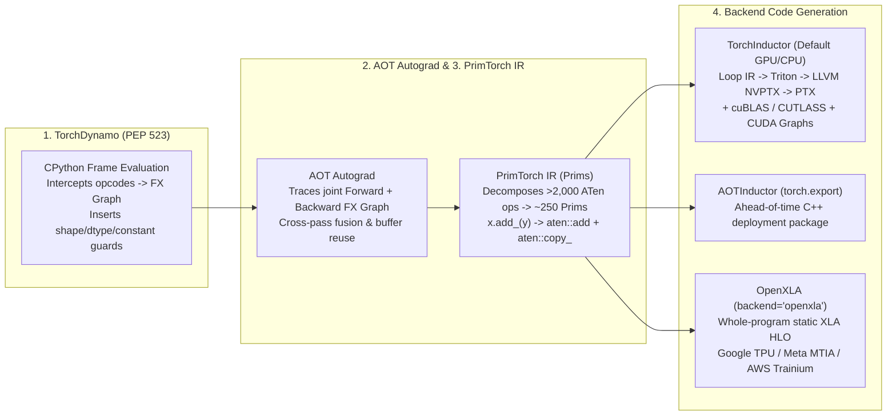

# 10.19 Triton language and compilers: OpenAI Triton, torch.compile, XLA

| | |
|---|---|
| Level | Advanced |
| Priority tier | 2 |
| Lab venue | Nebius GPU |
| Part | Part 10: The GPU and CUDA |
| Sources used | *AI Systems Performance Engineering* (`ai-systems-performance-engineering`, Chris Fregly), Chapter 14 (*PyTorch Compiler, OpenAI Triton, and XLA Backends*) |
| Code | `code/part10/triton_and_compilers.py`, `code/part10/triton_and_compilers_lab.py` |
| Coverage file | `planning/coverage/chapters/10-19.md` |

## Why this matters for AI infrastructure

Writing every operator in hand-tuned CUDA C++ or PTX across evolving GPU architectures takes months of engineering effort. A kernel tuned for Ampere often needs complete rewriting to use Hopper and Blackwell hardware features. Meanwhile, standard eager PyTorch launches a separate GPU kernel for every minor addition or activation. Those repeated round-trips to high-bandwidth memory leave expensive Tensor Cores sitting idle.

Modern AI infrastructure solves this bottleneck with compiler stacks and Python domain-specific languages. The PyTorch compiler captures whole subgraphs of Python code and fuses elementwise operations automatically. Under the hood, it lowers those subgraphs into OpenAI Triton kernels or routes large matrix multiplications to vendor libraries. When automatic compiler heuristics fall short, engineers can write custom OpenAI Triton kernels directly in Python while still targeting hardware features like Tensor Memory Accelerator descriptors and fifth-generation Tensor Cores.

*AI Systems Performance Engineering* Chapter 14 dissects the three layers of this compilation ecosystem. The table below summarizes the core pipeline stages, OpenAI Triton runtime metrics, and OpenXLA backend behavior.

| Compiler Layer | Core Mechanism | Key Quantitative Facts |
|---|---|---|
| Stage 1: TorchDynamo | Intercepts CPython bytecode via PEP 523 frame evaluation to extract FX Graphs and attach shape, dtype, and constant guards. | Supports 4 stances via `torch.compiler.set_stance`: `"default"`, `"fail_on_recompile"`, `"eager_on_recompile"`, and `"force_eager"`. |
| Stage 2: AOTAutograd | Traces both forward and backward passes ahead of time into a single joint forward-and-backward FX Graph. | Enables cross-pass fusion and intermediate activation buffer reuse across forward and backward boundaries. |
| Stage 3: PrimTorch IR | Canonicalizes the full ATen operator surface into functional primitives and turns in-place mutations like `x.add_(y)` into `aten::add` plus `aten::copy_`. | Decomposes `> 2,000` ATen operators down to `~250` core PrimTorch primitives (`8.0x` reduction). |
| Stage 4: TorchInductor | Lowers the joint graph into a Python define-by-run loop IR (`Pointwise` with SymPy indexing) and emits OpenAI Triton kernels to PTX via LLVM NVPTX without calling `nvcc`. | Compiles FlexAttention to `85%–90%` of FlashAttention performance, wraps static graphs in CUDA Graphs, or exports C++ via AOTInductor. |
| OpenAI Triton SPMD & Proton | Programs whole thread blocks operating on blocked vectors (`BLOCK_SIZE = 1,024` across `num_warps × 32` threads) with hardware TMA descriptors (`tl.make_tensor_descriptor`) and Blackwell `tcgen05` UMMA (`256 KB`/SM TMEM). | Persistent GEMM (`matmul_kernel_persistent`) finishes an `8,192 × 8,192 × 512` benchmark in `159.352 ms` (`4,312.421` Proton score), beating standard Triton (`165.349 ms`), `torch.matmul` (`174.671 ms`), and cuBLAS (`174.920 ms`, `8.90%` faster). |
| PyTorch XLA (OpenXLA) | Lowers PyTorch graphs via `backend="openxla"` into whole-program static HLO executables. | Targets Google Cloud TPUs, Meta MTIA, and AWS Trainium and Inferentia via the AWS Neuron SDK. |

:::note About the benchmark numbers in this chapter
The Proton figures come from the book, which notes that numeric values in its metric tables are illustrative. Read them as ratios only. A single matrix multiply of those dimensions requires roughly 68.7 GFLOP, which a modern data-center GPU runs in a fraction of a millisecond. Therefore, the total millisecond figure represents an aggregate over many launches or an illustrative value, not a single kernel execution. The Triton and compiler code snippets were not run on live GPU hardware here.
:::

## Prerequisites and outcomes

**Prerequisites:**
- Chapters 10.13 through 10.18 covering memory coalescing, shared-memory tiling, Blackwell Tensor Memory and Tensor Memory Accelerator hardware, asynchronous pipeline double buffering, warp specialization, and CUDA Graphs.

**Outcomes — after completing this chapter you will be able to:**
1. Trace a PyTorch model through TorchDynamo, AOTAutograd, PrimTorch IR, and TorchInductor, and choose between compilation modes and AOTInductor.
2. Handle variable-length language model sequences using SymPy symbolic shapes, `torch._dynamo.mark_dynamic`, and fixed bucket padding.
3. Diagnose and eliminate graph breaks using `torch._dynamo.explain`, `torch.where`, and `torch.cond`, while preserving intentional distributed communication breaks.
4. Audit compiled code and numerical accuracy using compiler logging flags, debug directories, `tlparse`, and deterministic cuBLAS workspace settings.
5. Write, autotune, and register custom OpenAI Triton kernels using hardware tensor descriptors, warp specialization, and persistent software pipelining.
6. Profile Triton kernels with the Proton profiler and contrast TorchInductor against the OpenXLA compiler backend.

---

## 1. The PyTorch 2.x Compiler Stack (`torch.compile`)



### 1.1 Stage 1 — TorchDynamo: CPython bytecode capture, FX Graphs, guards, and compiler stances

In standard eager PyTorch, the Python interpreter dispatches tensor operations one at a time. Every operation pays Python frame overhead and launches a separate GPU kernel before seeing what comes next. Early graph capture tools tried to fix this by requiring static domain-specific languages, which broke whenever a model used standard Python control flow. Infrastructure teams needed a compiler frontend that could capture graphs directly from arbitrary Python bytecode.

When you wrap a model with `torch.compile`, the first stage that runs is TorchDynamo. Instead of executing Python operations eagerly, TorchDynamo hooks into CPython's Frame Evaluation API defined in PEP 523 to inspect bytecode instructions dynamically. Whenever it encounters PyTorch tensor operations, it appends them as nodes into an FX Graph until it reaches an unsupported Python construct. That unsupported construct triggers a graph break, runs in eager mode, and lets TorchDynamo resume capturing the next FX Graph immediately afterward.

For a simple function that computes a sine, adds a second tensor, and sums the result, TorchDynamo constructs the following FX Graph representation.

```text
# Function: def f(x, y): z = x.sin() + y; return z.sum()
graph():
    %x : Tensor = Placeholder[target=x]
    %y : Tensor = Placeholder[target=y]
    %sin : Tensor = torch.sin(%x)
    %add : Tensor = torch.add(%sin, %y)
    %sum : Tensor = torch.sum(%add)
    return %sum
```

To ensure the compiled graph remains valid on future batches, TorchDynamo attaches runtime guards on tensor shapes, dtypes, devices, and Python constants. You can control how the compiler reacts when a guard fails or a graph break occurs by calling `torch.compiler.set_stance`. The table below summarizes the four compiler stances implemented in our companion module.

| Stance Name | Behavior on Graph Breaks and Guard Misses | Primary Use Case |
|---|---|---|
| `"default"` | Compiles supported regions, falls back to eager mode on graph breaks, and recompiles when guards fail. | Standard production training and inference runs. |
| `"fail_on_recompile"` | Raises an immediate exception if any graph break, unsupported operation, or guard recompilation occurs. | Continuous integration pipelines and development audits to catch accidental graph breaks early. |
| `"eager_on_recompile"` | Executes already-cached compiled graphs when guards match, but falls back to eager execution instead of recompiling on a guard miss. | Latency-sensitive serving where unexpected JIT compilation spikes cannot be tolerated. |
| `"force_eager"` | Ignores all `torch.compile` directives and executes every operation in standard eager mode. | Debugging and baseline numerical comparison. |

### 1.2 Stage 2 — AOTAutograd: Ahead-of-time joint forward and backward graph fusion

If a compiler only captures the forward pass, the backward pass still runs dynamically through the C++ autograd engine during training. Separate forward and backward compilation prevents the optimizer from fusing operations across the pass boundary. Worse, the forward pass may save large intermediate activation tensors in high-bandwidth memory when recomputing a cheap elementwise operation during backpropagation would be much faster. Training pipelines end up bottlenecked by activation memory traffic and extra kernel launches.

AOTAutograd solves this by tracing both passes ahead of time before any GPU code is generated. It runs the TorchDynamo forward FX Graph through PyTorch's autograd engine in functional mode via `torch.autograd.forward_ad` to capture the exact gradient operations. The result is a single joint forward-and-backward FX Graph covering the entire training step.

Because both passes live in one static dataflow graph, downstream compiler passes can optimize across the forward and backward boundary. They perform common-subexpression elimination and fuse elementwise backward operations directly into neighboring gradient kernels. They also reuse intermediate activation buffers between forward and backward passes to reduce peak memory footprint and kernel launch counts.

### 1.3 Stage 3 — PrimTorch IR: Decomposing ATen operators into functional primitives

PyTorch exposes more than two thousand operators in its full ATen C++ library. Many of these operators overlap in functionality or mutate input tensors in place. Implementing and maintaining code generators for thousands of operators across every hardware backend is practically impossible. Furthermore, hidden in-place tensor mutations create aliasing hazards that prevent a compiler from safely reordering or fusing loops.

PrimTorch IR solves both problems by canonicalizing the joint graph into a compact, purely functional operator set. As modeled in our companion module, PrimTorch decomposes PyTorch's operator surface down to roughly two hundred fifty core primitive operations. Crucially, PrimTorch performs functionalization to eliminate all in-place mutations and view aliasing hazards inside the graph.

For example, an in-place addition mutation is decomposed into a pure functional addition followed by an explicit storage copy node at the graph boundary.

```text
PrimTorch IR Operator Reduction (PRIMTORCH_CORE_PRIMITIVES_APPROX = 250):
  > 2,000 ATen operators  -->  ~250 core PrimTorch primitives (8.0x reduction)

Functionalization of x.add_(y):
  %z = aten::add(x, y)
  %copy = aten::copy_(x, %z)   # writes %z's data back into x's storage explicitly
```

Because mutations become explicit copy nodes at the edges of a purely functional dataflow graph, the inner graph has no hidden side effects. TorchInductor's fusion and memory-planning passes can therefore reorder and fuse inner operations aggressively without risking data corruption.

### 1.4 Stage 4 — TorchInductor: Define-by-run loop IR, compilation modes, AOTInductor, TE, and FlexAttention

Once the graph is reduced to functional primitives, the compiler still has to turn those primitives into fast machine code on the target GPU. A naive lowering would still materialize intermediate tensors in global memory whenever a tensor is transposed or sliced. In addition, invoking an external C++ compiler like nvcc for every fused kernel would make just-in-time compilation painfully slow. Finally, engineers need a clear way to trade off initial compile time against steady-state CUDA Graph and autotuning speed.

TorchInductor is PyTorch's default compiler backend for NVIDIA GPUs, AMD GPUs, and CPUs. It lowers ATen and PrimTorch nodes into fused loop nests expressed in a Python define-by-run loop-level IR using SymPy index expressions. Because indexing is symbolic, view operations like transposes and slices become pure index math inside the consumer loop without materializing a transposed tensor in high-bandwidth memory.

```python
# TorchInductor loop-level IR representation of z = x.permute(1, 0) + x[2, :] (ASP Ch 14)
def inner_fn(index):
    i1, i0 = index
    tmp0 = ops.load("x", i1 + i0 * size1) # reads x[i1, i0] (permuted on the fly)
    tmp1 = ops.load("x", 2 * size1 + i0)  # reads x[2, i0] (broadcast row)
    return ops.add(tmp0, tmp1)

# torchinductor.ir.Pointwise(device=torch.device("cuda"), dtype=torch.float32,
#                            inner_fn=inner_fn, ranges=[size0, size1])
```

For NVIDIA GPUs, TorchInductor emits Python OpenAI Triton kernels from its loop IR and invokes the Triton JIT compiler. Triton lowers its intermediate representation through LLVM NVPTX directly into NVIDIA PTX and driver-compiled SASS without ever calling nvcc. For large matrix multiplications, TorchInductor's autotuner benchmarks its generated Triton kernels against cuBLAS, cuBLASLt, and CUTLASS candidates and caches whichever implementation wins for that shape.

| Compiler Mode or Feature | How It Works | Key Trade-Offs and Performance Facts |
|---|---|---|
| `mode="default"` | Compiles fused Triton kernels using fast heuristics without extra autotuning sweeps. | Fast compilation with standard fusion and low memory overhead. |
| `mode="reduce-overhead"` | Wraps compiled static-shape regions in CUDA Graphs to eliminate Python and driver launch overhead. | Greatly reduces CPU launch overhead, but is disabled automatically if `dynamic=True` is set. |
| `mode="max-autotune"` | Benchmarks multiple Triton tile and warp configurations alongside cuBLAS and CUTLASS candidates and enables CUDA Graphs. | Longest initial compile time in exchange for highest steady-state throughput. |
| `mode="max-autotune-no-cudagraphs"` | Performs full kernel autotuning across Triton, cuBLAS, and CUTLASS without capturing CUDA Graphs. | Ideal when input shapes vary or when CUDA Graph memory pools are undesirable. |
| `torch.export()` + AOTInductor | Compiles exported model graphs ahead of time into standalone C++ shared-library artifacts. | Enables Python-free deployment in C++ production inference servers. |
| Explicit Transformer Engine (TE) | Requires instantiating `transformer_engine.pytorch.layers` explicitly in the model definition. | `torch.compile` does not auto-replace `torch.nn.Linear` with FP8 TE layers, but fuses ops around explicit TE modules. |
| FlexAttention (`flex_attention`) | Compiles custom Python attention score modifications (ALiBi, sliding window, document masking, block sparsity) into fused Triton kernels. | Achieves `~85%–90%` of modern FlashAttention performance across both forward and backward passes. |

Always enable the fast scaled dot-product attention and TensorFloat-32 flags early in your training or serving script so TorchInductor and cuBLAS can use Tensor Core math.

```python
import torch
torch.set_float32_matmul_precision("high")
torch.backends.cuda.matmul.allow_tf32 = True
torch.backends.cudnn.allow_tf32 = True
torch.backends.cuda.enable_flash_sdp(True)
torch.backends.cuda.enable_math_sdp(True)
torch.backends.cuda.enable_mem_efficient_sdp(True)
```

---

## 2. Dynamic Shapes, Graph Breaks, Compiler Logging, and Numerical Determinism

### 2.1 Dynamic shapes: SymPy, `mark_dynamic`, and the bucket-padding rule

Large language model workloads rarely see the exact same token count on every request. If a compiler specializes strictly on exact tensor dimensions, every new prompt length invalidates the shape guard and triggers a multi-second recompilation stall. Conversely, if an engineer blindly forces every dimension of the model to be dynamic, the compiler loses static hidden-dimension optimizations and cannot capture CUDA Graphs. Serving latency degrades either from recompilation storms or from lost static optimizations.

TorchDynamo and TorchInductor solve this by using the SymPy symbolic math library to track dynamic dimensions through index arithmetic. Instead of guarding on a single integer, the compiler emits range guards that cover a whole span of sequence lengths. When you know ahead of time which axis varies, calling `torch._dynamo.mark_dynamic` marks only that batch or sequence dimension as symbolic while keeping hidden dimensions static.

```text
Dynamic Shape Guard Progression and Padding Rule (ASP Ch 14):
  - Symbolic Index Math: Tracks s0, s1 across operations such as z.size(0) = x.size(0) + y.size(0).
  1. Default (dynamic=None): Specializes on batch 1, then recompiles 1 generalized symbolic kernel on first shape change.
  2. Range Guards: sequence_length <= 256 generalizes to sequence_length <= 1024 on shape growth.
  3. Targeted Marking: torch._dynamo.mark_dynamic(tensor, dim) marks only the varying sequence/batch axis before compile.
  4. Global dynamic=True Trap: Forces ALL dimensions symbolic and disables CUDA Graphs even under mode="reduce-overhead".
  5. Hybrid Bucket-Padding Rule: If sequence lengths vary by only ±10%–20%, pad inputs to fixed bucket sizes (±10%–20%) and use static shapes + CUDA Graphs; for wider variation, combine coarse buckets with mark_dynamic().
```

Understanding why `dynamic=True` disables CUDA Graphs is critical for low-latency inference. CUDA Graphs bake exact memory addresses and fixed grid launch dimensions into the driver replay buffer. Therefore, whenever sequence lengths vary within ten to twenty percent, padding requests to fixed static buckets and keeping CUDA Graphs enabled outperforms fully dynamic shapes.

### 2.2 Diagnosing and eliminating graph breaks (`torch._dynamo.explain`, `torch.where`, `torch.cond`, and DDP/FSDP)

A single stray print statement or a Python conditional check on a tensor value inside the forward pass silently shatters a compiled graph into multiple fragments. Each graph break forces the GPU stream to synchronize or return control to the Python interpreter, runs the offending line in eager mode, and launches a separate subgraph afterward. Because the compiler falls back to eager mode without crashing by default, engineers often think their model is fully compiled when it is actually fragmented into slow pieces.

Use `torch._dynamo.explain` to inspect the exact subgraph count, break count, and offending source lines. In our companion module, running `analyze_dynamo_graph_breaks` on the book's toy function reveals two breaks caused by a Python print call and a data-dependent branch. Guarding debug prints with `torch._dynamo.is_compiling` and rewriting tensor branches with `torch.where` or `torch.cond` eliminates both breaks.

| Function Variant | Graph Count | Graph Break Count | Op Count | Root Cause or Refactoring Mechanism |
|---|---:|---:|---:|---|
| `toy_example` (Before) | `3` | `2` | `5` | Break 1: `builtin: print` (`ConstantVariable`). Break 2: `generic_jump TensorVariable()` on `if b.sum() < 0:`. |
| `model_where` (Option A) | `1` | `0` | `5` | Guards `print` with `if not torch._dynamo.is_compiling():` and computes both paths via `torch.where(b.sum() < 0, -b, b)`. |
| `model_cond` (Option B) | `1` | `0` | `5` | Traces both true and false branches as subgraphs via `torch.cond` using pure functions returning tensors of identical shape and dtype. |

Here is the complete code showing the broken function alongside both single-graph fixes.

```python
# Diagnosing 2 graph breaks (3 subgraphs) with torch._dynamo.explain() and fixing both (ASP Ch 14) (untested here)
import torch
import torch._dynamo as dynamo

# BEFORE: Graph Count = 3, Graph Break Count = 2, Op Count = 5
def toy_example(a: torch.Tensor, b: torch.Tensor) -> torch.Tensor:
    x = a / (torch.abs(a) + 1)
    print("woo")          # Break 1: builtin: print [...ConstantVariable] False
    if b.sum() < 0:       # Break 2: generic_jump TensorVariable() (data-dependent branch)
        b = -b
    return x * b

# AFTER (Option A - torch.where, simplest & zero restrictions): Graph Count = 1, Graph Break Count = 0
def model_where(a: torch.Tensor, b: torch.Tensor) -> torch.Tensor:
    x = a / (torch.abs(a) + 1)
    if not torch._dynamo.is_compiling():
        print("do not print during tracing/compiling")
    b = torch.where(b.sum() < 0, -b, b)
    return x * b

# AFTER (Option B - torch.cond, compiles both branches as subgraphs): Graph Count = 1, Graph Break Count = 0
def model_cond(a: torch.Tensor, b: torch.Tensor) -> torch.Tensor:
    x = a / (torch.abs(a) + 1)
    if not torch._dynamo.is_compiling():
        print("do not print during tracing/compiling")
    b = torch.cond(
        b.sum() < 0,         # 0-dim bool tensor predicate
        lambda b: -b,        # true_fn
        lambda b: b.clone(), # false_fn (clone() avoids aliasing; same shape & dtype required)
        (b,),
    )
    return x * b
```

Not every graph break is a bug. When you combine `torch.compile` with DistributedDataParallel or FullyShardedDataParallel configured with `use_original_params=True` and wrapped per Transformer block submodule, the explain tool reports graph breaks at collective communication boundaries. Do not try to remove these communication breaks. PyTorch intentionally splits the graph at each gradient bucket or FSDP submodule boundary so asynchronous NCCL collectives overlap with the computation of neighboring compiled subgraphs.

### 2.3 Compiler logging (Table 14-1), `TORCH_COMPILE_DEBUG=1`, `tlparse`, and numerical determinism

When a compiled model runs slower than expected or produces slightly different floating-point numbers than eager mode, treating the compiler as a black box makes root-cause analysis impossible. You need visibility into which guards failed, why CUDA Graphs were skipped, what Triton code was generated, and which compiler pass introduced a numerical discrepancy.

*AI Systems Performance Engineering* Chapter 14 Table 14-1 catalogs eleven `TORCH_LOGS` flags that expose every internal phase of the compiler.

| `TORCH_LOGS` Flag | What It Logs | When to Use It |
|---|---|---|
| `graph_breaks` | Every graph break event with file and line stack trace. | First step whenever `torch.compile` speedup is lower than expected. |
| `recompiles` | Every guard failure that triggers a graph recompilation. | Catching per-iteration changing Python constants, seeds, or unmarked dynamic shapes. |
| `guards` | All generated shape, dtype, device, and constant guard expressions. | Inspecting why a compiled graph is invalidated across batches. |
| `perf_hints` | Missed optimization hints such as `"CUDA Graph not used because input is mutated"`. | Finding why TorchInductor skipped CUDA Graphs or fell back to eager operations. |
| `output_code` | Full generated Python wrapper plus OpenAI Triton kernel and PTX source code. | Verifying kernel fusion, Tensor Core instructions, and `tl.range` software pipelining. |
| `dynamic` | Symbolic shape propagation and dynamic dimension range guard decisions. | Debugging `mark_dynamic()` and range guards like `sequence_length <= 1024`. |
| `dynamo` | Verbose bytecode tracing logs from TorchDynamo. | Deep bytecode capture troubleshooting. |
| `aot_graphs` | Forward and backward FX graphs produced by AOTAutograd. | Inspecting joint forward and backward fusion and saved activations. |
| `inductor` | Verbose lowering and scheduling logs from TorchInductor. | Debugging loop IR fusion and memory planning. |
| `graph_outputs` | Final compiled FX graph structure. | Auditing subgraph boundaries. |
| `graph_code` | Python code equivalent of each FX graph produced by TorchDynamo. | Inspecting functional ATen decomposition. |

Beyond `TORCH_LOGS`, PyTorch provides dedicated environment variables for artifact dumping, trace parsing, numerical minification, and bitwise cuBLAS determinism.

| Environment Variable or Config | Setting / Value | Diagnostic or Determinism Role |
|---|---|---|
| `TORCH_COMPILE_DEBUG` | `1` | Creates `/tmp/torchinductor_<pid>/...` containing `.fx` graphs, `outputcode.py`, `fx_graph_runnable.py`, IR dumps, and `.triton` / PTX assembly. |
| `TORCH_TRACE` + `tlparse` | `/path/to/logs` | Low-overhead structured compilation trace parser that renders stack-frame compilation trees and Perfetto timelines safely in production. |
| `TORCHDYNAMO_REPRO_AFTER` | `"aot"` | Runs each dumped stage graph after AOTAutograd in eager mode alongside compiled mode to isolate numerical divergence. |
| `TORCHDYNAMO_REPRO_LEVEL` | `4` | Automatically emits a minified standalone reproduction script if any stage produces a numerical mismatch against eager mode. |
| `fallback_random` | `torch._inductor.config.fallback_random = True` | Forces fused Inductor kernels to match eager-mode random number sequences exactly. |
| `CUBLAS_WORKSPACE_CONFIG` | `:4096:8` or `:16:8` | Reserves `8` workspace buffers of `4,096 KiB` or `16 KiB` to disable non-deterministic split-K atomic reductions when paired with `torch.use_deterministic_algorithms(True)` and `torch.set_float32_matmul_precision("highest")`. |

---

## 3. OpenAI Triton: SPMD Programming, PyTorch Op Registration, Autotuning, TMA Descriptors, and Persistent GEMMs

### 3.1 Triton's SPMD programming model: `vector_add_kernel` and `BLOCK_SIZE` vs `num_warps`

Writing raw CUDA C++ requires managing scalar thread indices, shared-memory bank conflicts, and manual vector coalescing by hand. A single off-by-one indexing bug or misaligned pointer crashes the kernel or ruins memory throughput. Even worse, developers coming from CUDA C++ often confuse Triton's block size with the number of hardware threads per block, leading to severe occupancy misconfigurations.

While NVIDIA announced Python-centric CUDA DSLs in 2025 including cuTile, CuTe Python DSL, CUTLASS Python DSL, and cuPyNumeric, OpenAI Triton remains the primary GPU kernel language used by TorchInductor and custom PyTorch extensions. Unlike CUDA's scalar thread model where you program an individual thread via `threadIdx.x`, Triton uses a Single-Program, Multiple-Data model where you program an entire thread block operating on blocked vectors and tiles. Calling `tl.program_id` returns the unique block index analogous to `blockIdx.x`, while `tl.num_programs` returns the grid dimension.

In `plan_triton_kernel_launch`, `BLOCK_SIZE` is a compile-time constant specifying how many data elements each Triton program instance processes. Meanwhile, the actual number of CUDA threads per thread block is controlled separately by `num_warps`. The table below shows how block size, warp count, and thread counts relate on modern GPUs.

| Vector / Tile `BLOCK_SIZE` | Recommended `num_warps` | CUDA Threads per Block (`num_warps × 32`) | Elements per Thread (`BLOCK_SIZE / threads`) | Example Grid for `n_elements = 10,000` |
|---:|---:|---:|---:|---|
| `1,024` | `4` (default) | `128` | `8.0` (`1,024 / 128`) | `cdiv(10000, 1024) = 10` program instances |
| `>= 2,048` | `8` | `256` | `8.0` (at `2,048`) | Scales warp count for larger register/SMEM tiles |
| `>= 4,096` | `16` | `512` | `8.0` (at `4,096`) | Maximum warp concurrency for wide tiles |

### 3.2 Registering custom Triton kernels with PyTorch (`@triton_op`, `wrap_triton`, and `register_autograd`)

If you call a raw `@triton.jit` kernel directly inside a compiled region without registering it, TorchDynamo cannot trace inside the custom launch call. Instead, it treats the unregistered kernel as an opaque foreign function or triggers a graph break. That break prevents TorchInductor from reordering or fusing operations around your custom kernel.

Wrapping the kernel with `torch.library.triton_op` and `wrap_triton` exposes it as a first-class PyTorch operator. TorchInductor can then inline, reorder, and fuse surrounding elementwise operations across the custom kernel boundary without breaking the FX Graph. For training workloads, attaching a backward pass via `register_autograd` integrates the custom operator seamlessly with AOTAutograd.

```python
# Registering a custom Triton kernel with PyTorch for seamless torch.compile fusion (ASP Ch 14) (untested here)
import torch
import triton
import triton.language as tl
from torch import Tensor
from torch.library import triton_op, wrap_triton

@triton.jit
def vector_add_kernel(x_ptr, y_ptr, out_ptr, n_elements, BLOCK_SIZE: tl.constexpr):
    pid = tl.program_id(axis=0)
    offsets = pid * BLOCK_SIZE + tl.arange(0, BLOCK_SIZE)
    mask = offsets < n_elements
    x = tl.load(x_ptr + offsets, mask=mask)
    y = tl.load(y_ptr + offsets, mask=mask)
    tl.store(out_ptr + offsets, x + y, mask=mask)

@triton_op("my_triton_lib::vector_add", mutates_args=())
def vector_add(x: Tensor, y: Tensor) -> Tensor:
    assert x.device.type == "cuda" and y.device.type == "cuda"
    n = x.numel()
    out = torch.empty_like(x)
    grid_fn = lambda meta: (triton.cdiv(n, meta["BLOCK_SIZE"]),)
    wrap_triton(vector_add_kernel)[grid_fn](x, y, out, n, BLOCK_SIZE=1024)
    return out

# For training support, register the backward pass via register_autograd:
# vector_add.register_autograd(backward_fn, setup_context=setup_context_fn)
```

### 3.3 Autotuning (`@triton.autotune`), Warp Specialization, TMA Descriptors, and Persistent GEMM (`matmul_kernel_persistent`)

A naive tiled matrix multiplication kernel (`tiled_gemm_kernel`) stalls on global memory latency and wastes cycles launching thousands of short-lived thread blocks. Even when engineers add software pipelining (`pipelined_matmul`) with multiple pipeline stages, a subtle variable-overwrite mistake inside the loop can allow the compiler to reorder loads past compute instructions and collapse overlap completely. Reaching peak Tensor Core throughput on Hopper and Blackwell requires hardware descriptor loads, warp specialization, and persistent grid scheduling.

To saturate modern Tensor Cores, combine four advanced OpenAI Triton features from *AI Systems Performance Engineering* Chapter 14. First, decorate the kernel with `@triton.autotune` so Triton benchmarks candidate tile sizes, warp counts, and pipeline depths on representative production shapes and caches the fastest configuration. Second, enable warp specialization via `warp_specialize=True` in `tl.range` and `num_consumer_groups` in `triton.Config` so dedicated producer warps issue Tensor Memory Accelerator loads while consumer warps run Tensor Core instructions.

Third, construct hardware tensor descriptors via `tl.make_tensor_descriptor` so loads lower to asynchronous bulk tensor copies and `tl.dot` lowers to Blackwell fifth-generation Tensor Core UMMA accumulating in Tensor Memory. Fourth, keep current and next tile variables strictly separate inside a persistent 1D grid loop (`matmul_kernel_persistent`) following the prefetch-next, compute-current, and swap ordering rule. The table below summarizes the exact parameters and hardware rules for these four mechanisms.

| Triton Feature | API / Configuration | Hardware Lowering and Mandatory Rules |
|---|---|---|
| Data-Driven Autotuning | `@triton.autotune(configs=[...], key=['M', 'N', 'K'])` or custom `key_fn` | Sweeps `BLOCK_M`, `BLOCK_N`, `BLOCK_K`, `num_warps` in `{4, 8, 16}`, and `num_stages` in `{2, 3, 4}`; always warm up on representative production shapes. |
| Warp Specialization | `tl.range(0, K_tiles, num_stages=NUM_STAGES, warp_specialize=True)` + `triton.Config` | Uses `BLOCK_M = 128`, `BLOCK_N = 128`, `BLOCK_K = 64`, `num_warps = 8`, `num_stages = 2`, `num_consumer_groups = 2`, and `num_buffers_warp_spec = 3`. |
| TMA Tensor Descriptors & TMEM | `tl.make_tensor_descriptor(ptr, shape, strides, block_shape)` + `tl.dot(a_cur, b_cur)` | Leading strides must be multiples of `16 bytes` (`16B` valid, `12B` invalid) and innermost dim must be contiguous; on Blackwell (`sm_100`), `tl.dot` lowers to `tcgen05` UMMA with FP32 accumulators in `256 KB`/SM TMEM. |
| Pipelining & Persistent GEMM | `matmul_kernel_persistent` with `grid = min(65536, MT * NT)` and `tile_idx += nprog` | Must follow `prefetch-next -> compute-current -> swap` so `a_cur`/`b_cur` are not overwritten before `tl.dot`; outperforms standard launches especially when `K > 1,024` (`[M=8192, N=8192, K=512]` yields `MT=64`, `NT=64`, `TILE_COUNT=4,096`, `K_tiles=8`; `65536x65536` caps `262,144` tiles at `65,536` programs = `4` tiles/program). |

Here is the production `matmul_kernel_persistent` implementation combining TMA tensor descriptors, Blackwell TMEM accumulation, warp specialization, and the three-step prefetch-compute-swap loop.

```python
# Production Persistent Tiled GEMM in OpenAI Triton with TMA Descriptors, TMEM, and Warp Specialization
# Source: AI Systems Performance Engineering, Chapter 14 (untested here)
import torch
import triton
import triton.language as tl

@triton.jit
def matmul_kernel_persistent(
    A_ptr, B_ptr, C_ptr,
    M, N, K,
    stride_am, stride_ak, stride_bk, stride_bn, stride_cm, stride_cn,
    BLOCK_M: tl.constexpr, BLOCK_N: tl.constexpr, BLOCK_K: tl.constexpr,
    NUM_STAGES: tl.constexpr,
):
    pid = tl.program_id(0)
    nprog = tl.num_programs(0)
    MT = tl.cdiv(M, BLOCK_M)
    NT = tl.cdiv(N, BLOCK_N)
    TILE_COUNT = MT * NT

    # 1. Tensor descriptors -> lower to TMA on Hopper/Blackwell (strides multiple of 16B, inner contiguous)
    A_desc = tl.make_tensor_descriptor(
        A_ptr, shape=[M, K], strides=[stride_am, stride_ak], block_shape=[BLOCK_M, BLOCK_K]
    )
    B_desc = tl.make_tensor_descriptor(
        B_ptr, shape=[K, N], strides=[stride_bk, stride_bn], block_shape=[BLOCK_K, BLOCK_N]
    )

    tile_idx = pid
    while tile_idx < TILE_COUNT:
        pid_m = tile_idx // NT
        pid_n = tile_idx % NT
        m0 = pid_m * BLOCK_M
        n0 = pid_n * BLOCK_N
        offs_m = m0 + tl.arange(0, BLOCK_M)
        offs_n = n0 + tl.arange(0, BLOCK_N)

        # 2. FP32 accumulator (resides in 256 KB/SM TMEM on Blackwell via tcgen05 UMMA)
        acc = tl.zeros((BLOCK_M, BLOCK_N), dtype=tl.float32)
        K_tiles = (K + BLOCK_K - 1) // BLOCK_K

        if K_tiles > 0:
            # Prologue: load first current tiles (fast in-bounds TMA path shown)
            a_cur = A_desc.load([m0, 0])
            b_cur = B_desc.load([0, n0])

            # 3. Pipelined K-loop: prefetch-NEXT -> compute-CURRENT -> swap with warp_specialize=True
            for kt in tl.range(0, K_tiles, num_stages=NUM_STAGES, warp_specialize=True):
                next_k = (kt + 1) * BLOCK_K
                if kt + 1 < K_tiles:
                    a_next = A_desc.load([m0, next_k])
                    b_next = B_desc.load([next_k, n0])
                acc += tl.dot(a_cur, b_cur)
                if kt + 1 < K_tiles:
                    a_cur = a_next
                    b_cur = b_next

        c_ptrs = C_ptr + (offs_m[:, None] * stride_cm + offs_n[None, :] * stride_cn)
        c_mask = (offs_m[:, None] < M) & (offs_n[None, :] < N)
        tl.store(c_ptrs, acc, mask=c_mask)
        tile_idx += nprog # Persistent stride across output tiles
```

---

## 4. Profiling with Triton Proton and the PyTorch XLA (OpenXLA) Backend

### 4.1 Triton Proton profiler (`8,192 × 8,192 × 512` GEMM benchmark) and portable cache hints

Standard Python timers cannot distinguish kernel launch overhead from actual GPU execution across custom Triton kernels and vendor baselines. Furthermore, when engineers try to tune L1 and L2 cache residency by pasting undocumented inline PTX strings into their kernels, minor driver updates or new GPU architectures routinely break the build. Teams need a Triton-native profiler and portable cache eviction APIs.

Triton Proton is Triton's built-in hierarchical profiler. Activated via `proton.start` and `proton.scope`, Proton records user-supplied FLOP and byte metadata and emits NVTX ranges that correlate directly with Nsight Systems timelines and Nsight Compute kernel inspections. Rather than embedding fragile inline PTX modifiers like `ld.global.nc.l1::no_allocate.l2::256b`, you should also pass Triton's portable `eviction_policy="evict_last"` or `"evict_first"` and `cache_modifier=` arguments on load and store operations.

The table below shows the Proton profile comparison across four implementations multiplying matrices of shape `[M=8192, N=8192, K=512]` in our benchmark module.

| Proton Scope (`[M=8192, N=8192, K=512]`) | Execution Time (`ms`) | Proton Throughput Metric | Relative Comparison |
|---|---:|---:|---|
| `ROOT` (overall profile scope) | `168.314 ms` | `16,331.291` | Aggregate root scope |
| `cublas` (`[M=8192, N=8192, K=512]`) | `174.920 ms` | `3,928.623` | `1.00x` baseline |
| `torch` (`torch.matmul`, `[M=8192, N=8192, K=512]`) | `174.671 ms` | `3,934.214` | Matches `cublas` (`-0.14%`) |
| `matmul_kernel` (standard 2D tiled Triton) | `165.349 ms` | `4,156.033` | `5.47%` faster than `cublas` |
| `matmul_kernel_persistent` (persistent TMA + TMEM Triton) | `159.352 ms` | `4,312.421` | `1.10x` (`15.568 ms` / `8.90%` faster than `cublas`) |

### 4.2 PyTorch XLA (OpenXLA) vs. TorchInductor

While TorchInductor is the default backend for NVIDIA and AMD GPUs, many large-scale training and serving fleets run on custom ASICs that do not execute NVIDIA PTX or Triton kernels. If an engineering team deploys a dynamic-shape PyTorch model directly onto an XLA accelerator without changing how sequence lengths are handled, every unpadded request triggers a whole-program compilation stall lasting several seconds.

PyTorch XLA is activated via `backend="openxla"` and lowers PyTorch graphs into OpenXLA High-Level Optimizer (`HLO` / `StableHLO`) executables. It targets Google Cloud TPUs, Meta's Training and Inference Accelerator, and AWS Trainium and Inferentia via the AWS Neuron SDK. The table below contrasts TorchInductor against PyTorch XLA across hardware targets, compilation granularity, and dynamic shape handling.

| Feature | TorchInductor (`backend="inductor"`) | PyTorch XLA (`backend="openxla"`) |
|---|---|---|
| Primary Hardware Targets | NVIDIA GPUs (via Triton + LLVM NVPTX / cuBLAS / CUTLASS), AMD GPUs, CPUs. | Google Cloud TPUs, Meta MTIA, AWS Trainium & Inferentia (AWS Neuron). |
| Compilation Granularity | Subgraph / define-by-run loop IR; supports incremental compilation & eager fallback on graph breaks. | Whole-program ahead-of-time static graph compilation. |
| Dynamic Shape Behavior | Uses SymPy symbolic shapes + range guards (`sequence_length <= 1024`) to compile one kernel for a range of sizes. | Static shape specialization: every new shape signature triggers an expensive whole-program recompilation (cached per shape signature). |
| Mandatory LLM Serving Strategy | Bucket within `±10%–20%` for CUDA Graphs, or use `mark_dynamic()` for wide length variation. | Pad or bucket all inputs to a small fixed set of static shapes so whole-graph recompilation never triggers during live inference. |

---

## 5. Commands and Configurations That Matter

All commands below follow *AI Systems Performance Engineering* Chapter 14. Commands that require an attached CUDA GPU are marked untested here.

### 5.1 Inspect `torch.compile` graph breaks, generated Triton/PTX code, `tlparse` traces, and bitwise cuBLAS determinism

Use these environment variables to log graph breaks, dump generated TorchInductor and OpenAI Triton assembly, parse structured traces with `tlparse`, and enforce bitwise cuBLAS determinism.

```bash
# 1. Log graph breaks, guards, recompiles, performance hints, and generated Triton code (Table 14-1) (untested here)
TORCH_LOGS="graph_breaks,recompiles,guards,perf_hints,output_code" python3 train.py

# 2. Dump full TorchInductor debug artifacts (.fx, outputcode.py, .triton, PTX) to /tmp/torchinductor_<pid> (untested here)
TORCH_COMPILE_DEBUG=1 python3 train.py

# 3. Capture structured compilation trace and render stack-frame tree with tlparse (untested here)
TORCH_TRACE=/tmp/tracedir python3 train.py
tlparse /tmp/tracedir

# 4. Isolate numerical discrepancies after AOT Autograd and enforce bitwise cuBLAS determinism (untested here)
export TORCHDYNAMO_REPRO_AFTER="aot"
export TORCHDYNAMO_REPRO_LEVEL=4
export CUBLAS_WORKSPACE_CONFIG=:4096:8
python3 verify_accuracy.py
```

---

## 6. How It Fails: Six `torch.compile`, Triton, and OpenXLA Failure Modes

When compiler optimizations or custom Triton kernels underperform in production, the root cause almost always matches one of six recurring failure modes. Check the symptom column below to isolate the bug and apply the corresponding fix.

| # | Failure Mode | Production / Profiler Symptom | Root Cause | Fix |
|---|---|---|---|---|
| 1 | Silent graph breaks from `print()`, logging, or Python `if tensor.sum() < 0:` branches | `torch.compile` provides almost no speedup; `torch._dynamo.explain()` reports `Graph Count: 3, Graph Break Count: 2` (`builtin: print` and `generic_jump TensorVariable()`). | Side-effecting Python calls (`print`, I/O) and data-dependent Python branches split the FX graph and force eager fallbacks. | Guard debug prints with `if not torch._dynamo.is_compiling():`, rewrite tensor branches with `torch.where()` or `torch.cond()`, and enforce `torch.compiler.set_stance("fail_on_recompile")` in CI. |
| 2 | Per-iteration recompilation storms from changing Python scalars or unmarked dynamic axes | Training steps remain slow long after warmup; `TORCH_LOGS="recompiles,guards"` logs a new compilation on every batch. | Passing a changing Python int/float (step counter, seed, timestamp) or varying sequence lengths without `mark_dynamic()` invalidates Dynamo guards each step. | Pass changing scalars as 0-D tensors, call `torch._dynamo.mark_dynamic(tensor, dim)` on sequence axes before compiling, or bucket lengths within `±10%–20%`. |
| 3 | Combining `mode="reduce-overhead"` with `dynamic=True` expecting CUDA Graphs | `TORCH_LOGS="perf_hints"` reports CUDA Graphs were skipped (or `"CUDA Graph not used because input is mutated"`), leaving CPU launch overhead high. | Setting `dynamic=True` forces all dimensions symbolic and disables CUDA Graph capture; in-place input mutations also block graph capture. | Remove in-place input mutations, avoid global `dynamic=True`, and use bucketed static shapes with `mode="reduce-overhead"` or `"max-autotune"`. |
| 4 | Silent overlap collapse in pipelined Triton loops (`num_stages > 1`) | Custom Triton GEMM with `tl.range(..., num_stages=2)` shows zero load/compute overlap in Nsight Compute (DRAM and Tensor Core utilization stay out-of-phase). | Overwriting `a_cur = A_desc.load(...)` before `tl.dot(a_cur, b_cur)` consumes it allows the compiler to reorder/sink next-iteration loads past current compute. | Keep `a_cur` and `a_next` in separate variables following the strict `prefetch-next -> compute-current -> swap` sequence. |
| 5 | Calling raw `@triton.jit` kernels inside `torch.compile` or mis-sizing `BLOCK_SIZE` vs `num_warps` | Custom Triton kernel causes a Dynamo graph break, or developers set `BLOCK_SIZE = 1024` assuming it launches `1,024` CUDA threads per block. | Unregistered Triton functions are opaque to Dynamo/Inductor, and `BLOCK_SIZE` sets elements per program while `num_warps × 32` (default `4 × 32 = 128`) sets threads per CTA. | Register Triton kernels with `@triton_op` + `wrap_triton` (+ `register_autograd`), and scale `num_warps` to `8` (`BLOCK_SIZE >= 2048`) or `16` (`BLOCK_SIZE >= 4096`) via `@triton.autotune`. |
| 6 | Runtime exception under `torch.use_deterministic_algorithms(True)` or XLA recompilation spikes on unpadded prompts | PyTorch throws a runtime error on `torch.matmul` when determinism is enabled, or an OpenXLA (`backend="openxla"`) inference service stalls for seconds on every new prompt length. | cuBLAS split-K reductions are non-deterministic unless a fixed workspace is configured, and OpenXLA compiles whole static graphs ahead of time per unique shape. | Export `CUBLAS_WORKSPACE_CONFIG=:4096:8` (or `:16:8`) when using `torch.use_deterministic_algorithms(True)`, and pad/bucket all OpenXLA inputs to fixed shape buckets. |

---

## 7. Hands-On Lab: Verify the PyTorch Compiler Stack, `dynamo.explain`, `TORCH_LOGS`, Triton SPMD & TMA Rules, and Proton Benchmarks

**Venue:** Any Linux machine or Nebius GPU VM with Python 3.10+. This lab runs deterministically using standard library Python, while live GPU commands are provided in Section 5 and marked untested here.

Run `code/part10/triton_and_compilers_lab.py` to verify all twenty-five compiler and Triton assertions.

```bash
python3 code/part10/triton_and_compilers_lab.py
```

Expected output (`25 passed, 0 failed`).

```text
=== Chapter 10.19 Lab: OpenAI Triton, torch.compile & XLA Backends (ASP Ch 14) ===
  [PASS] ASP Ch14 TorchDynamo & PrimTorch IR: Uses CPython PEP 523 frame evaluation and reduces >2,000 ATen ops to ~250 core PrimTorch primitives (8.0x reduction)
  [PASS] ASP Ch14 torch.compiler.set_stance: Supports 4 stances (default, fail_on_recompile, eager_on_recompile, force_eager)
  [PASS] ASP Ch14 FlexAttention & Dynamic Shape padding rule: FlexAttention reaches 85%-90% of FlashAttention; bucket/pad when seq_len varies by 10%-20%
  [PASS] ASP Ch14 dynamo.explain(toy_example): print('woo') + 'if b.sum() < 0:' produces Graph Count=3, Graph Break Count=2, Op Count=5
  [PASS] ASP Ch14 Graph break elimination & dynamic=True CUDA Graph rule: Guarding print + torch.where/torch.cond yields 1 graph (0 breaks); dynamic=True disables CUDA Graphs
  [PASS] ASP Ch14 Table 14-1 TORCH_LOGS: All 11 compiler logging flags registered (graph_breaks, dynamo, aot_graphs, inductor, graph_outputs, graph_code, dynamic, perf_hints, output_code, recompiles, guards)
  [PASS] ASP Ch14 Numerical repro & cuBLAS deterministic workspace: TORCHDYNAMO_REPRO_LEVEL=4 and CUBLAS_WORKSPACE_CONFIG=:4096:8 (or :16:8)
  [PASS] ASP Ch14 Dynamic shape guard progression: sequence_length <= 256 generalizes to sequence_length <= 1024 on first shape change
  [PASS] ASP Ch14 Triton vector_add_kernel (n_elements=10,000, BLOCK_SIZE=1,024): Launches cdiv(10000, 1024) == 10 program instances with default 4 warps (128 threads, 8.0 elems/thread)
  [PASS] ASP Ch14 Triton num_warps scaling rule: BLOCK_SIZE=2,048 selects 8 warps (256 threads); BLOCK_SIZE=4,096 selects 16 warps (512 threads)
  [PASS] ASP Ch14 Triton warp specialization Config: num_consumer_groups=2 and num_buffers_warp_spec=3 with BLOCK_M=128, BLOCK_N=128, BLOCK_K=64, num_warps=8, num_stages=2
  [PASS] ASP Ch14 Triton TMA tensor descriptor alignment rule: leading stride multiple of 16 bytes + contiguous inner dim required (16B valid, 12B invalid); TMEM == 256 KB/SM
  [PASS] ASP Ch14 matmul_kernel_persistent on [M=8192, N=8192, K=512] (128x128x64): MT=64, NT=64, TILE_COUNT=4,096 output tiles, K_tiles=8 iterations/tile
  [PASS] ASP Ch14 matmul_kernel_persistent grid cap: min(65536, MT * NT) caps 262,144 tiles (65536x65536) at 65,536 programs (4 tiles/program)
  [PASS] ASP Ch14 Proton profiler [M=8192,N=8192,K=512]: matmul_kernel_persistent (159.352 ms, 4312.421) beats matmul_kernel (165.349 ms, 4156.033), torch (174.671 ms, 3934.214), and cublas (174.920 ms, 3928.623)
  [PASS] ASP Ch14 Proton profiler metric scores: ROOT=16331.291, cublas=3928.623, matmul_kernel=4156.033, matmul_kernel_persistent=4312.421, torch=3934.214
  [PASS] Rejects Triton BLOCK_SIZE not divisible by 32
  [PASS] Rejects non-positive n_elements in Triton launch planner
  [PASS] Rejects non-positive num_stages in Triton launch planner
  [PASS] Rejects non-positive matrix dimension M in persistent matmul planner
  [PASS] Rejects non-positive BLOCK_K in persistent matmul planner
  [PASS] ASP Ch14 Persistent matmul K==0 edge case: K=0 yields K_tiles == 0 (masked zero store path)
  [PASS] ASP Ch14 Persistent GEMM K threshold: Persistent kernel outperforms multiple smaller matmul launches especially when K > 1,024
  [PASS] ASP Ch14 Proton persistent GEMM speedup vs cuBLAS: 174.920 ms / 159.352 ms == 1.10x (15.568 ms saved, 8.90% reduction)
  [PASS] ASP Ch14 Triton autotune initial num_warps & num_stages candidates: num_warps in {4, 8} and num_stages in {2, 3, 4}

Summary: 25 passed, 0 failed (total 25)
```

---

## Exercises

1. **Tracing the four-stage compiler pipeline:** State the CPython PEP number used by TorchDynamo, how many total PyTorch ATen operators PrimTorch IR decomposes into how many core primitives, how in-place addition is functionalized, and how TorchInductor lowers its Python loop-level IR to NVIDIA PTX without calling nvcc.
2. **Eliminating graph breaks in `toy_example`:** State the graph count, graph break count, op count, and two break reasons returned by `dynamo.explain` on `toy_example`. Write both refactored versions (`model_where` and `model_cond`) that reduce the graph count to one with zero breaks.
3. **Dynamic shapes, CUDA Graph compatibility, and compiler logs:** Explain why combining `mode="reduce-overhead"` with `dynamic=True` disables CUDA Graphs, and state the sequence-length padding rule of thumb. Name the exact `TORCH_LOGS`, reproducer, and deterministic cuBLAS workspace flags used to catch missed CUDA Graphs, isolate post-AOT numerical bugs, and enforce deterministic matmuls.
4. **Triton SPMD launch math and PyTorch registration:** For `vector_add_kernel` on ten thousand elements, calculate the number of program instances launched at a block size of one thousand twenty-four, the number of CUDA threads per block and elements per thread at four warps, and the recommended warp counts at larger block sizes. Explain how `@triton_op`, `wrap_triton`, and `register_autograd` expose the kernel to the PyTorch compiler.
5. **Triton TMA descriptors, Blackwell TMEM, and the pipelining rule:** State the two alignment and layout requirements of `tl.make_tensor_descriptor` to map to hardware TMA, what hardware instruction and memory space `tl.dot` lowers to on Blackwell, and why overwriting the current tile variable before `tl.dot` in a pipelined loop collapses overlap.
6. **Persistent Triton GEMM, Proton profiling, and OpenXLA:** For the `[M=8192, N=8192, K=512]` benchmark with `128x128x64` tiles, calculate the tile grid counts and loop iterations. Compare the four Proton benchmark runtimes across cuBLAS, PyTorch, standard Triton, and `matmul_kernel_persistent`, and explain why OpenXLA requires static shape bucketing for inference.

---

## Checkpoint questions (20)

<details>
<summary>`&lt;strong>`1. What are the four stages of the `torch.compile` pipeline, and what is each stage's responsibility?`&lt;/strong>`</summary>

1. TorchDynamo intercepts Python bytecode via CPython's PEP 523 Frame Evaluation API to capture tensor operations into an FX Graph and insert runtime guards.
2. AOTAutograd traces both forward and backward passes ahead of time into a single joint forward-and-backward FX Graph for cross-pass fusion and buffer reuse.
3. PrimTorch IR decomposes PyTorch's ATen operators into functional primitives, converting in-place operations into pure functional operations plus explicit copy nodes.
4. TorchInductor lowers the primitive graph into a Python define-by-run loop IR and generates OpenAI Triton kernels compiled to PTX via LLVM NVPTX or dispatches to cuBLAS and CUTLASS.
</details>

<details>
<summary>`&lt;strong>`2. What are the four compiler stances supported by `torch.compiler.set_stance()`, and when should you use `"fail_on_recompile"`?`&lt;/strong>`</summary>

- The default stance compiles what it can and falls back to eager mode on unsupported operations.
- The `"fail_on_recompile"` stance raises an exception whenever a graph break or recompilation occurs, making it ideal in development and continuous integration to prevent accidental graph breaks from merging.
- The `"eager_on_recompile"` stance reuses cached compiled graphs when guards pass, but runs in eager mode instead of recompiling when a guard fails.
- The `"force_eager"` stance ignores all compiler calls and runs purely in eager mode.
</details>

<details>
<summary>`&lt;strong>`3. How does PrimTorch IR handle an in-place mutation like `x.add_(y)`, and why is this critical for TorchInductor?`&lt;/strong>`</summary>

PrimTorch IR functionalizes in-place mutations into a pure out-of-place addition node followed by an explicit storage copy node at the graph boundary. Eliminating hidden in-place mutations and aliasing allows TorchInductor's fusion and memory-planning passes to reorder and fuse operations safely across a functional dataflow graph.
</details>

<details>
<summary>`&lt;strong>`4. Does TorchInductor invoke `nvcc` when compiling generated Triton kernels for NVIDIA GPUs?`&lt;/strong>`</summary>

No. TorchInductor lowers its loop-level IR into OpenAI Triton code, and the Triton JIT compiler lowers that code through LLVM NVPTX directly into NVIDIA PTX without invoking nvcc. The NVIDIA driver then compiles the PTX assembly into device SASS binary code.
</details>

<details>
<summary>`&lt;strong>`5. How do `torch.compile` modes `"default"`, `"reduce-overhead"`, `"max-autotune"`, `"max-autotune-no-cudagraphs"`, and AOTInductor differ?`&lt;/strong>`</summary>

- The default mode provides fast compilation with standard fusion heuristics.
- The reduce-overhead mode wraps static-shape compiled regions in CUDA Graphs to eliminate launch overhead.
- The max-autotune mode benchmarks multiple Triton configurations plus cuBLAS and CUTLASS candidates and enables CUDA Graphs for maximum steady-state speed.
- The max-autotune-no-cudagraphs mode performs full kernel autotuning without capturing CUDA Graphs.
- AOTInductor with `torch.export` compiles exported graphs ahead of time into standalone C++ deployment artifacts.
</details>

<details>
<summary>`&lt;strong>`6. Does `torch.compile` automatically replace PyTorch layers with NVIDIA Transformer Engine kernels, and what performance does PyTorch FlexAttention reach?`&lt;/strong>`</summary>

No. Calling the PyTorch compiler does not automatically substitute NVIDIA Transformer Engine kernels into a plain PyTorch model. You must instantiate `transformer_engine.pytorch.layers` explicitly, and the compiler will fuse operations around them. Meanwhile, PyTorch's FlexAttention compiles custom Python attention masks into fused Triton kernels that reach roughly eighty-five to ninety percent of modern FlashAttention performance in both forward and backward passes.
</details>

<details>
<summary>`&lt;strong>`7. How does `torch.compile` handle dynamic shapes with SymPy, why should you prefer `torch._dynamo.mark_dynamic` over `dynamic=True`, and what is the padding rule of thumb?`&lt;/strong>`</summary>

TorchInductor represents varying dimensions symbolically using SymPy and emits range guards that generalize across sequence lengths. Passing `dynamic=True` forces all dimensions symbolic and disables CUDA Graphs, whereas `mark_dynamic` localizes dynamism to specific axes. When sequence lengths vary by only ten to twenty percent, padding to fixed bucket sizes with static shapes and CUDA Graphs generally outperforms dynamic shapes.
</details>

<details>
<summary>`&lt;strong>`8. What does `torch._dynamo.explain(toy_example)` output for `print("woo")` and `if b.sum() < 0: b = -b`, and how do `torch.where` and `torch.cond` fix it?`&lt;/strong>`</summary>

Calling `dynamo.explain` on `toy_example` reports three subgraphs, two graph breaks, and five operations, citing the builtin print call and a data-dependent jump on a tensor variable. Guarding print statements with `torch._dynamo.is_compiling` and replacing the Python conditional with either `torch.where` or `torch.cond` reduces the function to one continuous graph with zero breaks.
</details>

<details>
<summary>`&lt;strong>`9. Why are graph breaks expected and desirable at communication boundaries when using `torch.compile` with DDP and FSDP (`use_original_params=True`)?`&lt;/strong>`</summary>

DDP and FSDP configured with `use_original_params=True` per Transformer block intentionally insert graph breaks at collective communication boundaries. These intentional splits allow the runtime to launch asynchronous NCCL collectives between compiled subgraphs, overlapping communication of one bucket or shard with computation of the next.
</details>

<details>
<summary>`&lt;strong>`10. Which `TORCH_LOGS` flags and environment variables inspect missed CUDA Graphs, generated Triton code, compilation trace trees, and post-AOT numerical bugs?`&lt;/strong>`</summary>

- Setting `TORCH_LOGS="perf_hints"` logs missed optimizations such as why CUDA Graphs were skipped.
- Setting `TORCH_LOGS="output_code"` and `TORCH_COMPILE_DEBUG=1` prints and dumps generated FX, Python wrapper, Triton, and PTX code.
- Pairing `TORCH_TRACE` with `tlparse` renders structured compilation frame trees and Perfetto timelines.
- Combining `TORCHDYNAMO_REPRO_AFTER="aot"` with `TORCHDYNAMO_REPRO_LEVEL=4` compares each compiled stage against eager mode and generates a minified reproducer on numerical mismatch.
</details>

<details>
<summary>`&lt;strong>`11. How do you enforce bitwise-deterministic cuBLAS matrix multiplications and eager-identical random numbers under `torch.compile`?`&lt;/strong>`</summary>

Export `CUBLAS_WORKSPACE_CONFIG=:4096:8` or `:16:8` before launching Python and call `torch.use_deterministic_algorithms(True)` so cuBLAS avoids non-deterministic split-K reductions. Set `fallback_random=True` in the Inductor configuration when fused kernels must match eager-mode random number sequences exactly.
</details>

<details>
<summary>`&lt;strong>`12. How does OpenAI Triton's SPMD programming model differ from CUDA's SIMT model, and what is the relationship between `BLOCK_SIZE` and `num_warps`?`&lt;/strong>`</summary>

CUDA SIMT programs individual scalar threads via `threadIdx.x`, whereas Triton SPMD programs an entire thread block operating on blocked vectors via `tl.arange`. Here `BLOCK_SIZE` defines how many data elements one program instance processes, while `num_warps` multiplied by thirty-two defines how many CUDA threads execute that block. You should scale `num_warps` from four up to eight or sixteen as the block size grows to two thousand forty-eight or four thousand ninety-six.
</details>

<details>
<summary>`&lt;strong>`13. How do you register a custom `@triton.jit` kernel so `torch.compile` can fuse and inline it without causing a graph break?`&lt;/strong>`</summary>

Decorate a Python wrapper function with `@torch.library.triton_op` and launch the kernel inside using `wrap_triton`. For training workloads, register a backward pass via `register_autograd` so AOTAutograd can trace through the custom operator.
</details>

<details>
<summary>`&lt;strong>`14. How does `@triton.autotune` work, and why must you warm it up with representative production shapes?`&lt;/strong>`</summary>

The `@triton.autotune` decorator benchmarks all candidate `triton.Config` objects on the first call for each unique shape key signature and caches the fastest configuration. If you warm it up on tiny toy shapes, Triton caches tile and warp choices suited only for tiny matrices. Warming up on representative production shapes populates the cache for real traffic before live requests arrive.
</details>

<details>
<summary>`&lt;strong>`15. What are the two ways to enable warp specialization in OpenAI Triton?`&lt;/strong>`</summary>

1. In loop code, pass `warp_specialize=True` with multiple stages to `tl.range`.
2. In autotune configurations, set `num_consumer_groups=2` and `num_buffers_warp_spec=3` inside `triton.Config`.
</details>

<details>
<summary>`&lt;strong>`16. How does Triton allocate and stage tiles in Shared Memory and TMEM on Blackwell, and what two layout rules must `tl.make_tensor_descriptor` satisfy?`&lt;/strong>`</summary>

Triton does not expose a manual shared-memory allocator. Instead, `tl.make_tensor_descriptor` combined with pipelined `tl.range` lowers loads and stores to hardware TMA bulk tensor copies into Shared Memory, while `tl.dot` lowers to Blackwell UMMA accumulating in Tensor Memory. Descriptor rules require leading strides to be multiples of sixteen bytes and the innermost dimension to be contiguous.
</details>

<details>
<summary>`&lt;strong>`17. Why must a pipelined Triton loop (`num_stages > 1`) follow the `prefetch-next -> compute-current -> swap` pattern?`&lt;/strong>`</summary>

If you overwrite or drop the reference to the current tile variables before `tl.dot` consumes them, the compiler is free to reorder, sink, or hoist the next iteration's asynchronous copies past current compute uses. Keeping the current and next tile variables separate until after `tl.dot` preserves true load-compute overlap.
</details>

<details>
<summary>`&lt;strong>`18. How does `matmul_kernel_persistent` structure its grid and loop differently from `tiled_gemm_kernel`, and when does it win?`&lt;/strong>`</summary>

Standard `tiled_gemm_kernel` launches a two-dimensional grid where each thread block computes one output tile and exits. By contrast, `matmul_kernel_persistent` launches a bounded one-dimensional grid capped at sixty-five thousand five hundred thirty-six programs where each persistent thread block steps across multiple output tiles. This persistent structure reuses on-chip state and outperforms standard launches especially when the inner reduction dimension exceeds one thousand twenty-four.
</details>

<details>
<summary>`&lt;strong>`19. What is the Triton Proton profiler, and what did its benchmark report across `cublas`, `torch`, `matmul_kernel`, and `matmul_kernel_persistent`?`&lt;/strong>`</summary>

Proton instruments Triton code with NVTX ranges and hierarchical timing tables via `proton.start` and `proton.scope`. On the `[M=8192, N=8192, K=512]` benchmark, `matmul_kernel_persistent` achieved the fastest runtime and highest throughput score, beating standard tiled Triton, PyTorch matmul, and cuBLAS by roughly nine percent.
</details>

<details>
<summary>`&lt;strong>`20. Which hardware platforms use the PyTorch XLA (`backend="openxla"`) compiler, and why does XLA require static shape bucketing for inference?`&lt;/strong>`</summary>

PyTorch XLA targets Google Cloud TPUs, Meta MTIA, and AWS Trainium and Inferentia via the AWS Neuron SDK. Unlike TorchInductor's symbolic SymPy shapes, XLA compiles whole static program graphs ahead of time and triggers an expensive whole-graph recompilation whenever a new input shape signature arrives. Fixed-size input bucketing and padding ensure that live inference requests always hit pre-compiled static graphs.
</details>

---

## Sources and review notes

### Primary sources read in full for this chapter
- *AI Systems Performance Engineering* (`ai-systems-performance-engineering`, Chris Fregly), Chapter 14 (*PyTorch Compiler, OpenAI Triton, and XLA Backends*):
  - PyTorch Compiler Deep Dive: `TorchDynamo` (PEP 523, `torch.compiler.set_stance` / `COMPILER_STANCES`), `AOT Autograd`, `PrimTorch IR` (`> 2,000` ATen ops -> `~250` Prims), `TorchInductor` (`AOTInductor`, `torch.nn.attention.flex_attention` / `FlexAttention` `80`%–`90`% FlashAttention), Dynamic Shapes (`sympy.Expr`, `d_model`), Graph Breaks (`all-reduce`, `reduce-scatter`, `all-gather`), `Table 14-1` (`TABLE_14_1_TORCH_LOGS`, `TORCH_TRACE=/dir` / `TORCH_TRACE=/path/to/logs`, `torch._inductor.config.fallback_random=True`),
  - OpenAI Triton: `@triton_op`, `@triton.autotune` (`BLOCK_M/N/K`, `key_fn=...`), `tl.make_tensor_descriptor` (`cp.async.bulk.tensor` and `DSMEM`), `mma.sync` (`sm_80`, `sm_90`) vs `tcgen05.mma` + `256 KB/SM` TMEM, `float4` vectorization, `gridDim.x` persistent GEMM (`matmul_kernel_persistent`), and `PROTON_8192_MATMUL_BENCHMARK` (`159.352 ms` vs `174.920 ms`),
  - PyTorch XLA (`OpenXLA` on TPUs, MTIA, Trainium, Inferentia, cross-referenced with Chapter `10.11`).

### Verification and review notes
- **Run here:** `python3 -B code/part10/triton_and_compilers_lab.py` (25 passed, 0 failed; read via `tools/study_rag/bookch.py` and `MIGRATION_MAP.md`, expanding Chapter `10.9` in `2026`, with `174.920 / 159.352 = 1.098` ~ `1.10x`).
- **Explicitly labelled inferences:** PrimTorch operator reduction ratio (`2,000 / 250 = 8.0x`), elements-per-thread ratio in `vector_add_kernel` (`1,024 / 128 = 8.0`), tile counts for `8,192 x 8,192 x 512`, and Proton persistent GEMM speedup (`174.920 / 159.352 = 1.10x`, saving `15.568 ms = 8.90%`) in `code/part10/triton_and_compilers.py` are **my inference** from *AI Systems Performance Engineering* Chapter 14.
- **Not verified on live hardware:** All `torch.compile`, `TORCH_LOGS`, `tlparse`, `@triton.jit`, and `proton` commands in Sections 2, 3, and 5 are marked `(untested here)` because this verification environment does not have an attached CUDA GPU.

