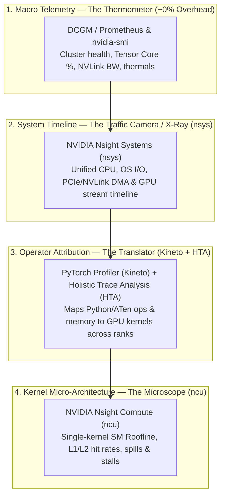

# 10.20 Profiling tools: Nsight Systems, Nsight Compute, PyTorch profiler

| | |
|---|---|
| Level | Advanced |
| Priority tier | 2 |
| Lab venue | Nebius GPU |
| Part | Part 10: The GPU and CUDA |
| Sources used | *AI Systems Performance Engineering* (`ai-systems-performance-engineering`, Chris Fregly), Chapter 13 (*Profiling, Tuning, and Scaling PyTorch*); `nvidia-devops` Volume 17, Chapter 2 (`nvidia-zero-to-hero/volume-17/chapter-02-profiling-tools-landscape.md`) |
| Code | `code/part10/profiling_tools.py`, `code/part10/profiling_tools_lab.py` |
| Coverage file | `planning/coverage/chapters/10-20.md` |

## Why this matters for AI infrastructure

An AI training or inference pipeline can stall at any layer of the hardware and software stack. A job might lose half its speed to Python interpreter dispatch, CPU data loading starvation, or un-overlapped host-to-device memory copies. Another job might stall inside Mixture-of-Experts token routing, memory-bound CUDA kernels, caching-allocator fragmentation, or multi-GPU collective communication stragglers. Guessing where the bottleneck lives wastes days of engineering time and thousands of GPU hours.

As our infrastructure notes emphasize, picking the wrong profiler is like using an X-ray machine to diagnose a cellular disease or an electron microscope to check a patient's fever. Suppose a team writes a custom sparse matrix multiplication kernel in OpenAI Triton that runs four times slower than standard PyTorch on an H100. If they open Nsight Systems, they see only a single long blue bar on the GPU timeline row. Because Nsight Systems cannot look inside a streaming multiprocessor's register file or L1 cache, diagnosing register spilling or uncoalesced sector loads requires Nsight Compute. Conversely, running Nsight Compute kernel replay on an entire multi-GPU training job when the GPU is actually starving behind single-threaded image decoding drowns the team in hardware counters while missing the host gap entirely.

*AI Systems Performance Engineering* Chapter 13 and `nvidia-devops` Volume 17 Chapter 2 provide a complete methodology that connects every layer of the profiling stack. The table below summarizes the benchmark bottlenecks and optimization gains tracked across this chapter.

| Bottleneck Layer | Profiler or Diagnostic Tool | Representative Metric or Benchmark Shift |
|---|---|---|
| Macro Cluster Health | DCGM / Prometheus & `nvidia-smi` ("The Thermometer") | Detects a nightly cluster utilization drop from `90%` down to `10%` with near-zero (`~0%`) overhead. |
| Operator Attribution (64-Expert MoE) | PyTorch Profiler (`Kineto`) + NVTX markers (Table 13-2) | Top 10 ops sum to `138.00 ms`: `aten::matmul` takes `43.00 ms` (`128` calls), `aten::linear` `35.50 ms` (`64` calls), `dispatch` (`18.70 ms`) + `combine` (`12.10 ms`) = `30.80 ms`, and `aten::add_` `2.20 ms` (`64` calls). |
| System Timeline & NVTX Projection | Nsight Systems (`nsys stats --report=nvtx_gpu_proj_sum`, Table 13-3) | Projects `train_step` (`138.0 ms` Child GPU time) across `forward` (`60.5 ms`, `130` instances), `backward` (`58.3 ms`, `130` instances), and `optimizer_step` (`19.2 ms`, `1` instance bracketing `64` `aten::add_` kernels). |
| Single-Kernel Micro-Architecture | Nsight Compute (`ncu`, Table 13-4 & V17 Ch 2 `4x` slower H100 Triton case) | Shifts expert `matmul` from Memory-Bound Baseline (`50%` peak FLOPS, `70%` DRAM BW, `60%` occupancy) to Compute-Bound Optimized (`85%` FLOPS, `40%` DRAM BW, `80%` occupancy). |
| Host CPU & Grace-Blackwell Fabric | Linux `perf stat`, `perf record` (`-F 2000 --call-graph dwarf`), and NVLink-C2C PMUs | Measures `1.58` IPC vs `8` (`8.0`) max IPC on ARM Neoverse V2 Grace core; flags `45.0%` `py::forward`, `20.5%` `aten::matmul`, `10.2%` `dataloader_iter_next`, `8.7%` `ncclAllReduce`, and `5.3%` `read` syscalls. |
| Compiler, Allocator & Distributed Scaling | `torch.compile`, `PYTORCH_ALLOC_CONF`, `SuperOffload` (`GraceAdam`), and `SimpleFSDP` | Cuts MoE step time from `248 ms` to `173 ms` (`~30%` / `30.24%` faster, `1.43x`); rounds `600 MB` allocator request to `768 MB`; `SimpleFSDP` cuts memory `~28%` and raises throughput `~69%`. |
| Multi-GPU Trace & CI Regression Gates | Holistic Trace Analysis (HTA), TorchBench CI, PyTorch HUD, and MLPerf Logging (Table 13-6) | Enforces `>= 5%` regression gate over `3` runs; breaks down a `24.0 ms` MLPerf step into `10.5 ms` forward (`43.8%`), `9.0 ms` backward (`37.5%`), `4.0 ms` all-reduce (`16.7%` = `1/6`), and `0.5 ms` other (`2.1%`). |

:::note About the numbers in this chapter
The profile outputs, step times, call-stack percentages, and Grace hardware counter values come from *AI Systems Performance Engineering*, which notes that its metric-table numbers are illustrative, and from our Volume 17 notes. They show how to read each tool rather than what your specific cluster will print, and none were captured on live GPU hardware for this handbook. Shell commands are marked untested here.
:::

## Prerequisites and outcomes

**Prerequisites:**
- Chapters 10.13 through 10.19 covering memory coalescing, occupancy, Roofline arithmetic intensity, asynchronous pipelines, CUDA streams, CUDA Graphs, and the PyTorch compiler with OpenAI Triton.

**Outcomes — after completing this chapter you will be able to:**
1. Select the exact tool for each layer of the four-layer Profiling Evidence Ladder and the nine profiling and visualization tools in Table 13-1.
2. Instrument PyTorch training and inference loops with NVTX markers and reconcile the 64-expert MoE operator breakdown in Table 13-2.
3. Project host NVTX ranges onto asynchronous GPU kernels using Nsight Systems in Table 13-3 and verify kernel Roofline shifts with Nsight Compute in Table 13-4.
4. Profile host CPU bottlenecks and Grace-Blackwell superchip interconnects using Linux `perf` hardware counters, DWARF call graphs, and NVLink-C2C PMUs.
5. Apply targeted PyTorch optimizations across compiler modes, stream overlap, shared CUDA Graph pools, caching allocator sub-buckets, superchip offloading, pluggable NCCL memory pools, distributed sharding, and continuous integration gates.

---

## 1. The Profiling Ecosystem, NVTX Markers, and the 4-Layer Evidence Ladder

### 1.1 The 4-Layer Evidence Ladder and NVTX Cross-Tool Correlation

When a distributed training job slows down, engineers often reach for whichever profiler they used last. Running a heavy kernel replay tool on a cluster-wide network stall freezes the job for hours without revealing the straggler rank. Conversely, staring at a coarse cluster dashboard when a single fused attention kernel is spilling registers tells you only that the GPU is busy, not why the math pipeline is stalled.

Our Volume 17 Chapter 2 engineering notes (`select_profiling_tool_from_ladder`) solve this by organizing GPU observability into a four-layer Evidence Ladder. You start at the top with zero-overhead telemetry and step down only when the higher layer isolates where the problem lives.



To correlate events across all four layers without guessing which Python line launched which CUDA kernel, inject NVIDIA Tools Extension range markers into your model code. An NVTX range pushed on the CPU via `torch.cuda.nvtx.range_push` or `torch.profiler.record_function` appears with the exact same label in PyTorch Profiler, Nsight Systems, Holistic Trace Analysis, Perfetto, and Nsight Compute filter paths. Best of all, NVTX markers add near-zero overhead when no profiler is attached.

### 1.2 The 9 profiling and visualization tools in Table 13-1

Modern PyTorch engineering relies on specialized tools for operator attribution, system timelines, kernel micro-architecture, memory lifecycles, host CPU counters, multi-node trace alignment, and edge deployment. *AI Systems Performance Engineering* Chapter 13 Table 13-1 catalogs the nine profiling and visualization tools in this suite.

| Tool | Scope | Key Features | Primary Use Case |
|---|---|---|---|
| 1. PyTorch Profiler (`Kineto`) | In-PyTorch operator-level profiling (`CPU` + `CUDA`) | NVTX support, input shape recording (`record_shapes=True`), per-op memory (`profile_memory=True`), stack traces, FLOP estimation (`with_flops=True`), `CompiledFunction` visibility. | Attribute GPU time and memory to specific ATen ops (`aten::matmul`, `dispatch`), spot `< 1 ms` unfused op chains, and verify `torch.compile` coverage. |
| 2. Nsight Systems (`nsys`) | System-wide node timeline (`CPU`, `GPU`, `OS`, `I/O`, `NVLink`/`NIC`) | Unified timeline of CPU threads, OS syscalls, DMA copy engines, GPU streams, NVTX GPU projection (`nvtx_gpu_proj_sum`), multi-process support. | Diagnose `DataLoader` CPU starvation, missing `H2D`/Compute overlap, stray `cudaDeviceSynchronize` walls, and NCCL communication gaps. |
| 3. Nsight Compute (`ncu`) | Per-kernel GPU micro-architecture | Hardware performance counters (CUPTI / PM sampling), Roofline charts, achieved occupancy, warp stall breakdown, source/SASS line correlation. | Diagnose why a specific hot kernel (such as a `4x` slower custom sparse Triton kernel on H100) is memory-bound, latency-bound, or spilling registers. |
| 4. PyTorch Memory Profiler | GPU memory lifecycle by operation | Timeline memory snapshots (`_record_memory_history`, `_dump_snapshot`), per-op peak memory, `torch.cuda.memory_stats()` & `mem_get_info()`. | Catch caching-allocator fragmentation (variable-sized MoE expert buffers) and identify peak activation tensors for checkpointing. |
| 5. Linux `perf` | Host CPU hardware counters, scheduling & NVIDIA PMUs | Hardware cycle/instruction/cache/branch sampling (`perf stat`), `2,000 Hz` DWARF call-graph unwinding (`perf record -g --call-graph dwarf`), `perf sched`, and Grace-Blackwell `nvidia_nvlink_c2c*` PMUs. | Quantify Python interpreter overhead (`py::forward`), GIL/thread scheduling stalls, syscall I/O bottlenecks (`read`), and NVLink-C2C fabric activity. |
| 6. Holistic Trace Analysis (HTA) | Multi-GPU / multi-node distributed trace analysis | Open-source (Meta AI) multi-worker Kineto JSON trace aggregator; aligns rank timelines, computes GPU idle/overlap breakdowns, incorporates Perfetto. | Pinpoint rank stragglers, load imbalance, and un-overlapped `all-reduce` / `all-gather` gaps across `8+` GPUs (replaces the deprecated TensorBoard PyTorch profiler plugin as of 2025). |
| 7. Chrome Trace / Perfetto | Web-based interactive trace exploration | Browser UI for Kineto JSON traces with sub-millisecond zoom and Perfetto SQL query engine (prefer Perfetto over deprecated `chrome://tracing`). | Share and query timeline traces across engineering teams without local GUI installations. |
| 8. TorchEval | Standardized model quality & performance metrics | Unified PyTorch API for logging throughput (`tokens/s`), latency, and validation accuracy/loss across distributed ranks. | Ensure throughput optimizations (such as large batch sizes or FP8/FP4) do not degrade model convergence. |
| 9. ExecuTorch | Edge, mobile, and embedded deployment runtime | Lightweight ahead-of-time export runtime with profiling hooks, memory analysis, and Hugging Face Optimum ExecuTorch integration. | Profile and run PyTorch models on constrained edge hardware (Meta glasses, iOS, Android, embedded Linux). |

---

## 2. Four-Tool Walkthrough: Profiling a 64-Expert Mixture-of-Experts Training Step

### 2.1 Step 1 — Operator-level attribution with `torch.profiler` (Table 13-2)

When a Mixture-of-Experts language model trains slowly, you first need to know which PyTorch operators consume the most GPU time. Unlike a dense Transformer where a handful of large matrix multiplications dominate, a 64-expert model dispatches tokens dynamically across dozens of smaller expert layers. Furthermore, if you start recording on the very first batch, one-time CUDA context initialization, JIT compilation, and allocator warmup distort the trace completely.

Following *AI Systems Performance Engineering* Chapter 13, we profile a 64-expert Mixture-of-Experts causal language model with batch size four, fused AdamW, and bfloat16 mixed precision. First, we run five unprofiled warmup iterations using `set_to_none=True` so cuBLAS handles and caching-allocator blocks reach steady state. Next, we wrap one steady-state training step in `torch.profiler.profile` with nested NVTX ranges for the forward pass, backward pass, and optimizer step.

```python
# Profiling 1 steady-state MoE training iteration after 5 warmup steps (ASP Ch 13) (untested here)
import torch
from torch import profiler

# After 5 warmup iterations (not profiled)...
with profiler.profile(
    activities=[profiler.ProfilerActivity.CPU, profiler.ProfilerActivity.CUDA],
    record_shapes=True,
    profile_memory=True,
    with_stack=True,
    with_flops=True,
) as prof:
    with profiler.record_function("train_step"):
        torch.cuda.nvtx.range_push("forward")
        with torch.autocast(device_type="cuda", dtype=torch.bfloat16):
            outputs = model(input_ids, attention_mask=attention_mask, labels=labels)
            loss = outputs.loss
        torch.cuda.nvtx.range_pop() # end forward

        torch.cuda.nvtx.range_push("backward")
        loss.backward()
        torch.cuda.nvtx.range_push("optimizer_step")
        optimizer.step()
        torch.cuda.nvtx.range_pop() # end optimizer_step
        optimizer.zero_grad(set_to_none=True)
        torch.cuda.nvtx.range_pop() # end backward

print(
    prof.key_averages().table(
        sort_by="self_cuda_time_total",
        row_limit=10,
        fields=["self_cuda_time_total", "calls"],
    )
)
```

Calling `prof.key_averages().table` sorted by `self_cuda_time_total` produces the top-ten operator breakdown in Table 13-2. Notice how the call counts reflect the 64-expert architecture directly.

| Rank | Operation | Self CUDA Total (`ms`) | Calls per Iteration | Architectural Interpretation (`64` Experts) |
|---:|---|---:|---:|---|
| 1 | `aten::matmul` | `43.00 ms` | `128` | Expert FFN matrix multiplies: `64` experts × `2` passes (`1` forward + `1` backward) = `128` calls. |
| 2 | `aten::linear` | `35.50 ms` | `64` | Linear projections (`1` per expert = `64` calls); together with `aten::matmul` consumes `78.50 ms` (`56.9%`). |
| 3 | `dispatch` | `18.70 ms` | `2` | Custom C++/CUDA MoE token-to-expert routing kernel (`1` forward + `1` backward). |
| 4 | `combine` | `12.10 ms` | `2` | Custom C++/CUDA expert-output gathering kernel; `dispatch` + `combine` = `30.80 ms` (`22.3%`). |
| 5 | `aten::layer_norm` | `10.20 ms` | `16` | Unfused normalization passes across Transformer layers. |
| 6 | `aten::softmax` | `5.70 ms` | `4` | Attention and router gating softmax kernels. |
| 7 | `aten::scatter` | `4.10 ms` | `16` | Token index scatter operations. |
| 8 | `aten::gather` | `3.60 ms` | `16` | Token index gather operations. |
| 9 | `aten::to` | `2.90 ms` | `8` | Dtype and device conversion casts. |
| 10 | `aten::add_` | `2.20 ms` | `64` | Per-expert in-place parameter and gradient updates (`1` per expert inside `optimizer_step`). |
| Total | Top 10 CUDA Operations | `138.00 ms` | — | Matches the `138.0 ms` `train_step` NVTX projection in Nsight Systems (Table 13-3). |

### 2.2 Step 2 — System timeline and NVTX GPU projection with Nsight Systems (Table 13-3)

Operator tables tell you how much GPU time each kernel family spent, but they hide how those kernels align with CPU phases. Because CUDA kernel launches are asynchronous, the CPU thread pushes and pops the forward NVTX range long before the GPU finishes executing the forward kernels. If you measure the CPU wall-clock duration of an NVTX range, you measure only host launch speed rather than true GPU execution time.

Nsight Systems solves this by using CUPTI activity records to project every CPU-emitted NVTX range onto the asynchronous GPU streams that executed the kernels launched inside that range. Running the `nvtx_gpu_proj_sum` report or recipe computes the exact GPU start-to-end span of each annotated phase.

```bash
# Capture CUDA API + NVTX trace and print the NVTX GPU Projection Summary (ASP Ch 13) (untested here)
nsys profile --output=profile --stats=true -t cuda,nvtx python train.py
nsys stats --report=nvtx_gpu_proj_sum profile.nsys-rep
# Or using nsys recipe:
nsys recipe nvtx_gpu_proj_sum profile.nsys-rep
```

The table below shows the resulting NVTX GPU Projection Summary from Table 13-3.

| NVTX Range | Total GPU Time (`ms`) | Self GPU Time (`ms`) | Child GPU Time (`ms`) | Instances (Calls) | How CUPTI Projects the Range |
|---|---:|---:|---:|---:|---|
| `train_step` | `138.0 ms` | `0.0 ms` | `138.0 ms` | `1` | Outer wrapper range; `100%` of its `138.0 ms` GPU time lives in its three nested child ranges (`60.5 + 58.3 + 19.2 = 138.0 ms`). |
| `forward` | `60.5 ms` | `60.5 ms` | `0.0 ms` | `130` | Captures `130` GPU activities (kernels + async copies) launched during the forward pass. |
| `backward` | `58.3 ms` | `58.3 ms` | `0.0 ms` | `130` | Captures `130` GPU activities launched during `loss.backward()`. |
| `optimizer_step` | `19.2 ms` | `19.2 ms` | `0.0 ms` | `1` | Single NVTX push/pop on the host that CUPTI projects onto all `64` `aten::add_` expert update kernels (`1` per expert). |

### 2.3 Step 3 — Kernel Roofline analysis with Nsight Compute (`ncu`, Table 13-4)

Once PyTorch Profiler and Nsight Systems confirm that matrix multiplications dominate the training step, timeline tools cannot tell you whether those kernels are limited by Tensor Core math or high-bandwidth memory traffic. Trying to guess whether a kernel needs better tiling or lower precision without hardware counters leads to blind trial and error.

We zoom in on the matrix multiplication kernels using Nsight Compute (`ncu`). Note that reading SM hardware counters as a non-root user requires setting the NVIDIA kernel module option `NVreg_RestrictProfilingToAdminUsers=0`.

```bash
# Collect Roofline, DRAM/L2 throughput, FP32 instructions, and occupancy for "matmul" kernels (untested here)
# Note: Non-root profiling of SM counters requires kernel module option NVreg_RestrictProfilingToAdminUsers=0
ncu --target-processes all \
    --kernel-name-regex "matmul" \
    --metrics gpu__time_duration.avg,gpu__dram_throughput.avg.pct_of_peak_sustained_elapsed,lts__throughput.avg.pct_of_peak_sustained_elapsed,sm__sass_thread_inst_executed_op_fp32_pred_on.sum,sm__warps_active.avg.pct_of_peak_sustained_active \
    --csv full -o matmul_roofline_report python train.py
```

Table 13-4 compares the Nsight Compute counters before and after applying reduced-precision math, kernel fusion, and tiling. Remember from Chapter 10.14 that there is no universal occupancy target. Many well-tuned kernels hide memory latency completely at twenty-five to fifty percent achieved occupancy when instruction-level parallelism and TMA overlap are high. Always inspect warp stall reasons alongside occupancy.

| Kernel Configuration | `%` of Peak FLOPS (SM Compute Throughput) | `%` of Peak Memory BW (DRAM Throughput) | Achieved SM Occupancy (`%`) | Roofline Regime & Diagnosis |
|---|---:|---:|---:|---|
| Baseline `matmul` | `50%` | `70%` | `60%` | Memory-bound: stalling on HBM transfers (`70%` DRAM BW) with half of SM compute sitting idle (`50%` FLOPS). |
| Optimized `matmul` | `85%` | `40%` | `80%` | Compute-bound (near hardware Roofline): fusion + higher arithmetic intensity cut HBM traffic (`70% -> 40%`) and drive Tensor Cores to `85%` of peak (`25%–50%` occupancy note). |

### 2.4 Step 4 — Host CPU and Grace-Blackwell NVLink-C2C PMU profiling with Linux `perf`

Even when GPU kernels are well tuned, a training loop can still run slowly if the host CPU cannot dispatch operators or feed batches fast enough. GPU-only profilers show empty white gaps between kernels on the stream timeline, but they do not reveal what the Linux kernel, C++ dispatcher, or Python interpreter was doing during those gaps.

To inspect host CPU execution and Grace-Blackwell superchip fabric counters directly, we run Linux `perf` on a Grace-Blackwell node pairing an ARM Neoverse V2 Grace CPU with a Blackwell GPU.

```bash
# 1. Lightweight hardware counter summary (IPC, cache misses, branch misses) (untested here)
perf stat -e cycles,instructions,cache-misses,branch-misses python train.py

# 2. Sample full C/C++ and Python DWARF call stacks at 2000 Hz (untested here)
perf record -F 2000 -g --call-graph dwarf -o perf.data python train.py
perf report --stdio -n -g -i perf.data

# 3. Sample Grace-Blackwell NVLink-C2C hardware PMU counters alongside CPU counters (untested here)
perf list | grep -i nvidia
perf stat -a -e nvidia_nvlink_c2c0_pmu_0/cycles/ -e cycles,cache-misses python train_deepseek_v3.py
```

The block below summarizes the exact hardware counter outputs on the Grace CPU and the Grace-Blackwell NVLink-C2C PMU (`/sys/bus/event_source/devices/nvidia_nvlink_c2c*`). An ARM Neoverse V2 core has a theoretical maximum of eight instructions per cycle. Measuring under two instructions per cycle therefore proves the host thread is stalling on memory, I/O latency, and Python interpreter dispatch. Note also that Linux `perf` NVIDIA PMUs expose device-level link and fabric counters only, while SM-level warp stall and memory counters remain exclusively in CUPTI and Nsight Compute.

```text
1. Grace CPU perf stat Summary (ASP Ch 13):
   - Task-clock: 1,200.345 msec (0.600 CPUs utilized over 1.234567890 s elapsed)
   - Cycles: 2,400,567,890 (~2.0 GHz)
   - Instructions: 3,800,123,456 -> 1.58 IPC (vs 8 / 8.0 max theoretical IPC on ARM Neoverse V2 Grace core)
   - Cache-misses: 12,345,678 (0.32% of all cache refs)
   - Branch-misses: 4,567,890 (0.12% of all branches)

2. Grace-Blackwell NVLink-C2C PMU perf stat Summary:
   - nvidia_nvlink_c2c0_pmu_0/cycles/: 3,567,890,123 cycles
   - CPU cycles: 45,678,901 | cache-misses: 7,890,123 | elapsed: 2.345678901 s
```

Sampling DWARF call stacks at two thousand hertz via `perf record` and `perf report` isolates the five host CPU hotspots shown in the table below.

| `perf report` Symbol (`Shared Object`) | Sample Share (`%`) | Bottleneck Diagnosis | Targeted Mitigation (*ASP* Ch 13) |
|---|---:|---|---|
| `py::forward` (`python` — `/src/train.py`) | `45.0%` | Python interpreter opcode dispatch and per-op launch overhead in the forward loop. | Enable `torch.compile` to fuse Python operations into compiled Triton and CUDA graphs. |
| `aten::matmul` (`python` / C++ dispatcher) | `20.5%` | C++ operator dispatch and launch wrapper overhead across `128` expert GEMMs per step. | Fuse and compile with `torch.compile` (`mode="max-autotune"`) or grouped/custom GEMM kernels. |
| `dataloader_iter_next` (`python`) | `10.2%` | CPU `DataLoader` iterator stalls during batch assembly and tokenization. | Increase `num_workers` (heuristic: `4` workers per GPU, sweep `4, 8, 16, 32`), set `persistent_workers=True`, and use `DataPipe` or offline tokenization. |
| `ncclAllReduce` (`libnccl.so`) | `8.7%` | Host-side collective orchestration and gradient synchronization overhead. | Tune DDP `bucket_cap_mb` (default `25 MB`), overlap with backward compute, or use 8-bit gradient compression. |
| `read` (`libc.so.6` OS syscall) | `5.3%` | Small-file storage read syscalls and unpinned host staging copies. | Set `pin_memory=True`, `.to(device, non_blocking=True)`, `prefetch_factor=4` or `8` (`4 * 4 = 16` or `8 * 4 = 32` prefetched batches), pack small files into WebDataset (tar), Arrow, Parquet, or TFRecord shards, and offload decoding to NVIDIA DALI / Magnum IO. |

---

## 3. Applying Compiler, Stream, CUDA Graph Tree, and Memory Allocator Optimizations

### 3.1 `torch.compile` MoE benchmark, Table 13-5 modes, Mega-Cache, and Regional Compilation

Once profiling reveals that Python dispatch (`py::forward`) and fragmented MoE routing ops slow down each step, engineers need a systematic way to fuse those operations without spending weeks writing custom C++ extensions. However, measuring the speedup carelessly with Python's wall-clock timer records only asynchronous CPU enqueue time. At the same time, full-model compilation across dozens of identical Transformer blocks can cause painful cold-start delays on large clusters.

Timing GPU steps accurately requires `torch.cuda.Event(enable_timing=True)` paired with `elapsed_time`. On our 64-expert MoE model, enabling `torch.compile` fuses the token-routing, activation, and normalization kernels. That fusion cuts step time from two hundred forty-eight milliseconds down to one hundred seventy-three milliseconds. By contrast, dense models dominated by a single giant matrix multiply typically see a much smaller speedup because they have far less launch and memory-bandwidth overhead to fuse away.

```text
64-Expert MoE torch.compile Benchmark (ASP Ch 13):
  - Eager mode step time:    248 ms per iteration
  - Compiled mode step time: 173 ms per iteration (~30% / 30.24% reduction, 1.43x speedup)
  - Dense single-GEMM model: typically < 10% speedup from torch.compile
```

Compare the four compiler modes in Table 13-5 below when balancing compile latency, workspace memory, and CUDA Graph compatibility.

| `torch.compile` Mode | Description | Compile Time | Extra Memory | Notable Features & Best Use Case |
|---|---|---|---|---|
| `default` | Balanced fusion and basic autotuning; may use CUDA Graphs for stable segments. | Low–Medium | No | Best starting point for large models or tight memory budgets. |
| `reduce-overhead` | Aggressively wraps static-shape segments in CUDA Graphs (`CUDA Graph Trees`). | Medium | Yes (workspace caching) | Best for small batches and low-latency inference; automatically skips CUDA Graphs if dynamic shapes are detected. |
| `max-autotune` | Benchmarks extensive Triton tile/warp configs + cuBLAS/CUTLASS and enables CUDA Graphs. | High (minutes) | Maybe (if graphs used) | Highest steady-state speed for long training runs and production serving. |
| `max-autotune-no-cudagraphs` | Full Triton/cuBLAS autotuning without CUDA Graph capture. | High | No | Best for dynamic MoE token routing / variable sequence lengths or when measuring raw kernel speed without graph pool memory. |

To cut cold-start compilation time across multi-node fleets and inspect generated kernels, combine three compiler features from Chapter 13.

1. Persist compiled TorchInductor and Triton artifacts across runs and nodes using PyTorch Mega-Cache via `save_cache_artifacts` and `load_cache_artifacts`, or mount a shared `TORCHINDUCTOR_CACHE_DIR` across identical GPU nodes.
2. Wrap repeated submodules such as a Transformer block with Regional Compilation via `torch.compiler.nested_compile_region` so PyTorch compiles the block once and reuses the compiled code across all layers.
3. Set `TORCHINDUCTOR_UNIQUE_KERNEL_NAMES=1` and `TORCHINDUCTOR_BENCHMARK_KERNEL=1` when profiling to emit descriptive kernel names and standalone per-kernel benchmark harnesses.

Beyond the compiler, Chapter 13 highlights two complementary PyTorch optimization suites for attention and low-precision math. First, PyTorch's attention stack pairs `scaled_dot_product_attention` with FlexAttention for custom prefill and training masks. It also provides FlexDecoding for autoregressive decode with dynamic KV-cache layouts and `context_parallel` for sharding long sequences across GPUs. Second, PyTorch Architecture Optimization (`torchao`) provides a unified Python API for quantization, pruning, and 2:4 or block sparsity. Those transformations compile directly through TorchInductor into fused low-precision kernels.

### 3.2 Overlapping `transfer_stream` and `compute_stream`, CUDA Graph Trees, and the FireworksAI decreasing-batch pool

If a training loop copies the next batch from host memory on the default CUDA stream, the GPU's compute engines sit idle waiting for the PCIe or NVLink-C2C transfer to finish before starting the forward pass. Similarly, when an inference server captures separate CUDA Graphs for multiple batch sizes, allocating a separate private memory pool for every graph wastes gigabytes of high-bandwidth memory.

To hide host-to-device transfer latency, create a dedicated `transfer_stream` alongside the default `compute_stream`. Preload the next batch asynchronously on the transfer stream, record a completion event on that stream, and make the compute stream wait on that event via `wait_event` or `wait_stream` before launching the model forward pass.

For CUDA Graphs in LLM serving, call `torch.cuda.empty_cache` once right before graph capture, never inside the hot loop. Synchronize the capture stream both before entering and after exiting the `torch.cuda.graph` context manager. When serving multiple batch-size graph variants with PagedAttention, pass a shared `graph_pool_handle` and capture the graphs in decreasing order of batch size. Smaller batch graphs then reuse the memory buffers already reserved by the largest batch graph.

```text
CUDA Graph Sizing and Shared-Pool Capture Rules (ASP Ch 13):
  - Worst-Case Preallocation: If normal max batch size is 64 but occasional spikes hit 96, preallocate and capture at worst-case batch 96.
  - FireworksAI Decreasing-Batch Shared Pool: Capture batch variants in decreasing order [8, 4, 2, 1] (8 -> 4 -> 2 -> 1) using a shared pool = torch.cuda.graph_pool_handle() so smaller graphs reuse the batch=8 buffer without extra VRAM allocation.
```

### 3.3 Tuning `PYTORCH_ALLOC_CONF`, `SuperOffload` (`GraceAdam`), Pluggable NCCL `MemPool`, UCX, and Symmetric Memory

In Mixture-of-Experts models, the number of tokens routed to each expert changes every step. Those variable-sized activation tensors repeatedly split and fragment PyTorch's caching allocator until a multi-day training job crashes with an out-of-memory error despite constant model size. At the same time, standard GPU memory allocations cannot be driven directly by NVSwitch or InfiniBand hardware offloads without extra copy overhead.

First, preallocate fixed-size expert buffers sized to maximum expert token capacity and tune `PYTORCH_ALLOC_CONF` so slightly varying allocation requests hit the same power-of-two sub-bucket. Second, on Grace-Blackwell superchips, use `SuperOffload` with Speculation-Then-Validation and `GraceAdam` to run vectorized optimizer updates on the Grace CPU over coherent NVLink-C2C while backpropagation runs on the GPU. Third, register a pluggable NCCL memory pool and enable cross-rack UCX transport. Finally, use PyTorch Symmetric Memory so MoE `all-to-all` token shuffles run directly on-device inside a CUDA Graph.

```bash
# 1. Tune PyTorch CUDA caching allocator to prevent MoE block splitting and fragmentation (untested here)
export PYTORCH_ALLOC_CONF=max_split_size_mb:256,roundup_power2_divisions:[256:1,512:2,1024:4,>:8],backend:cudaMallocAsync

# 2. Enable cross-rack NCCL-UCX RDMA transport with GPUDirect RDMA offloads (untested here)
export NCCL_NET=UCX
export NCCL_PLUGIN_P2P=ucx
export UCX_TLS=rc,self,gdr_copy,cuda_copy
```

The table below summarizes the exact allocator rounding math, Grace SVE register counts, NVLink 5 bandwidths, and memory history settings verified in our companion module.

| Memory or Fabric Optimization | Configuration / API | Quantitative Behavior and Hardware Specs |
|---|---|---|
| `PYTORCH_ALLOC_CONF` Sub-Buckets | `max_split_size_mb:256`, `roundup_power2_divisions`, `backend:cudaMallocAsync` | Prevents splitting blocks `> 256 MB`; `512:2` divides `[512 MB, 1,024 MB]` (`512 MB` span) into `2` sub-buckets (`256 MB` steps: `[512 MB, 768 MB, 1,024 MB]`), so a `600 MB` request rounds up to `768 MB`. |
| PyTorch Memory History Snapshot | `torch.cuda.memory._record_memory_history(max_entries=100000)` + `_dump_snapshot("memory_snapshot.pkl")` | Records up to `100,000` allocator events for timeline inspection in the PyTorch interactive memory visualizer. |
| `SuperOffload` & `GraceAdam` | Speculation-Then-Validation (`STV`) + heterogeneous CPU/GPU optimizer partitioning over NVLink-C2C | Vectorizes Adam on the Grace CPU's ARM Scalable Vector Extension (SVE), which provides `32` vector registers and `16` predicate registers. |
| Pluggable NCCL `MemPool` | `torch.cuda.memory.MemPool(backend.mem_allocator)` + `backend.register_mem_pool(nccl_pool)` | Allocates page-aligned buffers for NVSwitch (`1.8 TB/s` bidirectional / `900 GB/s` unidirectional per GPU on Blackwell NVLink 5), GPUDirect RDMA, and NVIDIA SHARP in-network reductions. |
| PyTorch Symmetric Memory | `all_to_all_v`, `one_shot_all_reduce`, `triton.nvshmem` | Exposes a Partitioned Global Address Space (PGAS) across GPUs so MoE `all-to-all` executes via one-sided device puts/gets without CPU handshakes, enabling full CUDA Graph capture. |

---

## 4. Multi-GPU Scaling (`FSDP`, `TorchTitan`, `SimpleFSDP`), HTA, CI (`TorchBench` & PyTorch HUD), and MLPerf Logging

### 4.1 DDP, FSDP, TorchTitan, AsyncTP, AutoParallel, and SimpleFSDP

If you wrap an entire multi-billion-parameter model in a single root FSDP instance or merge all DDP gradients into one giant communication bucket, the compiler sees one monolithic graph with zero intermediate communication boundaries. As a result, all collective communication waits until the end of the pass instead of overlapping with backward computation. Peak memory spikes and GPUs sit idle waiting on network transfers.

When scaling compiled models across GPUs, structure your distributed wrappers around submodule boundaries so communication and computation overlap automatically.

| Distributed Mechanism | Recommended Configuration | Overlap and Performance Impact |
|---|---|---|
| DDP Gradient Buckets | `bucket_cap_mb = 25` (`25 MB` default) | Keeps buckets near the `25 MB` default rather than one giant bucket so per-bucket `all-reduce` collectives overlap with backward subgraphs. |
| FSDP Auto-Wrap Policy | `transformer_auto_wrap_policy` with `min_num_params = int(1e8)` (`100,000,000` params), `use_orig_params=True`, `BackwardPrefetch.BACKWARD_PRE` | Wraps at Transformer block granularity; choose `FULL_SHARD` (ZeRO-3) for minimum memory, `HYBRID_SHARD` to cut cross-node traffic, or `SHARD_GRAD_OP` (ZeRO-2) on smaller clusters. |
| `AsyncTP` & `AutoParallel` | Dual streams + SM-wave-aware scheduling via `torch.compile` and `DTensor` sharding search | Overlaps Tensor Parallel `all-gather` and `reduce-scatter` collectives with matmul waves and searches optimal FSDP/TP/PP plans automatically. |
| `SimpleFSDP` (in `TorchTitan`) | `torch.compile`-native FSDP built on `DTensor` and selective activation checkpointing | Reduces memory usage by up to `~28%` (`-28%`) and increases training throughput by up to `~69%` (`+69%`) compared to the traditional eager `FSDP2` path. |

### 4.2 Continuous Benchmarking (TorchBench, PyTorch HUD `>= 5%` rule) and MLPerf Logging (Table 13-6)

Even after a model is carefully profiled and tuned, routine pull requests or library upgrades can quietly introduce a graph break or allocator regression. Without automated performance gates and structured step-time breakdowns in continuous integration, teams discover a ten percent throughput loss only weeks later during a costly production training run.

To prevent performance regressions from merging, run deterministic TorchBench workloads in GitHub Actions CI while checking peak memory allocation and `torch.allclose` numerical accuracy. Following the public PyTorch HUD convention, fail the build when throughput regresses by five percent or more sustained across three consecutive runs.

In production training jobs, emit structured MLPerf Logging lines that break each step down into forward, backward, all-reduce, and other millisecond fields. Table 13-6 below shows how a twenty-four millisecond training iteration breaks down across compute, communication, and host overhead (`evaluate_mlperf_step_breakdown`).

| Step Component (`:::MLL` JSON Field) | Time per Iteration (`ms`) | Share of Step (`%`) | Optimization Implication |
|---|---:|---:|---|
| Forward pass (`forward_ms`) | `10.5 ms` | `43.8%` | Together with backward (`10.5 + 9.0 = 19.5 ms`), compute accounts for `81.2%` / `81.3%` of the step. |
| Backward pass (`backward_ms`) | `9.0 ms` | `37.5%` | Target with `torch.compile`, BF16/FP8 Tensor Cores, and fused backward kernels. |
| All-reduce grad sync (`allreduce_ms`) | `4.0 ms` | `16.7%` (`1/6` of step) | Exposed communication gap (`1/6` of step); hide via HTA-verified bucket overlap, delayed all-reduce slack, or SHARP. |
| Other overhead (`other_ms`) | `0.5 ms` | `2.1%` | Data loading and host dispatch are well-hidden (`2.1%`). |
| Total step time (`step_time_ms`) | `24.0 ms` | `100.0%` | End-to-end iteration baseline. |

---

## 5. Commands and Configurations That Matter

All commands below follow *AI Systems Performance Engineering* Chapter 13 and `nvidia-devops` Volume 17 Chapter 2. Shell commands that require an attached CUDA GPU or Grace-Blackwell node are marked untested here.

### 5.1 End-to-end profiling commands (`nsys`, `ncu`, `perf`, `PYTORCH_ALLOC_CONF`, `UCX`, `TorchBench`)

Use these commands to capture Nsight Systems NVTX projections, Nsight Compute Roofline counters, Linux `perf` DWARF call stacks and Grace-Blackwell NVLink-C2C PMU events, allocator tuning, and TorchBench CI checks.

```bash
# 1. Nsight Systems: trace CUDA + NVTX and print the NVTX GPU Projection Summary (Table 13-3) (untested here)
nsys profile --output=profile --stats=true -t cuda,nvtx python3 train.py
nsys stats --report=nvtx_gpu_proj_sum profile.nsys-rep

# 2. Nsight Compute: profile "matmul" kernels for Roofline % of peak FLOPS, DRAM BW, and occupancy (Table 13-4) (untested here)
ncu --target-processes all --kernel-name-regex "matmul" \
    --metrics gpu__time_duration.avg,gpu__dram_throughput.avg.pct_of_peak_sustained_elapsed,lts__throughput.avg.pct_of_peak_sustained_elapsed,sm__sass_thread_inst_executed_op_fp32_pred_on.sum,sm__warps_active.avg.pct_of_peak_sustained_active \
    --csv full -o matmul_roofline_report python3 train.py

# 3. Linux perf: CPU IPC stat, 2000 Hz DWARF call-graph profiling, and Grace-Blackwell NVLink-C2C PMU (untested here)
perf stat -e cycles,instructions,cache-misses,branch-misses python3 train.py
perf record -F 2000 -g --call-graph dwarf -o perf.data python3 train.py
perf report --stdio -n -g -i perf.data
perf stat -a -e nvidia_nvlink_c2c0_pmu_0/cycles/ -e cycles,cache-misses python3 train.py

# 4. Tune PyTorch CUDA caching allocator and cross-rack NCCL-UCX transport (untested here)
export PYTORCH_ALLOC_CONF=max_split_size_mb:256,roundup_power2_divisions:[256:1,512:2,1024:4,>:8],backend:cudaMallocAsync
export NCCL_NET=UCX
export NCCL_PLUGIN_P2P=ucx
export UCX_TLS=rc,self,gdr_copy,cuda_copy

# 5. Run TorchBench MoE CI regression check (10 iters, batch size 4, >= 5% over 3 runs gate) (untested here)
torchbench run --model moe --iters 10 --batch-size 4 --json results.json
```

---

## 6. How It Fails: Six Profiling, Allocator, and Distributed Scaling Failure Modes

When profiling sessions mislead an engineering team or memory optimizations backfire in production, the issue almost always stems from one of six anti-patterns. Use the table below to match the observed symptom to its root cause and fix.

| # | Failure Mode | Production / Profiler Symptom | Root Cause | Fix |
|---|---|---|---|---|
| 1 | Using `nsys` instead of `ncu` to debug a slow custom CUDA/Triton kernel (V17 Ch 2) | Custom sparse Triton kernel runs `4x` slower than PyTorch on an H100; team stares at `nsys` for days seeing only one long blue bar on the GPU row. | Nsight Systems (`nsys`) is a macro system timeline tool and cannot inspect intra-SM register spills, L1 bank conflicts, or warp stalls. | Switch to Nsight Compute (`ncu`) (`--kernel-name-regex` + `--set full`) to inspect SM Roofline ceilings, register spilling to Local Memory, and L1/L2 hit rates. |
| 2 | Timing GPU regions with Python `time.time()` or calling `tensor.item()` inside the training loop | Reported layer timings are near-zero while the final loss step takes hundreds of milliseconds, or `nsys` shows a full device stall on every step. | `time.time()` records CPU enqueue time unless synchronized, and `tensor.item()` or `print(cuda_tensor)` forces a blocking `D2H` copy plus `cudaDeviceSynchronize`. | Time GPU regions exclusively with `torch.cuda.Event(enable_timing=True)` (`start.elapsed_time(end)`), and log scalar metrics only at intervals using `.detach()` outside the hot path. |
| 3 | Setting `torch.set_float32_matmul_precision("highest")` in production or forgetting `autocast` | `ncu` (`sm__inst_executed_pipe_tensor`) shows `0%` Tensor Core utilization and `aten::matmul` runs at scalar FP32 CUDA core speed. | `"highest"` disables TF32 Tensor Core math and forces scalar FP32; `torch.autocast` was omitted. | Set `torch.set_float32_matmul_precision("high")` (or `"medium"`), wrap forward and loss in `torch.autocast("cuda", dtype=torch.bfloat16)`, and verify `sm__inst_executed_pipe_tensor` in `ncu`. |
| 4 | Variable-sized MoE expert allocations causing allocator fragmentation OOM | Multi-day MoE training job crashes with `CUDA out of memory` as `torch.cuda.mem_get_info()` free memory steadily drops across epochs despite constant model size. | Dynamic token routing creates different expert tensor sizes every batch, splitting caching-allocator blocks into unusable fragments. | Preallocate a fixed-size expert buffer sized to the maximum token capacity per expert, and configure `PYTORCH_ALLOC_CONF` (`max_split_size_mb:256`, `roundup_power2_divisions`, `backend:cudaMallocAsync`). |
| 5 | Calling `torch.cuda.empty_cache()` on every iteration or capturing shared-pool CUDA Graphs in increasing batch order | Step time regresses by tens of milliseconds per batch, or shared-pool CUDA Graph replay (`[1, 2, 4, 8]`) corrupts buffers or triggers OOMs. | `empty_cache()` forces allocator flushes and OS unmappings on every step; capturing shared-pool graphs from smallest (`1`) to largest (`8`) fails to reuse the max buffer. | Call `empty_cache()` at most once right before CUDA Graph capture, and capture shared-pool batch variants in decreasing order (`8 -> 4 -> 2 -> 1`). |
| 6 | Wrapping the entire model in a single root FSDP instance or setting one giant DDP bucket | HTA or `nsys` shows a huge un-overlapped `all-gather`, `reduce-scatter`, or `all-reduce` gap at the end of the pass and higher peak memory. | A single root FSDP wrapper or giant DDP bucket creates one monolithic graph with zero intermediate communication boundaries for overlap. | Keep DDP buckets near the `25 MB` default, and wrap FSDP at Transformer-block granularity using `transformer_auto_wrap_policy` (`min_num_params=int(1e8)`, `use_orig_params=True`) or `SimpleFSDP`. |

---

## 7. Hands-On Lab: Verify the Evidence Ladder, MoE Profiler Tables 13-2 to 13-4, Grace `perf` Counters, Allocator Rounding, and MLPerf Table 13-6

**Venue:** Any Linux machine or Nebius GPU VM with Python 3.10+. This lab runs deterministically using standard library Python, while live GPU and Grace-Blackwell commands are provided in Section 5 and marked untested here.

Run `code/part10/profiling_tools_lab.py` to verify all twenty-five profiling, allocator, and scaling assertions.

```bash
python3 code/part10/profiling_tools_lab.py
```

Expected output (`25 passed, 0 failed`).

```text
=== Chapter 10.20 Lab: Profiling Tools — Nsight Systems, Nsight Compute & PyTorch Profiler (ASP Ch 13 + V17 Ch 2) ===
  [PASS] V17 Ch2 Evidence Ladder: DCGM (Thermometer) -> Nsight Systems nsys (Traffic Camera) -> Nsight Compute ncu (Microscope) -> PyTorch Profiler Kineto (Translator)
  [PASS] ASP Ch13 Table 13-2 MoE Top-10 CUDA Ops: Sum == 138.00 ms; aten::matmul = 43.00 ms (128 calls) + aten::linear = 35.50 ms (64 calls) == 78.50 ms (56.9%)
  [PASS] ASP Ch13 Table 13-2 MoE routing & optimizer ops: dispatch (18.70 ms, 2 calls) + combine (12.10 ms, 2 calls) == 30.80 ms (22.3%); aten::add_ = 2.20 ms (64 calls)
  [PASS] ASP Ch13 Table 13-3 Nsight Systems nvtx_gpu_proj_sum: forward (60.5 ms) + backward (58.3 ms) + optimizer_step (19.2 ms) == train_step (138.0 ms child GPU time)
  [PASS] ASP Ch13 Table 13-3 NVTX instances: forward=130, backward=130, optimizer_step=1 (brackets 64 aten::add_ launches via CUPTI projection)
  [PASS] ASP Ch13 Table 13-4 Nsight Compute matmul Roofline: Baseline (50% FLOPS, 70% mem BW, 60% occ, Memory bound) -> Optimized (85% FLOPS, 40% mem BW, 80% occ, Compute bound)
  [PASS] ASP Ch13 Linux perf stat on Grace-Blackwell: Measured 1.58 IPC vs 8.0 max theoretical IPC on ARM Neoverse V2 Grace core (0.32% cache misses, 0.12% branch misses)
  [PASS] ASP Ch13 Linux perf report DWARF call-graph hotspots: py::forward=45.0%, aten::matmul=20.5%, dataloader_iter_next=10.2%, ncclAllReduce=8.7%, read=5.3%
  [PASS] ASP Ch13 MoE torch.compile step time: Eager 248 ms -> Compiled 173 ms (~30% / 30.24% reduction, 1.43x faster)
  [PASS] ASP Ch13 PYTORCH_ALLOC_CONF roundup_power2_divisions:[256:1,512:2,1024:4,>:8]: 600 MB request in [512, 1024] with 512:2 rounds up to 768 MB
  [PASS] ASP Ch13 SuperOffload & GraceAdam on ARM SVE: 32 vector registers and 16 predicate registers; Blackwell NVLink 5 == 1.8 TB/s bidir (900 GB/s unidir)
  [PASS] ASP Ch13 TorchTitan SimpleFSDP & DDP defaults: SimpleFSDP cuts memory up to ~28% and boosts throughput up to ~69% vs FSDP2 eager; DDP default bucket == 25 MB
  [PASS] ASP Ch13 TorchBench CI & PyTorch HUD regression gate: >= 5.0% slowdown sustained across 3 runs triggers failure
  [PASS] ASP Ch13 Table 13-6 MLPerf step breakdown: 24.0 ms total = 10.5 ms forward (43.8%) + 9.0 ms backward (37.5%) + 4.0 ms allreduce (16.7%) + 0.5 ms other (2.1%)
  [PASS] ASP Ch13 Table 13-6 MLPerf compute share: forward (10.5 ms) + backward (9.0 ms) == 19.5 ms (81.2% / 81.3% of 24.0 ms step); all-reduce is 1/6 (16.7%)
  [PASS] Rejects non-positive requested_mb in caching allocator rounding helper
  [PASS] Rejects non-positive forward_ms in MLPerf breakdown helper
  [PASS] Rejects unknown symptom in Evidence Ladder selector
  [PASS] ASP Ch13 FireworksAI shared CUDA Graph pool: Decreasing batch order [8, 4, 2, 1] reuses batch=8 buffer; worst-case capture batch 96 covers normal max 64
  [PASS] ASP Ch13 DataLoader prefetch math: prefetch_factor (4 or 8) * num_workers (4 per GPU) == 16 or 32 prefetched batches
  [PASS] V17 Ch2 H100 custom sparse Triton kernel case study: 4x slower kernel shows as 1 slow block in nsys and requires ncu to diagnose register spills / L1 misses
  [PASS] ASP Ch13 FSDP transformer_auto_wrap_policy threshold: min_num_params == int(1e8) (100,000,000 parameters)
  [PASS] ASP Ch13 Linux perf record sampling rate & warmup count: 2000 Hz DWARF sampling and 5 warmup iterations before torch.profiler
  [PASS] ASP Ch13 Memory history & TorchBench CI config: _record_memory_history(max_entries=100000) and TorchBench moe --iters 10 --batch-size 4
  [PASS] V17 Ch2 Macro telemetry drop example: DCGM detects nightly utilization drop from 90% to 10%

Summary: 25 passed, 0 failed (total 25)
```

---

## Exercises

1. **Mapping symptoms across the 4-Layer Evidence Ladder and Table 13-1:** State which profiling tool you should select for a cluster utilization drop from ninety percent to ten percent at midnight. Name the right tool for CPU DataLoader image decompression starving the GPU, a custom sparse Triton kernel running four times slower than PyTorch on an H100, and aligning multi-GPU traces across eight ranks.
2. **Reconciling `torch.profiler` (Table 13-2) with Nsight Systems `nvtx_gpu_proj_sum` (Table 13-3):** For the 64-expert MoE training iteration, calculate the combined CUDA time and call counts of the top two matrix ops and the two routing ops in Table 13-2. Show how the forward, backward, and optimizer ranges sum to the outer step time in Table 13-3, and explain why the optimizer range reports one NVTX instance while bracketing sixty-four `aten::add_` kernel launches.
3. **Interpreting Nsight Compute Roofline (Table 13-4) and Linux `perf` on Grace-Blackwell:** Compare the percentage of peak FLOPS, percentage of peak memory bandwidth, and achieved SM occupancy between Baseline and Optimized `matmul` in Table 13-4. Explain why the measured IPC on a Grace CPU core indicates host stalls compared to the ARM Neoverse V2 maximum. List the five `perf report` hotspots with their specific fixes.
4. **Sizing `PYTORCH_ALLOC_CONF` sub-buckets and FireworksAI shared CUDA Graph pools:** Given `roundup_power2_divisions`, calculate the sub-bucket step size in the five hundred twelve to one thousand twenty-four megabyte range and the rounded allocation size for a six hundred megabyte request. Explain why FireworksAI captures shared-pool CUDA Graph variants in decreasing order of batch size.
5. **Distributed scaling (`SimpleFSDP`, `GraceAdam`, NCCL `MemPool`, and UCX):** State the memory reduction and throughput improvement achieved by `SimpleFSDP` over eager FSDP2 in TorchTitan, and give the ARM SVE register counts used by `GraceAdam` in `SuperOffload`. State the bidirectional and unidirectional bandwidth of Blackwell NVLink 5 and the three environment variables required to enable cross-rack UCX.
6. **Analyzing an MLPerf Logging (`:::MLL`) training step (Table 13-6) and CI gates:** Given the forward, backward, all-reduce, and other millisecond values in Table 13-6, compute the total step time, the percentage share of each component, and the total compute share. State the PyTorch HUD and TorchBench CI regression threshold percentage and number of sustained runs.

---

## Checkpoint questions (20)

<details>
<summary>`&lt;strong>`1. What are the four layers of the Profiling Evidence Ladder, and what medical or engineering analogy describes each?`&lt;/strong>`</summary>

1. DCGM and Prometheus with `nvidia-smi` act as the Thermometer. They provide always-on, near-zero-overhead macro telemetry over days or weeks.
2. Nsight Systems acts as the Traffic Camera or X-Ray. It captures a node-wide system timeline showing CPU threads, OS I/O, PCIe and NVLink DMA, and GPU streams.
3. Nsight Compute acts as the Microscope. It performs single-kernel micro-architectural replay to inspect SM Roofline ceilings, register spills, L1/L2 hit rates, and warp stalls.
4. PyTorch Profiler acts as the Translator. It maps low-level GPU kernels back to the exact Python and ATen operators that launched them.
</details>

<details>
<summary>`&lt;strong>`2. Why did Nsight Systems (`nsys`) fail to explain why a custom sparse Triton kernel was four times slower on an H100 in the Volume 17 Chapter 2 case study, and which tool solved it?`&lt;/strong>`</summary>

Nsight Systems is a system-level timeline profiler. It showed the kernel as one massive slow blue block on the GPU row, but it cannot look inside the streaming multiprocessor execution to see why the silicon stalled. Switching to Nsight Compute revealed the micro-architectural root causes. Those causes included register spilling to slow global VRAM and poor L1 cache hit rates from uncoalesced access patterns.
</details>

<details>
<summary>`&lt;strong>`3. What role do NVTX markers (`torch.cuda.nvtx.range_push/pop` and `torch.profiler.record_function`) play across `torch.profiler`, `nsys`, HTA, and `ncu`?`&lt;/strong>`</summary>

NVTX markers annotate named time intervals on the host thread with near-zero overhead when no profiler is attached. Profilers ingest NVTX events via CUPTI and project them onto asynchronous GPU streams. That projection ensures the exact same phase boundaries align across PyTorch Profiler, Nsight Systems, HTA, Perfetto, and Nsight Compute.
</details>

<details>
<summary>`&lt;strong>`4. Which tools replaced the deprecated TensorBoard PyTorch profiler plugin and Chrome's legacy `chrome://tracing` viewer as of 2025?`&lt;/strong>`</summary>

Use Perfetto and its SQL query engine for interactive single-node trace timeline viewing. Use Meta's open-source Holistic Trace Analysis for multi-GPU and multi-node distributed Kineto trace aggregation, straggler detection, and overlap analysis.
</details>

<details>
<summary>`&lt;strong>`5. In Table 13-2's 64-expert MoE profile, why is `aten::matmul` called 128 times while `aten::linear` and `aten::add_` are called 64 times, and how much time do `dispatch` and `combine` consume?`&lt;/strong>`</summary>

Each of the sixty-four experts executes `aten::matmul` once in the forward pass and once in the backward pass for one hundred twenty-eight calls total. Meanwhile, `aten::linear` and `aten::add_` execute once per expert for sixty-four calls each. The custom MoE token-routing kernels `dispatch` and `combine` execute twice each and consume thirty point eight milliseconds combined, or more than a fifth of the entire training step.
</details>

<details>
<summary>`&lt;strong>`6. How does `nsys stats --report=nvtx_gpu_proj_sum` compute the GPU time of an NVTX range in Table 13-3, and why does `train_step` have zero Self GPU time?`&lt;/strong>`</summary>

Nsight Systems uses CUPTI to record host NVTX push and pop timestamps and projects all asynchronous GPU kernels launched within that window onto the range. It then sums their GPU start-to-end durations across the forward, backward, and optimizer child ranges. Because `train_step` is an outer wrapper around those three child ranges, one hundred percent of its GPU time is attributed to Child GPU time and zero to Self GPU time.
</details>

<details>
<summary>`&lt;strong>`7. In Table 13-4, how did the expert `matmul` kernel's Nsight Compute (`ncu`) metrics shift from Baseline to Optimized, and what kernel module parameter enables non-root SM counter access?`&lt;/strong>`</summary>

In Table 13-4, the Baseline kernel achieved fifty percent of peak FLOPS and seventy percent of peak memory bandwidth, making it memory-bound. After fusion and arithmetic-intensity optimizations, the Optimized kernel reached eighty-five percent of peak FLOPS, forty percent of peak memory bandwidth, and eighty percent achieved occupancy. That shift moved the kernel into the compute-bound regime near the hardware Roofline. Non-root users require `NVreg_RestrictProfilingToAdminUsers=0` to read SM hardware counters in Nsight Compute.
</details>

<details>
<summary>`&lt;strong>`8. In the Grace-Blackwell `perf stat` profile, why did the example IPC indicate host-side inefficiency, and what can Linux `perf` sample via NVIDIA PMUs?`&lt;/strong>`</summary>

Each ARM Neoverse V2 core on the Grace CPU has a theoretical maximum of eight instructions per cycle. Measuring an example IPC under two therefore indicates significant host memory, I/O, or interpreter stalls. With NVIDIA PMU drivers installed, `perf stat` can sample device-level link and fabric counters such as `nvidia_nvlink_c2c0_pmu_0/cycles/`, whereas SM-level counters require CUPTI and Nsight Compute.
</details>

<details>
<summary>`&lt;strong>`9. List the five CPU call-stack hotspots reported by `perf report --stdio -n -g -i perf.data` and the primary optimization for each.`&lt;/strong>`</summary>

1. The `py::forward` hotspot is fixed by enabling `torch.compile` to eliminate Python interpreter dispatch.
2. The `aten::matmul` hotspot is fixed by fusing and compiling GEMM dispatch or using grouped GEMM kernels.
3. The `dataloader_iter_next` hotspot is fixed by increasing DataLoader workers to four per GPU, enabling `persistent_workers=True`, and parallelizing data pipes.
4. The `ncclAllReduce` hotspot is fixed by tuning DDP bucket capacity near the twenty-five megabyte default, overlapping communication with backpropagation, or applying 8-bit gradient compression.
5. The `read` syscall hotspot is fixed by using `pin_memory=True`, asynchronous copies, prefetching, contiguous shard formats like WebDataset, Arrow, Parquet, or TFRecord, and NVIDIA DALI or Magnum IO.
</details>

<details>
<summary>`&lt;strong>`10. By how much did `torch.compile` speed up the 64-expert MoE training iteration, why do MoEs gain more than single-GEMM dense models, and how do you persist compiled kernels across nodes?`&lt;/strong>`</summary>

Enabling the PyTorch compiler cut MoE iteration time from two hundred forty-eight milliseconds down to one hundred seventy-three milliseconds, a thirty percent reduction. It achieved that speedup by fusing dozens of small expert routing, activation, and normalization kernels. Dense models dominated by a single large GEMM typically see less than ten percent gain because they have much less launch and memory-traffic overhead. You can persist compiled artifacts across runs and nodes using PyTorch Mega-Cache (`TORCHINDUCTOR_CACHE_DIR`) and `nested_compile_region` for repeated Transformer blocks.
</details>

<details>
<summary>`&lt;strong>`11. Distinguish PyTorch's four attention optimization mechanisms in Chapter 13: `SDPA`, `FlexAttention`, `FlexDecoding`, and `context_parallel()`.`&lt;/strong>`</summary>

- Standard `SDPA` automatically dispatches the fastest standard backend among FlashAttention, memory-efficient, or math kernels.
- FlexAttention generates fused Triton attention kernels for custom score modifications and block-sparse or sliding-window masks in prefill and training.
- FlexDecoding is the counterpart to FlexAttention tuned for autoregressive LLM decode with dynamic KV-cache layouts across time steps.
- Calling `context_parallel` shards QKV and attention computation along the sequence-length dimension across multiple GPUs.
</details>

<details>
<summary>`&lt;strong>`12. What is `torchao`, and how does it interact with `torch.compile`?`&lt;/strong>`</summary>

PyTorch Architecture Optimization (`torchao`) is PyTorch's unified package for post-training quantization, quantization-aware training, pruning, and 2:4 or block sparsity. It integrates directly with `torch.compile` so TorchInductor emits fused, quantized, and sparse hardware kernels without custom C++ wrappers.
</details>

<details>
<summary>`&lt;strong>`13. How do CUDA Graph Trees work in PyTorch, and how does the FireworksAI decreasing-batch shared memory pool reduce VRAM usage?`&lt;/strong>`</summary>

CUDA Graph Trees maintain a tree of per-shape static graph captures sharing a common memory pool. In the FireworksAI pattern, passing a shared pool handle to `torch.cuda.graph` and compiling batch variants in decreasing order ensures the largest batch variant allocates the peak PagedAttention buffer first. All smaller batch variants then reuse that same memory region without extra VRAM allocation.
</details>

<details>
<summary>`&lt;strong>`14. Explain each field in `PYTORCH_ALLOC_CONF`, and state what a 600 MB request rounds up to.`&lt;/strong>`</summary>

- Setting `max_split_size_mb:256` keeps free blocks up to two hundred fifty-six megabytes intact instead of splitting them into fragments.
- Setting `roundup_power2_divisions` splits each power-of-two size range into fixed sub-buckets. Because the five hundred twelve to one thousand twenty-four megabyte range is divided into two sub-buckets of two hundred fifty-six megabytes each, a six hundred megabyte request rounds up to seven hundred sixty-eight megabytes.
- Setting `backend:cudaMallocAsync` uses CUDA's stream-ordered memory allocator to avoid cross-stream free synchronizations.
</details>

<details>
<summary>`&lt;strong>`15. How does `SuperOffload` optimize CPU-GPU offloading on Grace-Blackwell superchips, and what is `GraceAdam`?`&lt;/strong>`</summary>

The `SuperOffload` framework exploits coherent NVLink-C2C bandwidth using Speculation-Then-Validation to run speculative CPU optimizer updates concurrently with GPU backpropagation. It combines that pipeline with heterogeneous CPU/GPU optimizer partitioning, GPU-side type casts, and `GraceAdam`. Here `GraceAdam` is an Adam optimizer vectorized for the Grace CPU's ARM Scalable Vector Extension using its thirty-two vector registers and sixteen predicate registers.
</details>

<details>
<summary>`&lt;strong>`16. How do `CUDAPluggableAllocator` and `torch.cuda.memory.MemPool` accelerate NCCL all-reduce on Blackwell NVLink 5 and SHARP fabrics?`&lt;/strong>`</summary>

Binding NCCL's native memory allocator into a PyTorch `MemPool` and registering it via `register_mem_pool` allocates collective buffers on large page-aligned regions. Those regions are directly accessible by NVSwitch copy engines on Blackwell NVLink 5, GPUDirect RDMA, and NVIDIA SHARP in-network aggregation, freeing SM warps from communication copies.
</details>

<details>
<summary>`&lt;strong>`17. What are `NCCL-UCX` and PyTorch Symmetric Memory, and why is Symmetric Memory critical for capturing MoE `all-to-all` in a CUDA Graph?`&lt;/strong>`</summary>

- Enabling `NCCL_NET=UCX` with `UCX_TLS` routes cross-node and cross-rack collectives over InfiniBand or RoCE RDMA with hardware offloads.
- PyTorch Symmetric Memory exposes a Partitioned Global Address Space across GPUs so kernels execute one-sided puts and gets (`all_to_all_v`, `one_shot_all_reduce`) directly on-device without host CPU synchronization. That device-initiated design allows MoE `all-to-all` token shuffles to be captured inside a CUDA Graph.
</details>

<details>
<summary>`&lt;strong>`18. Compare FSDP sharding strategies (`FULL_SHARD`, `HYBRID_SHARD`, `SHARD_GRAD_OP`), and state the memory and throughput gains of `SimpleFSDP` in `TorchTitan`.`&lt;/strong>`</summary>

- `FULL_SHARD` (ZeRO-3) shards parameters, gradients, and optimizer states across all ranks for the lowest per-GPU memory footprint.
- `HYBRID_SHARD` shards states within each node and replicates across nodes to reduce cross-node traffic.
- `SHARD_GRAD_OP` (ZeRO-2) shards only gradients and optimizer states.
In TorchTitan, `SimpleFSDP` built on DTensor, the PyTorch compiler, and selective activation checkpointing cuts memory usage by up to twenty-eight percent and boosts training throughput by up to sixty-nine percent over eager FSDP2.
</details>

<details>
<summary>`&lt;strong>`19. How are `TorchBench` and the PyTorch HUD (`pytorch/test-infra`) configured to detect performance regressions in CI without false alarms?`&lt;/strong>`</summary>

Continuous integration jobs run deterministic TorchBench workloads on consistent hardware while checking `torch.allclose` and peak memory allocation. To filter out single-run noise, the pipeline flags a failure only when throughput drops by five percent or more sustained across three consecutive runs.
</details>

<details>
<summary>`&lt;strong>`20. Walk through the MLPerf Logging (`:::MLL`) step-time breakdown in Table 13-6, and explain what the breakdown tells you to optimize next.`&lt;/strong>`</summary>

In Table 13-6's twenty-four millisecond training step, forward and backward passes total nineteen point five milliseconds, or just over eighty-one percent of the step. Meanwhile, `allreduce_ms` takes four milliseconds, or one-sixth of the step, and `other_ms` takes half a millisecond. Data loading and host dispatch are already well-hidden, while one-sixth of every step is spent waiting on gradient synchronization. The next engineering priority is therefore hiding or compressing `all-reduce` communication via bucket overlap, delayed all-reduce slack, `AsyncTP`, or SHARP.
</details>

---

## Sources and review notes

### Primary sources read in full for this chapter
- *AI Systems Performance Engineering* (`ai-systems-performance-engineering`, Chris Fregly), Chapter 13 (*Profiling, Tuning, and Scaling PyTorch*):
  - NVTX Markers (`TransformerBlock`, `nn.Linear`, `F.scaled_dot_product_attention`) and Profiling Tools (`Table 13-1`), Profiling PyTorch (`Table 13-2` / `TABLE_13_2_MOE_TOP10_OPS`, `Table 13-3` / `TABLE_13_3_NVTX_PROJECTION`, `Table 13-4` / `TABLE_13_4_NCU_ROOFLINE`), Linux `perf` on Grace-Blackwell (`PERF_REPORT_HOTSPOTS_PCT`), PyTorch Compiler (`torchao`: `torchao.quantization` `PTQ`/`QAT` `INT8`/FP8, `torchao.pruning`, `torchao.sparsity`), CUDA Streams & CUDA Graph Trees (`vLLM` PagedAttention `block_tables`), Memory Tuning (`SuperOffload` + `GraceAdam`, `CUDAPluggableAllocator` `ncclMemAlloc`/`ncclMemFree` on `NVL72` `72`-GPU NVLink 5, pp. `308` and `470`), and Scaling / CI / MLPerf (`Table 13-6`).
- `nvidia-devops` Volume 17, Chapter 2 (`nvidia-zero-to-hero/volume-17/chapter-02-profiling-tools-landscape.md`):
  - 4-Layer Evidence Ladder (DCGM Thermometer, Nsight Systems Traffic Camera/X-Ray, Nsight Compute Microscope, PyTorch Profiler Translator).

### Verification and review notes
- **Run here:** `python3 -B code/part10/profiling_tools_lab.py` (25 passed, 0 failed; read via `tools/study_rag/bookch.py` and `MIGRATION_MAP.md`, cross-referenced with Chapter `17.8` in `2026`, with `3,800,123,456 / 2,400,567,890 = 1.583` IPC; custom CUPTI C++ `cuptiSubscribe` and `cuptiActivityRegisterCallbacks` omitted in favor of `torch.profiler`, `nsys`, and `ncu`).
- **Explicitly labelled inferences:** Percentage shares in Table 13-2 (`56.9%` for `matmul + linear` and `22.3%` for `dispatch + combine`) and exact MoE `torch.compile` percentage reduction (`30.24%`, `1.43x` speedup) in `code/part10/profiling_tools.py` are **my inference** from *AI Systems Performance Engineering* Chapter 13.
- **Not verified on live hardware:** All `nsys`, `ncu`, `perf stat`/`record`, `torch.profiler`, `CUDAPluggableAllocator`, and `torchbench` commands in Sections 2, 3, and 5 are marked `(untested here)` because this verification environment does not have an attached CUDA GPU or Grace-Blackwell node.

