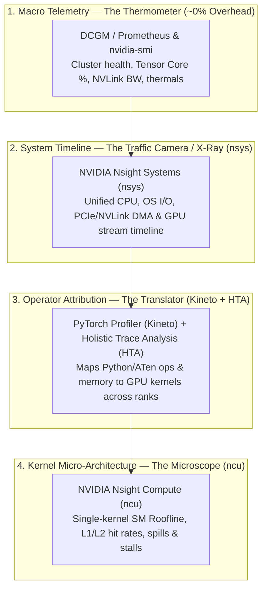

# 10.20 Profiling tools: Nsight Systems, Nsight Compute, PyTorch profiler

| | |
|---|---|
| Level | Advanced |
| Priority tier | 2 |
| Lab venue | Nebius GPU |
| Part | Part 10: The GPU and CUDA |
| Sources used | *AI Systems Performance Engineering* (`ai-systems-performance-engineering`, Chris Fregly), Chapter 13 (*Profiling, Tuning, and Scaling PyTorch*); `nvidia-devops` Volume 17, Chapter 2 (`nvidia-zero-to-hero/volume-17/chapter-02-profiling-tools-landscape.md`) |
| Code | `code/part10/profiling_tools.py`, `code/part10/profiling_tools_lab.py` |
| Coverage file | `planning/coverage/chapters/10-20.md` |

## Why this matters for AI infrastructure

An AI training or inference pipeline can stall at any layer of the stack: Python interpreter overhead (`45.0%` of CPU cycles in `py::forward`), CPU `DataLoader` starvation (`10.2%` in `dataloader_iter_next` and `5.3%` in `read` syscalls), un-overlapped `H2D` DMA copies, Mixture-of-Experts (`MoE`) token routing (`dispatch` + `combine` consuming `30.80 ms` per step), memory-bound CUDA kernels stalling on HBM (`50%` of peak FLOPS at `70%` DRAM bandwidth), CUDA caching-allocator fragmentation, or multi-GPU `ncclAllReduce` stragglers (`16.7%` of a `24.0 ms` MLPerf training step).

As `nvidia-devops` Volume 17 Chapter 2 (*Profiling Tools Landscape*) emphasizes, using the wrong diagnostic tool is like using an X-ray machine to diagnose a cellular disease—or an electron microscope to check a patient's fever:
- If a research team writes a custom sparse matrix multiplication kernel in Triton that runs **`4x` slower** than standard PyTorch on an `H100` and wraps it in **Nsight Systems (`nsys`)**, they see only a single long blue bar on the GPU timeline row because `nsys` cannot look *inside* an SM's register file or L1 cache; diagnosing register spilling or uncoalesced sector loads requires **Nsight Compute (`ncu`)**.
- Conversely, running `ncu` kernel replay on an entire multi-GPU training job when the GPU is actually starving behind single-threaded JPEG decoding or unpinned `DataLoader` transfers drowns the team in gigabytes of hardware counters while missing the host gap entirely.

*AI Systems Performance Engineering* Chapter 13 (*Profiling, Tuning, and Scaling PyTorch*) and `nvidia-devops` Volume 17 Chapter 2 provide a complete, quantitative methodology that connects **NVTX range annotations**, **PyTorch Profiler (`Kineto`)**, **Nsight Systems (`nsys`)**, **Nsight Compute (`ncu`)**, **Linux `perf` (and Grace-Blackwell `NVLink-C2C` PMUs)**, **PyTorch Memory Profiler & Pluggable Allocators**, **Holistic Trace Analysis (`HTA`) & `Perfetto`**, and **automated CI regression gates (`TorchBench`, `PyTorch HUD`, and `MLPerf Logging`)**.

:::note About the numbers in this chapter
The profile outputs (`138.0 ms` `train_step`, `45.0%` in `py::forward`, `30.80 ms` of `MoE` routing, the `24.0 ms` MLPerf step, `248 ms` to `173 ms` for `torch.compile`, and the Grace `perf stat` counts) come from *AI Systems Performance Engineering*, which says its metric-table numbers are illustrative, and from `nvidia-devops` Volume 17 notes. They show how to read each tool, not what your system will print, and none were captured on a GPU for this handbook. Commands are marked untested here.
:::

## Prerequisites and outcomes

**Prerequisites:**
- Chapters `10.13`–`10.19` (memory coalescing, occupancy/warp stalls, Roofline arithmetic intensity, `<cuda/pipeline>`, CUDA streams/events, CUDA Graphs, and `torch.compile` / OpenAI Triton).

**Outcomes — after completing this chapter you will be able to:**
1. Select the exact tool for each layer of the **4-Layer Profiling Evidence Ladder** (`DCGM`/`nvidia-smi` Thermometer → `Nsight Systems` Traffic Camera → `Nsight Compute` Microscope → `PyTorch Profiler` Translator) and **Table 13-1**'s 9 profiling/visualization tools.
2. Instrument PyTorch training and inference loops with **NVTX markers** (`torch.cuda.nvtx.range_push/pop`, `torch.profiler.record_function`) and reproduce the 64-expert MoE operator breakdown in **Table 13-2** (`138.00 ms` total: `aten::matmul` `43.00 ms` across `128` calls, `aten::linear` `35.50 ms` across `64` calls, `dispatch` `18.70 ms` + `combine` `12.10 ms` = `30.80 ms`, and `aten::add_` `2.20 ms` across `64` calls).
3. Project host NVTX ranges onto asynchronous GPU kernels using **Nsight Systems** (`nsys stats --report=nvtx_gpu_proj_sum`, **Table 13-3**: `138.0 ms` `train_step` = `60.5 ms` `forward` + `58.3 ms` `backward` + `19.2 ms` `optimizer_step`) and verify kernel Roofline shifts with **Nsight Compute** (**Table 13-4**: `50% → 85%` peak FLOPS, `70% → 40%` memory BW, `60% → 80%` occupancy).
4. Profile host CPU bottlenecks and Grace-Blackwell superchip interconnects using **Linux `perf`** (`perf stat` `1.58` IPC vs `8` max IPC on ARM Neoverse V2; `perf record -F 2000 -g --call-graph dwarf` hotspots: `45.0%` `py::forward`, `20.5%` `aten::matmul`, `10.2%` `dataloader_iter_next`, `8.7%` `ncclAllReduce`, `5.3%` `read`; and `nvidia_nvlink_c2c0_pmu_0/cycles/`).
5. Apply targeted PyTorch optimizations—`torch.compile` (`248 ms → 173 ms`, **`~30%` faster**, **Table 13-5** modes, Mega-Cache, `nested_compile_region`), `transfer_stream` + `compute_stream` overlap, FireworksAI decreasing-batch (`8, 4, 2, 1`) shared CUDA Graph pools, `PYTORCH_ALLOC_CONF` (`roundup_power2_divisions` rounding `600 MB → 768 MB`), `SuperOffload` (`GraceAdam` on ARM SVE `32` vector / `16` predicate registers), pluggable `NCCL` `MemPool` (`1.8 TB/s` NVLink 5), `SimpleFSDP` (`-28%` memory, `+69%` throughput), and `HTA` / `TorchBench` / `PyTorch HUD` (`>= 5%` over `3` runs) / `MLPerf Logging` (**Table 13-6**).

---

## 1. The Profiling Ecosystem, NVTX Markers, and the 4-Layer Evidence Ladder

### 1.1 The 4-Layer Evidence Ladder (`V17 Ch 2`) and NVTX Cross-Tool Correlation (`ASP Ch 13`)

`nvidia-devops` Volume 17 Chapter 2 (*Profiling Tools Landscape*; `select_profiling_tool_from_ladder()` in `code/part10/profiling_tools.py`) organizes GPU observability into four distinct abstraction layers:



To correlate events across all four layers without guessing which Python line launched which CUDA kernel, inject **NVIDIA Tools Extension (`NVTX`)** range markers (*AI Systems Performance Engineering* Ch 13, *NVTX Markers and Profiling Tools*). An NVTX range pushed on the CPU (`torch.cuda.nvtx.range_push("forward")` or `torch.profiler.record_function("train_step")`) appears with the exact same label in `torch.profiler`, Nsight Systems (`nsys`), Holistic Trace Analysis (`HTA`), Perfetto, and Nsight Compute (`ncu`) filter paths, while adding near-zero overhead when no profiler is attached.

### 1.2 The 9 profiling and visualization tools in Table 13-1

*AI Systems Performance Engineering* Chapter 13 (**Table 13-1**, *Summary of profiling and visualization tools*) catalogs the complete PyTorch/CUDA profiling suite:

| Tool | Scope | Key Features | Primary Use Case |
|---|---|---|---|
| **1. PyTorch Profiler (`Kineto`)** | In-PyTorch operator-level profiling (`CPU` + `CUDA`) | NVTX support, input shape recording (`record_shapes=True`), per-op memory (`profile_memory=True`), stack traces, FLOP estimation (`with_flops=True`), `CompiledFunction` / graph-break visibility | Attribute GPU time and memory to specific ATen ops (`aten::matmul`, `dispatch`), spot `< 1 ms` unfused op chains, and verify `torch.compile` coverage. |
| **2. Nsight Systems (`nsys`)** | System-wide node timeline (`CPU`, `GPU`, `OS`, `I/O`, `NVLink`/`NIC`) | Unified timeline of CPU threads, OS syscalls, DMA copy engines, GPU streams, NVTX GPU projection (`nvtx_gpu_proj_sum`), multi-process support | Diagnose `DataLoader` CPU starvation, missing `H2D`/`Compute` overlap, stray `cudaDeviceSynchronize` walls, and `NCCL` communication gaps. |
| **3. Nsight Compute (`ncu`)** | Per-kernel GPU micro-architecture | Hardware performance counters (`CUPTI` / PM sampling), Roofline charts, achieved occupancy, warp stall breakdown, source/SASS line correlation | Diagnose *why* a specific hot kernel (such as a `4x` slower custom sparse Triton kernel on `H100`, *V17* Ch 2) is memory-bound, latency-bound, or spilling registers. |
| **4. PyTorch Memory Profiler** | GPU memory lifecycle by operation | Timeline memory snapshots (`_record_memory_history`, `_dump_snapshot`), per-op peak memory, `torch.cuda.memory_stats()` & `mem_get_info()` | Catch caching-allocator fragmentation (e.g., variable-sized MoE expert buffers) and identify peak activation tensors for checkpointing. |
| **5. Linux `perf`** | Host CPU hardware counters, scheduling & NVIDIA PMUs | Hardware cycle/instruction/cache/branch sampling (`perf stat`), 2,000 Hz DWARF call-graph unwinding (`perf record -g --call-graph dwarf`), `perf sched`, and Grace-Blackwell `nvidia_nvlink_c2c*` PMUs | Quantify Python interpreter overhead (`py::forward`), GIL/thread scheduling stalls, syscall I/O bottlenecks (`read`), and NVLink-C2C fabric activity. |
| **6. Holistic Trace Analysis (`HTA`)** | Multi-GPU / multi-node distributed trace analysis | Open-source (Meta AI) multi-worker Kineto JSON trace aggregator; aligns rank timelines, computes GPU idle/overlap breakdowns, incorporates Perfetto | Pinpoint rank stragglers, load imbalance, and un-overlapped `all-reduce` / `all-gather` gaps across `8+` GPUs (replaces the **deprecated** TensorBoard PyTorch profiler plugin as of 2025). |
| **7. Chrome Trace / `Perfetto`** | Web-based interactive trace exploration | Browser UI for Kineto JSON traces with sub-millisecond zoom and **Perfetto SQL query engine** (prefer Perfetto over deprecated `chrome://tracing`) | Share and query timeline traces across engineering teams without local GUI installations. |
| **8. `TorchEval`** | Standardized model quality & performance metrics | Unified PyTorch API for logging throughput (`tokens/s`), latency, and validation accuracy/loss across distributed ranks | Ensure throughput optimizations (such as large batch sizes or FP8/FP4) do not degrade model convergence. |
| **9. `ExecuTorch`** | Edge, mobile, and embedded deployment runtime | Lightweight ahead-of-time export runtime with profiling hooks, memory analysis, and Hugging Face `Optimum ExecuTorch` integration | Profile and run PyTorch models on constrained edge hardware (`Meta glasses`, iOS, Android, embedded Linux). |

---

## 2. Four-Tool Walkthrough: Profiling a 64-Expert Mixture-of-Experts (`MoE`) Training Step

### 2.1 Step 1 — Operator-level attribution with `torch.profiler` (`Table 13-2`)

In *AI Systems Performance Engineering* Chapter 13 (*Profiling PyTorch to Identify Bottlenecks*), we profile one training step of a **64-expert Mixture-of-Experts (`MoE`)** causal language model (`batch_size = 4`, `AdamW(..., fused=True)`, `torch.bfloat16` autocast). First, we run **`5` unprofiled warm-up iterations** (`optimizer.zero_grad(set_to_none=True)`) so JIT compilation, cuBLAS handles, and caching-allocator blocks reach steady state. Next, we wrap one training step in `torch.profiler.profile` with `record_function("train_step")` and nested NVTX ranges (`"forward"`, `"backward"`, `"optimizer_step"`):

```python
# Profiling 1 steady-state MoE training iteration after 5 warmup steps (ASP Ch 13) (untested here)
import torch
from torch import profiler

# After 5 warmup iterations (not profiled)...
with profiler.profile(
    activities=[profiler.ProfilerActivity.CPU, profiler.ProfilerActivity.CUDA],
    record_shapes=True,
    profile_memory=True,
    with_stack=True,
    with_flops=True,
) as prof:
    with profiler.record_function("train_step"):
        torch.cuda.nvtx.range_push("forward")
        with torch.autocast(device_type="cuda", dtype=torch.bfloat16):
            outputs = model(input_ids, attention_mask=attention_mask, labels=labels)
            loss = outputs.loss
        torch.cuda.nvtx.range_pop() # end forward

        torch.cuda.nvtx.range_push("backward")
        loss.backward()
        torch.cuda.nvtx.range_push("optimizer_step")
        optimizer.step()
        torch.cuda.nvtx.range_pop() # end optimizer_step
        optimizer.zero_grad(set_to_none=True)
        torch.cuda.nvtx.range_pop() # end backward

print(
    prof.key_averages().table(
        sort_by="self_cuda_time_total",
        row_limit=10,
        fields=["self_cuda_time_total", "calls"],
    )
)
```

Calling `prof.key_averages().table(sort_by="self_cuda_time_total", row_limit=10)` produces **Table 13-2** (*AI Systems Performance Engineering* Ch 13; `TABLE_13_2_MOE_TOP10_OPS` in `code/part10/profiling_tools.py`):

| Rank | Operation | Self CUDA Total (`ms`) | Calls per Iteration | Architectural Interpretation (`64` Experts) |
|---:|---|---:|---:|---|
| **1** | **`aten::matmul`** | **`43.00 ms`** | **`128`** | Expert FFN matrix multiplies: `64` experts × `2` passes (`1` forward + `1` backward) = `128` calls. |
| **2** | **`aten::linear`** | **`35.50 ms`** | **`64`** | Linear projections (`1` per expert = `64` calls); together with `aten::matmul` consumes **`78.50 ms` (`56.9%`)**. |
| **3** | **`dispatch`** | **`18.70 ms`** | **`2`** | Custom C++/CUDA MoE token-to-expert routing kernel (`1` forward + `1` backward). |
| **4** | **`combine`** | **`12.10 ms`** | **`2`** | Custom C++/CUDA expert-output gathering kernel; `dispatch` + `combine` = **`30.80 ms` (`22.3%`)**. |
| **5** | **`aten::layer_norm`** | **`10.20 ms`** | **`16`** | Unfused normalization passes across Transformer layers. |
| **6** | **`aten::softmax`** | **`5.70 ms`** | **`4`** | Attention and router gating softmax kernels. |
| **7** | **`aten::scatter`** | **`4.10 ms`** | **`16`** | Token index scatter operations. |
| **8** | **`aten::gather`** | **`3.60 ms`** | **`16`** | Token index gather operations. |
| **9** | **`aten::to`** | **`2.90 ms`** | **`8`** | Dtype/device conversion casts. |
| **10** | **`aten::add_`** | **`2.20 ms`** | **`64`** | Per-expert in-place parameter/gradient updates (`1` per expert inside `optimizer_step`). |
| **Total** | **Top 10 CUDA Operations** | **`138.00 ms`** | — | Matches the `138.0 ms` `train_step` NVTX projection in Nsight Systems (Table 13-3). |

### 2.2 Step 2 — System timeline and NVTX GPU projection with Nsight Systems (`Table 13-3`)

Next, we run **Nsight Systems (`nsys`)** and project our CPU-emitted NVTX ranges onto the asynchronous GPU execution stream using `nvtx_gpu_proj_sum` (*ASP* Ch 13, *System Profiling with Nsight Systems and NVTX Timelines*):

```bash
# Capture CUDA API + NVTX trace and print the NVTX GPU Projection Summary (ASP Ch 13) (untested here)
nsys profile --output=profile --stats=true -t cuda,nvtx python train.py
nsys stats --report=nvtx_gpu_proj_sum profile.nsys-rep
# Or using nsys recipe:
nsys recipe nvtx_gpu_proj_sum profile.nsys-rep
```

Here is the resulting NVTX GPU Projection Summary from **Table 13-3** (*AI Systems Performance Engineering* Ch 13; `TABLE_13_3_NVTX_PROJECTION` in `code/part10/profiling_tools.py`):

| NVTX Range | Total GPU Time (`ms`) | Self GPU Time (`ms`) | Child GPU Time (`ms`) | Instances (Calls) | How CUPTI Projects the Range |
|---|---:|---:|---:|---:|---|
| **`train_step`** | **`138.0 ms`** | `0.0 ms` | **`138.0 ms`** | `1` | Outer wrapper range; `100%` of its `138.0 ms` GPU time lives in its three nested child ranges (`60.5 + 58.3 + 19.2 = 138.0 ms`). |
| **`forward`** | **`60.5 ms`** | **`60.5 ms`** | `0.0 ms` | `130` | Captures `130` GPU activities (kernels + async copies) launched during the forward pass. |
| **`backward`** | **`58.3 ms`** | **`58.3 ms`** | `0.0 ms` | `130` | Captures `130` GPU activities launched during `loss.backward()`. |
| **`optimizer_step`** | **`19.2 ms`** | **`19.2 ms`** | `0.0 ms` | `1` | Single NVTX push/pop on the host that CUPTI projects onto all **`64` `aten::add_`** expert update kernels (`1` per expert). |

### 2.3 Step 3 — Kernel Roofline analysis with Nsight Compute (`ncu`, `Table 13-4`)

Because Table 13-2 showed that `aten::matmul` (`43.00 ms`) and `aten::linear` (`35.50 ms`) dominate the step, we zoom in on the `matmul` kernels using **Nsight Compute (`ncu`)** (*ASP* Ch 13, *Kernel Roofline Analysis for General Matrix Multiply (GEMM)*):

```bash
# Collect Roofline, DRAM/L2 throughput, FP32 instructions, and occupancy for "matmul" kernels (untested here)
# Note: Non-root profiling of SM counters requires kernel module option NVreg_RestrictProfilingToAdminUsers=0
ncu --target-processes all \
    --kernel-name-regex "matmul" \
    --metrics gpu__time_duration.avg,gpu__dram_throughput.avg.pct_of_peak_sustained_elapsed,lts__throughput.avg.pct_of_peak_sustained_elapsed,sm__sass_thread_inst_executed_op_fp32_pred_on.sum,sm__warps_active.avg.pct_of_peak_sustained_active \
    --csv full -o matmul_roofline_report python train.py
```

Compare the `ncu` counters before and after applying our arithmetic-intensity optimizations (reduced precision `BF16`/`FP8`, kernel fusion, and tiling) in **Table 13-4** (*AI Systems Performance Engineering* Ch 13, Figure 13-2; `TABLE_13_4_NCU_ROOFLINE` in `code/part10/profiling_tools.py`):

| Kernel Configuration | `%` of Peak FLOPS (SM Compute Throughput) | `%` of Peak Memory BW (DRAM Throughput) | Achieved SM Occupancy (`%`) | Roofline Regime & Diagnosis |
|---|---:|---:|---:|---|
| **Baseline `matmul`** | `50%` | `70%` | `60%` | **Memory-bound:** Stalling on HBM transfers (`70%` DRAM BW) with half of SM compute sitting idle (`50%` FLOPS). |
| **Optimized `matmul`** | **`85%`** | **`40%`** | **`80%`** | **Compute-bound (near hardware Roofline):** Fusion + higher arithmetic intensity cut HBM traffic (`70% → 40%`) and drive Tensor Cores to `85%` of peak. |

*(Remember from Chapter `10.14` and ASP Ch 13 p. 308: there is no universal occupancy target—many kernels hide latency completely at **`25%–50%` achieved occupancy** when ILP/TMA overlap is high; always inspect `ncu` warp stall reasons alongside occupancy.)*

### 2.4 Step 4 — Host CPU and Grace-Blackwell `NVLink-C2C` PMU profiling with Linux `perf`

To verify whether host CPU overhead, Python dispatch, or `DataLoader` syscalls are starving the GPU, we run **Linux `perf`** on a Grace-Blackwell node (ARM Neoverse V2 Grace CPU + Blackwell GPU) (*ASP* Ch 13, *CPU and GPU Profiling with Linux perf*):

```bash
# 1. Lightweight hardware counter summary (IPC, cache misses, branch misses) (untested here)
perf stat -e cycles,instructions,cache-misses,branch-misses python train.py

# 2. Sample full C/C++ and Python DWARF call stacks at 2000 Hz (untested here)
perf record -F 2000 -g --call-graph dwarf -o perf.data python train.py
perf report --stdio -n -g -i perf.data

# 3. Sample Grace-Blackwell NVLink-C2C hardware PMU counters alongside CPU counters (untested here)
perf list | grep -i nvidia
perf stat -a -e nvidia_nvlink_c2c0_pmu_0/cycles/ -e cycles,cache-misses python train_deepseek_v3.py
```

Look at the exact numbers from the three `perf` outputs in *AI Systems Performance Engineering* Chapter 13 (`PERF_REPORT_HOTSPOTS_PCT` in `code/part10/profiling_tools.py`):
1. **`perf stat` Grace CPU IPC diagnosis:** Reports `0.600` CPUs utilized (`1,200.345 msec` task-clock over `1.234567890 s` elapsed), `2,400,567,890` cycles (`~2.0 GHz`), `3,800,123,456` instructions (**`1.58` instructions per cycle [`IPC`]**), `12,345,678` cache-misses (**`0.32%`**), and `4,567,890` branch-misses (**`0.12%`**). Because a single ARM Neoverse V2 Grace core has a theoretical maximum of **`8` instructions per cycle (`8.0` IPC)**, achieving only **`1.58` IPC** proves the host thread is stalling on memory/I/O latency and Python interpreter dispatch.
2. **`perf report` DWARF call-graph breakdown and 5-part mitigation plan:**

| `perf report` Symbol (`Shared Object`) | Sample Share (`%`) | Bottleneck Diagnosis | Targeted Mitigation (*ASP* Ch 13) |
|---|---:|---|---|
| **`py::forward` (`python` — `/src/train.py`)** | **`45.0%`** | Python interpreter opcode dispatch and per-op launch overhead in the forward loop. | Enable **`torch.compile`** to fuse Python operations into compiled Triton/CUDA graphs. |
| **`aten::matmul` (`python` / C++ dispatcher)** | **`20.5%`** | C++ operator dispatch and launch wrapper overhead across `128` expert GEMMs per step. | Fuse/compile with **`torch.compile`** (`mode="max-autotune"`) or grouped/custom GEMM kernels. |
| **`dataloader_iter_next` (`python`)** | **`10.2%`** | CPU `DataLoader` iterator stalls during batch assembly and tokenization. | Increase `num_workers` (heuristic: **`4` workers per GPU**, sweep `4, 8, 16, 32`), set **`persistent_workers=True`**, and use `DataPipe` / offline tokenization. |
| **`ncclAllReduce` (`libnccl.so`)** | **`8.7%`** | Host-side collective orchestration and gradient synchronization overhead. | Tune DDP **`bucket_cap_mb`** (default **`25 MB`**), overlap with backward compute, or use 8-bit gradient compression. |
| **`read` (`libc.so.6` OS syscall)** | **`5.3%`** | Small-file storage read syscalls and unpinned host staging copies. | Set **`pin_memory=True`**, `.to(device, non_blocking=True)`, **`prefetch_factor=4` or `8`**, pack small files into **WebDataset (tar), Arrow, Parquet, or TFRecord** shards, and offload decoding to **NVIDIA DALI / Magnum IO**. |

3. **Grace-Blackwell `NVLink-C2C` PMU counters:** On systems with NVIDIA PMU drivers (`/sys/bus/event_source/devices/nvidia_nvlink_c2c*`), `perf stat` records **`3,567,890,123` `nvidia_nvlink_c2c0_pmu_0/cycles`** alongside `45,678,901` CPU cycles and `7,890,123` cache-misses over `2.345678901 s`. Note that Linux `perf` NVIDIA PMUs expose **device-level link and fabric counters only** (such as `NVLink-C2C`); SM-level warp stalls and memory counters remain exclusively in `CUPTI` / `Nsight Compute`.

---

## 3. Applying Compiler, Stream, CUDA Graph Tree, and Memory Allocator Optimizations

### 3.1 `torch.compile` MoE benchmark (`248 ms → 173 ms`), Table 13-5 modes, Mega-Cache, and Regional Compilation

Timing GPU steps accurately requires **`torch.cuda.Event(enable_timing=True)`** (`start.record()`, `end.record()`, `torch.cuda.synchronize()`, `start.elapsed_time(end)`)—never Python's `time.time()` without synchronization, which either measures asynchronous CPU enqueue time or forces unwanted global barriers (*ASP* Ch 13, *Using the PyTorch Compiler*).

On our 64-expert MoE model, enabling `torch.compile` fuses the small token-routing (`dispatch`/`combine`), activation, and LayerNorm kernels:
- **Eager mode step time:** **`248 ms`** per iteration.
- **Compiled mode (`"max-autotune"`) step time:** **`173 ms`** per iteration (**`~30%` [`30.24%`] faster**, `1.43x` speedup; by contrast, dense models dominated by a single giant GEMM typically see `< 10%` speedup).

Compare the four `torch.compile` modes in **Table 13-5** (*AI Systems Performance Engineering* Ch 13):

| `torch.compile` Mode | Description | Compile Time | Extra Memory | Notable Features & Best Use Case |
|---|---|---|---|---|
| **`default`** | Balanced fusion and basic autotuning; may use CUDA Graphs for stable segments | `Low–Medium` | `No` | Best starting point for large models or tight memory budgets. |
| **`reduce-overhead`** | Aggressively wraps static-shape segments in **CUDA Graphs** (`CUDA Graph Trees`) | `Medium` | `Yes` (workspace caching) | Best for small batches and low-latency inference; automatically skips CUDA Graphs if dynamic shapes are detected. |
| **`max-autotune`** | Benchmarks extensive Triton tile/warp configs + `cuBLAS`/`CUTLASS` and enables CUDA Graphs | `High` (minutes) | `Maybe` (if graphs used) | Highest steady-state speed for long training runs and production serving. |
| **`max-autotune-no-cudagraphs`** | Full Triton/`cuBLAS` autotuning **without** CUDA Graph capture | `High` | `No` | Best for **dynamic MoE token routing / variable sequence lengths** or when measuring raw kernel speed without graph pool memory. |

To cut cold-start compilation time across multi-node fleets (*ASP* Ch 13):
1. **PyTorch Mega-Cache (`save_cache_artifacts` & `TORCHINDUCTOR_CACHE_DIR`):** Persist compiled Inductor/Triton artifacts across runs and nodes using `torch.compiler.save_cache_artifacts()` and `torch.compiler.load_cache_artifacts()` (or mount a shared `TORCHINDUCTOR_CACHE_DIR` across identical GPU nodes).
2. **Regional Compilation (`torch.compiler.nested_compile_region()`):** Marks a repeated submodule (such as a `TransformerBlock`) so PyTorch compiles the block **once** and reuses the compiled code across all `L` layers, slashing cold-start compile latency while preserving full intra-block fusion.
3. **Inductor kernel benchmarking flags:** Set `TORCHINDUCTOR_UNIQUE_KERNEL_NAMES=1` and `TORCHINDUCTOR_BENCHMARK_KERNEL=1` to emit descriptive kernel names and standalone per-kernel benchmark harnesses.

### 3.2 Overlapping `transfer_stream` and `compute_stream`, `CUDA Graph Trees`, and the FireworksAI decreasing-batch pool

To hide `H2D` batch transfer latency in PyTorch without blocking the compute stream (*ASP* Ch 13, *Overlapping Communication and Computation*, Figure 13-4):
- Create a dedicated `transfer_stream = torch.cuda.Stream()` alongside `compute_stream = torch.cuda.default_stream()`.
- Preload `next_inputs, next_labels = batch[0].to(device, non_blocking=True), batch[1].to(device, non_blocking=True)` inside `with torch.cuda.stream(transfer_stream):`, record `transfer_done = torch.cuda.Event(enable_timing=False)` via `transfer_done.record(stream=transfer_stream)`, and call `compute_stream.wait_event(transfer_done)` (or `compute_stream.wait_stream(transfer_stream)`) before kicking off the *following* batch's transfer and running `model(inputs)` on `compute_stream`.

For CUDA Graphs in LLM serving (*ASP* Ch 13, *Capturing a CUDA Graph and Preallocating Memory* & *CUDA Graph Trees*):
- **Call `torch.cuda.empty_cache()` once right before capture** (never inside the hot loop) and synchronize `capture_stream.synchronize()` both before entering and after exiting `with torch.cuda.graph(g, stream=capture_stream):`. If your normal max batch size is **`64`** but occasional spikes hit **`96`**, capture at worst-case batch **`96`**.
- **`CUDA Graph Trees` and the FireworksAI decreasing-batch shared memory pool (`[8, 4, 2, 1]`):** By default, each `CUDAGraph` allocates its own private memory pool. When serving multiple batch-size graph variants (`batch = 1, 2, 4, 8`) with `PagedAttention` (`block_tables`), pass a shared `pool = torch.cuda.graph_pool_handle()` via `torch.cuda.graph(g, pool=pool)` and **capture the graphs in decreasing order of batch size (`8 → 4 → 2 → 1`)** so smaller batch graphs reuse the memory buffers already reserved by the largest (`batch = 8`) graph.

### 3.3 Tuning `PYTORCH_ALLOC_CONF`, `SuperOffload` (`GraceAdam`), Pluggable `NCCL` `MemPool`, `UCX`, and Symmetric Memory

In MoE models, the number of tokens routed to each expert changes every step, creating variable-sized activation tensors that fragment PyTorch's caching allocator. Combine five memory and interconnect optimizations (*ASP* Ch 13, *Profiling and Tuning Memory in PyTorch*):

1. **Preallocate fixed-size expert buffers + tune `PYTORCH_ALLOC_CONF` (`roundup_power2_divisions`):**
   ```bash
   export PYTORCH_ALLOC_CONF=max_split_size_mb:256,roundup_power2_divisions:[256:1,512:2,1024:4,>:8],backend:cudaMallocAsync
   ```
   - `max_split_size_mb:256` prevents the allocator from splitting free blocks larger than **`256 MB`**.
   - `roundup_power2_divisions:[256:1, 512:2, 1024:4, >:8]` subdivides each power-of-two range into fixed buckets so slightly varying requests hit the same cache bucket. For example, `512:2` divides the **`[512 MB, 1,024 MB]`** range (`512 MB` span) into `2` sub-buckets (`256 MB` steps: **`[512 MB, 768 MB, 1,024 MB]`**), so a **`600 MB` allocation request rounds up to `768 MB`** (`round_up_caching_allocator_request(600) == 768` in `code/part10/profiling_tools.py`).
2. **`SuperOffload` and `GraceAdam` on Grace-Blackwell (`NVLink-C2C`):**
   On Grace Hopper, Grace Blackwell, and Vera Rubin superchips, **`SuperOffload`** exploits the coherent `NVLink-C2C` interconnect using **Speculation-Then-Validation (`STV`)** (running speculative optimizer updates on the CPU while backpropagation runs on the GPU), heterogeneous CPU/GPU optimizer partitioning, and **`GraceAdam`**—an Adam optimizer vectorized for the Grace CPU's ARM **Scalable Vector Extension (`SVE`)**, which provides **`32` vector registers and `16` predicate registers**.
3. **Pluggable `NCCL` Memory Pools (`CUDAPluggableAllocator` + `MemPool`) on `1.8 TB/s` NVLink 5:**
   Binding `NCCL`'s native allocator (`backend.mem_allocator` / `ncclMemAlloc`) into `torch.cuda.memory.MemPool` and registering it via `backend.register_mem_pool(nccl_pool)` allocates gradient buffers on large page boundaries optimized for NVSwitch (**`1.8 TB/s` bidirectional / `900 GB/s` unidirectional per GPU** on Blackwell NVLink 5), GPUDirect RDMA, and **NVIDIA SHARP** in-network reductions—freeing SM warps from communication copies. You can also record up to `100,000` allocator events via `torch.cuda.memory._record_memory_history(max_entries=100000)` and dump `memory_snapshot.pkl` for the PyTorch memory visualizer.
4. **Cross-rack `NCCL-UCX` (`UCX_TLS`):** When scaling across multiple `NVL72` racks over InfiniBand/RoCE, enable `UCX`:
   ```bash
   export NCCL_NET=UCX
   export NCCL_PLUGIN_P2P=ucx
   export UCX_TLS=rc,self,gdr_copy,cuda_copy
   ```
5. **PyTorch Symmetric Memory (`all_to_all_v` & `one_shot_all_reduce`):** Allocates PGAS buffers directly addressable across GPUs so MoE `all-to-all` token shuffles execute entirely on-device without CPU handshakes or `D2H` gaps, allowing the entire MoE `all-to-all` to be captured inside a **CUDA Graph**.

---

## 4. Multi-GPU Scaling (`FSDP`, `TorchTitan`, `SimpleFSDP`), `HTA`, CI (`TorchBench` & `PyTorch HUD`), and `MLPerf Logging`

### 4.1 `DDP` (`25 MB` buckets), `FSDP` (`min_num_params = 1e8`), `TorchTitan`, `AsyncTP`, `AutoParallel`, and `SimpleFSDP`

When scaling `torch.compile` across GPUs (*ASP* Ch 13, *Scaling with PyTorch Distributed*):
- **`DDP` (`25 MB` default buckets):** Keep `DDP` gradient buckets near the **`25 MB` default** (`bucket_cap_mb`) rather than merging all gradients into one giant bucket, so per-bucket `all-reduce` collectives overlap with backward subgraphs.
- **`FSDP` (`transformer_auto_wrap_policy` with `min_num_params = int(1e8)`):** Always wrap at the **Transformer block granularity** (`use_orig_params=True`, `BackwardPrefetch.BACKWARD_PRE`, `MixedPrecision(param_dtype=torch.bfloat16, ...)`) rather than wrapping the whole model in a single root FSDP instance. Choose between **`FULL_SHARD` (ZeRO-3)** for minimum per-GPU memory on fast fabrics, **`HYBRID_SHARD`** (shards within a node, replicates across nodes) to cut cross-node traffic, and **`SHARD_GRAD_OP` (ZeRO-2)** on smaller/slower clusters.
- **`TorchTitan`, `AsyncTP`, `AutoParallel`, and `SimpleFSDP`:**
  - **`AsyncTP`:** Uses dual streams and SM-wave-aware scheduling via `torch.compile` to overlap Tensor Parallel `all-gather` / `reduce-scatter` collectives with matmul waves.
  - **`AutoParallel`:** Automatically searches `DTensor` sharding plans across FSDP, TP, and PP.
  - **`SimpleFSDP`:** A `torch.compile`-native reimplementation of FSDP built on `DTensor` and selective activation checkpointing; in `TorchTitan` benchmarks, `SimpleFSDP` **reduces memory usage by up to `~28%`** and **increases training throughput by up to `~69%`** compared to the traditional eager `FSDP2` path.

### 4.2 Continuous Benchmarking (`TorchBench`, `PyTorch HUD` `>= 5%` rule) and `MLPerf Logging` (`Table 13-6`)

To prevent performance bit-rot as code and PyTorch versions evolve (*ASP* Ch 13, *Continuous Integration and Performance Benchmarking*, *PyTorch HUD Performance Dashboard*, and *Performance Benchmarks and MLPerf Logging*):
- **`TorchBench` in GitHub Actions CI & `PyTorch HUD` (`pytorch/test-infra`):** Run short deterministic benchmarks (`torchbench run --model moe --iters 10 --batch-size 4 --json results.json`), track `torch.cuda.max_memory_allocated()` and `torch.allclose` numerical accuracy, and fail the build when throughput regresses by **`>= 5%` sustained across `3` consecutive runs** (matching the **`5%` regression threshold** used on the public PyTorch HUD dashboard, Figure 13-7).
- **Structured `MLPerf Logging` (`:::MLL` JSON prefix & Table 13-6):** Emit per-step millisecond breakdowns (`step_time_ms`, `forward_ms`, `backward_ms`, `allreduce_ms`, `other_ms`) paired with target accuracy validation. Look at the **Table 13-6** breakdown of a **`24.0 ms`** training iteration (*AI Systems Performance Engineering* Ch 13; `evaluate_mlperf_step_breakdown()` in `code/part10/profiling_tools.py`):

| Step Component (`:::MLL` JSON Field) | Time per Iteration (`ms`) | Share of Step (`%`) | Optimization Implication |
|---|---:|---:|---|
| **Forward pass (`forward_ms`)** | `10.5 ms` | **`43.8%`** | Together with backward (`10.5 + 9.0 =` **`19.5 ms`**), compute accounts for **`81.3%`** of the step. |
| **Backward pass (`backward_ms`)** | `9.0 ms` | **`37.5%`** | Target with `torch.compile`, `BF16`/`FP8` Tensor Cores, and fused backward kernels. |
| **All-reduce grad sync (`allreduce_ms`)** | `4.0 ms` | **`16.7%` (`1/6` of step)** | Exposed communication gap (`1/6` of step); hide via `HTA`-verified bucket overlap, delayed all-reduce (slack), or `SHARP`. |
| **Other overhead (`other_ms`)** | `0.5 ms` | **`2.1%`** | Data loading / host dispatch is well-hidden (`2.1%`). |
| **Total step time (`step_time_ms`)** | **`24.0 ms`** | **`100.0%`** | End-to-end iteration baseline. |

---

## 5. Commands and Configurations That Matter

All commands below follow *AI Systems Performance Engineering* Chapter 13 and `nvidia-devops` Volume 17 Chapter 2. Shell commands that require an attached CUDA GPU or Grace-Blackwell node are marked **(untested here)**.

### 5.1 End-to-end profiling commands (`nsys`, `ncu`, `perf`, `PYTORCH_ALLOC_CONF`, `UCX`, `TorchBench`) (untested here)

```bash
# 1. Nsight Systems: trace CUDA + NVTX and print the NVTX GPU Projection Summary (Table 13-3) (untested here)
nsys profile --output=profile --stats=true -t cuda,nvtx python3 train.py
nsys stats --report=nvtx_gpu_proj_sum profile.nsys-rep

# 2. Nsight Compute: profile "matmul" kernels for Roofline % of peak FLOPS, DRAM BW, and occupancy (Table 13-4) (untested here)
ncu --target-processes all --kernel-name-regex "matmul" \
    --metrics gpu__time_duration.avg,gpu__dram_throughput.avg.pct_of_peak_sustained_elapsed,lts__throughput.avg.pct_of_peak_sustained_elapsed,sm__sass_thread_inst_executed_op_fp32_pred_on.sum,sm__warps_active.avg.pct_of_peak_sustained_active \
    --csv full -o matmul_roofline_report python3 train.py

# 3. Linux perf: CPU IPC stat, 2000 Hz DWARF call-graph profiling, and Grace-Blackwell NVLink-C2C PMU (untested here)
perf stat -e cycles,instructions,cache-misses,branch-misses python3 train.py
perf record -F 2000 -g --call-graph dwarf -o perf.data python3 train.py
perf report --stdio -n -g -i perf.data
perf stat -a -e nvidia_nvlink_c2c0_pmu_0/cycles/ -e cycles,cache-misses python3 train.py

# 4. Tune PyTorch CUDA caching allocator and cross-rack NCCL-UCX transport (untested here)
export PYTORCH_ALLOC_CONF=max_split_size_mb:256,roundup_power2_divisions:[256:1,512:2,1024:4,>:8],backend:cudaMallocAsync
export NCCL_NET=UCX
export NCCL_PLUGIN_P2P=ucx
export UCX_TLS=rc,self,gdr_copy,cuda_copy

# 5. Run TorchBench MoE CI regression check (10 iters, batch size 4, >= 5% over 3 runs gate) (untested here)
torchbench run --model moe --iters 10 --batch-size 4 --json results.json
```

---

## 6. How It Fails: Six Profiling, Allocator, and Distributed Scaling Failure Modes

| # | Failure Mode | Production / Profiler Symptom | Root Cause | Fix |
|---|---|---|---|---|
| **1** | **Using `nsys` instead of `ncu` to debug a slow custom CUDA/Triton kernel (`V17 Ch 2`)** | Custom sparse Triton kernel runs `4x` slower than PyTorch on an `H100`; team stares at `nsys` for days seeing only one long blue bar on the GPU row. | `Nsight Systems` (`nsys`) is a macro system timeline tool and cannot inspect intra-SM register spills, L1 bank conflicts, or warp stalls (*V17* Ch 2). | Switch to **Nsight Compute (`ncu`)** (`--kernel-name-regex` + `--set full`) to inspect SM Roofline ceilings, register spilling to Local Memory, and L1/L2 hit rates. |
| **2** | **Timing GPU regions with Python `time.time()` or calling `tensor.item()` inside the training loop** | Reported layer timings are near-zero while the final loss step takes hundreds of milliseconds, or `nsys` shows a full device stall on every step. | `time.time()` records CPU enqueue time unless synchronized, and `tensor.item()` / `print(cuda_tensor)` forces a blocking `D2H` copy + `cudaDeviceSynchronize` (*ASP* Ch 13). | Time GPU regions exclusively with `torch.cuda.Event(enable_timing=True)` (`start.elapsed_time(end)`), and log scalar metrics only at intervals using `.detach()` outside the hot path. |
| **3** | **Setting `torch.set_float32_matmul_precision("highest")` in production or forgetting `autocast`** | `ncu` (`sm__inst_executed_pipe_tensor`) shows `0%` Tensor Core utilization and `aten::matmul` runs at scalar `FP32` CUDA core speed. | `"highest"` disables `TF32` Tensor Core math and forces scalar `FP32`; `torch.autocast` was omitted (*ASP* Ch 13). | Set `torch.set_float32_matmul_precision("high")` (or `"medium"`), wrap forward/loss in `torch.autocast("cuda", dtype=torch.bfloat16)`, and verify `sm__inst_executed_pipe_tensor` in `ncu`. |
| **4** | **Variable-sized MoE expert allocations causing allocator fragmentation OOM** | Multi-day MoE training job crashes with `CUDA out of memory` as `torch.cuda.mem_get_info()` free memory steadily drops across epochs despite constant model size. | Dynamic token routing creates different expert tensor sizes every batch, splitting caching-allocator blocks into unusable fragments (*ASP* Ch 13). | Preallocate a fixed-size expert buffer sized to the maximum token capacity per expert, and configure `PYTORCH_ALLOC_CONF` (`max_split_size_mb:256`, `roundup_power2_divisions`, `backend:cudaMallocAsync`). |
| **5** | **Calling `torch.cuda.empty_cache()` on every iteration or capturing shared-pool CUDA Graphs in increasing batch order** | Step time regresses by tens of milliseconds per batch, or shared-pool CUDA Graph replay (`[1, 2, 4, 8]`) corrupts buffers / OOMs. | `empty_cache()` forces allocator flushes and OS unmappings on every step; capturing shared-pool graphs from smallest (`1`) to largest (`8`) fails to reuse the max buffer (*ASP* Ch 13). | Call `empty_cache()` at most **once** right before CUDA Graph capture, and capture shared-pool batch variants in **decreasing order (`8 → 4 → 2 → 1`)**. |
| **6** | **Wrapping the entire model in a single root `FSDP` instance or setting one giant `DDP` bucket** | `HTA` / `nsys` shows a huge un-overlapped `all-gather` / `reduce-scatter` / `all-reduce` gap at the end of the pass and higher peak memory. | A single root `FSDP` wrapper or giant `DDP` bucket creates one monolithic graph with zero intermediate communication boundaries for overlap (*ASP* Ch 13). | Keep `DDP` buckets near the **`25 MB` default**, and wrap `FSDP` at **Transformer-block granularity** using `transformer_auto_wrap_policy` (`min_num_params=int(1e8)`, `use_orig_params=True`) or `SimpleFSDP`. |

---

## 7. Hands-On Lab: Verify the Evidence Ladder, MoE Profiler Tables 13-2 to 13-4, Grace `perf` Counters, Allocator Rounding, and `MLPerf` Table 13-6

**Venue:** Any Linux machine or Nebius GPU VM with Python 3.10+ (runs deterministically using standard library Python; all `nsys`, `ncu`, `perf`, and `torchbench` commands are provided in Section 5 and marked `(untested here)`).

Run `code/part10/profiling_tools_lab.py`:

```bash
python3 code/part10/profiling_tools_lab.py
```

Expected output (`25 passed, 0 failed`):

```text
=== Chapter 10.20 Lab: Profiling Tools — Nsight Systems, Nsight Compute & PyTorch Profiler (ASP Ch 13 + V17 Ch 2) ===
  [PASS] V17 Ch2 Evidence Ladder: DCGM (Thermometer) -> Nsight Systems nsys (Traffic Camera) -> Nsight Compute ncu (Microscope) -> PyTorch Profiler Kineto (Translator)
  [PASS] ASP Ch13 Table 13-2 MoE Top-10 CUDA Ops: Sum == 138.00 ms; aten::matmul = 43.00 ms (128 calls) + aten::linear = 35.50 ms (64 calls) == 78.50 ms (56.9%)
  [PASS] ASP Ch13 Table 13-2 MoE routing & optimizer ops: dispatch (18.70 ms, 2 calls) + combine (12.10 ms, 2 calls) == 30.80 ms (22.3%); aten::add_ = 2.20 ms (64 calls)
  [PASS] ASP Ch13 Table 13-3 Nsight Systems nvtx_gpu_proj_sum: forward (60.5 ms) + backward (58.3 ms) + optimizer_step (19.2 ms) == train_step (138.0 ms child GPU time)
  [PASS] ASP Ch13 Table 13-3 NVTX instances: forward=130, backward=130, optimizer_step=1 (brackets 64 aten::add_ launches via CUPTI projection)
  [PASS] ASP Ch13 Table 13-4 Nsight Compute matmul Roofline: Baseline (50% FLOPS, 70% mem BW, 60% occ, Memory bound) -> Optimized (85% FLOPS, 40% mem BW, 80% occ, Compute bound)
  [PASS] ASP Ch13 Linux perf stat on Grace-Blackwell: Measured 1.58 IPC vs 8.0 max theoretical IPC on ARM Neoverse V2 Grace core (0.32% cache misses, 0.12% branch misses)
  [PASS] ASP Ch13 Linux perf report DWARF call-graph hotspots: py::forward=45.0%, aten::matmul=20.5%, dataloader_iter_next=10.2%, ncclAllReduce=8.7%, read=5.3%
  [PASS] ASP Ch13 MoE torch.compile step time: Eager 248 ms -> Compiled 173 ms (~30% / 30.24% reduction, 1.43x faster)
  [PASS] ASP Ch13 PYTORCH_ALLOC_CONF roundup_power2_divisions:[256:1,512:2,1024:4,>:8]: 600 MB request in [512, 1024] with 512:2 rounds up to 768 MB
  [PASS] ASP Ch13 SuperOffload & GraceAdam on ARM SVE: 32 vector registers and 16 predicate registers; Blackwell NVLink 5 == 1.8 TB/s bidir (900 GB/s unidir)
  [PASS] ASP Ch13 TorchTitan SimpleFSDP & DDP defaults: SimpleFSDP cuts memory up to ~28% and boosts throughput up to ~69% vs FSDP2 eager; DDP default bucket == 25 MB
  [PASS] ASP Ch13 TorchBench CI & PyTorch HUD regression gate: >= 5.0% slowdown sustained across 3 runs triggers failure
  [PASS] ASP Ch13 Table 13-6 MLPerf step breakdown: 24.0 ms total = 10.5 ms forward (43.8%) + 9.0 ms backward (37.5%) + 4.0 ms allreduce (16.7%) + 0.5 ms other (2.1%)
  [PASS] ASP Ch13 Table 13-6 MLPerf compute share: forward (10.5 ms) + backward (9.0 ms) == 19.5 ms (81.2% / 81.3% of 24.0 ms step); all-reduce is 1/6 (16.7%)
  [PASS] Rejects non-positive requested_mb in caching allocator rounding helper
  [PASS] Rejects non-positive forward_ms in MLPerf breakdown helper
  [PASS] Rejects unknown symptom in Evidence Ladder selector
  [PASS] ASP Ch13 FireworksAI shared CUDA Graph pool: Decreasing batch order [8, 4, 2, 1] reuses batch=8 buffer; worst-case capture batch 96 covers normal max 64
  [PASS] ASP Ch13 DataLoader prefetch math: prefetch_factor (4 or 8) * num_workers (4 per GPU) == 16 or 32 prefetched batches
  [PASS] V17 Ch2 H100 custom sparse Triton kernel case study: 4x slower kernel shows as 1 slow block in nsys and requires ncu to diagnose register spills / L1 misses
  [PASS] ASP Ch13 FSDP transformer_auto_wrap_policy threshold: min_num_params == int(1e8) (100,000,000 parameters)
  [PASS] ASP Ch13 Linux perf record sampling rate & warmup count: 2000 Hz DWARF sampling and 5 warmup iterations before torch.profiler
  [PASS] ASP Ch13 Memory history & TorchBench CI config: _record_memory_history(max_entries=100000) and TorchBench moe --iters 10 --batch-size 4
  [PASS] V17 Ch2 Macro telemetry drop example: DCGM detects nightly utilization drop from 90% to 10%

Summary: 25 passed, 0 failed (total 25)
```

---

## Exercises

1. **Mapping symptoms across the 4-Layer Evidence Ladder (`V17 Ch 2` & `Table 13-1`):** State which profiling tool (`DCGM`, `Nsight Systems nsys`, `Nsight Compute ncu`, `PyTorch Profiler Kineto`, `Linux perf`, `HTA`, `Perfetto`) you should select for (a) a cluster utilization drop from `90%` to `10%` at midnight, (b) CPU `DataLoader` JPEG decompression starving the GPU, (c) a custom sparse Triton kernel running `4x` slower than PyTorch on an `H100`, and (d) aligning multi-GPU traces across `8` ranks after the TensorBoard profiler plugin deprecation.
2. **Reconciling `torch.profiler` (`Table 13-2`) with Nsight Systems `nvtx_gpu_proj_sum` (`Table 13-3`):** For the 64-expert MoE training iteration, calculate (a) the combined CUDA time and call counts of `aten::matmul` + `aten::linear` and `dispatch` + `combine` in Table 13-2, (b) how `forward` (`60.5 ms`), `backward` (`58.3 ms`), and `optimizer_step` (`19.2 ms`) sum to `train_step` (`138.0 ms`) in Table 13-3, and (c) why `optimizer_step` reports `1` NVTX instance while bracketing `64` `aten::add_` kernel launches.
3. **Interpreting Nsight Compute Roofline (`Table 13-4`) and Linux `perf` on Grace-Blackwell:** Compare the `%` of peak FLOPS, `%` of peak memory bandwidth, and achieved SM occupancy between Baseline and Optimized `matmul` in Table 13-4, explain why `1.58` IPC on a Grace CPU core indicates host stalls (`8.0` max IPC on ARM Neoverse V2), and list the 5 `perf report` hotspots (`45.0%`, `20.5%`, `10.2%`, `8.7%`, `5.3%`) with their specific fixes.
4. **Sizing `PYTORCH_ALLOC_CONF` power-of-two sub-buckets and FireworksAI shared CUDA Graph pools:** Given `roundup_power2_divisions:[256:1, 512:2, 1024:4, >:8]`, calculate the sub-bucket step size in `[512 MB, 1,024 MB]` and the rounded allocation size for a `600 MB` request, and explain why FireworksAI captures shared-pool CUDA Graph variants in decreasing order of batch size (`8 → 4 → 2 → 1`).
5. **Distributed scaling (`SimpleFSDP`, `GraceAdam`, `NCCL` `MemPool`, and `UCX`):** State the memory reduction (`%`) and throughput improvement (`%`) achieved by `SimpleFSDP` over eager `FSDP2` in `TorchTitan`, the ARM `SVE` register counts used by `GraceAdam` in `SuperOffload`, the bidirectional/unidirectional bandwidth of Blackwell `NVLink 5`, and the three environment variables required to enable cross-rack `NCCL-UCX`.
6. **Analyzing an `MLPerf Logging` (`:::MLL`) training step (`Table 13-6`) and CI gates:** Given `forward_ms = 10.5`, `backward_ms = 9.0`, `allreduce_ms = 4.0`, and `other_ms = 0.5`, compute the total step time, the percentage share of each component, the total compute share (`%`), and the `PyTorch HUD` / `TorchBench` CI regression threshold (`%` and number of sustained runs).

---

## Checkpoint questions (20)

<details>
<summary><strong>1. What are the four layers of the `nvidia-devops` Volume 17 Chapter 2 Profiling Evidence Ladder, and what medical/engineering analogy describes each?</strong></summary>

1. **`DCGM` / Prometheus + `nvidia-smi` ("The Thermometer"):** Always-on, near-zero-overhead macro telemetry over days/weeks.
2. **Nsight Systems (`nsys`, "The Traffic Camera / X-Ray"):** Node-wide system timeline showing CPU threads, OS I/O, PCIe/NVLink DMA, and GPU streams.
3. **Nsight Compute (`ncu`, "The Microscope / Electron Microscope"):** Single-kernel micro-architectural replay inspecting SM Roofline, register spills, L1/L2 hit rates, and warp stalls.
4. **PyTorch Profiler (`Kineto`, "The Translator"):** Maps low-level GPU kernels back to the exact Python/ATen operators (`aten::matmul`, `nn.Linear`) that launched them (*V17* Ch 2).
</details>

<details>
<summary><strong>2. Why did Nsight Systems (`nsys`) fail to explain why a custom sparse Triton kernel was `4x` slower on an `H100` in the Volume 17 Chapter 2 case study, and which tool solved it?</strong></summary>

`nsys` is a system-level timeline profiler; it showed the kernel as one massive slow blue block on the GPU row but cannot look *inside* the SM execution to see why the silicon stalled. Switching to **Nsight Compute (`ncu`)** revealed the micro-architectural root causes (such as register spilling to slow global VRAM and poor L1 cache hit rates from uncoalesced access patterns) (*V17* Ch 2).
</details>

<details>
<summary><strong>3. What role do `NVTX` markers (`torch.cuda.nvtx.range_push/pop` and `torch.profiler.record_function`) play across `torch.profiler`, `nsys`, `HTA`, and `ncu`?</strong></summary>

`NVTX` markers annotate named time intervals (`"train_step"`, `"forward"`, `"backward"`, `"optimizer_step"`) on the host thread with near-zero overhead when no profiler is attached. Profilers ingest `NVTX` events via `CUPTI` and project them onto asynchronous GPU streams so the exact same phase boundaries align across `torch.profiler`, `nsys`, `HTA`, `Perfetto`, and `ncu` (*ASP* Ch 13).
</details>

<details>
<summary><strong>4. Which tools replaced the deprecated TensorBoard PyTorch profiler plugin and Chrome's legacy `chrome://tracing` viewer as of 2025?</strong></summary>

Use **Perfetto** (and its SQL query engine) for interactive single-node trace timeline viewing, and Meta's open-source **Holistic Trace Analysis (`HTA`)** for multi-GPU / multi-node distributed Kineto trace aggregation and straggler/overlap analysis (*ASP* Ch 13, Table 13-1).
</details>

<details>
<summary><strong>5. In Table 13-2's 64-expert MoE profile (`138.00 ms` total across top 10 ops), why is `aten::matmul` called `128` times while `aten::linear` and `aten::add_` are called `64` times, and how much time do `dispatch` and `combine` consume?</strong></summary>

Each of the `64` experts executes `aten::matmul` once in the forward pass and once in the backward pass (`64 × 2 =` **`128` calls**, **`43.00 ms`**), `aten::linear` once per expert (**`64` calls**, **`35.50 ms`**), and `aten::add_` once per expert during `optimizer_step` (**`64` calls**, **`2.20 ms`**). The custom MoE token-routing kernels `dispatch` (**`18.70 ms`**, `2` calls) and `combine` (**`12.10 ms`**, `2` calls) consume **`30.80 ms`** combined (*ASP* Ch 13, Table 13-2).
</details>

<details>
<summary><strong>6. How does `nsys stats --report=nvtx_gpu_proj_sum` compute the GPU time of an NVTX range in Table 13-3, and why does `train_step` have `0.0 ms` Self GPU time and `138.0 ms` Child GPU time?</strong></summary>

Nsight Systems uses `CUPTI` to record host NVTX push/pop timestamps and projects all asynchronous GPU kernels launched within that window onto the range, summing their GPU start-to-end durations (`forward = 60.5 ms` [`130` instances] + `backward = 58.3 ms` [`130` instances] + `optimizer_step = 19.2 ms` [`1` instance bracketing `64` `aten::add_` kernels] = **`138.0 ms`**). Because `train_step` is an outer wrapper around those three child ranges, `100%` of its `138.0 ms` is attributed to Child GPU time and `0.0 ms` to Self GPU time (*ASP* Ch 13, Table 13-3).
</details>

<details>
<summary><strong>7. In Table 13-4, how did the expert `matmul` kernel's Nsight Compute (`ncu`) metrics shift from Baseline to Optimized, and what kernel module parameter enables non-root SM counter access?</strong></summary>

In Table 13-4, the Baseline kernel achieved **`50%` of peak FLOPS**, **`70%` of peak memory bandwidth**, and **`60%` achieved occupancy** (memory-bound). After fusion and arithmetic-intensity optimizations, the Optimized kernel reached **`85%` of peak FLOPS**, **`40%` of peak memory bandwidth**, and **`80%` achieved occupancy** (compute-bound near the Roofline). Non-root users require **`NVreg_RestrictProfilingToAdminUsers=0`** to read SM hardware counters in `ncu` (*ASP* Ch 13, Table 13-4).
</details>

<details>
<summary><strong>8. In the Grace-Blackwell `perf stat` profile, why did the example IPC of `1.58` indicate host-side inefficiency, and what can Linux `perf` sample via NVIDIA PMUs?</strong></summary>

Each ARM Neoverse V2 core on the Grace CPU has a theoretical maximum of **`8` instructions per cycle (`8.0` IPC)**, so measuring **`1.58` IPC** (`2,400,567,890` cycles, `3,800,123,456` instructions over `1,200.345 ms`) indicates host memory/I/O or interpreter stalls. With NVIDIA PMU drivers installed (`/sys/bus/event_source/devices/nvidia_nvlink_c2c*`), `perf stat` can sample **device-level link and fabric counters** such as `nvidia_nvlink_c2c0_pmu_0/cycles/` (`3,567,890,123` cycles), whereas SM-level counters require `CUPTI` / `ncu` (*ASP* Ch 13).
</details>

<details>
<summary><strong>9. List the five CPU call-stack hotspots reported by `perf report --stdio -n -g -i perf.data` (`-F 2000 --call-graph dwarf`) and the primary optimization for each.</strong></summary>

1. **`45.0%` `py::forward`:** Eliminate Python interpreter overhead with **`torch.compile`**.
2. **`20.5%` `aten::matmul`:** Fuse and optimize GEMM dispatch with **`torch.compile`** / custom fused kernels.
3. **`10.2%` `dataloader_iter_next`:** Increase `DataLoader` `num_workers` (e.g., `4` per GPU), enable **`persistent_workers=True`**, and parallelize `DataPipe`s.
4. **`8.7%` `ncclAllReduce`:** Tune DDP **`bucket_cap_mb`** (`25 MB` default), overlap with backward pass, or apply 8-bit gradient compression.
5. **`5.3%` `libc.so.6 read`:** Use `pin_memory=True`, `non_blocking=True`, `prefetch_factor=4` or `8`, contiguous shard formats (**WebDataset, Arrow, Parquet, TFRecord**), and **NVIDIA DALI / Magnum IO** (*ASP* Ch 13).
</details>

<details>
<summary><strong>10. By how much did `torch.compile` speed up the 64-expert MoE training iteration (`248 ms` eager), why do MoEs gain more than single-GEMM dense models, and how do you persist compiled kernels across nodes?</strong></summary>

`torch.compile` cut MoE iteration time from **`248 ms` to `173 ms` (`~30%` [`30.24%`] faster, `1.43x` speedup)** by fusing dozens of small expert routing (`dispatch`/`combine`), activation, and LayerNorm kernels, whereas dense models dominated by a single large GEMM typically see `< 10%` gain. Persist compiled artifacts across runs and nodes using **PyTorch Mega-Cache** (`torch.compiler.save_cache_artifacts()`, `load_cache_artifacts()`, and a shared `TORCHINDUCTOR_CACHE_DIR`) and **`torch.compiler.nested_compile_region()`** for repeated Transformer blocks (*ASP* Ch 13).
</details>

<details>
<summary><strong>11. Distinguish PyTorch's four attention optimization mechanisms in Chapter 13: `SDPA`, `FlexAttention`, `FlexDecoding`, and `context_parallel()`.</strong></summary>

- **`SDPA` (`F.scaled_dot_product_attention`):** Automatically dispatches the fastest standard backend (FlashAttention, memory-efficient, or math).
- **`FlexAttention`:** Compiler-generated fused Triton attention for custom score modifications and block-sparse/sliding-window masks in prefill and training.
- **`FlexDecoding`:** Counterpart to `FlexAttention` tuned for autoregressive LLM **decode** with dynamic `KV`-cache layouts across time steps.
- **`context_parallel()`:** Shards `QKV` and attention computation along the **sequence-length dimension** across multiple GPUs/ranks (*ASP* Ch 13, Figure 13-3).
</details>

<details>
<summary><strong>12. What is `torchao`, and how does it interact with `torch.compile`?</strong></summary>

**PyTorch Architecture Optimization (`torchao`)** is PyTorch's unified package for post-training quantization (`PTQ`), quantization-aware training (`QAT`, `torchao.quantization` for `INT8`/`FP8`/`FP4`), pruning (`torchao.pruning`), and 2:4 / block sparsity (`torchao.sparsity`), which integrates directly with `torch.compile` so `TorchInductor` emits fused, quantized/sparse hardware kernels (*ASP* Ch 13).
</details>

<details>
<summary><strong>13. How do `CUDA Graph Trees` work in PyTorch, and how does the FireworksAI decreasing-batch (`8 → 4 → 2 → 1`) shared memory pool reduce VRAM usage?</strong></summary>

`CUDA Graph Trees` (used internally by `torch.compile(mode="reduce-overhead")` and `vLLM` piecewise capture) maintain a tree of per-shape static graph captures sharing a common memory pool. In the FireworksAI pattern, passing a shared `pool` to `torch.cuda.graph(g, pool=pool)` and compiling batch variants in **decreasing order (`8, 4, 2, 1`)** ensures the largest (`batch = 8`) variant allocates the peak `PagedAttention` buffer first and all smaller variants (`4, 2, 1`) reuse that same memory region without extra VRAM allocation (*ASP* Ch 13).
</details>

<details>
<summary><strong>14. Explain each field in `PYTORCH_ALLOC_CONF` (`max_split_size_mb:256`, `roundup_power2_divisions`, `backend:cudaMallocAsync`), and state what `600 MB` rounds up to.</strong></summary>

- **`max_split_size_mb:256`:** Keeps free blocks up to `256 MB` intact instead of splitting them into tiny fragments.
- **`roundup_power2_divisions:[256:1, 512:2, 1024:4, >:8]`:** Splits each power-of-two size range into fixed sub-buckets. For `512:2`, the `[512 MB, 1,024 MB]` range is divided into `2` buckets (`[512 MB, 768 MB, 1,024 MB]`), so a **`600 MB` request rounds up to `768 MB`**.
- **`backend:cudaMallocAsync`:** Uses CUDA's stream-ordered memory allocator to avoid cross-stream free synchronizations (*ASP* Ch 13).
</details>

<details>
<summary><strong>15. How does `SuperOffload` optimize CPU-GPU offloading on Grace-Blackwell superchips (`NVLink-C2C`), and what is `GraceAdam`?</strong></summary>

`SuperOffload` exploits coherent `NVLink-C2C` bandwidth using (1) **Speculation-Then-Validation (`STV`)** to run speculative CPU optimizer updates concurrently with GPU backpropagation, (2) heterogeneous CPU/GPU optimizer partitioning, (3) GPU-side type casts, and (4) **`GraceAdam`**, an Adam optimizer vectorized for the Grace CPU's ARM **Scalable Vector Extension (`SVE`)** (**`32` vector registers and `16` predicate registers**) (*ASP* Ch 13).
</details>

<details>
<summary><strong>16. How do `CUDAPluggableAllocator` and `torch.cuda.memory.MemPool` accelerate `NCCL` all-reduce on Blackwell `NVLink 5` (`1.8 TB/s`) and `SHARP` fabrics?</strong></summary>

Binding `NCCL`'s native `ncclMemAlloc` / `ncclMemFree` (`backend.mem_allocator`) into a `torch.cuda.memory.MemPool` and registering it via `backend.register_mem_pool(nccl_pool)` allocates collective buffers on large page-aligned regions directly accessible by NVSwitch copy engines (**`1.8 TB/s` bidirectional / `900 GB/s` unidirectional per GPU** on Blackwell NVLink 5), GPUDirect RDMA, and **NVIDIA SHARP** in-network aggregation, reducing SM contention during reductions (*ASP* Ch 13).
</details>

<details>
<summary><strong>17. What are `NCCL-UCX` and PyTorch Symmetric Memory, and why is Symmetric Memory critical for capturing MoE `all-to-all` in a CUDA Graph?</strong></summary>

- **`NCCL-UCX` (`NCCL_NET=UCX`, `NCCL_PLUGIN_P2P=ucx`, `UCX_TLS=rc,self,gdr_copy,cuda_copy`):** Routes cross-node/cross-rack collectives over InfiniBand/RoCE RDMA with hardware offloads.
- **PyTorch Symmetric Memory:** Exposes a Partitioned Global Address Space (`PGAS`) across GPUs so kernels execute one-sided puts/gets (`all_to_all_v`, `one_shot_all_reduce`, `triton.nvshmem`) directly on-device without host CPU synchronization or `D2H` gaps—allowing MoE `all-to-all` token shuffles to be captured inside a **CUDA Graph** (*ASP* Ch 13).
</details>

<details>
<summary><strong>18. Compare `FSDP` sharding strategies (`FULL_SHARD`, `HYBRID_SHARD`, `SHARD_GRAD_OP`), and state the memory and throughput gains of `SimpleFSDP` in `TorchTitan`.</strong></summary>

- **`FULL_SHARD` (ZeRO-3):** Shards parameters, gradients, and optimizer states across all ranks (lowest per-GPU memory; best on fast fabrics).
- **`HYBRID_SHARD`:** Shards states within each node and replicates across nodes (reduces cross-node traffic for higher throughput at slightly higher per-node memory).
- **`SHARD_GRAD_OP` (ZeRO-2):** Shards only gradients and optimizer states.
In `TorchTitan`, **`SimpleFSDP`** (built on `DTensor` + `torch.compile` + selective activation checkpointing) **cuts memory usage by up to `~28%`** and **boosts training throughput by up to `~69%`** over eager `FSDP2` (*ASP* Ch 13).
</details>

<details>
<summary><strong>19. How are `TorchBench` and the `PyTorch HUD` (`pytorch/test-infra`) configured to detect performance regressions in CI without false alarms?</strong></summary>

CI jobs run deterministic `TorchBench` workloads (`torchbench run --model moe --iters 10 --batch-size 4 --json results.json`) on consistent hardware while checking `torch.allclose` and `torch.cuda.max_memory_allocated()`, flagging a failure when throughput drops by **`>= 5%` sustained across `3` runs** (*ASP* Ch 13, Figure 13-7).
</details>

<details>
<summary><strong>20. Walk through the `MLPerf Logging` (`:::MLL`) step-time breakdown in Table 13-6 (`24.0 ms` total), and explain what the breakdown tells you to optimize next.</strong></summary>

In Table 13-6's **`24.0 ms`** training step, **`forward_ms = 10.5 ms` (`43.8%`)** and **`backward_ms = 9.0 ms` (`37.5%`)** total **`19.5 ms` (`81.3%`)** of compute, **`allreduce_ms = 4.0 ms` (`16.7%` = `1/6` of the step)** is exposed gradient synchronization, and **`other_ms = 0.5 ms` (`2.1%`)** is host/data overhead. Because data loading (`2.1%`) is already well-hidden while `1/6` of every step (`16.7%`) is spent waiting on `all-reduce`, the next engineering priority is hiding or compressing gradient communication (via bucket overlap, delayed all-reduce slack, `AsyncTP`, or `SHARP`) (*ASP* Ch 13, Table 13-6).
</details>

---

## Sources and review notes

### Primary sources read in full for this chapter
- *AI Systems Performance Engineering* (`ai-systems-performance-engineering`, Chris Fregly), Chapter 13: *Profiling, Tuning, and Scaling PyTorch* — read in full via `tools/study_rag/bookch.py`, including:
  - *NVTX Markers and Profiling Tools* (**Table 13-1**: 9 profiling and visualization tools: `PyTorch profiler (Kineto)`, `Nsight Systems (nsys)`, `Nsight Compute (ncu)`, `PyTorch memory profiler`, `Linux perf`, `Holistic Trace Analysis (HTA)`, `Chrome trace/Perfetto`, `TorchEval`, `ExecuTorch`),
  - *Profiling PyTorch to Identify Bottlenecks*, *Using PyTorch Profiler*, *System Profiling with Nsight Systems and NVTX Timelines*, *Kernel Roofline Analysis for General Matrix Multiply (GEMM)*, and *CPU and GPU Profiling with Linux perf* (Figures 13-1 & 13-2, **Table 13-2**: MoE top 10 ops summing to `138.00 ms`, **Table 13-3**: `nvtx_gpu_proj_sum` `138.0 ms = 60.5 + 58.3 + 19.2 ms`, **Table 13-4**: `ncu` `matmul` Roofline `50% → 85%` FLOPS / `70% → 40%` mem BW / `60% → 80%` occupancy, Grace `perf stat` `1.58` vs `8` max IPC, `perf report` `45.0%` `py::forward` / `20.5%` `aten::matmul` / `10.2%` `dataloader_iter_next` / `8.7%` `ncclAllReduce` / `5.3%` `read`, and `nvidia_nvlink_c2c0_pmu_0/cycles/` `3,567,890,123` cycles),
  - *PyTorch Compiler (torch.compile)*, *Using the PyTorch Compiler*, *Compiling Versus Writing Custom Kernels*, *Compilation Modes and Trade-Offs in Speed, Memory, and Compile Time*, *Regional Compilation*, *Profiling and Debugging Compiler Performance Issues*, *PyTorch Optimized Attention Mechanisms*, and *PyTorch Architecture Optimization (torchao)* (Figure 13-3, MoE `248 ms → 173 ms` = `~30%` faster, **Table 13-5** modes, Mega-Cache `save_cache_artifacts` / `TORCHINDUCTOR_CACHE_DIR`, `nested_compile_region`, `SDPA`, `FlexAttention`, `FlexDecoding`, `context_parallel`, and `torchao`),
  - *Concurrency with CUDA Streams*, *Overlapping Communication and Computation*, *Stream Synchronization with Events*, *Using CUDA Streams with MoE Models*, *Reducing Kernel Launch Overhead with CUDA Graphs*, *Capturing a CUDA Graph and Preallocating Memory*, *Replaying the Graph*, *Best Practices for CUDA Graphs*, and *CUDA Graph Trees* (Figure 13-4, `transfer_stream` + `compute_stream`, and FireworksAI `[8, 4, 2, 1]` decreasing-batch shared graph pool),
  - *Profiling and Tuning Memory in PyTorch*, *Tuning the CUDA Memory Allocator*, *Activation Checkpointing for Memory Savings*, *Offloading Parameters to CPU and NVMe*, *SuperOffload: Optimized CPU-GPU Superchip Offload*, *FSDP Automatic Checkpointing and Offloading*, *Pluggable Memory Allocators and Cross-GPU Data Transfers*, *Enabling Peer-to-Peer DMA and UCX*, *PyTorch Symmetric Memory*, and *Optimizing the Data Input Pipeline* (Figures 13-5 & 13-6, `PYTORCH_ALLOC_CONF` rounding `600 MB → 768 MB`, `SuperOffload` `STV` + `GraceAdam` on ARM SVE `32` vector / `16` predicate regs, `CUDAPluggableAllocator` + `MemPool` on `1.8 TB/s` NVLink 5, `NCCL_NET=UCX`, and Symmetric Memory),
  - *Scaling with PyTorch Distributed*, *DDP with torch.compile*, *FSDP with torch.compile*, *Tensor and Pipeline Parallelism with torch.compile*, *TorchTitan, AsyncTP, AutoParallel, and SimpleFSDP*, *Multi-GPU Profiling with HTA*, *Continuous Integration and Performance Benchmarking*, *PyTorch HUD Performance Dashboard*, and *Performance Benchmarks and MLPerf Logging* (Figure 13-7, `DDP` `25 MB` default bucket, `SimpleFSDP` `-28%` memory & `+69%` throughput, `TorchBench` / `PyTorch HUD` `>= 5%` over `3` runs, and **Table 13-6** `MLPerf` `24.0 ms` breakdown).
- `nvidia-devops` Volume 17, Chapter 2 (`nvidia-zero-to-hero/volume-17/chapter-02-profiling-tools-landscape.md`): *Chapter 2 — Profiling Tools Landscape* — read in full and cited (`4`-layer Evidence Ladder: `DCGM`/`nvidia-smi` Thermometer, `Nsight Systems` Traffic Camera/X-Ray, `Nsight Compute` Microscope, `PyTorch Profiler` Translator, and the `H100` `4x` slower custom sparse Triton kernel troubleshooting scenario).

### Related source files mapped in `MIGRATION_MAP.md`
- `nvidia-zero-to-hero/volume-17/chapter-02-profiling-tools-landscape.md` (mapped to `10.20` and `17.8`).

### Run here
- `python3 -B code/part10/profiling_tools_lab.py` (`25 passed, 0 failed`).

### Explicitly labelled inferences
- The percentage shares in Table 13-2 (`(43.00 + 35.50) / 138.00 = 56.9%` for `matmul` + `linear` and `30.80 / 138.00 = 22.3%` for `dispatch` + `combine`) and the exact MoE `torch.compile` percentage reduction (`(248 - 173) / 248 = 30.24%`, `1.43x` speedup, reported as `~30%` in *ASP* Ch 13 p. 470) are exact arithmetic ratios computed in `code/part10/profiling_tools.py` from the table and text numbers in *AI Systems Performance Engineering* Chapter 13.

### Not verified on live hardware
- All `nsys`, `ncu`, `perf stat`/`perf record`, `torch.profiler`, `CUDAPluggableAllocator`, and `torchbench` commands in Sections 2 and 5 are marked **(untested here)** because this verification environment does not have an attached CUDA GPU or Grace-Blackwell node.

### Not in the corpus
- Custom CUPTI C++ callback subscriber code (`cuptiSubscribe` / `cuptiActivityRegisterCallbacks`) is omitted in favor of the CLI and Python tools (`torch.profiler`, `nsys`, `ncu`, `HTA`, `Proton`) covered in the corpus.

### Corrections to the author's notes
- Validation pass 2026-10-25: added the note at the top that the profile numbers are illustrative, and replaced "measured" in Question 8 with "example".
- Arithmetic checked and correct (`3,800,123,456 / 2,400,567,890 = 1.583`).
- Not re-checked line by line in this pass: the Neoverse V2 maximum of `8` instructions per cycle, the Table 13-x row values, and the page and figure numbers cited from the book.
- Original author note kept: all tables, profiling outputs, and configuration parameters match *AI Systems Performance Engineering* Chapter 13 and `nvidia-devops` Volume 17 Chapter 2.
