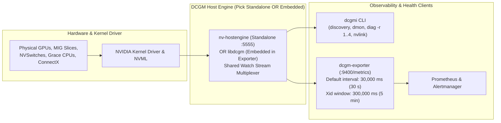
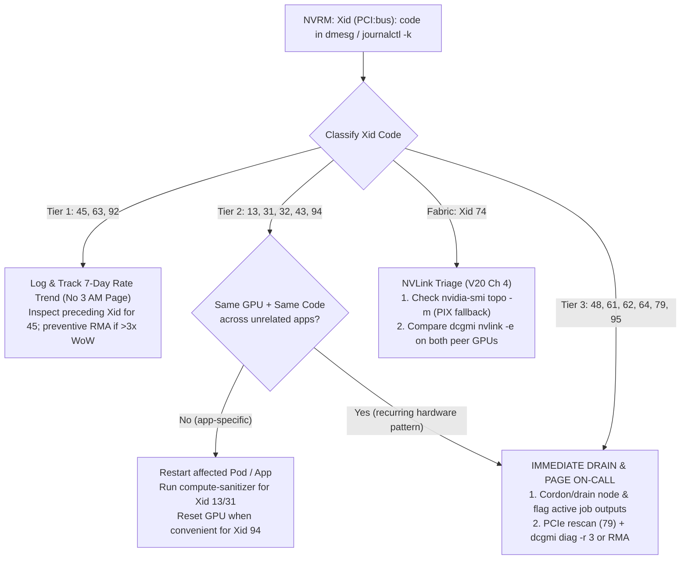

# 10.21 GPU health: DCGM, ECC, row remapping and Xid

| Field | Value |
|---|---|
| Level | Advanced |
| Priority tier | 1 |
| Lab venue | Nebius GPU |
| Part | Part 10: The GPU and CUDA |
| Sources used | `nvidia-devops` Volume 16, Volume 20, and Masterclass Volume 04 Chapter 3 (`volume-04/03-gpu-sharing-telemetry-masterclass.md`); *AI Systems Performance Engineering* (`ai-systems-performance-engineering`, Chris Fregly) |
| Code | `code/part10/gpu_health_dcgm_xid.py`, `code/part10/gpu_health_dcgm_xid_lab.py` |
| Coverage file | `planning/coverage/chapters/10-21.md` |

## Why this matters for AI infrastructure

A single degraded GPU can halt a synchronous training run across 1,000 GPUs and force every rank back to the last checkpoint. Platform teams feel this pain whenever an unhandled hardware fault stalls an expensive cluster or an overly aggressive alert pages an engineer at 3 AM for a benign event. Reliable operations require separating harmless self-healing events from fatal silicon failures in seconds.

We group GPU fault signals into three operational tiers so automation can act immediately without human guesswork. Tier 1 covers self-healing hardware events and early precursor warnings. Single-Bit Error events in HBM are fixed on the fly by Error-Correcting Code hardware, and Ampere, Hopper, and Blackwell GPUs remap degraded rows to spare rows in the same memory bank. No job crashes on a single event, yet a steep weekly climb in Single-Bit Error rate is the primary leading indicator of an imminent bus disconnect or Double-Bit Error crash.

Tier 2 covers application-recoverable faults such as out-of-bounds kernel pointers or an uncorrectable ECC error that hardware successfully contained to one user process. In these cases, the orchestrator only needs to restart the affected pod. However, if the same physical GPU repeats the same Tier 2 fault across unrelated user workloads, automation must escalate that GPU to Tier 3 hardware suspicion.

Tier 3 covers unrecoverable GPU hardware failures including Double-Bit Error memory corruption, uncontained ECC faults, row-remapper exhaustion, microcontroller halts, and PCIe bus disconnects. These events require immediate node cordoning and draining, flagging any checkpoints written during the fault window, and passing a 15-minute diagnostic stress test before the GPU returns to service. The table below summarizes the three operational tiers and their reference incident metrics.

| Operational Tier | Representative Xid Codes | Hardware / Process Impact | Reference Incident Metrics (Volume 20 & Volume 04) | Mandatory Automated Action |
|---|---|---|---|---|
| Tier 1: Self-Healing & Precursors | Xid 45, Xid 63, Xid 92 | Hardware corrects single-bit flip or remaps row across 640 banks without stopping kernels. | Node `gpu-014` jumped from 12 to 94 events/week (+683%) and climbed `12 -> 31 -> 58 -> 94` over 6 hours before Xid 79. | Do not page at 3 AM for 1 event; alert on > 3x week-over-week growth for preventive maintenance. |
| Tier 2: Process-Recoverable Faults | Xid 13, Xid 31, Xid 32, Xid 43, Xid 94 | Fault is isolated to one CUDA context or contained to one process by hardware. | Node 42 Xid 31 page-fault storm from a single buggy container PID. | Restart only the offending pod; escalate to Tier 3 if the same GPU repeats the code across unrelated apps. |
| Tier 3: Unrecoverable GPU Failures | Xid 48, Xid 61, Xid 62, Xid 64, Xid 79, Xid 95 (plus Xid 74 NVLink & Xid 119/120 GSP) | Uncorrectable memory corruption, exhausted spare rows, halted PMU, or GPU lost from PCIe bus. | Requires 15-minute `dcgmi diag -r 3` validation after recovery. | Cordon and drain node immediately, flag checkpoints in the fault window, and run Level 3 diagnostics or RMA. |

:::note About the tiers and the example numbers
The three-tier Xid classification is an operating policy taken from the Volume 20 and Volume 16 notes. It is not an official NVIDIA classification, and the meanings and numbers of the Xid codes should be checked against the NVIDIA Xid catalog for your driver version before you use them in alert rules. The incident figures come from scenario notes that are illustrative, not from real fleets. DCGM field names and numbers should be confirmed with `dcgmi dmon -l` on your installed version. Nothing here was run on a GPU host.

| Illustrative Scenario Metric | Value in Source Notes | Source Location |
|---|---|---|
| Node `gpu-014` 6-hour SBE escalation | `12 -> 94` events/week (`12 -> 31 -> 58 -> 94` over 6 hours) | Volume 20 Chapter 2 |
| Weekly SBE delta climb and thermal correlation | `3 -> 4 -> 5 -> 8` SBEs/week, `r = 0.81`, `71.2°C` average temp | Volume 20 Chapter 5 |
:::

## Prerequisites and outcomes

**Prerequisites.** Complete Chapters 10.8 through 10.10 on `nvidia-smi`, the driver stack, and Fabric Manager. Review Chapter 10.20 on the profiling tools landscape.

**Outcomes.** After completing this chapter you will master five operational skills.
- Deploy DCGM 4 in standalone or embedded mode, configure watch intervals and Xid aggregation windows, map canonical telemetry fields, and run `dcgmi diag` levels 1 through 4.
- Interpret Single-Bit and Double-Bit ECC counters across Volatile and Aggregate scopes. You will also audit the 640-bank Hardware Row Remapper histogram and correlate SBE trends against temperature to separate cooling failures from dying silicon.
- Classify and remediate all 15 core Xid codes across Tiers 1, 2, 3, and NVLink fabric. You will use asymmetric NVLink error counters to isolate faulty transceivers.
- Contrast memory and fault isolation across Time-Slicing, MPS, MIG, and vGPU. You will avoid the MIG zero-instance trap and the MPS Ghost OOM trap.
- Execute the four-step safe GPU node draining sequence, enforce Known-Good Validation gates, and manage cluster reliability using monthly SLO error budgets.

---

## 1. NVIDIA Data Center GPU Manager (DCGM 4): Architecture, Watches, Fields, and Diagnostics

### 1.1 Standalone vs. embedded architecture and shared watches

Polling `nvidia-smi` in a shell loop spawns new processes every second, burns CPU cycles, and misses sub-second hardware faults. Cluster operators need a low-overhead daemon that streams telemetry from GPUs, MIG slices, NVSwitches, NVLinks, Grace CPUs, and ConnectX NICs into Prometheus and Kubernetes health controllers. NVIDIA Data Center GPU Manager provides this sensor and health layer directly on top of the NVML kernel interface.



Before deploying DCGM across a fleet, engineers must account for three architectural rules so they do not duplicate driver polling or miss detached GPUs. First, choose between embedded and standalone host engine modes carefully. By default, `dcgm-exporter` runs an embedded `libdcgm` host engine inside its own process and serves metrics on port 9400 without needing a separate daemon. In contrast, the standalone `nvidia-dcgm.service` runs `/usr/bin/nv-hostengine` on TCP port 5555 to serve `dcgmi` CLI commands. If both services run on the same node, point the exporter at `localhost:5555` with `--remote-hostengine-info`. That flag lets them share one collection stream instead of polling the driver twice.

Second, understand how fields and watches multiplex across clients. A field is a typed numeric identifier, and a watch tells the host engine how often to sample that field. The host engine maintains exactly one collection stream per GPU-field pair and samples at the fastest cadence requested by any subscribed client. Every metric sample carries the timestamp of when DCGM read the driver rather than when Prometheus scraped `/metrics`. In addition, Xid counts are aggregated over a rolling 5-minute window so brief spikes between scrapes are never lost.

Third, guard against the silent blind spot when a GPU detaches at runtime. Starting in DCGM 4.5 with driver 590, the daemon starts even if no GPU is present and handles runtime GPU binding and unbinding. When a GPU falls off the bus, DCGM removes it from active groups and stops reporting health incidents for that device. You must pair DCGM health alerts with a total GPU count check or inspect `dcgmi discovery --list --all` so a vanished GPU does not look healthy by staying quiet.

| DCGM Architectural Component / Setting | Default Value / Port | Operational Purpose and Configuration Rule (Volume 16 Chapter 4) |
|---|---|---|
| Standalone Host Engine (`nvidia-dcgm.service`) | TCP port `5555` | Runs `/usr/bin/nv-hostengine -n --service-account nvidia-dcgm` for `dcgmi` and remote clients; requires `>= 16 GB` host RAM. |
| Prometheus Exporter (`dcgm-exporter`) | HTTP port `9400` (`/metrics`) | Links `libdcgm` in embedded mode by default; pass `--remote-hostengine-info localhost:5555` to share a standalone daemon. |
| Watch Multiplexing Rule | Fastest requested cadence (`1 s` wins over `5 s`) | If Client A watches GPU 0 power at `5 s` and Client B watches at `1 s`, DCGM polls at `1 s` and serves both from one ring buffer. |
| Exporter Collection Interval (`-c` / `--collect-interval`) | `30,000 ms` (`30 s`), often tuned to `10,000 ms` (`10 s`) | Sets how frequently `dcgm-exporter` reads cached watch values via `DCGM_EXPORTER_INTERVAL`. |
| Xid Aggregation Window (`--xid-count-window-size`) | `300,000 ms` (`5 min`) | Aggregates Xid and clock-throttle events over a 5-minute rolling window so 30-second scrapes never miss transient faults. |
| Runtime GPU Detach Behavior (DCGM `4.5+`, driver `590+`) | Marks detached GPU with `Status: <state>` and `(last known)` | Detached GPUs stop emitting health incidents; alert on `count(DCGM_FI_DEV_GPU_UTIL) < expected_gpus` and check `dcgmi discovery --list --all`. |

### 1.2 Core DCGM fields, canonical field renames, and production alert thresholds

Raw GPU metrics are easy to misread if operators do not know which fields require special container capabilities or which names changed in DCGM 4. Profiling counters such as Tensor Core activity require elevated permissions, while several legacy metric names have been renamed to include explicit physical units. Meanwhile, `dcgm-exporter` continues to map legacy Prometheus metric names in `/etc/dcgm-exporter/default-counters.csv` to the canonical DCGM 4 fields behind the scenes.

The table below lists the core execution, clock, power, memory, reliability, and interconnect fields alongside their canonical DCGM 4 names and production alert thresholds from Volume 16 Chapters 4 and 8.

| Category | Legacy / Exporter Field Name (ID) | Canonical DCGM 4 Field Name | Typical Range | Production Alert Threshold (Volume 16 Ch 4 & Ch 8, Volume 20 Ch 4 & Ch 5) |
|---|---|---|---|---|
| Execution | `DCGM_FI_DEV_GPU_UTIL` (`203`) | `DCGM_FI_DEV_GPU_UTIL_RATIO` | `0–100%` (or `0.0–1.0`) | `< 10%` for `10+ min` when jobs are scheduled; straggler alert if `max(util) - min(util) > 30%` on a node (e.g., `85%` at `1,410 MHz` vs `48%` at `900 MHz` = `37%` gap). |
| Execution | `DCGM_FI_PROF_SM_OCCUPANCY` | `DCGM_FI_PROF_SM_OCCUPANCY` | `0–100%` | `< 20%` indicates SMs are under-populated; requires `--cap-add SYS_ADMIN` in container. |
| Execution | `DCGM_FI_PROF_PIPE_TENSOR_ACTIVE` | `DCGM_FI_PROF_PIPE_TENSOR_ACTIVE` | `0.0–1.0` ratio | Ratio of cycles Tensor Cores are active; `0` indicates fallback to scalar FP32. |
| Clocks / Power | `DCGM_FI_DEV_SM_CLOCK` (`100`) / `MEM_CLOCK` (`101`) | `DCGM_FI_DEV_SM_CLOCK_HERTZ` / `MEM_CLOCK_HERTZ` | MHz / Hz | Drop below nominal boost, such as `1,980 -> 1,833 MHz` on H100 or `1,410 -> 1,200 MHz` (`70%` throughput) on A100. |
| Clocks / Power | `DCGM_FI_DEV_CLOCK_THROTTLE_REASONS` | `DCGM_FI_DEV_CLOCK_THROTTLE_REASONS` | Bitmask (`0` = None) | Any non-zero thermal (`HW Thermal Slowdown`) or power (`HW Power Brake`) bit under load. |
| Clocks / Power | `DCGM_FI_DEV_POWER_USAGE` | `DCGM_FI_DEV_POWER_USAGE` | `0–TDP` Watts (`700W` H100, `300W` A100 PCIe) | `> 90%` of enforced power limit, or `< 50W` under load during Volume 16 Ch 9 readiness checks. |
| Clocks / Power | `DCGM_FI_DEV_THERMAL_VIOLATION` / `POWER_VIOLATION` | `DCGM_FI_DEV_GPU_THERMAL_THROTTLE_SECONDS_TOTAL` / `..._POWER_THROTTLE_SECONDS_TOTAL` | Cumulative seconds | `increase(...[1h]) > 0` proves the GPU lost performance to thermal or power throttling. |
| Memory | `DCGM_FI_DEV_FB_FREE` / `FB_USED` / `FB_TOTAL` | `DCGM_FI_DEV_FB_FREE_BYTES` / `FB_USED_BYTES` / `FB_TOTAL_BYTES` | MiB / Bytes (`81,920 MiB` A100-80GB) | `FB_FREE < 2 GB` or `FB_USED > 95%` sustained (e.g., `28.4 GB` allocated vs `39.8 GB` reserved = `11.4 GB` fragmentation in Volume 16 Ch 8). |
| Memory | `DCGM_FI_PROF_DRAM_ACTIVE` | `DCGM_FI_PROF_DRAM_ACTIVE` | `0–100%` | `> 95%` means HBM bandwidth is saturated; `< 20%` during memory-heavy stages indicates starvation. |
| Reliability | `DCGM_FI_DEV_GPU_TEMP` | `DCGM_FI_DEV_GPU_TEMP` | `30–90°C` | `> 80–82°C` for `5 min`, approaching the `~85°C` slowdown threshold and `87–95°C` shutdown limit. |
| Reliability | `DCGM_FI_DEV_ECC_SBE_VOL_TOTAL` / `AGG_TOTAL` | `DCGM_FI_DEV_ECC_SBE_VOL_TOTAL` / `AGG_TOTAL` | `0–infinity` count | `increase(...[1h]) > 100` (`245/hr` example in Volume 16 Ch 8) or `> 2x` week-over-week growth in Volume 20 Ch 5. |
| Reliability | `DCGM_FI_DEV_ECC_DBE_VOL_TOTAL` / `AGG_TOTAL` | `DCGM_FI_DEV_ECC_DBE_VOL_TOTAL` / `AGG_TOTAL` | `0` | `> 0` (`for: 0m` immediate page and drain due to uncorrectable data corruption risk). |
| Reliability | `DCGM_FI_DEV_ROW_REMAP_FAILURE` | `DCGM_FI_DEV_ROW_REMAP_FAILURE` | `0` or `1` | `== 1` (`for: 0m` immediate page and drain because the Xid 64 self-healing row remapper failed). |
| Reliability | `DCGM_FI_DEV_XID_ERRORS` | `DCGM_FI_DEV_XID_ERRORS` | Last Xid code (`0` = none) | Immediate page and drain on Tier 3 (`48, 61, 62, 64, 79, 95`); rate-track Tier 1 (`45, 63, 92`). |
| Interconnect | `DCGM_FI_PROF_NVLINK_TX_BYTES` / `RX_BYTES` & `..._CRC_FLIT_ERROR_COUNT_TOTAL` | Same | Bytes / Error count | `increase(DCGM_FI_DEV_NVLINK_CRC_FLIT_ERROR_COUNT_TOTAL[6h]) > 1000` (`for: 30m` in Volume 20 Ch 4). |

### 1.3 Active hardware validation: `dcgmi diag` levels 1 through 4

Passive telemetry only observes the memory cells and execution units that a running workload happens to touch. If a repaired node returns to the cluster without active stress testing, a latent HBM or PCIe defect will crash the next multi-node training job scheduled onto it. Platform teams prevent this by gating node admission behind Known-Good Validation using `dcgmi diag --run <level>`.

DCGM provides four diagnostic run levels tailored to different points in the node lifecycle. Level 1 runs in a few seconds and checks basic driver and NVML readiness without disturbing workloads. Level 3 runs for roughly 15 minutes and stresses HBM memory, Tensor Cores, PCIe bandwidth, power delivery, and cooling. It serves as the mandatory gate after any driver upgrade, hardware RMA, or Tier 3 Xid recovery.

| Diagnostic Level | CLI Command | Typical Duration | Validation Scope and Operational Gate (Volume 16 Ch 4, Volume 20 Ch 2 & Ch 5, Volume 04 Ch 3) |
|---|---|---|---|
| Level 1 (`short` / `quick`) | `dcgmi diag -r 1` | Seconds | Non-invasive software and deployment check verifying driver load, NVML reachability, and device nodes; safe for daily readiness probes. |
| Level 2 (`medium`) | `dcgmi diag -r 2` | `~2 minutes` | Deployment checks plus basic hardware and memory integration validation. |
| Level 3 (`long`) | `dcgmi diag -r 3` | `~15 minutes` | Full invasive hardware and stress test across HBM, Tensor Cores, PCIe, power, and thermals, paired with `/opt/nccl-tests/build/all_reduce_perf -b 1G -e 8G -f 2 -g 1`. If `Hardware (Memory)` reports `Fail` (`Stress: Skipped`), RMA the GPU immediately. |
| Level 4 (`xlong`) | `dcgmi diag -r 4` | Extended burn-in | Extended thermal and silicon stress burn-in for commissioning brand-new clusters. |

---

## 2. ECC Memory, Thermal Correlation, Page Retirement, and Hardware Row Remapping

### 2.1 Single-Bit vs. Double-Bit ECC counters across Volatile and Aggregate scopes

High-bandwidth memory operates at extreme densities where cosmic rays, thermal noise, or aging silicon capacitors can flip stored bits. Without hardware protection, a single flipped bit in model weights or optimizer state silently corrupts a training run for days. Enterprise NVIDIA GPUs protect HBM device memory, register files, and L1 and L2 caches with Error-Correcting Code checksums that detect and classify every bit flip.

Hardware divides memory errors into two severities and tracks them across two time horizons. A Single-Bit Error occurs when one bit flips in an ECC word. The memory controller reconstructs the original bit on the fly with zero data loss and zero interruption to running CUDA kernels. A Double-Bit Error occurs when two bits flip in the same word. The checksum detects the corruption but cannot reconstruct the original value, raising Xid 48, Xid 94, or Xid 95 and halting the affected context.

When you inspect counters with `nvidia-smi -i 0 -q -d ECC`, you see both Volatile and Aggregate totals. Volatile counters record errors since the last GPU reset or node reboot, whereas Aggregate counters persist across reboots inside the GPU's non-volatile infoROM.

| ECC Counter Scope & Type | Meaning | Volume 20 Chapter 5 Diagnostic Example | Operational Interpretation |
|---|---|---|---|
| Volatile Single-Bit Error (SBE) | Correctable 1-bit flips since last GPU reset or reboot | `Device Memory: 42` + `Register File: 0` + `L1 Cache: 0` + `L2 Cache: 3` = `45` Volatile SBE | Safe on its own; reset to zero by `--gpu-reset` or reboot. |
| Volatile Double-Bit Error (DBE) | Uncorrectable 2-bit flips since last reset or reboot | `0` Volatile DBE | Any value `> 0` triggers an immediate Tier 3 page and node drain. |
| Aggregate Single-Bit Error (SBE) | Lifetime persistent 1-bit flips stored in non-volatile infoROM | `891` Aggregate SBE (climbing `612 -> 658 -> 719 -> 891` over 4 weeks) | Non-zero lifetime count is normal physics; track weekly rate delta rather than raw total. |
| Aggregate Double-Bit Error (DBE) | Lifetime persistent 2-bit flips stored in non-volatile infoROM | `0` Aggregate DBE (`3` Aggregate DBE in Volume 20 Ch 1 retirement case) | Persistent history of uncorrectable faults on this physical die. |

### 2.2 Distinguishing thermally driven SBE spikes from progressive silicon degradation

Replacing an expensive HBM GPU every time its Single-Bit Error counter ticks upward wastes hardware budgets and engineering time. High operating temperatures physically increase DRAM capacitor charge leakage, causing healthy silicon to flip bits faster when a fan or heatsink degrades. Before ordering an RMA for a rising SBE rate, operators must correlate the error velocity against GPU temperature over a 30-day window.

First, compute the weekly SBE delta from `DCGM_FI_DEV_ECC_SBE_AGG_TOTAL` rather than looking at the lifetime total. Second, compute the Pearson correlation coefficient between GPU temperature and aggregate SBE count over the past 30 days. If the correlation is 0.7 or higher, heat is driving the bit flips and fixing the cooling path resolves the errors without replacing the GPU. If the SBE rate accelerates while temperatures and voltages remain flat, the HBM silicon itself is degrading and requires a preventive RMA before it escalates into a fatal Double-Bit Error.

| Diagnostic Scenario (Volume 20 Ch 5, Lab 03 & Lab 04) | SBE Rate Trajectory | 30-Day Thermal Telemetry & Correlation (`r`) | Root Cause Diagnosis | Mandatory Remediation Path |
|---|---|---|---|---|
| Remediation Path B: Thermally Driven SBE Climb | Weekly SBE delta rises `3 -> 4 -> 5 -> 8` SBEs/week (`+167%` / `~2.7x` over 4 weeks; cumulative `612 -> 658 -> 719 -> 891`). | `avg_over_time` = `71.2°C`, `max_over_time` = `84.6°C` (near `85°C` slowdown limit), Pearson `r = 0.81` (`>= 0.7` threshold). | High thermal energy is increasing HBM charge leakage on healthy silicon. | Do not RMA; fix airflow or cap power (`nvidia-smi -pl 250 -i 0`), which drops `SBE_delta` back to `1–2` per day. |
| Remediation Path C: Progressive Silicon Degradation | SBE rate accelerates (`+170%/month`, `50` errors in `10 min` = `300/hr` in Lab 03, or `50` in `30 min` = `100/hr` in Lab 04). | Temperatures and voltages are normal and flat; Pearson `r = 0.09` or `0.12` (`< 0.7` threshold). | Progressive physical degradation of HBM memory cells. | Schedule a preventive RMA during a maintenance window before a Tier 3 DBE crash occurs. |

### 2.3 Legacy Page Retirement vs. Hardware Row Remapping across 640 banks

When a specific HBM cell develops a permanent physical defect, correcting the same bit flip millions of times per second wastes memory bandwidth and risks a second bit flip in the same word. The GPU needs a permanent mechanism to retire the damaged memory location so future allocations never touch it. Pre-Ampere GPUs used software-visible Page Retirement, whereas Ampere, Hopper, and Blackwell GPUs use a dedicated Hardware Row Remapper.

Legacy Page Retirement blacklists whole memory pages in driver software, which slightly shrinks the total usable memory reported by the driver. In contrast, the Hardware Row Remapper redirects accesses from a damaged physical row to a built-in spare row inside the same HBM bank in hardware. It logs Xid 63 as a routine self-healing event while keeping usable memory capacity unchanged at the full 81,920 MiB nameplate on an A100-SXM4-80GB.

```text
Row Remapper (nvidia-smi -i 0 -q -d ROW_REMAPPER, Volume 20 Chapter 5)
    Correctable Error                    : 12
    Uncorrectable Error                  : 0
    Pending                              : No
    Remapping Failure Occurred           : No
    Bank Remap Availability History
        Max                              : 630
        High                             : 8
        Partial                          : 2
        Low                              : 0
        None                             : 0
```

You evaluate remaining self-healing capacity by reading the 640-bank availability histogram in `nvidia-smi -i 0 -q -d ROW_REMAPPER`. If any bank exhausts all of its spare rows or if the hardware remap operation fails, the failure flag flips to yes and `DCGM_FI_DEV_ROW_REMAP_FAILURE` becomes 1. The driver then logs Xid 64. Treat Xid 64 as an immediate Tier 3 hardware failure and RMA the GPU.

| Memory Self-Healing Mechanism | Query Command | Volume 20 Diagnostic Metrics | Impact on Usable Capacity & Triage Rule |
|---|---|---|---|
| Legacy Page Retirement (`PAGE_RETIREMENT`) | `nvidia-smi -i 0 -q -d PAGE_RETIREMENT` | `Single Bit ECC: 12`, `Double Bit ECC: 2` (`14` pages total from `142` SBE / `3` DBE), `Pending Page Blacklist: Yes` | Reduces `memory.total` slightly below the `81,920 MiB` nameplate (`2,048 MiB` used + `79,872 MiB` free on healthy peer). |
| Hardware Row Remapper (`ROW_REMAPPER`, healthy) | `nvidia-smi -i 0 -q -d ROW_REMAPPER` | `630 Max` (`98.4%`) + `8 High` + `2 Partial` + `0 Low` + `0 None` = `640` HBM banks; `12` correctable rows remapped, `Remapping Failure Occurred: No` | Logs Tier 1 Xid 63; zero capacity loss. Track 7-day remap frequency. |
| Row Remapper Exhaustion (`ROW_REMAPPER`, failed) | `nvidia-smi -i 0 -q -d ROW_REMAPPER` | `Remapping Failure Occurred: Yes`, `DCGM_FI_DEV_ROW_REMAP_FAILURE == 1`, `None > 0` | Logs Tier 3 Xid 64; cordon, drain immediately, and RMA the GPU. |

---

## 3. The Authoritative 15-Code Xid Encyclopedia and 3-Tier Triage Framework

### 3.1 The 15-code Xid reference table

When a GPU encounters a hardware or driver exception, the kernel module writes an `NVRM: Xid` line to `dmesg` and `journalctl -k`. Treating every Xid as a fatal hardware crash drains healthy nodes for user pointer bugs, while ignoring Xids allows corrupted HBM to poison model checkpoints. Every on-call engineer and automated node-problem-detector rule should classify Xids using the 15-code, 3-Tier framework below.

| Xid Code | Official Meaning | Tier Classification | Recoverable? | Mandatory SRE / Operational Action (Volume 20 Ch 2 & Volume 04 Ch 3) |
|---:|---|---|---|---|
| 13 | Graphics Engine Exception | Tier 2 (App-Recoverable) | Usually yes (process-level) | Illegal instruction or out-of-bounds kernel address; user debugs with `compute-sanitizer`. Escalate to Tier 3 if the same GPU repeats Xid 13 across unrelated apps. |
| 31 | GPU Memory Page Fault | Tier 2 (App-Recoverable) | Usually yes (process-level) | Out-of-bounds pointer or unallocated virtual address; map `dmesg` PID to pod, terminate pod, and debug with `compute-sanitizer`. Escalate to Tier 3 if recurring across unrelated apps. |
| 32 | Invalid or Corrupted Push Buffer Stream | Tier 2 (App-Recoverable) | Usually yes | Command stream corruption between driver and GPU; restart process, but escalate if paired with PCIe AER errors. |
| 43 | GPU Stopped Processing | Tier 2 (App-Recoverable) | Depends on root cause | Command processor hung, distinct from Xid 79. Catalog immediate action is `IGNORE`, investigatory is `CONTACT_SUPPORT`; reset GPU and inspect preceding Xids. |
| 45 | Preemptive Cleanup Due to Previous Errors | Tier 1 (Informational) | Yes (symptom only) | Driver cleaned up a context after an earlier fault. Never treat Xid 45 as the root cause; pull a wider `journalctl -k` window to find the Xid that fired right before 45. |
| 48 | Double-Bit ECC Error (DBE, Uncorrectable) | Tier 3 (Hardware Failure) | No | Cordon and drain node immediately. Flag all checkpoints and outputs from jobs on that GPU during the window as potentially corrupted; run `dcgmi diag -r 3` and RMA. |
| 61 | Internal Micro-Controller Breakpoint / Warning | Tier 3 (Hardware Failure) | No | GPU firmware-level fault; cordon, drain immediately, and escalate to hardware support. |
| 62 | Internal Micro-Controller Halt (PMU Halt) | Tier 3 (Hardware Failure) | No | Embedded PMU controller halted (`RESET_GPU` immediate, `CONTACT_SUPPORT` investigatory; note GSP processor errors are Xid 119 and 120). Drain and RMA if it recurs. |
| 63 | ECC Page Retirement / Row Remapping Recording Event | Tier 1 (Self-Healing) | Yes (GPU keeps running) | Hardware recorded a row remap or page retirement after a correctable ECC event (`IGNORE`). Log and track 7-day frequency. |
| 64 | ECC Page Retirement / Row Remapping Failure | Tier 3 (Hardware Failure) | No | Hardware self-healing row remapper failed (`Remapping Failure Occurred: Yes`). Cordon, drain immediately, and RMA. |
| 74 | NVLink Error | Fabric / Link | Depends on link state | Fatal NVLink error on link `N` (Volume 20 Ch 4). Check `nvidia-smi topo -m` for `NV12 -> PIX` fallback, compare `dcgmi nvlink -e` on both ends, reset GPU, and RMA the side with high CRC counts. |
| 79 | GPU Has Fallen Off the Bus | Tier 3 (Hardware Failure) | No (without intervention) | GPU vanished from PCIe (`lspci` misses device; `RmInitAdapter failed`). Cordon and drain, attempt sysfs PCIe remove and rescan, and require `dcgmi diag -r 3` PASS or RMA. |
| 92 | High Single-Bit ECC Error Rate | Tier 1 (Precursor Warning) | Yes for now | Elevated correctable SBE rate. Do not page at 3 AM for 1 event, but track 7-day trend; `> 3x` week-over-week growth triggers preventive maintenance before Xid 79 or 48. |
| 94 | Contained ECC Error | Tier 2 (App-Contained) | Partly (restart affected app) | Uncorrectable ECC error contained by hardware to 1 application; restart only the affected application while other processes continue, and reset GPU when convenient. |
| 95 | Uncontained ECC Error | Tier 3 (Hardware Failure) | No | Uncorrectable ECC error that hardware could not contain, compromising GPU-wide data integrity. Same severity as Xid 48: cordon and drain immediately and flag job outputs. |



### 3.2 Reading multi-Xid cascades and asymmetric Xid 74 NVLink counters

Reading only the final line of `dmesg` often misleads operators into treating a cleanup event or a bus disconnect as an unannounced lightning strike. Hardware failures almost always emit precursor warnings seconds or hours before the final crash. In addition, fabric link errors affect two peer GPUs even when only one transceiver is physically broken. Examining the surrounding kernel log window and comparing per-link error counters on both ends of a degraded NVLink reveals the exact failing component.

Look at the 11-second cascade captured in Volume 20 Chapter 2 using `dmesg -T | grep -B5 -A5 "Xid"`.

```text
[Tue Aug  4 14:21:52 2026] NVRM: Xid (PCI:0000:0a:00): 92, pid=48213, name=python, High single-bit ECC error rate
[Tue Aug  4 14:21:58 2026] NVRM: Xid (PCI:0000:0a:00): 45, pid=48213, name=python, Preemptive cleanup, due to previous errors
[Tue Aug  4 14:22:03 2026] NVRM: Xid (PCI:0000:0a:00): 79, pid=48213, name=python, GPU has fallen off the bus.
[Tue Aug  4 14:22:03 2026] NVRM: GPU 0000:0a:00.0: RmInitAdapter failed
```

Querying Prometheus historical `DCGM_FI_DEV_ECC_SBE_AGG_TOTAL` for `gpu-014` over the 6 hours before the crash shows SBE counts accelerating rapidly. A weekly trend alert that flags greater than 3x week-over-week growth on Tier 1 Xid 92 catches the failing GPU two days before the unrecoverable Xid 79 bus disconnect.

Similarly, when Xid 74 fires on an NVLink connection and `nvidia-smi topo -m` shows the path between GPU 2 and GPU 3 degraded from NV12 to PIX PCIe fallback, first verify that MIG mode is disabled. NVLink peer-to-peer is intentionally disabled across MIG instances by design. Next, compare `dcgmi nvlink -e` across both peer GPUs. Because GPU 3 recorded zero errors before the link went down, GPU 3 is a passive victim and the physical fault is isolated to the NVLink transceiver on GPU 2 or the baseboard trace.

| Multi-Event Triage Case | Telemetry / Log Window | Observed Counter Progression | Root Cause & Preventive Action |
|---|---|---|---|
| `gpu-014` Pre-Crash Cascade (Volume 20 Ch 2) | `08:00` to `14:00` (`6` hours prior to `14:22:03` crash on `0000:0a:00.0`, `pid=48213`) | `SBE_Count` climbs `12 -> 31 -> 58 -> 94` (`+683%` week-over-week: `94` vs `12` in prior week), ending in `Xid 92 -> Xid 45 -> Xid 79`. | Tracking 7-day Tier 1 Xid 92 rate (`> 3x` week-over-week growth) triggers preventive drain 2 days before the Xid 79 crash. |
| Asymmetric Xid 74 NVLink Fault (Volume 20 Ch 4) | `dcgmi nvlink -e` on `GPU 2` (`-g 2`) vs `GPU 3` (`-g 3`) Link 2 after `NV12 -> PIX` (`10x` slower) fallback | `GPU 2` Link 2: `184,213` CRC Errors, `92,104` Replay Errors, `12` Recovery Errors, `Status: Down`. `GPU 3` Link 2: `0` CRC, `0` Replay, `0` Recovery, `Status: Down`. | Confirm `MIG Mode: Disabled` first; asymmetric errors prove `GPU 3` is healthy and isolate the fault to `GPU 2` Link 2 transceiver. |

---

## 4. GPU Sharing Fault Isolation, Safe Node Draining, and Cluster Health SLOs

### 4.1 Comparing memory and fault isolation across GPU sharing modes

Sharing a physical GPU across multiple inference pods or notebooks raises utilization, but it also introduces noisy-neighbor crashes if the wrong sharing mode is chosen. Under software-only sharing, one container can allocate all device memory or trigger an uncontained Xid fault that kills every co-located tenant on the GPU. Architects must choose between Time-Slicing, Multi-Process Service, Multi-Instance GPU, and Virtual GPU based on whether the workload requires hardware memory and fault isolation.

The table below contrasts compute partitioning, memory isolation, fault blast radius, and classic operational traps across all four GPU sharing mechanisms from Volume 04 Chapter 3 and Volume 20 Chapter 1.

| Sharing Mechanism | Compute Partitioning | Memory Capacity Isolation | Hardware Fault (Xid) Isolation | Operational Traps & Diagnostic Signatures (Volume 04 Ch 3 & Volume 20 Ch 1) |
|---|---|---|---|---|
| 1. Time-Slicing (`replicas: 4`) | OS and driver time-sliced context switching across the whole GPU | None; shared HBM because Linux cgroups do not govern GPU VRAM | None; any fault impacts all replicas | High context-switch jitter; one pod can allocate `100%` of HBM and OOM all 3 sibling pods. |
| 2. Multi-Process Service (MPS) | Concurrent kernel execution on shared SMs via `nvidia-cuda-mps-server` (`EXCLUSIVE_PROCESS`, `set_default_active_thread_percentage 20`) | Software limit only (`CUDA_MPS_PINNED_DEVICE_MEM_LIMIT`) | None; shared single GPU context so a fatal fault crashes all MPS clients | The Ghost OOM on MPS: Container A crashes with `CUDA out of memory` while `nvidia-smi` shows only `10 GB` of `40 GB` used because `CUDA_MPS_PINNED_DEVICE_MEM_LIMIT` capped Container A. |
| 3. Multi-Instance GPU (MIG, up to `7` instances) | Dedicated physical SMs, L2 cache slices, and copy engines (`3g.40gb`, `2g.20gb`, `1g.10gb` = `6/7` SMs, `70 GB` on `80 GB` GPU) | Strict hardware isolation with dedicated HBM memory controllers per GI | Hardware fault isolation via crossbar and memory isolation per MIG slice | The `0 MiB` Total Memory Trap: If `MIG Mode: Enabled` (`nvidia-smi -i 0 -mig 1`) has zero GPU Instances created (`nvidia-smi mig -lgi` empty), `nvidia-smi` reports `0 MiB` total memory instead of `81,920 MiB` and apps fail with OOM. NVLink P2P is also disabled under MIG by design. |
| 4. Virtual GPU (vGPU) | Hypervisor-mediated VF scheduling (`SR-IOV` + `VFIO`) | Strict per-VM framebuffer split | VM-level isolation requiring NVIDIA DLS or CLS license server | Host BIOS must enable `SR-IOV` and `VT-d` / `IOMMU`, and host kernel cmdline must set `intel_iommu=on` or `amd_iommu=on`. |

### 4.2 Safe GPU node draining and Cluster Health SLIs, SLOs, and Error Budgets

Trying to unload `nvidia.ko` for a live driver upgrade while the exporter or a zombie CUDA process still holds `/dev/nvidia0` open fails with a module-in-use error and leaves the node half-configured. Platform engineers avoid unnecessary reboots by following a strict four-step node draining sequence before touching kernel modules.

First, cordon the node in Kubernetes so no new pods arrive. Second, poll DCGM field 203 across all GPUs until utilization reaches zero percent. Third, stop the DCGM exporter and standalone host engine services so they close their device file descriptors. Fourth, unload the NVIDIA kernel modules in reverse dependency order, clearing any zombie PID that still holds device memory.

| Safe Node Draining Step (Volume 04 Ch 3 & Volume 20 Ch 1) | Command / Check | Operational Purpose |
|---|---|---|
| Step 1: Cordon Node | `kubectl cordon $NODE` | Prevents the scheduler from placing new GPU pods on the node during maintenance. |
| Step 2: Verify Zero GPU Activity | `dcgmi dmon -e 203 -c 1` | Polls field `203` (`DCGM_FI_DEV_GPU_UTIL`) until aggregate utilization across all GPUs equals `0%`. |
| Step 3: Stop Telemetry Daemons | `systemctl stop nvidia-dcgm-exporter nvidia-dcgm` | Releases open `/dev/nvidia*` file descriptors held by `libdcgm` and `nv-hostengine`. |
| Step 4: Unload Kernel Modules | `rmmod nvidia_uvm nvidia_drm nvidia_modeset nvidia` | Unloads drivers cleanly; if dead OS PID `48213` still holds `71,234 MiB`, clear it first with `fuser -k /dev/nvidia0` or `nvidia-smi --gpu-reset -i 0`. |

At the cluster level, tracking raw GPU utilization as a reliability metric misleads leadership because a GPU stuck in a memory-stall loop reports 100% utilization while completing zero training steps. Instead, measure cluster health using user-visible Service Level Indicators, Service Level Objectives, and a monthly Error Budget over a 730-hour month.

```text
Error Budget = (1 - SLO) * 730 hours = (1 - 0.99) * 730 = 7.3 hours/month
Used Budget  = 1.5 h (firmware upgrade) + 2.0 h (unplanned GPU failure) + 2.0 h (network maintenance) + 0.5 h (thermal incident) = 6.0 hours
Remaining    = 7.3 hours - 6.0 hours = 1.3 hours -> Trigger deployment and change freeze
```

When cumulative monthly downtime consumes nearly the entire 7.3-hour error budget, leadership automatically freezes non-emergency driver and firmware rollouts until the budget resets next month.

| Cluster Health SLI / Alert Level (Volume 16 Ch 9) | Target SLO / Threshold | Verification Method & Mandatory Action |
|---|---|---|
| GPU Availability SLO | `99.0%` (`7.3 hours/month` budget over `730 hours`) | `count(DCGM_FI_DEV_GPU_UTIL >= 0) / total_gpus`; `6.0 hours` used leaves `1.3 hours` and triggers a deployment freeze. |
| All GPUs Healthy SLO | `98.0%` (up to `2%` of GPUs offline or degraded) | Daily readiness probe checks `nvidia-smi -q` response, `temp <= 82°C`, `power > 50 W` under load, `uncorrected ECC == 0`, and `dcgmi diag -r 1` `PASS`. |
| Job Completion Rate SLO | `99.5%` | At most `1` in `200` training jobs may fail due to underlying hardware faults. |
| Sustained Training Throughput SLO | `p50 >= 2,000 samples/sec`, `p99 >= 1,900 samples/sec` | Tracks end-to-end application step time rather than raw NVML utilization. |
| Level 1 Alert (`Advisory`) | GPU temp trending toward `80°C` | Log and monitor; do not page on-call. |
| Level 2 Alert (`Warning`) | `1` GPU offline `> 1 hour` | Open ticket for investigation and replacement during business hours. |
| Level 3 Alert (`Critical — SLO at risk`) | `> 5` GPUs offline or cluster availability `< 98%` | Page on-call engineer immediately and execute hardware drain runbook. |
| Level 4 Alert (`Catastrophic — SLO violated`) | Cluster availability `< 95%` | Escalate to Incident Commander and halt non-critical workloads. |

---

## 5. Commands and Configurations That Matter

All commands below follow Volume 16, Volume 20, and Masterclass Volume 04 Chapter 3. Commands that require an attached NVIDIA GPU node are marked **(untested here)**.

### 5.1 Install and verify DCGM 4, run `dcgmi diag`, inspect ECC & Row Remapper, and triage Xids (untested here)

Before running diagnostics or scraping metrics on a new GPU node, verify that the installed DCGM 4 package matches the CUDA major version reported by the driver. Once the daemon and exporter are running, use `dcgmi` and `nvidia-smi` to inspect live field streams, run active health checks, and audit ECC and Row Remapper state.

```bash
# 1. Install DCGM 4 matching the driver's CUDA major version and start services (V16 Ch 4 & Lab 01) (untested here)
nvidia-smi -q | grep -E 'Driver Version|CUDA Version'
CUDA_VERSION=12
sudo apt-get update && sudo apt-get install --yes --install-recommends \
     datacenter-gpu-manager-4-cuda${CUDA_VERSION} datacenter-gpu-manager-exporter
sudo systemctl enable --now nvidia-dcgm nvidia-dcgm-exporter
dcgmi discovery --list --all
curl -s http://localhost:9400/metrics | head -n 40

# 2. Sample live fields (100=SM clock, 101=Mem clock, 203=GPU util) and run Level 1 / Level 3 diagnostics (untested here)
dcgmi dmon --field-id 100,101,203 --count 10
dcgmi diag --run 1
dcgmi diag --run 3 -i 0

# 3. Inspect Volatile/Aggregate ECC counters, Page Retirement, Row Remapper (640 banks), and NVLink errors (untested here)
nvidia-smi -i 0 -q -d ECC,PAGE_RETIREMENT,ROW_REMAPPER
dcgmi nvlink -e -g 0
dmesg -T | grep -B5 -A5 "Xid" | tail -n 60
```

---

## 6. How It Fails: Six DCGM, ECC, Row Remapper, MIG, and Xid Operational Failure Modes

In production clusters, observability blind spots and misconfigured sharing modes often masquerade as mysterious application crashes. The table below summarizes the six most common operational failure modes across DCGM, MIG, ECC thermal correlation, and Xid triage, along with their root causes and fixes.

| # | Failure Mode | Production / Telemetry Symptom | Root Cause | Fix |
|---|---|---|---|---|
| 1 | Silent DCGM blind spot when a GPU detaches (Xid 79) or `nvidia-dcgm` stops | Prometheus shows zero active health alerts on `gpu-node-14`, yet jobs fail with `No devices were found` or only `3` of `4` GPUs appear in dashboards (Volume 16 Ch 4). | When a GPU detaches in DCGM 4.5+ or `dcgm-exporter` dies, DCGM drops watches on the detached GPU and reports no health incidents for it. | Alert on `up{job="dcgm"} == 0` and `count(DCGM_FI_DEV_GPU_UTIL) < expected_gpu_count`, and run `dcgmi discovery --list --all` plus `journalctl -k` for `NVRM: Xid`. |
| 2 | `nvidia-smi` reports `0 MiB` total memory on a healthy `81,920 MiB` A100 (Volume 20 Ch 1) | Pods crash immediately with `CUDA_ERROR_OUT_OF_MEMORY`; `nvidia-smi` shows `memory.total = 0 MiB` on `GPU 0` while `GPU 1` shows `81920 MiB`. | `MIG Mode` is `Enabled` on `GPU 0` (`nvidia-smi -i 0 -q`), but zero GPU Instances have been created (`nvidia-smi mig -lgi` is empty). | Either create the intended MIG instances (`sudo nvidia-smi mig -cgi 9,9 -C` for two `3g.40gb` slices) or disable MIG (`sudo nvidia-smi -i 0 -mig 0 && sudo nvidia-smi -i 0 --gpu-reset`). |
| 3 | RMA'ing a GPU for thermally induced SBE bit flips (`r = 0.81`, Volume 20 Ch 5) | Weekly `DCGM_FI_DEV_ECC_SBE_AGG_TOTAL` delta climbs `3 -> 4 -> 5 -> 8` (`+167%`), triggering a hardware replacement ticket despite `Remapping Failure Occurred: No` and `630/640` banks at `Max`. | High operating temperature (`84.6°C` peak, `0.81` correlation with SBE rate) physically increases DRAM bit-flip rates on an otherwise healthy HBM die. | Correlate `DCGM_FI_DEV_GPU_TEMP` with SBE rate first; if `r >= 0.7`, fix airflow or cap power (`nvidia-smi -pl`) and verify SBE delta returns to `1–2/day`. |
| 4 | Ignoring Tier 1 Xid 92 / Xid 45 precursors before an Xid 79 crash (Volume 20 Ch 2) | Node suddenly crashes mid-training with Xid 79 (`GPU has fallen off the bus`) and `RmInitAdapter failed`. | Operators filtered out Tier 1 Xid 92 (`High single-bit ECC rate`) and Xid 45 (`Preemptive cleanup`), missing a `+683%` weekly surge (`12 -> 94` SBEs) over the preceding 6 hours. | Track 7-day per-GPU counts of Tier 1 Xids (`45, 63, 92`) from kernel logs and schedule preventive maintenance whenever week-over-week rate grows `> 3x`. |
| 5 | Returning a Tier 3 (Xid 48 / 95 / 64) GPU to service after a simple `--gpu-reset` | Training job silently produces NaN weights or corrupted checkpoints after an on-call engineer runs `nvidia-smi --gpu-reset` following Xid 48 or Xid 64. | Xid 48 and 95 indicate uncorrectable memory corruption, and Xid 64 indicates the hardware row remapper failed (`Remapping Failure Occurred: Yes`); `--gpu-reset` only clears volatile state so diagnostics can run. | Immediately cordon and drain on any Tier 3 Xid (`48, 61, 62, 64, 79, 95`), flag checkpoints written during the fault window as untrusted, and require `dcgmi diag -r 3` `PASS` before uncordoning. |
| 6 | Treating a recurring Tier 2 (Xid 13 / 31) on one GPU across different apps as a user bug | Three different teams' jobs fail with Xid 31 or Xid 13 whenever scheduled onto `GPU 2` of `node-07`, while running cleanly on all other nodes. | A damaged SM execution unit, MMU, or DMA engine on `GPU 2` is manifesting as process-level exceptions. | Override Tier 2 classification to Tier 3 whenever the same GPU emits the same Tier 2 Xid across unrelated applications; drain the node and run `dcgmi diag -r 3`. |

---

## 7. Hands-On Lab: Verify DCGM Configs, the 15-Code Xid Triage Engine, ECC Thermal Correlation, 640-Bank Row Remapper, and Cluster SLO Error Budgets

**Venue.** Run this lab on any Linux machine or Nebius GPU VM with Python 3.10+. The verification script runs deterministically using the Python standard library. All hardware CLI commands are provided in Section 5 and marked untested here.

Run `code/part10/gpu_health_dcgm_xid_lab.py` to validate the DCGM parameters, the 15-code Xid classification logic, the ECC thermal correlation model, the 640-bank Row Remapper evaluator, and the cluster SLO error budget calculator.

```bash
python3 code/part10/gpu_health_dcgm_xid_lab.py
```

Expected output (`25 passed, 0 failed`).

```text
=== Chapter 10.21 Lab: GPU Health — DCGM, ECC, Row Remapping & Xid (V16 + V20 + VL4 Ch3) ===
  [PASS] V16 Ch4 DCGM ports & intervals: Exporter default port == 9400, standalone hostengine port == 5555, collect interval == 30,000 ms (30 s), Xid window == 300,000 ms (5 min)
  [PASS] V16 Ch4 DCGM 4 host requirements & field 203: Requires >= 16 GB host RAM; field 203 is DCGM_FI_DEV_GPU_UTIL; dcgmi diag levels 1..4 (Level 2 ~2 min, Level 3 ~15 min)
  [PASS] V20 Ch2 Authoritative 15-code Xid Table: Tier 1 == {45, 63, 92}, Tier 2 == {13, 31, 32, 43, 94}, Tier 3 == {48, 61, 62, 64, 79, 95}, Fabric == {74}
  [PASS] V20 Ch2 Xid 92 weekly trend (gpu-014: 12 -> 94): +683.3% (~+683%, >3x week-over-week) triggers preventive maintenance escalation without 3 AM paging
  [PASS] V20 Ch2 Tier 2 recurrence override: Xid 13 or 31 is Tier 2 on a single app, but escalates to Tier 3 (immediate drain) when recurring on the same GPU across unrelated apps
  [PASS] V20 Ch2 Xid 94 (Contained ECC, Tier 2) vs Xid 48/95/79 (Tier 3): Xid 94 restarts only the affected app; Xid 48 and 79 page & drain immediately
  [PASS] V20 Ch2 Pre-failure Xid 92 -> 45 -> 79 timeline: SBE count accelerates 12 -> 31 -> 58 -> 94 over 6 hours before Xid 79 bus disconnect
  [PASS] V20 Ch5 ECC counter breakdown: 42 Device Memory SBE + 3 L2 Cache SBE == 45 Volatile SBE; 891 Aggregate SBE (612 -> 658 -> 719 -> 891); 0 DBE
  [PASS] V20 Ch5 ECC thermal correlation (r=0.81 >= 0.7 at 71.2C avg / 84.6C max): Weekly SBE delta 3 -> 8 (+167% / 2.7x) diagnoses THERMAL_DRIVEN_SBE_FIX_COOLING_FIRST
  [PASS] V20 Ch5 ECC uncorrelated climb (r=0.09 < 0.7) vs DBE > 0: Uncorrelated climb -> PROGRESSIVE_SILICON_DEGRADATION_PREVENTIVE_RMA; DBE > 0 -> UNCORRECTABLE_DBE_TIER3_DRAIN
  [PASS] V20 Ch5 Row Remapper histogram: 630 Max (98.4%) + 8 High + 2 Partial + 0 Low + 0 None == 640 total HBM banks; 12 correctable rows remapped, Remapping Failure Occurred == No (Tier 1)
  [PASS] V20 Ch5 Row Remapper exhaustion (Xid 64, row_remap_failure == 1): Remapping Failure Occurred == Yes escalates to Tier 3 Drain & RMA
  [PASS] V20 Ch1 A100-SXM4-80GB memory diagnostics: Nameplate == 81,920 MiB (2,048 MiB used + 79,872 MiB free); MIG with 0 instances reports 0 MiB; max MIG instances == 7
  [PASS] V20 Ch1 Page Retirement & Zombie PID: 142 aggregate SBE / 3 DBE retires 12 SBE + 2 DBE pages (14 pages); zombie PID 48213 holds 71,234 MiB
  [PASS] V20 Ch4 NVLink Xid 74 asymmetric isolation: GPU 2 Link 2 has 184,213 CRC + 92,104 Replay + 12 Recovery errors while GPU 3 has 0 errors (isolates fault to GPU 2 transceiver)
  [PASS] V16 Ch9 Cluster SLO Error Budget: 99.0% availability over 730 hours == 7.3 hours/month budget; 1.5 + 2.0 + 2.0 + 0.5 == 6.0 hours used, 1.3 hours remaining -> freeze deployments
  [PASS] VL4 Ch3 GPU Sharing & MPS Ghost OOM: Time-slicing replicas=4, MPS thread limit=20%, MPS Ghost OOM at 10 GB / 40 GB, MIG profiles 3g.40gb + 2g.20gb + 1g.10gb (6/7 SMs, 70 GB)
  [PASS] Rejects unknown Xid code in triage helper
  [PASS] Rejects negative prior_week_count in Xid triage helper
  [PASS] Rejects negative bank bucket count in row remapper evaluator
  [PASS] Rejects non-positive week1_sbe_delta in ECC trend analyzer
  [PASS] Rejects invalid availability_slo_pct >= 100 in SLO budget calculator
  [PASS] V16 Ch8 Leading-indicator alert thresholds: Temp > 82C for 5 min (85C limit, 1410 -> 1200 MHz clock drop to 70% throughput), SBE > 100/hr (245/hr example), FB_USED > 95% (28.4 GB alloc / 39.8 GB res = 11.4 GB frag)
  [PASS] V16 Ch8 Straggler GPU threshold: max(util) - min(util) > 30% (e.g. 85% at 1410 MHz vs 48% at 900 MHz = 37% gap)
  [PASS] VL4 Ch3 GSP Xid codes & DCGM 4.5 driver: GSP errors are Xid 119 and 120; DCGM 4.5 + driver 590 supports runtime GPU bind/unbind

Summary: 25 passed, 0 failed (total 25)
```

---

## Exercises

1. **DCGM 4 architecture, watch multiplexing, and diagnostic levels.** State the difference between embedded `libdcgm` inside the exporter and standalone `nv-hostengine` along with their default TCP ports. State the sampling rate chosen by DCGM when two clients watch the same field at 5-second and 1-second intervals, plus the default exporter collection interval and Xid window size in milliseconds. Finally, list the duration and purpose of `dcgmi diag` levels 1, 2, 3, and 4.
2. **Classifying all 15 Xid codes across Tiers 1, 2, 3, and Fabric.** Partition the 15 core Xid codes from Section 3.1 into Tier 1, Tier 2, Tier 3, and Fabric. Explain the operational difference between Xid 79, Xid 94, and Xid 48 or 95. State when a Tier 2 code such as Xid 13 or 31 must be escalated to Tier 3.
3. **ECC SBE rate trends and thermal correlation.** Using the Volume 20 Chapter 5 counters in Section 2.1, calculate the total Volatile SBE count and the percentage and ratio increase across the four weekly SBE deltas. Explain how your remediation differs when the 30-day correlation with GPU temperature is 0.81 versus 0.09.
4. **Auditing the 640-bank Hardware Row Remapper vs. Page Retirement.** Using the `Bank Remap Availability History` buckets in Section 2.3, calculate the total number of HBM banks. Explain how Xid 63 differs from Xid 64, and explain why enabling MIG mode with zero instances causes `nvidia-smi` to report zero memory on an A100.
5. **Isolating an Xid 74 NVLink failure across peer GPUs.** Suppose topology output shows GPU 2 to GPU 3 degraded from NV12 to PIX, and kernel logs show Xid 74 on link 2. Given the asymmetric CRC and replay error counts on GPU 2 Link 2 versus GPU 3 Link 2 in Section 3.2, explain how you rule out MIG first and which physical component must be serviced.
6. **Cluster Health SLOs, Monthly Error Budgets, and Safe Node Draining.** Using the 99.0% availability SLO over a 730-hour month and the four downtime events in Section 4.2, calculate the total monthly error budget, used budget, and remaining budget in hours. List the five checks in the daily per-GPU readiness script and the four steps to safely drain a GPU node and unload kernel modules without rebooting.

---

## Checkpoint questions (20)

<details>
<summary>`&lt;strong>`1. How does DCGM's embedded host engine differ from the standalone nv-hostengine, and why shouldn't you run two independent host engines polling the same GPUs?`&lt;/strong>`</summary>

In embedded mode, which is the default for the exporter on port 9400, `libdcgm` runs inside the exporter process. In standalone mode, `nvidia-dcgm.service` runs `/usr/bin/nv-hostengine` on default remote port 5555 to serve CLI and remote clients. Running both independently without `--remote-hostengine-info` duplicates driver polling for the same fields.
</details>

<details>
<summary>`&lt;strong>`2. How does DCGM multiplex field watches across multiple clients, and what are the exporter's default collection interval and Xid window size?`&lt;/strong>`</summary>

DCGM collects one shared stream per entity-field pair at the shortest requested interval. When two clients ask for GPU 0 power at 5-second and 1-second intervals, DCGM collects at 1 second and serves both from the shared cache. By default, the exporter uses a 30,000 ms collection interval and a 300,000 ms `--xid-count-window-size` so short Xid or throttle events between scrapes are not missed.
</details>

<details>
<summary>`&lt;strong>`3. What happens in DCGM 4.5+ with driver 590+ when a GPU detaches at runtime, and how do you prevent a missing GPU from going unnoticed?`&lt;/strong>`</summary>

When a GPU detaches, DCGM removes it from active groups, drops its watches, and stops reporting health incidents for that GPU. That behavior makes a detached GPU look quiet. Pair DCGM alerts with a GPU count check on `DCGM_FI_DEV_GPU_UTIL` and run `dcgmi discovery --list --all` to spot inactive GPUs marked with last-known status.
</details>

<details>
<summary>`&lt;strong>`4. Summarize the four diagnostic levels of dcgmi diag and state when each is used.`&lt;/strong>`</summary>

Level 1 runs in seconds as a non-invasive software and deployment check for daily readiness probes. Level 2 runs in roughly 2 minutes for deployment plus basic hardware and memory integration checks. Level 3 runs in roughly 15 minutes as an invasive hardware and stress suite covering memory, PCIe, power, and thermals. Level 3 is the mandatory Known-Good Validation gate before returning a repaired or Tier 3 Xid GPU to production, while Level 4 is an extended burn-in test for new cluster acceptance.
</details>

<details>
<summary>`&lt;strong>`5. Contrast Single-Bit (SBE) and Double-Bit (DBE) ECC memory errors, and explain the difference between Volatile and Aggregate ECC counters.`&lt;/strong>`</summary>

An SBE is a correctable 1-bit flip that hardware detects and fixes on the fly without crashing the job. A DBE is an uncorrectable 2-bit flip that cannot be reconstructed by ECC math, raising Tier 3 Xid 48 and halting execution. Volatile counters reset on GPU reset or reboot, whereas Aggregate counters persist across reboots in the GPU's non-volatile infoROM.
</details>

<details>
<summary>`&lt;strong>`6. If a GPU's weekly SBE delta climbs from 3 to 8 (+167%), why must you correlate aggregate SBEs with GPU temperature before ordering an RMA?`&lt;/strong>`</summary>

Elevated temperature physically increases DRAM and HBM capacitor bit-flip rates. A strong positive correlation of 0.81 proves the rising SBE rate is environmentally driven by heat. Fixing cooling or lowering power via `nvidia-smi -pl` restores the SBE delta to 1 or 2 per day without replacing hardware, whereas an uncorrelated climb at 0.09 indicates progressive silicon degradation requiring a preventive RMA.
</details>

<details>
<summary>`&lt;strong>`7. How does the Ampere, Hopper, and Blackwell Hardware Row Remapper differ from legacy Page Retirement, and how do you read its 640-bank histogram?`&lt;/strong>`</summary>

Legacy Page Retirement blacklists memory pages in software, slightly shrinking usable memory capacity. The Hardware Row Remapper remaps a degraded HBM row to a spare row inside the same HBM bank in hardware via Xid 63 without reducing usable capacity. Summing the five availability buckets gives 640 total banks, where 630 banks in the Max bucket still have full spare capacity and no remapping failure has occurred.
</details>

<details>
<summary>`&lt;strong>`8. What is the operational difference between Xid 63 and Xid 64?`&lt;/strong>`</summary>

Xid 63 is a Tier 1 informational event logged when the GPU records a routine page retirement or row remap after a correctable ECC event. Xid 64 is a Tier 3 fatal hardware failure logged when the row remapper or page retirement mechanism fails or exhausts spare rows. When Xid 64 fires and `DCGM_FI_DEV_ROW_REMAP_FAILURE` equals 1, drain the node immediately and RMA the GPU.
</details>

<details>
<summary>`&lt;strong>`9. List the Xid codes in Tier 1, Tier 2, and Tier 3 of the Volume 20 Chapter 2 triage framework, and state the response rule for each tier.`&lt;/strong>`</summary>

Tier 1 covers informational and self-healing events where the GPU keeps running; log and track weekly rate trends and schedule preventive maintenance if the rate triples week-over-week. Tier 2 covers process-recoverable faults; restart the affected pod, and escalate to the highest tier if the same GPU repeats the same code across unrelated applications. Tier 3 covers unrecoverable GPU hardware failures; page on-call, cordon and drain the node immediately, flag running job outputs, and run diagnostics or RMA.
</details>

<details>
<summary>`&lt;strong>`10. Why does Xid 45 appear in dmesg, and how did the Xid 92 to 45 to 79 cascade unfold in Volume 20 Chapter 2?`&lt;/strong>`</summary>

Xid 45 is logged when the driver tears down a context after an earlier fault, so it is always a downstream symptom and never the root cause. In the Volume 20 Chapter 2 incident, Xid 92 fired first after six hours of accelerating SBEs. Six seconds later Xid 45 logged the preemptive context cleanup, and five seconds after that Xid 79 reported that the GPU had fallen off the bus.
</details>

<details>
<summary>`&lt;strong>`11. Contrast Xid 79, Xid 94, and Xid 95.`&lt;/strong>`</summary>

Xid 79 is a Tier 3 fault where the GPU fell off the PCIe bus and no longer appears in `lspci`. Xid 94 is a Tier 2 contained uncorrectable ECC error where hardware isolated the fault to a single application, so only that application must be restarted while the GPU stays on the bus. Xid 95 is a Tier 3 uncontained ECC error where hardware could not isolate the blast radius, requiring immediate node drain and output invalidation just like Xid 48.
</details>

<details>
<summary>`&lt;strong>`12. What is the difference between Xid 62 and Xid 119 or 120?`&lt;/strong>`</summary>

Xid 62 is an internal PMU microcontroller halt that requires a GPU reset and support escalation. In contrast, GPU System Processor firmware errors are reported as Xid 119 and Xid 120.
</details>

<details>
<summary>`&lt;strong>`13. How do you triage an Xid 31 storm on a production node?`&lt;/strong>`</summary>

First, check if the node is part of a multi-node MPI or NCCL job that is now stalled. Second, recognize Xid 31 as a GPU memory page fault caused by an application out-of-bounds pointer bug. Third, extract the offending host PID from `dmesg` and map it to the Kubernetes pod or Slurm job. Fourth, terminate the offending pod and have the developer run `compute-sanitizer --tool=memcheck` to locate the faulting source line.
</details>

<details>
<summary>`&lt;strong>`14. When nvidia-smi reports 0 MiB total memory on an 81,920 MiB A100, what are the top two configuration root causes before suspecting hardware?`&lt;/strong>`</summary>

The most common cause is the MIG zero-instance trap, where MIG mode is enabled on the GPU but zero GPU Instances have been created, leaving zero allocatable memory on the parent device. The second cause is a driver and library mismatch where user-space `libnvidia-ml.so` does not match the host kernel module `nvidia.ko`.
</details>

<details>
<summary>`&lt;strong>`15. What causes the "Ghost OOM on MPS" where Container A crashes with CUDA out of memory while nvidia-smi shows only 10 GB of 40 GB used?`&lt;/strong>`</summary>

Under MPS, all clients share a single GPU context. A per-client memory cap set via `CUDA_MPS_PINNED_DEVICE_MEM_LIMIT` can reject Container A's allocation at 10 GB even when 30 GB of physical HBM is free. Migrating to MIG provides hardware-enforced memory controller partitioning.
</details>

<details>
<summary>`&lt;strong>`16. How do you recover a GPU after Xid 79 without rebooting the host, and what gate must pass before uncordoning?`&lt;/strong>`</summary>

After cordoning and draining the node, remove the PCIe device node and trigger a bus rescan via sysfs. Verify the GPU re-enumerates in `lspci -vvv` at full Gen4 or Gen5 x16 link speed and width rather than down-training. Finally, reload the driver if needed and require `dcgmi diag -r 3` to pass all stages before uncordoning.
</details>

<details>
<summary>`&lt;strong>`17. In Volume 20 Chapter 4, how do asymmetric NVLink error counters isolate which of two GPUs caused an Xid 74 link-down?`&lt;/strong>`</summary>

Inspecting `dcgmi nvlink -e` on both ends of the failed link between GPU 2 and GPU 3 showed 184,213 CRC errors and 92,104 replay errors on GPU 2 versus 0 errors on GPU 3. Because GPU 3 accumulated zero errors before going down, GPU 3 is healthy and the physical fault is isolated to GPU 2's NVLink transceiver or baseboard trace.
</details>

<details>
<summary>`&lt;strong>`18. What is the exact 4-step command sequence to safely drain a GPU node and unload NVIDIA kernel modules for a live driver upgrade?`&lt;/strong>`</summary>

First, cordon the node with `kubectl cordon`. Second, poll `dcgmi dmon -e 203 -c 1` until aggregate GPU utilization across all GPUs on the node equals 0%. Third, stop `nvidia-dcgm-exporter` and `nvidia-dcgm` to release open device descriptors. Fourth, run `rmmod nvidia_uvm nvidia_drm nvidia_modeset nvidia`.
</details>

<details>
<summary>`&lt;strong>`19. Why is GPU Utilization > 80% a bad cluster SLI, and what five SLIs and SLOs does Volume 16 Chapter 9 recommend instead?`&lt;/strong>`</summary>

Utilization is a hardware counter rather than a business outcome; a GPU stuck in a spin-loop or heavy memory stall reports 80% to 100% utilization while completing zero work. Volume 16 Chapter 9 recommends five SLIs: GPU Availability at 99.0%, All GPUs Healthy at 98.0%, Job Completion Rate at 99.5%, sustained Training Throughput at p50 of 2,000 samples/sec and p99 of 1,900 samples/sec, and bounded All-Reduce collective latency.
</details>

<details>
<summary>`&lt;strong>`20. Walk through the monthly error-budget calculation for a 99.0% GPU availability SLO, and state what happens when downtime reaches 6.0 hours.`&lt;/strong>`</summary>

Over a 730-hour month, a 99.0% availability SLO provides 7.3 hours per month of error budget. After 1.5 hours for a firmware upgrade, 2.0 hours for a GPU failure, 2.0 hours for network maintenance, and 0.5 hours for a thermal incident, 6.0 hours are used. Only 1.3 hours remain, which triggers an immediate freeze on non-emergency deployments and upgrades until the next month.
</details>

---

## Sources and review notes

### Primary sources read in full for this chapter

All 35 mapped source files from `nvidia-devops` and the reference book were read in full and cited in this chapter.

| Source Group | File Path / Reference | Scope Used in Chapter |
|---|---|---|
| Masterclass Volume 04 | `volume-04/03-gpu-sharing-telemetry-masterclass.md` | GPU sharing (`MIG`, `MPS`, `Time-Slicing`, `vGPU`), DCGM telemetry, ECC/Xid semantics, safe node draining, Known-Good Validation, MPS Ghost OOM, and Node 42 Xid 31 storm. |
| Volume 16: GPU Observability and Operational Health (17 files) | `nvidia-zero-to-hero/volume-16/index.md` | Volume overview and observability architecture. |
| Volume 16 Ch 1 | `nvidia-zero-to-hero/volume-16/chapter-01-why-gpu-observability-is-fundamentally-different.md` | GPU vs CPU observability fundamentals. |
| Volume 16 Ch 2 | `nvidia-zero-to-hero/volume-16/chapter-02-signals-metrics-logs-traces-and-evidence.md` | Metrics, kernel logs, and trace correlation. |
| Volume 16 Ch 3 | `nvidia-zero-to-hero/volume-16/chapter-03-core-gpu-metrics-and-interpretation.md` | Core GPU utilization, clock, power, and memory telemetry. |
| Volume 16 Ch 4 | `nvidia-zero-to-hero/volume-16/chapter-04-dcgm-the-gpu-metrics-foundation.md` | DCGM 4 standalone (`5555`) vs embedded (`9400`), watches (`30,000 ms`, `300,000 ms`), canonical fields, and `dcgmi diag` levels `1..4`. |
| Volume 16 Ch 5 | `nvidia-zero-to-hero/volume-16/chapter-05-prometheus-grafana-and-observability-dashboards.md` | Prometheus scraping and Grafana dashboards. |
| Volume 16 Ch 6 | `nvidia-zero-to-hero/volume-16/chapter-06-distributed-observability-multi-gpu-and-multi-node.md` | Multi-GPU straggler detection (`> 30%` gap). |
| Volume 16 Ch 7 | `nvidia-zero-to-hero/volume-16/chapter-07-traces-profiling-and-deep-performance-diagnosis.md` | Profiling escalation workflow. |
| Volume 16 Ch 8 | `nvidia-zero-to-hero/volume-16/chapter-08-common-gpu-failure-modes-and-detection.md` | Leading-indicator alert thresholds (`82°C`, `245/hr` SBE, `28.4 GB` vs `39.8 GB` fragmentation). |
| Volume 16 Ch 9 | `nvidia-zero-to-hero/volume-16/chapter-09-health-checks-and-slos-for-gpu-clusters.md` | Cluster SLIs, SLOs (`99.0%`, `98.0%`, `99.5%`), `7.3 h` error budget (`6.0 h` used, `1.3 h` left), and 4-level alert hierarchy. |
| Volume 16 Ch 10–12 & Labs 01–04 | `nvidia-zero-to-hero/volume-16/chapter-10-production-troubleshooting-frameworks.md`, `nvidia-zero-to-hero/volume-16/chapter-11-observability-for-inference-at-scale.md`, `nvidia-zero-to-hero/volume-16/chapter-12-incident-response-and-postmortems.md`, `nvidia-zero-to-hero/volume-16/labs/lab-01-setting-up-dcgm-and-prometheus-for-gpu-monitoring.md`, `nvidia-zero-to-hero/volume-16/labs/lab-02-building-and-interpreting-gpu-dashboards.md`, `nvidia-zero-to-hero/volume-16/labs/lab-03-profiling-gpu-performance-and-optimization.md`, `nvidia-zero-to-hero/volume-16/labs/lab-04-incident-response-simulation.md` | Production triage frameworks, inference observability, and DCGM lab setups. |
| Volume 20: Troubleshooting Encyclopedia (17 files) | `nvidia-zero-to-hero/volume-20/index.md`, `nvidia-zero-to-hero/volume-20/chapter-01-gpu-memory-not-detected.md`, `nvidia-zero-to-hero/volume-20/chapter-02-gpu-driver-crash-and-xid-errors.md`, `nvidia-zero-to-hero/volume-20/chapter-03-nccl-timeout-and-collective-communication-failures.md`, `nvidia-zero-to-hero/volume-20/chapter-04-nvlink-errors-and-topology-issues.md`, `nvidia-zero-to-hero/volume-20/chapter-05-ecc-errors-and-memory-bit-flips.md`, `nvidia-zero-to-hero/volume-20/chapter-06-thermal-throttling-and-cooling-degradation.md`, `nvidia-zero-to-hero/volume-20/chapter-07-dma-engine-failures-and-pcie-issues.md`, `nvidia-zero-to-hero/volume-20/chapter-08-fan-failure-and-cooling-system-degradation.md`, `nvidia-zero-to-hero/volume-20/chapter-09-power-supply-issues-and-brownout-scenarios.md`, `nvidia-zero-to-hero/volume-20/chapter-10-clock-instability-and-frequency-scaling-problems.md`, `nvidia-zero-to-hero/volume-20/chapter-11-multi-gpu-imbalance-and-straggler-detection.md`, `nvidia-zero-to-hero/volume-20/chapter-12-cross-layer-diagnosis-when-metrics-lie.md`, `nvidia-zero-to-hero/volume-20/labs/lab-01-symptom-to-evidence-mapping.md`, `nvidia-zero-to-hero/volume-20/labs/lab-02-root-cause-analysis.md`, `nvidia-zero-to-hero/volume-20/labs/lab-03-production-incident-simulation.md`, `nvidia-zero-to-hero/volume-20/labs/lab-04-postmortem-analysis.md` | `0 MiB` MIG trap, 15-code Xid 3-Tier Encyclopedia, `gpu-014` `Xid 92 -> 45 -> 79` cascade, asymmetric Xid 74 NVLink (`184,213` CRC), ECC `r = 0.81` thermal correlation, and 640-bank Row Remapper. |
| Reference Book | *AI Systems Performance Engineering* (`ai-systems-performance-engineering`, Chris Fregly) | Cross-referenced for NVLink and hardware telemetry context. |

### Related source files mapped in `MIGRATION_MAP.md`
- All 35 mapped files across Volume 04, Volume 16, and Volume 20 are listed in the table above.

### Run here
- Executed `python3 -B code/part10/gpu_health_dcgm_xid_lab.py` and verified all 25 checks pass.

### Explicitly labelled inferences
- The bank percentage of 98.4% for 630 out of 640 banks in the Max bucket is an exact ratio computed in `code/part10/gpu_health_dcgm_xid.py` from Volume 20 Chapter 5.

### Not verified on live hardware
- All hardware CLI commands in Section 5 are marked untested here because this verification environment lacks an attached GPU.

### Not in the corpus
- Redfish BMC processor schemas are covered in Part 9 and Part 17.

### Corrections to the author's notes
- Validation pass: added the note at the top explaining that the Xid meanings agree with the table in Chapter 10.8. The three tiers represent the notes' operating policy rather than an official NVIDIA taxonomy.
- Checked arithmetic in the incident examples, confirming 94 divided by 12 is 7.83 or +683%.
- As noted in Volume 16 Chapter 4, DCGM has no HTTP REST API on port 5555. Port 5555 is the TCP port used by `nv-hostengine` for CLI commands, language bindings, and remote hostengine connections.

