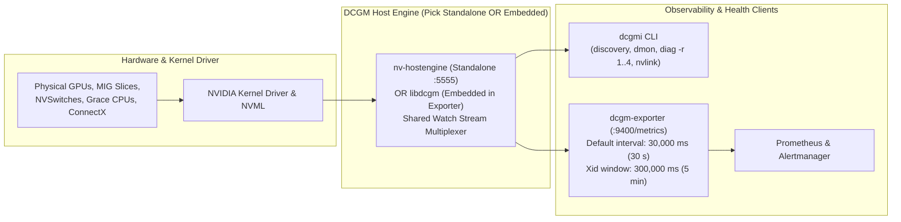
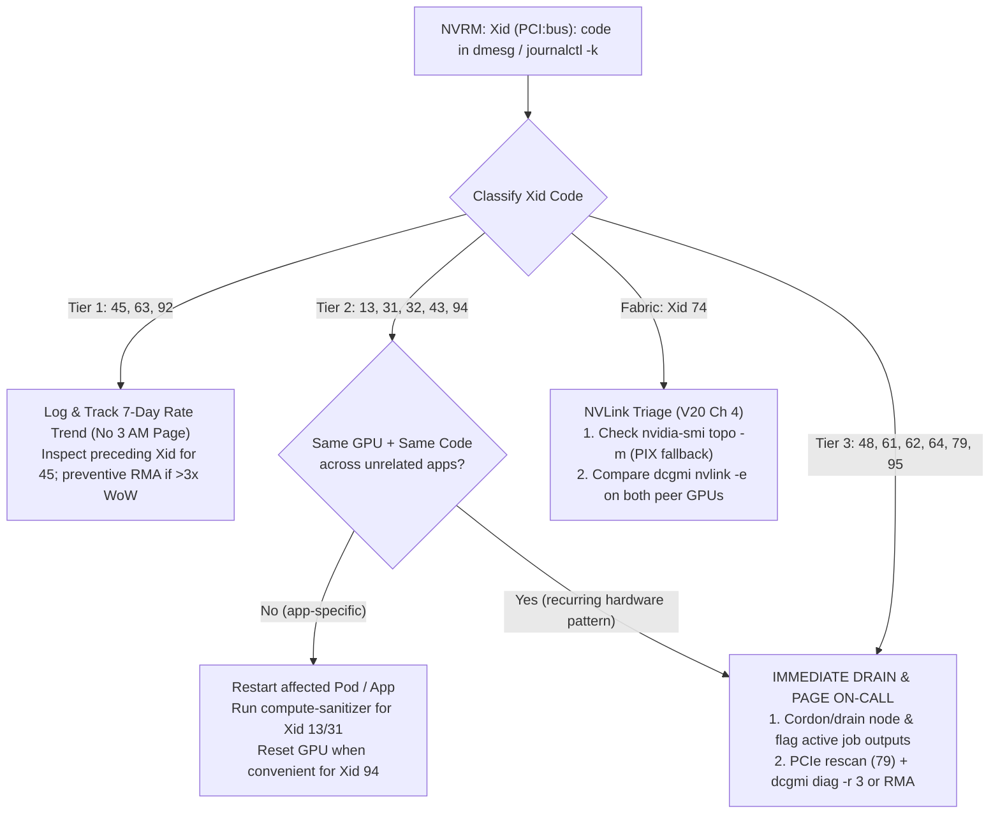

# 10.21 GPU health: DCGM, ECC, row remapping and Xid

| | |
|---|---|
| Level | Advanced |
| Priority tier | 1 |
| Lab venue | Nebius GPU |
| Part | Part 10: The GPU and CUDA |
| Sources used | `nvidia-devops` Volume 16 (*GPU Observability and Operational Health*, Chapters 1–12 & Labs 01–04), Volume 20 (*Troubleshooting Encyclopedia*, Chapters 1–12 & Labs 01–04), and Masterclass Volume 04 Chapter 3 (`volume-04/03-gpu-sharing-telemetry-masterclass.md`); *AI Systems Performance Engineering* (`ai-systems-performance-engineering`, Chris Fregly) |
| Code | `code/part10/gpu_health_dcgm_xid.py`, `code/part10/gpu_health_dcgm_xid_lab.py` |
| Coverage file | `planning/coverage/chapters/10-21.md` |

## Why this matters for AI infrastructure

In a synchronous multi-node LLM training job across `1,000+` GPUs, the failure or silent degradation of a **single GPU** halts the entire training cluster and forces every rank to roll back to the last checkpoint (`nvidia-devops` Masterclass Volume 04 Chapter 3, *Blast Radius Analysis*). Operating an AI Factory reliably requires distinguishing three classes of GPU events in seconds:

1. **Self-healing or precursor hardware signals (`Tier 1`: `Xid 45`, `Xid 63`, `Xid 92`):** A single-bit bit flip in HBM is corrected on the fly by **Error-Correcting Code (`ECC`)** (`Single-Bit Error`, `SBE`), and on Ampere/Hopper/Blackwell GPUs the degraded row is remapped to a spare row by the **Hardware Row Remapper** (`Xid 63`, `640` banks total). No job crashes and no 3 AM page should fire on a single event—yet an accelerating `SBE` rate (such as `gpu-014` jumping from **`12` to `94` events/week [`+683%`]** or climbing `12 → 31 → 58 → 94` over `6` hours in Volume 20 Chapter 2) is the leading indicator of an imminent **`Xid 79` ("GPU has fallen off the bus")** or **`Xid 48` (Double-Bit ECC error)** outage.
2. **Process-recoverable application faults (`Tier 2`: `Xid 13`, `Xid 31`, `Xid 32`, `Xid 43`, `Xid 94`):** Out-of-bounds CUDA kernel pointers (`Xid 31` page fault or `Xid 13` graphics exception) or an uncorrectable ECC error contained by hardware to one process (**`Xid 94`**) require restarting only the affected pod—unless the *same GPU* repeats the *same Tier 2 Xid* across *unrelated applications*, which escalates the GPU to `Tier 3` hardware suspicion.
3. **Unrecoverable GPU-level hardware failures (`Tier 3`: `Xid 48`, `Xid 61`, `Xid 62`, `Xid 64`, `Xid 79`, `Xid 95`, plus `Xid 74` NVLink faults):** Uncorrectable double-bit memory corruption (`Xid 48`), uncontained ECC errors (`Xid 95`), row-remapper failure (`Xid 64`), PMU microcontroller halts (`Xid 62`; GSP errors are `Xid 119`/`120`), or PCIe bus disconnects (`Xid 79`) require **immediate node cordoning and draining**, flagging checkpoints written during the fault window, and passing a **15-minute `dcgmi diag -r 3`** hardware validation before returning the GPU to service.

:::note About the tiers and the example numbers
The three-tier Xid classification (informational, application-recoverable, hardware failure) is an operating policy taken from the `nvidia-devops` Volume 20 and Volume 16 notes. It is not an NVIDIA classification, and the meanings and numbers of the Xid codes should be checked against NVIDIA's Xid catalog for your driver version before you use them in alert rules. The incident figures (`gpu-014`, `3 → 4 → 5 → 8` SBEs per week, `r = 0.81`, `71.2°C`, `12 → 94` SBE counts) come from scenario notes that are illustrative, not from real fleets. DCGM field names and numbers should be confirmed with `dcgmi dmon -l` on your installed version. Nothing here was run on a GPU host.
:::

## Prerequisites and outcomes

**Prerequisites:**
- Chapters `10.8`–`10.10` (`nvidia-smi`, driver stack, Fabric Manager) and Chapter `10.20` (profiling tools landscape).

**Outcomes — after completing this chapter you will be able to:**
1. Deploy **DCGM 4** (`datacenter-gpu-manager-4-cuda12`, standalone `nv-hostengine` port `5555` vs embedded `libdcgm` in `dcgm-exporter` port `9400`), configure watches (`30,000 ms` collect interval, `300,000 ms` Xid window), map canonical `DCGM_FI_*` fields, and run `dcgmi diag` levels `1`–`4`.
2. Interpret **ECC (`SBE` vs `DBE`, `Volatile` vs `Aggregate`)**, **Page Retirement**, and **Hardware Row Remapper** telemetry (`640` banks), and correlate `SBE` trends against temperature (`r = 0.81 >= 0.7` thermal cause vs silicon degradation).
3. Classify and remediate all **15 core Xid codes** across **Tier 1 (`45, 63, 92`)**, **Tier 2 (`13, 31, 32, 43, 94`)**, **Tier 3 (`48, 61, 62, 64, 79, 95` + GSP `119/120`)**, and **Fabric (`74`)**, including asymmetric `dcgmi nvlink -e` transceiver isolation (`184,213` CRC errors).
4. Contrast memory and fault isolation across **Time-Slicing (`replicas: 4`)**, **MPS (`20%` thread limit, `10 GB / 40 GB` Ghost OOM)**, **MIG (up to `7` instances, `0 MiB` trap on `81,920 MiB` `A100`)**, and **vGPU (`SR-IOV` + `intel_iommu=on`)**.
5. Execute safe GPU node draining (`dcgmi dmon -e 203` == `0%` → stop `nvidia-dcgm` → `rmmod`), **Known-Good Validation (`KGV`)**, and **SRE Error Budget math** (`99.0%` availability over `730 hours` = `7.3 hours/month` budget; `6.0 hours` used → `1.3 hours` left → deployment freeze).

---

## 1. NVIDIA Data Center GPU Manager (`DCGM 4`): Architecture, Watches, Fields, and Diagnostics

### 1.1 Standalone (`nv-hostengine`) vs. Embedded (`libdcgm`) architecture and shared watches (`V16 Ch 4` & `VL4 Ch 3`)

**DCGM (NVIDIA Data Center GPU Manager)** is the sensor and health daemon layer between the NVIDIA kernel driver (`NVML`) and cluster monitoring systems (`Prometheus`, `Grafana`, Kubernetes device plugins) across GPUs, MIG instances, NVSwitches, NVLinks, NVIDIA Grace CPUs, and ConnectX NICs (`nvidia-devops` Volume 16 Chapter 4, *DCGM: The GPU Metrics Foundation*, and Masterclass Volume 04 Chapter 3).



Understand three architectural rules before deploying DCGM in production (`V16 Ch 4`):
1. **Embedded vs. Standalone host engine (avoid double collection):**
   - **Embedded mode (default in `dcgm-exporter`):** `dcgm-exporter` links against `libdcgm` and initializes an embedded host engine inside its own process, serving Prometheus metrics on **`:9400/metrics`** without requiring a separate daemon.
   - **Standalone mode (`nvidia-dcgm.service`):** Runs `/usr/bin/nv-hostengine -n --service-account nvidia-dcgm` (listening on default remote port **`5555`**) to serve `dcgmi` CLI commands and remote bindings. If you run both `nvidia-dcgm.service` and `dcgm-exporter` on the same node, pass `--remote-hostengine-info localhost:5555` to `dcgm-exporter` if you want it to share the standalone daemon rather than polling the driver twice.
2. **Fields and Watches (shared-stream multiplexing and cadence cost):**
   - A **field** is a typed numeric identifier (`DCGM_FI_*`). A **watch** instructs the host engine to sample a field for an entity at a specified cadence and retention window.
   - **Multiplexing rule:** The host engine maintains **one collection stream per entity-field pair** regardless of how many clients subscribe. If Client A requests GPU 0 power every `5 s` and Client B requests GPU 0 power every `1 s`, DCGM samples at **`1 s`** and serves both clients from the same ring buffer.
   - **Default intervals and timestamps:** `dcgm-exporter`'s default collection interval is **`30,000 ms` (`30 s`)** (`-c` / `--collect-interval` or `DCGM_EXPORTER_INTERVAL`, often tuned to `-c 10000` [`10 s`] in production). Because short events between 30-second scrapes could otherwise be missed, DCGM aggregates Xid and clock-throttle counts over a configurable window (`--xid-count-window-size`, default **`300,000 ms` [`5 min`]**). Every sample carries the timestamp of *when DCGM collected it from the driver*, not when Prometheus scraped `/metrics`.
3. **Runtime GPU detach/attach behavior (DCGM `4.5+` with driver `590+`):**
   - Starting in DCGM `4.5` (with driver `590`), DCGM starts even if no GPU is present and handles runtime GPU binding/unbinding. When a GPU detaches (or falls off the bus), DCGM removes it from active groups and **stops reporting health incidents for that detached GPU**—so a missing GPU can look completely quiet unless you pair DCGM alerts with a **GPU count check** (`count(DCGM_FI_DEV_GPU_UTIL)` or `dcgmi discovery --list --all`, which marks inactive GPUs with `Status: <state>` and `(last known)`).

### 1.2 Core DCGM fields, canonical field renames, and production alert thresholds (`V16 Ch 4, Ch 8 & VL4 Ch 3`)

Current DCGM 4 documentation deprecates several legacy field names in favor of canonical names with explicit units, while `dcgm-exporter` continues to map legacy Prometheus metric names in `/etc/dcgm-exporter/default-counters.csv` to the canonical fields behind the scenes (`V16 Ch 4`):

| Category | Legacy / Exporter Field Name (ID) | Canonical DCGM 4 Field Name | Typical Range | Production Alert Threshold (`V16 Ch 4 & Ch 8`) |
|---|---|---|---|---|
| **Execution** | `DCGM_FI_DEV_GPU_UTIL` (`203`) | `DCGM_FI_DEV_GPU_UTIL_RATIO` | `0–100%` (or `0.0–1.0`) | `< 10%` for `10+ min` when jobs are scheduled; straggler alert if `max(util) - min(util) > 30%` on a node. |
| **Execution** | `DCGM_FI_PROF_SM_OCCUPANCY` | `DCGM_FI_PROF_SM_OCCUPANCY` | `0–100%` | `< 20%` (SMs under-populated; requires `--cap-add SYS_ADMIN` in container). |
| **Execution** | `DCGM_FI_PROF_PIPE_TENSOR_ACTIVE` | `DCGM_FI_PROF_PIPE_TENSOR_ACTIVE` | `0.0–1.0` ratio | Ratio of cycles Tensor Cores are active (`0` indicates fallback to scalar FP32). |
| **Clocks / Power** | `DCGM_FI_DEV_SM_CLOCK` / `MEM_CLOCK` | `DCGM_FI_DEV_SM_CLOCK_HERTZ` / `MEM_CLOCK_HERTZ` | MHz / Hz | Drop below nominal boost (e.g., `1,980 → 1,833 MHz` on `H100` or `1,410 → 1,200 MHz` on `A100`). |
| **Clocks / Power** | `DCGM_FI_DEV_CLOCK_THROTTLE_REASONS` | `DCGM_FI_DEV_CLOCK_THROTTLE_REASONS` | Bitmask (`0` = None) | Any non-zero thermal (`HW Thermal Slowdown`) or power (`HW Power Brake`) bit under load. |
| **Clocks / Power** | `DCGM_FI_DEV_POWER_USAGE` | `DCGM_FI_DEV_POWER_USAGE` | `0–TDP` Watts (`700W` H100, `300W` A100 PCIe) | `> 90%` of enforced power limit, or `< 50W` under load (`V16 Ch 9` readiness check). |
| **Clocks / Power** | `DCGM_FI_DEV_THERMAL_VIOLATION` / `POWER_VIOLATION` | `DCGM_FI_DEV_GPU_THERMAL_THROTTLE_SECONDS_TOTAL` / `..._POWER_THROTTLE_SECONDS_TOTAL` | Cumulative seconds | `increase(...[1h]) > 0` (GPU lost performance to thermal or power throttling). |
| **Memory** | `DCGM_FI_DEV_FB_FREE` / `FB_USED` / `FB_TOTAL` | `DCGM_FI_DEV_FB_FREE_BYTES` / `FB_USED_BYTES` / `FB_TOTAL_BYTES` | MiB / Bytes (`81,920 MiB` A100-80GB) | `FB_FREE < 2 GB` or `FB_USED > 95%` sustained (OOM / fragmentation stall risk). |
| **Memory** | `DCGM_FI_PROF_DRAM_ACTIVE` | `DCGM_FI_PROF_DRAM_ACTIVE` | `0–100%` | `> 95%` (HBM bandwidth saturated) or `< 20%` during memory-intensive stages. |
| **Reliability** | `DCGM_FI_DEV_GPU_TEMP` | `DCGM_FI_DEV_GPU_TEMP` | `30–90°C` | `> 80–82°C` for `5 min` (approaching `~85°C` slowdown threshold and `87–95°C` shutdown limit). |
| **Reliability** | `DCGM_FI_DEV_ECC_SBE_VOL_TOTAL` / `AGG_TOTAL` | `DCGM_FI_DEV_ECC_SBE_VOL_TOTAL` / `AGG_TOTAL` | `0–∞` count | `increase(...[1h]) > 100` (e.g., `245/hr` in `V16 Ch 8`) or `> 2x` week-over-week growth (`V20 Ch 5`). |
| **Reliability** | `DCGM_FI_DEV_ECC_DBE_VOL_TOTAL` / `AGG_TOTAL` | `DCGM_FI_DEV_ECC_DBE_VOL_TOTAL` / `AGG_TOTAL` | `0` | **`> 0` (`for: 0m` immediate page & drain — uncorrectable data corruption risk)**. |
| **Reliability** | `DCGM_FI_DEV_ROW_REMAP_FAILURE` | `DCGM_FI_DEV_ROW_REMAP_FAILURE` | `0` or `1` | **`== 1` (`for: 0m` immediate page & drain — `Xid 64` self-healing row remapper failed)**. |
| **Reliability** | `DCGM_FI_DEV_XID_ERRORS` | `DCGM_FI_DEV_XID_ERRORS` | Last Xid code (`0` = none) | Tiered alert: immediate page/drain on Tier 3 (`48, 61, 62, 64, 79, 95`), rate-track Tier 1 (`45, 63, 92`). |
| **Interconnect** | `DCGM_FI_PROF_NVLINK_TX_BYTES` / `RX_BYTES` & `..._CRC_FLIT_ERROR_COUNT_TOTAL` | Same | Bytes / Error count | `increase(DCGM_FI_DEV_NVLINK_CRC_FLIT_ERROR_COUNT_TOTAL[6h]) > 1000` (`for: 30m`, `V20 Ch 4`). |

### 1.3 Active hardware validation: `dcgmi diag` levels `1` through `4` (`V16 Ch 4` & `VL4 Ch 3`)

Passive telemetry only observes what a running workload touches. Before admitting a new or repaired node into the cluster (**Known-Good Validation [`KGV`]** in `VL4 Ch 3`), run active DCGM diagnostics (`dcgmi diag --run <level>`):
- **Level 1 (`dcgmi diag -r 1` or `-r short` / `quick`, runs in `seconds`):** Non-invasive software/deployment sanity check (verifies driver loaded, NVML reachable, device nodes present). Safe for daily readiness probes (`V16 Ch 9`).
- **Level 2 (`dcgmi diag -r 2` or `-r medium`, runs in `~2 minutes`):** Runs deployment checks plus basic hardware and memory integration checks (`V20 Ch 5`).
- **Level 3 (`dcgmi diag -r 3` or `-r long`, runs in `~15 minutes`):** Full hardware and stress validation across HBM memory, Tensor Cores, PCIe bandwidth, power delivery, and thermal stability. **Mandatory gate after any driver upgrade, RMA, or Tier 3 Xid recovery** (paired with `/opt/nccl-tests/build/all_reduce_perf -b 1G -e 8G -f 2 -g 1`). If the `Hardware (Memory)` stage reports `Fail` (`Stress: Skipped`), the GPU is a hard stop and must be RMA'd (`V20 Ch 2`).
- **Level 4 (`dcgmi diag -r 4` or `-r xlong`):** Extended burn-in stress test for new cluster commissioning.

---

## 2. ECC Memory (`SBE` vs. `DBE`), Thermal Correlation, Page Retirement, and Hardware Row Remapping

### 2.1 Single-Bit (`SBE`) vs. Double-Bit (`DBE`) ECC counters (`Volatile` vs. `Aggregate`, `V20 Ch 5`)

Enterprise NVIDIA data-center GPUs protect HBM device memory, register files, and L1/L2 caches with **Error-Correcting Code (`ECC`)** checksums (`nvidia-devops` Volume 20 Chapter 5, *ECC Errors and Memory Bit Flips*; `diagnose_ecc_trend()` in `code/part10/gpu_health_dcgm_xid.py`):
- **Single-Bit Error (`SBE`, Correctable):** When a single bit flips in an ECC word, hardware detects and corrects the bit on the fly with zero corruption and zero interruption to the running kernel.
- **Double-Bit Error (`DBE`, Uncorrectable):** When two bits flip in the same ECC word, the checksum detects the corruption but cannot reconstruct the original bits—raising **`Xid 48`** (or **`Xid 94` / `Xid 95`**) and halting the affected context.
- **`Volatile` vs. `Aggregate` counters (`nvidia-smi -i 0 -q -d ECC`):**
  - **`Volatile`:** Errors recorded since the last GPU reset or node reboot. In `V20 Ch 5`'s diagnostic example, `Device Memory: 42` + `Register File: 0` + `L1 Cache: 0` + `L2 Cache: 3` = **`45` Volatile Single-Bit Errors** and **`0` Volatile Double-Bit Errors**.
  - **`Aggregate`:** Lifetime persistent counters stored in GPU non-volatile infoROM across reboots (**`891` Aggregate Single-Bit Errors** and **`0` Aggregate Double-Bit Errors** in `V20 Ch 5`).

### 2.2 Distinguishing thermally driven `SBE` spikes from progressive silicon degradation (`r = 0.81`, `V20 Ch 5`)

A non-zero lifetime `Aggregate SBE` count (`891`) is normal physics; what matters operationally is **the velocity (rate delta) and its correlation with temperature** (`V20 Ch 5`):
- **Step 1 — Compute weekly SBE deltas:** In `V20 Ch 5`, weekly deltas of `DCGM_FI_DEV_ECC_SBE_AGG_TOTAL` over four weeks climb from **`3 → 4 → 5 → 8` SBEs/week** (cumulative `612 → 658 → 719 → 891`), a **`+167%` (`~2.7x`) increase** over the month.
- **Step 2 — Correlate against 30-day thermal history (`DCGM_FI_DEV_GPU_TEMP`):**
  - Higher thermal energy physically increases DRAM/HBM capacitor charge leakage and bit-flip probability. In `V20 Ch 5`, `avg_over_time(gpu_temperature_celsius[30d])` is **`71.2°C`**, `max_over_time` hits **`84.6°C`** (just below the `85°C` slowdown threshold), and the offline Pearson correlation between `DCGM_FI_DEV_GPU_TEMP` and `DCGM_FI_DEV_ECC_SBE_AGG_TOTAL` is **`0.81` (`> 0.7` strong correlation threshold)**.
  - **Remediation Path B (Thermal correlation `>= 0.7`):** Do **not** RMA the GPU. Fix the cooling path or lower the power cap (`nvidia-smi -pl 250 -i 0`); in `V20 Ch 5`, restoring cooling drops the daily `SBE_delta` back to **`1–2` per day**.
  - **Remediation Path C (No thermal/power correlation, e.g., `r = 0.09` or `0.12`):** When `SBE` rate accelerates (`+170%/month`, or `50` errors in `10 min` = `300/hr` in `V20 Lab 03`, or `50` in `30 min` = `100/hr` in `V20 Lab 04`) while temperatures and voltages are flat, the HBM silicon itself is degrading—schedule a **preventive RMA** before it escalates to a Tier 3 `DBE` crash.

### 2.3 Legacy Page Retirement (`PAGE_RETIREMENT`) vs. Hardware Row Remapping (`ROW_REMAPPER`, `640` banks)

When an HBM memory location repeatedly experiences ECC errors, the GPU permanently removes that location from service using one of two mechanisms (`V20 Ch 1` & `V20 Ch 5`; `evaluate_row_remapper()` in `code/part10/gpu_health_dcgm_xid.py`):

1. **Page Retirement (`nvidia-smi -i 0 -q -d PAGE_RETIREMENT`, pre-Ampere and capacity-visible retirement):**
   Blacklists whole memory pages (`Retired Pages — Single Bit ECC: 12`, `Double Bit ECC: 2`, `Pending Page Blacklist: Yes`), slightly reducing `memory.total` from nameplate capacity (`81,920 MiB` on an `A100-SXM4-80GB`).
2. **Hardware Row Remapper (`nvidia-smi -i 0 -q -d ROW_REMAPPER`, Ampere `A100`, Hopper `H100`, Blackwell `B200`):**
   Instead of retiring software-visible pages, the HBM controller remaps the degraded physical row to a built-in **spare row inside the same HBM bank** (recording **`Xid 63`** as a routine self-healing event):
   ```text
   Row Remapper (nvidia-smi -i 0 -q -d ROW_REMAPPER, V20 Ch 5)
       Correctable Error                    : 12
       Uncorrectable Error                  : 0
       Pending                              : No
       Remapping Failure Occurred           : No
       Bank Remap Availability History
           Max                              : 630
           High                             : 8
           Partial                          : 2
           Low                              : 0
           None                             : 0
   ```
   - **Reading the `640`-bank histogram:** Across all **`640` HBM banks** (`630 + 8 + 2 + 0 + 0 = 640`), **`630` banks (`98.4%`)** still have the maximum (`Max`) number of spare rows available, `8` have `High`, `2` have `Partial`, and **`0` banks** are in `Low` or `None`.
   - **When self-healing fails (`Xid 64` / `Remapping Failure Occurred: Yes`):** If a bank exhausts all of its spare rows (`None > 0`) or the hardware remap operation fails, `Remapping Failure Occurred` flips to **`Yes`** (`DCGM_FI_DEV_ROW_REMAP_FAILURE == 1`) and the driver logs **`Xid 64`**. Treat `Xid 64` as an immediate **Tier 3 GPU failure**—cordon, drain, and RMA the GPU.

---

## 3. The Authoritative 15-Code Xid Encyclopedia and 3-Tier Triage Framework

### 3.1 The 15-code Xid reference table (`V20 Ch 2`, `V16 Ch 8`, `VL4 Ch 3`)

When a GPU faults, the NVIDIA kernel driver writes `NVRM: Xid (PCI:<bus>): <code>, pid=<pid>, name=<proc>, <message>` to `dmesg` / `journalctl -k`. Always triage by the **numeric Xid code and its 3-Tier classification** (`nvidia-devops` Volume 20 Chapter 2, *GPU Driver Crash and Xid Errors*, and Volume 04 Chapter 3; `XID_ENCYCLOPEDIA` in `code/part10/gpu_health_dcgm_xid.py`):

| Xid Code | Official Meaning | Tier Classification | Recoverable? | Mandatory SRE / Operational Action (`V20 Ch 2` & `VL4 Ch 3`) |
|---:|---|---|---|---|
| **`13`** | **Graphics Engine Exception** | **Tier 2** (App-Recoverable) | Usually yes (process-level) | Illegal instruction or out-of-bounds kernel address; user debugs with `compute-sanitizer`. **Override:** Escalate to **Tier 3** if the *same GPU* repeats `Xid 13` across *unrelated applications*. |
| **`31`** | **GPU Memory Page Fault** | **Tier 2** (App-Recoverable) | Usually yes (process-level) | Out-of-bounds pointer or unallocated virtual address (`dmesg` PID lookup → terminate pod → debug with `compute-sanitizer`; *VL4 Ch 3* Node 42 storm). Escalate to **Tier 3** if recurring across unrelated apps. |
| **`32`** | **Invalid or Corrupted Push Buffer Stream** | **Tier 2** (App-Recoverable) | Usually yes | Command stream corruption between driver and GPU; restart process, but escalate if paired with PCIe AER errors. |
| **`43`** | **GPU Stopped Processing** | **Tier 2** (App-Recoverable) | Depends on root cause | Command processor hung (distinct from `Xid 79`). Xid Catalog immediate action is `IGNORE`, investigatory is `CONTACT_SUPPORT`; reset GPU and inspect preceding Xids. |
| **`45`** | **Preemptive Cleanup Due to Previous Errors** | **Tier 1** (Informational) | Yes (symptom only) | Driver cleaned up a context after an earlier fault. **Never treat `45` as the root cause**—pull a wider `journalctl -k` window to find the Xid that fired immediately before `45`. |
| **`48`** | **Double-Bit ECC Error (`DBE`, Uncorrectable)** | **Tier 3** (Hardware Failure) | **No** | **Cordon and drain node immediately.** Flag all checkpoints/outputs from jobs running on that GPU during the window as potentially corrupted; run `dcgmi diag -r 3` and RMA. |
| **`61`** | **Internal Micro-Controller Breakpoint / Warning** | **Tier 3** (Hardware Failure) | **No** | GPU firmware-level fault; cordon, drain immediately, and escalate to hardware support. |
| **`62`** | **Internal Micro-Controller Halt (`PMU` Halt)** | **Tier 3** (Hardware Failure) | **No** | Embedded PMU controller halted (Catalog: `RESET_GPU` immediate, `CONTACT_SUPPORT` investigatory; note GSP processor errors are **`Xid 119` and `120`**). Drain and RMA if it recurs. |
| **`63`** | **ECC Page Retirement / Row Remapping Recording Event** | **Tier 1** (Self-Healing) | Yes (GPU keeps running) | Hardware recorded a row remap or page retirement after a correctable ECC event (Catalog: `IGNORE`). Log and track 7-day frequency. |
| **`64`** | **ECC Page Retirement / Row Remapping Failure** | **Tier 3** (Hardware Failure) | **No** | Hardware self-healing row remapper failed (`Remapping Failure Occurred: Yes`). **Cordon, drain immediately, and RMA.** |
| **`74`** | **NVLink Error** | **Fabric / Link** | Depends on link state | Fatal NVLink error on link `N` (`V20 Ch 4`). Check `nvidia-smi topo -m` (for `NV12 → PIX` fallback), compare `dcgmi nvlink -e` counters on both ends of the link, reset GPU, and RMA the side with high CRC/replay counts if link stays `Down`. |
| **`79`** | **GPU Has Fallen Off the Bus** | **Tier 3** (Hardware Failure) | **No** (without intervention) | GPU vanished from PCIe (`lspci \| grep -i nvidia` misses device; `RmInitAdapter failed`). Cordon/drain, attempt `/sys/bus/pci/devices/.../remove` + `/sys/bus/pci/rescan`, and require `dcgmi diag -r 3` PASS or RMA. |
| **`92`** | **High Single-Bit ECC Error Rate** | **Tier 1** (Precursor Warning) | Yes for now | Elevated correctable `SBE` rate. Do not page at 3 AM for 1 event, but track 7-day trend (`> 3x` week-over-week growth triggers preventive maintenance before it cascades into `Xid 79` or `48`). |
| **`94`** | **Contained ECC Error** | **Tier 2** (App-Contained) | Partly (restart affected app) | Uncorrectable ECC error **contained by hardware to 1 application**; restart only the affected application while other processes continue, and reset GPU when convenient. Track recurrence. |
| **`95`** | **Uncontained ECC Error** | **Tier 3** (Hardware Failure) | **No** | Uncorrectable ECC error that hardware could **not** contain—data integrity across the GPU is compromised. **Same severity as `Xid 48`: cordon/drain immediately and flag job outputs.** |



### 3.2 Reading multi-Xid cascades (`Xid 92 → 45 → 79`) and asymmetric `Xid 74` NVLink counters (`V20 Ch 2 & Ch 4`)

Never read only the last line of `dmesg`. Look at the 11-second cascade captured in `nvidia-devops` Volume 20 Chapter 2 (`dmesg -T | grep -B5 -A5 "Xid"`):

```text
[Tue Aug  4 14:21:52 2026] NVRM: Xid (PCI:0000:0a:00): 92, pid=48213, name=python, High single-bit ECC error rate
[Tue Aug  4 14:21:58 2026] NVRM: Xid (PCI:0000:0a:00): 45, pid=48213, name=python, Preemptive cleanup, due to previous errors
[Tue Aug  4 14:22:03 2026] NVRM: Xid (PCI:0000:0a:00): 79, pid=48213, name=python, GPU has fallen off the bus.
[Tue Aug  4 14:22:03 2026] NVRM: GPU 0000:0a:00.0: RmInitAdapter failed
```

Querying Prometheus historical `DCGM_FI_DEV_ECC_SBE_AGG_TOTAL` for `gpu-014` (`0000:0a:00.0`) over the `6` hours prior to the crash (`08:00` to `14:00`) reveals `SBE_Count` accelerating **`12 → 31 → 58 → 94`** (`+683%` week-over-week: `94` vs `12` in the prior week). A weekly trend alert (`> 3x` week-over-week growth on Tier 1 `Xid 92`) catches `gpu-014` **two days before** the unrecoverable `Xid 79` bus disconnect.

Similarly, when **`Xid 74` (`NVLink: fatal error detected on link 2`)** fires and `nvidia-smi topo -m` shows `GPU2 ↔ GPU3` degraded from **`NV12` to `PIX`** (PCIe fallback, `10x` slower; `V20 Ch 4`), first verify `MIG Mode: Disabled` (because NVLink P2P is intentionally disabled between MIG instances by design). Next, compare `dcgmi nvlink -e` across *both* peer GPUs (`-g 2` vs `-g 3`):
- **`GPU 2` Link 2:** **`184,213` CRC Errors**, **`92,104` Replay Errors**, **`12` Recovery Errors**, `Status: Down`.
- **`GPU 3` Link 2:** **`0` CRC Errors**, **`0` Replay Errors**, **`0` Recovery Errors**, `Status: Down`.
Because `GPU 3` recorded zero errors before going down, `GPU 3` is a passive victim—isolating the physical hardware fault to **`GPU 2`'s NVLink transceiver** (or the `GPU2–GPU3` baseboard trace).

---

## 4. GPU Sharing Fault Isolation (`MIG`, `MPS`, `Time-Slicing`, `vGPU`), Safe Node Draining, and Cluster Health `SLOs`

### 4.1 Comparing memory and fault isolation across GPU sharing modes (`VL4 Ch 3` & `V20 Ch 1`)

When multiple workloads share a physical GPU, an `OOM` or `Xid` fault on one tenant can impact co-located tenants unless hardware partitioning is used (`nvidia-devops` Masterclass Volume 04 Chapter 3 & Volume 20 Chapter 1):

| Sharing Mechanism | Compute Partitioning | Memory Capacity Isolation | Hardware Fault (`Xid`) Isolation | Operational Traps & Diagnostic Signatures (`VL4 Ch 3` & `V20 Ch 1`) |
|---|---|---|---|---|
| **1. Time-Slicing (`replicas: 4`)** | OS/driver time-sliced context switching across the whole GPU | **None** (shared HBM; Linux cgroups do not govern GPU VRAM) | **None** (any fault impacts all replicas) | High context-switch jitter; one pod can allocate `100%` of HBM and OOM all 3 sibling pods. |
| **2. Multi-Process Service (`MPS`)** | Concurrent kernel execution on shared SMs via `nvidia-cuda-mps-server` (`EXCLUSIVE_PROCESS`, e.g., `set_default_active_thread_percentage 20`) | **Software limit only** (`CUDA_MPS_PINNED_DEVICE_MEM_LIMIT`) | **None** (shared single GPU context; fatal fault crashes all MPS clients) | **"The Ghost OOM on MPS" (`VL4 Ch 3` Scenario 1):** Container A crashes with `CUDA out of memory` while `nvidia-smi` shows only **`10 GB` of `40 GB`** used because `CUDA_MPS_PINNED_DEVICE_MEM_LIMIT` capped Container A (or Container B spiked between samples). |
| **3. Multi-Instance GPU (`MIG`, up to `7` instances)** | Dedicated physical SMs, L2 cache slices, and copy engines (`3g.40gb`, `2g.20gb`, `1g.10gb` on `80 GB` GPU) | **Strict hardware isolation** (dedicated HBM memory controllers per GI) | **Hardware fault isolation** (crossbar/memory isolation per MIG slice) | **The "`0 MiB` Total Memory" Trap (`V20 Ch 1`):** If `MIG Mode: Enabled` (`nvidia-smi -i 0 -mig 1`) has **zero GPU Instances (`GI`) created** (`nvidia-smi mig -lgi` empty), `nvidia-smi` reports **`0 MiB` total memory** (vs `81,920 MiB` on a healthy `A100-SXM4-80GB`) and apps fail with `OOM`. Also note: **NVLink P2P is disabled under MIG by design (`V20 Ch 4`)**. |
| **4. Virtual GPU (`vGPU`)** | Hypervisor-mediated VF scheduling (`SR-IOV` + `VFIO`) | **Strict per-VM framebuffer split** | **VM-level isolation** (requires NVIDIA DLS/CLS license server) | Host BIOS must enable **`SR-IOV`** and **`VT-d` / `IOMMU`**, and host kernel cmdline must set **`intel_iommu=on`** or **`amd_iommu=on`**. |

### 4.2 Safe GPU node draining and Cluster Health `SLIs` / `SLOs` / Error Budgets (`VL4 Ch 3` & `V16 Ch 9`)

Before upgrading drivers or servicing hardware on a GPU node, follow the **4-step safe node draining protocol** (`VL4 Ch 3`):
1. Cordon the node (`kubectl cordon $NODE`).
2. Poll DCGM field **`203` (`DCGM_FI_DEV_GPU_UTIL`)** across all GPUs (`dcgmi dmon -e 203 -c 1`) until aggregate utilization reaches **`0%`**.
3. Stop the DCGM exporter and host engine (`systemctl stop nvidia-dcgm-exporter nvidia-dcgm`) so they release open `/dev/nvidia*` file descriptors.
4. Unload the kernel modules in dependency order: `rmmod nvidia_uvm nvidia_drm nvidia_modeset nvidia`. (If a zombie CUDA context holds memory—such as dead OS PID `48213` holding **`71,234 MiB`** in `V20 Ch 1`—clear it with `fuser -k /dev/nvidia0` or `nvidia-smi --gpu-reset -i 0`.)

Finally, measure cluster health using user-visible **Service Level Indicators (`SLIs`)**, **Service Level Objectives (`SLOs`)**, and **Monthly Error Budgets** (`nvidia-devops` Volume 16 Chapter 9, *Health Checks and SLOs for GPU Clusters*; `evaluate_cluster_slo_budget()` in `code/part10/gpu_health_dcgm_xid.py`):
- **Enterprise GPU Cluster SLOs (`V16 Ch 9`):**
  - **GPU Availability SLO:** **`99.0%`** (`count(DCGM_FI_DEV_GPU_UTIL >= 0) / total_gpus`).
  - **All GPUs Healthy SLO:** **`98.0%`** (up to `2%` of GPUs offline/degraded; daily readiness probe verifies `nvidia-smi -q` responds, `temp <= 82°C`, `power > 50 W` under load, `uncorrected ECC == 0`, and `dcgmi diag -r 1` `PASS`).
  - **Job Completion Rate SLO:** **`99.5%`** (`1` in `200` jobs may fail due to hardware).
  - **Sustained Training Throughput SLO:** **`p50 >= 2,000 samples/sec`**, **`p99 >= 1,900 samples/sec`**.
- **Monthly Error Budget Math (`730 hours/month`):**
  ```text
  Error Budget = (1 - SLO) * 730 hours = (1 - 0.99) * 730 = 7.3 hours/month
  ```
  In `V16 Ch 9`'s August tracking example (`1.5 h` planned firmware upgrade + `2.0 h` unplanned GPU failure + `2.0 h` planned network maintenance + `0.5 h` thermal incident = **`6.0 hours` used**), only **`1.3 hours` of error budget remain**—automatically triggering a **deployment/change freeze** until the monthly budget resets.
- **Four-Level Alert Escalation Hierarchy (`V16 Ch 9`):**
  - **Level 1 (`Advisory`):** GPU temp trending toward `80°C` → monitor, no page.
  - **Level 2 (`Warning`):** `1` GPU offline `> 1 hour` → schedule investigation/replacement during business hours.
  - **Level 3 (`Critical — SLO at risk`):** `> 5` GPUs offline or cluster availability **`< 98%`** → page on-call engineer immediately and execute runbook.
  - **Level 4 (`Catastrophic — SLO violated`):** Cluster availability **`< 95%`** → incident commander escalation.

---

## 5. Commands and Configurations That Matter

All commands below follow `nvidia-devops` Volume 16, Volume 20, and Masterclass Volume 04 Chapter 3. Commands that require an attached NVIDIA GPU node are marked **(untested here)**.

### 5.1 Install and verify DCGM 4, run `dcgmi diag`, inspect ECC & Row Remapper, and triage Xids (untested here)

```bash
# 1. Install DCGM 4 matching the driver's CUDA major version and start services (V16 Ch 4 & Lab 01) (untested here)
nvidia-smi -q | grep -E 'Driver Version|CUDA Version'
CUDA_VERSION=12
sudo apt-get update && sudo apt-get install --yes --install-recommends \
     datacenter-gpu-manager-4-cuda${CUDA_VERSION} datacenter-gpu-manager-exporter
sudo systemctl enable --now nvidia-dcgm nvidia-dcgm-exporter
dcgmi discovery --list --all
curl -s http://localhost:9400/metrics | head -n 40

# 2. Sample live fields (100=SM clock, 101=Mem clock, 203=GPU util) and run Level 1 / Level 3 diagnostics (untested here)
dcgmi dmon --field-id 100,101,203 --count 10
dcgmi diag --run 1
dcgmi diag --run 3 -i 0

# 3. Inspect Volatile/Aggregate ECC counters, Page Retirement, Row Remapper (640 banks), and NVLink errors (untested here)
nvidia-smi -i 0 -q -d ECC,PAGE_RETIREMENT,ROW_REMAPPER
dcgmi nvlink -e -g 0
dmesg -T | grep -B5 -A5 "Xid" | tail -n 60
```

---

## 6. How It Fails: Six DCGM, ECC, Row Remapper, MIG, and Xid Operational Failure Modes

| # | Failure Mode | Production / Telemetry Symptom | Root Cause | Fix |
|---|---|---|---|---|
| **1** | **Silent DCGM blind spot when a GPU detaches (`Xid 79`) or `nvidia-dcgm` stops** | Prometheus shows zero active health alerts on `gpu-node-14`, yet jobs fail with `No devices were found` or only `3` of `4` GPUs appear in dashboards (`V16 Ch 4`). | When a GPU detaches (DCGM 4.5+) or `dcgm-exporter` dies, DCGM drops watches on the detached GPU and reports no health incidents for it (*V16* Ch 4). | Alert on `up{job="dcgm"} == 0` and `count(DCGM_FI_DEV_GPU_UTIL) < expected_gpu_count`, and run `dcgmi discovery --list --all` plus `journalctl -k` for `NVRM: Xid`. |
| **2** | **`nvidia-smi` reports `0 MiB` total memory on a healthy `81,920 MiB` `A100` (`V20 Ch 1`)** | Pods crash immediately with `CUDA_ERROR_OUT_OF_MEMORY`; `nvidia-smi` shows `memory.total = 0 MiB` on `GPU 0` while `GPU 1` shows `81920 MiB`. | `MIG Mode` is `Enabled` on `GPU 0` (`nvidia-smi -i 0 -q`), but zero GPU Instances (`GI`) have been created (`nvidia-smi mig -lgi` is empty; *V20* Ch 1). | Either create the intended MIG instances (`sudo nvidia-smi mig -cgi 9,9 -C` for two `3g.40gb` slices) or disable MIG (`sudo nvidia-smi -i 0 -mig 0 && sudo nvidia-smi -i 0 --gpu-reset`). |
| **3** | **RMA'ing a GPU for thermally induced `SBE` bit flips (`r = 0.81`, `V20 Ch 5`)** | Weekly `DCGM_FI_DEV_ECC_SBE_AGG_TOTAL` delta climbs `3 → 4 → 5 → 8` (`+167%`), triggering a hardware replacement ticket despite `Remapping Failure Occurred: No` and `630/640` banks at `Max`. | High operating temperature (`84.6°C` peak, `0.81` correlation with SBE rate) physically increases DRAM bit-flip rates on an otherwise healthy HBM die (*V20* Ch 5). | Correlate `DCGM_FI_DEV_GPU_TEMP` with SBE rate first; if `r >= 0.7`, fix airflow/cooling or cap power (`nvidia-smi -pl`) and verify SBE delta returns to `1–2/day`. |
| **4** | **Ignoring Tier 1 `Xid 92` / `Xid 45` precursors before an `Xid 79` crash (`V20 Ch 2`)** | Node suddenly crashes mid-training with `Xid 79 (GPU has fallen off the bus)` and `RmInitAdapter failed`. | Operators filtered out Tier 1 `Xid 92` (`High single-bit ECC rate`) and `Xid 45` (`Preemptive cleanup`), missing a `+683%` weekly surge (`12 → 94` SBEs) over the preceding 6 hours (*V20* Ch 2). | Track 7-day per-GPU counts of Tier 1 Xids (`45, 63, 92`) from kernel logs and schedule preventive maintenance whenever week-over-week rate grows `> 3x`. |
| **5** | **Returning a `Tier 3` (`Xid 48 / 95 / 64`) GPU to service after a simple `--gpu-reset`** | Training job silently produces NaN weights or corrupted checkpoints after an on-call engineer runs `nvidia-smi --gpu-reset` following `Xid 48` or `Xid 64`. | `Xid 48`/`95` indicates uncorrectable memory corruption, and `Xid 64` indicates the hardware row remapper itself failed (`Remapping Failure Occurred: Yes`); `--gpu-reset` only clears volatile state so diagnostics can run (*V20* Ch 2 & Ch 5). | Immediately cordon/drain on any Tier 3 Xid (`48, 61, 62, 64, 79, 95`), flag checkpoints written during the fault window as untrusted, and require `dcgmi diag -r 3` `PASS` across all stages before uncordoning. |
| **6** | **Treating a recurring `Tier 2` (`Xid 13 / 31`) on one GPU across different apps as a user bug** | Three different teams' jobs fail with `Xid 31` or `Xid 13` whenever scheduled onto `GPU 2` of `node-07`, while running cleanly on all other nodes. | A damaged SM execution unit, MMU, or DMA engine on `GPU 2` is manifesting as process-level exceptions (*V20* Ch 2). | Override `Tier 2` classification to **`Tier 3`** whenever the *same GPU* emits the *same Tier 2 Xid* across *unrelated applications*; drain the node and run `dcgmi diag -r 3`. |

---

## 7. Hands-On Lab: Verify DCGM Configs, the 15-Code Xid Triage Engine, ECC Thermal Correlation, 640-Bank Row Remapper, and Cluster SLO Error Budgets

**Venue:** Any Linux machine or Nebius GPU VM with Python 3.10+ (runs deterministically using standard library Python; all `dcgmi`, `nvidia-smi`, and `dmesg` commands are provided in Section 5 and marked `(untested here)`).

Run `code/part10/gpu_health_dcgm_xid_lab.py`:

```bash
python3 code/part10/gpu_health_dcgm_xid_lab.py
```

Expected output (`25 passed, 0 failed`):

```text
=== Chapter 10.21 Lab: GPU Health — DCGM, ECC, Row Remapping & Xid (V16 + V20 + VL4 Ch3) ===
  [PASS] V16 Ch4 DCGM ports & intervals: Exporter default port == 9400, standalone hostengine port == 5555, collect interval == 30,000 ms (30 s), Xid window == 300,000 ms (5 min)
  [PASS] V16 Ch4 DCGM 4 host requirements & field 203: Requires >= 16 GB host RAM; field 203 is DCGM_FI_DEV_GPU_UTIL; dcgmi diag levels 1..4 (Level 2 ~2 min, Level 3 ~15 min)
  [PASS] V20 Ch2 Authoritative 15-code Xid Table: Tier 1 == {45, 63, 92}, Tier 2 == {13, 31, 32, 43, 94}, Tier 3 == {48, 61, 62, 64, 79, 95}, Fabric == {74}
  [PASS] V20 Ch2 Xid 92 weekly trend (gpu-014: 12 -> 94): +683.3% (~+683%, >3x week-over-week) triggers preventive maintenance escalation without 3 AM paging
  [PASS] V20 Ch2 Tier 2 recurrence override: Xid 13 or 31 is Tier 2 on a single app, but escalates to Tier 3 (immediate drain) when recurring on the same GPU across unrelated apps
  [PASS] V20 Ch2 Xid 94 (Contained ECC, Tier 2) vs Xid 48/95/79 (Tier 3): Xid 94 restarts only the affected app; Xid 48 and 79 page & drain immediately
  [PASS] V20 Ch2 Pre-failure Xid 92 -> 45 -> 79 timeline: SBE count accelerates 12 -> 31 -> 58 -> 94 over 6 hours before Xid 79 bus disconnect
  [PASS] V20 Ch5 ECC counter breakdown: 42 Device Memory SBE + 3 L2 Cache SBE == 45 Volatile SBE; 891 Aggregate SBE (612 -> 658 -> 719 -> 891); 0 DBE
  [PASS] V20 Ch5 ECC thermal correlation (r=0.81 >= 0.7 at 71.2C avg / 84.6C max): Weekly SBE delta 3 -> 8 (+167% / 2.7x) diagnoses THERMAL_DRIVEN_SBE_FIX_COOLING_FIRST
  [PASS] V20 Ch5 ECC uncorrelated climb (r=0.09 < 0.7) vs DBE > 0: Uncorrelated climb -> PROGRESSIVE_SILICON_DEGRADATION_PREVENTIVE_RMA; DBE > 0 -> UNCORRECTABLE_DBE_TIER3_DRAIN
  [PASS] V20 Ch5 Row Remapper histogram: 630 Max (98.4%) + 8 High + 2 Partial + 0 Low + 0 None == 640 total HBM banks; 12 correctable rows remapped, Remapping Failure Occurred == No (Tier 1)
  [PASS] V20 Ch5 Row Remapper exhaustion (Xid 64, row_remap_failure == 1): Remapping Failure Occurred == Yes escalates to Tier 3 Drain & RMA
  [PASS] V20 Ch1 A100-SXM4-80GB memory diagnostics: Nameplate == 81,920 MiB (2,048 MiB used + 79,872 MiB free); MIG with 0 instances reports 0 MiB; max MIG instances == 7
  [PASS] V20 Ch1 Page Retirement & Zombie PID: 142 aggregate SBE / 3 DBE retires 12 SBE + 2 DBE pages (14 pages); zombie PID 48213 holds 71,234 MiB
  [PASS] V20 Ch4 NVLink Xid 74 asymmetric isolation: GPU 2 Link 2 has 184,213 CRC + 92,104 Replay + 12 Recovery errors while GPU 3 has 0 errors (isolates fault to GPU 2 transceiver)
  [PASS] V16 Ch9 Cluster SLO Error Budget: 99.0% availability over 730 hours == 7.3 hours/month budget; 1.5 + 2.0 + 2.0 + 0.5 == 6.0 hours used, 1.3 hours remaining -> freeze deployments
  [PASS] VL4 Ch3 GPU Sharing & MPS Ghost OOM: Time-slicing replicas=4, MPS thread limit=20%, MPS Ghost OOM at 10 GB / 40 GB, MIG profiles 3g.40gb + 2g.20gb + 1g.10gb (6/7 SMs, 70 GB)
  [PASS] Rejects unknown Xid code in triage helper
  [PASS] Rejects negative prior_week_count in Xid triage helper
  [PASS] Rejects negative bank bucket count in row remapper evaluator
  [PASS] Rejects non-positive week1_sbe_delta in ECC trend analyzer
  [PASS] Rejects invalid availability_slo_pct >= 100 in SLO budget calculator
  [PASS] V16 Ch8 Leading-indicator alert thresholds: Temp > 82C for 5 min (85C limit, 1410 -> 1200 MHz clock drop to 70% throughput), SBE > 100/hr (245/hr example), FB_USED > 95% (28.4 GB alloc / 39.8 GB res = 11.4 GB frag)
  [PASS] V16 Ch8 Straggler GPU threshold: max(util) - min(util) > 30% (e.g. 85% at 1410 MHz vs 48% at 900 MHz = 37% gap)
  [PASS] VL4 Ch3 GSP Xid codes & DCGM 4.5 driver: GSP errors are Xid 119 and 120; DCGM 4.5 + driver 590 supports runtime GPU bind/unbind

Summary: 25 passed, 0 failed (total 25)
```

---

## Exercises

1. **DCGM 4 architecture, watch multiplexing, and `dcgmi diag` levels (`V16 Ch 4`):** State (a) the difference between embedded `libdcgm` inside `dcgm-exporter` (port `9400`) and standalone `nv-hostengine` (port `5555`), (b) the sampling rate chosen by DCGM when two clients watch the same field at `5 s` and `1 s` intervals, plus `dcgm-exporter`'s default collection interval (`ms`) and Xid window size (`ms`), and (c) the duration and purpose of `dcgmi diag` levels `1`, `2`, `3`, and `4`.
2. **Classifying all 15 Xid codes across Tiers 1, 2, 3, and Fabric (`V20 Ch 2`):** Partition the 15 Xid codes (`13, 31, 32, 43, 45, 48, 61, 62, 63, 64, 74, 79, 92, 94, 95`) into **Tier 1**, **Tier 2**, **Tier 3**, and **Fabric**, explain the difference between **`Xid 79`**, **`Xid 94`**, and **`Xid 48`/`95`**, and explain when a Tier 2 code (`Xid 13` or `31`) must be escalated to Tier 3.
3. **ECC `SBE` rate trends and thermal correlation (`V20 Ch 5`):** Given `Device Memory SBE = 42`, `L2 Cache SBE = 3`, `Aggregate SBE = 891`, `DBE = 0`, and weekly `SBE` deltas rising `3 → 4 → 5 → 8`, calculate (a) the total Volatile `SBE` count and the percentage/ratio increase from Week 1 to Week 4, and (b) how your remediation differs when the 30-day correlation with `DCGM_FI_DEV_GPU_TEMP` is `r = 0.81` (`max = 84.6°C`) versus `r = 0.09`.
4. **Auditing the 640-bank Hardware Row Remapper (`ROW_REMAPPER`) vs Page Retirement (`V20 Ch 1 & Ch 5`):** Given `Bank Remap Availability History` buckets `Max = 630, High = 8, Partial = 2, Low = 0, None = 0` (`Correctable Error = 12, Remapping Failure Occurred = No`), calculate the total number of HBM banks, explain how `Xid 63` differs from `Xid 64` (`DCGM_FI_DEV_ROW_REMAP_FAILURE == 1`), and explain why `MIG Mode: Enabled` with `0` instances causes `nvidia-smi` to report `0 MiB` on an `81,920 MiB` `A100`.
5. **Isolating an `Xid 74` NVLink failure across peer GPUs (`V20 Ch 4`):** `nvidia-smi topo -m` shows `GPU2 ↔ GPU3` degraded from `NV12` to `PIX`, and `dmesg` logs `Xid 74` on link `2`. Given `dcgmi nvlink -e` showing `184,213` CRC errors and `92,104` replay errors on `GPU 2` Link 2 versus `0` errors on `GPU 3` Link 2, explain how you rule out MIG first and which physical component must be serviced.
6. **Cluster Health `SLOs`, Monthly Error Budgets, and Safe Node Draining (`V16 Ch 9` & `VL4 Ch 3`):** For a GPU cluster with a `99.0%` availability SLO over a `730`-hour month that has experienced `1.5 h`, `2.0 h`, `2.0 h`, and `0.5 h` of downtime, calculate (a) the total monthly error budget (`hours`), used budget (`hours`), and remaining budget (`hours`), (b) the 5 checks in the daily per-GPU readiness script, and (c) the 4 steps to safely drain a GPU node and unload `nvidia` kernel modules without rebooting.

---

## Checkpoint questions (20)

<details>
<summary><strong>1. How does DCGM's embedded host engine (`dcgm-exporter`) differ from the standalone `nv-hostengine` (`nvidia-dcgm.service`), and why shouldn't you run two independent host engines polling the same GPUs?</strong></summary>

In **embedded mode** (the default for `dcgm-exporter` on port **`9400`**), `libdcgm` runs inside the exporter process. In **standalone mode**, `nvidia-dcgm.service` runs `/usr/bin/nv-hostengine` (default remote port **`5555`**) to serve `dcgmi` and remote clients. Running both independently without `--remote-hostengine-info` duplicates driver polling for the same fields (*V16* Ch 4).
</details>

<details>
<summary><strong>2. How does DCGM multiplex field watches across multiple clients, and what are `dcgm-exporter`'s default collection interval and Xid window size?</strong></summary>

DCGM collects **one shared stream per entity-field pair** at the shortest requested interval (e.g., if two clients ask for GPU 0 power at `5 s` and `1 s`, DCGM collects at **`1 s`** and serves both from the shared cache). `dcgm-exporter` defaults to a **`30,000 ms` (`30 s`)** collection interval (`-c` / `DCGM_EXPORTER_INTERVAL`) and a **`300,000 ms` (`5 min`)** `--xid-count-window-size` so short Xid or throttle events between scrapes are not missed (*V16* Ch 4).
</details>

<details>
<summary><strong>3. What happens in DCGM `4.5+` (driver `590+`) when a GPU detaches at runtime, and how do you prevent a missing GPU from going unnoticed?</strong></summary>

When a GPU detaches, DCGM removes it from active groups, drops its watches, and **stops reporting health incidents for that GPU**—making a detached GPU look quiet. Pair DCGM alerts with a **GPU count check** (`count(DCGM_FI_DEV_GPU_UTIL) < expected_gpus`) and run `dcgmi discovery --list --all`, which lists inactive GPUs with `Status: <state>` and `(last known)` (*V16* Ch 4).
</details>

<details>
<summary><strong>4. Summarize the four diagnostic levels of `dcgmi diag --run <1..4>` and state when each is used.</strong></summary>

- **Level 1 (`-r 1` / `short`, `seconds`):** Non-invasive software/deployment check for daily readiness probes.
- **Level 2 (`-r 2` / `medium`, `~2 minutes`):** Deployment + basic hardware/memory integration checks.
- **Level 3 (`-r 3` / `long`, `~15 minutes`):** Invasive hardware and stress suite (memory, PCIe, power, thermals); mandatory **Known-Good Validation (`KGV`)** gate before returning a repaired or Tier 3 Xid GPU to production.
- **Level 4 (`-r 4` / `xlong`):** Extended burn-in test for new cluster acceptance (*V16* Ch 4 & *VL4* Ch 3).
</details>

<details>
<summary><strong>5. Contrast Single-Bit (`SBE`) and Double-Bit (`DBE`) ECC memory errors, and explain the difference between `Volatile` and `Aggregate` ECC counters.</strong></summary>

- **`SBE` (Correctable):** Hardware detects and fixes a 1-bit flip on the fly without crashing the job (`Tier 1`).
- **`DBE` (Uncorrectable):** A 2-bit flip cannot be reconstructed by ECC math, raising **`Xid 48`** (`Tier 3`) and halting execution.
- **`Volatile` counters** reset on GPU reset or reboot (`42` Device Memory + `3` L2 Cache = `45` Volatile SBE in *V20* Ch 5), whereas **`Aggregate` counters** persist across reboots in the GPU's non-volatile infoROM (`891` Aggregate SBE in *V20* Ch 5) (*V20* Ch 5).
</details>

<details>
<summary><strong>6. If a GPU's weekly `SBE` delta climbs from `3` to `8` (`+167%`), why must you correlate `DCGM_FI_DEV_ECC_SBE_AGG_TOTAL` with `DCGM_FI_DEV_GPU_TEMP` before ordering an RMA?</strong></summary>

Elevated temperature (`84.6°C` peak in *V20* Ch 5) physically increases DRAM/HBM capacitor bit-flip rates. A strong positive correlation (**`r = 0.81 > 0.7`**) proves the rising `SBE` rate is environmentally driven by heat—fixing cooling or lowering power (`nvidia-smi -pl`) restores the `SBE` delta to `1–2/day` without replacing hardware. Only when `SBE` rate accelerates with **no thermal/power correlation** (`r = 0.09`) does it indicate progressive silicon degradation requiring preventive RMA (*V20* Ch 5).
</details>

<details>
<summary><strong>7. How does the Ampere/Hopper/Blackwell Hardware Row Remapper (`nvidia-smi -q -d ROW_REMAPPER`) differ from legacy Page Retirement (`PAGE_RETIREMENT`), and how do you read its `640`-bank histogram?</strong></summary>

Legacy **Page Retirement** blacklists memory pages in software (`12` SBE + `2` DBE retired pages in *V20* Ch 1), slightly shrinking `memory.total`. The **Hardware Row Remapper** remaps a degraded HBM row to a spare row inside the same HBM bank in hardware (`Xid 63`) without reducing usable capacity. In *V20* Ch 5, `630 Max + 8 High + 2 Partial + 0 Low + 0 None =` **`640` total banks**, showing `630` banks still have maximum spare rows and `Remapping Failure Occurred: No` (*V20* Ch 1 & Ch 5).
</details>

<details>
<summary><strong>8. What is the operational difference between `Xid 63` and `Xid 64`?</strong></summary>

- **`Xid 63` (`Tier 1`, `IGNORE`):** Informational event logged when the GPU records a routine page retirement or row remap after a correctable ECC event.
- **`Xid 64` (`Tier 3`, `Drain & RMA`):** Fatal failure logged when the row remapper or page retirement mechanism itself fails or exhausts spare rows (`Remapping Failure Occurred: Yes`, `DCGM_FI_DEV_ROW_REMAP_FAILURE == 1`) (*V20* Ch 2 & Ch 5).
</details>

<details>
<summary><strong>9. List the Xid codes in Tier 1, Tier 2, and Tier 3 of the Volume 20 Chapter 2 triage framework, and state the response rule for each tier.</strong></summary>

- **Tier 1 (`45, 63, 92` — Informational / Self-Healing):** GPU keeps running; log and track 7-day rate trends (escalate to preventive maintenance if rate grows `> 3x` week-over-week).
- **Tier 2 (`13, 31, 32, 43, 94` — Process / Application-Recoverable):** Restart the affected pod/process; escalate to **Tier 3** only if the *same GPU* repeats the *same code* across *unrelated applications*.
- **Tier 3 (`48, 61, 62, 64, 79, 95` — Unrecoverable GPU Failure):** Page on-call and **cordon/drain the node immediately**; flag running job outputs (for `48`/`95`), run `dcgmi diag -r 3`, and RMA if diagnostics fail (*V20* Ch 2).
</details>

<details>
<summary><strong>10. Why does `Xid 45` appear in `dmesg`, and how did `Xid 92 → 45 → 79` unfold in the Volume 20 Chapter 2 incident?</strong></summary>

`Xid 45` (*Preemptive cleanup, due to previous errors*) is logged when the driver tears down a context after an earlier fault—it is **always a downstream symptom, never the root cause**. In *V20* Ch 2, `Xid 92` (`High single-bit ECC rate`, after 6 hours of SBEs climbing `12 → 31 → 58 → 94`) fired at `14:21:52`, followed `6` seconds later by `Xid 45` at `14:21:58`, and `5` seconds later by `Xid 79` (`GPU has fallen off the bus`) at `14:22:03` (*V20* Ch 2).
</details>

<details>
<summary><strong>11. Contrast `Xid 79`, `Xid 94`, and `Xid 95`.</strong></summary>

- **`Xid 79` (`Tier 3`):** GPU fell off the PCIe bus (`lspci` no longer sees the device).
- **`Xid 94` (`Tier 2`):** **Contained** uncorrectable ECC error; hardware isolated the fault to a single application, so only that application must be restarted while the GPU stays on the bus and other apps continue.
- **`Xid 95` (`Tier 3`):** **Uncontained** ECC error; hardware could not isolate the blast radius, requiring immediate node drain and output invalidation just like `Xid 48` (*V20* Ch 2 & Ch 7).
</details>

<details>
<summary><strong>12. What is the difference between `Xid 62` and `Xid 119`/`120`?</strong></summary>

**`Xid 62`** is an internal microcontroller (**`PMU`**) halt (`RESET_GPU` immediate action, `CONTACT_SUPPORT` investigatory action), whereas GPU System Processor (**`GSP`**) firmware errors are reported as **`Xid 119` and `Xid 120`** (*VL4* Ch 3).
</details>

<details>
<summary><strong>13. How do you triage an `Xid 31` storm on a production node (`VL4 Ch 3` Scenario 2)?</strong></summary>

1. Check if the node is part of a multi-node MPI/NCCL job that is now stalled.
2. Recognize `Xid 31` as a **GPU memory page fault** (almost always an application out-of-bounds pointer bug).
3. Extract the offending host `pid=` from `dmesg | grep NVRM` (or DCGM) and map it to the Kubernetes Pod / Slurm job.
4. Terminate the offending Pod; if the node recovers cleanly, have the developer run **`compute-sanitizer --tool=memcheck`** to locate the exact faulting source line (*VL4* Ch 3).
</details>

<details>
<summary><strong>14. When `nvidia-smi` reports `memory.total = 0 MiB` on an `81,920 MiB` `A100` (`V20 Ch 1`), what are the top two configuration root causes before suspecting hardware?</strong></summary>

1. **The MIG Trap (most common):** `MIG Mode` is `Enabled` on the GPU, but zero GPU Instances (`GI`) have been created (`nvidia-smi mig -lgi` returns empty), leaving zero allocatable memory on the parent device.
2. **The Driver/Library Mismatch Trap:** The user-space `libnvidia-ml.so` (e.g., `545.23.08` baked into a container) does not match the host kernel module `nvidia.ko` (`550.90.07` in `/proc/driver/nvidia/version`) (*V20* Ch 1).
</details>

<details>
<summary><strong>15. What causes the "Ghost OOM on MPS" (`VL4 Ch 3` Scenario 1) where Container A crashes with `CUDA out of memory` while `nvidia-smi` shows only `10 GB` of `40 GB` used?</strong></summary>

Under **MPS**, all clients share a single GPU context, and a per-client memory cap (**`CUDA_MPS_PINNED_DEVICE_MEM_LIMIT`** or `set_default_device_pinned_mem_limit` in `nvidia-cuda-mps-control`) can reject Container A's allocation at `10 GB` even when `30 GB` of physical HBM is free (or Container B briefly spiked between `nvidia-smi` polls). Migrating to **MIG** provides hardware-enforced memory controller partitioning (*VL4* Ch 3).
</details>

<details>
<summary><strong>16. How do you recover a GPU after `Xid 79` ("GPU has fallen off the bus") without rebooting the host, and what gate must pass before uncordoning?</strong></summary>

After cordoning and draining the node, remove the PCIe device node and trigger a bus rescan:
`echo 1 > /sys/bus/pci/devices/0000:0a:00.0/remove && sleep 3 && echo 1 > /sys/bus/pci/rescan`.
Verify the GPU re-enumerates in `lspci -vvv` at full link speed/width (`Gen4/Gen5 x16`, not down-trained to `Gen3 x8` or `x1`), reload `nvidia` if needed, and require **`dcgmi diag -r 3`** to pass all stages (`Deployment`, `Integration`, `Hardware`, `Stress`) before uncordoning (*V20* Ch 2 & Ch 7).
</details>

<details>
<summary><strong>17. In Volume 20 Chapter 4, how do asymmetric `dcgmi nvlink -e` counters isolate which of two GPUs caused an `Xid 74` NVLink link-down?</strong></summary>

Inspecting `dcgmi nvlink -e` on both ends of the failed `GPU 2 ↔ GPU 3` link (`Link 2`) showed **`184,213` CRC errors, `92,104` replay errors, and `12` recovery errors on `GPU 2`** versus **`0` errors on `GPU 3`**. Because `GPU 3` accumulated zero errors before going `Down`, `GPU 3` is healthy and the physical fault is isolated to **`GPU 2`'s NVLink transceiver** (or baseboard trace) (*V20* Ch 4).
</details>

<details>
<summary><strong>18. What is the exact 4-step command sequence to safely drain a GPU node and unload NVIDIA kernel modules for a live driver upgrade (`VL4 Ch 3`)?</strong></summary>

1. `kubectl cordon $NODE`
2. Poll `dcgmi dmon -e 203 -c 1` until aggregate GPU utilization across all GPUs on `$NODE` equals **`0%`**.
3. `systemctl stop nvidia-dcgm-exporter nvidia-dcgm` (releases open `/dev/nvidia*` descriptors).
4. `rmmod nvidia_uvm nvidia_drm nvidia_modeset nvidia` (*VL4* Ch 3).
</details>

<details>
<summary><strong>19. Why is `GPU Utilization > 80%` a bad cluster `SLI`, and what five `SLIs`/`SLOs` does Volume 16 Chapter 9 recommend instead?</strong></summary>

Utilization is a hardware counter, not a business outcome—a GPU stuck in a spin-loop or heavy memory stall reports `80–100%` utilization while completing zero work. Volume 16 Chapter 9 recommends:
1. **GPU Availability:** **`99.0%`** (`7.3 hours/month` error budget).
2. **All GPUs Healthy:** **`98.0%`** (passing temp `<= 82°C`, power `> 50 W` under load, `0` uncorrected ECC, and `dcgmi diag -r 1`).
3. **Job Completion Rate:** **`99.5%`**.
4. **Training Throughput:** **`p50 >= 2,000 samples/sec`**, **`p99 >= 1,900 samples/sec`**.
5. **All-Reduce Latency:** Bounded collective sync duration (*V16* Ch 9).
</details>

<details>
<summary><strong>20. Walk through the monthly error-budget calculation for a `99.0%` GPU availability `SLO` (`V16 Ch 9`), and state what happens when downtime reaches `6.0` hours.</strong></summary>

Over a `730`-hour month, a `99.0%` availability SLO provides `(1 - 0.99) × 730 =` **`7.3 hours/month`** of error budget. After `1.5 h` (firmware upgrade) + `2.0 h` (node-03 GPU failure) + `2.0 h` (network maintenance) + `0.5 h` (thermal incident) = **`6.0 hours` used**, only **`1.3 hours`** remain—triggering a **freeze on non-emergency deployments and upgrades** until the next month (*V16* Ch 9).
</details>

---

## Sources and review notes

### Primary sources read in full for this chapter
- `nvidia-devops` Masterclass Volume 04, Chapter 3 (`volume-04/03-gpu-sharing-telemetry-masterclass.md`): GPU sharing (`MIG`, `MPS`, `Time-Slicing`, `vGPU`), DCGM telemetry, ECC/Xid semantics, safe node draining, Known-Good Validation, and MPS Ghost OOM / Node 42 `Xid 31` storm scenarios.
- `nvidia-devops` Volume 16 (*GPU Observability and Operational Health*) — all 17 files read in full and cited:
  - `nvidia-zero-to-hero/volume-16/index.md`
  - `nvidia-zero-to-hero/volume-16/chapter-01-why-gpu-observability-is-fundamentally-different.md`
  - `nvidia-zero-to-hero/volume-16/chapter-02-signals-metrics-logs-traces-and-evidence.md`
  - `nvidia-zero-to-hero/volume-16/chapter-03-core-gpu-metrics-and-interpretation.md`
  - `nvidia-zero-to-hero/volume-16/chapter-04-dcgm-the-gpu-metrics-foundation.md`
  - `nvidia-zero-to-hero/volume-16/chapter-05-prometheus-grafana-and-observability-dashboards.md`
  - `nvidia-zero-to-hero/volume-16/chapter-06-distributed-observability-multi-gpu-and-multi-node.md`
  - `nvidia-zero-to-hero/volume-16/chapter-07-traces-profiling-and-deep-performance-diagnosis.md`
  - `nvidia-zero-to-hero/volume-16/chapter-08-common-gpu-failure-modes-and-detection.md`
  - `nvidia-zero-to-hero/volume-16/chapter-09-health-checks-and-slos-for-gpu-clusters.md`
  - `nvidia-zero-to-hero/volume-16/chapter-10-production-troubleshooting-frameworks.md`
  - `nvidia-zero-to-hero/volume-16/chapter-11-observability-for-inference-at-scale.md`
  - `nvidia-zero-to-hero/volume-16/chapter-12-incident-response-and-postmortems.md`
  - `nvidia-zero-to-hero/volume-16/labs/lab-01-setting-up-dcgm-and-prometheus-for-gpu-monitoring.md`
  - `nvidia-zero-to-hero/volume-16/labs/lab-02-building-and-interpreting-gpu-dashboards.md`
  - `nvidia-zero-to-hero/volume-16/labs/lab-03-profiling-gpu-performance-and-optimization.md`
  - `nvidia-zero-to-hero/volume-16/labs/lab-04-incident-response-simulation.md`
- `nvidia-devops` Volume 20 (*Troubleshooting Encyclopedia*) — all 17 files read in full and cited (end-to-end multi-symptom runbooks expanded in Chapter `10.22`):
  - `nvidia-zero-to-hero/volume-20/index.md`
  - `nvidia-zero-to-hero/volume-20/chapter-01-gpu-memory-not-detected.md`
  - `nvidia-zero-to-hero/volume-20/chapter-02-gpu-driver-crash-and-xid-errors.md`
  - `nvidia-zero-to-hero/volume-20/chapter-03-nccl-timeout-and-collective-communication-failures.md`
  - `nvidia-zero-to-hero/volume-20/chapter-04-nvlink-errors-and-topology-issues.md`
  - `nvidia-zero-to-hero/volume-20/chapter-05-ecc-errors-and-memory-bit-flips.md`
  - `nvidia-zero-to-hero/volume-20/chapter-06-thermal-throttling-and-cooling-degradation.md`
  - `nvidia-zero-to-hero/volume-20/chapter-07-dma-engine-failures-and-pcie-issues.md`
  - `nvidia-zero-to-hero/volume-20/chapter-08-fan-failure-and-cooling-system-degradation.md`
  - `nvidia-zero-to-hero/volume-20/chapter-09-power-supply-issues-and-brownout-scenarios.md`
  - `nvidia-zero-to-hero/volume-20/chapter-10-clock-instability-and-frequency-scaling-problems.md`
  - `nvidia-zero-to-hero/volume-20/chapter-11-multi-gpu-imbalance-and-straggler-detection.md`
  - `nvidia-zero-to-hero/volume-20/chapter-12-cross-layer-diagnosis-when-metrics-lie.md`
  - `nvidia-zero-to-hero/volume-20/labs/lab-01-symptom-to-evidence-mapping.md`
  - `nvidia-zero-to-hero/volume-20/labs/lab-02-root-cause-analysis.md`
  - `nvidia-zero-to-hero/volume-20/labs/lab-03-production-incident-simulation.md`
  - `nvidia-zero-to-hero/volume-20/labs/lab-04-postmortem-analysis.md`
- *AI Systems Performance Engineering* (`ai-systems-performance-engineering`, Chris Fregly) — cross-referenced for NVLink/telemetry context.

### Related source files mapped in `MIGRATION_MAP.md`
- All 35 mapped files (`volume-04/03-gpu-sharing-telemetry-masterclass.md`, 17 files in `volume-16/`, and 17 files in `volume-20/`) are listed above.

### Run here
- `python3 -B code/part10/gpu_health_dcgm_xid_lab.py` (`25 passed, 0 failed`).

### Explicitly labelled inferences
- The bank percentage `630 / 640 = 98.4%` in the `ROW_REMAPPER` `Max` bucket is an exact ratio computed in `code/part10/gpu_health_dcgm_xid.py` from `nvidia-devops` Volume 20 Chapter 5.

### Not verified on live hardware
- All `dcgmi`, `nvidia-smi`, `kubectl`, and `/sys/bus/pci/rescan` commands in Section 5 are marked **(untested here)** because this environment lacks an attached GPU.

### Not in the corpus
- Redfish `/redfish/v1/Systems/.../Processors/GPU_*` BMC schemas are covered in Part 9 (`9.5`) and Part 17.

### Corrections to the author's notes
- Validation pass 2026-10-25: added the note at the top. The Xid meanings agree with the table in 10.8 (`XID_TABLE` in `code/part10/gpu_node_ops.py`), which was compared with the Volume 20 notes earlier; the tiers are the notes' policy, not NVIDIA's.
- Arithmetic checked and correct (`94 / 12 = 7.83`, which is `+683%`).
- Not re-checked line by line in this pass: the DCGM field numbers other than `203`, the temperature thresholds, and the page and figure numbers cited from the book.
- As noted in `nvidia-devops` Volume 16 Chapter 4, DCGM has no HTTP REST API on port `5555`; port `5555` is the TCP port used by `nv-hostengine` for `dcgmi`, bindings, and `--remote-hostengine-info`.
