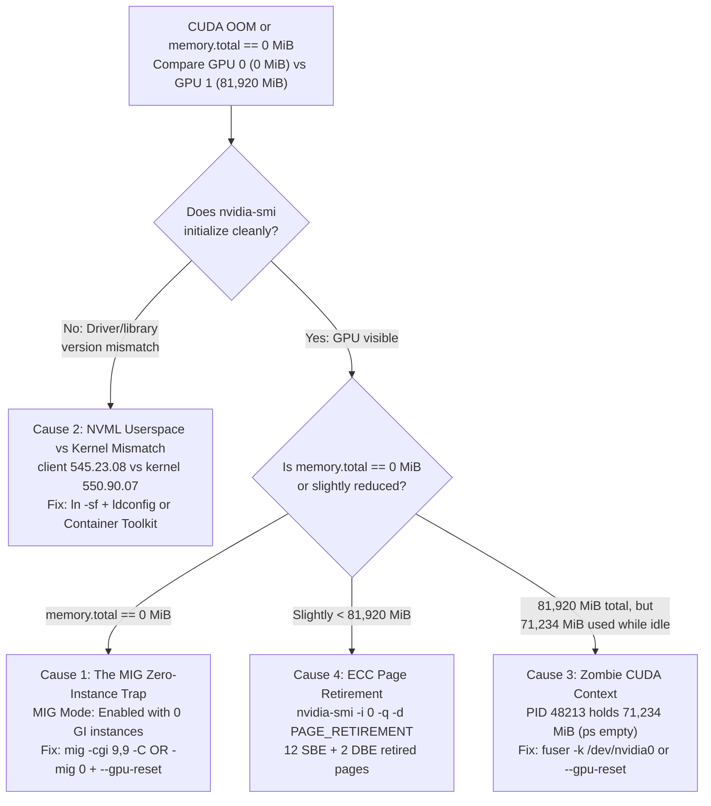
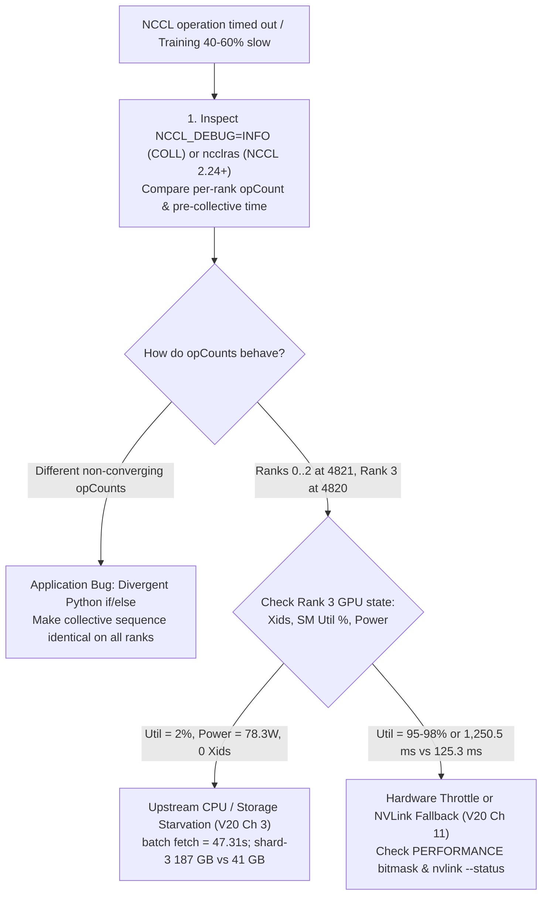

# 10.22 GPU troubleshooting scenarios

| | |
|---|---|
| Level | Advanced |
| Priority tier | 1 |
| Lab venue | Nebius GPU |
| Part | Part 10: The GPU and CUDA |
| Sources used | `nvidia-devops` Volume 20 (*Troubleshooting Encyclopedia*, Chapters 1–12 & Labs 01–04) and `src/data/troubleshooting.ts` incident runbooks; *AI Systems Performance Engineering* (`ai-systems-performance-engineering`, Chris Fregly) |
| Code | `code/part10/gpu_troubleshooting_scenarios.py`, `code/part10/gpu_troubleshooting_scenarios_lab.py` |
| Coverage file | `planning/coverage/chapters/10-22.md` |

## Why this matters for AI infrastructure

In production GPU clusters, user-reported symptoms almost never name the failing hardware or software layer (`nvidia-devops` Volume 20 Chapters 1–12):
- A data scientist reports **`CUDA_ERROR_OUT_OF_MEMORY`** on an idle `81,920 MiB` `A100` where `nvidia-smi` shows **`memory.total = 0 MiB`** (`V20 Ch 1`). Ripping the server out of the rack wastes days when the actual cause is **`MIG Mode: Enabled` with zero GPU Instances created**, a container shipping a stale **`libnvidia-ml.so.545.23.08`** against host kernel **`550.90.07`**, or a dead OS process (**PID `48213`**) holding **`71,234 MiB`** in a zombie CUDA context.
- A distributed training job crashes with **`NCCL operation timed out`** (`V20 Ch 3 & Ch 11`). Junior engineers blame the network switches; `NCCL_DEBUG=INFO` reveals that Ranks `0, 1, 2` reached **`opCount 4821`** while **Rank `3` is stuck at `opCount 4820`** with **`2%` GPU utilization** and **`78.3 W`** power draw because its `/data` volume is **`96%` full (`480G / 500G`)** and its dataset shard (`187 GB`) is **`4.56x` (`~4.5x`) larger** than Rank 0's shard (`41 GB`), stalling `next(iter(train_loader))` for **`47.31 s`**.
- A dashboard reports **`100%` GPU utilization** and `300 W` power draw, yet training throughput is **`200 samples/sec` instead of `1,000 samples/sec`** (`V20 Ch 12`, *Cross-Layer Diagnosis: When Metrics Lie*)—or attaching Nsight Systems cuts throughput from **`500` to `250 samples/sec` (`-50%` profiler Heisenbug)**.

This final chapter of Part 10 synthesizes the **12 end-to-end GPU troubleshooting runbooks** and **4 incident postmortem labs** from `nvidia-devops` Volume 20 alongside the GPU/Driver, Slurm/Enroot, DKMS, and Observability incident playbooks from `src/data/troubleshooting.ts`.

:::note About the incident numbers
The incident figures in this chapter (the `0 MiB` memory report, `opCount 4821` versus `4820`, `47.31 s`, the `750 ms` step breakdown, the `500` to `250 samples/sec` profiler effect and similar) come from `nvidia-devops` Volume 20 scenario notes and the playbook file named in the text. Those notes mark their outputs as illustrative or as constructed incidents. They teach the diagnostic order and were not captured from real systems or reproduced for this handbook. The triage priority order (data integrity, then hardware performance cause, then communication symptom) is the notes' operating policy.
:::

## Prerequisites and outcomes

**Prerequisites:**
- Chapters `10.8`–`10.10` (`nvidia-smi`, driver/container stack, Fabric Manager), Chapter `10.20` (profiling tools), and Chapter `10.21` (DCGM, ECC, row remapping, and the 15-code Xid 3-Tier framework).

**Outcomes — after completing this chapter you will be able to:**
1. Diagnose and resolve **Missing GPU Memory (`0 MiB`) and Visibility Incidents** (`MIG` zero-instance trap, `545.23.08` vs `550.90.07` NVML mismatch, zombie PID `48213` holding `71,234 MiB`, `< 81,820 MiB` pre-flight check, `kernel-patch-dkms-break`, `enroot-gpu-not-visible`, and `systemd-gpu-service-race-boot-order`).
2. Execute **Thermal, Fan, Power Brownout, and DVFS Clock Runbooks** (`1,980 → 1,833 MHz` `7.42%` clock drop at `85°C`, thermal vs power throttle bitmask proof, fan rise rate `0.05°C/s` vs `0.25–0.93°C/s`, `4 × 300 W × 1.3 = 1,560 W` PSU sizing, `10.8 V < 11.4 V` 12V sag, and `nvidia-smi -lgc 1800` DVFS lock).
3. Troubleshoot **PCIe Down-Training (`Gen4 x16 → Gen3 x8`, `2.3 GB/s`), NVLink Fallback (`NV12 → PIX`), Multi-GPU Stragglers (`10.02x` ratio), and ECC Storms (`300/hr`–`2,040/hr`)** using `lspci -vvv`, `bandwidthTest`, `NCCL_DEBUG=INFO` (`opCount`), and `nvidia-smi nvlink --status`.
4. Perform **Cross-Layer Diagnosis When Metrics Lie** (`V20 Ch 12` & `Lab 01` Ex 3): rank simultaneous failures (`Integrity > Throttle > NCCL`), run the **7-Stage Synchronous Iteration Breakdown (`750.00 ms` total, `60.0%` CPU data load)**, quantify **Profiler Heisenbugs (`-10%` `nvidia-smi` loop, `-50%` `nsys`)**, and catch false-green dashboards (`grafana-stale-healthy-dashboard`, `dcgm-scrape-target-down-masked-by-average`, `slurm-healthcheck-venv-false-green`, `selinux-gpu-monitoring-block`).

---

## 1. Runbook Family 1: Missing GPU Memory (`0 MiB`), Zombie Contexts, `DKMS`, and Container Visibility

### 1.1 The four causes of missing or unavailable GPU memory (`V20 Ch 1`)

When a workload crashes with `CUDA_ERROR_OUT_OF_MEMORY` or `cudaGetDeviceProperties()` returns `totalGlobalMem = 0` on an `NVIDIA A100-SXM4-80GB` (`81,920 MiB` nameplate capacity), follow the 4-step decision tree in `nvidia-devops` Volume 20 Chapter 1 (*GPU Memory Not Detected*):



1. **Cause 1 — The MIG Zero-Instance Trap (most common cause of `memory.total = 0 MiB`):**
   - **Evidence:** `nvidia-smi --query-gpu=index,name,memory.total,memory.used,memory.free --format=csv` shows `0, NVIDIA A100-SXM4-80GB, 0 MiB, 0 MiB, 0 MiB` on `GPU 0` while `GPU 1` shows `81920 MiB, 2048 MiB, 79872 MiB`. Running `nvidia-smi -i 0 -q | grep -A5 "MIG Mode"` shows `Current: Enabled`, and `nvidia-smi mig -lgi` prints `No MIG-enabled GPU instances found on GPU 0`.
   - **Mechanism:** When MIG mode is enabled, CUDA applications cannot allocate memory from the parent physical device—memory is exposed *only* through instantiated GPU Instances (`GI`). Also verify `CUDA_VISIBLE_DEVICES` uses the MIG UUID (`MIG-GPU-8f3a.../1/0`) rather than bare index `0`.
   - **Fix:** Either create the required instances (`sudo nvidia-smi mig -cgi 9,9 -C` to create two `3g.40gb` instances) or disable MIG (`sudo nvidia-smi -i 0 -mig 0 && sudo nvidia-smi -i 0 --gpu-reset`).
2. **Cause 2 — Userspace vs. Kernel Driver Version Mismatch (`545.23.08` vs `550.90.07`):**
   - **Evidence:** `nvidia-smi` fails with `Failed to initialize NVML: Driver/library version mismatch`, and `dmesg | grep -i nvidia` logs:
     `NVRM: API mismatch: the client has the version 545.23.08, but this kernel module has the version 550.90.07.`
   - **Fix:** Update stale userspace symlinks (`ldconfig -p | grep libnvidia-ml`, `sudo ln -sf /usr/lib/x86_64-linux-gnu/libnvidia-ml.so.550.90.07 /usr/lib/x86_64-linux-gnu/libnvidia-ml.so.1 && sudo ldconfig`), and ensure containers use the NVIDIA Container Toolkit rather than baking old `libnvidia-ml.so` libraries into the image.
3. **Cause 3 — Orphaned / Zombie CUDA Context (`PID 48213` holding `71,234 MiB`):**
   - **Evidence:** `nvidia-smi --query-compute-apps=pid,used_memory --format=csv` lists `48213, 71234`, but `ps -p 48213` returns no OS process.
   - **Fix:** Reclaim the orphaned context with `sudo fuser -k /dev/nvidia0` or `sudo nvidia-smi --gpu-reset -i 0`.
4. **Cause 4 — ECC Page Retirement (`12` SBE + `2` DBE retired pages) & Pre-Flight Capacity Gate:**
   - **Evidence:** `nvidia-smi -i 0 -q -d ECC` shows `142` Aggregate SBE and `3` Aggregate DBE, and `nvidia-smi -i 0 -q -d PAGE_RETIREMENT` shows `Single Bit ECC: 12`, `Double Bit ECC: 2`, `Pending Page Blacklist: Yes`.
   - **Prevention gate:** Before admitting any `A100-SXM4-80GB` node into scheduling, reject any GPU where `memory.total < 81,920 - 100 = 81,820 MiB` (and alert in Prometheus when `nvidia_smi_memory_total_bytes < 0.95 * nvidia_smi_memory_total_expected_bytes` for `10m`).

### 1.2 Kernel Patch `DKMS` Breaks, Missing `Enroot` Hooks, and `systemd` Boot Races (`troubleshooting.ts`)

Three closely related node/container lifecycle incidents appear in `src/data/troubleshooting.ts`:

| Incident ID (`troubleshooting.ts`) | Production Symptom | Diagnostic Evidence | Containment, Fix & Prevention |
|---|---|---|---|
| **`kernel-patch-dkms-break`** | After routine kernel errata reboot, `nvidia-smi` fails on every patched node with `Driver/library version mismatch`. | `dkms status` shows `nvidia` kernel module registered *only* against the previous kernel version; `/var/log/patch-pipeline.log` rebooted before DKMS rebuilt. | Hold remaining patch waves; run **`dkms autoinstall`** against the running kernel (`nvidia-smi` recovers without another reboot). Gate kernel upgrades + DKMS rebuild as one atomic step. |
| **`enroot-gpu-not-visible`** | Slurm `srun --container-image` job reports `no devices found`, while bare-host `nvidia-smi -L` and Kubernetes pods on the same node work fine. | `ls -l /etc/enroot/hooks.d/*nvidia*` returns no file after a BCM image update; `NVIDIA_VISIBLE_DEVICES` is unset inside the Enroot container. | Reinstall the Enroot NVIDIA hook package on the node and add `/etc/enroot/hooks.d/*nvidia*` to the golden-image validation checklist. |
| **`systemd-gpu-service-race-boot-order`** | After reboot, `gpu-health-agent.service` is permanently `Active: failed` (`StartLimitBurst` exhausted), though manual restart succeeds. | `journalctl -u gpu-health-agent -b` shows NVML init failure *before* `nvidia-persistenced.service` started; `systemd-analyze critical-chain` shows missing `After=`. | Run `systemctl reset-failed && systemctl restart gpu-health-agent`, then add **`After=nvidia-persistenced.service`** and **`Requires=nvidia-persistenced.service`** to the unit file. |

---

## 2. Runbook Family 2: Thermal Throttling, Fan Rise Rates, PSU Brownouts, and DVFS Clock Instability

### 2.1 Separating thermal throttling from power limiting (`1,980 → 1,833 MHz`, `V20 Ch 6 & Lab 02 Ex 1`)

During heavy training on an `H100 SXM5`, clocks drop from **`1,980 MHz` to `1,833 MHz` (`7.42%` [`~7%`] clock reduction**, degrading training throughput by **`15%–30%`**, or `2,000 → 1,200 samples/sec` [`-40%`] in `Lab 03` Exercise 2) while temperature sits at `80–85°C` and power draw drops from `300 W` to `245–250 W` (`V20 Ch 6` & `Lab 02` Exercise 1; `diagnose_thermal_and_fan()` in `code/part10/gpu_troubleshooting_scenarios.py`):
- **Why raw temperature, clock, and power numbers are inconclusive by themselves (`Lab 02` Ex 1):** Lowering clock frequency automatically lowers power draw (`P ∝ C × V^2 × f`), so observing `power = 250 W` (down from `300 W`) does *not* prove a power cap caused the drop.
- **The discriminating proof (`nvidia-smi -i 0 -q -d PERFORMANCE`):**
  ```text
  HW Slowdown                       : Not Active
  HW Thermal Slowdown               : Active      <-- Proves thermal throttling
  SW Thermal Slowdown               : Not Active
  SW Power Cap                      : Not Active  <-- Rules out software power limit
  HW Power Brake Slowdown           : Not Active  <-- Rules out PSU brownout brake
  ```
- **Applicability caveat for data-center GPUs (`V20 Ch 6 & Ch 8`):** `HGX`/`DGX` `SXM` modules (`H100 SXM5`, `B200`) and passively cooled PCIe cards (`H100 PCIe`, `L40S`) have **no on-board GPU fan** (`fan.speed` reports `N/A`); their cooling is driven by server chassis fans managed by the BMC (`ipmitool sdr type Fan`) or direct-to-chip liquid cooling loops. Never open a data-center GPU module to replace thermal paste in the rack—degraded thermal interfaces require a vendor RMA or field-service action.
- **Emergency threshold (`87°C` / `95°C`) and mitigation:** If GPU temperature exceeds **`87°C`** (approaching the `95°C` hardware shutdown limit), cordon/drain and power down (`sudo shutdown -h now`). As a temporary mitigation while awaiting facility/vendor repair, enable persistence mode and lower the power cap (`sudo nvidia-smi -pm 1 && sudo nvidia-smi -pl 200 -i 0`, trading `~15%–20%` throughput for stable `< 80°C` operation) or lock clocks slightly below the throttle point (`sudo nvidia-smi -i 0 -lgc <clock_mhz>`, reset with `-rgc`) to stop `75°C ↔ 87°C` boost/throttle oscillation.

### 2.2 Fan degradation, temperature rise rate (`°C/sec`), and the `2h 35m` postmortem (`V20 Ch 8, Lab 03 Ex 2 & Lab 04 Ex 1`)

On air-cooled nodes, check chassis fans via BMC (`ipmitool sdr type Fan`: e.g., `FAN1 = 0 RPM` stuck vs `FAN2 = 8,400 RPM`, `FAN3 = 8,350 RPM`) and measure the **temperature rise rate (`°C/sec`)** over a 30-to-60-second synthetic load test (`V20 Ch 8`, `Lab 03` Ex 2, and `Lab 04` Ex 1):
- **Healthy cooling baseline:** **`~0.05°C/sec`** (`0.05–0.10°C/sec`, plateauing `< 80°C` with fan speed at `70%–90%`).
- **Stuck fan or degraded thermal interface (`V20 Ch 8`):** Temperature climbs from `55°C` to `70°C` in `60 s` = **`0.25°C/sec`** (`0.20–0.30°C/sec` continuous rise).
- **Severe cooling failure (`V20 Lab 03` Ex 2 `gpu-burn 30`):** Temperature climbs from `55°C` (`0 s`) → `65°C` (`10 s`) → `75°C` (`20 s`) → `83°C` (`30 s`) = **`(83 - 55) / 30 = 0.93°C/sec`**.
- **Postmortem lesson (`V20 Lab 04` Ex 1):** A training job started at `06:00` with a degrading fan bearing (`0.05°C/min` drift), did not trip the static `85°C` threshold alert until `08:15` (**`2 hours 15 minutes` [`135 min`] detection latency**), and took `20 minutes` (`08:15 → 08:35`) to replace the fan—wasting **`2 hours 35 minutes` (`155 min`)** of cluster compute. Adding a Prometheus derivative alert:
  ```yaml
  alert: FanDegradation
  expr: deriv(gpu_temp[1m]) > 0.15
  for: 10m
  ```
  plus a weekly 30-second burn test catches fan degradation `2+` weeks before hard failure.

### 2.3 Power supply brownouts, `12V` voltage sag (`< 11.4 V`), and PSU capacity sizing (`V20 Ch 9`)

When `8` GPUs simultaneously transition from network wait to Tensor Core GEMM bursts, power demand swings by kilowatts in milliseconds (`nvidia-devops` Volume 20 Chapter 9, *Power Supply Issues and Brownout Scenarios*; `evaluate_psu_and_brownout()` in `code/part10/gpu_troubleshooting_scenarios.py`):
- **Symptoms:** `Enforced Power Limit` drops from `300 W` to `200 W` (`Power Draw: 198 W`), or a single GPU (`GPU 1`) drops to **`145 W` (`48.3%` / `~41%` of `300 W`, `45%` SM util)** while `GPU 0, 2, 3` draw `280–300 W`, accompanied by `HW Power Brake Slowdown` or `SW Power Cap` in `nvidia-smi -q -d PERFORMANCE`.
- **IPMI / BMC Voltage Sag Diagnosis (`ipmitool sensor list` & `ipmitool sel list`):**
  - Input AC rails read `PSU1_INPUT_VOLT = 209.0 V`, `PSU2_INPUT_VOLT = 211.0 V`.
  - Nominal auxiliary 12V rail is **`12.0 V ± 0.5 V` (`11.5–12.5 V`)**. Reading **`GPU_AUX_12V = 10.8 V` (`< 11.4 V` `WARN` threshold)** proves the PSU rail is sagging under peak load.
- **PSU Capacity Formula (`30%` headroom) & Node Power Cap (`80%`):**
  - For **`4 × A100` (`300 W` each)**: raw GPU draw = `4 × 300 W = 1,200 W`; with **`30%` (`1.3x`) PSU headroom**, minimum PSU capacity is `1,200 W × 1.3 =` **`1,560 W`** (so a `1,500 W` PSU is undersized; check `sudo dmidecode --type 39`).
  - Enforce a per-node GPU power budget of **`0.80 × PSU_capacity`** (e.g., capping GPUs at `260–280 W` via `sudo nvidia-smi -pl 280`) until PSUs are upgraded to `2,000–3,000 W` or cables are balanced across PSU rails.

### 2.4 DVFS clock instability (`1,980 → 1,200 → 800 MHz` at flat `65°C`, `V20 Ch 10`)

If `nvidia-smi` shows graphics clocks oscillating **`1,980 MHz → 1,200 MHz → 800 MHz → 1,980 MHz`** every `0.5–2.0 s` (`Power: 310 W → 150 W → 310 W`, `Performance State: P0 → P2/P3`, `Memory Clock: 405 MHz`) while temperature remains completely flat at **`65°C`** and all throttle reasons are `Not Active` (`V20 Ch 10`):
- **Root cause:** Bursty `DataLoader` gaps (`5 ms` pauses between batches) allow the GPU's firmware **Dynamic Voltage and Frequency Scaling (`DVFS`)** governor to downshift into power-saving P-states (`P2`/`P3`), or an operator script left a stale low clock lock (`1,000` or `1,200 MHz`).
- **Fix:** Remember that data-center GPU DVFS is controlled in GPU firmware (there is **no host BIOS setting** that disables GPU DVFS). Enable persistence mode (`sudo nvidia-smi -pm 1`), set the host CPU governor to `performance` (`/sys/devices/system/cpu/cpu0/cpufreq/scaling_governor`), clear any stale clock lock (`sudo nvidia-smi -rgc`), or lock the GPU graphics clock (`sudo nvidia-smi -i 0 -lgc 1800`). Alert if more than **`3` to `5` unique clock frequencies** appear in a 30-second window under fixed load.

---

## 3. Runbook Family 3: PCIe Down-Training, `NCCL` Stragglers, NVLink Degradation, and ECC Storms

### 3.1 PCIe link down-training (`Gen4 x16 → Gen3 x8`, `2.3 GB/s`) and DMA faults (`V20 Ch 7`)

When host-to-device copies stall or `dmesg` logs `DMAR: DRHD: processing fault logged [DMA Read]` / `pci_link_speed_mismatch: expected Gen4 x16, got Gen3 x8` (`nvidia-devops` Volume 20 Chapter 7, *DMA Engine Failures and PCIe Issues*):
1. **Check DCGM PCIe replay counter:** `dcgmi dmon -e <PCIE_REPLAY_COUNTER>` shows `GPU 0 =` **`127` replays** (while `GPU 1..3 = 0`), proving link-level retransmission due to electrical noise or a loose riser/slot.
2. **Benchmark `H2D` bandwidth (`bandwidthTest --device 0` on `33,554,432` bytes = `32 MiB`):**
   - **PCIe Gen4 x16 baseline:** Raw link rate is `~31.5 GB/s` unidirectional (`64 GB/s` bidirectional); healthy `bandwidthTest` achieves **`20–26 GB/s`** unidirectional (`22.0 GB/s` nominal baseline; weekly health gate requires **`>= 17.6 GB/s` [`0.80 × 22.0 GB/s`]**).
   - **PCIe Gen3 x16 baseline:** **`10–12 GB/s`**.
   - **Degraded measurement in `V20 Ch 7`:** **`2.3 GB/s`** (`~80%–90%` slower than expected).
3. **Inspect negotiated PCIe width/speed (`lspci -s 08:00.0 -vvv | grep -A5 "LnkCap|LnkSta"`):**
   Shows `LnkCap: Speed 16GT/s (Gen4), Width x16`, but **`LnkSta: Speed 8GT/s (Gen3), Width x8 (Down-trained)`** (or `5GT/s, Width x1` in `V16 Ch 8`).
4. **Soft PCIe link retrain:** Drain the node, then remove and rescan the PCIe device:
   `echo 1 > /sys/bus/pci/devices/0000:08:00.0/remove && sleep 3 && echo 1 > /sys/bus/pci/rescan`
   Verify `LnkSta` returns to `16GT/s, Width x16` and `bandwidthTest` recovers to `20–26 GB/s`.

### 3.2 Hunting the single straggler behind an `NCCL` timeout (`opCount 4820`, `187 GB` shard, `10.02x` ratio, `V20 Ch 3 & Ch 11`)

An `NCCL operation timed out` error almost never means all network switches failed simultaneously—it means **one rank failed to arrive at a synchronous collective** (`nvidia-devops` Volume 20 Chapters 3 & 11, and Labs 01–04; `diagnose_nccl_straggler()` in `code/part10/gpu_troubleshooting_scenarios.py`):



Walk through the two canonical straggler investigations in Volume 20:
1. **Investigation A — The Upstream Data-Pipeline Straggler (`V20 Ch 3`):**
   - **Step 1 (`NCCL_DEBUG=INFO NCCL_DEBUG_SUBSYS=COLL`):** Ranks `0, 1, 2` log `AllReduce: opCount 4821, count 268435456` (`256M` floats = `1 GiB`), while **Rank `3` logs `opCount 4820`** and never reaches `4821` (alert rule: `(max(nccl_op_count) - min(nccl_op_count)) > 2` for `3m`).
   - **Step 2 (Check Rank 3's GPU):** Process is alive, `dmesg` has `0` Xids, and `nvidia-smi` reports **`utilization.gpu = 2%`, `temp = 61°C`, `power = 78.3 W`**—proving Rank 3's GPU is starving upstream of the collective.
   - **Step 3 (Time `next(iter(train_loader))` and inspect `/data`):** Fetching one batch on Rank 3 takes **`47.31 s`** (vs `< 1 s` on Ranks `0–2`). `df -h /data` shows `storage-pv-3` at **`96%` capacity (`480G / 500G`, `20G` free)**, and `du -sh` reveals `/data/shard-3` is **`187 GB`** versus **`41 GB`** on `/data/shard-0` (**`4.56x` [`~4.5x`] shard size imbalance**).
   - **Note on collective timeouts (`V20 Ch 3`):** NCCL has no `NCCL_TIMEOUT` environment variable; the timeout belongs to PyTorch's `dist.init_process_group("nccl", timeout=datetime.timedelta(seconds=1800))`. Never set an unbounded timeout to mask a straggler.
2. **Investigation B — The `10.02x` Multi-GPU Imbalance and NVLink Link Failure (`V20 Ch 11`, `Lab 02` Ex 2 & `Lab 04` Ex 3):**
   - **Measure pre-collective time (`torch.cuda.synchronize()` *before* `dist.all_reduce`):** Measuring *after* `all_reduce` hides the straggler because fast ranks wait for the slow rank. Pre-collective timings across 4 GPUs show `[125.3 ms, 126.1 ms, 1250.5 ms, 124.8 ms]`—**`GPU 2` is `1,250.5 / 124.8 = 10.02x` slower** (daily alert threshold: **`max / min > 1.2` [`20%` imbalance]**).
   - **Localize with subset `nccl-tests` and `nvidia-smi nvlink --status`:** Because `all_reduce_perf` prints one aggregate summary row per message size (not per-rank rows), run 2-GPU subsets (`CUDA_VISIBLE_DEVICES=0,1`, `0,2`, `0,3`). On an `A100` (`NVLink 3` = **`25 GB/s` per link**, `12` links = `~600 GB/s` aggregate; warn if any link `< 20 GB/s`), `nvidia-smi nvlink --status` reveals `GPU 0 Link 3: DEGRADED (5 GB/sec)` and `GPU 2 Link 0: FAILED (0 Mbps)`.
   - **Preempting the 16-minute timeout (`V20 Lab 04` Ex 3):** When `GPU 4`'s `AllReduce` latency rose from a **`12 ms` baseline** (`10:00`) to **`30 ms`** (`10:05`, **`2.5x` baseline**) and **`100 ms`** (`10:10`), waiting for the `300 s` timeout at `10:15` wasted `16 minutes`. Alerting on **`max(nccl_allreduce_latency) / min(...) > 2.5` for `1m`** detects the degradation at `10:06` and restarts on `7` healthy GPUs by `10:08`.

### 3.3 ECC storm escalation math (`300/hr`–`2,040/hr`, `V20 Lab 03 Ex 3 & Lab 04 Ex 2`)

In `nvidia-devops` Volume 20 Lab 03 Exercise 3 and Lab 04 Exercise 2, a training job on `GPU 0` experiences an accelerating ECC storm:
- **`15:00`:** `1` ECC error (`1/hr` baseline, `92%` validation accuracy — monitor only).
- **`15:30`:** **`50` ECC errors in `30 min`** = **`100 errors/hour`** (`30x` normal; or `50` errors in `10 min` = **`300 errors/hour` [`5/min`]** in `Lab 03` Ex 3; or `1 → 5 → 12 → 21 → 35` across 4 samples = `34 errors/min` = **`2,040 errors/hour`**).
- **`16:00`:** `500` ECC errors (`300/hr`).
- **`16:15`:** `600+` ECC errors (`400/hr`), and training accuracy drops from **`92%` to `85%`** (`16:20` job stopped).
- **Automated rate-based stop policy (`Lab 04` Ex 2):**
  - **`< 1 error/hour` (`safe_rate`):** Normal cosmic-ray background; log only.
  - **`1–10 errors/hour` (`warning_rate`):** Reduce workload / schedule preventive maintenance; set a `600 s` (`10 min`) escalation timer.
  - **`> 10 errors/hour` (or `>= 100 errors/hour` `critical_rate`):** **Automatically stop the job and drain the GPU immediately** (at `15:30` in the postmortem, `45 minutes` before accuracy diverged). Remember that applications cannot carve out bad HBM addresses (`0x12345678` in `cuda_memtest`) in software—if Hardware Row Remapping did not absorb the errors, the GPU must be RMA'd.

---

## 4. Runbook Family 4: Cross-Layer Diagnosis — When Metrics Lie (`V20 Ch 12 & Lab 01`)

### 4.1 Multi-failure evidence priority (`Lab 01 Ex 3`) and the 7-stage synchronous breakdown (`750.00 ms`, `V20 Ch 12`)

When a node simultaneously exhibits ECC/Xid errors, thermal throttling, and NCCL hangs (`V20 Lab 01` Exercise 3), always triage in **strict evidence priority order**:
1. **Priority 1 — Data Integrity (`Xid 48 / 95 / 64` & `ECC` counters):** An uncorrectable memory error invalidates job outputs and requires draining the GPU regardless of thermal or network findings.
2. **Priority 2 — Hardware Performance Cause (`PERFORMANCE` throttle bitmask & `TEMP`):** Thermal or power throttling slows one rank, which is the physical cause of downstream collective delays.
3. **Priority 3 — Downstream Communication Symptom (`NCCL` `opCount` lag):** The collective hang is the consequence of the slow or dead rank.

When GPU utilization, power, and temperature all look green (`95%` util, `300 W`, `65°C`) yet end-to-end training is slow, insert synchronous `torch.cuda.synchronize()` timers around all **7 stages of a single iteration** (`nvidia-devops` Volume 20 Chapter 12, *Cross-Layer Diagnosis: When Metrics Lie*; `analyze_cross_layer_breakdown()` in `code/part10/gpu_troubleshooting_scenarios.py`):

| Iteration Stage (`V20 Ch 12`) | Hardware Layer | Reported Time (`ms`, illustrative) | Share of `750.00 ms` Step (`%`) | Diagnostic Interpretation |
|---|---|---:|---:|---|
| **1. `data_load_cpu`** | Host CPU / Storage I/O | **`450.00 ms`** | **`60.0%`** | **Primary bottleneck:** CPU data pipeline consumes `60%` of the step (`monthly baseline target < 30%`). |
| **2. `allreduce_network`** | NVLink / NIC Fabric (`NCCL`) | **`150.00 ms`** | **`20.0%`** | Secondary bottleneck (`1/5` of step in collective sync). |
| **3. `backward_gpu`** | GPU SMs / Tensor Cores | **`60.00 ms`** | **`8.0%`** | Actual GPU backward math is fast. |
| **4. `forward_gpu`** | GPU SMs / Tensor Cores | **`30.00 ms`** | **`4.0%`** | Actual GPU forward math (`forward + backward + opt + loss = 108 ms` = **`14.4%`**). |
| **5. `data_transfer_pcie`** | PCIe DMA Copy Engine | **`10.00 ms`** | **`1.3%`** | `H2D` copy is minor. |
| **6. `optimizer_gpu`** | GPU SMs | **`10.00 ms`** | **`1.3%`** | Optimizer step is fast. |
| **7. `loss_gpu`** | GPU SMs | **`8.00 ms`** | **`1.1%`** | Loss computation (`sum of 7 stages = 718.00 ms` out of **`750.00 ms`** reported step). |

### 4.2 Five classic "lying metrics" scenarios and Profiler Heisenbugs (`V20 Ch 12` & `troubleshooting.ts`)

| "Lying Metric" Scenario | What the Dashboard Claims | What Cross-Layer Evidence Proves | Root Cause & Fix (`V20 Ch 12` & `troubleshooting.ts`) |
|---|---|---|---|
| **1. The Utilization Lie (`100%` `nvidia-smi` util, `200` vs `1,000 samples/sec`)** | `nvidia-smi` and `torch.cuda.utilization()` (which reads the same NVML counter) report `95%–100%` utilization. | `nsys` timeline shows the GPU computing only **`10%` of the time** (`90%` idle between launches); CPU kernel launch rate is **`50 kernels/sec`** vs **`1,000+ kernels/sec`** expected. | NVML utilization measures whether any kernel ran during a sampling window, including launch-queue wait gaps. Fix with **CUDA Graphs** or `torch.compile`. |
| **2. The Memory Lie (`35 GB / 40 GB` used in `nvidia-smi` vs `10 GB` in profiler)** | `nvidia-smi` reports `35 GB` of `40 GB` used, triggering OOM panic alerts. | `torch.cuda.memory_stats()` shows **`10 GB` live allocated** and **`25 GB` reserved/cached** by PyTorch's caching allocator. | PyTorch retains freed blocks in its pool to avoid `cudaMalloc` syncs. Inspect `memory_allocated()` vs `memory_reserved()` instead of raw `nvidia-smi` `FB_USED`. |
| **3. The Profiler Heisenbug (`500 → 450 → 250 samples/sec`)** | Job runs at **`500 samples/sec` without a profiler**, drops to **`450 samples/sec` (`-10%`)** when polling `nvidia-smi` in a `1 s` loop, and drops to **`250 samples/sec` (`-50%`)** under `nsys profile` (or `800 → 400 samples/sec`). | High-overhead tracing changes CPU/GPU scheduling and masks the real bottleneck. | Rank tools by overhead (**`1. time.perf_counter()` [`< 1%`] → `2. DCGM` → `3. nvidia-smi` polling → `4. nsys` → `5. heavyweight CPU tools`**), audit profiler overhead quarterly (`< 10%` target), and profile a `100`-step standalone benchmark. |
| **4. The Stale Green Dashboard & Masked Fleet Average (`grafana-stale-healthy-dashboard` & `dcgm-scrape-target-down-masked-by-average`)** | Grafana GPU panels stay green for `4–6 hours`, or fleet-wide `avg(DCGM_FI_DEV_GPU_UTIL)` looks normal while a node's exporter is dead. | `curl http://prometheus:9090/api/v1/targets` shows `health: "down"` with `lastScrape` `4–6 hours` ago and `up{job="dcgm-exporter"} == 0`; `avg()` silently drops dead targets. | Alert on **`count(up{job="dcgm-exporter"} == 0) > 0`**, **`timestamp(up) - time()`**, and `absent_over_time()`, never on fleet averages alone. |
| **5. The False-Green Slurm NHC & SELinux Block (`slurm-healthcheck-venv-false-green` & `selinux-gpu-monitoring-block`)** | Slurm `sinfo` marks all nodes `idle`/`alloc` (`Reason=` empty) despite active Xids; or `dcgm-exporter` runs with zero logs while metrics stay blank after OS hardening. | Running `nhc_gpu_check.py --verbose` directly reveals `ModuleNotFoundError` swallowed by a wrapper exiting `0`; `ausearch -m avc -ts recent` + `audit2why` reveals SELinux AVC denials on GPU device nodes. | Pin and verify the NHC virtualenv (`pip check`) and fail closed (`exit 1`) on unhandled exceptions; install a supplemental SELinux policy module rather than disabling enforcement fleet-wide. |

---

## 5. Commands and Configurations That Matter

All commands below follow `nvidia-devops` Volume 20 and `src/data/troubleshooting.ts`. Commands that require an attached NVIDIA GPU node are marked **(untested here)**.

### 5.1 Multi-layer triage commands (`MIG`, `PERFORMANCE` bitmask, `PCIe` retrain, `NCCL` straggler, and `SELinux` / `DKMS`) (untested here)

```bash
# 1. Diagnose 0 MiB memory trap (MIG instances), NVML version mismatch, and zombie PIDs (V20 Ch 1) (untested here)
nvidia-smi --query-gpu=index,name,memory.total,memory.used,memory.free --format=csv
nvidia-smi -i 0 -q | grep -A5 "MIG Mode" && nvidia-smi mig -lgi
cat /proc/driver/nvidia/version && ldconfig -p | grep libnvidia-ml
nvidia-smi --query-compute-apps=pid,used_memory --format=csv

# 2. Discriminate thermal slowdown vs power cap / brownout brake & check BMC fans/12V rail (V20 Ch 6, 8, 9) (untested here)
nvidia-smi -i 0 -q -d TEMPERATURE,POWER,CLOCK,PERFORMANCE
ipmitool sdr type Fan
ipmitool sensor list | grep -iE "volt|psu|gpu_aux"

# 3. Check PCIe link negotiation (Gen4 x16 vs Gen3 x8), replay counter, and soft bus rescan (V20 Ch 7) (untested here)
lspci -s 08:00.0 -vvv | grep -A5 -E "LnkCap|LnkSta"
echo 1 > /sys/bus/pci/devices/0000:08:00.0/remove && sleep 3 && echo 1 > /sys/bus/pci/rescan

# 4. Hunt NCCL straggler opCount, check NVLink per-link status, and audit DKMS / SELinux (V20 Ch 3, 11 & troubleshooting.ts) (untested here)
NCCL_DEBUG=INFO NCCL_DEBUG_SUBSYS=COLL,INIT,NET python3 train.py 2>&1 | tee nccl_trace.log
nvidia-smi nvlink --status
dkms status && ausearch -m avc -ts recent
```

---

## 6. How It Fails: Six Classic Troubleshooting Misdiagnoses and Traps

| # | Troubleshooting Trap | What the Operator Mistakenly Does | Actual Root Cause | Evidence-Based Fix |
|---|---|---|---|---|
| **1** | **Blaming network switches or raising `init_process_group` timeout on an `NCCL` hang (`V20 Ch 3`)** | Sets `timeout=timedelta(hours=6)` or replaces network cables when `AllReduce` times out. | Ranks `0–2` are at `opCount 4821` waiting on Rank `3` (`opCount 4820`, `2%` GPU util), which is stalled on a `47.31 s` batch read from a `96%`-full disk and a `4.56x` (`187 GB` vs `41 GB`) uneven data shard (*V20* Ch 3). | Grep per-rank `opCount` in `NCCL_DEBUG=INFO` (or `ncclras`), inspect the lagging rank's GPU utilization and data-fetch latency, and rebalance dataset shards. |
| **2** | **Measuring per-rank iteration time *after* `dist.all_reduce` (`V20 Ch 11`)** | Concludes all 4 GPUs are equally slow (`~1,250 ms` each) because the timer was placed after `dist.all_reduce(loss)`. | Synchronous collectives force fast ranks (`125 ms`) to wait for the slow rank (`1,250.5 ms`), making post-collective timestamps identical across ranks (*V20* Ch 11). | Call `torch.cuda.synchronize()` and record per-rank compute + data time *before* entering `dist.all_reduce` to expose the `10.02x` straggler ratio. |
| **3** | **Guessing thermal vs. power throttling without reading the `PERFORMANCE` bitmask (`V20 Lab 02 Ex 1`)** | Orders a larger PSU because power dropped from `300 W` to `250 W` when clocks fell from `1,980` to `1,833 MHz` at `80°C`. | Lower clocks reduce power draw automatically regardless of whether heat or power triggered the clock drop (*V20* Lab 02 Ex 1). | Query `nvidia-smi -i 0 -q -d PERFORMANCE` (`DCGM_FI_DEV_CLOCK_THROTTLE_REASONS`) to see whether `HW Thermal Slowdown`, `SW Power Cap`, or `HW Power Brake Slowdown` is `Active`. |
| **4** | **Waiting for validation accuracy to drop (`92% → 85%`) during an ECC storm (`V20 Lab 04 Ex 2`)** | Lets a job keep running when `SBE` rate hits `50` errors in `30 min` (`100/hr`) because single-bit errors are hardware-corrected. | An `SBE` rate `> 10/hr` (`100–2,040/hr`) signals rapidly failing HBM that soon produces uncorrectable errors or numerical divergence (*V20* Lab 03 Ex 3 & Lab 04 Ex 2). | Automate an ECC rate monitor that stops the job and drains the GPU as soon as `SBE` rate exceeds **`> 10/hr` (`critical_rate = 100/hr`)**. |
| **5** | **Trusting a green fleet-average Grafana panel or exit-0 Slurm NHC wrapper (`troubleshooting.ts`)** | Assumes all nodes are healthy because `avg(DCGM_FI_DEV_GPU_UTIL)` is `85%` and `sinfo` shows zero drained nodes. | `avg()` hides `up == 0` dead targets (`dcgm-scrape-target-down-masked-by-average`), and a broken NHC Python `venv` caught by a try/except wrapper exits `0` (`slurm-healthcheck-venv-false-green`). | Alert on `count(up{job="dcgm-exporter"} == 0) > 0` and sample age (`timestamp(up) - time()`), and test NHC scripts directly with `--verbose` + `pip check`. |
| **6** | **Leaving a high-overhead profiler (`nsys` or `1 s` `nvidia-smi` loop) attached during throughput baselines (`V20 Ch 12`)** | Concludes a code optimization failed because throughput is `250 samples/sec` under `nsys` (`-50%`) or `450 samples/sec` under a `nvidia-smi` loop (`-10%`) vs `500 samples/sec` baseline. | Process-spawning `nvidia-smi` loops and full `nsys` tracing introduce a **Heisenbug** that alters scheduling and steals CPU cycles (*V20* Ch 12). | Measure steady-state throughput with zero-overhead timers (`time.perf_counter()` / `torch.cuda.Event`), quantify each tool's overhead (`< 10%` target), and restrict `nsys` to short `60–100` step captures. |

---

## 7. Hands-On Lab: Verify All 12 Volume 20 & Runbook Troubleshooting Scenarios

**Venue:** Any Linux machine or Nebius GPU VM with Python 3.10+ (runs deterministically using standard library Python; all `nvidia-smi`, `lspci`, `ipmitool`, and `NCCL_DEBUG` commands are provided in Section 5 and marked `(untested here)`).

Run `code/part10/gpu_troubleshooting_scenarios_lab.py`:

```bash
python3 code/part10/gpu_troubleshooting_scenarios_lab.py
```

Expected output (`25 passed, 0 failed`):

```text
=== Chapter 10.22 Lab: GPU Troubleshooting Scenarios (Volume 20 + Incident Runbooks) ===
  [PASS] V20 Ch1 Missing GPU Memory: A100-SXM4-80GB nameplate == 81,920 MiB; pre-flight check rejects < 81,820 MiB (81,920 - 100 MiB); zombie PID 48213 holds 71,234 MiB
  [PASS] V20 Ch1 Driver/library mismatch: Userspace libnvidia-ml.so.545.23.08 vs kernel module 550.90.07 fails NVML init
  [PASS] V20 Ch6 & Ch8 Thermal Throttling & Rise Rate: 1,980 -> 1,833 MHz is a 7.42% (~7%) clock reduction; 55 -> 70C in 60s == 0.25 C/sec (vs 0.05 C/sec normal)
  [PASS] V20 Ch8 & Lab 03 Ex2 Fan Failure: Fan=0% at >50C diagnoses FAN_STUCK_AT_0_RPM; gpu-burn 55 -> 83C in 30s == 0.93 C/sec; >87C triggers immediate shutdown
  [PASS] V20 Lab 04 Ex1 Fan Postmortem: 06:00 start -> 08:15 alert (135 min = 2h 15m detection latency) + 20m replacement (08:15 -> 08:35) == 155 min (2h 35m) wasted; deriv(gpu_temp[1m]) > 0.15 C/s
  [PASS] V20 Ch9 PSU Capacity & Brownout: 4 x 300W A100 * 1.3 headroom == 1,560 W min PSU (1,500 W PSU is undersized; 0.8 * 1,500 == 1,200 W node cap)
  [PASS] V20 Ch9 12V Rail Voltage Sag & GPU 1 Power Drop: GPU_AUX_12V = 10.8 V < 11.4 V threshold (nominal 12.0 V +- 0.5 V); GPU 1 at 145 W vs 300 W (48.3%)
  [PASS] V20 Ch10 DVFS Clock Oscillation: Clocks drop 1,980 -> 1,200 -> 800 MHz (310W -> 150W) at flat 65C (P0 -> P2/P3, 405 MHz mem); locked via nvidia-smi -lgc 1800
  [PASS] V20 Ch7 PCIe Down-Training: Gen4 x16 raw 31.5 GB/s (64 GB/s bidir) achieves 20-26 GB/s on 33,554,432 B (weekly gate >= 17.6 GB/s = 0.8 * 22.0); Gen3 x8 drops to 2.3 GB/s with 127 PCIe replays
  [PASS] V20 Ch3 NCCL Straggler Hunt: Ranks 0-2 at opCount 4821 (count 268,435,456) while Rank 3 lags at opCount 4820 (2% util, 78.3W, 47.31s fetch, 480G/500G = 96% full)
  [PASS] V20 Ch3 Uneven Data Sharding: shard-3 (187 GB) vs shard-0 (41 GB) == 4.56x (~4.5x) imbalance -> UPSTREAM_DATA_PIPELINE_STARVATION_UNEVEN_SHARD
  [PASS] V20 Ch11 Multi-GPU Straggler Timing & NVLink 3: [125.3, 126.1, 1250.5, 124.8] ms has max/min ratio == 10.02x (> 1.2x alert); A100 NVLink 3 == 25 GB/s per link (warn < 20 GB/s, degraded = 5 GB/s)
  [PASS] V20 Lab 02 Ex2 & Lab 04 Ex3 AllReduce Latency Escalation: 12 ms baseline -> 30 ms (2.5x alert threshold) -> 100 ms -> 125 ms (10.42x) -> 300s timeout (16 min wasted vs 8 min with preemption)
  [PASS] V20 Lab 03 Ex3 & Lab 04 Ex2 ECC Storm Math: 50 errors/10min == 300/hr (5/min); 34 errors/min (1->35) == 2,040/hr; 50 errors/30min == 100/hr (>10/hr stop threshold before 92%->85% accuracy drop)
  [PASS] V20 Ch12 7-Stage Cross-Layer Timing Breakdown (750.00 ms, 718.00 ms sum, 108.00 ms GPU): data_load_cpu=450 ms (60.0%), allreduce=150 ms (20.0%), backward=60 ms (8.0%), forward=30 ms (4.0%), pcie=10 ms (1.3%), opt=10 ms (1.3%), loss=8 ms (1.1%)
  [PASS] V20 Ch12 Profiler Heisenbug Overhead: 500 samples/s (no profiler) -> 450 samples/s with nvidia-smi loop (-10.0%) -> 250 samples/s with nsys (-50.0%); 800 -> 400 samples/s (-50.0%)
  [PASS] V20 Ch12 Utilization Lie & Memory Lie: 100% nvidia-smi util at 50 kernels/sec (vs 1,000+ expected) yields 200 vs 1,000 samples/sec; 35 GB / 40 GB reserved vs 10 GB live allocated (25 GB cached)
  [PASS] V20 Lab 01 Ex3 Multi-Failure Evidence Priority: 1. Data Integrity (Xid 48/95/64 & ECC) > 2. Hardware Performance Cause (Throttle bitmask) > 3. Downstream Symptom (NCCL hang)
  [PASS] Rejects non-positive window_sec in thermal/fan analyzer
  [PASS] Rejects fan_speed_pct > 100 in thermal/fan analyzer
  [PASS] Rejects non-positive num_gpus in PSU calculator
  [PASS] Rejects empty rank_op_counts in NCCL straggler analyzer
  [PASS] Rejects non-positive reported_total_ms in cross-layer analyzer
  [PASS] V20 Ch8 BMC Chassis Fan RPM check: FAN1=0 RPM (stuck) vs FAN2=8,400 RPM and FAN3=8,350 RPM
  [PASS] V20 Ch9 PSU input voltage & power cap: PSU1_INPUT_VOLT=209.0V, PSU2_INPUT_VOLT=211.0V, power cap 300W -> 200W (198W draw) or 280W

Summary: 25 passed, 0 failed (total 25)
```

---

## Exercises

1. **Triage for `memory.total = 0 MiB`, zombie contexts, `DKMS`, and `Enroot` (`V20 Ch 1` & `troubleshooting.ts`):** Explain (a) why `GPU 0` reports `0 MiB` while `GPU 1` reports `81,920 MiB` on an `A100` node and the two commands that fix it, (b) how to clear dead OS PID `48213` holding `71,234 MiB`, and (c) how to fix `kernel-patch-dkms-break` (`dkms status`) and `enroot-gpu-not-visible` (`/etc/enroot/hooks.d/*nvidia*`).
2. **Thermal throttling vs. power limiting and fan rise-rate math (`V20 Ch 6, Ch 8, Lab 02 Ex 1 & Lab 04 Ex 1`):** Calculate (a) the percentage clock reduction when an `H100` drops from `1,980 MHz` to `1,833 MHz` and why `nvidia-smi -q -d PERFORMANCE` is required to separate thermal from power limiting, (b) the temperature rise rate (`°C/sec`) for `55 → 70°C` in `60 s` and `55 → 83°C` in `30 s` (`gpu-burn`) against the `0.05°C/sec` baseline, and (c) the detection latency (`min`), repair time (`min`), total wasted time (`min`), and Prometheus `deriv()` alert threshold from the Lab 04 fan postmortem.
3. **PSU sizing (`1.3x` headroom), `12V` voltage sag, and DVFS clock locks (`V20 Ch 9 & Ch 10`):** For a node with `4 × 300 W` `A100` GPUs and a `1,500 W` PSU where `GPU_AUX_12V` reads `10.8 V`, calculate (a) the minimum required PSU capacity at `30%` headroom and the safe `80%` node power budget for the `1,500 W` PSU, (b) why `10.8 V` triggers a brownout warning (`12.0 V ± 0.5 V`, `< 11.4 V`), and (c) how to stabilize clocks when DVFS oscillates `1,980 → 1,200 → 800 MHz` at a flat `65°C`.
4. **PCIe down-training (`Gen4 x16 → Gen3 x8`) and `NCCL` straggler hunt (`V20 Ch 3, Ch 7 & Ch 11`):** Given `bandwidthTest` measuring `2.3 GB/s` (with `127` PCIe replays) against a `22.0 GB/s` Gen4 x16 baseline, calculate the `80%` weekly warning threshold (`GB/s`) and write the sysfs PCIe retrain commands; then explain how `NCCL_DEBUG=INFO` (`opCount 4821` vs `4820`), `utilization.gpu = 2%`, `47.31 s` batch fetch, and `187 GB` vs `41 GB` shards (`4.56x`) prove Rank 3 is data-starved rather than network-broken.
5. **Pre-collective straggler timing (`10.02x`), `NVLink 3` per-link bandwidth, and ECC storm thresholds (`V20 Ch 11, Lab 03 & Lab 04`):** Given pre-collective iteration times `[125.3, 126.1, 1250.5, 124.8] ms`, calculate the max/min ratio against the `1.2x` alert threshold, state healthy vs warning per-link bandwidths on `A100` `NVLink 3` (`25 GB/s` vs `< 20 GB/s`), and calculate the hourly ECC rates for `50 errors / 30 min`, `50 errors / 10 min`, and `34 errors / min` against the `1/hr`, `10/hr`, and `100/hr` escalation thresholds.
6. **Cross-Layer Diagnosis (`750.00 ms` breakdown), Profiler Heisenbugs, and Lying Dashboards (`V20 Ch 12 & Lab 01 Ex 3`):** Rank simultaneous `ECC/Xid`, `Thermal Throttle`, and `NCCL Hang` signals by priority; compute the percentage shares of `data_load_cpu` (`450 ms`), `allreduce_network` (`150 ms`), and GPU compute (`108 ms`) in the `750.00 ms` step; and calculate the percentage overhead of `nvidia-smi` polling (`500 → 450 samples/s`) and `nsys` (`500 → 250 samples/s`).

---

## Checkpoint questions (20)

<details>
<summary><strong>1. When `nvidia-smi` reports `memory.total = 0 MiB` on `GPU 0` and `81,920 MiB` on `GPU 1` of the same node (`V20 Ch 1`), what does the peer comparison immediately rule out, and what is the primary root cause?</strong></summary>

Because `GPU 1` on the same host reports its full `81,920 MiB` capacity, a node-wide kernel driver installation failure is ruled out immediately. The primary root cause on `GPU 0` is **MIG Mode Enabled with zero GPU Instances (`GI`) created** (`nvidia-smi mig -lgi` returns empty), because in MIG mode memory can only be allocated through a MIG instance (*V20* Ch 1).
</details>

<details>
<summary><strong>2. How do you identify and clear a zombie CUDA context that holds `71,234 MiB` of GPU memory with no visible OS process (`V20 Ch 1`)?</strong></summary>

Run `nvidia-smi --query-compute-apps=pid,used_memory --format=csv` (which lists `48213, 71234`) and check `ps -p 48213` (which returns empty, proving the OS process exited without releasing its GPU context). Reclaim the memory with **`sudo fuser -k /dev/nvidia0`** or **`sudo nvidia-smi --gpu-reset -i 0`** (*V20* Ch 1).
</details>

<details>
<summary><strong>3. In `src/data/troubleshooting.ts`, why does a routine kernel patch cause `nvidia-smi` to fail across an entire maintenance batch (`kernel-patch-dkms-break`), and how do you fix it without another reboot?</strong></summary>

The patching pipeline updated the Linux kernel package and rebooted before **DKMS** rebuilt `nvidia.ko` against the new kernel headers (`dkms status` shows `nvidia` registered only for the previous kernel). Running **`dkms autoinstall`** builds and loads the module for the running kernel immediately without requiring a second reboot (*troubleshooting.ts*).
</details>

<details>
<summary><strong>4. Why can Kubernetes GPU pods work normally on a node while Slurm `srun --container-image` jobs report `no devices found` (`enroot-gpu-not-visible`)?</strong></summary>

Kubernetes uses the NVIDIA Container Toolkit / CDI path, whereas Slurm Pyxis/Enroot relies on `/etc/enroot/hooks.d/*nvidia*` to bind-mount driver libraries and `/dev/nvidia*` devices into the rootless container. If that hook file is missing after a node image update, `NVIDIA_VISIBLE_DEVICES` is unset inside Enroot containers (*troubleshooting.ts*).
</details>

<details>
<summary><strong>5. Why can't `Temp = 80°C`, `Clock = 1,833 MHz` (down from `1,980 MHz`), and `Power = 250 W` (down from `300 W`) distinguish thermal throttling from power limiting on their own (`V20 Lab 02 Ex 1`)?</strong></summary>

Because lowering clock frequency automatically reduces dynamic power draw regardless of *why* the clock dropped. To prove whether heat or power triggered the reduction, inspect the hardware throttle reason bitmask via **`nvidia-smi -i 0 -q -d PERFORMANCE`** (`HW Thermal Slowdown` vs `SW Power Cap` vs `HW Power Brake Slowdown`) and `DCGM_FI_DEV_CLOCK_THROTTLE_REASONS` (*V20* Lab 02 Ex 1).
</details>

<details>
<summary><strong>6. Why does `nvidia-smi --query-gpu=fan.speed` return `N/A` on `H100 SXM5`, `H100 PCIe`, and `L40S` GPUs, and how do you inspect their cooling fans (`V20 Ch 6 & Ch 8`)?</strong></summary>

Data-center `HGX`/`DGX` `SXM` modules and passively cooled server PCIe cards do not have GPU-mounted fans; airflow is provided by server chassis fans controlled by the Baseboard Management Controller (`BMC`). Query chassis fan RPMs via IPMI/Redfish (**`ipmitool sdr type Fan`**, e.g., spotting `FAN1 = 0 RPM` vs `FAN2 = 8,400 RPM`) (*V20* Ch 6 & Ch 8).
</details>

<details>
<summary><strong>7. Contrast a healthy GPU temperature rise rate (`°C/sec`) under load against a stuck-fan rise rate, and state the Prometheus alert rule from the Lab 04 fan postmortem (`V20 Ch 8 & Lab 04 Ex 1`).</strong></summary>

A healthy GPU rises at **`~0.05°C/sec`** (`0.05–0.10°C/sec`) and plateaus below `80°C`, whereas a GPU with a failed fan or degraded thermal interface rises at **`0.20–0.30°C/sec`** (`0.25°C/sec` for `55 → 70°C` in `60 s`, or `0.93°C/sec` for `55 → 83°C` in `30 s` on `gpu-burn`). Alert proactively with **`deriv(gpu_temp[1m]) > 0.15` for `10m`** (*V20* Ch 8 & Lab 04 Ex 1).
</details>

<details>
<summary><strong>8. How do you size PSU capacity for `4 × 300 W` `A100` GPUs (`V20 Ch 9`), and what `GPU_AUX_12V` voltage reading confirms a PSU brownout sag?</strong></summary>

Include **`30%` (`1.3x`) PSU headroom**: `4 × 300 W × 1.3 =` **`1,560 W` minimum PSU capacity** (and cap total node GPU power at **`0.80 × PSU_capacity`**). On the 12V auxiliary rail (nominal **`12.0 V ± 0.5 V`**), a reading below **`11.4 V`** (such as **`10.8 V`** in `ipmitool sensor list`) confirms voltage sag under peak Tensor Core load (*V20* Ch 9).
</details>

<details>
<summary><strong>9. When GPU clocks oscillate `1,980 → 1,200 → 800 MHz` at a cool `65°C` with zero active throttle reasons (`V20 Ch 10`), what is happening and how do you fix it?</strong></summary>

Short idle gaps between bursty `DataLoader` batches allow firmware **DVFS** to downshift from `P0` into lower power states (`P2`/`P3`). Enable persistence mode (`sudo nvidia-smi -pm 1`), set the host CPU governor to `performance`, and lock graphics clocks with **`sudo nvidia-smi -i 0 -lgc 1800`** (reset with `-rgc`) (*V20* Ch 10).
</details>

<details>
<summary><strong>10. What `bandwidthTest` throughput and `lspci` fields indicate PCIe Gen4 x16 down-training (`V20 Ch 7`), and how do you retrain the link without rebooting?</strong></summary>

Healthy PCIe Gen4 x16 (`16GT/s, Width x16`, raw `31.5 GB/s`) delivers **`20–26 GB/s`** in `bandwidthTest` (weekly gate **`>= 17.6 GB/s`** = `0.8 × 22.0 GB/s`). Measuring **`2.3 GB/s`** with `127` PCIe replays and `lspci -vvv` showing `LnkSta: Speed 8GT/s (Gen3), Width x8 (Down-trained)` confirms link degradation. Retrain via `echo 1 > /sys/bus/pci/devices/0000:08:00.0/remove && sleep 3 && echo 1 > /sys/bus/pci/rescan` (*V20* Ch 7).
</details>

<details>
<summary><strong>11. How do you use `NCCL_DEBUG=INFO` (or `ncclras` in NCCL `2.24+`) to distinguish a starved straggler rank from an application-level collective deadlock (`V20 Ch 3`)?</strong></summary>

- **Starved straggler rank:** Most ranks converge on the latest `opCount` (`4821` on Ranks `0–2`) while one rank lags behind (`opCount 4820` on Rank `3`).
- **Application code deadlock (divergent `if/else`):** Ranks freeze permanently at **different, non-converging `opCount` values** because different ranks called different sequences of collectives (*V20* Ch 3).
</details>

<details>
<summary><strong>12. In the Volume 20 Chapter 3 `NCCL` timeout incident, why was Rank 3 stuck at `opCount 4820` with `2%` GPU utilization, and what was the underlying storage cause?</strong></summary>

Rank 3's GPU was healthy (`0` Xids, `61°C`, `78.3 W`) but starved waiting **`47.31 s`** for `next(iter(train_loader))` because its `/data` volume (`storage-pv-3`) was **`96%` full (`480G / 500G`)** due to uneven dataset sharding: `/data/shard-3` was **`187 GB` versus `41 GB`** on `/data/shard-0` (**`4.56x` [`~4.5x`] larger**) (*V20* Ch 3).
</details>

<details>
<summary><strong>13. Why must per-rank iteration timers be placed *before* `dist.all_reduce` (`V20 Ch 11`), and how do you localize a slow GPU using `nccl-tests`?</strong></summary>

Because `dist.all_reduce` synchronizes all ranks, post-collective timers include the time fast ranks spent waiting for the straggler, making every rank look equally slow. Synchronizing (`torch.cuda.synchronize()`) and timing *before* `all_reduce` exposes `[125.3, 126.1, 1250.5, 124.8] ms` (**`10.02x` ratio** on `GPU 2`). Because `all_reduce_perf` prints one summary row per size, run 2-GPU subsets (`CUDA_VISIBLE_DEVICES=0,1`, `0,2`, `0,3`) and check `nvidia-smi nvlink --status` (`25 GB/s` healthy vs `5 GB/s` degraded / `0 Mbps` failed on `A100` `NVLink 3`) (*V20* Ch 11).
</details>

<details>
<summary><strong>14. In the Volume 20 Lab 04 Exercise 2 ECC storm postmortem, at what timestamp and error rate should automated monitoring have stopped the job before accuracy dropped from `92%` to `85%`?</strong></summary>

At **`15:30`**, when `50` errors accumulated in `30 minutes` (**`100 errors/hour`**, `30x` normal), well before `500` errors (`16:00`) and the `92% → 85%` accuracy drop (`16:15`). The automated policy monitors `< 1/hr` as normal, reduces load at `1–10/hr`, and **immediately stops the job and drains the GPU when the rate exceeds `> 10/hr` (`100/hr` critical)** (*V20* Lab 04 Ex 2).
</details>

<details>
<summary><strong>15. When a GPU simultaneously exhibits ECC/Xid errors, thermal throttling, and NCCL hangs (`V20 Lab 01 Ex 3`), in what priority order must you evaluate the evidence and why?</strong></summary>

1. **Data Integrity (`Xid 48 / 95 / 64` & `ECC`):** Outranks performance because uncorrectable memory errors corrupt outputs and mandate immediate node drain regardless of other findings.
2. **Hardware Performance Cause (`PERFORMANCE` throttle bitmask & `TEMP`):** Explains why one rank slowed down physically.
3. **Downstream Symptom (`NCCL` `opCount` lag):** Consequence of the slow or dead rank (*V20* Lab 01 Ex 3).
</details>

<details>
<summary><strong>16. Walk through the 7-stage synchronous iteration breakdown in Volume 20 Chapter 12 (`750.00 ms` total), and explain why optimizing GPU kernels would be wasted effort on that workload.</strong></summary>

In the `750.00 ms` iteration, **`data_load_cpu` takes `450.00 ms` (`60.0%`)**, **`allreduce_network` takes `150.00 ms` (`20.0%`)**, and all four GPU compute stages combined (`backward = 60 ms [8.0%]`, `forward = 30 ms [4.0%]`, `optimizer = 10 ms [1.3%]`, `loss = 8 ms [1.1%]`) take only **`108.00 ms` (`14.4%`)** (plus `10.00 ms` [`1.3%`] PCIe copy). Even a `2x` faster GPU kernel would save `< 8%` of step time while `60%` sits in CPU data loading (*V20* Ch 12).
</details>

<details>
<summary><strong>17. How can `nvidia-smi` report `100%` GPU utilization while actual throughput is only `200 samples/sec` instead of `1,000 samples/sec` (`V20 Ch 12`)?</strong></summary>

`nvidia-smi` (and `torch.cuda.utilization()`) reports the percentage of sampling intervals during which any context was active on the GPU, which can stay near `100%` even when the GPU is idle `90%` of the time waiting between slow CPU kernel launches (**`50 kernels/sec`** vs **`1,000+ kernels/sec`** expected). Capturing CUDA Graphs eliminates the CPU launch gap (*V20* Ch 12).
</details>

<details>
<summary><strong>18. What is a Profiler Heisenbug (`V20 Ch 12`), what overheads did `nvidia-smi` polling and `nsys` introduce in the Chapter 12 benchmark, and how do you order tools by overhead?</strong></summary>

A **Profiler Heisenbug** occurs when measurement overhead alters application behavior (`500 samples/sec` unprofiled baseline → **`450 samples/sec` [`-10%`]** with a `1 s` `nvidia-smi` polling loop → **`250 samples/sec` [`-50%`]** under `nsys`, or `800 → 400 samples/sec`). Order tools from lowest to highest overhead: **`1. Python `time.perf_counter()` (`< 1%`) → `2. DCGM` → `3. nvidia-smi` polling → `4. Nsight Systems` → `5. heavyweight CPU instrumentation`** (*V20* Ch 12).
</details>

<details>
<summary><strong>19. How do `grafana-stale-healthy-dashboard` and `dcgm-scrape-target-down-masked-by-average` (`troubleshooting.ts`) deceive operators into thinking a broken GPU fleet is healthy?</strong></summary>

1. **Stale green panel:** When Prometheus stops scraping a target (`up == 0`, `lastScrape` `6 hours` old), Grafana continues rendering the last scraped value inside the panel window, which looks like a steady green plateau unless you alert on **`timestamp(up) - time()`** and `up == 0`.
2. **Masked fleet average:** A panel plotting `avg(DCGM_FI_DEV_GPU_UTIL)` across the fleet silently drops any node whose exporter is `up == 0`, hiding a dead node unless you alert on **`count(up{job="dcgm-exporter"} == 0) > 0`** (*troubleshooting.ts*).
</details>

<details>
<summary><strong>20. How do `slurm-healthcheck-venv-false-green` and `selinux-gpu-monitoring-block` (`troubleshooting.ts`) silently disable GPU health monitoring?</strong></summary>

- **`slurm-healthcheck-venv-false-green`:** A package update breaks an import (`ModuleNotFoundError`) inside the Slurm NHC script's Python `venv`, and a catch-all wrapper exits `0` on exceptions—marking nodes with active Xid faults as healthy (`idle`/`alloc`).
- **`selinux-gpu-monitoring-block`:** An OS hardening baseline lacks an SELinux type mapping for a GPU device node; enforcing mode silently denies `dcgm-exporter` reads (`ausearch -m avc -ts recent`, decoded with `audit2why`) without logging an application error (*troubleshooting.ts*).
</details>

---

## Sources and review notes

### Primary sources read in full for this chapter
- `nvidia-devops` Volume 20 (*Troubleshooting Encyclopedia*) — all 17 files read in full and cited:
  - `nvidia-zero-to-hero/volume-20/index.md`
  - `nvidia-zero-to-hero/volume-20/chapter-01-gpu-memory-not-detected.md`
  - `nvidia-zero-to-hero/volume-20/chapter-02-gpu-driver-crash-and-xid-errors.md`
  - `nvidia-zero-to-hero/volume-20/chapter-03-nccl-timeout-and-collective-communication-failures.md`
  - `nvidia-zero-to-hero/volume-20/chapter-04-nvlink-errors-and-topology-issues.md`
  - `nvidia-zero-to-hero/volume-20/chapter-05-ecc-errors-and-memory-bit-flips.md`
  - `nvidia-zero-to-hero/volume-20/chapter-06-thermal-throttling-and-cooling-degradation.md`
  - `nvidia-zero-to-hero/volume-20/chapter-07-dma-engine-failures-and-pcie-issues.md`
  - `nvidia-zero-to-hero/volume-20/chapter-08-fan-failure-and-cooling-system-degradation.md`
  - `nvidia-zero-to-hero/volume-20/chapter-09-power-supply-issues-and-brownout-scenarios.md`
  - `nvidia-zero-to-hero/volume-20/chapter-10-clock-instability-and-frequency-scaling-problems.md`
  - `nvidia-zero-to-hero/volume-20/chapter-11-multi-gpu-imbalance-and-straggler-detection.md`
  - `nvidia-zero-to-hero/volume-20/chapter-12-cross-layer-diagnosis-when-metrics-lie.md`
  - `nvidia-zero-to-hero/volume-20/labs/lab-01-symptom-to-evidence-mapping.md`
  - `nvidia-zero-to-hero/volume-20/labs/lab-02-root-cause-analysis.md`
  - `nvidia-zero-to-hero/volume-20/labs/lab-03-production-incident-simulation.md`
  - `nvidia-zero-to-hero/volume-20/labs/lab-04-postmortem-analysis.md`
- `nvidia-devops` Interactive Incident Runbooks (`src/data/troubleshooting.ts`) — read in full and cited (`gpu-unavailable`, `driver-mismatch`, `mig`, `xid`, `nccl`, `rdma-perf`, `ttft`, `low-gpu`, `topology`, `missing-gpu-metrics`, `enroot-gpu-not-visible`, `selinux-gpu-monitoring-block`, `kernel-patch-dkms-break`, `systemd-gpu-service-race-boot-order`, `slurm-healthcheck-venv-false-green`, `dcgm-scrape-target-down-masked-by-average`, `canary-firmware-not-representative`).
- *AI Systems Performance Engineering* (`ai-systems-performance-engineering`, Chris Fregly) — cross-referenced for multi-GPU debugging context.

### Related source files mapped in `MIGRATION_MAP.md`
- All 17 files in `nvidia-zero-to-hero/volume-20/` and `src/data/troubleshooting.ts` (`MIGRATION_ASSETS.md`) are listed above and read in full.

### Run here
- `python3 -B code/part10/gpu_troubleshooting_scenarios_lab.py` (`25 passed, 0 failed`).

### Explicitly labelled inferences
- The exact clock reduction ratio `(1980 - 1833) / 1980 = 7.42%` (reported as `~7%` in `V20 Ch 6`), the shard imbalance ratio `187 / 41 = 4.56x` (reported as `4.5x` in `V20 Ch 3`), and the 4-stage GPU compute sum `60 + 30 + 10 + 8 = 108 ms` (`108 / 750 = 14.4%` in `V20 Ch 12`) are exact arithmetic ratios computed in `code/part10/gpu_troubleshooting_scenarios.py` from the source figures in `nvidia-devops` Volume 20.

### Not verified on live hardware
- All `nvidia-smi`, `lspci`, `ipmitool`, `dkms`, `ausearch`, and `NCCL_DEBUG` commands in Section 5 are marked **(untested here)** because this verification environment does not have an attached data-center GPU.

### Not in the corpus
- Vendor-specific liquid-cooling manifold CDU valve controller Modbus register maps are covered in Part 9 (`9.11`).

### Corrections to the author's notes
- Validation pass 2026-10-25: added the note at the top and renamed the "Measured Time" column to "Reported Time (illustrative)".
- Arithmetic checked and correct (`450 + 150 + 60 + 30 + 10 + 10 + 8 = 718 ms`, `450 / 750 = 60%`, `187 / 41 = 4.56`).
- Not re-checked line by line in this pass: the page-level references to the Volume 20 chapters.
- As noted in `nvidia-devops` Volume 20 Chapters 3, 6, 8, and 10: (1) NCCL has no `NCCL_TIMEOUT` environment variable (use `dist.init_process_group(..., timeout=...)`), (2) `HGX`/`DGX` `SXM` and passive PCIe data-center GPUs report `fan.speed = N/A` because cooling is driven by BMC-managed chassis fans (`ipmitool sdr type Fan`), and (3) GPU DVFS is managed in GPU firmware (`nvidia-smi -lgc`), not via a host BIOS toggle.
