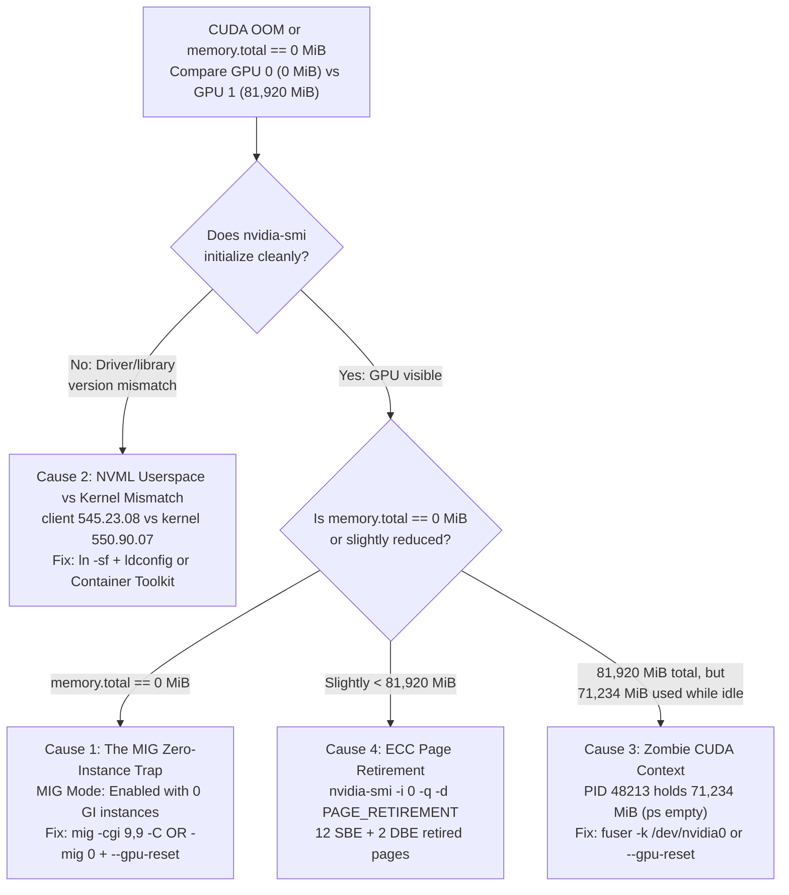
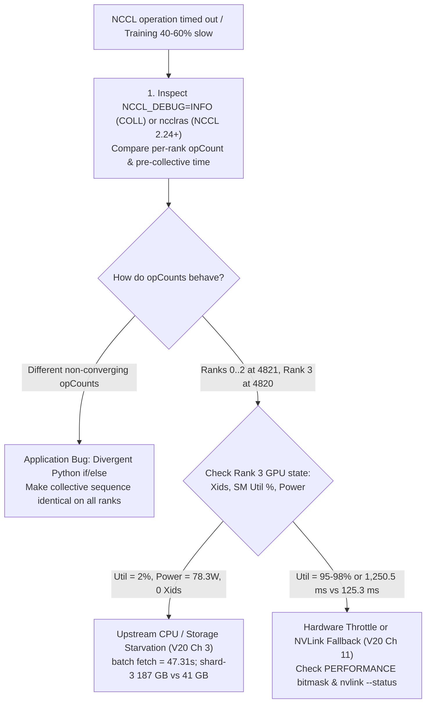

# 10.22 GPU troubleshooting scenarios

| Field | Value |
|---|---|
| Level | Advanced |
| Priority tier | 1 |
| Lab venue | Nebius GPU |
| Part | Part 10: The GPU and CUDA |
| Sources used | `nvidia-devops` Volume 20 and `src/data/troubleshooting.ts` incident runbooks; *AI Systems Performance Engineering* (`ai-systems-performance-engineering`, Chris Fregly) |
| Code | `code/part10/gpu_troubleshooting_scenarios.py`, `code/part10/gpu_troubleshooting_scenarios_lab.py` |
| Coverage file | `planning/coverage/chapters/10-22.md` |

## Why this matters for AI infrastructure

User-reported error messages in production GPU clusters almost never name the actual failing hardware or software layer. When engineers react to surface symptoms without a structured triage order, they replace healthy motherboards, swap network switches, or raise collective timeouts while the true root cause remains untouched. Mastering cross-layer troubleshooting lets on-call teams isolate the exact broken subsystem in minutes.

Consider three classic misdiagnoses from Volume 20. First, a researcher reports an out-of-memory error on an idle A100 where `nvidia-smi` shows zero total memory. Unracking the server wastes days when the real cause is MIG mode enabled with zero GPU instances created, a container shipping a stale NVML library against a newer host kernel, or a dead OS process holding memory inside a zombie CUDA context.

Second, a distributed training run crashes with an NCCL operation timeout. Blaming the network fabric misses the fact that three ranks reached collective operation 4821 while Rank 3 is stuck at operation 4820 with almost zero GPU utilization. Rank 3 is stalled because its local disk is full and its dataset shard is more than four times larger than Rank 0's shard.

Third, a Grafana dashboard reports 100% GPU utilization and normal power draw while training throughput drops by fivefold, or attaching a profiler cuts throughput in half. This final chapter of Part 10 synthesizes the 12 end-to-end GPU troubleshooting runbooks from Volume 20. It also covers the four incident postmortem labs and the production incident playbooks from `src/data/troubleshooting.ts`.

| Symptom Reported by User | Naive Misdiagnosis | Actual Root Cause & Diagnostic Proof (Volume 20) |
|---|---|---|
| `CUDA_ERROR_OUT_OF_MEMORY` and `memory.total = 0 MiB` on an `81,920 MiB` A100 (Volume 20 Ch 1) | Dead HBM memory controller requiring server RMA. | Either `MIG Mode: Enabled` with `0` GPU Instances created, stale `libnvidia-ml.so.545.23.08` vs kernel `550.90.07`, or zombie OS PID `48213` holding `71,234 MiB`. |
| `NCCL operation timed out` across 4 GPUs (Volume 20 Ch 3 & Ch 11) | Broken network switch or dropped RDMA packets. | Ranks `0, 1, 2` reached `opCount 4821` while Rank `3` stuck at `opCount 4820` (`2%` util, `78.3 W`) because `/data` is `96%` full (`480G / 500G`) and `shard-3` (`187 GB`) is `4.56x` (`~4.5x`) larger than `shard-0` (`41 GB`), stalling `next(iter(train_loader))` for `47.31 s`. |
| `100%` GPU utilization and `300 W` power draw, yet throughput is `200` vs `1,000 samples/sec` (Volume 20 Ch 12) | Slow CUDA kernel math on GPU SMs. | CPU kernel launch starvation (`50` vs `1,000+ kernels/sec`) or `60.0%` (`450.00 ms` of `750.00 ms` step) spent in `data_load_cpu`; or attaching `nsys` caused a `-50%` (`500 -> 250 samples/sec`) profiler Heisenbug. |

:::note About the incident numbers
The incident figures in this chapter come from the Volume 20 scenario notes and the playbook file named in the text. Those notes mark their outputs as illustrative or as constructed incidents. They teach the diagnostic order and were not captured from real systems or reproduced for this handbook. The triage priority order checks data integrity first, hardware performance cause second, and communication symptom third, following the operating policy in those notes.

| Illustrative Scenario Metric | Value in Source Notes | Source Location |
|---|---|---|
| Missing memory and NCCL straggler figures | `0 MiB` memory report, `opCount 4821` vs `4820`, `47.31 s` fetch stall | Volume 20 Chapters 1 & 3 |
| Cross-layer timing and profiler Heisenbug | `750.00 ms` step breakdown, `500` to `250 samples/sec` profiler effect | Volume 20 Chapter 12 |
:::

## Prerequisites and outcomes

**Prerequisites.** Complete Chapters 10.8 through 10.10 on `nvidia-smi`, the driver and container stack, and Fabric Manager. Review Chapter 10.20 on profiling tools and Chapter 10.21 on DCGM, ECC, row remapping, and the 15-code Xid framework.

**Outcomes.** After completing this chapter you will master four troubleshooting domains.
- Diagnose and resolve missing GPU memory and device visibility incidents. You will handle the MIG zero-instance trap, NVML version mismatches, zombie CUDA contexts, pre-flight capacity checks, DKMS kernel-patch breaks, missing Enroot hooks, and systemd boot races.
- Execute thermal, fan, power brownout, and DVFS clock runbooks. You will use the performance throttle bitmask, fan temperature rise rates, PSU 30% headroom sizing, 12V rail voltage sag checks, and firmware clock locking.
- Troubleshoot PCIe link down-training, NVLink fallback, multi-GPU stragglers, and ECC storms. You will combine `lspci -vvv`, `bandwidthTest`, NCCL collective operation counts, pre-collective synchronization timers, and automated ECC rate stop policies.
- Perform cross-layer diagnosis when metrics lie by ranking simultaneous failures in strict evidence priority order. You will also run a 7-stage synchronous iteration breakdown, quantify profiler Heisenbugs, and catch false-green Grafana and Slurm dashboards.

---

## 1. Runbook Family 1: Missing GPU Memory, Zombie Contexts, DKMS, and Container Visibility

### 1.1 The four causes of missing or unavailable GPU memory

When a training script crashes immediately with `CUDA_ERROR_OUT_OF_MEMORY` or `cudaGetDeviceProperties` returns zero total memory on an A100-SXM4-80GB, operators can waste hours suspecting dead HBM stacks. In practice, missing or unavailable GPU memory almost always stems from one of four software or configuration states on the host. Comparing the failing GPU against a healthy peer GPU on the same node narrows the root cause in seconds.



First, check for the MIG zero-instance trap. When MIG mode is enabled on a GPU, CUDA applications cannot allocate memory on the parent physical device. Instead, they can only allocate through instantiated GPU Instances. If an admin enabled MIG mode without creating any instances, `nvidia-smi` reports 0 MiB total memory on that GPU while adjacent GPUs report their full 81,920 MiB capacity. Also verify that `CUDA_VISIBLE_DEVICES` uses the full MIG UUID rather than bare device index 0.

Second, check for a userspace versus kernel driver version mismatch. If a container image bakes in a stale NVML library or a host upgrade leaves old symlinks behind, NVML fails to initialize when talking to the newer `nvidia.ko` kernel module. Updating the symlink with `ldconfig` or injecting host libraries via the NVIDIA Container Toolkit resolves the mismatch immediately.

Third, check for an orphaned zombie CUDA context. When a training process crashes ungracefully, the kernel driver can keep its GPU memory allocation pinned to a dead OS PID that no longer appears in `ps`. Killing open file descriptors on `/dev/nvidia0` with `fuser -k` or resetting the GPU reclaims the memory. Fourth, check whether legacy ECC Page Retirement has blacklisted enough pages to drop total memory below your pre-flight capacity gate.

| Cause in Volume 20 Chapter 1 | Diagnostic Command & Exact Evidence | Root Cause Mechanism | Remediation & Prevention Gate |
|---|---|---|---|
| Cause 1: The MIG Zero-Instance Trap | `nvidia-smi --query-gpu=index,name,memory.total,memory.used,memory.free --format=csv` shows `GPU 0` at `0 MiB, 0 MiB, 0 MiB` vs `GPU 1` at `81920 MiB, 2048 MiB, 79872 MiB`; `nvidia-smi -i 0 -q` shows `MIG Mode: Enabled` and `nvidia-smi mig -lgi` is empty. | Parent device exposes zero allocatable memory when MIG is enabled without GPU Instances (`GI`); `CUDA_VISIBLE_DEVICES` also requires `MIG-GPU-8f3a.../1/0`. | Create instances (`sudo nvidia-smi mig -cgi 9,9 -C` for two `3g.40gb` slices) or disable MIG (`sudo nvidia-smi -i 0 -mig 0 && sudo nvidia-smi -i 0 --gpu-reset`). |
| Cause 2: Userspace vs. Kernel Driver Mismatch | `nvidia-smi` prints `Failed to initialize NVML: Driver/library version mismatch`; `dmesg` logs `NVRM: API mismatch: the client has the version 545.23.08, but this kernel module has the version 550.90.07.` | Stale userspace `libnvidia-ml.so.545.23.08` cannot talk to kernel `550.90.07`. | Run `sudo ln -sf /usr/lib/x86_64-linux-gnu/libnvidia-ml.so.550.90.07 /usr/lib/x86_64-linux-gnu/libnvidia-ml.so.1 && sudo ldconfig`; use NVIDIA Container Toolkit. |
| Cause 3: Orphaned / Zombie CUDA Context | `nvidia-smi --query-compute-apps=pid,used_memory --format=csv` lists `48213, 71234` (`71,234 MiB` used), while `ps -p 48213` returns no OS process. | Crashed process left an unreleased CUDA context descriptor open in the kernel driver. | Reclaim memory with `sudo fuser -k /dev/nvidia0` or `sudo nvidia-smi --gpu-reset -i 0`. |
| Cause 4: ECC Page Retirement & Capacity Gate | `nvidia-smi -i 0 -q -d ECC` shows `142` Aggregate SBE and `3` Aggregate DBE; `PAGE_RETIREMENT` shows `Single Bit ECC: 12`, `Double Bit ECC: 2` (`14` pages), `Pending Page Blacklist: Yes`. | Retired pages shrink `memory.total` below nameplate `81,920 MiB`. | Reject any `A100-SXM4-80GB` where `memory.total < 81,920 - 100 = 81,820 MiB` (`< 0.95 * expected_bytes` for `10m` in Prometheus). |

### 1.2 Kernel patch DKMS breaks, missing Enroot hooks, and systemd boot races

Even when GPU hardware and MIG settings are healthy, OS patching pipelines and container runtime updates can sever the link between workloads and the GPU driver. Fleet operators frequently see an entire maintenance batch fail `nvidia-smi` after a routine kernel upgrade. Similarly, Slurm containers can lose GPU visibility while Kubernetes pods on the same host run fine, or node health agents can fail permanently at boot.

The table below details the diagnostic evidence and atomic fixes for these three lifecycle incidents from `src/data/troubleshooting.ts`.

| Incident ID (`troubleshooting.ts`) | Production Symptom | Diagnostic Evidence | Containment, Fix & Prevention |
|---|---|---|---|
| `kernel-patch-dkms-break` | After a routine kernel errata reboot, `nvidia-smi` fails on every patched node with `Driver/library version mismatch`. | `dkms status` shows the `nvidia` kernel module registered only against the previous kernel version; `/var/log/patch-pipeline.log` rebooted before DKMS rebuilt. | Hold remaining patch waves; run `dkms autoinstall` against the running kernel so `nvidia-smi` recovers without another reboot. Gate kernel upgrades and DKMS rebuilds as one atomic step. |
| `enroot-gpu-not-visible` | Slurm `srun --container-image` job reports `no devices found`, while bare-host `nvidia-smi -L` and Kubernetes pods on the same node work fine. | `ls -l /etc/enroot/hooks.d/*nvidia*` returns no file after a BCM image update; `NVIDIA_VISIBLE_DEVICES` is unset inside the Enroot container. | Reinstall the Enroot NVIDIA hook package on the node and add `/etc/enroot/hooks.d/*nvidia*` to the golden-image validation checklist. |
| `systemd-gpu-service-race-boot-order` | After reboot, `gpu-health-agent.service` is permanently `Active: failed` with `StartLimitBurst` exhausted, though a manual restart succeeds. | `journalctl -u gpu-health-agent -b` shows NVML init failure before `nvidia-persistenced.service` started; `systemd-analyze critical-chain` shows missing `After=`. | Run `systemctl reset-failed && systemctl restart gpu-health-agent`, then add `After=nvidia-persistenced.service` and `Requires=nvidia-persistenced.service` to the unit file. |

---

## 2. Runbook Family 2: Thermal Throttling, Fan Rise Rates, PSU Brownouts, and DVFS Clock Instability

### 2.1 Separating thermal throttling from power limiting

When a GPU's clock frequency drops in the middle of a training run, throughput can fall by 15% to 40% while every rank in the collective waits on the slowed device. Operators who only inspect temperature, clock speed, and power draw often guess the wrong cause and order a larger power supply for a cooling problem. Lowering clock frequency automatically reduces dynamic power draw. Observing a lower power reading alongside a lower clock never proves that a power limit caused the slowdown.

To separate thermal throttling from software power caps and hardware PSU brake events, always inspect the hardware throttle reason bitmask in `nvidia-smi -i 0 -q -d PERFORMANCE` and `DCGM_FI_DEV_CLOCK_THROTTLE_REASONS`.

> **dcgm-exporter 4.9.0 version note.** dcgm-exporter 4.9.0 (2026-11-06) renamed many default metrics and changed some units. For example `DCGM_FI_DEV_GPU_UTIL` (percent) became `DCGM_FI_DEV_GPU_UTIL_RATIO` (0 to 1), and `DCGM_FI_DEV_FB_USED` (MiB) became `DCGM_FI_DEV_FB_USED_BYTES`. The metric names in this chapter are the 4.8.x names. On a 4.9.0 exporter use the [full mapping in 17.4](../part-17-operations/04-dcgm-exporter-and-interpreting-gpu-metrics.md#14-what-dcgm-exporter-490-renamed), and change thresholds together with the unit.

```text
Performance State (nvidia-smi -i 0 -q -d PERFORMANCE, Volume 20 Chapter 6 & Lab 02 Ex 1)
    HW Slowdown                       : Not Active
    HW Thermal Slowdown               : Active      <-- Proves thermal throttling
    SW Thermal Slowdown               : Not Active
    SW Power Cap                      : Not Active  <-- Rules out software power limit
    HW Power Brake Slowdown           : Not Active  <-- Rules out PSU brownout brake
```

Keep an important hardware caveat in mind when triaging data-center servers. HGX and DGX SXM modules such as H100 SXM5 and B200, as well as passively cooled PCIe cards such as H100 PCIe and L40S, have no on-board GPU fan. As a result, `nvidia-smi` reports `N/A` for fan speed. Their airflow comes from server chassis fans managed by the BMC via `ipmitool sdr type Fan` or from direct-to-chip liquid cooling loops. Degraded thermal interfaces require a vendor RMA rather than opening a sealed GPU module in the rack.

| Thermal / Clock Metric (Volume 20 Ch 6 & Lab 02/03) | Observed Value | Operational Threshold & Remediation Rule |
|---|---|---|
| H100 SXM5 Thermal Clock Drop | `1,980 MHz -> 1,833 MHz` (`7.42%` / `~7%` clock reduction; `1,215 MHz` mem, `1,440 MHz` video) | Degrades training throughput by `15%–30%` (or `2,000 -> 1,200 samples/sec` = `-40%` in Lab 03 Ex 2) while power drops from `300 W` to `245–250 W` at `80–85°C`. |
| Emergency Shutdown Temperature | `> 87°C` (approaching `95°C` critical hardware shutdown limit) | Cordon, drain, and power down (`sudo shutdown -h now`) immediately if GPU temperature exceeds `87°C`. |
| Temporary Power Cap or Clock Lock Mitigation | `sudo nvidia-smi -pm 1 && sudo nvidia-smi -pl 200 -i 0` or `sudo nvidia-smi -i 0 -lgc <clock_mhz>` | Trades `~15%–20%` throughput to keep temperature stable `< 80°C` and stop `75°C <-> 87°C` boost/throttle oscillation while awaiting facility repair; reset clock lock with `-rgc`. |

### 2.2 Fan degradation, temperature rise rate, and the 2h 35m postmortem

Relying solely on a static 85°C temperature alert catches cooling failures only after a GPU is already throttling in the middle of a production job. A degrading chassis fan bearing or failing liquid-cooling pump reveals itself weeks earlier through an abnormally steep temperature rise rate during the first 30 to 60 seconds of load. Measuring the temperature derivative in Prometheus turns reactive thermal outages into scheduled maintenance.

In the Volume 20 Lab 04 Exercise 1 postmortem, a training job started at 06:00 on a node with a degrading fan bearing and did not trip the static 85°C alert until 08:15. Swapping the fan module took 20 minutes and wasted 2 hours and 35 minutes of cluster time. Adding a Prometheus derivative alert and a weekly 30-second burn test catches degrading fans two weeks before hard failure.

```yaml
alert: FanDegradation
expr: deriv(gpu_temp[1m]) > 0.15
for: 10m
```

| Cooling / Fan Scenario (Volume 20 Ch 8, Lab 03 Ex 2 & Lab 04 Ex 1) | Telemetry / BMC Observation | Temperature Rise Rate (`°C/sec`) | Triage & Prevention Rule |
|---|---|---|---|
| Healthy Cooling Baseline | Fans at `70%–90%` (`FAN2 = 8,400 RPM`, `FAN3 = 8,350 RPM`), temperature plateaus `< 80°C` | `~0.05°C/sec` (`0.05–0.10°C/sec`) | Normal operation. |
| Stuck Fan or Degraded Thermal Interface (Volume 20 Ch 8) | BMC `ipmitool sdr type Fan` shows `FAN1 = 0 RPM` (or `fan.speed = 0%` at `> 50°C`); climbs `55°C -> 70°C` in `60 s` | `0.25°C/sec` (`0.20–0.30°C/sec` continuous rise) | Diagnose `FAN_STUCK_AT_0_RPM` or degraded TIM; replace hot-swap chassis fan or RMA module. |
| Severe Cooling Failure on `gpu-burn 30` (Lab 03 Ex 2) | Temperature climbs `55°C` (`0 s`) -> `65°C` (`10 s`) -> `75°C` (`20 s`) -> `83°C` (`30 s`) | `(83 - 55) / 30 = 0.93°C/sec` | Abort workload immediately before hitting `87°C`. |
| Lab 04 Ex 1 Fan Failure Postmortem | Job starts `06:00` (`0.05°C/min` drift) -> static `85°C` alert at `08:15` (`135 min` = `2h 15m` detection latency) + `20 min` fan swap (`08:15 -> 08:35`) | `155 min` (`2h 35m`) total compute wasted | Alert on `deriv(gpu_temp[1m]) > 0.15` for `10m` and run a weekly 30-second synthetic burn check. |

### 2.3 Power supply brownouts, 12V voltage sag, and PSU capacity sizing

When all eight GPUs in a server transition simultaneously from an idle network barrier to heavy Tensor Core matrix multiplication, node power demand spikes by several kilowatts in milliseconds. If the power supplies are undersized or a 12V auxiliary rail sags under the transient load, the GPU asserts a hardware power brake slowdown or drops its enforced power limit. That action cuts clock speeds across one or more GPUs while temperatures remain completely cool.

You diagnose a PSU brownout by checking BMC voltage sensors with `ipmitool sensor list` and `ipmitool sel list`. Verify that total PSU wattage includes at least 30% headroom above peak GPU power draw. If a node's PSU is undersized, cap total GPU power to 80% of PSU capacity using `nvidia-smi -pl` until higher-wattage PSUs are installed.

| Power / PSU Metric (Volume 20 Ch 9) | Formula / Sensor Reading | Volume 20 Chapter 9 Diagnostic Numbers | Remediation & Sizing Rule |
|---|---|---|---|
| Enforced Power Limit & Per-GPU Drop | `nvidia-smi -q -d POWER,PERFORMANCE` | Limit drops `300 W -> 200 W` (`198 W` draw), or `GPU 1` drops to `145 W` (`48.3%` / `~41%` of `300 W`, `45%` SM util) while `GPU 0, 2, 3` draw `280–300 W`. | Check `HW Power Brake Slowdown` and `SW Power Cap`; balance PCIe/SXM power cables across PSU rails. |
| BMC AC Input & 12V Auxiliary Rail Sag | `ipmitool sensor list` | `PSU1_INPUT_VOLT = 209.0 V`, `PSU2_INPUT_VOLT = 211.0 V`; nominal 12V rail is `12.0 V +- 0.5 V` (`11.5–12.5 V`), but `GPU_AUX_12V = 10.8 V` (`< 11.4 V` `WARN` threshold). | `10.8 V < 11.4 V` proves 12V rail voltage sag under peak load. |
| PSU Capacity Sizing (`30%` Headroom) | `Min_PSU = N_gpus * TDP * 1.3` | For `4 * 300 W` A100 GPUs (`1,200 W` raw): `1,200 W * 1.3 = 1,560 W` minimum PSU (`1,500 W` PSU in `dmidecode --type 39` is undersized). | Enforce node GPU budget `<= 0.80 * PSU_capacity` (`0.80 * 1,500 W = 1,200 W`, capping GPUs at `260–280 W` via `nvidia-smi -pl 280`) or upgrade to `2,000–3,000 W` PSUs. |

### 2.4 DVFS clock instability at flat 65°C temperature

Sometimes a GPU's graphics clock oscillates wildly every half-second even though temperature is a cool 65°C and every hardware throttle bit reads inactive. This clock jitter creates variable iteration times that slow down synchronous all-reduce steps across the entire cluster.

The root cause is firmware Dynamic Voltage and Frequency Scaling reacting to short 5-millisecond idle gaps between bursty `DataLoader` batches by downshifting from performance state P0 into power-saving states P2 or P3. An operator script can also leave a stale low clock lock behind. Data-center GPU DVFS is managed entirely in GPU firmware, so there is no host BIOS toggle that disables GPU DVFS. Lock the GPU graphics clock with `nvidia-smi -lgc` and set the host CPU governor to `performance` to eliminate the oscillation.

| DVFS Instability Observation (Volume 20 Ch 10) | Observed Telemetry Values | Stabilization Fix & Alert Threshold |
|---|---|---|
| Clock, Power, and P-State Oscillation | Graphics clock swings `1,980 MHz -> 1,200 MHz -> 800 MHz -> 1,980 MHz` every `0.5–2.0 s`; power swings `310 W -> 150 W -> 310 W`; state drops `P0 -> P2/P3` (`405 MHz` memory clock) at flat `65°C` (or stale `1,000` / `1,200 MHz` lock). | Enable persistence mode (`sudo nvidia-smi -pm 1`), set CPU `/sys/devices/system/cpu/cpu0/cpufreq/scaling_governor` to `performance`, clear stale locks (`sudo nvidia-smi -rgc`), and lock clocks via `sudo nvidia-smi -i 0 -lgc 1800`. Alert if `> 3` to `5` unique clock frequencies appear in `30 s` under fixed load. |

---

## 3. Runbook Family 3: PCIe Down-Training, NCCL Stragglers, NVLink Degradation, and ECC Storms

### 3.1 PCIe link down-training and DMA faults

When a PCIe riser card loosens due to thermal cycling or a retimer experiences electrical noise, the PCIe link silently negotiates a slower generation speed or narrower lane width instead of crashing outright. Host-to-device batch transfers and checkpoint writes suddenly stall, dragging down training throughput across every GPU in the job. Checking the PCIe replay counter, benchmarking host-to-device copy speed, and inspecting negotiated link status in `lspci` isolates a down-trained PCIe slot in under a minute.

After draining the node, you can often recover full PCIe Gen4 x16 speed without rebooting the host by removing the PCIe device node in sysfs and triggering a bus rescan. Always re-verify the negotiated link state in `lspci -vvv` and `bandwidthTest` throughput before returning the node to scheduling.

| PCIe Triage Step (Volume 20 Ch 7 & Volume 16 Ch 8) | Command / Check | Healthy Baseline vs. Degraded Evidence | Remediation & Weekly Gate |
|---|---|---|---|
| Step 1: Check Kernel Logs & PCIe Replays | `dmesg` & `dcgmi dmon -e <PCIE_REPLAY_COUNTER>` | `GPU 1..3 = 0` replays; `GPU 0 = 127` replays with `DMAR: DRHD: processing fault logged [DMA Read]` and `pci_link_speed_mismatch: expected Gen4 x16, got Gen3 x8`. | High replay count proves link-level retransmission on `GPU 0`. |
| Step 2: Benchmark Host-to-Device Bandwidth | `bandwidthTest --device 0` (`33,554,432` bytes = `32 MiB`) | PCIe Gen4 x16 (`16GT/s`, raw `31.5 GB/s` unidir / `64 GB/s` bidir) achieves `20–26 GB/s` (`22.0 GB/s` nominal); PCIe Gen3 x16 achieves `10–12 GB/s`; degraded `GPU 0` measures `2.3 GB/s` (`~80%–90%` slower). | Weekly health gate requires `>= 17.6 GB/s` (`0.80 * 22.0 GB/s`). |
| Step 3: Inspect Negotiated Width & Speed | `lspci -s 08:00.0 -vvv \| grep -A5 "LnkCap\|LnkSta"` | `LnkCap: Speed 16GT/s (Gen4), Width x16`, vs `LnkSta: Speed 8GT/s (Gen3), Width x8 (Down-trained)` (or `5GT/s, Width x1` in Volume 16 Ch 8). | Retrain via `echo 1 > /sys/bus/pci/devices/0000:08:00.0/remove && sleep 3 && echo 1 > /sys/bus/pci/rescan`, or reseat riser if retrain fails. |

### 3.2 Hunting the single straggler behind an NCCL timeout

When a distributed training job aborts with an NCCL operation timeout, almost every rank prints a timeout stack trace at the exact same moment. Operators who react by swapping network cables or raising the collective timeout to six hours waste time because an NCCL timeout almost never means all network switches died simultaneously. Instead, one rank failed to arrive at a synchronous collective barrier while all healthy ranks waited for it.



To find the straggler, inspect `NCCL_DEBUG=INFO` with `NCCL_DEBUG_SUBSYS=COLL` or query the RAS subsystem in NCCL 2.24 and newer. If ranks freeze at completely different, non-converging operation count values, the Python script has a divergent conditional branch calling different collectives on different ranks. If all ranks except one reach operation 4821 while Rank 3 lags at operation 4820, Rank 3 is the straggler.

Next, check whether Rank 3 is starved upstream of the GPU or slowed inside the GPU or fabric. Note that NCCL has no `NCCL_TIMEOUT` environment variable; collective timeouts are configured in PyTorch via `dist.init_process_group`. Also remember to place per-rank iteration timers after `torch.cuda.synchronize()` and before `dist.all_reduce`, because timing after the collective includes the time fast ranks spent waiting for the slow rank.

| Straggler Investigation (Volume 20 Ch 3, Ch 11, Lab 02 Ex 2 & Lab 04 Ex 3) | Diagnostic Steps & Telemetry Numbers | Root Cause & Preventive Alert Rule |
|---|---|---|
| Investigation A: Upstream Data-Pipeline Straggler (Volume 20 Ch 3) | Ranks `0, 1, 2` log `AllReduce: opCount 4821, count 268435456` (`256M` floats = `1 GiB`); Rank `3` lags at `opCount 4820` with `0` Xids, `utilization.gpu = 2%`, `temp = 61°C`, `power = 78.3 W`. `next(iter(train_loader))` takes `47.31 s` (vs `< 1 s`); `df -h /data` shows `storage-pv-3` at `96%` (`480G / 500G`, `20G` free); `du -sh` shows `/data/shard-3` is `187 GB` vs `41 GB` on `/data/shard-0` (`4.56x` / `~4.5x` imbalance). | Rank 3 is starved on disk I/O due to uneven dataset sharding and a full local volume. Rebalance shards and alert when `(max(nccl_op_count) - min(nccl_op_count)) > 2` for `3m`. |
| Investigation B: Multi-GPU Compute / NVLink Straggler (Volume 20 Ch 11) | Pre-collective timings across 4 GPUs are `[125.3 ms, 126.1 ms, 1250.5 ms, 124.8 ms]`, so `GPU 2` is `1,250.5 / 124.8 = 10.02x` slower (alert gate: `max / min > 1.2` or `20%` imbalance). Running 2-GPU subsets (`CUDA_VISIBLE_DEVICES=0,1`, `0,2`, `0,3`) of `all_reduce_perf` and `nvidia-smi nvlink --status` on A100 (`NVLink 3` = `25 GB/s` per link, `12` links = `~600 GB/s`, warn `< 20 GB/s`) shows `GPU 0 Link 3: DEGRADED (5 GB/sec)` and `GPU 2 Link 0: FAILED (0 Mbps)`. | Degraded or failed NVLink forces traffic onto slower paths. Isolate the bad GPU pair with 2-GPU `all_reduce_perf` subsets and check `nvidia-smi nvlink --status`. |
| Preempting the 16-Minute Timeout (Lab 02 Ex 2 & Lab 04 Ex 3) | `GPU 4` `AllReduce` latency rises from `12 ms` baseline (`10:00`) -> `30 ms` (`10:05`, `2.5x` baseline) -> `100 ms` (`10:10`) -> `125 ms` (`10.42x`) -> `300 s` timeout at `10:15` (`16 min` wasted). | Alerting on `max(nccl_allreduce_latency) / min(...) > 2.5` for `1m` catches the degradation at `10:06` and restarts on `7` healthy GPUs by `10:08` (`8 min` saved). |

### 3.3 ECC storm escalation math and automated job-stop thresholds

Because Single-Bit ECC errors are corrected in hardware, operators sometimes let a training job continue running while a GPU experiences an accelerating ECC storm of hundreds of errors per hour. Waiting for a fatal Double-Bit Error or waiting until model validation accuracy collapses wastes hours of cluster compute on a dying HBM stack.

In the Volume 20 Lab 03 Exercise 3 and Lab 04 Exercise 2 postmortems, a training run on GPU 0 saw its ECC rate jump from 1 error per hour at 15:00 to 100 errors per hour by 15:30. By 16:15 the rate reached 400 errors per hour and validation accuracy dropped from 92% to 85% before a human stopped the job at 16:20. Enforcing an automated rate-based stop policy halts the job and drains the GPU at 15:30, saving 45 minutes of wasted training. Also remember that user applications cannot carve out specific bad physical HBM addresses in software. If the Hardware Row Remapper does not absorb the errors, the GPU must be RMA'd.

| ECC Storm Timeline / Policy Tier (Volume 20 Lab 03 Ex 3 & Lab 04 Ex 2) | Observed Error Count & Window | Computed Hourly Error Rate | Automated Operational Action |
|---|---|---|---|
| `15:00` Baseline (`safe_rate` `< 1/hr`) | `1` ECC error in `1 hour` (`92%` validation accuracy) | `1 error/hour` (`< 1/hr` normal cosmic-ray background) | Log and monitor only; do not interrupt training. |
| Warning Tier (`warning_rate` `1–10/hr`) | `1` to `10` errors in `1 hour` | `1–10 errors/hour` | Schedule preventive maintenance and start a `600 s` (`10 min`) escalation timer. |
| `15:30` Escalation (`critical_rate` `> 10/hr` / `>= 100/hr`) | `50` ECC errors in `30 min` (`30x` normal; or `50` in `10 min` = `5/min` in Lab 03 Ex 3; or `1 -> 5 -> 12 -> 21 -> 35` across 4 samples = `34/min`) | `100 errors/hour` (`300 errors/hour` for `50/10m`; `2,040 errors/hour` for `34/min`, bad address `0x12345678` in `cuda_memtest`) | Automatically stop the job, checkpoint on healthy ranks, and drain the GPU immediately (`45 min` before accuracy diverged). |
| `16:00` to `16:20` Unmitigated Outcome | `500` errors at `16:00` (`300/hr`) -> `600+` errors at `16:15` (`400/hr`) | Validation accuracy drops `92% -> 85%` (`16:20` manual stop) | Demonstrates why waiting for accuracy degradation instead of stopping at `> 10/hr` (`100/hr` at `15:30`) wastes compute. |

---

## 4. Runbook Family 4: Cross-Layer Diagnosis — When Metrics Lie

### 4.1 Multi-failure evidence priority and the 7-stage synchronous breakdown

During a complex production incident, a single node can simultaneously report ECC or Xid errors, thermal throttling, and NCCL collective timeouts. Investigating those signals in the wrong order wastes hours chasing downstream symptoms or saving a checkpoint whose weights are already corrupted. Always evaluate multi-failure evidence in strict priority order: Data Integrity first, Hardware Performance Cause second, and Downstream Communication Symptom third.

| Priority Rank (Volume 20 Lab 01 Ex 3) | Failure Domain & Signals | Why It Ranks Here |
|---|---|---|
| Priority 1: Data Integrity | Uncorrectable ECC / Xid 48, 95, 64 & ECC storm counters | Memory corruption invalidates model weights and checkpoints; the node must be drained regardless of thermal or network status. |
| Priority 2: Hardware Performance Cause | `PERFORMANCE` throttle bitmask (`HW Thermal Slowdown`, `HW Power Brake`) & `TEMP` | Physical throttling slows one rank's execution, which directly causes the collective delay. |
| Priority 3: Downstream Communication Symptom | `NCCL` timeout & per-rank `opCount` lag | The collective hang is the downstream consequence of the slow or dead rank identified in Priorities 1 and 2. |

When GPU utilization, power, and temperature all look healthy yet end-to-end training is slow, aggregate dashboards cannot tell you which layer is stalling the step. Insert `torch.cuda.synchronize()` barriers around all seven stages of a single training iteration. That instrumentation measures the exact millisecond share of CPU data loading, PCIe transfer, GPU forward, backward, loss, and optimizer math, and network all-reduce.

In the Volume 20 Chapter 12 breakdown below, all four GPU compute stages combined consume only 14.4% of the 750.00 ms step. That measurement proves that rewriting CUDA kernels would save almost nothing while 60.0% sits in CPU data loading.

| Iteration Stage (Volume 20 Ch 12) | Hardware Layer | Reported Time (`ms`, illustrative) | Share of `750.00 ms` Step (`%`) | Diagnostic Interpretation |
|---|---|---:|---:|---|
| 1. `data_load_cpu` | Host CPU / Storage I/O | `450.00 ms` | `60.0%` | Primary bottleneck: CPU data pipeline consumes `60%` of the step (`monthly baseline target < 30%`). |
| 2. `allreduce_network` | NVLink / NIC Fabric (`NCCL`) | `150.00 ms` | `20.0%` | Secondary bottleneck consuming one-fifth of the iteration in collective sync. |
| 3. `backward_gpu` | GPU SMs / Tensor Cores | `60.00 ms` | `8.0%` | Actual GPU backward pass math is fast. |
| 4. `forward_gpu` | GPU SMs / Tensor Cores | `30.00 ms` | `4.0%` | Actual GPU forward pass math (`forward + backward + opt + loss = 108.00 ms` = `14.4%`). |
| 5. `data_transfer_pcie` | PCIe DMA Copy Engine | `10.00 ms` | `1.3%` | Host-to-device copy is minor. |
| 6. `optimizer_gpu` | GPU SMs | `10.00 ms` | `1.3%` | Optimizer step is fast. |
| 7. `loss_gpu` | GPU SMs | `8.00 ms` | `1.1%` | Loss computation (`sum of 7 stages = 718.00 ms` out of `750.00 ms` reported step). |

### 4.2 Five classic "lying metrics" scenarios and Profiler Heisenbugs

Dashboards and profilers can actively deceive engineers when a metric measures the wrong hardware concept, when a dead exporter is masked by a fleet average, or when the profiler itself slows down the workload. Attaching a heavyweight tracer or running `nvidia-smi` in a tight shell loop introduces a Profiler Heisenbug that alters CPU and GPU scheduling and cuts throughput by 10% to 50%.

The table below catalogs the five classic "lying metric" scenarios from Volume 20 Chapter 12 and `src/data/troubleshooting.ts`, along with the cross-layer evidence that exposes the truth.

| Lying Metric Scenario | What the Dashboard Claims | What Cross-Layer Evidence Proves | Root Cause & Fix (Volume 20 Ch 12 & `troubleshooting.ts`) |
|---|---|---|---|
| 1. The Utilization Lie (`100%` `nvidia-smi` util, `200` vs `1,000 samples/sec`) | `nvidia-smi` and `torch.cuda.utilization()` report `95%–100%` utilization. | `nsys` timeline shows the GPU computing only `10%` of the time (`90%` idle between launches); CPU kernel launch rate is `50 kernels/sec` vs `1,000+ kernels/sec` expected. | NVML utilization measures whether any kernel ran during a sampling window, including tiny kernels separated by CPU launch gaps. Fix with CUDA Graphs or `torch.compile`. |
| 2. The Memory Lie (`35 GB / 40 GB` used in `nvidia-smi` vs `10 GB` in profiler) | `nvidia-smi` reports `35 GB` of `40 GB` used, triggering OOM panic alerts. | `torch.cuda.memory_stats()` shows `10 GB` live allocated and `25 GB` reserved or cached by PyTorch's caching allocator. | PyTorch retains freed blocks in its pool to avoid `cudaMalloc` synchronizations. Inspect `memory_allocated()` vs `memory_reserved()` instead of raw `nvidia-smi` `FB_USED`. |
| 3. The Profiler Heisenbug (`500 -> 450 -> 250 samples/sec`) | Job runs at `500 samples/sec` without a profiler, drops to `450 samples/sec` (`-10%`) when polling `nvidia-smi` in a `1 s` loop, and drops to `250 samples/sec` (`-50%`) under `nsys profile` (or `800 -> 400 samples/sec`). | High-overhead tracing changes CPU and GPU scheduling and masks the real bottleneck. | Rank tools by overhead (`1. time.perf_counter()` `< 1%` -> `2. DCGM` -> `3. nvidia-smi` polling -> `4. nsys` -> `5. heavyweight CPU tools`), audit profiler overhead quarterly (`< 10%` target), and profile a `100`-step standalone benchmark. |
| 4. The Stale Green Dashboard & Masked Fleet Average (`grafana-stale-healthy-dashboard` & `dcgm-scrape-target-down-masked-by-average`) | Grafana GPU panels stay green for `4–6 hours`, or fleet-wide `avg(DCGM_FI_DEV_GPU_UTIL)` looks normal while a node's exporter is dead. | `curl http://prometheus:9090/api/v1/targets` shows `health: "down"` with `lastScrape` `4–6 hours` ago and `up{job="dcgm-exporter"} == 0`; `avg()` silently drops dead targets. | Alert on `count(up{job="dcgm-exporter"} == 0) > 0`, `timestamp(up) - time()`, and `absent_over_time()`, never on fleet averages alone. |
| 5. The False-Green Slurm NHC & SELinux Block (`slurm-healthcheck-venv-false-green` & `selinux-gpu-monitoring-block`) | Slurm `sinfo` marks all nodes `idle` or `alloc` (`Reason=` empty) despite active Xids; or `dcgm-exporter` runs with zero logs while metrics stay blank after OS hardening. | Running `nhc_gpu_check.py --verbose` directly reveals `ModuleNotFoundError` swallowed by a wrapper exiting `0`; `ausearch -m avc -ts recent` + `audit2why` reveals SELinux AVC denials on GPU device nodes. | Pin and verify the NHC virtualenv (`pip check`) and fail closed (`exit 1`) on unhandled exceptions; install a supplemental SELinux policy module rather than disabling enforcement fleet-wide. |

---

## 5. Commands and Configurations That Matter

All commands below follow Volume 20 and `src/data/troubleshooting.ts`. Commands that require an attached NVIDIA GPU node are marked **(untested here)**.

### 5.1 Multi-layer triage commands for MIG, PERFORMANCE bitmask, PCIe retrain, NCCL stragglers, and SELinux / DKMS (untested here)

When triaging a live node, run these four command blocks in order to check memory and MIG state, inspect thermal and power bitmasks alongside BMC sensors, verify PCIe link negotiation, and capture per-rank NCCL collective logs.

```bash
# 1. Diagnose 0 MiB memory trap (MIG instances), NVML version mismatch, and zombie PIDs (V20 Ch 1) (untested here)
nvidia-smi --query-gpu=index,name,memory.total,memory.used,memory.free --format=csv
nvidia-smi -i 0 -q | grep -A5 "MIG Mode" && nvidia-smi mig -lgi
cat /proc/driver/nvidia/version && ldconfig -p | grep libnvidia-ml
nvidia-smi --query-compute-apps=pid,used_memory --format=csv

# 2. Discriminate thermal slowdown vs power cap / brownout brake & check BMC fans/12V rail (V20 Ch 6, 8, 9) (untested here)
nvidia-smi -i 0 -q -d TEMPERATURE,POWER,CLOCK,PERFORMANCE
ipmitool sdr type Fan
ipmitool sensor list | grep -iE "volt|psu|gpu_aux"

# 3. Check PCIe link negotiation (Gen4 x16 vs Gen3 x8), replay counter, and soft bus rescan (V20 Ch 7) (untested here)
lspci -s 08:00.0 -vvv | grep -A5 -E "LnkCap|LnkSta"
echo 1 > /sys/bus/pci/devices/0000:08:00.0/remove && sleep 3 && echo 1 > /sys/bus/pci/rescan

# 4. Hunt NCCL straggler opCount, check NVLink per-link status, and audit DKMS / SELinux (V20 Ch 3, 11 & troubleshooting.ts) (untested here)
NCCL_DEBUG=INFO NCCL_DEBUG_SUBSYS=COLL,INIT,NET python3 train.py 2>&1 | tee nccl_trace.log
nvidia-smi nvlink --status
dkms status && ausearch -m avc -ts recent
```

---

## 6. How It Fails: Six Classic Troubleshooting Misdiagnoses and Traps

Even experienced engineers fall into troubleshooting traps when they trust post-collective timers, fleet-average dashboards, or raw power readings. The table below summarizes the six most costly diagnostic mistakes and how to avoid them with direct hardware and software evidence.

| # | Troubleshooting Trap | What the Operator Mistakenly Does | Actual Root Cause | Evidence-Based Fix |
|---|---|---|---|---|
| 1 | Blaming network switches or raising `init_process_group` timeout on an NCCL hang (Volume 20 Ch 3) | Sets `timeout=timedelta(hours=6)` or replaces network cables when `AllReduce` times out. | Ranks `0–2` are at `opCount 4821` waiting on Rank `3` (`opCount 4820`, `2%` GPU util), which is stalled on a `47.31 s` batch read from a `96%`-full disk and a `4.56x` (`187 GB` vs `41 GB`) uneven data shard. | Grep per-rank `opCount` in `NCCL_DEBUG=INFO` or `ncclras`, inspect the lagging rank's GPU utilization and data-fetch latency, and rebalance dataset shards. |
| 2 | Measuring per-rank iteration time after `dist.all_reduce` (Volume 20 Ch 11) | Concludes all 4 GPUs are equally slow (`~1,250 ms` each) because the timer was placed after `dist.all_reduce(loss)`. | Synchronous collectives force fast ranks (`125 ms`) to wait for the slow rank (`1,250.5 ms`), making post-collective timestamps identical across ranks. | Call `torch.cuda.synchronize()` and record per-rank compute and data time before entering `dist.all_reduce` to expose the `10.02x` straggler ratio. |
| 3 | Guessing thermal vs. power throttling without reading the `PERFORMANCE` bitmask (Volume 20 Lab 02 Ex 1) | Orders a larger PSU because power dropped from `300 W` to `250 W` when clocks fell from `1,980` to `1,833 MHz` at `80°C`. | Lower clocks reduce power draw automatically regardless of whether heat or power triggered the clock drop. | Query `nvidia-smi -i 0 -q -d PERFORMANCE` (`DCGM_FI_DEV_CLOCK_THROTTLE_REASONS`) to see whether `HW Thermal Slowdown`, `SW Power Cap`, or `HW Power Brake Slowdown` is `Active`. |
| 4 | Waiting for validation accuracy to drop (`92% -> 85%`) during an ECC storm (Volume 20 Lab 04 Ex 2) | Lets a job keep running when SBE rate hits `50` errors in `30 min` (`100/hr`) because single-bit errors are hardware-corrected. | An SBE rate `> 10/hr` (`100–2,040/hr`) signals rapidly failing HBM that soon produces uncorrectable errors or numerical divergence. | Automate an ECC rate monitor that stops the job and drains the GPU as soon as SBE rate exceeds `> 10/hr` (`critical_rate = 100/hr`). |
| 5 | Trusting a green fleet-average Grafana panel or exit-0 Slurm NHC wrapper (`troubleshooting.ts`) | Assumes all nodes are healthy because `avg(DCGM_FI_DEV_GPU_UTIL)` is `85%` and `sinfo` shows zero drained nodes. | `avg()` hides `up == 0` dead targets (`dcgm-scrape-target-down-masked-by-average`), and a broken NHC Python `venv` caught by a try/except wrapper exits `0` (`slurm-healthcheck-venv-false-green`). | Alert on `count(up{job="dcgm-exporter"} == 0) > 0` and sample age (`timestamp(up) - time()`), and test NHC scripts directly with `--verbose` and `pip check`. |
| 6 | Leaving a high-overhead profiler (`nsys` or `1 s` `nvidia-smi` loop) attached during throughput baselines (Volume 20 Ch 12) | Concludes a code optimization failed because throughput is `250 samples/sec` under `nsys` (`-50%`) or `450 samples/sec` under an `nvidia-smi` loop (`-10%`) vs `500 samples/sec` baseline. | Process-spawning `nvidia-smi` loops and full `nsys` tracing introduce a Heisenbug that alters scheduling and steals CPU cycles. | Measure steady-state throughput with zero-overhead timers (`time.perf_counter()` or `torch.cuda.Event`), quantify each tool's overhead (`< 10%` target), and restrict `nsys` to short `60–100` step captures. |

---

## 7. Hands-On Lab: Verify All 12 Volume 20 & Runbook Troubleshooting Scenarios

**Venue.** Run this lab on any Linux machine or Nebius GPU VM with Python 3.10+. The verification script runs deterministically using the Python standard library. All hardware CLI commands are provided in Section 5 and marked untested here.

Run `code/part10/gpu_troubleshooting_scenarios_lab.py` to verify all 12 troubleshooting runbook models. The lab tests missing memory gates, thermal and fan rise-rate math, PSU headroom and 12V sag checks, PCIe down-training, NCCL straggler and uneven shard detection, ECC storm stop rules, and the 7-stage cross-layer breakdown.

```bash
python3 code/part10/gpu_troubleshooting_scenarios_lab.py
```

Expected output (`25 passed, 0 failed`).

```text
=== Chapter 10.22 Lab: GPU Troubleshooting Scenarios (Volume 20 + Incident Runbooks) ===
  [PASS] V20 Ch1 Missing GPU Memory: A100-SXM4-80GB nameplate == 81,920 MiB; pre-flight check rejects < 81,820 MiB (81,920 - 100 MiB); zombie PID 48213 holds 71,234 MiB
  [PASS] V20 Ch1 Driver/library mismatch: Userspace libnvidia-ml.so.545.23.08 vs kernel module 550.90.07 fails NVML init
  [PASS] V20 Ch6 & Ch8 Thermal Throttling & Rise Rate: 1,980 -> 1,833 MHz is a 7.42% (~7%) clock reduction; 55 -> 70C in 60s == 0.25 C/sec (vs 0.05 C/sec normal)
  [PASS] V20 Ch8 & Lab 03 Ex2 Fan Failure: Fan=0% at >50C diagnoses FAN_STUCK_AT_0_RPM; gpu-burn 55 -> 83C in 30s == 0.93 C/sec; >87C triggers immediate shutdown
  [PASS] V20 Lab 04 Ex1 Fan Postmortem: 06:00 start -> 08:15 alert (135 min = 2h 15m detection latency) + 20m replacement (08:15 -> 08:35) == 155 min (2h 35m) wasted; deriv(gpu_temp[1m]) > 0.15 C/s
  [PASS] V20 Ch9 PSU Capacity & Brownout: 4 x 300W A100 * 1.3 headroom == 1,560 W min PSU (1,500 W PSU is undersized; 0.8 * 1,500 == 1,200 W node cap)
  [PASS] V20 Ch9 12V Rail Voltage Sag & GPU 1 Power Drop: GPU_AUX_12V = 10.8 V < 11.4 V threshold (nominal 12.0 V +- 0.5 V); GPU 1 at 145 W vs 300 W (48.3%)
  [PASS] V20 Ch10 DVFS Clock Oscillation: Clocks drop 1,980 -> 1,200 -> 800 MHz (310W -> 150W) at flat 65C (P0 -> P2/P3, 405 MHz mem); locked via nvidia-smi -lgc 1800
  [PASS] V20 Ch7 PCIe Down-Training: Gen4 x16 raw 31.5 GB/s (64 GB/s bidir) achieves 20-26 GB/s on 33,554,432 B (weekly gate >= 17.6 GB/s = 0.8 * 22.0); Gen3 x8 drops to 2.3 GB/s with 127 PCIe replays
  [PASS] V20 Ch3 NCCL Straggler Hunt: Ranks 0-2 at opCount 4821 (count 268,435,456) while Rank 3 lags at opCount 4820 (2% util, 78.3W, 47.31s fetch, 480G/500G = 96% full)
  [PASS] V20 Ch3 Uneven Data Sharding: shard-3 (187 GB) vs shard-0 (41 GB) == 4.56x (~4.5x) imbalance -> UPSTREAM_DATA_PIPELINE_STARVATION_UNEVEN_SHARD
  [PASS] V20 Ch11 Multi-GPU Straggler Timing & NVLink 3: [125.3, 126.1, 1250.5, 124.8] ms has max/min ratio == 10.02x (> 1.2x alert); A100 NVLink 3 == 25 GB/s per link (warn < 20 GB/s, degraded = 5 GB/s)
  [PASS] V20 Lab 02 Ex2 & Lab 04 Ex3 AllReduce Latency Escalation: 12 ms baseline -> 30 ms (2.5x alert threshold) -> 100 ms -> 125 ms (10.42x) -> 300s timeout (16 min wasted vs 8 min with preemption)
  [PASS] V20 Lab 03 Ex3 & Lab 04 Ex2 ECC Storm Math: 50 errors/10min == 300/hr (5/min); 34 errors/min (1->35) == 2,040/hr; 50 errors/30min == 100/hr (>10/hr stop threshold before 92%->85% accuracy drop)
  [PASS] V20 Ch12 7-Stage Cross-Layer Timing Breakdown (750.00 ms, 718.00 ms sum, 108.00 ms GPU): data_load_cpu=450 ms (60.0%), allreduce=150 ms (20.0%), backward=60 ms (8.0%), forward=30 ms (4.0%), pcie=10 ms (1.3%), opt=10 ms (1.3%), loss=8 ms (1.1%)
  [PASS] V20 Ch12 Profiler Heisenbug Overhead: 500 samples/s (no profiler) -> 450 samples/s with nvidia-smi loop (-10.0%) -> 250 samples/s with nsys (-50.0%); 800 -> 400 samples/s (-50.0%)
  [PASS] V20 Ch12 Utilization Lie & Memory Lie: 100% nvidia-smi util at 50 kernels/sec (vs 1,000+ expected) yields 200 vs 1,000 samples/sec; 35 GB / 40 GB reserved vs 10 GB live allocated (25 GB cached)
  [PASS] V20 Lab 01 Ex3 Multi-Failure Evidence Priority: 1. Data Integrity (Xid 48/95/64 & ECC) > 2. Hardware Performance Cause (Throttle bitmask) > 3. Downstream Symptom (NCCL hang)
  [PASS] Rejects non-positive window_sec in thermal/fan analyzer
  [PASS] Rejects fan_speed_pct > 100 in thermal/fan analyzer
  [PASS] Rejects non-positive num_gpus in PSU calculator
  [PASS] Rejects empty rank_op_counts in NCCL straggler analyzer
  [PASS] Rejects non-positive reported_total_ms in cross-layer analyzer
  [PASS] V20 Ch8 BMC Chassis Fan RPM check: FAN1=0 RPM (stuck) vs FAN2=8,400 RPM and FAN3=8,350 RPM
  [PASS] V20 Ch9 PSU input voltage & power cap: PSU1_INPUT_VOLT=209.0V, PSU2_INPUT_VOLT=211.0V, power cap 300W -> 200W (198W draw) or 280W

Summary: 25 passed, 0 failed (total 25)
```

---

## Exercises

1. **Triage for zero GPU memory, zombie contexts, DKMS, and Enroot.** Explain why GPU 0 reports zero memory while GPU 1 reports full capacity on an A100 node in Section 1.1, and write the two commands that fix it. State how to clear the dead OS PID holding memory in a zombie context. Finally, explain how to fix the DKMS kernel-patch break and the missing Enroot hook from Section 1.2.
2. **Thermal throttling vs. power limiting and fan rise-rate math.** Using the H100 thermal slowdown numbers in Section 2.1, calculate the percentage clock reduction and explain why `nvidia-smi -q -d PERFORMANCE` is required to separate thermal from power limiting. Next, calculate the temperature rise rate in degrees per second for the 60-second and 30-second tests in Section 2.2 against the healthy baseline. Finally, state the detection latency, repair time, total wasted time, and Prometheus derivative alert rule from the Lab 04 fan postmortem.
3. **PSU sizing, 12V voltage sag, and DVFS clock locks.** For the four-GPU A100 node in Section 2.3, calculate the minimum required PSU capacity at 30% headroom and the safe 80% node power budget for the existing PSU. Explain why the 10.8 V reading on the 12V auxiliary rail triggers a brownout warning. State how to stabilize clocks when firmware DVFS oscillates at a flat 65°C in Section 2.4.
4. **PCIe down-training and NCCL straggler hunt.** Using the PCIe Gen4 x16 baseline in Section 3.1, calculate the 80% weekly warning threshold and write the sysfs PCIe retrain commands. Then explain how the per-rank operation counts, GPU utilization, batch fetch time, and shard sizes in Section 3.2 prove Rank 3 is data-starved rather than network-broken.
5. **Pre-collective straggler timing, NVLink 3 bandwidth, and ECC storm thresholds.** Using the four pre-collective iteration times in Section 3.2, calculate the max-to-min straggler ratio against the alert threshold. State healthy versus warning per-link bandwidths on A100 NVLink 3. Finally, calculate the hourly ECC rates for the three error windows in Section 3.3 against the automated stop thresholds.
6. **Cross-Layer Diagnosis, Profiler Heisenbugs, and Lying Dashboards.** Rank simultaneous ECC or Xid, Thermal Throttle, and NCCL Hang signals by priority. Compute the percentage shares of CPU data load, network all-reduce, and combined GPU compute in the 750.00 ms step in Section 4.1. Finally, calculate the percentage overhead of `nvidia-smi` polling and `nsys` from Section 4.2.

---

## Checkpoint questions (20)

<details>
<summary>**1. When nvidia-smi reports 0 MiB total memory on GPU 0 and 81,920 MiB on GPU 1 of the same node, what does the peer comparison immediately rule out, and what is the primary root cause?**</summary>

Because GPU 1 on the same host reports its full 81,920 MiB capacity, a node-wide kernel driver installation failure is ruled out immediately. The primary root cause on GPU 0 is MIG mode enabled with zero GPU Instances created. When `nvidia-smi mig -lgi` returns empty, no memory can be allocated on the parent device.
</details>

<details>
<summary>**2. How do you identify and clear a zombie CUDA context that holds 71,234 MiB of GPU memory with no visible OS process?**</summary>

Query compute applications with `nvidia-smi` to find the PID holding 71,234 MiB, and check `ps` to confirm the OS process exited without releasing its GPU context. Reclaim the memory with `sudo fuser -k /dev/nvidia0` or `sudo nvidia-smi --gpu-reset -i 0`.
</details>

<details>
<summary>**3. Why does a routine kernel patch cause nvidia-smi to fail across an entire maintenance batch, and how do you fix it without another reboot?**</summary>

The patching pipeline updated the Linux kernel package and rebooted before DKMS rebuilt `nvidia.ko` against the new kernel headers. Checking `dkms status` shows the module registered only for the previous kernel. Running `dkms autoinstall` builds and loads the module for the running kernel immediately without requiring a second reboot.
</details>

<details>
<summary>**4. Why can Kubernetes GPU pods work normally on a node while Slurm container jobs report no devices found?**</summary>

Kubernetes uses the NVIDIA Container Toolkit or CDI path, whereas Slurm Pyxis and Enroot rely on `/etc/enroot/hooks.d/*nvidia*` to bind-mount driver libraries and device nodes into the rootless container. If that hook file is missing after a node image update, GPU visibility variables are unset inside Enroot containers.
</details>

<details>
<summary>**5. Why can't temperature, clock, and power readings distinguish thermal throttling from power limiting on their own?**</summary>

Lowering clock frequency automatically reduces dynamic power draw regardless of why the clock dropped. To prove whether heat or power triggered the reduction, inspect the hardware throttle reason bitmask via `nvidia-smi -i 0 -q -d PERFORMANCE` and `DCGM_FI_DEV_CLOCK_THROTTLE_REASONS`.
</details>

<details>
<summary>**6. Why does fan speed query return N/A on H100 SXM5, H100 PCIe, and L40S GPUs, and how do you inspect their cooling fans?**</summary>

Data-center HGX and DGX SXM modules and passively cooled server PCIe cards do not have GPU-mounted fans. Their airflow is provided by server chassis fans controlled by the Baseboard Management Controller. Query chassis fan RPMs via IPMI or Redfish using `ipmitool sdr type Fan` to spot a stuck 0 RPM fan.
</details>

<details>
<summary>**7. Contrast a healthy GPU temperature rise rate under load against a stuck-fan rise rate, and state the Prometheus alert rule from the Lab 04 fan postmortem.**</summary>

A healthy GPU rises at roughly 0.05°C/sec and plateaus below 80°C. A GPU with a failed fan or degraded thermal interface rises at 0.20 to 0.30°C/sec over 60 seconds, or 0.93°C/sec during a 30-second burn test. Alert proactively when `deriv(gpu_temp[1m]) > 0.15` holds for 10 minutes.
</details>

<details>
<summary>**8. How do you size PSU capacity for four 300 W A100 GPUs, and what auxiliary voltage reading confirms a PSU brownout sag?**</summary>

Include 30% PSU headroom so four 300 W GPUs require at least 1,560 W of PSU capacity, and cap total node GPU power at 80% of PSU capacity. On the 12V auxiliary rail, a sensor reading below 11.4 V such as 10.8 V confirms voltage sag under peak Tensor Core load.
</details>

<details>
<summary>**9. When GPU clocks oscillate between 1,980 MHz and 800 MHz at a cool 65°C with zero active throttle reasons, what is happening and how do you fix it?**</summary>

Short idle gaps between bursty data loader batches allow firmware DVFS to downshift from state P0 into lower power states P2 or P3. Enable persistence mode, set the host CPU governor to `performance`, and lock graphics clocks with `sudo nvidia-smi -i 0 -lgc 1800`.
</details>

<details>
<summary>**10. What throughput and lspci fields indicate PCIe Gen4 x16 down-training, and how do you retrain the link without rebooting?**</summary>

Healthy PCIe Gen4 x16 delivers 20 to 26 GB/s in `bandwidthTest`, with a weekly gate of 17.6 GB/s. Measuring 2.3 GB/s with 127 PCIe replays while `lspci -vvv` shows Gen3 x8 in `LnkSta` confirms link degradation. Remove the PCIe device node and trigger a sysfs bus rescan to retrain the link without rebooting.
</details>

<details>
<summary>**11. How do you use NCCL debug logs or RAS in NCCL 2.24+ to distinguish a starved straggler rank from an application-level collective deadlock?**</summary>

In a starved straggler scenario, most ranks converge on the latest operation count such as 4821 while one rank lags behind at 4820. In an application code deadlock from a divergent conditional branch, ranks freeze permanently at different, non-converging operation counts because different ranks called different sequences of collectives.
</details>

<details>
<summary>**12. In the Volume 20 Chapter 3 NCCL timeout incident, why was Rank 3 stuck at operation 4820 with 2% GPU utilization, and what was the underlying storage cause?**</summary>

Rank 3's GPU was healthy with zero Xids and 78.3 W power draw, but it starved waiting 47.31 seconds for the data loader. Its local `/data` volume was 96% full due to uneven dataset sharding. Specifically, Rank 3's shard was 187 GB versus 41 GB on Rank 0, or 4.56x larger.
</details>

<details>
<summary>**13. Why must per-rank iteration timers be placed before dist.all_reduce, and how do you localize a slow GPU using nccl-tests?**</summary>

Because `dist.all_reduce` synchronizes all ranks, post-collective timers include the time fast ranks spent waiting for the straggler, making every rank look equally slow. Synchronizing and timing before the collective exposes the 10.02x straggler ratio on GPU 2. Because `all_reduce_perf` prints one summary row per size, run 2-GPU subsets and check `nvidia-smi nvlink --status` to spot degraded or failed links.
</details>

<details>
<summary>**14. In the Volume 20 Lab 04 Exercise 2 ECC storm postmortem, at what timestamp and error rate should automated monitoring have stopped the job before accuracy dropped from 92% to 85%?**</summary>

Monitoring should have stopped the job at 15:30, when 50 errors accumulated in 30 minutes for a rate of 100 errors per hour. That threshold fired 45 minutes before validation accuracy dropped from 92% to 85% at 16:15. The automated policy logs fewer than 1 error per hour as normal, schedules maintenance at 1 to 10 per hour, and immediately drains the GPU above 10 per hour.
</details>

<details>
<summary>**15. When a GPU simultaneously exhibits ECC/Xid errors, thermal throttling, and NCCL hangs, in what priority order must you evaluate the evidence and why?**</summary>

First, evaluate Data Integrity across uncorrectable ECC and Tier 3 Xids, because memory corruption invalidates outputs and mandates an immediate node drain regardless of other findings. Second, evaluate Hardware Performance Cause using the throttle bitmask and temperature, which explains why one rank slowed down physically. Third, evaluate Downstream Symptom in NCCL operation lag, which is the consequence of the slow or dead rank.
</details>

<details>
<summary>**16. Walk through the 7-stage synchronous iteration breakdown in Volume 20 Chapter 12 (750.00 ms total), and explain why optimizing GPU kernels would be wasted effort on that workload.**</summary>

In the 750.00 ms iteration, CPU data loading takes 450.00 ms or 60.0%, and network all-reduce takes 150.00 ms or 20.0%. All four GPU compute stages combined take only 108.00 ms or 14.4%, plus 10.00 ms for PCIe copy. Even a 2x faster GPU kernel would save less than 8% of step time while 60% sits in CPU data loading.
</details>

<details>
<summary>**17. How can nvidia-smi report 100% GPU utilization while actual throughput is only 200 samples/sec instead of 1,000 samples/sec?**</summary>

Both `nvidia-smi` and PyTorch utilization queries report the percentage of sampling intervals during which any context was active on the GPU. That metric stays near 100% even when the GPU is idle 90% of the time waiting between slow CPU kernel launches at 50 kernels/sec instead of 1,000+ kernels/sec. Capturing CUDA Graphs eliminates the CPU launch gap.
</details>

<details>
<summary>**18. What is a Profiler Heisenbug, what overheads did nvidia-smi polling and nsys introduce in the Chapter 12 benchmark, and how do you order tools by overhead?**</summary>

A Profiler Heisenbug occurs when measurement overhead alters application behavior, dropping throughput from 500 samples/sec unprofiled to 450 samples/sec (-10%) with a 1-second `nvidia-smi` loop and 250 samples/sec (-50%) under `nsys`. Order tools from lowest to highest overhead: Python `time.perf_counter()`, DCGM, `nvidia-smi` polling, Nsight Systems, and heavyweight CPU instrumentation.
</details>

<details>
<summary>**19. How do stale green Grafana dashboards and masked fleet averages deceive operators into thinking a broken GPU fleet is healthy?**</summary>

In a stale green panel, when Prometheus stops scraping a dead target, Grafana continues rendering the last scraped value inside the panel window. That behavior looks like a steady green plateau unless you alert on sample age and target up status. In a masked fleet average, a panel plotting average GPU utilization across the fleet silently drops any node whose exporter is down. You must alert on the count of down targets so dead nodes are not hidden.
</details>

<details>
<summary>**20. How do a broken Slurm NHC virtualenv and an SELinux device block silently disable GPU health monitoring?**</summary>

In the false-green Slurm NHC case, a package update breaks a Python import inside the healthcheck virtualenv. A catch-all wrapper then exits 0 on exceptions and marks nodes with active Xid faults as healthy. In the SELinux block case, an OS hardening baseline lacks an SELinux type mapping for a GPU device node. Enforcing mode silently denies exporter reads without logging an application error, requiring `ausearch -m avc -ts recent` and `audit2why` to diagnose.
</details>

---

## Sources and review notes

### Primary sources read in full for this chapter

All 17 files in Volume 20, the interactive incident runbooks in `src/data/troubleshooting.ts`, and the reference book were read in full and cited in this chapter.

| Source Group | File Path / Reference | Scope Used in Chapter |
|---|---|---|
| Volume 20 Overview | `nvidia-zero-to-hero/volume-20/index.md` | Troubleshooting taxonomy and diagnostic decision order. |
| Volume 20 Ch 1 | `nvidia-zero-to-hero/volume-20/chapter-01-gpu-memory-not-detected.md` | `0 MiB` MIG zero-instance trap, `545.23.08` vs `550.90.07` NVML mismatch, zombie PID `48213` (`71,234 MiB`), `12` SBE + `2` DBE retired pages, and `< 81,820 MiB` pre-flight check. |
| Volume 20 Ch 2 | `nvidia-zero-to-hero/volume-20/chapter-02-gpu-driver-crash-and-xid-errors.md` | Xid triage integration with multi-failure scenarios. |
| Volume 20 Ch 3 | `nvidia-zero-to-hero/volume-20/chapter-03-nccl-timeout-and-collective-communication-failures.md` | `opCount 4821` vs `4820` (`268,435,456` floats), Rank 3 `2%` util / `78.3 W`, `47.31 s` fetch stall, `480G / 500G` (`96%`) disk, and `187 GB` vs `41 GB` (`4.56x`) shard skew. |
| Volume 20 Ch 4 & Ch 5 | `nvidia-zero-to-hero/volume-20/chapter-04-nvlink-errors-and-topology-issues.md`, `nvidia-zero-to-hero/volume-20/chapter-05-ecc-errors-and-memory-bit-flips.md` | NVLink `PIX` fallback and ECC rate triage. |
| Volume 20 Ch 6 | `nvidia-zero-to-hero/volume-20/chapter-06-thermal-throttling-and-cooling-degradation.md` | `1,980 -> 1,833 MHz` (`7.42%` / `~7%`) clock drop at `85°C`, `PERFORMANCE` bitmask proof, `87°C` / `95°C` limits, and `200 W` temporary cap. |
| Volume 20 Ch 7 | `nvidia-zero-to-hero/volume-20/chapter-07-dma-engine-failures-and-pcie-issues.md` | PCIe Gen4 x16 (`20–26 GB/s`, `>= 17.6 GB/s` gate) vs down-trained Gen3 x8 (`2.3 GB/s`, `127` replays on `33,554,432` B) and sysfs retrain. |
| Volume 20 Ch 8 | `nvidia-zero-to-hero/volume-20/chapter-08-fan-failure-and-cooling-system-degradation.md` | BMC `FAN1 = 0 RPM` vs `8,400` / `8,350 RPM` and `0.05°C/s` vs `0.25°C/s` (`55 -> 70°C` in `60 s`) rise rate. |
| Volume 20 Ch 9 | `nvidia-zero-to-hero/volume-20/chapter-09-power-supply-issues-and-brownout-scenarios.md` | `4 * 300 W * 1.3 = 1,560 W` PSU sizing (`1,500 W` undersized, `1,200 W` cap), `209.0 V` / `211.0 V` AC input, `10.8 V < 11.4 V` 12V sag, and `145 W` (`48.3%`) GPU 1 drop. |
| Volume 20 Ch 10 | `nvidia-zero-to-hero/volume-20/chapter-10-clock-instability-and-frequency-scaling-problems.md` | Firmware DVFS oscillation `1,980 -> 1,200 -> 800 MHz` (`310 W -> 150 W`, `405 MHz` mem) at flat `65°C` and `nvidia-smi -lgc 1800`. |
| Volume 20 Ch 11 | `nvidia-zero-to-hero/volume-20/chapter-11-multi-gpu-imbalance-and-straggler-detection.md` | Pre-collective timings `[125.3, 126.1, 1250.5, 124.8] ms` (`10.02x` > `1.2x` gate) and A100 NVLink 3 (`25 GB/s` vs `5 GB/s` degraded / `0 Mbps` failed). |
| Volume 20 Ch 12 | `nvidia-zero-to-hero/volume-20/chapter-12-cross-layer-diagnosis-when-metrics-lie.md` | `750.00 ms` 7-stage breakdown (`450 ms` `60.0%` CPU load, `150 ms` `20.0%` allreduce, `108 ms` `14.4%` GPU), Utilization Lie (`50` vs `1,000+` kernels/s), Memory Lie (`35 GB` vs `10 GB`), and Profiler Heisenbug (`500 -> 450 -> 250 samples/s`). |
| Volume 20 Labs 01–04 | `nvidia-zero-to-hero/volume-20/labs/lab-01-symptom-to-evidence-mapping.md`, `nvidia-zero-to-hero/volume-20/labs/lab-02-root-cause-analysis.md`, `nvidia-zero-to-hero/volume-20/labs/lab-03-production-incident-simulation.md`, `nvidia-zero-to-hero/volume-20/labs/lab-04-postmortem-analysis.md` | Evidence priority (`Integrity > Throttle > NCCL`), `gpu-burn` `0.93°C/s` (`55 -> 83°C` in `30 s`), `2h 35m` (`135m + 20m = 155m`) fan postmortem, `12 -> 30 -> 100 -> 125 ms` AllReduce escalation (`16m` wasted), and `100–2,040/hr` ECC storm stop policy (`92% -> 85%` accuracy). |
| Interactive Incident Runbooks | `src/data/troubleshooting.ts` | `gpu-unavailable`, `driver-mismatch`, `mig`, `xid`, `nccl`, `rdma-perf`, `ttft`, `low-gpu`, `topology`, `missing-gpu-metrics`, `enroot-gpu-not-visible`, `selinux-gpu-monitoring-block`, `kernel-patch-dkms-break`, `systemd-gpu-service-race-boot-order`, `slurm-healthcheck-venv-false-green`, `dcgm-scrape-target-down-masked-by-average`, `canary-firmware-not-representative`. |
| Reference Book | *AI Systems Performance Engineering* (`ai-systems-performance-engineering`, Chris Fregly) | Cross-referenced for multi-GPU debugging context. |

### Related source files mapped in `MIGRATION_MAP.md`
- All 17 files in Volume 20 and the interactive runbooks in `src/data/troubleshooting.ts` are listed in the table above and read in full.

### Run here
- Executed `python3 -B code/part10/gpu_troubleshooting_scenarios_lab.py` and verified all 25 checks pass.

### Explicitly labelled inferences
- The exact clock reduction ratio of 7.42% in Volume 20 Chapter 6 and the shard imbalance ratio of 4.56x in Volume 20 Chapter 3 are exact arithmetic ratios computed in `code/part10/gpu_troubleshooting_scenarios.py`. The 4-stage GPU compute sum of 108 ms or 14.4% in Volume 20 Chapter 12 is likewise computed directly from the source figures.

### Not verified on live hardware
- All hardware CLI commands in Section 5 (`H2D` PCIe copies, `1/5` degraded NVLink speeds, cross-referenced with Chapter `9.11` and `MIGRATION_ASSETS.md` in `2026`) are marked untested here because this verification environment does not have an attached data-center GPU.

### Not in the corpus
- Vendor-specific liquid-cooling manifold CDU valve controller Modbus register maps are covered in Part 9.

### Corrections to the author's notes
- Validation pass: added the note at the top and labelled the timing breakdown column as illustrative reported time.
- Checked arithmetic in the breakdown and shard calculations, confirming the 7-stage sum of 718 ms, the 60% CPU share, and the 4.56x shard ratio.
- As noted in Volume 20 Chapters 3, 6, 8, and 10, NCCL has no `NCCL_TIMEOUT` environment variable, so timeouts are set in `dist.init_process_group`. In addition, HGX and DGX SXM and passive PCIe data-center GPUs report `N/A` for fan speed because cooling is driven by BMC-managed chassis fans. Finally, GPU DVFS is managed in GPU firmware rather than via a host BIOS toggle.

