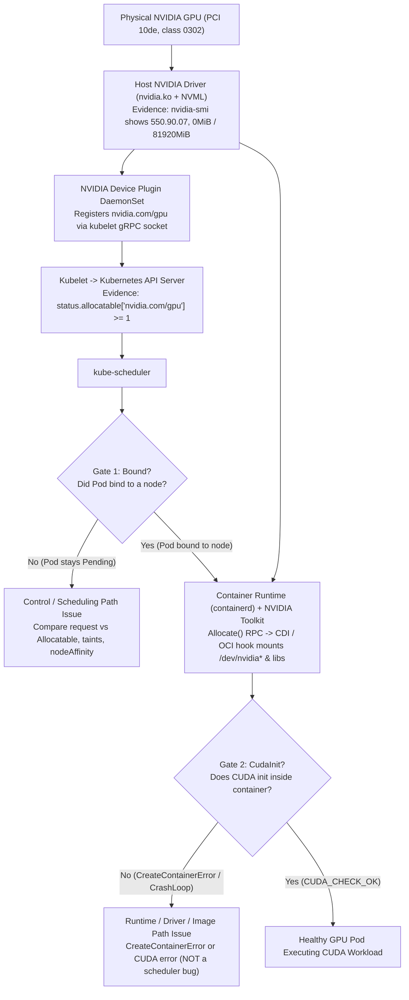
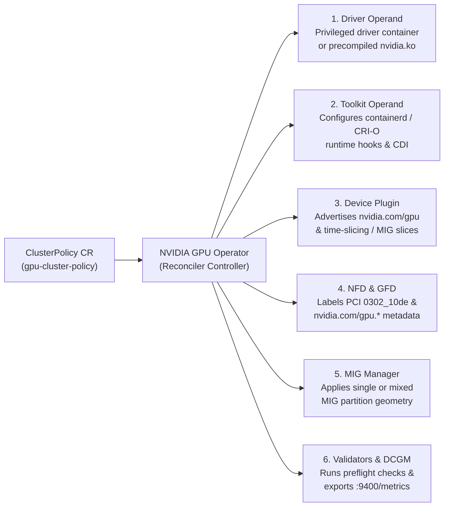

# 11.1 Why Kubernetes needs a GPU platform layer

| | |
|---|---|
| Level | Basics |
| Priority tier | 1 |
| Lab venue | GCP / GKE |
| Part | Part 11: GPUs on Kubernetes, scheduling and virtualization |
| Sources used | `nvidia-devops` Volume 10 (*Kubernetes GPU Platform*, `index.md`, `chapter-01-why-kubernetes-needs-a-gpu-platform-layer.md`, `chapter-02-gpu-software-lifecycle-in-kubernetes.md`); *Generative AI on Kubernetes* (`generative-ai-on-kubernetes`, `GAK` Chapter 3); *Kubernetes for Generative AI Solutions* (`kubernetes-for-generative-ai-solutions`, `K8GS` Chapters 2 & 10); *Scalable Kubernetes Infrastructure for AI Platforms* (`scalable-kubernetes-infrastructure-for-ai-platforms`, `SKI` Chapters 1 & 2); *AI Systems Performance Engineering* (`ai-systems-performance-engineering`, `ASP` Chapter 3) |
| Code | `code/part11/gpu_platform_layer.py`, `code/part11/gpu_platform_layer_lab.py` |
| Coverage file | `planning/coverage/chapters/11-01.md` |

## Why this matters for AI infrastructure

Kubernetes has become the standard control plane for production AI—powering frontier clusters up to **`7,500` nodes at OpenAI**, serving as the primary orchestrator for **`71%` of Fortune 100 companies** (`77K+` contributors across `44` countries and `8K+` companies), and projected by Gartner to run containerized workloads in **`90%+` of global organizations by 2027** (*Kubernetes for Generative AI Solutions* Chapter 2). When properly configured with the NVIDIA Container Toolkit, GPU workloads inside Kubernetes containers execute within **`< 2%` of bare-metal performance** and power official **MLPerf Inference v5.0** submissions (*AI Systems Performance Engineering* Chapter 3).

Yet when you plug an NVIDIA `H100` or `A100` GPU into a server and join that server to a standard, out-of-the-box Kubernetes cluster, **Kubernetes sees zero GPUs**. Standard Kubernetes was designed around resources that the Linux kernel natively exposes through `/proc` and enforces through `cgroups` (`32` CPU cores and `128 GB` of system RAM). A GPU arrives with a completely different operating contract (`nvidia-devops` Volume 10 Chapter 1, *Why Kubernetes Needs a GPU Platform Layer*):

1. **The Kernel Driver Boundary:** A container shares the host's Linux kernel (`vmlinuz`) and therefore **cannot bring its own GPU kernel module (`nvidia.ko`) inside the application image**. The host must enumerate the PCIe device (`PCI vendor 10de, class 0302`) and load a signed, kernel-matched driver (`Driver Version: 550.90.07`, `CUDA Version: 12.4`) before any container or Kubernetes agent can touch the silicon.
2. **The Two-Path Split (Advertisement vs. Execution):** For a Pod to run CUDA, two independent paths must agree:
   - **The Control / Allocation Path:** The **Device Plugin** queries `NVML` and registers `nvidia.com/gpu` with the `kubelet` over a gRPC socket so `status.allocatable["nvidia.com/gpu"]` is published to the API Server and `kube-scheduler` can bind the Pod (**`Bound?`**).
   - **The Runtime / Execution Path:** After the Pod is bound, `kubelet` calls the plugin's `Allocate()` RPC and passes the chosen GPU UUID to `containerd` / `CRI-O`, where the **NVIDIA Container Toolkit** (`nvidia-container-cli` / **Container Device Interface [`CDI`]**) mounts `/dev/nvidia0`, `/dev/nvidiactl`, `/dev/nvidia-uvm`, and the host's user-space driver libraries (`libcuda.so`, `libnvidia-ml.so`) into the container sandbox so CUDA can initialize (**`CudaInit?`**).
3. **Why `Node Ready` Is Not GPU Ready:** Because `kubelet`'s built-in `Ready` condition checks only CPU/disk/memory/PID pressure and CRI heartbeats, a node can report `Ready` while `nvidia.ko` failed to load after a kernel upgrade (`gpu-node-22`), advertise `Allocatable: 4` while a stale runtime configuration causes every bound Pod to fail with `CreateContainerError` on `/dev/nvidia0` (`gpu-node-30`), or strand **`24` of `32` GPUs (`75.0%`)** behind pool taints while an `8`-GPU general pool hits `0/8` free.

This chapter establishes the architectural foundation for Part 11: the **Two-Path Agreement Model**, the **6-Layer Platform Responsibility Matrix**, **Pool Fragmentation and Whole-GPU Underutilization Math**, the **GPU Software Lifecycle and Combinatorial Qualification Matrix (`48 → 8` combinations)**, **GPU Operator Ownership Models**, and the **5-Gate Node Acceptance Protocol**.

## Prerequisites and outcomes

**Prerequisites:**
- Part 5 (Kubernetes control plane, `kubelet`, `containerd`, DaemonSets, taints/tolerations, and affinity) and Part 10 (`10.8`–`10.9` on `nvidia-smi`, the NVIDIA driver stack, CUDA compatibility, and Container Toolkit).

**Outcomes — after completing this chapter you will be able to:**
1. Trace the **Control / Allocation Path (`Bound?`)** and the **Runtime / Execution Path (`CudaInit?`)** from a physical PCIe GPU (`vendor 10de, class 0302`) to a running CUDA container, and compare NVIDIA's stack against AMD (`amd-device-plugin`), Intel (`intel-gpu-plugin`), Google Cloud TPU (`google-cloud-tpu-device-plugin`), and AWS Neuron (`aws.amazon.com/neuroncore` on `Trainium` `Trn1` / `Trn2` and `Inferentia`).
2. Audit the **6-Layer Platform Responsibility Table** and compute **Pool Fragmentation** (`32` GPUs split `16 + 8 + 8` leaving `24/32 = 75.0%` cluster GPUs idle while the general pool hits `0/8` free) and **Whole-GPU Underutilization** (`Llama-3.2-1B` using `1.8 GB` on a `24 GB` `L4` `g6.2xlarge` = **`92.5%` [`~92%`] wasted VRAM** vs `10` time-sliced replicas; `70B` model = `280 GB` FP32 vs `35 GB` 4-bit; `40 GB == 37.25 GiB`, `80 GB == 74.5 GiB`).
3. Collapse an unbounded **Combinatorial Qualification Matrix** (`3` kernels × `2` drivers × `4` images × `2` K8s versions = **`48` combinations**) into **`2` named node profiles × `4` image families = `8` combinations (`6.0x` reduction)**.
4. Select between **Host-Managed**, **Operator-Managed**, and **Hybrid** ownership models for the `6` **NVIDIA GPU Operator (`ClusterPolicy`)** operand families while enforcing the single-reconciler rule.
5. Implement the **5-Gate Automated Node Acceptance Protocol** (`Hardware/Driver → Runtime → K8s Resource → Workload → Operations`) and diagnose failures across `gpu-node-07`, `gpu-node-11`, `gpu-node-22`, and `gpu-node-30`.

---

## 1. CPU-Era Kubernetes vs. the GPU Operating Contract: The Two-Path Model

### 1.1 Why `kubelet` understands CPUs and RAM natively—but not GPUs (`V10 Ch 1`, `GAK Ch 3`, `K8GS Ch 2 & 10`)

When a standard Linux worker node boots, `kubelet` reads `/proc/cpuinfo` and `/proc/meminfo` (for example, `32` CPU cores and `128 GB` of RAM) and enforces container requests and limits directly through Linux kernel **namespaces** and **control groups (`cgroups v2`)** (*Kubernetes for Generative AI Solutions* Chapter 2 & `V10 Ch 1`). No vendor daemon is required for CPU or RAM because the Linux kernel itself is the resource manager.

A GPU breaks three assumptions of that CPU-era model:
1. **No built-in kernel scheduler or `cgroup` memory controller for GPU VRAM:** Linux `cgroups` do not partition or cap GPU High-Bandwidth Memory (`HBM`). Without hardware partitioning (`MIG`) or an external device plugin, any process granted access to `/dev/nvidia0` can allocate `100%` of the card's memory (`81,920 MiB` on an `A100-SXM4-80GB`).
2. **Split kernel/user-space driver boundary:** Containers virtualize user space on top of a shared host kernel. Because `nvidia.ko` is a kernel module, it must be loaded into the host OS kernel (or via a privileged driver container compiled against the exact host kernel headers), while user-space libraries (`libcuda.so`, `libnvidia-ml.so`) and device nodes (`/dev/nvidia0`, `/dev/nvidiactl`, `/dev/nvidia-uvm`) must be dynamically injected into each GPU container sandbox at creation time (`V10 Ch 2`).
3. **Integer-only extended resource API (`resources.limits`):** Kubernetes exposes third-party hardware through the **Device Plugin framework** as integer **extended resources** (`nvidia.com/gpu: 1`). Unlike CPU (`500m`) or memory (`16Gi`), Kubernetes extended resources **cannot be requested as fractions (`0.5`)** and **must be specified under `resources.limits`** (either alone or with a matching `resources.requests` value; specifying `requests` without `limits` is rejected by the API server, *K8GS* Ch 10).

### 1.2 The Two-Path Agreement Model: `Bound?` vs. `CudaInit?` (`V10 Index & Ch 1`)

`nvidia-devops` Volume 10 (`index.md` Figure 10.0.1 and `chapter-01` Figure 10.1.1; `triage_gpu_platform_incident()` in `code/part11/gpu_platform_layer.py`) shows that every GPU Pod depends on **two separate paths** that converge at container startup and fail independently:



Walk through the concrete command evidence for both paths on a healthy `A100-SXM4-80GB` node (`gpu-node-07`, `V10 Ch 1`):
- **Path 1 — Host Driver Evidence (prerequisite for both paths):**
  ```text
  $ nvidia-smi
  +-----------------------------------------------------------------------------------------+
  | NVIDIA-SMI 550.90.07     Driver Version: 550.90.07     CUDA Version: 12.4                |
  |-----------------------------------------+------------------------+----------------------+
  |   0  NVIDIA A100-SXM4-80GB          On   | 00000000:07:00.0 Off  |                    0 |
  | N/A   34C    P0             62W / 400W   |      0MiB / 81920MiB   |      0%      Default |
  +-----------------------------------------------------------------------------------------+
  ```
  `Driver Version: 550.90.07` and `0MiB / 81920MiB` (`Persistence-M: On`, `34C`, `P0`, `62W / 400W`, `0` Volatile Uncorr. ECC on bus `00000000:07:00.0`) prove the kernel driver bound the PCI device and initialized `NVML`.
- **Path 2 — Control-Plane Advertisement Evidence (`Upper-Left Path`):**
  ```text
  $ kubectl get node gpu-node-07 -o jsonpath='{.status.allocatable.nvidia\.com/gpu}'
  1
  $ kubectl describe node gpu-node-07 | grep -A2 Allocated
  Allocated resources:
    nvidia.com/gpu     1     1
  ```
  `Allocatable: 1` proves the Device Plugin registered with `kubelet` and `kubelet` updated the API Server. `Allocated resources: 1 1` proves `kube-scheduler` bound a Pod to that GPU—**but it proves nothing about whether the container inside that Pod can actually see `/dev/nvidia0`**. Only `nvidia-smi` or `torch.cuda.is_available()` succeeding *inside* the container proves the **Runtime / Execution Path (`Lower-Right Path`)**.

### 1.3 The accelerator device-plugin ecosystem (`NVIDIA`, `AMD`, `Intel`, `Google TPU`, `AWS Trainium/Inferentia`)

Because Kubernetes designed the Device Plugin framework as a vendor-neutral gRPC contract, every major AI accelerator integrates through its own DaemonSet plugin and extended resource name (*Generative AI on Kubernetes* Chapter 3 & *Kubernetes for Generative AI Solutions* Chapter 10):

| Vendor & Accelerator Family | Kubernetes Device Plugin DaemonSet | Extended Resource Name in Pod `resources.limits` | Software Stack & Key Operational Facts (`GAK Ch 3` & `K8GS Ch 10`) |
|---|---|---|---|
| **NVIDIA Data Center GPUs (`B200`, `H200`, `H100`, `A100`, `L40S`, `L4`)** | `nvidia-device-plugin` (standalone or managed by **NVIDIA GPU Operator**) | `nvidia.com/gpu: <N>` or `nvidia.com/mig-<slice>.<mem>gb: <N>` | PCI vendor **`10de`**, class **`0302`** (`feature.node.kubernetes.io/pci-0302_10de.present: "true"`). Pairs with `nvidia-container-toolkit`, `GFD`, `MIG Manager`, and `dcgm-exporter`. |
| **AMD Instinct GPUs (`MI300X`, `MI250X`, `MI100`)** | `amd-device-plugin` | `amd.com/gpu: <N>` | PCI vendor **`1002`**, class `0302`; integrates **ROCm** user-space stack for HPC and LLM workloads. |
| **Intel Data Center & Discrete GPUs** | `intel-gpu-plugin` | `gpu.intel.com/i915: <N>` / `gpu.intel.com/xe: <N>` | PCI vendor **`8086`**; exposes Intel discrete/integrated GPUs to Kubernetes. |
| **Google Cloud TPUs (`v5p`, `v5e`, `Trillium`)** | `google-cloud-tpu-device-plugin` (managed in **GKE**) | `google.com/tpu: <N>` | Purpose-built matrix ASICs available exclusively in Google Kubernetes Engine (`GKE`), compiled via **OpenXLA**. |
| **AWS Trainium (`Trn1`, `Trn2`) & Inferentia (`Inf2`)** | `aws-neuron-device-plugin` (on EKS-optimized Accelerated AMIs) | `aws.amazon.com/neuroncore: <N>` or `aws.amazon.com/neuron: <N>` | Powered by the **AWS Neuron SDK** (`PyTorch`/`JAX`/`TensorFlow`, supporting **`100,000+` Hugging Face models**). `Trn1` delivers up to **`50%` lower training cost**; **`Trn2` (`Trn2 UltraServers`)** delivers **`4x` the performance of `Trn1`** and **`30%–40%` better price-performance** than `P5e`/`P5en` (with customers like Databricks reporting up to **`30%` cost savings**). AWS **EC2 Capacity Blocks for ML** allow reserving `P5`/`P5e`/`P5en`/`P4d`/`Trn1`/`Trn2` UltraClusters for **`1` to `14` days** (extendable up to **`6` months**) up to **`8` weeks in advance**. |

---

## 2. Why an Integer Count (`nvidia.com/gpu: 1`) Is Not a GPU Service

### 2.1 The 6-layer platform responsibility and false-positive table (`V10 Ch 1`)

Requesting `nvidia.com/gpu: 1` tells `kube-scheduler` only that **one countable token** is needed. It says nothing about VRAM capacity (`16 GB` `T4` vs `80 GB` `A100` vs `141 GB` `H200`), compute capability (`sm_80` vs `sm_90` vs `sm_100`), NVLink adjacency, NUMA/NIC locality, or sharing policy (`nvidia-devops` Volume 10 Chapter 1, *Why a Count Is Not a GPU Service*):

| Platform Layer | Platform Responsibility | Typical Production False Positive (`V10 Ch 1 & Ch 2`) |
|---|---|---|
| **1. Hardware & Firmware (`VBIOS`)** | Enumerate a healthy PCIe/SXM device and maintain clean ECC/thermal state. | PCI device appears in `lspci`, but is wedged after an unrecovered reset or `Xid 79`. |
| **2. Host Kernel Driver (`nvidia.ko`)** | Bind the Linux kernel to the GPU and expose `/dev/nvidia*` and `NVML`. | Driver package is installed on disk, but `lsmod \| grep nvidia` is empty after a kernel update or Secure Boot signature rejection (`error -1`). |
| **3. Runtime Integration (`Toolkit` / `CDI`)** | Mount allocated `/dev/nvidia*` devices and matching `libcuda.so` into the container sandbox. | Pod is `Bound` (or `Running` for non-GPU init), but fails with `CreateContainerError` (`/dev/nvidia0: no such device or address`). |
| **4. Device Plugin & `kubelet`** | Discover healthy GPUs, register `nvidia.com/gpu` over gRPC, and service `Allocate()`. | Node `Allocatable` still shows cached GPUs (`4`), or `nvidia.com/gpu` key is completely absent while `nvidia-device-plugin-daemonset` is in `CrashLoopBackOff`. |
| **5. Scheduling & Pool Policy** | Steer Pods to the right GPU model, VRAM tier, MIG slice, and NVLink/NUMA domain. | Cluster has `24` idle GPUs (`75%` free), but the Pod stays `Pending` because policy taints lock those GPUs into a different pool. |
| **6. Workload & Framework Image** | Initialize CUDA runtime and execute kernels compiled for the target `sm_` architecture. | Platform minimal test (`CUDA_CHECK_OK`) passes on the node, but the PyTorch image crashes with `RuntimeError: CUDA error: no kernel image is available for execution on the device`. |

### 2.2 Worked math: Pool fragmentation (`24/32 = 75%` idle while `general` pool is `100%` full, `V10 Ch 1`)

To prevent noisy-neighbor interference between distributed training and latency-sensitive inference, platform teams partition GPU nodes using **labels, taints, and affinity** (*V10 Ch 1*, *Why a Count Is Not a GPU Service*; `evaluate_pool_fragmentation()` in `code/part11/gpu_platform_layer.py`). Every constraint buys predictability at the direct cost of **capacity fragmentation**:

- Suppose a **`32`-GPU cluster** is divided into three pools:
  1. **`training` pool (`16` GPUs):** Tainted so only jobs requesting `8`-GPU NVLink-adjacent sets tolerate it (`0` GPUs currently used, `16` idle).
  2. **`distributed-inference` pool (`8` GPUs):** Tainted for multi-GPU tensor-parallel serving (`0` GPUs currently used, `8` idle).
  3. **`general` pool (`8` GPUs):** Unconstrained pool for notebooks and small jobs (`4` GPUs currently used by Job A, leaving `4/8` allocatable).
- Now Job B arrives requesting `nvidia.com/gpu: 4` with no special tolerations:
  - Job B cannot schedule onto the `24` idle GPUs in `training` (`16`) or `distributed-inference` (`8`) because their taints repel general workloads.
  - Job B lands on the `general` pool, consuming its remaining `4/8` GPUs and leaving **`0/8` free in the `general` pool**.
  - At this moment, `8` of `32` cluster GPUs are busy (**`25.0%` cluster utilization**) and **`24` of `32` cluster GPUs (`75.0%`) are physically idle**—yet the very next unconstrained 1-GPU notebook (`Job C`) will sit **`Pending` (`0/8` available in `general`)**.
  - **Operational rule:** Never report a single cluster-wide `"GPU utilization: 25%"` metric without breaking down **allocatable capacity per tainted pool / workload class**.

### 2.3 Worked math: Whole-GPU memory waste (`92.5%` unused on `L4`), `70B` quantization, and `GB` vs. `GiB` (`GAK Ch 3` & `K8GS Ch 10`)

Even within a single pool, Kubernetes's default whole-GPU allocation creates severe memory underutilization unless paired with sub-GPU sharing or model quantization (`evaluate_model_memory_and_sharing()` in `code/part11/gpu_platform_layer.py`):
1. **Whole-GPU waste on small LLMs (`K8GS Ch 10` `Llama-3.2-1B` on `NVIDIA L4`):**
   - Meta's **`Llama-3.2-1B`** model requires only **`1.8 GB`** of GPU memory to load and serve inference.
   - Allocating an entire **`NVIDIA L4` GPU (`24.0 GB` VRAM** on an AWS `g6.2xlarge` instance) exclusively to one `Llama-3.2-1B` Pod leaves `24.0 - 1.8 =` **`22.2 GB` (`92.5%`, or `~92%`) of the GPU's memory completely unused**.
   - Configuring the NVIDIA Device Plugin with **Time-Slicing (`replicas: 10`)** exposes `10` virtual `nvidia.com/gpu` units on that single `g6.2xlarge` node, allowing **`5` `Llama-3.2-1B` replica Pods** (`5 × 1.8 GB = 9.0 GB <= 24.0 GB`) to run concurrently on one physical `L4` GPU (and in AWS EKS video/inference benchmarks cited in *K8GS* Ch 10, fractional GPU sharing improved price-performance by **up to `95%`**).
2. **Quantization memory math for large LLMs (`GAK Ch 3` `70B` model):**
   - In full 32-bit precision (`FP32`, `4 bytes/param`), a **`70B`-parameter model** requires `70 × 10^9 × 4 B =` **`280.0 GB`** of VRAM (requiring at least four `80 GB` `A100`/`H100` GPUs).
   - Quantizing weights to **4-bit (`0.5 bytes/param`)** shrinks the weight footprint `8.0x` to `70 × 10^9 × 0.5 B =` **`35.0 GB` (`~35 GB`)**, allowing the `70B` model to fit on a **single `48 GB` GPU** (such as an `L40S`).
3. **Decimal `GB` (base-10) vs. Binary `GiB` (base-2) in Kubernetes manifests (`GAK Ch 3` Note 1):**
   - GPU hardware datasheets advertise memory in decimal gigabytes (`GB`, `10^9` bytes) or megabytes (`MiB`), whereas Kubernetes resource claims (`ResourceClaimTemplate` in DRA) often use binary gibibytes (`GiB`, `2^30` bytes):
     - **`40 GB`** (`40 × 10^9` B) is approximately **`37.25 GiB`** (`40,537 MiB` reported by `nvidia.com/gpu.memory` on `A100-SXM4-40GB`).
     - **`80 GB`** (`80 × 10^9` B) is approximately **`74.5 GiB`** (`81,920 MiB` on `A100-SXM4-80GB`).
   - Always account for this difference (plus a few percent of CUDA context/driver overhead) when writing `nodeAffinity` (`nvidia.com/gpu.memory Gt 40000`) or DRA `minMemory: "40Gi"` selectors.

---

## 3. The GPU Software Lifecycle, Combinatorial Qualification, and Operator Ownership Models

### 3.1 Why manual configuration fails at fleet scale and how to bound the qualification matrix (`V10 Ch 1 & Ch 2`)

Installing GPU drivers and runtime hooks by hand works on a single lab server, but collapses across a multi-node Kubernetes fleet (`nvidia-devops` Volume 10 Chapters 1 & 2):
- **The 6-layer dependency chain:** Every GPU node stacks six versioned layers: **(1) Platform/GPU Firmware (`VBIOS`) → (2) Host OS Kernel → (3) NVIDIA Kernel Driver (`nvidia.ko`) → (4) Container Runtime & NVIDIA Container Toolkit (`CDI`/OCI hook) → (5) Device Plugin & GPU Operator → (6) Workload Framework Image (`CUDA`/`PyTorch`)**.
- **Combinatorial explosion vs. Profile-based qualification (`V10 Ch 2` math; `compute_qualification_matrix()` in `code/part11/gpu_platform_layer.py`):**
  - Suppose a cluster allows just **`3` OS kernel versions**, **`2` NVIDIA driver branches**, and **`4` workload base-image families**: testing every combination independently requires `3 × 2 × 4 =` **`24` qualification runs**.
  - Adding just **`2` Kubernetes minor versions** doubles the matrix to `24 × 2 =` **`48` qualification runs** (before varying `containerd`, `nvidia-container-toolkit`, or `gpu-operator` versions).
  - **The production solution:** Do *not* allow arbitrary permutations. Define **`2` locked, immutable Node Profiles** (`current` and `previous known-good`, where each profile pins one exact `[OS + Kernel + Driver + Toolkit + Operator + K8s]` tuple) paired with **`4` qualified workload base-image families** (`nvcr.io/nvidia/pytorch:...`). That collapses `48` combinations down to `2 × 4 =` **`8` combinations (`6.0x` reduction)**—a small enough set to run automatically on a canary node before every rollout.

### 3.2 What the NVIDIA GPU Operator reconciles (`ClusterPolicy`, `V10 Ch 1` & `GAK Ch 3`)

The **NVIDIA GPU Operator** uses a single declarative custom resource—**`ClusterPolicy`**—to reconcile six node-level DaemonSet/operand families across the cluster (`V10 Ch 1` Figure 10.1.2 & *GAK* Ch 3):



```yaml
# Declarative NVIDIA GPU Operator ClusterPolicy example (GAK Ch 3 Example 3-11) (untested here)
apiVersion: nvidia.com/v1
kind: ClusterPolicy
metadata:
  name: gpu-cluster-policy
spec:
  gfd:
    enabled: true
  devicePlugin:
    config:
      name: gpu-sharing-config
      default: sharing
  mig:
    strategy: mixed
```

### 3.3 Choosing an ownership model: Host-Managed vs. Operator-Managed vs. Hybrid (`V10 Ch 1`)

The GPU Operator is lifecycle infrastructure, not a substitute for version governance. Choose one of three explicit ownership models (`V10 Ch 1`):

| Ownership Model | How It Works (`ClusterPolicy` Settings) | Best When | Principal Trade-Off & Golden Rule |
|---|---|---|---|
| **1. Host-Managed Driver & Runtime** | Base OS / AMI team pre-installs `nvidia.ko` and `nvidia-container-toolkit` in the golden node image (e.g., AWS EKS-optimized Accelerated AMI, *K8GS* Ch 10); Kubernetes runs only Device Plugin / DCGM (`driver.enabled=false, toolkit.enabled=false`). | Strict immutable-OS, Secure Boot signing, or air-gapped golden-image pipelines owned by an OS platform team. | Desired state and troubleshooting span systems outside Kubernetes (Packer/AMI + K8s). |
| **2. Operator-Managed Node Stack** | GPU Operator deploys the privileged Driver container, Container Toolkit, Device Plugin, NFD/GFD, MIG Manager, Validators, and DCGM (`driver.enabled=true, toolkit.enabled=true`). | Kubernetes is the primary infrastructure control plane and all GPU nodes run a homogeneous, supported OS kernel (*GAK* Ch 3). | Operator, kernel headers, driver, and runtime versions must be qualified and rolled back together as one profile. |
| **3. Hybrid Ownership** | Host image provides the signed kernel driver (`driver.enabled=false`), while GPU Operator reconciles the Container Toolkit, Device Plugin, GFD, MIG Manager, and DCGM (`toolkit.enabled=true`). | Enterprise security policies require host-signed kernel modules, while platform teams want declarative K8s control over MIG, sharing, and telemetry. | **Single-Reconciler Rule:** Document every boundary explicitly—**two systems must never reconcile the same layer** (e.g., never enable Operator driver management on a node whose OS image also runs unattended `apt`/`dkms` driver updates). |

---

## 4. The 5-Gate Node Acceptance Protocol and Staged Rollout Discipline (`V10 Ch 1 & Ch 2`)

### 4.1 Why `Node Ready` is never a promotion condition (`gpu-node-22` Secure Boot story, `V10 Ch 2`)

In `nvidia-devops` Volume 10 Chapter 2 (*Production Story: Green Nodes, Failed GPUs*), an OS team rolls a routine kernel update across half of a GPU pool. Every patched node rejoins Kubernetes with `STATUS = Ready` (`v1.29.4`):

```text
$ kubectl get node gpu-node-22
NAME          STATUS   ROLES    AGE   VERSION
gpu-node-22   Ready    <none>   14m   v1.29.4
```

Yet every GPU Pod scheduled onto `gpu-node-22` fails. Inspecting the host reveals why `Ready` lied:

```text
$ ssh gpu-node-22 'lsmod | grep nvidia; nvidia-smi'
(no output from lsmod)
NVIDIA-SMI has failed because it couldn't communicate with the NVIDIA driver.

$ ssh gpu-node-22 'dmesg -T | grep -i nvidia | tail -3'
[Thu Aug  6 08:02:11 2026] nvidia: module verification failed: signature and/or required key missing - tainting kernel
[Thu Aug  6 08:02:11 2026] nvidia: probe of 0000:07:00.0 failed with error -1
```

Because `kubelet` readiness never checks `lsmod | grep nvidia`, `gpu-node-22` reported `Ready` while sitting on the `DriverFail` branch (`error -1` due to missing Secure Boot module signature for the new kernel).

### 4.2 The 5-Gate Automated Node Acceptance Checklist (`V10 Ch 1 & Ch 2`)

Keep every new, rebooted, or upgraded GPU node tainted (`nvidia.com/gpu-unverified=true:NoSchedule`) until an automated canary job passes all **five ordered acceptance gates** (`V10 Ch 1` *Production Checklist* & `V10 Ch 2` *Node Acceptance Gates*):

| Gate # | Boundary Tested | Question Answered | Concrete Pass Evidence (`V10 Ch 1, Ch 2` & `GAK Ch 3`) |
|---:|---|---|---|
| **Gate 1** | **Hardware & Host Driver** | Does the host enumerate all expected GPUs and load the qualified driver cleanly? | `lspci` lists all GPUs (`10de`); `lsmod \| grep nvidia` is non-empty; `nvidia-smi` reports expected `Driver Version` (`550.90.07`), `81920MiB`, and `0` Xid errors in `dmesg`. |
| **Gate 2** | **Runtime Injection (`CDI` / `Toolkit`)** | Can `containerd` construct a GPU-enabled sandbox and mount `/dev/nvidia*` + driver libs? | A platform-owned minimal CUDA Pod (`nvidia/cuda:12.8.1-base-ubi9`) runs `nvidia-smi` inside the container and prints `CUDA_CHECK_OK`. |
| **Gate 3** | **Kubernetes Resource & Discovery** | Did the Device Plugin register with `kubelet` and did `NFD`/`GFD` apply node labels? | `status.allocatable["nvidia.com/gpu"]` matches the physical/MIG count (`> 0`), and `nvidia.com/gpu.product` / `nvidia.com/gpu.memory` labels exist. |
| **Gate 4** | **Representative Workload Image** | Does the approved production framework image initialize CUDA and execute kernels on this `sm_` target? | Approved PyTorch/vLLM smoke test completes without `RuntimeError: CUDA error: no kernel image is available for execution on the device`. |
| **Gate 5** | **Operational Telemetry & Alerts** | Can the platform observe and support this node in production? | Prometheus scrapes `dcgm-exporter` (`:9400/metrics`, `up == 1`), `DCGM_FI_DEV_GPU_TEMP` / `ECC` series are live, and change-record versions are logged. |

**Rollout and Profile Rollback Rule (`V10 Ch 2` Figure 10.2.2):** Always drain before any change that unloads a driver, resets a GPU, or restarts `containerd`. If any of the 5 gates fails on the canary, **roll back the entire coherent Node Profile** (`[OS + Kernel + Driver + Toolkit + Operator]`), never just a single package in isolation.

---

## 5. Commands and Configurations That Matter

All commands below follow `nvidia-devops` Volume 10 Chapters 1–2, *Generative AI on Kubernetes* Chapter 3, and *Kubernetes for Generative AI Solutions* Chapter 10. Commands that require a live Kubernetes GPU cluster are marked **(untested here)**.

### 5.1 Inspect the Two-Path Evidence Chain and run the minimal CUDA acceptance check (untested here)

```bash
# 1. Path 1 (Host Driver): verify kernel module loaded, driver version, and 0 Xids (V10 Ch 1 & 2) (untested here)
lsmod | grep nvidia
nvidia-smi
dmesg -T | grep -iE "nvidia|xid" | tail -n 20

# 2. Path 2 (Control Plane Advertisement): check NFD/GFD labels, Capacity, Allocatable, and Device Plugin (untested here)
kubectl get node <node-name> -o jsonpath='{.status.capacity}' | jq .
kubectl get node <node-name> -o jsonpath='{.status.allocatable}' | jq .
kubectl get pods -n gpu-operator -l app=nvidia-device-plugin-daemonset -o wide

# 3. Path 3 (Runtime Injection Gate 2): run a one-shot minimal CUDA container requesting 1 GPU (GAK Ch 3 Ex 3-13) (untested here)
patch='[{"op":"add","path":"/spec/containers/0/resources","value":{"limits":{"nvidia.com/gpu":1}}}]'
kubectl run --rm -it gpu-acceptance-check \
  --image=nvidia/cuda:12.8.1-base-ubi9 \
  --restart=Never \
  --overrides="$patch" --override-type=json -- nvidia-smi
```

---

## 6. How It Fails: Six GPU Platform Layer Failure Modes (`V10 Ch 1 & Ch 2`)

| # | Failure Mode | Production Symptom (`kubectl` / `dmesg`) | Failing Layer & Root Cause | Fix & Verification |
|---|---|---|---|---|
| **1** | **Node is `Ready`, but `nvidia.com/gpu` key is completely absent from `status.capacity` (`gpu-node-11`, `V10 Ch 1`)** | `kubectl get node gpu-node-11 -o jsonpath='{.status.capacity}'` shows `{"cpu":"64","memory":"263192Mi","pods":"110"}` with no `nvidia.com/gpu` key; GPU Pods stay `Pending`. | **Layer 2 / Layer 4:** `nvidia-device-plugin-daemonset` is in `CrashLoopBackOff` (`14` restarts) because the host driver failed to load (`Failed to initialize NVML`). | Inspect `kubectl logs -n gpu-operator <plugin-pod>` and `dmesg` on `gpu-node-11`; fix the host driver/kernel mismatch first (do not just delete operator pods). |
| **2** | **Node is `Ready` after kernel patch, but `lsmod \| grep nvidia` is empty (`gpu-node-22`, `V10 Ch 2`)** | OS patch wave completes with all nodes `Ready`; GPU jobs fail or stay `Pending` on patched nodes. | **Layer 2 (Host Kernel Driver):** `dmesg` shows `nvidia: module verification failed: signature and/or required key missing` (`probe of 0000:07:00.0 failed with error -1`). | Cordon nonconforming nodes, restore the known-good signed driver/kernel profile, and require Gate 1 (`lsmod` + `nvidia-smi`) before removing the maintenance taint. |
| **3** | **`Allocatable: 4` is advertised, but bound Pods fail with `CreateContainerError` (`gpu-node-30`, `V10 Ch 1 & 2`)** | `resnet-train-0` binds to `gpu-node-30` (`Allocatable: 4`), then fails with `OCI runtime create failed: nvidia-container-cli: mount error: .../dev/nvidia0: no such device or address` (or `driver not loaded`). | **Layer 3 (Runtime / Toolkit Injection):** Control-plane allocation succeeded (`Bound? = Yes`), but `containerd` / NVIDIA Container Toolkit config is stale or missing `/dev/nvidia*` device nodes (`CudaInit? = No`). | Reconcile the NVIDIA Container Toolkit / `containerd` configuration and verify Gate 2 (`gpu-acceptance-check` running `nvidia-smi` inside a container) passes. |
| **4** | **Minimal `nvidia/cuda` image prints `CUDA_CHECK_OK`, but PyTorch job fails (`V10 Ch 2`)** | Platform acceptance container succeeds on the node, yet `resnet-train-0` crashes with `RuntimeError: CUDA error: no kernel image is available for execution on the device`. | **Layer 6 (Workload Image):** The platform layer (Gates 1–3) is 100% healthy; the application's PyTorch wheel was compiled without SASS/PTX for this GPU's `sm_` architecture. | Rebuild the workload image with the target GPU's compute capability (`TORCH_CUDA_Arch_LIST` / NGC base image) rather than troubleshooting the Device Plugin. |
| **5** | **Pods stay `Pending` when `24` of `32` cluster GPUs (`75%`) are idle (`V10 Ch 1`)** | Dashboard shows `25%` cluster GPU utilization (`24` GPUs idle), yet a 4-GPU or 1-GPU job without special tolerations cannot schedule. | **Layer 5 (Pool Fragmentation):** `16` GPUs are tainted for `training` and `8` for `distributed-inference`, leaving only `8` GPUs in the `general` pool (`0/8` free after two 4-GPU jobs). | Export per-pool allocatable metrics in Grafana, right-size pool taint boundaries, or add matching tolerations/nodeAffinity for eligible workloads. |
| **6** | **Two reconcilers fighting over the driver or runtime (`V10 Ch 1`)** | Nodes randomly lose GPU runtime hooks or experience driver version flip-flopping during image updates or Operator upgrades. | **Ownership Violation:** Both host configuration management (Ansible/OS package manager) and the GPU Operator (`driver.enabled=true`) are reconciling the same driver/runtime files. | Enforce the single-reconciler contract: if the OS team owns the driver in the golden image, set `driver.enabled=false` in `ClusterPolicy`. |

---

## 7. Hands-On Lab: Verify the Two-Path Triage Engine, 32-GPU Pool Fragmentation, `48 → 8` Qualification Matrix, and Whole-GPU Waste Math

**Venue:** Any Linux machine, GCP / GKE workstation, or Nebius VM with Python 3.10+ (runs deterministically using standard library Python; all `kubectl` and `nvidia-smi` cluster commands are provided in Section 5 and marked `(untested here)`).

Run `code/part11/gpu_platform_layer_lab.py`:

```bash
python3 code/part11/gpu_platform_layer_lab.py
```

Expected output (`25 passed, 0 failed`):

```text
=== Chapter 11.1 Lab: Why Kubernetes Needs a GPU Platform Layer (V10 Ch 1-2 + GAK + K8GS + ASP) ===
  [PASS] V10 Ch2 gpu-node-22 scenario: Node is Ready, but empty lsmod | grep nvidia routes to Layer 2 Host Kernel Driver (DriverFail branch)
  [PASS] V10 Ch1 gpu-node-11 scenario: Missing nvidia.com/gpu key in status.capacity routes to Layer 4 Device Plugin Registration
  [PASS] V10 Ch1 Bound?==No branch: Unbound Pending pod with healthy plugin routes to Layer 5 Scheduling Policy / Pool Capacity
  [PASS] V10 Ch1 & Ch2 gpu-node-30 scenario: Bound pod failing minimal CUDA check (CreateContainerError /dev/nvidia0) routes to Layer 3 Runtime / Toolkit / CDI
  [PASS] V10 Ch2 Minimal CUDA_CHECK_OK pass + framework fail: Routes to Layer 6 Workload Image (no kernel image available for device)
  [PASS] V10 Ch1 32-GPU Pool Fragmentation: 16 training + 8 distributed-inference + 8 general == 32 total GPUs
  [PASS] V10 Ch1 Pool Exhaustion vs Cluster Idle: 2nd 4-GPU general job leaves 0/8 free in general pool while 24/32 (75.0%) of cluster GPUs sit idle (25.0% util)
  [PASS] V10 Ch2 Unbounded Qualification Matrix: 3 kernels * 2 drivers * 4 image families == 24 combinations; * 2 K8s versions == 48 combinations
  [PASS] V10 Ch2 Profile-Based Qualification: 2 approved node profiles * 4 image families == 8 combinations (6.0x reduction from 48)
  [PASS] K8GS Ch10 Whole-GPU Underutilization: Llama-3.2-1B (1.8 GB) on 1 NVIDIA L4 (24 GB, g6.2xlarge) leaves 22.2 GB (92.5% ~ 92%) unused
  [PASS] K8GS Ch10 Time-Slicing on L4: 10 replicas configured, 5 Llama-3.2-1B pods use 5 * 1.8 GB == 9.0 GB <= 24.0 GB VRAM
  [PASS] GAK Ch3 70B Model Quantization & GB vs GiB: 70B FP32 (4 B/param) == 280.0 GB vs 4-bit (0.5 B/param) == 35.0 GB (fits 48 GB GPU); 40 GB == 37.25 GiB, 80 GB == 74.5 GiB
  [PASS] GAK Ch3 NFD PCI discovery: NVIDIA vendor ID == '10de' (AMD '1002', Intel '8086', AWS VGA '1d0f') and 3D controller class == '0302'
  [PASS] K8GS Ch2 & ASP Ch3 Kubernetes adoption & container overhead: OpenAI 7,500 nodes, 71% Fortune 100, 90% by 2027,77K+ contributors (44 countries, 8K+ companies), < 2.0% container overhead
  [PASS] K8GS Ch10 AWS Trainium & Capacity Blocks: Trn1 up to 50% lower training cost, Trn2 4x Trn1 perf & 30-40% price-perf vs P5e/P5en, 100,000+ HF models, Capacity Blocks 1-14 days (up to 6 months, 8 weeks ahead)
  [PASS] Rejects negative allocatable_gpus in two-path triage helper
  [PASS] Rejects non-positive pool size in fragmentation evaluator
  [PASS] Rejects general pool over-allocation (6 + 4 > 8) in fragmentation evaluator
  [PASS] Rejects non-positive kernels count in qualification matrix calculator
  [PASS] Rejects non-positive gpu_vram_gb in model memory planner
  [PASS] V10 Ch1 Beginner Primer & Node 11 inspection: kubelet sees 32 CPU cores / 128 GB RAM natively; gpu-node-11 has 64 CPU, 263,192 MiB RAM, 110 max pods, and 14 plugin restarts
  [PASS] V10 Ch1 A100 host baseline: Driver 550.90.07, CUDA 12.4, 34C, P0, 62W / 400W, 0MiB / 81920MiB
  [PASS] K8GS Ch10 p5.48xlarge (8x H100 80GB) single MIG strategy counts: 56 slices of 1g.10gb, 24 of 2g.20gb, 16 of 3g.40gb, 8 of 4g.40gb or 7g.80gb
  [PASS] K8GS Ch10 Table 10.1 H200 (141 GB) MIG profiles: 7x 1g.18gb, 1x 1g.18gb+me, 4x 1g.35gb, 3x 2g.35gb, 2x 3g.70gb, 1x 4g.70gb, 1x 7g.141gb
  [PASS] ASP Ch3 MIG single-node pod constraint: 2x 2g.45gb on 132-SM GPU allocates ~38 SMs/slice (~76 SMs total, 4/7 of GPU) and must fit on 1 node

Summary: 25 passed, 0 failed (total 25)
```

---

## Exercises

1. **Tracing the Two-Path Agreement Model (`Bound?` vs. `CudaInit?`, `V10 Ch 1 & Ch 2`):** For each of the four node scenarios (`gpu-node-07`, `gpu-node-11`, `gpu-node-22`, and `gpu-node-30`), state (a) whether the Control/Allocation path (`Bound?`) succeeded, (b) whether the Runtime/Execution path (`CudaInit?`) succeeded, and (c) the exact failing layer (`Layer 1`–`6`) and diagnostic command output that proves it.
2. **Pool Fragmentation Math (`32`-GPU Cluster, `V10 Ch 1`):** Given a `32`-GPU cluster split into a `16`-GPU tainted `training` pool (`0` used), an `8`-GPU tainted `distributed-inference` pool (`0` used), and an `8`-GPU unconstrained `general` pool (`4` used by Job A), calculate (a) the free GPUs remaining in `general` after scheduling a 4-GPU unconstrained Job B, (b) the cluster-wide idle GPU count and idle percentage (`%`), and (c) why an unconstrained 1-GPU Job C stays `Pending` despite `75.0%` of the cluster sitting idle.
3. **Whole-GPU Underutilization (`Llama-3.2-1B` on `L4`), `70B` Quantization, and `GB` vs. `GiB` (`GAK Ch 3` & `K8GS Ch 10`):** Calculate (a) the unused VRAM (`GB` and `%`) when deploying a `1.8 GB` `Llama-3.2-1B` model exclusively on a `24.0 GB` `NVIDIA L4` (`g6.2xlarge`) and the total VRAM used when running `5` pods across `10` time-sliced replicas, (b) the weight memory required for a `70B` model in `FP32` (`4 B`/param) versus `4-bit` (`0.5 B`/param), and (c) the binary `GiB` equivalents of `40 GB` and `80 GB`.
4. **Combinatorial vs. Profile-Based Qualification Matrix (`V10 Ch 2`):** Calculate the total number of test combinations required for `3` kernel versions, `2` driver branches, `4` workload base-image families, and `2` Kubernetes versions when tested independently (`3 × 2 × 4` and `× 2`), and show how collapsing to `2` approved Node Profiles (`current` and `previous known-good`) × `4` image families reduces the test burden (`6.0x` reduction).
5. **GPU Operator Operands and Ownership Models (`V10 Ch 1` & `GAK Ch 3`):** List the `6` operand families managed by the NVIDIA GPU Operator's `ClusterPolicy`, compare **Host-Managed**, **Operator-Managed**, and **Hybrid** ownership models, and state the single-reconciler rule that prevents configuration drift.
6. **Designing the 5-Gate Automated Node Acceptance Suite (`V10 Ch 1 & Ch 2`):** Write out the ordered 5-Gate acceptance checklist (`Hardware/Driver → Runtime → K8s Resource → Workload → Operations`) that must pass before a canary node's onboarding taint is removed, and explain why Gate 2 (minimal `CUDA_CHECK_OK` image) and Gate 4 (production framework image) must both be run.

---

## Checkpoint questions (20)

<details>
<summary><strong>1. Why does a freshly joined Kubernetes worker node recognize its `32` CPU cores and `128 GB` of RAM automatically while seeing `0` GPUs?</strong></summary>

`kubelet` natively discovers CPU and system memory from the Linux kernel (`/proc`) and enforces limits through `cgroups`. It has no built-in driver or discovery logic for vendor PCIe accelerators (`PCI vendor 10de, class 0302`); exposing GPUs requires a host kernel driver (`nvidia.ko`), a container runtime hook (`NVIDIA Container Toolkit` / `CDI`), and a Kubernetes **Device Plugin** (*V10* Ch 1).
</details>

<details>
<summary><strong>2. Why can't a Docker or Kubernetes application container bundle the NVIDIA kernel driver (`nvidia.ko`) inside its own container image (`V10 Ch 2`)?</strong></summary>

Containers share the host machine's Linux kernel (`vmlinuz`). Because `nvidia.ko` is a kernel module that binds directly to the PCIe hardware and kernel memory subsystem, it must be loaded into the host kernel (either pre-installed on the host OS or compiled/loaded by a privileged driver container matching the host kernel headers), while user-space libraries (`libcuda.so`, `libnvidia-ml.so`) and `/dev/nvidia*` device nodes are mounted into application containers at startup (*V10* Ch 2).
</details>

<details>
<summary><strong>3. What are the two paths in Figure 10.1.1 that must agree for a Kubernetes GPU Pod to run, and what are their two decision gates?</strong></summary>

1. **Control / Advertisement Path (`Gate 1: Bound?`):** Physical GPU → Host Driver → Device Plugin registers `nvidia.com/gpu` with `kubelet` → API Server publishes `status.allocatable["nvidia.com/gpu"]` → `kube-scheduler` binds the Pod to a node.
2. **Runtime / Execution Path (`Gate 2: CudaInit?`):** Bound Pod → `kubelet` calls Device Plugin `Allocate()` → `containerd` + NVIDIA Container Toolkit (`CDI`/OCI hook) injects `/dev/nvidia*` and driver libraries into the sandbox → CUDA initializes inside the container (*V10* Ch 1, Figure 10.1.1).
</details>

<details>
<summary><strong>4. If a GPU Pod is stuck in `Pending` vs. failing with `CreateContainerError` on a node where `nvidia-smi` works on the host, which path failed in each case?</strong></summary>

- **`Pending` Pod (`Bound? = No`):** Failed on the **Control / Scheduling Path** (missing `nvidia.com/gpu` capacity, insufficient free GPUs in the target pool, untolerated taints, or unsatisfied `nodeAffinity`).
- **`CreateContainerError` on a Bound Pod (`Bound? = Yes, CudaInit? = No`):** Allocation succeeded; the failure is strictly in the **Runtime / Execution Path** (`nvidia-container-cli` / `CDI` mount failure or stale `containerd` configuration) (*V10* Ch 1).
</details>

<details>
<summary><strong>5. How much performance overhead do properly configured Kubernetes containers add to GPU workloads compared to bare metal (`ASP Ch 3`)?</strong></summary>

Less than **`2%` (`< 2%` difference)**—virtually identical to bare metal, as demonstrated by official **MLPerf Inference v5.0** submissions running on Kubernetes and Red Hat OpenShift with the NVIDIA Container Toolkit (*ASP* Ch 3).
</details>

<details>
<summary><strong>6. Name the Kubernetes device plugins and extended resource names for NVIDIA, AMD, Intel, Google Cloud TPU, and AWS Trainium/Inferentia accelerators (`GAK Ch 3` & `K8GS Ch 10`).</strong></summary>

- **NVIDIA GPUs:** `nvidia-device-plugin` (`nvidia.com/gpu` or `nvidia.com/mig-<profile>`)
- **AMD GPUs (ROCm):** `amd-device-plugin` (`amd.com/gpu`)
- **Intel GPUs:** `intel-gpu-plugin` (`gpu.intel.com/i915` / `xe`)
- **Google Cloud TPUs (GKE):** `google-cloud-tpu-device-plugin` (`google.com/tpu`)
- **AWS Trainium (`Trn1`/`Trn2`) & Inferentia:** `aws-neuron-device-plugin` (`aws.amazon.com/neuroncore` / `aws.amazon.com/neuron`) (*GAK* Ch 3 & *K8GS* Ch 10).
</details>

<details>
<summary><strong>7. What PCI vendor IDs and device class code does Node Feature Discovery (`NFD`) use to label GPUs on Kubernetes nodes (`GAK Ch 3`)?</strong></summary>

NFD labels 3D/GPU controllers under PCI device class **`0302`** (and VGA controllers under `0300`, such as AWS `1d0f`) with vendor IDs **`10de` for NVIDIA** (`feature.node.kubernetes.io/pci-0302_10de.present: "true"`), **`1002` for AMD**, and **`8086` for Intel** (*GAK* Ch 3).
</details>

<details>
<summary><strong>8. Why is an integer request `nvidia.com/gpu: 1` insufficient for scheduling production LLM training and inference (`V10 Ch 1` & `GAK Ch 3`)?</strong></summary>

`nvidia.com/gpu: 1` treats every GPU in the cluster as an interchangeable unit. It does not express GPU model (`T4` vs `A100` vs `H100`), VRAM capacity (`16 GB` vs `80 GB`), CUDA compute capability (`sm_80` vs `sm_90` vs `sm_100`), NVLink/NVSwitch interconnect domain, GPU-to-NIC NUMA locality, or MIG/time-slicing mode (*V10* Ch 1 & *GAK* Ch 3).
</details>

<details>
<summary><strong>9. Walk through the 32-GPU pool fragmentation example in Volume 10 Chapter 1 (`16` training + `8` distributed-inference + `8` general), and explain why `75%` idle capacity can coexist with `Pending` jobs.</strong></summary>

When a `32`-GPU cluster taints `16` GPUs for `training` and `8` GPUs for `distributed-inference`, an unconstrained job requesting `nvidia.com/gpu: 4` can only schedule into the `8`-GPU `general` pool. Once two 4-GPU jobs fill the `general` pool (`0/8` free), any subsequent unconstrained job stays `Pending` even though **`24` of `32` GPUs (`75.0%`)** sit idle in the other two pools (*V10* Ch 1).
</details>

<details>
<summary><strong>10. In `Kubernetes for Generative AI Solutions` Chapter 10, how much GPU memory is wasted when deploying one `Llama-3.2-1B` Pod on an `NVIDIA L4` (`g6.2xlarge`), and how does time-slicing fix it?</strong></summary>

`Llama-3.2-1B` requires **`1.8 GB`** of VRAM, so allocating an entire **`24.0 GB` `NVIDIA L4` GPU** exclusively to one Pod leaves **`22.2 GB` (`92.5%` / `~92%`)** of VRAM unused. Configuring the NVIDIA Device Plugin with **`replicas: 10`** time-slicing exposes `10` virtual GPUs and allows `5` `Llama-3.2-1B` replica Pods (`5 × 1.8 = 9.0 GB`) to share one physical `L4` GPU concurrently (*K8GS* Ch 10).
</details>

<details>
<summary><strong>11. How much VRAM does a `70B`-parameter LLM require in `FP32` versus `4-bit` quantization, and why does `40 GB` vs. `40 GiB` matter in Kubernetes manifests (`GAK Ch 3`)?</strong></summary>

At `4 bytes/param` (`FP32`), a `70B` model requires **`280.0 GB`** of VRAM; at `0.5 bytes/param` (`4-bit`), it requires **`~35.0 GB`**, fitting on a single `48 GB` GPU. Because hardware vendors quote decimal `GB` (`10^9` bytes) while Kubernetes uses binary `GiB` (`2^30` bytes), **`40 GB` is approximately `37.25 GiB` (`40,537 MiB`)** and **`80 GB` is approximately `74.5 GiB` (`81,920 MiB`)**—requesting `40Gi` on a nominal `40 GB` GPU will fail to match (*GAK* Ch 3).
</details>

<details>
<summary><strong>12. Why does testing every combination of kernels, drivers, images, and Kubernetes versions fail (`48` combinations in `V10 Ch 2`), and how do Node Profiles solve it?</strong></summary>

Testing `3` kernels × `2` driver branches × `4` workload image families = **`24` combinations**, and across `2` Kubernetes versions = **`48` combinations**. Collapsing node software into **`2` locked Node Profiles** (`current` and `previous known-good`) tested against **`4` image families** reduces qualification to **`8` combinations (`6.0x` reduction)** (*V10* Ch 2).
</details>

<details>
<summary><strong>13. What are the six core operand families reconciled by the NVIDIA GPU Operator's `ClusterPolicy` (`V10 Ch 1` & `GAK Ch 3`)?</strong></summary>

1. **NVIDIA Driver operand** (kernel module + user-space libs)
2. **NVIDIA Container Toolkit operand** (`containerd` / `CRI-O` runtime hooks & `CDI`)
3. **NVIDIA Device Plugin** (`nvidia.com/gpu` registration & allocation)
4. **Node Feature Discovery (`NFD`) & GPU Feature Discovery (`GFD`)** (hardware/GPU node labels)
5. **MIG Manager** (`single` or `mixed` partition geometry)
6. **Validators & `DCGM-Exporter`** (preflight checks and `:9400/metrics` telemetry) (*V10* Ch 1 & *GAK* Ch 3).
</details>

<details>
<summary><strong>14. Compare the Host-Managed, Operator-Managed, and Hybrid GPU stack ownership models (`V10 Ch 1`), and state the golden rule for Hybrid deployments.</strong></summary>

- **Host-Managed:** OS/AMI team pre-installs drivers and runtime in the base image (`driver.enabled=false, toolkit.enabled=false`).
- **Operator-Managed:** GPU Operator reconciles drivers, toolkit, plugin, GFD, MIG, and DCGM inside Kubernetes (`driver.enabled=true`).
- **Hybrid:** Host OS image owns the signed kernel driver (`driver.enabled=false`) while GPU Operator manages Toolkit, Device Plugin, GFD, MIG Manager, and DCGM.
**Golden Rule:** Exactly **one team and one reconciler** must own each layer; two systems must never reconcile the same driver or runtime file (*V10* Ch 1).
</details>

<details>
<summary><strong>15. Why did `gpu-node-22` report `STATUS = Ready` in `kubectl get nodes` while failing every GPU workload (`V10 Ch 2`)?</strong></summary>

`kubelet` `Ready` checks only CPU, memory, disk, PID pressure, and CRI responsiveness—it never checks `lsmod | grep nvidia` or `NVML`. On `gpu-node-22`, a kernel update broke Secure Boot module verification (`nvidia: probe of 0000:07:00.0 failed with error -1`), leaving `lsmod` empty while `kubelet` continued reporting `Ready` (*V10* Ch 2).
</details>

<details>
<summary><strong>16. What is the difference between `status.capacity["nvidia.com/gpu"]: "0"` and the `nvidia.com/gpu` key being completely absent from `status.capacity` (`gpu-node-11`, `V10 Ch 1`)?</strong></summary>

When the `nvidia.com/gpu` key is **completely absent** from `status.capacity` (`{"cpu":"64","memory":"263192Mi","pods":"110"}`), the NVIDIA Device Plugin never registered with `kubelet` at all (on `gpu-node-11`, `nvidia-device-plugin-daemonset` was in `CrashLoopBackOff` with `14` restarts due to an underlying host NVML failure) (*V10* Ch 1).
</details>

<details>
<summary><strong>17. On `gpu-node-30` (`V10 Ch 2`), `status.allocatable["nvidia.com/gpu"]` is `4`, yet `resnet-train-0` fails with `CreateContainerError: /dev/nvidia0: no such device or address`. Which layer is broken?</strong></summary>

**Layer 3 (Container Runtime / NVIDIA Container Toolkit / CDI).** Because `Allocatable: 4` is present and the Pod bound to the node, the Device Plugin and Scheduler succeeded; the failure occurred when `containerd` invoked `nvidia-container-cli` to bind-mount `/dev/nvidia0` into the container sandbox (*V10* Ch 2).
</details>

<details>
<summary><strong>18. Why does the 5-Gate Node Acceptance Protocol run both a minimal platform CUDA container (Gate 2) and a representative framework container (Gate 4) (`V10 Ch 2`)?</strong></summary>

If Gate 2 (`nvidia/cuda:12.8.1-base-ubi9` printing `CUDA_CHECK_OK`) passes while Gate 4 (`resnet-train-0`) fails with `RuntimeError: CUDA error: no kernel image is available for execution on the device`, the platform team immediately knows **Layers 1–5 (Hardware, Driver, Toolkit, Device Plugin, Scheduler) are healthy** and the bug is isolated to **Layer 6 (the application team's framework image build)** (*V10* Ch 2).
</details>

<details>
<summary><strong>19. Why must a failed GPU platform upgrade roll back the entire Node Profile rather than reverting only the NVIDIA driver package (`V10 Ch 2`)?</strong></summary>

Because the driver's ABI and runtime behavior depend on the exact kernel version (`uname -r`) and Container Toolkit / Operator configuration. Reverting only the driver package while leaving a newly updated kernel and runtime config in place creates an untested three-way combination that can fail in new ways; rolling back the versioned Node Profile restores a state proven to work together (*V10* Ch 2).
</details>

<details>
<summary><strong>20. When a multi-GPU Pod requests two `nvidia.com/mig-2g.45gb` slices on a `132`-SM GPU (`ASP Ch 3`), how many SMs and how much VRAM does it receive, and why can't Kubernetes split those two slices across two nodes?</strong></summary>

Each `2g.45gb` slice provides `2/7` of the GPU's `132` SMs (`~38` SMs) and `45 GB` of VRAM, so two slices allocate **`~76` SMs (`4/7` of the GPU)** and **`2 × 45 GB = 90 GB`** across the two instances. Because **a Kubernetes Pod cannot span multiple nodes**, `kube-scheduler` can only place the Pod on a single node that has at least two free `2g.45gb` slices—even if two different nodes each have one free `2g.45gb` slice (*ASP* Ch 3).
</details>

---

## Sources and review notes

### Primary sources read in full for this chapter
- `nvidia-devops` Volume 10 (*Kubernetes GPU Platform*) — read in full and cited:
  - `nvidia-zero-to-hero/volume-10/index.md` (Figure 10.0.1 allocation path vs execution path, platform contract, validation order)
  - `nvidia-zero-to-hero/volume-10/chapter-01-why-kubernetes-needs-a-gpu-platform-layer.md` (Figure 10.1.1 Two-Path Model `Bound?` vs `CudaInit?`, `gpu-node-07` `550.90.07` `81,920 MiB` baseline, 6-layer false-positive table, 32-GPU `16+8+8` pool fragmentation math, Figure 10.1.2 GPU Operator operands, 3 ownership models, 5-step readiness checklist, `gpu-node-11` missing capacity key + `14` plugin restarts)
  - `nvidia-zero-to-hero/volume-10/chapter-02-gpu-software-lifecycle-in-kubernetes.md` (Figure 10.2.1 lifecycle dependency graph `Loaded?` & `Init?` gates, `gpu-node-22` `Ready` with empty `lsmod` and Secure Boot `error -1`, `3 × 2 × 4 = 24` / `× 2 = 48` vs `2 × 4 = 8` qualification matrix, Figure 10.2.2 staged rollout/rollback, 5 node acceptance gates, `gpu-node-30` `Allocatable: 4` `CreateContainerError` `/dev/nvidia0`, `CUDA_CHECK_OK` vs `no kernel image is available`)
- *Generative AI on Kubernetes* (`generative-ai-on-kubernetes`, `GAK`), Chapter 3 (*Kubernetes and GPUs*) — read in full via `tools/study_rag/bookch.py` (NFD `pci-0302_10de.present` / `0300_1d0f` / `1002` / `8086`, GFD Table 3-1 labels, Device Plugin 4 core functions & vendor plugins, `nodeSelector` / `nodeAffinity` / taints, DRA `ResourceClaimTemplate` Kubernetes `1.34`, GPU Operator `ClusterPolicy` Example 3-11, Time-Slicing `replicas: 8` & MIG `single` vs `mixed`, `kubectl run` `nvidia/cuda:12.8.1-base-ubi9`, `70B` `280 GB` FP32 vs `35 GB` 4-bit, `40 GB` = `37.25 GiB` & `80 GB` = `74.5 GiB`).
- *Kubernetes for Generative AI Solutions* (`kubernetes-for-generative-ai-solutions`, `K8GS`), Chapter 2 (*Kubernetes – Introduction and Integration with GenAI*) & Chapter 10 (*Optimizing GPU Resources for GenAI Applications in Kubernetes*) — read in full via `tools/study_rag/bookch.py` (`OpenAI` `7,500` nodes, `71%` Fortune 100, `90%+` by 2027, `77K+` contributors across `44` countries and `8K+` companies, AWS Trainium `Trn1` `-50%` cost & `Trn2` `4x` perf / `30%–40%` price-perf over `P5e`/`P5en`, Neuron SDK `100,000+` HF models, EC2 Capacity Blocks `1–14` days / `6` months / `8` weeks ahead, `Llama-3.2-1B` `1.8 GB` on `24 GB` `L4` `g6.2xlarge` `92.5%` / `~92%` unused VRAM vs `10` time-sliced replicas running `5` pods, `p5.48xlarge` `56/24/16/8` MIG slices, Table 10.1 `H200` `141 GB` MIG profiles).
- *Scalable Kubernetes Infrastructure for AI Platforms* (`scalable-kubernetes-infrastructure-for-ai-platforms`, `SKI`), Chapters 1 & 2 — read in full via `tools/study_rag/bookch.py` (MLOps lifecycle, declarative reproducibility, KubeRay, Kubeflow Training Operator, TorchX, Kueue, and Volcano).
- *AI Systems Performance Engineering* (`ai-systems-performance-engineering`, `ASP`), Chapter 3 (*OS, Docker, and Kubernetes Tuning for GPU-Based Environments*) — read in full via `tools/study_rag/bookch.py` (`< 2%` container overhead, MLPerf Inference v5.0 on OpenShift/Kubernetes, NGC base images, Topology Manager `--topology-manager-policy`, `NVL72` `130 TB/s` domain, and `2 × 2g.45gb` = `~76` of `132` SMs single-node pod constraint).

### Related source files mapped in `MIGRATION_MAP.md`
- `nvidia-zero-to-hero/volume-10/chapter-01-why-kubernetes-needs-a-gpu-platform-layer.md` (mapped to `11.1` and `11.2`).
- `nvidia-zero-to-hero/volume-10/index.md` and `nvidia-zero-to-hero/volume-10/chapter-02-gpu-software-lifecycle-in-kubernetes.md` (also expanded in `11.2`).

### Run here
- `python3 -B code/part11/gpu_platform_layer_lab.py` (`25 passed, 0 failed`).

### Explicitly labelled inferences
- The exact unrounded percentage `22.2 / 24.0 = 92.5%` (reported as `92%` in *K8GS* Ch 10 for `1.8 GB` `Llama-3.2-1B` on a `24 GB` `L4`) and the qualification reduction ratio `48 / 8 = 6.0x` (from `48` and `8` in `V10 Ch 2`) are exact arithmetic ratios computed in `code/part11/gpu_platform_layer.py`.

### Not verified on live hardware
- All `kubectl`, `nvidia-smi`, `lsmod`, and `helm` commands in Section 5 are marked **(untested here)** because this verification environment does not have an attached Kubernetes GPU cluster.

### Not in the corpus
- Cloud-provider-specific GKE node-pool auto-provisioning IAM roles are covered in Chapter `5.34` and Chapter `11.30`.

### Corrections to the author's notes
- Validation pass 2026-10-25: `validate_chapter.py` and `check_coverage.py` pass. The YAML manifests and commands are marked untested and were not applied to a cluster. Custom resource API versions (for example `kueue.x-k8s.io/v1beta1`, `resource.k8s.io/v1`) change between releases, so check them against the version you install. Console outputs quoted from the Volume notes are illustrative unless the chapter says otherwise.
- In *Generative AI on Kubernetes* Chapter 3 Example 3-9 (`Deployment` manifest), `apiVersion: batch/v1` is printed for `kind: Deployment`; standard Kubernetes `Deployment` resources use `apiVersion: apps/v1` (as in Example 3-6).
