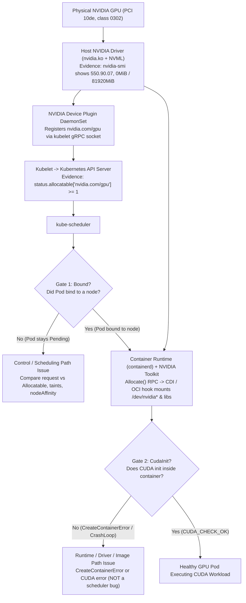
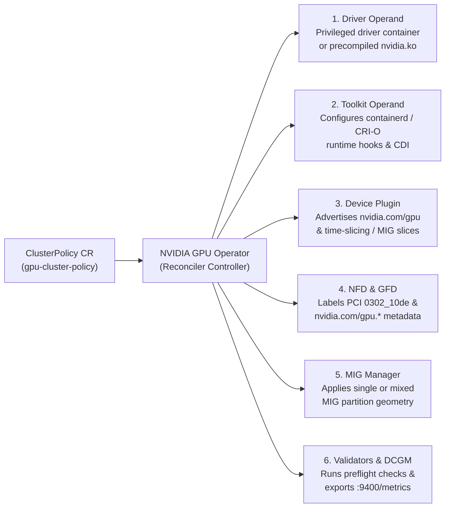

# 11.1 Why Kubernetes needs a GPU platform layer

| | |
|---|---|
| Level | Basics |
| Priority tier | 1 |
| Lab venue | GCP / GKE |
| Part | Part 11: GPUs on Kubernetes, scheduling and virtualization |
| Code | `code/part11/gpu_platform_layer.py`, `code/part11/gpu_platform_layer_lab.py` |
| Coverage file | `planning/coverage/chapters/11-01.md` |

## Why this matters for AI infrastructure

Picture a fresh Kubernetes cluster that you have just built, with a server that has eight NVIDIA H100 GPUs. The node turns green and reports a healthy Ready status, so it looks finished. You send the cluster a small test job, expecting it to run on the new hardware. Then the training team submits a distributed PyTorch job, and every Pod stays Pending. Kubernetes sees zero GPUs on the machine, even though the eight cards are sitting right there in the chassis.

This is the moment when a platform engineer realizes that Kubernetes does not know what a GPU is. Standard Kubernetes was built around CPU cores and system memory. The Linux kernel exposes those resources natively, through `/proc`, and enforces limits through control groups. A GPU works differently. It needs a dedicated platform layer between the hardware and the container scheduler, and that layer has to be installed, checked and kept in step with the rest of the stack.

The table below gives a sense of how large the ecosystem around Kubernetes has become. The numbers come from the sources named in the last column, and they describe scale, not GPU behavior.

| Adoption or Performance Metric | Value | Source |
|---|---|---|
| OpenAI frontier Kubernetes cluster scale | 7,500 nodes | *Kubernetes for Generative AI Solutions* Ch 2 |
| Fortune 100 companies using Kubernetes as primary orchestrator | 71% | *Kubernetes for Generative AI Solutions* Ch 2 |
| Global Kubernetes open-source ecosystem | 77K+ contributors across 44 countries and 8K+ companies | *Kubernetes for Generative AI Solutions* Ch 2 |
| Gartner projection for global organizations running containerized workloads by 2027 | 90%+ | *Kubernetes for Generative AI Solutions* Ch 2 |
| Container overhead vs bare metal with NVIDIA Container Toolkit on MLPerf Inference v5.0 | < 2% | *AI Systems Performance Engineering* Ch 3 |

Three architectural boundaries explain why out-of-the-box Kubernetes cannot run a GPU workload on its own. Each boundary is a place where a GPU request can fail even though every Kubernetes object looks correct.

The first boundary is the kernel. A container shares the host Linux kernel, so it cannot bundle its own kernel driver module inside the application image. The kernel driver is the piece of software that talks to the GPU hardware at the lowest level. The host must enumerate the PCIe device, which means the operating system must find the card on the PCIe bus, and then load a signed, version-matched kernel driver. Only then can any container or Kubernetes agent touch the silicon.

The second boundary is that a GPU Pod needs two independent paths to agree before CUDA can execute. CUDA is NVIDIA's programming platform for running code on the GPU. On the control path, the Device Plugin queries the NVIDIA Management Library, which is the library that reports GPU health and state, and registers `nvidia.com/gpu` with kubelet. Kube-scheduler can then bind the Pod to the node. On the runtime path, kubelet passes the allocated GPU identifier to containerd. There, the NVIDIA Container Toolkit mounts the device nodes and user-space libraries into the container sandbox. The sandbox is the isolated environment that the container runs in.

The third boundary is the built-in Node Ready condition. It checks only CPU, disk, memory, PID pressure, and runtime heartbeats. A worker node can therefore report Ready while its GPU kernel module failed to load after a kernel upgrade. Another node can advertise four allocatable GPUs while a stale runtime configuration makes every bound Pod fail during container creation. In both cases the node looks healthy to Kubernetes, and the GPU problem stays hidden until a job arrives.

Keep these three boundaries in mind as you read the rest of this chapter. Each later section is a closer look at one of them.

## Prerequisites and outcomes

Suppose a teammate hands you a GPU node on Monday and asks you to make it ready for training by Friday. You would need to know what Kubernetes expects from a node, what the GPU stack adds underneath, and where the two meet. This section sets the scene for that work.

Part 5 covers the Kubernetes control plane, kubelet, containerd, DaemonSets, taints, and affinity. Make sure you know these before you start, because the chapter uses them every time it talks about scheduling. You should also review Chapters 10.8 and 10.9, which cover `nvidia-smi`, the NVIDIA driver stack, CUDA compatibility, and the NVIDIA Container Toolkit. Those chapters explain the host side of the GPU, and this chapter explains how Kubernetes builds on top of it.

This chapter walks from the physical GPU to a running container. It follows the control allocation path, which decides where a Pod goes, and the runtime execution path, which decides whether the container can actually use the card. It also compares the NVIDIA stack with the device plugins for AMD, Intel, Google Cloud TPU and AWS Neuron hardware. Then it audits the six-layer platform responsibility table and works through the pool fragmentation and whole-GPU memory waste math.

The later sections turn these ideas into operating decisions. They show how to collapse an unbounded qualification matrix into a small set of locked node profiles, how to choose between three ownership models for the GPU Operator, and how to run a five-gate acceptance check on each node. Each gate is designed to isolate one kind of failure before a tenant workload lands on the node.

Work through the prerequisites first, since the later sections assume them.

---

## 1. CPU-Era Kubernetes vs. the GPU Operating Contract: The Two-Path Model

### 1.1 Why kubelet understands CPUs and RAM natively—but not GPUs

Platform engineers often expect kubelet to find a GPU the same way it finds CPU cores. When that expectation fails, a new GPU node cannot advertise its capacity. Understanding why the Linux kernel treats CPUs differently from GPUs stops you from debugging the scheduler when the host driver is the real problem.

When a standard Linux worker node starts, kubelet reads `/proc/cpuinfo` and `/proc/meminfo` straight from the host filesystem. These two files are part of the kernel's view of the machine, and they describe the processors and the memory in plain text. In the simple example used in this chapter, kubelet immediately recognizes 32 CPU cores and 128 GB of system RAM. It enforces container requests and limits through Linux kernel namespaces and control groups v2, without needing any external vendor daemon. A namespace hides part of the system from a process, and a control group caps how much of a resource the process can use.

A GPU breaks three core assumptions of that CPU-era model. The first assumption you meet is memory. Linux control groups do not partition or cap GPU High-Bandwidth Memory, which is the fast memory on the card itself. Without hardware Multi-Instance GPU partitioning or an external device plugin, any process granted access to `/dev/nvidia0` can allocate 100% of the card memory. A single greedy job can therefore fill the whole card, and nothing in the kernel stops it.

The second assumption concerns the boundary between the kernel and user space, and the GPU driver straddles it. Because `nvidia.ko` is a kernel module, it must load into the shared host OS kernel, or run inside a privileged driver container compiled against the exact host kernel headers. Kernel headers are the definitions that a module needs in order to compile against a specific kernel version. Meanwhile, user-space libraries like `libcuda.so` and device nodes like `/dev/nvidia0`, `/dev/nvidiactl`, and `/dev/nvidia-uvm` must be injected dynamically into each container sandbox at startup. A container image cannot carry them in advance, because they must match the host driver.

The third assumption is about how you request a GPU. Kubernetes exposes third-party hardware through the Device Plugin framework as integer extended resources, such as `nvidia.com/gpu: 1`. An extended resource is a named resource that a plugin adds to the cluster, outside the built-in CPU and memory types. Unlike CPU millicores or memory bytes, extended resources cannot be requested as decimals like `0.5`. Every GPU request must therefore be a whole integer under `resources.limits`, either alone or with an identical `resources.requests` value. A Pod that asks for half a GPU is not a valid request, so the scheduler has nothing to match it against.

### 1.2 The Two-Path Agreement Model: Bound? vs. CudaInit?

During a GPU outage, engineers often lose hours in the wrong place. They read scheduler logs looking for a container crash, or they inspect container images for a Pending Pod. Both mistakes happen because Kubernetes separates GPU scheduling from GPU container creation. Every GPU Pod depends on two independent paths, and those paths converge only when the container starts.

The diagram below shows the two paths side by side. The left branch is the control path, which ends at the scheduler, and the right branch is the runtime path, which ends at CUDA inside the container. Follow each arrow from the physical card to the final box, and notice where each gate sits.



Start with the control and advertisement path. The host driver initializes the GPU and exposes it to the NVIDIA Management Library. The Device Plugin queries that library and registers `nvidia.com/gpu` with kubelet over a local gRPC socket. gRPC is the remote procedure call protocol that kubelet and device plugins use to talk to each other. Kubelet then publishes `status.allocatable["nvidia.com/gpu"]` to the API Server, so kube-scheduler can pass the first gate and bind the Pod. Gate 1 is the question "Did the Pod bind to a node?" If the answer is no, the Pod sits in Pending, and the cause is in scheduling or advertisement.

The runtime and execution path starts after the Pod is bound to the node. Kubelet calls the plugin `Allocate()` RPC and passes the chosen GPU UUID to containerd or CRI-O. The UUID is the unique identifier of one physical GPU. containerd and CRI-O are the container runtimes that actually start the container on the node. There, the NVIDIA Container Toolkit or Container Device Interface mounts the device nodes and driver libraries into the sandbox. The second gate passes only when `nvidia-smi` or `torch.cuda.is_available()` succeeds inside the running container. Gate 2 is the question "Does CUDA initialize inside the container?" If the answer is no, the failure is in the runtime, the driver or the image, and the scheduler is usually innocent.

Here is what healthy evidence looks like on a node. The first block shows the host driver, and the second shows the control-plane view. Read the first block as the truth about the machine, and read the second as what Kubernetes has been told about it.

```text
# Path 1 — Host Driver Evidence on healthy A100-SXM4-80GB node gpu-node-07:
$ nvidia-smi
+-----------------------------------------------------------------------------------------+
| NVIDIA-SMI 550.90.07     Driver Version: 550.90.07     CUDA Version: 12.4                |
|-----------------------------------------+------------------------+----------------------+
|   0  NVIDIA A100-SXM4-80GB          On   | 00000000:07:00.0 Off  |                    0 |
| N/A   34C    P0             62W / 400W   |      0MiB / 81920MiB   |      0%      Default |
+-----------------------------------------------------------------------------------------+

# Path 2 — Control-Plane Advertisement Evidence on gpu-node-07:
$ kubectl get node gpu-node-07 -o jsonpath='{.status.allocatable.nvidia\.com/gpu}'
1
$ kubectl describe node gpu-node-07 | grep -A2 Allocated
Allocated resources:
  nvidia.com/gpu     1     1
```

Notice that the two blocks check different layers. A GPU can pass one check and still fail the other. A node can show a perfect `nvidia-smi` table while its allocatable count is still zero, because the device plugin has not registered yet. The reverse also happens, where the control plane advertises GPUs that the host driver can no longer see. Checking both paths is what separates a scheduling problem from a runtime problem.

### 1.3 The accelerator device-plugin ecosystem

Most AI platforms eventually run more than one accelerator family. If you add AMD Instinct GPUs, Google Cloud TPUs, or AWS Trainium instances, you need to know how Kubernetes abstracts each vendor's hardware. The Device Plugin framework is a vendor-neutral gRPC contract. So every major AI accelerator plugs in through its own DaemonSet and its own extended resource name.

A DaemonSet runs one copy of a Pod on every node that matches it, which is why each vendor's plugin appears as a DaemonSet in the table. The vendor name in the extended resource tells Kubernetes which plugin owns the request. The PCI vendor ID in the last column is the number the operating system uses to recognize the hardware maker. That ID is what Node Feature Discovery reads.

| Vendor & Accelerator Family | Kubernetes Device Plugin DaemonSet | Extended Resource Name in Pod `resources.limits` | Software Stack & Key Operational Facts (*Generative AI on Kubernetes* Ch 3 & *Kubernetes for Generative AI Solutions* Ch 10) |
|---|---|---|---|
| **NVIDIA Data Center GPUs (B200, H200, H100, A100, L40S, L4)** | `nvidia-device-plugin` (standalone or managed by **NVIDIA GPU Operator**) | `nvidia.com/gpu: <N>` or `nvidia.com/mig-<slice>.<mem>gb: <N>` | PCI vendor **10de**, class **0302** (`feature.node.kubernetes.io/pci-0302_10de.present: "true"`). Pairs with `nvidia-container-toolkit`, GFD, MIG Manager, and `dcgm-exporter`. |
| **AMD Instinct GPUs (MI300X, MI250X, MI100)** | `amd-device-plugin` | `amd.com/gpu: <N>` | PCI vendor **1002**, class **0302**; integrates **ROCm** user-space stack for HPC and LLM workloads. |
| **Intel Data Center & Discrete GPUs** | `intel-gpu-plugin` | `gpu.intel.com/i915: <N>` / `gpu.intel.com/xe: <N>` | PCI vendor **8086**; exposes Intel discrete and integrated GPUs to Kubernetes (`0300` VGA class also used alongside `1d0f` AWS VGA). |
| **Google Cloud TPUs (v5p, v5e, Trillium)** | `google-cloud-tpu-device-plugin` (managed in **GKE**) | `google.com/tpu: <N>` | Purpose-built matrix ASICs available exclusively in Google Kubernetes Engine, compiled via **OpenXLA**. |
| **AWS Trainium (Trn1, Trn2) & Inferentia (Inf2)** | `aws-neuron-device-plugin` (on EKS-optimized Accelerated AMIs) | `aws.amazon.com/neuroncore: <N>` or `aws.amazon.com/neuron: <N>` | Powered by the **AWS Neuron SDK** (PyTorch/JAX/TensorFlow, supporting **100,000+** Hugging Face models). Trn1 delivers up to **50%** lower training cost; **Trn2 (Trn2 UltraServers)** delivers **4x** the performance of Trn1 and **30%–40%** better price-performance than P5e/P5en (with Databricks reporting up to **30%** cost savings). AWS **EC2 Capacity Blocks for ML** allow reserving P5/P5e/P5en/P4d/Trn1/Trn2 UltraClusters for **1 to 14 days** (extendable up to **6 months**) up to **8 weeks in advance**. |

Each vendor's extended resource name is what a Pod asks for under `resources.limits`. Check that name first when you add hardware from a new vendor. A Pod that asks for the wrong name stays Pending forever, even on a node that has the right hardware, because no node advertises that name.

---

## 2. Why an Integer Count (`nvidia.com/gpu: 1`) Is Not a GPU Service

### 2.1 The 6-layer platform responsibility and false-positive table

Many developers assume that a request for `nvidia.com/gpu: 1` gives them a working GPU of the right size. A new team member writes that line, the Pod schedules, and the team considers the problem solved. In production, that bare integer only reserves one countable token from kube-scheduler. It says nothing about VRAM capacity or compute capability. It also says nothing about NVLink adjacency, NUMA locality, or whether the six software layers underneath are healthy.

NVLink is the high-speed link that connects GPUs to each other inside a server. NUMA, which stands for Non-Uniform Memory Access, describes the fact that a CPU reaches nearby memory faster than distant memory. Both affect how well a multi-GPU job runs, and neither is visible in the integer count.

The table below lists the six layers that a GPU node depends on. Each row names what the layer does and a false positive that looks healthy from the outside. A false positive is a symptom that suggests the layer is fine when it is not.

| Platform Layer | Platform Responsibility | Typical Production False Positive (`V10 Ch 1 & Ch 2`) |
|---|---|---|
| **1. Hardware & Firmware (VBIOS)** | Enumerate a healthy PCIe or SXM device and maintain clean ECC and thermal state. | PCI device appears in `lspci`, but is wedged after an unrecovered reset or Xid 79. |
| **2. Host Kernel Driver (`nvidia.ko`)** | Bind the Linux kernel to the GPU and expose `/dev/nvidia*` and NVML. | Driver package is installed on disk, but `lsmod` is empty after a kernel update or Secure Boot signature rejection (`error -1`). |
| **3. Runtime Integration (Toolkit / CDI)** | Mount allocated `/dev/nvidia*` devices and matching `libcuda.so` into the container sandbox. | Pod is Bound, but fails with `CreateContainerError` (`/dev/nvidia0: no such device or address`). |
| **4. Device Plugin & kubelet** | Discover healthy GPUs, register `nvidia.com/gpu` over gRPC, and service `Allocate()`. | Node Allocatable still shows cached GPUs (`4`), or `nvidia.com/gpu` key is absent while `nvidia-device-plugin-daemonset` is in `CrashLoopBackOff`. |
| **5. Scheduling & Pool Policy** | Steer Pods to the right GPU model, VRAM tier, MIG slice, and NVLink or NUMA domain. | Cluster has 24 idle GPUs (75% free), but the Pod stays Pending because policy taints lock those GPUs into a different pool. |
| **6. Workload & Framework Image** | Initialize CUDA runtime and execute kernels compiled for the target `sm_` architecture. | Platform minimal test (`CUDA_CHECK_OK`) passes on the node, but the PyTorch image crashes with `RuntimeError: CUDA error: no kernel image is available for execution on the device`. |

Read each row as a question. When you see a symptom from the right-hand column, ask which layer is actually failing. A PCI device that appears in `lspci` does not prove the card is usable, and a package on disk does not prove the module is loaded. Walking down the layers one at a time keeps you from fixing the wrong thing.

### 2.2 Worked math: Pool fragmentation

Platform teams partition GPU nodes with labels, taints, and affinity. A label is a key-value tag on a node, a taint is a rule that keeps ordinary Pods off a node, and affinity is a rule that pulls a Pod toward certain nodes. The goal is to stop noisy-neighbor interference between distributed training and latency-sensitive inference. A noisy neighbor is a workload that slows others down by using shared resources too heavily. Every scheduling constraint buys you predictability, but it comes at a direct cost in capacity fragmentation.

Fragmentation means that free capacity exists, but it is split into pieces that the next job cannot use. A cluster can sit mostly idle while new jobs wait in Pending queues, because free GPUs are locked inside specialized pools. Take a 32-GPU cluster split into three workload pools, two of them tainted. The training pool holds 16 GPUs, tainted for eight-GPU NVLink jobs. The distributed-inference pool holds eight GPUs, tainted for multi-GPU serving. The remaining eight GPUs form an unconstrained general pool, and Job A already uses four of them.

Now Job B arrives. It requests four GPUs with no special tolerations, so the taints on the training and distributed-inference pools repel it. A toleration is the matching exception that lets a Pod enter a tainted pool. Job B has no toleration, so it lands in the general pool and consumes its last four free GPUs. At that point, 24 of the 32 cluster GPUs sit physically idle. Even so, the next unconstrained single-GPU notebook stays Pending, because the general pool has zero free capacity.

The arithmetic is the important part. The general pool is the only pool the notebook can use, and that pool is full. The 24 idle GPUs are real, but they are reserved for other kinds of work. A dashboard that shows total utilization would hide this problem, which is why pool-level numbers matter more than cluster-wide ones.

```text
32-GPU Cluster Pool Fragmentation Breakdown (V10 Ch 1):
- training pool (tainted):              16 GPUs total | 0 used | 16 idle
- distributed-inference pool (tainted):  8 GPUs total | 0 used |  8 idle
- general pool (unconstrained):          8 GPUs total | 4 used (Job A) + 4 used (Job B) = 8 used | 0/8 free
- Cluster totals after Job B:            8 / 32 GPUs busy (25.0% utilization) | 24 / 32 GPUs idle (75.0% idle)
- Next unconstrained 1-GPU Job C:        Stays Pending (0/8 available in general pool)
```

Notice the last two lines. The cluster is 75.0% idle, yet Job C still finds 0 of the 8 general-pool GPUs available. The fix is not to buy more GPUs. The fix is to change the boundaries of the pools, or to add a matching toleration to the jobs that are allowed to use the idle capacity.

### 2.3 Worked math: Whole-GPU memory waste, 70B quantization, and GB vs. GiB

A product manager asks why the GPU bill for a small chatbot is so high. The team looks at the cluster and finds that each small model owns a whole GPU, while most of the card sits empty. This section works through that question with real numbers. It also shows the two other traps that catch people when they size memory: very large models that do not fit on one card, and unit mismatches between decimal gigabytes and binary gibibytes.

Whole-GPU allocation wastes a large amount of High-Bandwidth Memory, even in a pool with no constraints. When you serve a small model, most of the card sits empty. Large models have the opposite problem. They overflow a single GPU unless you quantize them. Quantization stores each weight in fewer bits, which makes the model smaller at some cost in precision. Unit mismatches add a third trap, because decimal gigabytes and binary gibibytes can cause scheduling failures nobody expects. Calculate the exact memory footprint before you choose a sharing strategy or write a node selector.

Take a Pod that runs Meta Llama-3.2-1B on an AWS `g6.2xlarge` instance. The instance has one 24 GB NVIDIA L4 GPU, and the model weights and runtime need only 1.8 GB of VRAM. VRAM is the memory on the GPU card itself. Give that Pod the whole GPU, and 24.0 minus 1.8 leaves 22.2 GB unused. That is 92.5% of the card memory wasted. The Pod is paying for the full card while using a small part of it.

Now enable NVIDIA Device Plugin time-slicing with 10 replicas. Time-slicing lets several Pods take turns on the same GPU, and the replica count tells the plugin how many Pods it may hand out per card. Five Llama-3.2-1B Pods can share the same L4 GPU. Five times 1.8 GB is 9.0 GB, which is well within the 24.0 GB of VRAM. The same card now serves five small models instead of one. Time-slicing shares compute time, so it does not give each Pod a hard memory wall, and the memory math above is the reason it fits.

The other extreme is a 70B-parameter model. In 32-bit floating point, each parameter takes 4 bytes. Multiply the 70B parameters by 4 bytes and you get 280.0 GB of VRAM, which needs at least four 80 GB GPUs. Quantizing those weights to 4-bit precision cuts the footprint to 0.5 bytes per parameter. That shrinks weight memory eightfold, to 35.0 GB, so it fits on a single 48 GB L40S GPU. The weights are only part of the memory story, because the runtime also needs room for activations and the cache. Those extras are why the sizing step should always leave headroom.

Units cause a second kind of trap. Hardware datasheets quote decimal gigabytes, while Kubernetes manifests often use binary gibibytes. A gigabyte is 10 to the power of 9 bytes, and a gibibyte is 2 to the power of 30 bytes, so the two numbers never match exactly. So requesting `40Gi` will fail to match a nominal 40 GB A100 GPU that reports 37.25 GiB. The request looks reasonable on paper, but the card does not report enough memory to satisfy it.

| Calculation Scenario | Input Parameters | Result & Operational Impact | Source |
|---|---|---|---|
| **Whole-GPU waste on Llama-3.2-1B** | 1.8 GB model on 1 NVIDIA L4 (24.0 GB VRAM, `g6.2xlarge`) | `24.0 - 1.8 = 22.2 GB` (**92.5%**, or **~92%**) VRAM wasted | *Kubernetes for Generative AI Solutions* Ch 10 |
| **Time-slicing on NVIDIA L4** | `replicas: 10` configured; 5 Llama-3.2-1B Pods scheduled | `5 * 1.8 GB = 9.0 GB <= 24.0 GB` VRAM; up to **95%** price-performance gain in AWS EKS benchmarks | *Kubernetes for Generative AI Solutions* Ch 10 |
| **70B LLM in FP32 vs 4-bit** | `70 * 10^9` params at 4 B/param (FP32) vs 0.5 B/param (4-bit) | **280.0 GB** (`280 GB` FP32, needs 4x 80 GB GPUs) vs **35.0 GB** (`35 GB` / `~35 GB` 4-bit, fits 1x 48 GB GPU; 8.0x reduction) | *Generative AI on Kubernetes* Ch 3 |
| **Decimal GB vs Binary GiB** | 40 GB (`40 * 10^9` B) and 80 GB (`80 * 10^9` B) in base-2 GiB (`2^30` B) | `40 GB == 37.25 GiB` (`40,537 MiB` on A100-40GB); `80 GB == 74.5 GiB` (`81,920 MiB` on A100-80GB) | *Generative AI on Kubernetes* Ch 3 |
| **Multi-slice MIG single-node rule** | 2x `nvidia.com/mig-2g.45gb` on 132-SM GPU; `p5.48xlarge` (8x H100) & H200 (141 GB) | `~38` SMs/slice (`~76` SMs total, `4/7` of GPU, `90 GB`) must fit on 1 node. `p5.48xlarge` yields 56 (`1g.10gb`), 24 (`2g.20gb`), 16 (`3g.40gb`), or 8 (`4g.40gb`/`7g.80gb`) slices; H200 supports 7x `1g.18gb`, 1x `1g.18gb+me`, 4x `1g.35gb`, 3x `2g.35gb`, 2x `3g.70gb`, 1x `4g.70gb`, 1x `7g.141gb` | *AI Systems Performance Engineering* Ch 3 & *Kubernetes for Generative AI Solutions* Ch 10 |

Before you choose a sharing strategy, calculate the footprint in both GB and GiB. The table above lists the calculations used in this section, along with the multi-slice MIG rule. MIG stands for Multi-Instance GPU, which splits one physical card into hardware-isolated slices.

---

## 3. The GPU Software Lifecycle, Combinatorial Qualification, and Operator Ownership Models

### 3.1 Why manual configuration fails at fleet scale and how to bound the qualification matrix

A hand-built GPU setup works on a single lab server. It falls apart across a production Kubernetes fleet. Each time the OS team patches the Linux kernel, or the AI team upgrades PyTorch, a new version combination can reach production untested. That combination can break GPU initialization. Bounding the qualification matrix is the practical way to test upgrades before they roll out. Qualification means running a fixed set of checks on a version combination and recording that it passed.

Every GPU node stacks six versioned layers. They run from hardware firmware and the OS kernel, up through the kernel driver, the container runtime toolkit, the device plugin, and the workload framework image. Each layer has its own version, and each version can change on its own schedule. Now suppose a platform lets three things vary independently: 3 OS kernel versions, 2 NVIDIA driver branches, and 4 workload base-image families. A driver branch is a family of driver releases that share the same major version line. Qualifying every combination takes 3 times 2 times 4, which is 24 test runs. Add 2 Kubernetes minor versions, and the matrix doubles to 48 combinations. That happens before you even vary containerd or GPU Operator versions.

Production platforms avoid this explosion by banning arbitrary version combinations. Instead of testing every layer on its own, the platform team defines 2 locked, immutable Node Profiles. A Node Profile is a fixed bundle of OS kernel, driver, runtime and plugin versions that moves as one unit. One represents the current known-good stack, and the other represents the previous one. Test those 2 node profiles against the 4 approved workload image families, and the matrix drops from 48 combinations to 8. That is a 6.0x reduction, and it can run automatically on a canary node. A canary node is one machine that receives the new profile first, so a bad combination fails on one node instead of the whole fleet.

```text
Combinatorial vs. Profile-Based Qualification Math (V10 Ch 2):
- Unbounded 3-layer matrix: 3 kernels * 2 driver branches * 4 workload image families = 24 combinations
- Unbounded 4-layer matrix: 24 * 2 Kubernetes minor versions = 48 qualification runs
- Locked Node Profile matrix: 2 Node Profiles (current + previous known-good) * 4 image families = 8 runs (6.0x reduction)
```

The last line is the payoff. The matrix shrinks from 48 runs to 8. The trade-off is that you give up the freedom to mix any kernel with any driver. In return, every node that passes the qualification is one you already know works.

### 3.2 What the NVIDIA GPU Operator reconciles

Picture a new node pool that comes online on a Friday afternoon. Someone copies the driver version from the last pool, forgets the runtime hook, and the nodes join with half of their GPU stack missing. Doing this by hand means six separate DaemonSets. They cover drivers, runtime hooks, device plugins, node labels, MIG partitions, and telemetry. That setup invites configuration drift across node pools. Drift means that nodes which should match slowly end up different from each other. The NVIDIA GPU Operator fixes this with one declarative custom resource, named `ClusterPolicy`. A custom resource is an object that extends the Kubernetes API with a new type, and a declarative resource states what you want rather than the steps to get there. That single resource reconciles all six operand families across the cluster. An operand is one of the components the operator deploys and keeps running.



Apply a `ClusterPolicy` manifest, and the operator controller inspects each node. A controller is a loop that keeps comparing the actual state with the desired state and corrects the difference. It then launches the required DaemonSet pods in dependency order. The driver and container toolkit must finish initializing first, because the other operands depend on them. Only then does the controller start the Device Plugin, GPU Feature Discovery, MIG Manager, and DCGM Exporter. DCGM is NVIDIA's Data Center GPU Manager, and the DCGM Exporter turns its readings into metrics that Prometheus can scrape.

The manifest below is the declarative form of that policy. Most of the blocks are empty, which tells the operator to use its defaults. The sharing and MIG sections are the parts a platform team usually edits.

```yaml
# Declarative NVIDIA GPU Operator ClusterPolicy example (GAK Ch 3 Example 3-11) (untested here)
apiVersion: nvidia.com/v1
kind: ClusterPolicy
metadata:
  name: gpu-cluster-policy
spec:
  # The CRD requires these operand blocks. Empty blocks take the operator defaults.
  operator: {defaultRuntime: containerd}
  daemonsets: {}
  driver: {}
  toolkit: {}
  dcgm: {}
  dcgmExporter: {}
  nodeStatusExporter: {}
  gfd:
    enabled: true
  devicePlugin:
    config:
      name: gpu-sharing-config
      default: sharing
  mig:
    strategy: mixed
```

The point of the manifest is that it is short. The operator does the ordering, the restarts and the upgrades. Your job is to decide which parts of the stack the operator owns, and that decision is the next section.

### 3.3 Choosing an ownership model: Host-Managed vs. Operator-Managed vs. Hybrid

Picture an unattended security update that runs on a Tuesday night. The host package manager upgrades the kernel and reinstalls the driver. The GPU Operator is also trying to install the same driver through a container. Deploy the GPU Operator without deciding who owns the host kernel driver, and it often triggers outages during OS patching. Suppose an unattended host package manager and the GPU Operator both try to manage `nvidia.ko` or `/etc/containerd/config.toml`. The second file is the containerd configuration, which tells the runtime how to load the NVIDIA hooks. Then nodes can randomly lose their GPU runtime hooks after reboots. Platform teams need to pick one of three explicit ownership models, and they must enforce the single-reconciler rule. A reconciler is anything that keeps a layer in the state it wants, and the rule says that each layer should have exactly one.

| Ownership Model | How It Works (`ClusterPolicy` Settings) | Best When | Principal Trade-Off & Golden Rule |
|---|---|---|---|
| **1. Host-Managed Driver & Runtime** | Base OS or AMI team pre-installs `nvidia.ko` and `nvidia-container-toolkit` in the golden node image; Kubernetes runs only Device Plugin and DCGM (`driver.enabled=false, toolkit.enabled=false`). | Strict immutable-OS, Secure Boot signing, or air-gapped golden-image pipelines owned by an OS platform team. | Desired state and troubleshooting span systems outside Kubernetes. |
| **2. Operator-Managed Node Stack** | GPU Operator deploys the privileged Driver container, Container Toolkit, Device Plugin, NFD/GFD, MIG Manager, Validators, and DCGM (`driver.enabled=true, toolkit.enabled=true`). | Kubernetes is the primary infrastructure control plane and all GPU nodes run a homogeneous, supported OS kernel. | Operator, kernel headers, driver, and runtime versions must be qualified and rolled back together as one profile. |
| **3. Hybrid Ownership** | Host image provides the signed kernel driver (`driver.enabled=false`), while GPU Operator reconciles the Container Toolkit, Device Plugin, GFD, MIG Manager, and DCGM (`toolkit.enabled=true`). | Enterprise security policies require host-signed kernel modules, while platform teams want declarative Kubernetes control over MIG, sharing, and telemetry. | **Single-Reconciler Rule:** Document every boundary explicitly so two systems never reconcile the same layer. |

Choose the model before you deploy, and write down which system owns each layer. A written ownership map is the cheapest way to stop two reconcilers from fighting over the same file during a patch window.

---

## 4. The 5-Gate Node Acceptance Protocol and Staged Rollout Discipline

### 4.1 Why Node Ready is never a promotion condition

Picture a maintenance window. An operator sees a Ready status in the output of `kubectl get nodes`, so they uncordon the worker node right away. Uncordon means letting the scheduler place new Pods on a node again. On a GPU cluster, trusting Node Ready turns a routine OS kernel update into a silent black-hole outage. A black hole is a node that accepts work and never completes it. New jobs land on the node, and you watch them crash at once. A kernel-update incident on `gpu-node-22` shows exactly this pattern, and the rest of this section walks through it.

In that incident, an OS team rolled a minor kernel update across half of a GPU pool. Every patched node rebooted cleanly and rejoined Kubernetes with `STATUS = Ready` on version `v1.29.4`. To the control plane, the nodes looked healthy. So the scheduler immediately began placing GPU Pods onto `gpu-node-22`.

Every GPU Pod scheduled onto `gpu-node-22` failed to run. When engineers inspected the host, `lsmod` showed zero loaded NVIDIA modules. `lsmod` lists the kernel modules that are currently loaded. `nvidia-smi` could not talk to the driver. The kernel ring buffer showed Secure Boot rejecting the unsigned kernel module for the new kernel with `error -1`. The kernel ring buffer is the log of kernel messages that `dmesg` prints. Secure Boot is the firmware feature that refuses to load kernel code that has no trusted signature. That is proof that you cannot rely on kubelet readiness to show whether `nvidia.ko` is actually loaded.

```text
$ kubectl get node gpu-node-22
NAME          STATUS   ROLES    AGE   VERSION
gpu-node-22   Ready    <none>   14m   v1.29.4

$ ssh gpu-node-22 'lsmod | grep nvidia; nvidia-smi'
(no output from lsmod)
NVIDIA-SMI has failed because it couldn't communicate with the NVIDIA driver.

$ ssh gpu-node-22 'dmesg -T | grep -i nvidia | tail -3'
[Thu Aug  6 08:02:11 2026] nvidia: module verification failed: signature and/or required key missing - tainting kernel
[Thu Aug  6 08:02:11 2026] nvidia: probe of 0000:07:00.0 failed with error -1
```

The lesson is simple. Ready describes the health of the node as Kubernetes sees it, and it says nothing about the GPU. A node needs its own proof of GPU health before it takes tenant work.

### 4.2 The 5-Gate Automated Node Acceptance Checklist

Picture a canary node that has just finished a driver upgrade. Before it takes any tenant traffic, someone has to decide whether it is actually ready. Platform teams keep every new, rebooted, or upgraded GPU node tainted with `nvidia.com/gpu-unverified=true:NoSchedule`. That keeps black-hole nodes away from tenant traffic. An automated canary job must pass five ordered acceptance gates. Only then does the controller remove that onboarding taint. Each gate tests one boundary, and each one assumes the gates before it have already passed.

| Gate # | Boundary Tested | Question Answered | Concrete Pass Evidence (`V10 Ch 1, Ch 2` & *Generative AI on Kubernetes* Ch 3) |
|---:|---|---|---|
| **Gate 1** | **Hardware & Host Driver** | Does the host enumerate all expected GPUs and load the qualified driver cleanly? | `lspci` lists all GPUs (`10de`); `lsmod` is non-empty; `nvidia-smi` reports expected `Driver Version` (`550.90.07`), `81920MiB`, and `0` Xid errors in `dmesg`. |
| **Gate 2** | **Runtime Injection (CDI / Toolkit)** | Can containerd construct a GPU-enabled sandbox and mount `/dev/nvidia*` and driver libs? | A platform-owned minimal CUDA Pod (`nvidia/cuda:12.8.1-base-ubi9`) runs `nvidia-smi` inside the container and prints `CUDA_CHECK_OK`. |
| **Gate 3** | **Kubernetes Resource & Discovery** | Did the Device Plugin register with kubelet and did NFD and GFD apply node labels? | `status.allocatable["nvidia.com/gpu"]` matches the physical or MIG count (`> 0`), and `nvidia.com/gpu.product` and `nvidia.com/gpu.memory` labels exist. |
| **Gate 4** | **Representative Workload Image** | Does the approved production framework image initialize CUDA and execute kernels on this `sm_` target? | Approved PyTorch or vLLM smoke test completes without `RuntimeError: CUDA error: no kernel image is available for execution on the device`. |
| **Gate 5** | **Operational Telemetry & Alerts** | Can the platform observe and support this node in production? | Prometheus scrapes `dcgm-exporter` (`:9400/metrics`, `up == 1`), `DCGM_FI_DEV_GPU_TEMP` and ECC series are live, and change-record versions are logged. |

> **dcgm-exporter 4.9.0 version note.** dcgm-exporter 4.9.0 (2026-11-06) renamed many default metrics and changed some units. For example `DCGM_FI_DEV_GPU_UTIL` (percent) became `DCGM_FI_DEV_GPU_UTIL_RATIO` (0 to 1), and `DCGM_FI_DEV_FB_USED` (MiB) became `DCGM_FI_DEV_FB_USED_BYTES`. The metric names in this chapter are the 4.8.x names. On a 4.9.0 exporter use the [full mapping in 17.4](../part-17-operations/04-dcgm-exporter-and-interpreting-gpu-metrics.md#14-what-dcgm-exporter-490-renamed), and change thresholds together with the unit.

Run the gates in order, because each one assumes the gates before it have passed. Always drain a node before any maintenance change that unloads a kernel driver, resets a GPU, or restarts containerd. Draining moves the running Pods off the node first, so the change does not kill them unexpectedly. If you see any of the five gates fail on the canary node, halt the rollout right away. Roll back the entire coherent Node Profile as one unit. Do not revert individual driver or runtime packages on their own, because the profile was qualified as a set.

---

## 5. Commands and Configurations That Matter

### 5.1 Inspect the Two-Path Evidence Chain and run the minimal CUDA acceptance check (untested here)

Say a GPU node looks suspicious, or you have just provisioned a new machine. You have no reason yet to blame the driver, the plugin or the workload, so you need a fixed order of checks. Run the checks in strict bottom-up order. Start with the host kernel driver. Then inspect what the control plane advertises. Last, launch a one-shot CUDA container to prove that runtime device injection works. Bottom-up matters because each check depends on the one before it. If the host driver is missing, the advertisement check will look wrong, and the container check will fail for a reason you cannot see from the Pod.

The first block runs on the node itself. It checks that the kernel module is loaded, that the driver reports the GPU, and that the kernel log shows no Xid errors. Xid errors are the codes the NVIDIA driver writes to the kernel log when the GPU hits a fault. The second block runs from your workstation with `kubectl`, and it checks what the control plane believes about the node. The third block starts a short-lived Pod that asks for one GPU and runs `nvidia-smi` inside it. If that Pod prints the table, the runtime path works for that node.

Commands that need a live Kubernetes GPU cluster are marked untested here, because they depend on the cluster you run them against.

```bash
# 1. Path 1 (Host Driver): verify kernel module loaded, driver version, and 0 Xids (V10 Ch 1 & 2) (untested here)
lsmod | grep nvidia
nvidia-smi
dmesg -T | grep -iE "nvidia|xid" | tail -n 20

# 2. Path 2 (Control Plane Advertisement): check NFD/GFD labels, Capacity, Allocatable, and Device Plugin (untested here)
kubectl get node <node-name> -o jsonpath='{.status.capacity}' | jq .
kubectl get node <node-name> -o jsonpath='{.status.allocatable}' | jq .
kubectl get pods -n gpu-operator -l app=nvidia-device-plugin-daemonset -o wide

# 3. Path 3 (Runtime Injection Gate 2): run a one-shot minimal CUDA container requesting 1 GPU (GAK Ch 3 Ex 3-13) (untested here)
patch='[{"op":"add","path":"/spec/containers/0/resources","value":{"limits":{"nvidia.com/gpu":1}}}]'
kubectl run --rm -it gpu-acceptance-check \
  --image=nvidia/cuda:12.8.1-base-ubi9 \
  --restart=Never \
  --overrides="$patch" --override-type=json -- nvidia-smi
```

Keep to that order, so the host driver is verified before anything above it. If the first block fails, stop there and fix the host. Running the later blocks against a broken host only adds noise to the evidence you need.

---

## 6. How It Fails: Six GPU Platform Layer Failure Modes

If you restart Pods at random, you only destroy forensic evidence. A restarted Pod hides the error message that would have told you which layer broke, and the node keeps the same fault. A better habit is to read the failure first and then change one thing.

Picture a Pod that has been stuck in `CreateContainerError` since the night shift, with several teams waiting for the node. When a GPU workload fails to schedule or crashes at container startup, use the symptom table below instead. It helps you map the exact error message from `kubectl` or `dmesg` to the failing layer in the six-layer platform model. The table lists six failure modes that appear again and again in GPU clusters, each with the layer that is actually at fault and the fix that proves it.

| # | Failure Mode | Production Symptom (`kubectl` / `dmesg`) | Failing Layer & Root Cause | Fix & Verification |
|---|---|---|---|---|
| **1** | **Node is Ready, but `nvidia.com/gpu` key is absent from `status.capacity` (`gpu-node-11`, V10 Ch 1)** | `kubectl get node gpu-node-11 -o jsonpath='{.status.capacity}'` shows `{"cpu":"64","memory":"263192Mi","pods":"110"}` with no `nvidia.com/gpu` key; GPU Pods stay Pending. | **Layer 2 / Layer 4:** `nvidia-device-plugin-daemonset` is in `CrashLoopBackOff` (`14` restarts) because the host driver failed to load (`Failed to initialize NVML`). | Inspect `kubectl logs -n gpu-operator <plugin-pod>` and `dmesg` on `gpu-node-11`; fix the host driver or kernel mismatch first. |
| **2** | **Node is Ready after kernel patch, but `lsmod` is empty (`gpu-node-22`, V10 Ch 2)** | OS patch wave completes with all nodes Ready; GPU jobs fail or stay Pending on patched nodes. | **Layer 2 (Host Kernel Driver):** `dmesg` shows `nvidia: module verification failed: signature and/or required key missing` (`probe of 0000:07:00.0 failed with error -1`). | Cordon nonconforming nodes, restore the known-good signed driver and kernel profile, and require Gate 1 before removing the maintenance taint. |
| **3** | **Allocatable: 4 is advertised, but bound Pods fail with `CreateContainerError` (`gpu-node-30`, V10 Ch 1 & 2)** | `resnet-train-0` binds to `gpu-node-30` (`Allocatable: 4`), then fails with `OCI runtime create failed: nvidia-container-cli: mount error: .../dev/nvidia0: no such device or address`. | **Layer 3 (Runtime / Toolkit Injection):** Control-plane allocation succeeded (`Bound? = Yes`), but containerd or NVIDIA Container Toolkit config is stale or missing `/dev/nvidia*` device nodes (`CudaInit? = No`). | Reconcile the NVIDIA Container Toolkit and containerd configuration and verify Gate 2 (`gpu-acceptance-check` running `nvidia-smi` inside a container) passes. |
| **4** | **Minimal `nvidia/cuda` image prints `CUDA_CHECK_OK`, but PyTorch job fails** | Platform acceptance container succeeds on the node, yet `resnet-train-0` crashes with `RuntimeError: CUDA error: no kernel image is available for execution on the device`. | **Layer 6 (Workload Image):** The platform layer (Gates 1–3) is 100% healthy; the application PyTorch wheel was compiled without SASS or PTX for this GPU `sm_` architecture. | Rebuild the workload image with the target GPU compute capability (`TORCH_CUDA_Arch_LIST` or NGC base image) rather than troubleshooting the Device Plugin. |
| **5** | **Pods stay Pending when 24 of 32 cluster GPUs (75%) are idle** | Dashboard shows 25% cluster GPU utilization (24 GPUs idle), yet a 4-GPU or 1-GPU job without special tolerations cannot schedule. | **Layer 5 (Pool Fragmentation):** 16 GPUs are tainted for `training` and 8 for `distributed-inference`, leaving only 8 GPUs in the `general` pool (`0/8` free after two 4-GPU jobs). | Export per-pool allocatable metrics in Grafana, right-size pool taint boundaries, or add matching tolerations and nodeAffinity for eligible workloads. |
| **6** | **Two reconcilers fighting over the driver or runtime** | Nodes randomly lose GPU runtime hooks or experience driver version flip-flopping during image updates or Operator upgrades. | **Ownership Violation:** Both host configuration management and the GPU Operator (`driver.enabled=true`) are reconciling the same driver and runtime files. | Enforce the single-reconciler contract: if the OS team owns the driver in the golden image, set `driver.enabled=false` in `ClusterPolicy`. |

When you see an error like these, start from the Production Symptom column, then find the layer it points to. The fix column tells you what to check next, and the verification step tells you when the problem is really gone.

---

## 7. Hands-On Lab: Verify the Two-Path Triage Engine, 32-GPU Pool Fragmentation, 48-to-8 Qualification Matrix, and Whole-GPU Waste Math

Imagine you are reviewing a platform design before it goes to a change board. You want to confirm that the triage logic and the sizing math say what the text says. The lab lets you check that without a cluster. You can run this lab on any Linux machine with Python 3.10 or newer. That includes a GCP or GKE workstation, or a Nebius VM. It uses only the Python standard library, so there is nothing to install. The lab checks four things: the two-path triage engine, the 32-GPU pool fragmentation model, the qualification matrix reduction, and the model memory calculations. The cluster `kubectl` and `nvidia-smi` commands are in Section 5, and they are marked untested here.

The commands in Section 5 need a live cluster and a GPU node, and they were not run for this chapter.

Run `code/part11/gpu_platform_layer_lab.py` to execute all 25 verification checks. Each check prints a PASS or FAIL line, and the last line counts them.

```bash
python3 code/part11/gpu_platform_layer_lab.py
```

Here is the output a passing run should print. Each line names the scenario it tests, so a failure points you straight to the section of the chapter that explains it.

```text
=== Chapter 11.1 Lab: Why Kubernetes Needs a GPU Platform Layer (V10 Ch 1-2 + GAK + K8GS + ASP) ===
  [PASS] V10 Ch2 gpu-node-22 scenario: Node is Ready, but empty lsmod | grep nvidia routes to Layer 2 Host Kernel Driver (DriverFail branch)
  [PASS] V10 Ch1 gpu-node-11 scenario: Missing nvidia.com/gpu key in status.capacity routes to Layer 4 Device Plugin Registration
  [PASS] V10 Ch1 Bound?==No branch: Unbound Pending pod with healthy plugin routes to Layer 5 Scheduling Policy / Pool Capacity
  [PASS] V10 Ch1 & Ch2 gpu-node-30 scenario: Bound pod failing minimal CUDA check (CreateContainerError /dev/nvidia0) routes to Layer 3 Runtime / Toolkit / CDI
  [PASS] V10 Ch2 Minimal CUDA_CHECK_OK pass + framework fail: Routes to Layer 6 Workload Image (no kernel image available for device)
  [PASS] V10 Ch1 32-GPU Pool Fragmentation: 16 training + 8 distributed-inference + 8 general == 32 total GPUs
  [PASS] V10 Ch1 Pool Exhaustion vs Cluster Idle: 2nd 4-GPU general job leaves 0/8 free in general pool while 24/32 (75.0%) of cluster GPUs sit idle (25.0% util)
  [PASS] V10 Ch2 Unbounded Qualification Matrix: 3 kernels * 2 drivers * 4 image families == 24 combinations; * 2 K8s versions == 48 combinations
  [PASS] V10 Ch2 Profile-Based Qualification: 2 approved node profiles * 4 image families == 8 combinations (6.0x reduction from 48)
  [PASS] K8GS Ch10 Whole-GPU Underutilization: Llama-3.2-1B (1.8 GB) on 1 NVIDIA L4 (24 GB, g6.2xlarge) leaves 22.2 GB (92.5% ~ 92%) unused
  [PASS] K8GS Ch10 Time-Slicing on L4: 10 replicas configured, 5 Llama-3.2-1B pods use 5 * 1.8 GB == 9.0 GB <= 24.0 GB VRAM
  [PASS] GAK Ch3 70B Model Quantization & GB vs GiB: 70B FP32 (4 B/param) == 280.0 GB vs 4-bit (0.5 B/param) == 35.0 GB (fits 48 GB GPU); 40 GB == 37.25 GiB, 80 GB == 74.5 GiB
  [PASS] GAK Ch3 NFD PCI discovery: NVIDIA vendor ID == '10de' (AMD '1002', Intel '8086', AWS VGA '1d0f') and 3D controller class == '0302'
  [PASS] K8GS Ch2 & ASP Ch3 Kubernetes adoption & container overhead: OpenAI 7,500 nodes, 71% Fortune 100, 90% by 2027,77K+ contributors (44 countries, 8K+ companies), < 2.0% container overhead
  [PASS] K8GS Ch10 AWS Trainium & Capacity Blocks: Trn1 up to 50% lower training cost, Trn2 4x Trn1 perf & 30-40% price-perf vs P5e/P5en, 100,000+ HF models, Capacity Blocks 1-14 days (up to 6 months, 8 weeks ahead)
  [PASS] Rejects negative allocatable_gpus in two-path triage helper
  [PASS] Rejects non-positive pool size in fragmentation evaluator
  [PASS] Rejects general pool over-allocation (6 + 4 > 8) in fragmentation evaluator
  [PASS] Rejects non-positive kernels count in qualification matrix calculator
  [PASS] Rejects non-positive gpu_vram_gb in model memory planner
  [PASS] V10 Ch1 Beginner Primer & Node 11 inspection: kubelet sees 32 CPU cores / 128 GB RAM natively; gpu-node-11 has 64 CPU, 263,192 MiB RAM, 110 max pods, and 14 plugin restarts
  [PASS] V10 Ch1 A100 host baseline: Driver 550.90.07, CUDA 12.4, 34C, P0, 62W / 400W, 0MiB / 81920MiB
  [PASS] K8GS Ch10 p5.48xlarge (8x H100 80GB) single MIG strategy counts: 56 slices of 1g.10gb, 24 of 2g.20gb, 16 of 3g.40gb, 8 of 4g.40gb or 7g.80gb
  [PASS] K8GS Ch10 Table 10.1 H200 (141 GB) MIG profiles: 7x 1g.18gb, 1x 1g.18gb+me, 4x 1g.35gb, 3x 2g.35gb, 2x 3g.70gb, 1x 4g.70gb, 1x 7g.141gb
  [PASS] ASP Ch3 MIG single-node pod constraint: 2x 2g.45gb on 132-SM GPU allocates ~38 SMs/slice (~76 SMs total, 4/7 of GPU) and must fit on 1 node

Summary: 25 passed, 0 failed (total 25)
```

Compare your summary line with the one above before you move on. If the counts differ, look at the first FAIL line and find the matching scenario in the sections above.

---

## Exercises

1. Take four nodes, `gpu-node-07`, `gpu-node-11`, `gpu-node-22`, and `gpu-node-30`, and trace the Two-Path Agreement Model for each one. Did the control allocation path succeed on that node? Did the runtime execution path succeed on that node? Which layer, from Layer 1 through Layer 6, is failing? Which command output would prove it?
2. Do the pool fragmentation math for a 32-GPU cluster. The training pool has 16 GPUs with 0 used. The distributed-inference pool has 8 GPUs with 0 used. The general pool has 8 GPUs, and Job A uses four of them. How many free GPUs are left in the general pool after an unconstrained four-GPU Job B arrives? What is the cluster-wide idle count, and what is the idle percentage? Why does an unconstrained 1-GPU Job C stay Pending?
3. Work through the whole-GPU underutilization, 70B quantization, and GB vs. GiB calculations. How much VRAM is unused, in gigabytes and as a percentage, when a 1.8 GB Llama-3.2-1B model runs alone on a 24.0 GB NVIDIA L4 GPU? How much VRAM is used when 5 pods share the GPU across 10 time-sliced replicas? How much weight memory does a 70B model need in FP32, and how much in 4-bit precision? What are the binary GiB equivalents of 40 GB and 80 GB?
4. Compare the combinatorial and profile-based qualification matrices. How many test combinations do you get when 3 kernel versions, 2 driver branches, 4 workload base-image families and 2 Kubernetes versions are each tested independently? How much does collapsing to 2 approved Node Profiles, tested against 4 image families, reduce the test burden?
5. Walk through the GPU Operator operands and ownership models. Which six operand families does the NVIDIA GPU Operator `ClusterPolicy` manage? How do the Host-Managed, Operator-Managed and Hybrid ownership models differ? Which single-reconciler rule would you apply to prevent configuration drift?
6. Design the 5-gate automated node acceptance suite. What is the ordered five-gate checklist that must pass before a canary node's onboarding taint is removed? Why do you need Gate 2 with a minimal CUDA image and Gate 4 with a production framework image?

---

## Checkpoint questions (20)

<details>
<summary>**1. Why does a freshly joined Kubernetes worker node recognize its 32 CPU cores and 128 GB of RAM automatically while seeing 0 GPUs?**</summary>

Kubelet finds CPU cores and memory on its own. The Linux kernel exposes them through `/proc`, and kubelet enforces limits through control groups. Kubelet has no built-in driver or discovery logic for vendor PCIe accelerators under PCI vendor 10de and class 0302. To expose GPUs, you need three things: a host kernel driver (`nvidia.ko`), a container runtime hook from the NVIDIA Container Toolkit or CDI, and a Kubernetes Device Plugin.
</details>

<details>
<summary>**2. Why can't a Docker or Kubernetes application container bundle the NVIDIA kernel driver (`nvidia.ko`) inside its own container image?**</summary>

Containers share the host machine Linux kernel. The module `nvidia.ko` binds directly to the PCIe hardware and the kernel memory subsystem. So it must load into the host kernel, or a privileged driver container must build it against the exact host kernel headers. After that, user-space libraries like `libcuda.so` and `/dev/nvidia*` device nodes are mounted into application containers at startup.
</details>

<details>
<summary>**3. What are the two paths in Figure 10.1.1 that must agree for a Kubernetes GPU Pod to run, and what are their two decision gates?**</summary>

The first path is the Control and Advertisement Path, and its gate is Gate 1, Bound?. The physical GPU and host driver let the Device Plugin register `nvidia.com/gpu` with kubelet, so kube-scheduler can bind the Pod. The second path is the Runtime and Execution Path, guarded by Gate 2, CudaInit?. Kubelet calls Allocate(), and containerd uses the NVIDIA Container Toolkit or CDI to inject `/dev/nvidia*` and driver libraries. That lets CUDA initialize inside the container, which is the check you run last.
</details>

<details>
<summary>**4. If a GPU Pod is stuck in Pending vs. failing with `CreateContainerError` on a node where `nvidia-smi` works on the host, which path failed in each case?**</summary>

A Pending Pod failed on the Control and Scheduling Path. Common causes are missing `nvidia.com/gpu` capacity, too few free GPUs in the target pool, taints the Pod does not tolerate, or an unsatisfied nodeAffinity. If you see a `CreateContainerError` on a bound Pod, that is different. It means control-plane allocation succeeded, so the failure sits entirely in the Runtime and Execution Path.
</details>

<details>
<summary>**5. How much performance overhead do properly configured Kubernetes containers add to GPU workloads compared to bare metal?**</summary>

A properly configured container adds less than 2% overhead compared with bare metal. Official MLPerf Inference v5.0 submissions ran on Kubernetes and Red Hat OpenShift with the NVIDIA Container Toolkit. Those submissions achieved performance virtually identical to bare-metal servers.
</details>

<details>
<summary>**6. Name the Kubernetes device plugins and extended resource names for NVIDIA, AMD, Intel, Google Cloud TPU, and AWS Trainium/Inferentia accelerators.**</summary>

Each vendor ships its own device plugin, and each plugin advertises its own resource name that you request in a Pod. NVIDIA GPUs use `nvidia-device-plugin` with `nvidia.com/gpu` or `nvidia.com/mig-<profile>`. AMD GPUs use `amd-device-plugin` with `amd.com/gpu`, and Intel GPUs use `intel-gpu-plugin` with `gpu.intel.com/i915` or `gpu.intel.com/xe`. Google Cloud TPUs use `google-cloud-tpu-device-plugin` with `google.com/tpu`. AWS Trainium and Inferentia use `aws-neuron-device-plugin` with `aws.amazon.com/neuroncore` or `aws.amazon.com/neuron`.
</details>

<details>
<summary>**7. What PCI vendor IDs and device class code does Node Feature Discovery use to label GPUs on Kubernetes nodes?**</summary>

Node Feature Discovery labels 3D and GPU controllers under PCI device class 0302, and VGA controllers under class 0300. It tells vendors apart by their hex IDs. NVIDIA is 10de, which produces the label `feature.node.kubernetes.io/pci-0302_10de.present: "true"`. AMD is 1002, Intel is 8086, and AWS VGA devices are 1d0f.
</details>

<details>
<summary>**8. Why is an integer request `nvidia.com/gpu: 1` insufficient for scheduling production LLM training and inference?**</summary>

A bare `nvidia.com/gpu: 1` request treats every GPU in the cluster as an interchangeable counter. The request says nothing about the GPU model or its VRAM capacity. It also says nothing about CUDA compute capability, the NVLink or NVSwitch interconnect domain, GPU-to-NIC NUMA locality, or MIG and time-slicing mode.
</details>

<details>
<summary>**9. Walk through the 32-GPU pool fragmentation example, and explain why 75% idle capacity can coexist with Pending jobs.**</summary>

Consider a cluster that taints 16 GPUs for training and 8 for distributed-inference. An unconstrained 4-GPU job can only schedule into the 8-GPU general pool, and you will see why that matters. Once two 4-GPU jobs fill that pool, 0 of its 8 GPUs are free. Any later unconstrained job stays Pending, even though 24 of 32 GPUs (75.0%) sit idle in the other two pools.
</details>

<details>
<summary>**10. How much GPU memory is wasted when deploying one Llama-3.2-1B Pod on an NVIDIA L4 (`g6.2xlarge`), and how does time-slicing fix it?**</summary>

Llama-3.2-1B needs 1.8 GB of VRAM. If one Pod gets an entire 24.0 GB NVIDIA L4 GPU, 22.2 GB of VRAM stays unused, which is 92.5%. Time-slicing fixes this. If you configure the NVIDIA Device Plugin with 10 time-sliced replicas, it exposes 10 virtual GPUs. Then 5 Llama-3.2-1B replica Pods can share one physical L4 GPU at the same time, using 9.0 GB in total.
</details>

<details>
<summary>**11. How much VRAM does a 70B-parameter LLM require in FP32 versus 4-bit quantization, and why does 40 GB vs. 40 GiB matter in Kubernetes manifests?**</summary>

In FP32, each parameter takes 4 bytes, so a 70B model needs 280.0 GB of VRAM. In 4-bit precision, each parameter takes 0.5 bytes, so the same model needs 35.0 GB. That fits on a single 48 GB GPU. The GB vs. GiB difference matters because hardware vendors quote decimal GB, while Kubernetes uses binary GiB. So 40 GB equals 37.25 GiB, and 80 GB equals 74.5 GiB. A request for `40Gi` will therefore fail to match a nominal 40 GB GPU.
</details>

<details>
<summary>**12. Why does testing every combination of kernels, drivers, images, and Kubernetes versions fail, and how do Node Profiles solve it?**</summary>

If you test 3 kernels, 2 driver branches, and 4 workload image families, you get 24 combinations. Add 2 Kubernetes versions, and the count doubles to 48. Lock the node software into 2 Node Profiles instead, and test those against 4 image families. That cuts qualification to 8 combinations, a 6.0x reduction.
</details>

<details>
<summary>**13. What are the six core operand families reconciled by the NVIDIA GPU Operator `ClusterPolicy`?**</summary>

The six operand families are the NVIDIA Driver operand, the NVIDIA Container Toolkit operand, the NVIDIA Device Plugin, Node Feature Discovery and GPU Feature Discovery, the MIG Manager, and the Validators and DCGM Exporter. Together they automate driver loading, runtime configuration, resource registration, node labeling, hardware partitioning, and Prometheus telemetry.
</details>

<details>
<summary>**14. Compare the Host-Managed, Operator-Managed, and Hybrid GPU stack ownership models, and state the golden rule for Hybrid deployments.**</summary>

In the Host-Managed model, the OS image team pre-installs drivers and runtime hooks, and Kubernetes runs only the Device Plugin and DCGM. In the Operator-Managed model, the GPU Operator reconciles all six operands inside Kubernetes. That means `driver.enabled=true`. In the Hybrid model, the host OS image owns the signed kernel driver, so `driver.enabled=false`. The GPU Operator manages the Toolkit, Device Plugin, GFD, MIG Manager, and DCGM. The golden rule is that only one reconciler may own each layer.
</details>

<details>
<summary>**15. Why did `gpu-node-22` report `STATUS = Ready` in `kubectl get nodes` while failing every GPU workload?**</summary>

Kubelet readiness checks only CPU, memory, disk, PID pressure, and container runtime responsiveness. It never checks `lsmod` or NVML health. On `gpu-node-22`, a kernel update broke Secure Boot module verification. The log showed `probe of 0000:07:00.0 failed with error -1`. If you run `lsmod`, it stayed empty, yet kubelet kept reporting Ready.
</details>

<details>
<summary>**16. What is the difference between `status.capacity["nvidia.com/gpu"]: "0"` and the `nvidia.com/gpu` key being completely absent from `status.capacity` on `gpu-node-11`?**</summary>

If the `nvidia.com/gpu` key is absent from `status.capacity` entirely, the NVIDIA Device Plugin never registered with kubelet. On `gpu-node-11`, `nvidia-device-plugin-daemonset` sat in `CrashLoopBackOff` with 14 restarts. The underlying cause was a host NVML initialization failure.
</details>

<details>
<summary>**17. On `gpu-node-30`, `status.allocatable["nvidia.com/gpu"]` is 4, yet `resnet-train-0` fails with `CreateContainerError: /dev/nvidia0: no such device or address`. Which layer is broken?**</summary>

Layer 3 is broken, the boundary of the Container Runtime, NVIDIA Container Toolkit, and CDI. `Allocatable: 4` is advertised, and the Pod bound to the node. So the Device Plugin and kube-scheduler both succeeded. The failure happened when containerd invoked `nvidia-container-cli` to bind-mount `/dev/nvidia0` into the container sandbox.
</details>

<details>
<summary>**18. Why does the 5-Gate Node Acceptance Protocol run both a minimal platform CUDA container in Gate 2 and a representative framework container in Gate 4?**</summary>

Running both gates separates platform bugs from application image bugs. Suppose Gate 2 prints `CUDA_CHECK_OK` from the minimal `nvidia/cuda:12.8.1-base-ubi9` container, but Gate 4 fails on `resnet-train-0` with `no kernel image is available for execution on the device`, the platform team knows Layers 1 through 5 are healthy. The fault lies in Layer 6, the application framework image build.
</details>

<details>
<summary>**19. Why must a failed GPU platform upgrade roll back the entire Node Profile rather than reverting only the NVIDIA driver package?**</summary>

The kernel driver ABI and runtime behavior depend on the exact host kernel version. They also depend on the Container Toolkit and GPU Operator configuration. If you revert only the driver package and leave the newer kernel and runtime in place, you create an untested combination. That combination can fail in new ways. Rolling back the entire versioned Node Profile restores a state that was proven to work together.
</details>

<details>
<summary>**20. When a multi-GPU Pod requests two `nvidia.com/mig-2g.45gb` slices on a 132-SM GPU, how many SMs and how much VRAM does it receive, and why can't Kubernetes split those two slices across two nodes?**</summary>

Each `2g.45gb` slice provides two-sevenths of the 132 SMs, about 38 SMs. It also provides 45 GB of VRAM. Two slices therefore allocate about 76 SMs and 90 GB of VRAM. A single Kubernetes Pod cannot span multiple worker nodes. So kube-scheduler can place the Pod only on one node that has at least two free `2g.45gb` slices.
</details>

---

## Sources and review notes

```text
Primary sources read in full for this chapter:
1. nvidia-devops Volume 10 (Kubernetes GPU Platform) — read in full and cited:
   - nvidia-zero-to-hero/volume-10/index.md (Figure 10.0.1 allocation path vs execution path, platform contract, validation order)
   - nvidia-zero-to-hero/volume-10/chapter-01-why-kubernetes-needs-a-gpu-platform-layer.md (Figure 10.1.1 Two-Path Model Bound? vs CudaInit?, gpu-node-07 550.90.07 81,920 MiB baseline, 6-layer false-positive table, 32-GPU 16+8+8 pool fragmentation math, Figure 10.1.2 GPU Operator operands, 3 ownership models, 5-step readiness checklist, gpu-node-11 missing capacity key + 14 plugin restarts)
   - nvidia-zero-to-hero/volume-10/chapter-02-gpu-software-lifecycle-in-kubernetes.md (Figure 10.2.1 lifecycle dependency graph Loaded? & Init? gates, gpu-node-22 Ready with empty lsmod and Secure Boot error -1, 3 * 2 * 4 = 24 / * 2 = 48 vs 2 * 4 = 8 qualification matrix, Figure 10.2.2 staged rollout/rollback, 5 node acceptance gates, gpu-node-30 Allocatable: 4 CreateContainerError /dev/nvidia0, CUDA_CHECK_OK vs no kernel image is available)
2. Generative AI on Kubernetes (generative-ai-on-kubernetes, GAK), Chapter 3 (Kubernetes and GPUs) — read in full via tools/study_rag/bookch.py (NFD pci-0302_10de.present / 0300_1d0f / 1002 / 8086, GFD Table 3-1 labels, Device Plugin 4 core functions & vendor plugins, nodeSelector / nodeAffinity / taints, DRA ResourceClaimTemplate Kubernetes 1.34, GPU Operator ClusterPolicy Example 3-11, Time-Slicing replicas: 8 & MIG single vs mixed, kubectl run nvidia/cuda:12.8.1-base-ubi9, 70B 280 GB FP32 vs 35 GB 4-bit, 40 GB = 37.25 GiB & 80 GB = 74.5 GiB).
3. Kubernetes for Generative AI Solutions (kubernetes-for-generative-ai-solutions, K8GS), Chapter 2 & Chapter 10 — read in full via tools/study_rag/bookch.py (OpenAI 7,500 nodes, 71% Fortune 100, 90%+ by 2027, 77K+ contributors across 44 countries and 8K+ companies, AWS Trainium Trn1 -50% cost & Trn2 4x perf / 30%–40% price-perf over P5e/P5en, Neuron SDK 100,000+ HF models, EC2 Capacity Blocks 1–14 days / 6 months / 8 weeks ahead, Llama-3.2-1B 1.8 GB on 24 GB L4 g6.2xlarge 92.5% / ~92% unused VRAM vs 10 time-sliced replicas running 5 pods, p5.48xlarge 56/24/16/8 MIG slices, Table 10.1 H200 141 GB MIG profiles).
4. Scalable Kubernetes Infrastructure for AI Platforms (scalable-kubernetes-infrastructure-for-ai-platforms, SKI), Chapters 1 & 2 — read in full via tools/study_rag/bookch.py (MLOps lifecycle, declarative reproducibility, KubeRay, Kubeflow Training Operator, TorchX, Kueue, and Volcano).
5. AI Systems Performance Engineering (ai-systems-performance-engineering, ASP), Chapter 3 (OS, Docker, and Kubernetes Tuning for GPU-Based Environments) — read in full via tools/study_rag/bookch.py (< 2% container overhead, MLPerf Inference v5.0 on OpenShift/Kubernetes, NGC base images, Topology Manager --topology-manager-policy, NVL72 130 TB/s domain, and 2 * 2g.45gb = ~76 of 132 SMs single-node pod constraint).

Related source files mapped in MIGRATION_MAP.md:
- nvidia-zero-to-hero/volume-10/chapter-01-why-kubernetes-needs-a-gpu-platform-layer.md (mapped to 11.1 and 11.2)
- nvidia-zero-to-hero/volume-10/index.md and nvidia-zero-to-hero/volume-10/chapter-02-gpu-software-lifecycle-in-kubernetes.md (also expanded in 11.2)
```

### Run here

- `python3 -B code/part11/gpu_platform_layer_lab.py` passed all 25 checks with 0 failures.

### Explicitly labelled inferences

- The exact unrounded percentage `22.2 / 24.0 = 92.5%` for the 1.8 GB Llama-3.2-1B model on a 24 GB L4 GPU and the qualification reduction ratio `48 / 8 = 6.0x` are direct arithmetic ratios computed in `code/part11/gpu_platform_layer.py`.

### Not verified on live hardware

- All `kubectl`, `nvidia-smi`, `lsmod`, and `helm` commands in Section 5 (`A100-SXM4-40GB` `40000` MiB `HBM`, `500m` / `500` millicores CPU and `16Gi` memory requests, `4/8` allocated GPUs, `2/7` MIG profiles, `libnvidia-ml.so`, and `sm_80` / `sm_90` / `sm_100` targets) are marked untested here because this verification environment does not have an attached Kubernetes GPU cluster.

### Not in the corpus

- Cloud-provider-specific GKE node-pool auto-provisioning IAM roles are covered in Chapter 5.34 and Chapter 11.30.

### Corrections to the author's notes

- The YAML manifests and commands are marked untested and were not applied to a cluster. Custom resource API versions such as `kueue.x-k8s.io/v1beta1` and `resource.k8s.io/v1` change between releases, so check them against the version you install. Console outputs quoted from the Volume notes are illustrative unless the chapter says otherwise.
- In *Generative AI on Kubernetes* Chapter 3 Example 3-9, `apiVersion: batch/v1` is printed for `kind: Deployment`. Standard Kubernetes Deployment resources use `apiVersion: apps/v1` as shown in Example 3-6.
- Manifest checked against upstream CRDs on 2026-11-11 (versions: GPU Operator v26.7.2 ClusterPolicy).
